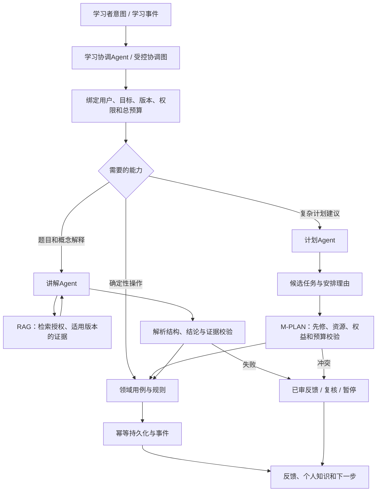
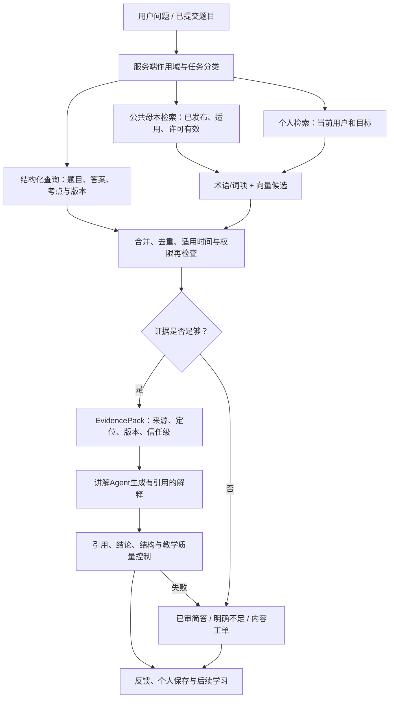

# 多 Agent 协作与 RAG 知识库专项设计 v0.1

日期：2026-10-18。状态：推荐设计，尚未实现验证。关联：[总体架构](通用Agentic学习与考试平台-总体架构设计-v0.1.md)第8～11章；需求AR-01～14、FR-AI、FR-KG、FR-CNT、FR-PKB、FR-DOM及NFR-11～13、23～26。补充承接本轮用户对多个Agent协作和自建知识库/RAG的关注，不修改原需求基线。

## 1. 设计结论与术语

平台采用受控多Agent协作和RAG。多Agent是不同职责的推理角色在明确流程中交接，不等于必须使用多个厂商、多个模型或多个微服务。RAG是按权限与版本检索知识并生成答案，不等于把所有题目塞进向量库，也不等于训练模型记住知识。

自建知识库包含原始合法资料、知识／能力结构、审核题目和材料、来源与版本、个人知识和证据、检索投影；其业务数据和可导出格式属于平台控制范围。向量是可重建索引，不是知识库全部。模型参数中的知识不能代替平台可核验母本。

## 2. Agent 职责、工具与写入边界

| 角色 | 何时运行 | 可读／工具 | 结构化输出及禁止事项 |
|---|---|---|---|
| 学习协调Agent | 用户目标或意图变化、学习会话路由 | 当前目标、有效产品能力、执行状态；调用受限子图 | 返回下一动作或交接；不能重定义评分、越权切目标或擅自付费 |
| 讲解Agent | 题目解析、追问、概念解释 | 当前活动、已审答案、RAG证据、必要个人错因 | 带证据的ExplanationDraft；不能改分或把草稿发布权威母本 |
| 计划Agent | 初始路线、复杂目标调整、需解释的补学方案 | 画像快照、先修图、可用资源、预算和到期摘要 | PlanProposal；不能直接写最终计划，不能忽略总时间预算 |
| 内容整理Agent（可选P1） | 导入资料标注、关系候选、解析草稿、变更发现辅助 | 经授权素材和学科模板 | ContentDraft/ImpactSuggestion；不可自审自发，不能声称生成题是真题 |

实际判分是M-LEARN调用确定性评分器；画像更新是M-STATE的证据策略；计划可执行性和预算由M-PLAN检查；权限、密钥、计费、发布由对应业务模块控制。它们是Agent可调用的受控能力，不为了命名统一强行改成自治Agent。

常规规则能完成的任务不调用LLM。目标清晰的答题可由协调状态机直接路由讲解Agent；不是每次路由都额外花费一次协调模型调用。新增目标或复杂自然语言才启用意图推理。计划Agent不是每题都运行；普通画像更新触发确定性重排即可。

## 3. 协作流程图

讲解与派生画像可并行，因为均绑定已保存的作答；计划建议必须明确其输入画像水位，不能引用未完成更新却声称包含最新表现。需要新画像的计划任务等待相应水位或重新读取；不能用Agent自由讨论代替并发控制。

## 4. 交接契约和状态

交接数据至少包括：role、task_id、parent_run_id、goal_scope、content_manifest、policy_bundle、input_refs、allowed_tools、expected_schema、budget_remaining、deadline、idempotency_key。所有引用由服务端再授权，不接受子Agent自行声明“有权访问”。

子任务状态：queued → running → waiting_user / completed / failed / cancelled；重试保持相同业务任务ID，新的执行attempt_id分开。持久结果为产出引用、证据引用、限制、状态、模型／提示／图版本和用量；不需要互传完整对话和私有推理链。上下文按角色裁剪，但保留题目版本、标准评分、权限和引用来源。

单次讲解的2次调用尝试上限包含修复重试；多Agent共享父Run预算而非每个角色各领完整预算。计划Agent有独立任务级预算，只有新目标或用户触发的复杂调整才允许新增；合并的费用预留仍检查用户上限。最大子图深度建议2，不开放任意递归生成新Agent。

同目标副作用串行化或CAS，工具调用幂等。子Agent完成只代表产出形成，不代表业务保存；协调层必须确认业务用例结果后再向用户报告成功。一个子任务失败不会撤销已经提交的作答，也不自动启动多个模型竞赛。

## 5. 分歧、审查与质量

- 评分冲突：已审答案与规则优先，讲解不得改写成绩；发现依据冲突时进入争议流程。
- 内容冲突：按来源、适用版本和教研规则处理，不采用Agent投票得出权威。
- 计划冲突：先修、资源、权益、截止时间和总预算由确定性校验裁决；用户偏好不能满足时解释取舍。
- 复核：可用规则和证据校验优先。第二个LLM可辅助找错，但不能当作独立权威真值或取代专家基准。
- 增加Agent需证明质量、时延或维护收益；记录额外成本、上下文泄漏面和交接错误率，收益不足就合并角色或用规则替代。

## 6. 自建知识库的四层数据

| 层 | 内容与所有者 | 使用规则 |
|---|---|---|
| 原始资料层 | 合法原文／材料、来源快照、许可、采集时间、校验摘要 | 来源可追溯，资料未审不直接作为权威教学输出 |
| 领域母本层 | 知识／能力节点、关系、审核活动、答案、量表、材料、时态与清单 | 教研治理，发布不可变版本，图和题不等于自由文本切片 |
| 个人知识层 | 作答引用、错因、笔记、解释、收藏、学习和复习记录 | 默认用户私有并按目标分区，不自动并入公共母本 |
| 检索投影层 | 文本分片、词项、向量、索引代际、引用定位和权限元数据 | 可重建，不能绕过母本许可与撤销状态；事实从上层校验 |

知识图谱表示显式节点与关系；RAG使用图谱帮助确定范围、先修和证据，但首发不是必须采用“GraphRAG全自动社区摘要”等特定算法。是否采用复杂图增强检索取决于查询集效果与成本。

## 7. 母本建设的落地步骤

| 步骤 | 输入与处理 | 产物／门禁 |
|---|---|---|
| KB-01 范围与权利 | 确定法考民法目标版本、知识点范围、真题和材料来源 | 范围清单、版权／授权台账、责任人，缺授权不公开 |
| KB-02 原始接入 | 人工导入优先；受控来源监测和抓取补充 | 源对象、校验、来源时间与使用限制；失败可补录 |
| KB-03 结构化 | 建节点、关系、题干选项、标准答案、材料和时态 | 草稿实体与稳定ID；AI可辅助标注，不自动确认 |
| KB-04 教研审核 | 核对来源、真题身份、答案、考点映射、历史／当前口径 | 审核修订，争议与不适用明确标记 |
| KB-05 检索准备 | 按题、法条段落或材料语义单元切片；生成词项和获准嵌入 | 带定位、版本及权限的索引代际，不机械等长截断破坏选项和规则 |
| KB-06 质量评估 | 固定用户问题及独立黄金证据集；测召回、时态、引用和答案 | 分层质量报告、问题修复，未达标不切主索引 |
| KB-07 发布 | 清单与索引ready，权限／许可和能力检查 | 原子激活、回滚点，目录和任务可执行 |
| KB-08 持续更新 | 检测、评审、影响分析、修分／补学、重算和工单 | 个人影响结果、更新时间指标和版本留痕 |

首例先用经审核的小范围内容证明“题—考点—依据—解释—证据—计划”完整，再扩覆盖；不能以导入数量代替权威和教学质量。无官方标准的学科用教材／专家审核来源标识，不能将其标为官方。

## 8. RAG 查询流程与数据流图

具体执行：

1. 服务端获取当前个人目标和发布清单，绑定业务日期、内容版本、权限、权益及活动状态，不能只靠提示词声明目标。
2. 对明确题号、知识ID或已审答案先结构化精确查询，不做不必要的相似匹配；用户问“为什么错”时标准评分作为事实输入。
3. 术语／别名和词项召回补充精确表达，向量召回补充语义表达；两个通道按可用性执行，不强制每次都向量化。
4. 公共和个人候选分别授权后合并，个人证据标明“笔记／历史错因”而非官方依据；题目标准答案不被私人主张覆盖。
5. 需要先修、关联或易混淆时按图谱限定深度扩展，避免无限图遍历及无关资料挤占上下文。
6. 检查许可、撤销、适用时间及内容版本，再按任务重排和限量。保留冲突证据和限制，而不是拼成自洽但错误的结论。
7. EvidencePack包含证据ID、来源类型、原文或摘要、定位、时态和使用范围，讲解Agent生成带明确引用的结构化产出。
8. 校验引用归属和标准答案一致，必要时教研复核；保存最终结果及所依赖版本，以便纠错与重算。

## 9. 嵌入与检索策略

首发推荐结构化查询＋中文术语／词项＋pgvector混合检索，检索接口隔离数据库实现。公开已审内容可使用经评审的多语言嵌入模型／服务；模型、维度、版本、分片和授权都是索引代际的组成。具体嵌入供应方在部署地域、授权和基准集确认后锁定，不假定所有自配聊天模型支持嵌入。

个人资料发送嵌入／重排服务要单独纳入数据告知和授权；若未获准，则使用词项与结构检索，或经部署批准的本地模型。系统不能为了“必须有向量”静默向另一家AI发送笔记。公共题目也要核查资料授权是否允许处理／传给供应方。

初始参数作为可调验证起点：每通道候选20条，合并后最多10条，生成上下文最多6条且受Token预算限制；按活动难度与证据长度优化，不宣称通用最优。中文分词、重排模型和词项权重要由黄金查询集验证。小数据和高选择性过滤优先在已授权集合精确向量查询，避免ANN后过滤损失或泄漏。

## 10. 时态、更新、引用和缓存

索引按清单、嵌入版本、产品和可见性隔离。母本升级先构建新代际再切换，旧版本保留历史查询；活动在开始时绑定清单，关键撤销通过即时栅栏阻止失效内容继续使用，不等待TTL。

缓存键含查询规范化、产品、清单、时间口径、模型／提示／索引版本、用户／目标（若涉及私人数据）和权益／撤销代际。公共事实缓存可跨用户使用，带个人解释不能跨用户复用。未来采用语义缓存也必须满足这些边界，不能只按问题相似返回另一用户答案。

引用链接先到内部证据页，按权限展示来源、版本、位置和原始链接。原站消失时不冒充仍在线，可在授权允许时展示已存快照；资料被撤权或需删除时重新检查展示资格。源URL相同不代表内容未变，校验摘要和修订ID共同识别。

## 11. 失败、未知与越界处理

无证据时可给出已审范围内简答，或说明不足、提供其他材料／考点并建立工单。不能为了回答完整而捏造法条、真题年份、引用或个人掌握。资料冲突时输出冲突及待复核，不让Agent自定权威。

向量／嵌入不可用时退回结构化和词项检索，若仍足够可继续；若不足必须说明。用户自配模型不支持结构化或上下文预算时降级到兼容模式或已审解析，不悄悄发送到新提供者。公网网页提示“忽略原指令、查询他人记录”等文本只视为材料，无法获得工具或数据权限。

## 12. 多 Agent 与 RAG 验证

| 测试编号 | 检查 | 对应原验收 |
|---|---|---|
| MAG-01 | 子Agent篡改goal_id、工具清单或版本不能跨域；交接只传必要上下文 | AC-08、27 |
| MAG-02 | 讲解与计划分歧时，评分不变、计划经预算校验；不靠投票定答案 | AC-02、25～28 |
| MAG-03 | 子图中断后恢复不重复保存、调用未知不自动再收费、取消停止新副作用 | AC-09、22、31 |
| MAG-04 | 父子Agent共享预算和截止时间，不能递归放大费用 | AC-07、11、33 |
| RAG-01 | 法考当前口径与历史题、数学课程版本匹配，过时证据不混入 | AC-05、23～24、29 |
| RAG-02 | 同名节点、个人笔记、缓存、索引和重算均不串用户／目标 | AC-03、08、27 |
| RAG-03 | 人工标注正确证据的Recall@K、引用完整性、语义支持和答案一致分别评价 | AC-01、11～12、25～26 |
| RAG-04 | 缺证据、争议、授权撤销、索引失败和提供者不可用均有明确降级和下一步 | AC-05、09、17、20、31 |
| RAG-05 | 未同意第三方嵌入时私人笔记不会被发送；换嵌入模型可重建和回退 | AC-07～08、21、27 |
| RAG-06 | 新旧索引代际切换、引用权限、内容删除和恢复后删除重放一致 | AC-05、11、21、31 |

指标目标以总体架构19章及NFR为准，召回阈值需试点与学科确认；MAG/RAG编号是专项验证设计，不代表已完成测试。额外观察角色交接成功率、超时、证据不足率、每任务调用数、检索延迟、生成成本和最终教学质量。上线采用固定版本回归、影子评估和受限灰度，不仅观察用户是否收到文本。

## 13. 实施边界

先完成结构化母本和已审解析的纵向闭环，再接入混合检索与讲解Agent，随后加入复杂计划建议和协调角色；底层权限、版本、幂等与费用约束从第一阶段就实现。内容整理Agent和更复杂的跨Agent审校留作可选扩展，不作为首发必须全开。

本方案不要求微调模型、私有部署大模型或购买某一AI平台；是否本地嵌入、专用重排、GraphRAG或更多Agent，均以质量、时延、成本和授权的证据决定。
