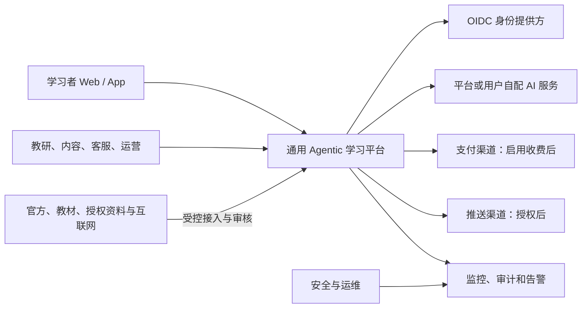
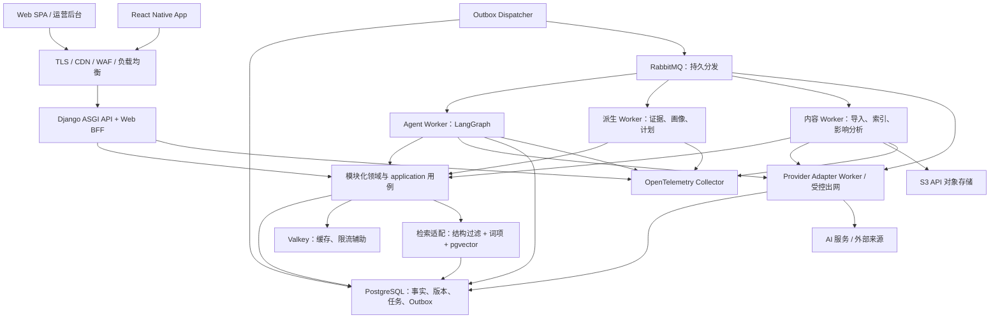
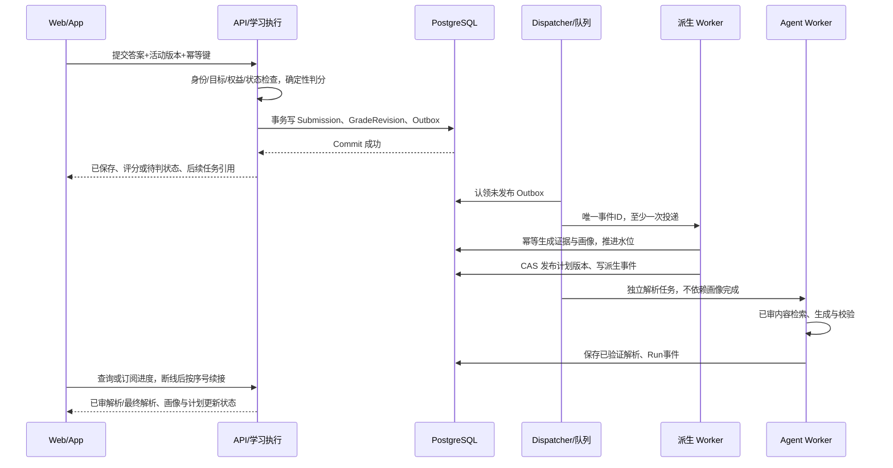
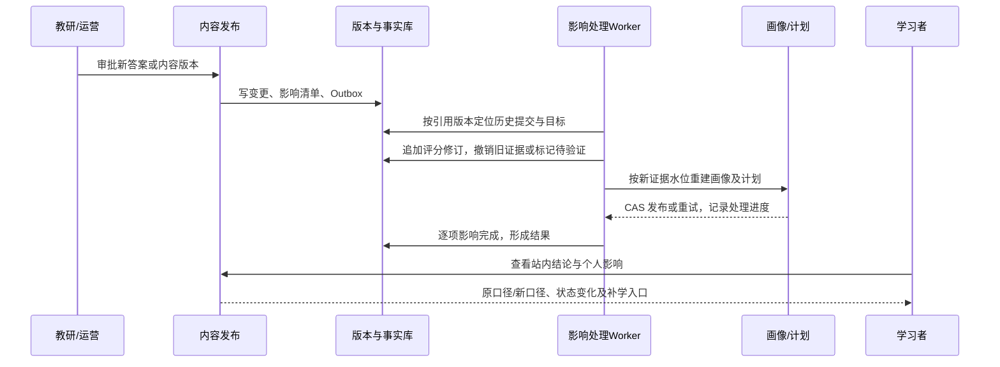
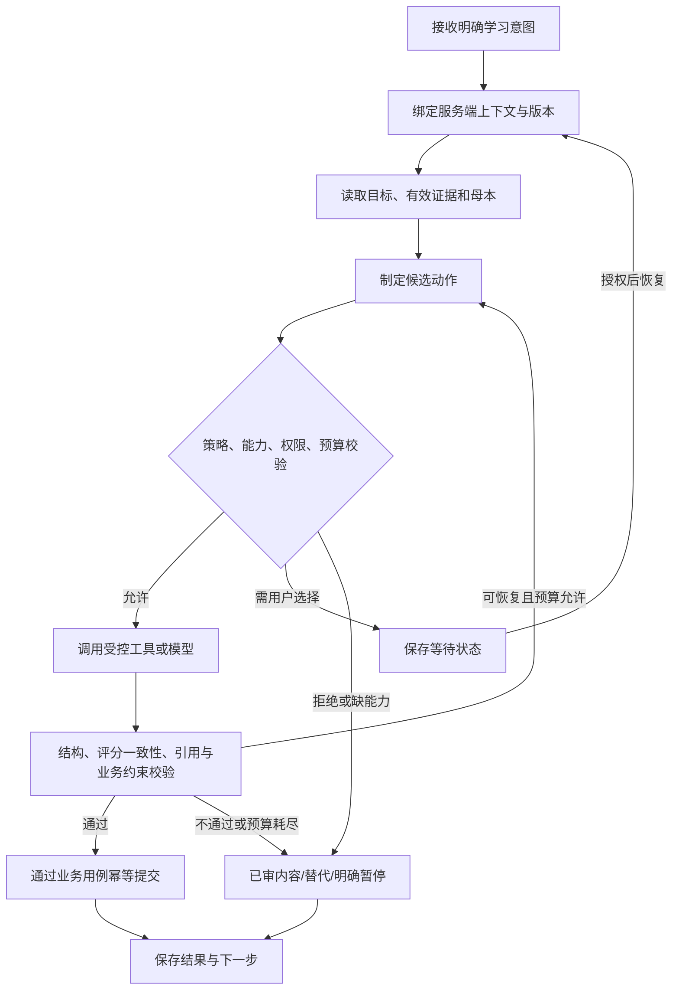
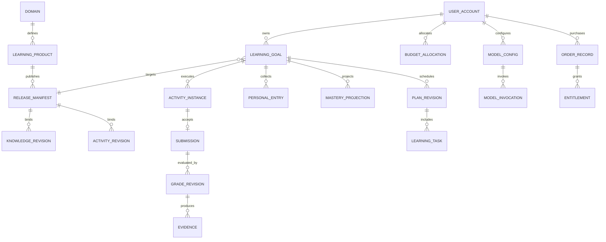
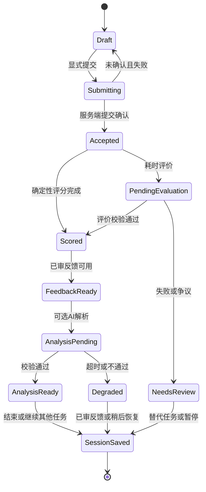
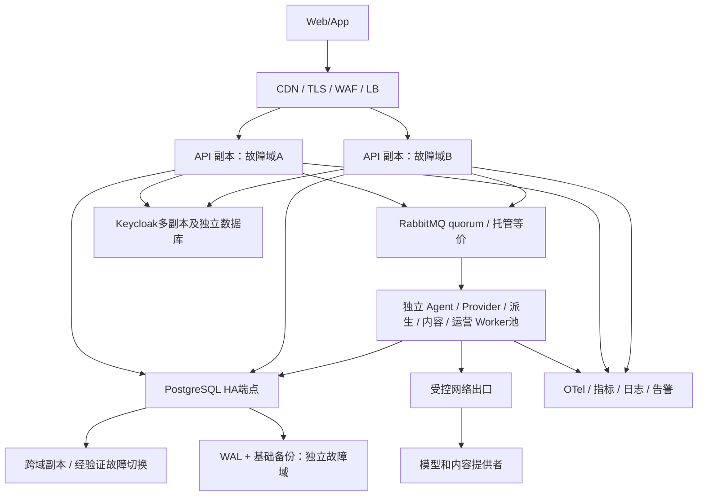

# 通用 Agentic 学习与考试平台——总体架构设计 v0.1

| 属性 | 内容 |
|---|---|
| 日期 | 2026-10-18（America/Los_Angeles） |
| 状态 | 架构评审稿；给出可实施的推荐基线，尚未经过代码 PoC、压测或生产演练 |
| 需求基线 | [通用平台需求 v0.1](../requirements/通用Agentic学习与考试平台-系统需求规格说明书-v0.1.md)；原法考实例要求继续有效 |
| 范围 | 通用平台首发、法考民法实例、受限第二实例验证，以及明确触发条件的演进 |
| 受众 | 产品、UI/UE、教研、内容运营、前后端及移动开发、AI/数据工程、测试、安全、运维、商业运营 |
| 设计性质 | 基于需求的新系统目标架构，不是对现有生产系统的描述 |
| 确认边界 | 用户已确认开始架构设计；本文技术选择与业务参数属于推荐设计，不能将需求中的待定项视为已确认 |

<a id="arch-01"></a>

## 1. 文档说明与架构摘要

### 1.1 总体方案

采用**模块化后端、独立后台任务、受控多 Agent 编排、RAG、版本化领域配置、证据驱动学习状态**。首发一套 Python 业务代码按职责模块化，API、Agent Worker、派生数据 Worker、内容 Worker 分进程部署，允许独立扩容；不把每个业务模块都部署为微服务。

Web 使用 React SPA，移动端使用 React Native/Expo；共享领域类型、API 客户端和设计 Token，各端保留适合自身的交互与组件。后台复用 Web 工程的独立应用，审核发布等流程提供专门页面。

PostgreSQL 是业务事实、版本和任务状态的权威存储；图谱先以关系表表达，pgvector 提供语义召回；RabbitMQ/Celery 承担工作分发，Outbox 和幂等消费保证业务变更可恢复；Valkey 仅作可重建缓存及近实时信号。Agent 使用 LangGraph 的状态图和持久化检查点，业务事实不存放在会话记忆中。[LangGraph 持久化说明](https://docs.langchain.com/oss/python/langgraph/persistence)提供检查点能力依据；具体一致性和授权措施是本项目设计。

### 1.2 不变量

- 用户、产品、个人目标、内容版本和策略版本共同确定一次学习的上下文，服务端强制校验。
- 已确认作答先持久保存；确定性判分不等待大模型。画像和计划可异步，必须显示更新状态。
- 原始事实、评分修正、有效证据、掌握估计和计划分别保存与版本化，不能相互覆盖。
- 系统母本是共享定义；个人知识库是引用加个人内容；画像是证据驱动的派生状态。
- 学科包可以配置教学差异，不能修改平台授权、计费、事实保存或数据隔离规则。
- 学习完成不等于掌握；没有合适题目或评价能力时保留待验证状态并提供下一步。
- 统一接口不等于统一评分公式；跨学科分数不能直接合并为“通用能力总分”。

### 1.3 文档包与阅读路线

| 文件 | 用途 |
|---|---|
| 本文 | 23 个架构视角、模块、关键运行流程、质量实现和落地路线 |
| [架构决策记录](adr/架构决策记录-v0.1.md) | 主要选择、候选、依据、后果及重审条件 |
| [多Agent与RAG专项](多Agent协作与RAG知识库设计-v0.1.md) | 协作角色、交接契约、知识库建设、混合检索、安全及评估 |
| [核心契约](contracts/核心数据与接口契约-v0.1.md) | 命令、事件、评分器、学科包、版本及并发规则 |
| [运行与恢复手册](运行与恢复手册-v0.1.md) | 告警、恢复、回滚、对账与删除处理的操作设计 |
| [需求追溯与验证矩阵](verification/需求追溯与验证矩阵-v0.1.md) | 逐条需求、旅程、验收和架构落点；区分设计映射与实施证据 |
| [文档检查报告](verification/文档检查报告-v0.1.md) | 编号、链接、覆盖、图结构及一致性检查结果 |

产品和 UI/UE 优先读 2、4、7、14、20、22；开发读 5～13、15、18 及契约；测试读 3、7、16、19 和矩阵；运维读 6、15～18 及运行手册；教研读 9～11、19、22。图采用 Mermaid 描述目标架构，正式实现后以代码、部署及运行证据更新。

<a id="arch-02"></a>

## 2. 干系人与架构关注点

| 角色 | 关键问题 | 架构交付与责任 |
|---|---|---|
| 产品经理 | 每条旅程有下一步吗，范围和权益是否明确 | 目标模型、状态和功能开关；定义 T 项业务规则、发布范围和成功指标 |
| UI/UE | 用户能否理解等待、未知、争议和恢复 | 信息架构、页面状态契约、跨端交互、可访问性；原型走查与设计验收 |
| 教研／学科负责人 | 内容依据与掌握标准是否可靠 | 学科包、来源分级、评分和证据策略、质量集；审核、争议及版本发布 |
| 内容运营 | 如何补题、更新、撤销和通知 | 内容工作流、影响清单、发布门禁、工单责任及超时升级 |
| 后端／数据开发 | 模块边界和一致性如何保证 | 数据所有权、事务、事件、幂等、重算和迁移契约 |
| AI 开发 | 模型如何可换、可评估、可恢复 | Agent 图、能力协商、校验器、凭据边界、版本与评测 |
| Web／移动开发 | 如何共用能力而保持体验 | 共享 API 和类型、双端状态、认证、恢复点、兼容策略 |
| 测试 | 怎样发现跨域污染、虚假掌握和重复收费 | 分层测试、数据基准、模型评估、故障注入和阻断门禁 |
| 安全与运维 | 如何隔离、监控、限额、恢复 | 威胁模型、网络及权限边界、SLO、告警、备份和手册 |
| 商业／客服 | 权益、费用、退款和学习记录如何协同 | 价格快照、账务对账、成本归属、支持工单与最小访问 |

每个跨角色交付均指定责任角色和验证产物，实施排期时补姓名，不用“由技术负责”替代业务规则确认。

<a id="arch-03"></a>

## 3. 架构驱动因素

### 3.1 质量优先级与假设

首发优先级依次为：学习事实与评分正确、数据和凭据隔离、业务可恢复、内容可信与时态、完整学习体验、成本及扩展效率。性能目标不得通过跳过持久化或授权实现。

| 假设 | 设计采用的工作基线 | 决策依赖 |
|---|---|---|
| A-01 | 首发单运营主体、单地区部署；多用户与多产品隔离 | 不是机构多租户；若增加机构，先补组织、委托授权、隔离与合同模型，T-09、11 |
| A-02 | 初始压测 100 个同时活跃会话、20 次提交/秒的短时突发 | 不是真实业务预测；测试持续 10 分钟突发及 60 分钟常态，T-07 |
| A-03 | AI 独立并发初始上限 10，排队有界，按服务商和用户限额 | 满载时不能保证所有请求 5 秒反馈；拆开排队、调用和降级指标，T-05、07 |
| A-04 | 首例法考民法客观题；第二验证实例暂按基础代数先学和数值题 | 目标范围仍由 T-01、13 决定；非商业小样本即可验证抽象 |
| A-05 | 部署采用支持 PostgreSQL 18/pgvector 的托管服务或同等运维能力 | 具体云和地区待定，禁止将任一厂商可用性视为已确认 |
| A-06 | 教研提供审核题、材料及评估策略；平台不自动制造权威 | 内容授权、人员和工作时效是上线依赖，T-02～04、16 |

建议性能、可用性、RPO/RTO 原值保留于第 16 章，并标注验证前提。暂不把 100 会话或 20 QPS 推导为注册量、付费人数或长期存储规模。

### 3.2 可验证质量场景

| 场景 | 刺激 → 响应 | 关键验证 |
|---|---|---|
| QS-01 | 提交后进程崩溃 → 查询同一幂等键仍返回唯一保存结果 | 作答与 Outbox 同事务，断点注入 |
| QS-02 | 模型超时 → 已审解析与答题可用，任务可恢复 | 不丢事实、不自动改付费服务 |
| QS-03 | 用户切换目标 → 检索、证据和画像随目标隔离 | 同名节点、缓存和并发重算测试 |
| QS-04 | 答案修正 → 评分、证据、画像和计划可重算并解释 | 保留原评分，重算有水位与状态 |
| QS-05 | 产品／评价器下架 → 阻止新增活动，存量有替代 | 不影响其他学科；权益影响可核对 |
| QS-06 | 数据灾难 → 按恢复点恢复并重建可派生数据 | 计时恢复演练；不宣称灾难下绝对零丢失 |

<a id="arch-04"></a>

## 4. 系统上下文与边界



边界 B-01：客户端到 API，客户端输入不可信，目标和所有者必须从认证及服务端关系校验。B-02：业务到模型／互联网，数据按授权最小化，外部文本不具指令权限。B-03：内容草稿到权威发布，需要来源、授权与教研审批。B-04：异步任务到业务写入，任务携带对象引用而非任意数据库写权限。B-05：客服与运维到用户数据，按职责授权，访问审计，不提供无理由全量聊天读取。

学习产品、学科和用户目标不是租户。平台统一身份下建立目标分区，不为每个产品或用户创建身份 Realm。支付和推送是可选外部能力，关闭时学习主体功能仍可执行。

<a id="arch-05"></a>

## 5. 业务与领域架构

### 5.1 模块边界与数据所有权

| 模块标识 | 职责／权威数据 | 对外能力／主要事件 | 失败与验证责任 |
|---|---|---|---|
| M-ID 身份与授权 | 本地用户、身份映射、会话、偏好、授权、注销状态 | Principal、Consent、Authorize；AccountDisabled | 越权测试、会话失效；不保存明文密码和模型密钥 |
| M-CAT 学科与产品 | 学科、学习产品、目标标准、学科包清单、发布与下架 | Catalog、ResolveManifest；ProductPublished/Retired | 配置和能力门禁、版本回滚 |
| M-CONT 内容母本 | 来源、许可、图谱、题目、答案、量表、材料、审核与内容版本 | ApprovedContent、ImpactSet；ReleaseActivated/CorrectionApproved | 授权失效与争议隔离、发布校验 |
| M-LEARN 学习执行 | 个人目标、会话、活动实例、提交、评分修订、材料进度 | Submit、Grade、Resume；SubmissionAccepted/GradeCorrected | 原始事实不可变、重试去重、判分测试 |
| M-STATE 学习状态 | 证据、个人知识条目、掌握投影与画像快照 | ApplyEvidence、ExplainMastery；MasteryChanged | 独立验证、证据撤销和重算，不回写原始作答 |
| M-PLAN 学习调度 | 计划版本、任务、复习安排、总预算和目标分配 | Build/RevisePlan、DueTasks；PlanRevised | 时间冲突、并发重排、到期与时区 |
| M-AGENT Agent 运行 | Agent Run、步骤、检查点引用、工具日志、产出校验状态 | Start/Resume/CancelRun；RunProgress/RunCompleted | 无界循环、故障恢复、授权工具验证 |
| M-AI 模型与网络 | AI 配置、凭据引用、提供者能力、调用、预算预留与用量事实 | Invoke、RetrieveExternal、CheckCapability | 凭据和网络隔离、调用不确定结果、预算 |
| M-BIZ 权益与账务 | 套餐版本、权益、订单、账务项、退款与对账 | CheckEntitlement、Reserve/Settle；EntitlementChanged | 防重复发放／收费、金额核验 |
| M-OPS 运营与治理 | 反馈、补充工单、审核流、通知偏好引用、审计、导出删除编排 | Open/ResolveCase、Notify、DataRequest | 工单有责任和结果；不绕过各数据所有者写入 |

### 5.2 依赖约束

API 与 Worker 都调用 application 层用例；domain 仅依赖自身规则和端口；infrastructure 实现数据库、模型、消息和网络端口。跨模块通过公开 application 接口和事件，禁止跨模块 ORM 对象直接修改。允许同数据库受控读模型，但跨域聚合查询只读并显式声明，不靠任意 Join 形成隐性写耦合。

评分调用由 M-LEARN 发起、使用 M-CAT 的已发布规则和 M-CONT 的答案版本；M-AGENT 没有改写标准答案的工具。M-STATE 从有效证据更新画像；M-PLAN 根据画像版本和预算生成计划；Agent 可提出候选任务，M-PLAN 检查可执行性后持久化。

### 5.3 平台、学科包和实例

平台统一事实、上下文、状态、授权、事务及费用；学科包配置术语、关系类型、评分器引用、证据／掌握／复习策略、来源等级和更新频率。评分器由版本化适配实现，不能在配置中执行任意脚本。法考包采用确定性选项评分与法律时态；代数验证包采用概念和运算维度、数值容差。核心流程不得出现 `if subject == 'law'` 这类教学差异分支；能力和策略注册表负责分派。

<a id="arch-06"></a>

## 6. 总体逻辑与组件架构



这是逻辑组件图，Modules 是代码边界，不是独立网络服务。Gateway包含共享的能力与适配契约、网络出口策略，以及专门的Provider Adapter Worker。API只有凭据加密写入权限，Agent通过持久化Invocation调用该Worker；只有该Worker进程身份具备限定的KMS解密和模型出网权限。它是同一代码库的独立受限进程池，不是首发额外建设一套通用AI网关产品。只有 API/流式查询面接收客户端请求；Worker 不暴露公网端口。

Celery 负责把已持久化业务任务送到进程执行；LangGraph 管理一次 Agent 内的步骤与检查点；业务数据库 task/run 记录负责生命周期与可恢复性。三者职责不可混用：消息成功不等于学习完成，检查点存在不等于业务副作用已提交。

初始独立队列为 `derive`、`agent`、`provider`、`content`、`ops`；分别设并发、超时、背压和公平配额。定时任务由单主租约 Scheduler 扫描数据库 `due_at`，只发布到期工作，不将数月复习任务塞进消息队列倒计时。

<a id="arch-07"></a>

## 7. 用户旅程到运行架构

### 7.1 旅程映射

| 旅程 | 主要参与组件 | 持久产物／下一步 | 异常回路 |
|---|---|---|---|
| UJ-01 首次进入 | ID、CAT、BIZ、AI、LEARN | 目标与授权，进入诊断或先学 | 无模型进入已有权益的已审内容 |
| UJ-02 建立起点 | LEARN、CONT、STATE、PLAN | 作答、初始画像和计划 | 未知／跳过不当普通错题；缺题建工单 |
| UJ-03 日常学习 | LEARN、AGENT、CONT、STATE、PLAN | 解析、笔记、材料进度、巩固任务 | 解析失败保留已审结果与继续入口 |
| UJ-04 到期复习 | PLAN、LEARN、STATE | 复测证据、保持状态、新到期时间 | 无独立证据保留待验证 |
| UJ-05 目标变化 | LEARN、CAT、STATE、PLAN | 目标和计划新版本 | 旧证据需映射检查，不机械继承 |
| UJ-06 接续 | ID、LEARN、AGENT | 恢复点、摘要、待处理状态 | 草稿与已确认提交区分，多端冲突提示 |
| UJ-07 更新争议 | OPS、CONT、LEARN、STATE、PLAN | 结论、评分修正、撤证与重算 | 争议活动替换，原记录保留 |
| UJ-08 服务变化 | AI、AGENT、BIZ、LEARN | 失败状态、可选替代与恢复 | 费用或提供者改变需相应授权 |
| UJ-09 资源不足 | CONT、OPS、PLAN | 内容工单、替代任务与回流 | 补齐后重新验证，不冒充真题 |
| UJ-10 付费退出 | BIZ、OPS、ID、AI | 权益、对账或数据请求 | 失去权益不改历史事实 |
| UJ-11 阶段结束 | STATE、PLAN、LEARN | 阶段快照、维护／暂停／新目标 | 到日期不自动认定考试通过 |
| UJ-12 非考试先学 | CAT、CONT、LEARN、STATE、PLAN | 过程证据、受控验证及复习 | 无评分能力待验证，不填假考试日期 |
| UJ-13 多目标 | CAT、STATE、PLAN | 分区画像、统一预算分配 | 不同量表不合分，无映射不转移证据 |
| SJ-01 新学科 | CAT、CONT、OPS、AI、LEARN | 学科包、验收及可见目录 | 草稿／试点与正式发布区分，下架影响闭环 |

### 7.2 提交到计划更新的关键时序



确定性评分在短事务前完成纯计算，事务中再检查活动和内容的可评分状态及版本栅栏，避免校验后被撤销仍提交。原始提交与评分修订同事务；耗时开放评分先持久写待评价任务，再独立计算和保存版本化结果。题目不可用时返回明确冲突或争议状态，保留可恢复草稿，不伪装成已有效判题。

### 7.3 答案修正与内容更新



影响工单只有在已修分／判定无需修分、证据处理、画像／计划处理、结果可见均有状态时才关闭；大批量处理显示进度，故障可从游标续作。更新法律规则不必改变历史正确评分，可能仅触发新版本待学习，具体由教研变更类型决定。

### 7.4 恢复、暂停与商业回流

| 触发 | 处理 | 用户可见结果 |
|---|---|---|
| 网络中断／重复提交 | 以幂等键查已有结果，未确认的草稿仅本地暂存 | 明确“未提交”“已保存”“分析中” |
| 画像／计划异步滞后 | 展示事实已保存和最后完成水位，重试或后台修复 | 不把旧画像当成本次已更新 |
| 学习材料失效／无题 | 工单带责任与范围，换材料或相关节点 | 待验证和继续学习入口 |
| 模型或密钥失败 | 不抹除事实；重试、已审解析、授权切换或暂停 | 费用与数据目的地变化可见 |
| 学科包／评分器下架 | 冻结新增实例；在学任务按策略替代或暂停 | 影响、历史访问、权益处理和恢复路径 |
| 支付成功 | 先处理唯一订单／权益，再返回受保护的原任务路由 | 失败可刷新权益，不重复下单 |
| 阶段结束／目标日期到达 | 保存快照；让用户选维护、调整、暂停或结束 | 不自动认定掌握或考试通过 |

<a id="arch-08"></a>

## 8. Agentic 与多 Agent 协作架构

### 8.1 编排图与权限



首发采用一个学习协调图，编排学习协调Agent、讲解Agent和计划Agent三个逻辑角色；讲解和计划分别作为有独立指令、上下文、工具权限和输出schema的子图，在需要其推理能力时执行。各Agent可使用同一个模型，也可按能力使用不同模型，首发不要求各自部署网络服务。常规到期计算和计划排序由确定性模块完成，不为每次答题额外启动所有Agent。确定性选题约束、评分、授权和预算在模型之外执行。工具只接收受限对象引用和参数，无原始 SQL、任意代码或不受控 URL 执行工具。

可用工具示例：`get_goal_context`、`find_approved_activities`、`get_approved_explanation`、`explain_attempt`、`propose_learning_tasks`、`save_personal_note`、`get_due_reviews`。`publish_master_content`、`change_standard_answer`、`charge_user` 不作为普通学习 Agent 工具。用户明确提交答案可调用受控提交用例，不通过自然语言推断暗中替用户答题。

### 8.2 上下文、记忆与恢复

`ExecutionContext` 至少包含 principal、user_id、goal_id、domain_id、product_id、manifest_id、content_release_id、policy_bundle_id、consent_version、budget_reservation_id、run_id。身份与作用域由服务端构造；模型参数中的 user_id 不作授权依据。

- 会话上下文：当次意图、题目引用和对话摘要；可裁剪，不包含密钥和标准答案的提前泄露字段。
- 检查点：图步骤、输入引用、已完成工具调用 ID、图版本与等待原因；PostgreSQL 独立 schema，禁止将检查点作为业务事实源。
- 长期知识：个人笔记、证据、偏好由业务模块查询；不默认写入框架的跨用户共享记忆。
- 审计：保存版本、工具摘要、结果和成本，不保存模型私有推理链；模型自然语言理由不能替代可验证业务依据。

重启时扫描过期执行租约，从最近检查点恢复；恢复的工具调用带原幂等键。图版本变化时优先由原版本 Worker 完成；不兼容则显式迁移或终止为可恢复任务，不把旧检查点直接交给新图解释。等待用户的 Run 不占用 Worker；取消写入 cancel_epoch，每个副作用前复检，已提交事实不回滚成“从未发生”。

### 8.3 模型能力与输出校验

提供者能力声明与探测分开记录：文本、结构化输出、工具调用、上下文、流式、费用规则、超时和数据地域。自配不兼容端点标记能力缺口，不假设所有接口都兼容某一协议。

最低支持两种经验证的接入路径：一种兼容聊天接口的自配端点及一种具有不同消息／工具契约的官方服务适配；供应方和地区是否允许仍由 T-05、09 决定。用户端点仅允许 HTTPS、受限端口和标准路径模板，不能让请求头或模型响应重定向内部网络。

解析先校验 JSON 结构、题目和规则版本、结论与标准评分一致、引用 ID 属于当前允许证据。程序校验能证明引用存在，不能证明每句话的教学正确性；语义支持和教学质量通过审核内容、抽样专家复核及独立基准评估。校验失败最多修复一次，随后回退已审解析并建立质量事件；具体阈值为可调整架构默认。

首发流式先展示已审简要反馈和业务进度，模型原始 Token 不直接当权威解析显示。完整生成内容经过验证再发布；若后续支持逐段生成，必须按段校验、标明状态并有撤回方案。

### 8.4 调用预算与不确定副作用

每个 Run 采用截止时间、最大步骤、工具次数、重试次数和费用预留；建议标准解释最多 8 步、单提供者同时调用 1 次、总调用尝试最多 2 次、总任务期限 45 秒，且受 30 秒标准解析体验目标约束。超过体验预算先降级，剩余后台任务仅在用户允许的范围和预算内继续。参数需在基准集上校准，不是默认收费承诺。

外部模型可能已扣费但网络结果未知，平台不能保证第三方“恰好一次”。记录 `outcome_unknown`、保留调用 ID 和预算预留，优先查询提供者结果；不支持查询或幂等键时不得无限重试或自动向用户重复结算。费用归属按购买时规则处理，必要时人工对账；取消不意味着提供者必定未产生费用。

### 8.5 多 Agent 交接与结果裁决

协调Agent负责绑定目标和任务路由，讲解Agent只输出带证据的解析，计划Agent输出候选任务与安排理由；业务用例完成校验、冲突处理和持久化。工具级上下文不可由子Agent任意改写，子图不继承主图全部权限。内容整理Agent仅作为后续可选后台能力，产出草稿，必须经过教研审批。

交接包含task_id、parent_run_id、role、目标作用域、版本、允许证据引用、预算、截止时间、期望schema和幂等键；结果包含状态、产出引用、证据、限制、用量和建议下一步，不传递私有推理链和密钥。角色分歧依据已审评分与来源处理，不用多数投票定义真理；计划冲突交M-PLAN预算和先修规则裁决，无法解决则显式待选择。详见多Agent与RAG专项。

<a id="arch-09"></a>

## 9. 内容母本与 RAG 检索架构

### 9.1 内容生命周期

原始素材进入对象存储隔离区，记录来源、抓取时间、摘要校验、权利范围、适用标准和业务有效时间。经清洗、去重、解析、考点／能力映射、答案和材料审核后形成不可变内容修订。自动标注只产生草稿，不直接发布权威内容。

发布采用不可变 `ReleaseManifest`：引用学科包、知识版本、活动、答案、材料、策略、索引代际及许可摘要。顺序为草稿 → 内容通过 → 构建并验证索引 → ready → 原子切换 active 指针。未完成索引时保留旧可用版本，不能先发布再让检索随机混用新旧内容。

紧急撤销另有实时 `revocation_epoch`：对授权撤销、危险错误和已禁用活动立即检查并阻止新增分发；不依赖漫长重建索引。下发材料的签名 URL 短时有效，无法保证已下载副本被远程收回，需向运营明确边界。

### 9.2 图谱、题库与个人层

知识节点稳定业务 ID 与内容修订 ID 分开；关系有类型、方向、适用版本、证据和审核信息。包含与先修关系按配置校验循环和悬空引用，关联或易混淆关系可有环。初始图关系使用 PostgreSQL 邻接表、递归查询和受限深度，热点可投影闭包表；不对个人复制公共图。

题目版本引用答案／评分量表、主次知识点和证据归因规则；真题、教研模拟、AI 草稿分别标记。客户端练习题卡不含答案和解析，在授权提交后按策略返回；测评模式可等整卷结束再揭示，规则由产品定义。

个人图由 `goal_node_binding`、个人条目和掌握投影构成，引用公共实体及版本。母本拆分合并产生显式映射；版本迁移不能仅按名称继承掌握。私人笔记和学习解释不自动进入公共检索语料。

### 9.3 检索与证据链

RAG是本平台知识落地的核心组成：检索自建母本和授权个人知识，再让Agent依据证据生成可引用解释。它不替代内容建设、结构化选题、评分和教学评估。

管线为：确定产品／目标／发布版本／时间及权限 → 精确知识 ID 和题目映射召回 → 词项与向量召回 → 合并和重排 → 再授权／撤销检查 → 引用与解释。公共母本检索与个人检索使用不同集合和查询端口，个人检索按用户及目标过滤，最后合并的每条证据标记可信来源。

公共母本与个人内容的嵌入处理分别受数据授权约束；用户配置了文本模型不代表具备嵌入能力或已同意向其他提供者发送笔记。没有获准嵌入服务时，保留结构化／词项检索，个人内容不得隐式发往新服务。具体知识建设和RAG链路见专项。

首发：结构过滤＋审核术语／别名及中文预分词词项表＋pgvector。PostgreSQL 默认分词不能自动解决中文法考检索，需用已审核术语表和固定版本分词器离线构建词项索引，并以中文黄金查询集验收。召回不足、词项规模或排序需求超过基线时才引入专用搜索引擎；没有通过查询集时不得宣称基础检索已满足质量。

向量索引可能在高选择性过滤后召回不足；首例小范围可在授权过滤集合内精确相似度查询，规模上升再选分区／迭代扫描等策略，并测 Recall@K。绝不先不受限召回再让模型过滤私人数据。嵌入模型、维度和分片策略都是索引代际的一部分，更换后双写重建，验证后切指针，旧索引按保留策略清理。[pgvector 官方项目](https://github.com/pgvector/pgvector)是扩展能力与兼容版本核验来源。

引用包含 source_id、content_revision、定位信息、可访问的内部证据页及适用时间；来源 URL 不是稳定身份。已删除或无许可内容不因引用存在继续暴露。模型端实时联网结果可作为未审参考或草稿线索，必须走审核链才能成为公共母本。

### 9.4 内容更新与个人影响

按领域风险分级检查来源；法考关键规则以变更发现、教研评审和发布时间分别计时。更新分为文字纠错、评分修正、规则前瞻变化、授权撤销、考点结构迁移，每类有不同个人影响策略。受影响对象通过版本引用反向索引查询，不遍历所有用户聊天推测。

发布前预计算影响规模、抽检样例和重算成本；发布后按目标分批执行，记录 `impact_job_id`、游标、成功／失败／无需变更。处理期间用户仍能查看旧证据及更新提示；关键争议题暂停新评分或不产生强证据，替换当前任务。通知遵循站内可见、外部渠道另行授权的边界。

<a id="arch-10"></a>

## 10. 学习智能架构

### 10.1 证据与掌握评估

证据对象保存来源提交、评分修订、节点、能力维度、表现、独立性、难度标签、暴露次数、时间、有效性和策略版本。事实、自述和推断分别标识；跳过、不知道、未提交、中断有不同语义，不把它们统一编码为 score=0。

掌握引擎接口为 `evaluate(evidence_set, node_context, policy_version, as_of)`，返回维度估计、业务状态、证据数量、限制、解释引用和下次验证建议。首发采用教研可解释的规则策略：最低有效题数、不同题覆盖、必要复测、近期错误与时间衰减共同约束；具体阈值由 T-04 确认。架构不伪装未经校准的概率置信度，展示证据充分度标签；后续采用 BKT/IRT 等模型需独立校准并新增 ADR。

多知识点题按已审主次考点归因；不把一个错误传播到全部节点。重复同题降低独立证据作用；未见题和延时复测使用独立验证标记，避免学习集与评估集混用。更新触发按用户目标串行化或通过 evidence_seq 高水位 CAS，禁止旧 Worker 覆盖新画像。

### 10.2 个人知识库、画像与报告

个人知识条目支持笔记、错因、收藏、解释、学习总结和资源引用；删除条目与删除作答事实是不同操作。报告区分覆盖、掌握、保持、任务完成及证据不足，说明分母和观察窗口。自愿考试结果单独保存，不能推断为官方认证。

画像可从业务事件与有效证据重建，保存 strategy_version、input_watermark、content_binding、as_of 和 revision。修正时先构建新投影、校验完整性，再 CAS 切换；旧报告保留快照并标记旧口径。被删除用户的原始内容不得为“重建方便”无限保留，重建需过滤 tombstone 和合法保留边界。

### 10.3 计划与复习调度

任务候选来源为薄弱节点补学、到期复习、先修缺口、独立测评、母本更新和用户主动选择。候选先通过发布状态、资源、评价能力和权益检查，再由领域策略排序；同一个人总时间预算内分配各目标。建议先满足到期和关键先修，再安排新内容，具体取舍由配置和用户控制。

材料任务完成只形成过程事件，计划继续安排验证；没有独立题或能力时转待验证／替代，不创建假评分任务。复习周期由学科策略计算，时间存 UTC，用户自然日与日预算按 IANA 时区和夏令时转换；改时区会重算未来提醒而不改变历史提交时刻。

并发重排获取用户周期预算行锁，读取最新各目标预算与 evidence 水位；计划版本通过 `If-Match` 或 CAS 更新。每次发布计划记录增删任务、原因、预计耗时和用户调整，已完成任务不复活。用户第一次接受或主动开始后计划生效；授权范围内微调可撤销，目标范围、费用和服务提供者改变需相应确认。

### 10.4 冷启动、完成与跨目标映射

新用户可诊断、直接练或先学，初始未知不是低能力判决。长期回归保留历史事实，重估保持和积压；目标到期可选择维护、调整、暂停或结束，不自动标记通过。跨目标证据默认不转移，只有审核映射表和策略允许时生成带来源的迁移证据；撤销映射触发重算，绝不复制成无来源的本地成绩。

<a id="arch-11"></a>

## 11. 学科接入与扩展架构

### 11.1 学科包与注册机制

学科包是经过 schema 校验的不可变配置与内容引用清单，含领域／产品、模式、标准版本、关系类型、资源、活动能力、评分器引用、证据／掌握／复习策略、来源和更新等级、支持媒介、可兼容平台版本、负责人。schema 及例子见核心契约附件。

上线步骤：负责人建立草稿 → 资料许可与范围审核 → 配置活动及评分规则 → 能力预检 → 内容覆盖和基准评测 → UJ 贯通 → 试点 → 审批发布。某能力只提供了接口但未安装和验证，目录不得标成已支持。

### 11.2 评价器边界

首发内置确定性选项评分与受限数值评分。数值用十进制／精确表示，规则明确绝对／相对容差、单位、精度、输入范围和非有限值处理；不以 `eval` 解析用户表达式。任意符号等价、自动证明、代码执行、口语和仿真另立专项，不通过配置偷偷开启。

评分器契约包含输入 schema、版本、所需能力、资源预算、可重复性级别、输出维度、证据适用性、错误类型和复核渠道。内置可信纯函数可在业务进程调用；未来需网络／执行代码或第三方评价的扩展必须独立隔离进程和受限网络，返回结果经校验才能写入评分。

### 11.3 升级、撤销和下架

注册表以 `evaluator_id + version` 定位，版本不兼容时不能原地覆盖。学科包发布切换不重写历史活动；新活动绑定新清单，旧活动根据兼容和撤销规则继续、迁移或暂停。紧急禁用先更新能力与撤销栅栏，再取消未开始任务、保护在途副作用、提供替代和权益工单，其他学科不受影响。

### 11.4 两个实例的抽象验证

| 维度 | 法考民法 | 第二验证实例建议：基础代数 |
|---|---|---|
| 目标 | 考试版本、时间与实战考点 | 主题范围和期望水平，无考试日期 |
| 内容 | 经授权真题、法律及考试口径 | 经审材料、概念与运算节点、非真题 |
| 活动与评分 | 客观选项及审核答案 | 材料先学＋选择／受限数值规则 |
| 画像 | 知识掌握、错因、保持证据 | 概念和运算维度、迁移表现 |
| 更新 | 规则生效与历史口径影响 | 课程修订，通常较低更新频率 |
| 共性验收 | 完整答题学习复习、个人知识库和画像、双端与故障恢复 | 相同核心流程、非考试入口、多目标隔离及预算 |

第二实例的内容规模和是否投产仍待 T-13；验证应记录新增配置、适配代码和核心改动，若必须改动共享流程的学科分支，视为抽象不足，不仅在目录里增加一个名称。

<a id="arch-12"></a>

## 12. 数据架构与一致性

### 12.1 逻辑模型



图为主要关联，清单绑定通过关联表承接多对多，节点、活动可以被多个清单引用；重复练习显式创建新 ActivityInstance，每个实例只接受一次有效正式提交。跳过为单独事件，草稿不作为 Submission；如果业务允许改答案，应显式定义重开／修订，不覆盖已提交内容。

### 12.2 存储职责与约束

| 存储 | 权威／派生 | 主要数据与约束 |
|---|---|---|
| PostgreSQL `identity/catalog/content/learning` | 事实与不可变修订 | 身份映射、发布清单、提交、评分、授权引用；复合外键保持产品和目标关系 |
| PostgreSQL `state/planning` | 可重建投影＋用户计划决策 | 证据、画像、个人条目、计划和预算；用户笔记及用户调整不是可丢弃缓存 |
| PostgreSQL `runtime/integration/billing` | 执行与财务事实 | Run、调用、预算预留、Outbox/Inbox、订单、账务和对账；检查点独立表 |
| PostgreSQL `search`＋pgvector | 可重建索引 | 分片文本、词项、嵌入模型、代际及作用域；不作权威内容源 |
| S3 API 对象存储 | 授权素材与对象版本 | 原始素材、材料、导出文件、数据库备份；独立桶／前缀权限和保留策略 |
| Valkey | 可重建／短时 | 读缓存、限流辅助、进度唤醒；丢失不丢作答、不改变账务 |
| RabbitMQ | 传输状态 | 至少一次任务，消息只放 ID 和安全元数据；事实回查数据库 |

所有个人表索引包含 owner/goal，公共内容以产品、清单、修订过滤；活动／目标交叉引用用复合唯一键和外键，不能只靠 UUID 难猜。可对私有数据启用 PostgreSQL 行级安全作为纵深保护，使用不绕过 RLS 的运行角色、事务内设置上下文、后台任务显式作用域；详细 SQL 和连接池重用隔离须 PoC 验证后上线。应用层对象授权始终保留。

### 12.3 事务、幂等与消息

Outbox 在与业务写入相同的数据库事务内保存。Dispatcher 使用租约认领、发布确认后标记 sent；发布后标记前崩溃会重复投递，这是预期。消费者以 `(consumer_name, event_id)` 的 Inbox 唯一约束和业务副作用同事务提交；外部调用还需 invocation 级去重及不确定状态处理。

事件携带 aggregate_id、aggregate_revision、event_id、occurred_at、schema_version、correlation_id 和作用域。不同聚合不保证全局顺序；同目标用本地提交序号及输入水位处理乱序。出现序号空缺时回查数据库或延后重算，不直接把缺失事件忽略为完成。

`Idempotency-Key` 按用户、命令类型和目标作用域限定，保存请求摘要、状态和响应引用。相同键相同请求返回原结果，不同请求返回 409。即使幂等记录过期，ActivityInstance 及账务业务唯一键仍防重复；建议请求记录初始保留 7 天，最终由隐私和重试策略确定，不作为法定期限。

### 12.4 并发、缓存与重建

画像 CAS 比较目标输入水位和策略版本；计划 CAS 比较 plan_revision、预算版本和 evidence 水位。重算生成 shadow generation，完成后原子切换，不能先清空在线画像。长作业持有短租约和游标，不跨模型调用持有数据库事务／行锁。

缓存键含产品、清单、用户／目标（私有时）、策略和权益／撤销代际。内容撤销和权限检查不得仅依赖 TTL；私有响应默认禁止 CDN 缓存。支付和注销由服务端最终状态判断，缓存仅加速。嵌入与搜索能重建；原始提交、笔记、授权和账务不能用“可派生”理由省略备份。

### 12.5 数据生命周期

将源素材、业务事实、个人知识、AI 输入输出、运行日志、审计和账务分级。期限按 T-09／10 和适用部署确认；架构提供按类型删除、脱敏、法定保留例外和备份过期机制。删除请求先禁用账号与凭据并生成 tombstone，再清除在线和派生数据，检查模型缓存及检查点，导出链接失效。备份不可逐行删时设置有限保留，恢复后必须重放删除账本；声明何时在线删除完成和何时备份自然过期，不声称瞬间消灭所有副本。

<a id="arch-13"></a>

## 13. 接口与外部集成

### 13.1 API 与事件契约

统一 `/api/v1`，用户端与管理端使用不同授权 scope；OpenAPI 生成客户端类型并在 CI 检测破坏性变更。完整接口清单在详细设计阶段扩充，核心命令、状态和错误语义本版已确定，见契约附件。

| 接口族 | 关键操作 | 一致性与失败约定 |
|---|---|---|
| 产品／目标 | GET products；POST goals；PATCH goals/{id} | 显式模式及可选日期，修改带 If-Match，冲突返回最新 revision |
| 活动／作答 | POST goals/{id}/activities；POST activities/{id}/submission | 显式重做建新实例，提交要求幂等键，不下发预提交答案 |
| 个人知识／画像 | GET goals/{id}/mastery；CRUD personal-entries | 返回 projection 水位、版本、未知／待验证与更新状态 |
| 计划／复习 | GET/PATCH goals/{id}/plan；GET reviews/due | 目标计划和总预算并发保护，改动有原因和差异 |
| Agent Run | POST runs；GET runs/{id}；POST resume/cancel | 生命周期与授权独立检查，不能跨用户续接或回放 |
| AI 配置 | POST model-configs；POST capability-check；DELETE config | 密钥写入不回显，能力检测也按网络和费用授权约束 |
| 运营／内容 | cases、releases、impact-jobs | 审核职责分离，发布有幂等和版本栅栏 |
| 商业／数据管理 | orders、refunds、entitlements、data-requests | 可信回调对账，删除与导出异步且状态可查 |

响应返回 request_id、resource revision 和必要状态；错误包含 code、retryable、user_action、details（不含密钥或内部栈）。400 输入不合法、401 未认证、403 无权限、404 不可见对象、409 版本／幂等冲突、422 能力／业务规则不满足、429 额度／速率限制、503 暂不可用。无权对象可返回统一 404，防泄漏存在性。任何返回“已保存”的响应必须发生在数据库提交成功之后。

事件 schema 采用 JSON，只有 ID、版本、类型和必要安全元数据，默认不包含聊天原文与答案全文。破坏性事件新建版本并提供兼容消费者，历史重放固定对应 schema 和策略；禁止 `pickle` 等反序列化任意对象执行。

### 13.2 流式与续传

Web 使用同源认证的 SSE 或 fetch-stream，App 使用带 Bearer 的受支持流式客户端；两端均提供短轮询退路。传输断开只断订阅，不默认为业务任务取消。

每个 Run 业务进度事件持久化并递增 seq，事件类型含 accepted、evidence_ready、approved_feedback、generation_pending、result_verified、projection_pending、completed、failed、cancelled。客户端保存 last_seq 并按 Run 重新授权续传，重复事件去重；历史已过期时返回最新状态快照，不伪造完整 Token 回放。Valkey 仅唤醒订阅端，数据库 Run 状态和事件为恢复依据，轮询间隔与连接数在容量测试中定标。

### 13.3 外部系统

模型适配统一 `capabilities / invoke / usage / outcome / errors`；Agent写入Invocation及请求引用，Provider Worker执行、登记结果并唤醒等待子图，不跨网络调用持有数据库事务。Provider在真正发起调用前再次校验账号、配置、授权与预算状态。接口保留提供者原请求 ID，区分超时、限流、能力不兼容、无效凭据和结果未知。对方版本变化触发契约测试，不假设 API 名称相同即能力相同。

内容抓取遵守授权和使用条件；限定来源域、频率、内容大小、类型及超时。支付入站验证签名、时间窗、渠道事件唯一性、订单号、金额和币种，必要时主动查询渠道；通知只发送最小摘要和受保护内部链接，退订在发送前最终检查。

<a id="arch-14"></a>

## 14. Web/App 与 UI/UE 架构

### 14.1 信息架构与端差异

| 页面／区域 | 核心任务与状态 | 接口及验收重点 |
|---|---|---|
| 产品目录与目标设置 | 已发布范围、版本、考试／非考试、已有权益、AI 选择 | 产品可进入状态，未发布不伪装可用；不强迫非考试填日期 |
| 今日学习与多目标总览 | 今日任务、到期、总预算冲突、下一步 | 时间总和可解释，单目标暂停不影响其他目标 |
| 练习／评价 | 未提交、草稿、提交中、已保存、待判、已判、争议 | 保存确认与 AI 进度分开；重做显式新实例 |
| 解析与追问 | 已审反馈、生成中、已验证解释、证据不足、降级 | 引用可访问，不用跳动文字假装完成；未知不显示为错误 |
| 学习材料与个人知识 | 阅读进度、笔记、错因、收藏、版本变化 | 读完仅完成材料任务，仍有巩固或待验证入口 |
| 知识体系与报告 | 列表／层级、掌握维度、证据数、更新中 | 图形为可选视图，颜色外另有文字／图标；不混合分数 |
| 计划与复习 | 计划草案／生效、差异、积压、重排和暂停 | 可调整和撤销，明确变更原因与预算 |
| AI 与费用设置 | 提供者、能力、密钥状态、授权和额度 | 密钥掩码显示仅是后端返回状态，不回显完整值 |
| 订单／数据管理 | 权益、到期、退款、导出、注销进度 | 回原任务，访问变化透明，操作可追踪 |
| 运营工作台 | 导入、审核、发布、争议和个人影响处理 | 多人复核、版本比较、工单状态与审计 |

Web 支持桌面键盘、多栏资料和移动自适应；App 优先单手操作、系统返回、前后台恢复和原生安全存储。共享数据模型与行为语义，不承诺逐组件复用。对外营销页如需 SEO 可另用静态生成或服务端渲染，学习 SPA 不因营销需求绑定复杂渲染运行时。

### 14.2 状态与交互契约



该图是一次活动体验的状态，不替代画像和计划的独立更新状态。提交成功而生成失败时页面仍必须显示已保存和评分。跨端冲突展示“另一端已更新”的选择，不以最后写入覆盖笔记、预算和计划；无冲突字段可合并，正文冲突保留两个版本供用户选择。

### 14.3 设计系统、可访问性和内容渲染

建立颜色、字体、间距、状态语义和动效 Token，组件覆盖题卡、选项、评分维度、证据引用、任务、更新提示和空状态。用户文本统一转义；受限 Markdown 和数学渲染禁用 HTML 执行与远程脚本，SVG/附件经过清洗和类型检查。公式、上下标、单位、长法条及引用定位在 Web/App 各自验证。

建议以核心流程满足[WCAG 2.2 AA](https://www.w3.org/TR/WCAG22/)为设计目标，最终适用等级待产品确认；落实键盘焦点、读屏名称、动态结果播报、触摸目标、文本缩放、对比与减少动效。原则是可访问性可测试，不在未检查前宣称达标。App 最低系统版本遵循选定 SDK 能力，再由 T-06/19 和设备覆盖决定。

### 14.4 产品到研发的交付

每个页面交付信息结构、主／空／失败／受限／恢复状态、交互原型、文案、数据字段、埋点、权限和无障碍验收点。产品负责规则与范围，UI/UE 负责交互和状态表达，研发负责契约与一致性，测试按同一状态清单走查。首发原型必须覆盖 UJ-01、03、07、08、12、13，避免只画正常刷题页面。

<a id="arch-15"></a>

## 15. 安全与隐私架构

### 15.1 身份、会话与业务授权

推荐 Keycloak OIDC。Web 采用授权码流程，Django BFF 持有 Token，浏览器只持有 HttpOnly、Secure、SameSite 合理配置的会话 Cookie，写操作 CSRF 校验且验证 Origin。App 使用系统浏览器授权码＋PKCE，Refresh Token 存系统安全存储，不嵌 client_secret。管理端强制 MFA，发布与退款等高风险操作按角色及二次验证控制。[Keycloak OIDC 说明](https://www.keycloak.org/securing-apps/oidc-layers)用于协议接入核验。

API 检验签名、issuer、audience、时效及本地账号禁用状态；JWKS 有界缓存并限制未知 key_id 的刷新频率。用户退出清理本地会话并按身份服务能力撤销相关会话；注销立即撤销业务会话、模型凭据和任务权限，不仅等待访问 Token 自然过期。身份服务不可用时已有合法会话可在已定义有效期内使用允许能力，不能绕过禁用检查或放宽新登录。

授权同时检查身份角色、资源所有者、目标归属、产品清单、活动状态、内容许可、权益及本次授权；ID 不可猜不等于权限。工具与后台 Worker 使用同一授权用例或受限系统任务 scope。配置／审核／发布职责分离，审核者不能无审计地给自己审批。

### 15.2 凭据与出网

模型密钥进入服务端凭据管理边界，用托管 KMS／等价密钥服务信封加密；数据库保存密文与 key_ref，只有M-AI的Provider Adapter Worker运行身份可解密；这是进程/IAM权限而非仅Python模块约定，API和普通Agent Worker不持有解密权限。密钥不放在消息、检查点、提示词、URL 查询参数、监控标签或客户端缓存。删除配置立刻禁用新调用，后续异步清理密文；已发送的外部请求不能假称完全撤回。

任意自配端点执行 SSRF 防护：规范化 URL、禁止 URL 内凭据、限制 HTTPS／端口、解析并阻断 IPv4/IPv6 私网／环回／链路本地／元数据地址，逐跳重新检查重定向，防 DNS 重绑定，网络出口防火墙独立阻断敏感网段。客户端提供的代理、证书跳过和自定义 Host 不允许。外部调用代理与数据库、管理网无直连权限。

### 15.3 AI 与内容威胁

| 威胁 | 控制 | 证据 |
|---|---|---|
| 网页／笔记提示注入 | 内容带来源信任级；分离指令和材料；受控工具与授权；敏感操作不可仅依模型决定 | 恶意文档、跨用户参数与工具越权测试 |
| 答案提前泄漏 | 题卡 DTO 白名单，未提交不发答案；测评按披露策略 | 抓包检查、接口权限与缓存检查 |
| 跨目标检索或记忆污染 | 服务端作用域、分区检索、带作用域缓存与检查点 | 同名节点、多端并发与重算测试 |
| 伪造权威与引用 | 版本绑定、已审证据库、程序引用校验和专家评测 | 无依据、过时、冲突引用基准 |
| 费用滥用／无限 Agent | 前置预留、限流、任务期限、工具配额、提供者级熔断 | 并发超额、超长输出、未知结果对账 |
| 恶意扩展与素材 | 只启用审核注册的适配；上传隔离、大小／类型限制及清洗 | 非有限数、畸形输出、脚本及恶意附件测试 |

### 15.4 隐私与用户权利

建立数据流清单，说明哪类学习数据发往哪个提供者、是否跨地区、授权版本和费用归属；用户自配服务也需告知最小数据发送范围。私人内容不默认用于训练或公共母本，不因用户购买套餐而隐含取得训练许可。

导出需再次校验身份与作用域，使用短时签名下载，导出不含密钥、他人数据和内部审计敏感字段。删除采用第 12.5 节流程，保留必要账务／审计的类型、理由与期限另行核验；不能自行假定法规和法定期限。未成年人、音视频、机构管理、代码执行启用前需新增专项需求和控制，当前不默认为已支持。

<a id="arch-16"></a>

## 16. 非功能需求实现

### 16.1 NFR 到实现与验证

| 需求 | 架构措施与目标口径 | 验证和限制 |
|---|---|---|
| NFR-01 可用性 | API 多实例、故障域隔离、数据库 HA；核心非 AI 月成功请求建议 ≥99.9% | 30 天预算约 43.2 分钟；核心/API/端到端依赖分开统计，内部失败不得从分母删除 |
| NFR-02 一般性能 | 索引、短事务、连接池、分页、确定性判分；读 P95≤500ms、提交确认 P95≤1s | 在 A-02 负载及明确客户端网络下测试，端到端另计；不以异步接收后未持久化冒充达标 |
| NFR-03 AI 体验 | 已审反馈先返回，推理队列限额、缓存和降级；有用反馈 P95≤5s、标准解析 P95≤30s | 进度动画不是有用反馈；分层报告排队与模型时间、降级率、完整生成率 |
| NFR-04 一致性 | 提交＋评分修订＋Outbox 事务；Inbox、CAS 和业务唯一键 | 崩溃与乱序、重复测试；派生状态最终一致且水位可见 |
| NFR-05 恢复 | PostgreSQL WAL/PITR、跨故障域备份、删除账本；建议灾难 RPO≤5min/RTO≤60min | 正常接收提交持久化与灾难潜在数据损失是不同指标，必须演练证明 |
| NFR-06 容量 | 按 API、AI、派生和导入分别测量并扩容 | A-02/03 为测试起点，不把短突发当持续日流量 |
| NFR-07 权限 | OIDC、角色＋对象授权、管理员 MFA、本地禁用 | 越权、角色升级和会话失效测试 |
| NFR-08 凭据传输 | TLS、KMS 密钥边界、出网限制、敏感脱敏 | 密钥扫描、SSRF/DNS/重定向测试，真实网络策略必验 |
| NFR-09 隐私 | 最小数据、同意版本、分类型保留和可查数据请求 | 导出／删除／恢复重放流程，部署和合规政策仍待定 |
| NFR-10 内容正确性 | 发布必填与审核，确定性题对基准 100% 一致 | 机器一致不等于现实永无争议；专家核对来源与时态 |
| NFR-11 AI 质量 | 分层黄金集、答案与引用校验、教研评估、灰度 | 建议一致率≥99%，引用可追溯100%；样本和置信区间必须报告 |
| NFR-12 画像 | 独立测评、延时保持、足够证据、策略版本及重算 | 校准、误判与长期试点，暂无实测效果，不宣称算法有效 |
| NFR-13 更新 | 分级监测、工单时钟、预构建索引、撤销栅栏 | 法考建议≤6h检查、发现后24h评审／提示、发布后传播≤15min；人工能力是依赖 |
| NFR-14 可观测 | trace/run/goal/correlation关联，审计、积压和费用指标 | 不用 user_id/goal_id 作无界指标标签；隐私数据不进日志 |
| NFR-15 维护 | 模块依赖约束、契约生成、版本迁移和回归 | 架构边界检查，模块 Owner 审核，弃用与迁移测试 |
| NFR-16 可移植 | 自有业务模型、模型／检索端口、标准数据导出 | 两提供者适配及故障切换，依赖替换 PoC |
| NFR-17 成本 | 原子预算预留、调用账本、输出上限、模型缓存 | 并发超预算和账单对账；成本未知保持待对账 |
| NFR-18 发布 | 不可变产物、灰度、特性开关、扩展收缩迁移 | 软件、配置、内容、模型分别回滚演练 |
| NFR-19 滥用 | 用户／产品／提供者限流、挑战与任务界限 | 低成本接口不能无限触发高成本任务，正常用户不被单产品拖垮 |
| NFR-20 供应链 | 锁文件、镜像摘要、SBOM、漏洞及许可证清单 | 建议关键漏洞24h分级处置、高危7天内修复或批准缓解；时限为内部建议 |
| NFR-21 商业 | 不可变价格快照、唯一账务项、可信回调和对账 | 重复、金额不符、部分退款、取消中途调用验证 |
| NFR-22 兼容 | 浏览器／设备矩阵、API兼容、移动最小支持版本 | T-06确认；SDK约束不自动代表真实设备覆盖 |
| NFR-23 隔离 | 产品与目标复合约束、检索过滤、上下文绑定 | 双实例同名节点、缓存、重算与检索攻击 |
| NFR-24 扩展 | 版本化学科包＋受限第二实例、共享流程无领域硬编码 | 接入差异报告，不以增加配置文件自证可扩展 |
| NFR-25 评价 | 按活动类型评分，量表版本和专家一致性 | 数值边界、人工参考及分学科错误统计 |
| NFR-26 故障隔离 | 队列与配额分离、扩展禁用、版本回滚 | 单扩展失败不污染其他学科，有替代任务 |
| NFR-27 表达 | 受限富文本、数学、单位和可访问组件 | Web/App 渲染与读屏检查，不承诺未支持媒体 |
| NFR-28 公平成本 | 按产品/任务计量，公平调度与独立并发 | 多产品压力与成本核对，防单高成本产品占满资源 |

### 16.2 容量和预算计算

提交量按 `日活 × 人均每日有效活动数` 估计；存储按提交事实、索引、材料、运行事件及保留周期分别估算，再加入副本、备份和索引开销。20 次/秒仅是短时测试：若连续一天则为 1,728,000 次，不能拿该数字直接当首发需求。

AI 并发需求约为到达率×平均占用时间；例如 20 提交/秒中 20% 请求新生成、平均调用 15 秒，则约需 60 个在途调用，高于初始 10 并发，因此必须通过已审解析、缓存、有限队列或提高配额取舍。初始建议：提供者并发总计10，等待队列上限20，预计等待超5秒时提供已审反馈与排队选择，不静默无限排队。该参数需按模型、预算和目标用户量压测调整。

限额是业务强约束，数据库预算预留保证同用户并发不透支；Valkey 限流只保护吞吐，不替代账务。单任务成本为模型输入／输出、嵌入、重排、基础设施、内容授权与运维的可归属部分；自配模型成本标明平台未知或由用户承担，不能当作平台零成本学习。

### 16.3 降级与隔离

降级顺序为：已审解析／缓存结果 → 关闭可选追问或个性化生成 → 保留练习、材料和到期清单 → 明确暂停不可用功能。画像重算拥塞时仍保存原始作答，显示更新中；任务超预算停止新副作用。内容导入与批量重算不占用所有交互 Worker；API、Agent、内容与派生各自监控和扩容。

<a id="arch-17"></a>

## 17. 部署与运维架构

### 17.1 环境与生产拓扑

本地使用容器组合运行 API、Worker、数据库、消息、缓存和身份测试环境；只做开发和集成测试。生产采用单地区跨至少两个故障域部署应用，数据库使用经过验证的 HA/PITR，消息如自管采用3节点 quorum分布在3个独立故障域或等价托管容错方案；没有3个故障域时不得把3个同机节点当作同等高可用。



首发建议使用托管容器服务而非立即自建 Kubernetes；API至少2副本，关键 Worker池至少2进程跨域；Provider Worker单独运行身份和配额，副本与连接数根据实测确定。身份数据库独立凭据、独立备份与连接额度，不能与业务 schema 随意互写。是否物理实例独立按预算和故障隔离决定，不将共享数据库单点忽略。

基础资源只作为 PoC 起点：API每副本2vCPU/4GiB，Agent Worker按I/O并发和提供者额度定标，内容解析进程更严格限制内存和文件大小；PostgreSQL先用4vCPU/16GiB级受控环境验证并观察索引、WAL和连接，不能凭配置承诺容量。生产规格需 T-07 容量与成本测试后锁定。

### 17.2 可观测与告警

采用 OpenTelemetry SDK＋Collector 统一导出 trace、metrics和脱敏日志，再接 Prometheus/Grafana及符合部署条件的日志／追踪后端。[OpenTelemetry 官方组件说明](https://opentelemetry.io/docs/concepts/components/)支持采用厂商中立采集边界；具体采样、脱敏和告警为本项目规则。

必须监测：提交确认成功率、评分冲突、Outbox最老事件、队列积压、死信、画像和计划水位延迟、内容发现／审核／传播延迟、引用和生成质量、模型未知调用、预算预留久未结算、支付对账差异、导出／删除积压、跨域访问拒绝。日志含request/run/event/case ID等查询字段，指标标签仅使用受限产品类别、任务类型、状态和提供者，不放用户、题目、全文或密钥。

建议初始告警：核心5xx连续5分钟>1%、提交P95>1秒、Outbox最老事件>60秒、派生延迟>60秒、模型未知费用>15分钟、账务不一致任意出现即建事件；阈值按试点校准。P0密钥泄漏或越权立即阻断受影响能力并启动响应，不能只在大盘展示。

### 17.3 恢复、发布和运行手册

每日基础备份＋持续WAL归档，监控归档延迟以支撑RPO；建议备份保留30天、导出文件24小时、普通进度事件7天是技术默认候选，涉及个人和账务保留需政策审批后启用。备份加密，定期在隔离环境恢复；每次重要数据模型变更和至少季度做一次完整恢复演练。

Runbook至少覆盖模型故障、作答重复、Outbox/DLQ积压、画像错算、内容紧急撤销、支付不一致、凭据泄漏、数据库恢复、账号删除及恢复后重放删除账本。操作详见配套手册，所有破坏性恢复操作记录操作者、范围和验证结果。

<a id="arch-18"></a>

## 18. 开发与交付架构

### 18.1 建议工程结构

```text
apps/
  web/                 # 学习Web
  admin/               # 运营、教研与审核Web
  mobile/              # React Native/Expo
packages/
  api-client/          # 从OpenAPI生成，禁止手改生成代码
  domain-types/        # 客户端DTO与状态，不复制服务端评分逻辑
  design-tokens/       # 跨端视觉与语义Token
server/
  modules/{identity,catalog,content,learning,state,planning,agent,ai,billing,ops}/
    domain/            # 规则与端口
    application/       # 命令、查询与事务协调
    infrastructure/    # ORM、网络和适配
    presentation/      # HTTP、任务入口与DTO
  workers/             # 队列配置与运行入口
  schemas/             # API、事件、学科包与评分器schema
  migrations/          # 以模块为边界的可追溯迁移
infra/                 # IaC、配置和部署模板
quality/               # 黄金集元数据、评测和脱敏测试资料
docs/architecture/     # 本文、ADR、契约和运行证据
```

这是推荐新工程布局，未修改工作区已有项目，也不把工作区其他学习笔记当作已存在平台实现。采用单仓有利于小团队原子修改契约；团队与发布需要变化后可拆包，不要求所有组件同一发布节奏。

### 18.2 开发工作流与CI/CD

需求编号／旅程 → 契约及状态确认 → 示例和测试数据 → 模块用例／适配 → UI多状态实现 → 契约、端到端与质量测试 → 预发布 → 灰度 → 验收证据归档。新增学科先配置与能力声明，再内容和全流程验证；新增模型先契约与黄金集，再小流量。

CI执行静态检查、格式、类型、单元、模块依赖、迁移检查、schema兼容、真实PostgreSQL/消息集成测试、凭据及依赖扫描、SBOM和许可证校验。CD使用已签名镜像与锁定摘要；同一产物跨环境晋级，配置和密钥另管；生产变更记录软件、配置、内容、图、提示、模型和策略版本。

数据库采用扩展—兼容写入—回填—读切换—收缩，多版本窗口内新旧客户端与Worker均可运行。回滚应用不等于反向删除数据库列；新事实格式需回退适配。移动端不能依赖即时更新，API至少兼容当前和前一已发布主客户端版本，具体支持时长按使用分布确认；强制升级有明确不可用范围和数据恢复说明。

### 18.3 特性开关与治理

开关按产品、能力、用户灰度和环境，变更有Owner、审计、过期日期与回滚方式。学科发布、模型切换、评分策略变更和价格分别版本化，不用一个“上线版本”隐藏教学与商业变化。单元测试不镜像实现，优先测试不变量、边界与故障；跨模块写入和依赖循环在CI阻断。

<a id="arch-19"></a>

## 19. 测试与质量架构

### 19.1 测试分层

| 层次 | 重点与环境 | 通过证据 |
|---|---|---|
| 领域单元／性质测试 | 评分规则、数值边界、预算、时区、证据资格、状态转移 | 同输入同规则一致；跳过不是错答；超预算不可发布 |
| 集成测试 | 实际PostgreSQL、RabbitMQ、缓存、对象存储测试环境 | 事务回滚、重复消息、唯一键、租约、RLS和并发 |
| 契约测试 | OpenAPI、事件schema、模型适配、学科包／评分器 | 兼容性、错误语义、能力缺口及恶意返回 |
| 端到端 | Web与App、用户和运营旅程 | 原AC-01～33逐项，有实际测试执行ID |
| AI／RAG评测 | 固定内容和模型版本、中文法考及第二实例 | 召回、适用版本、引用、答案一致、教学质量、注入与成本 |
| 安全测试 | 身份、对象、缓存、工具、SSRF、密钥、HTML | 跨用户／目标阻断，私有内容不外泄 |
| 性能与耐久 | A-02突发＋常态、不同AI并发和批任务 | 百分位、错误率、积压、资源及费用曲线 |
| 故障与恢复 | 杀进程、消息重复乱序、提供者未知、数据库恢复 | 用户可恢复、账务可核对、RPO/RTO实测 |
| UI/UE与可访问 | 设备矩阵、读屏、键盘、弱网、后台恢复 | 状态清单与设计走查，公式和长文本可读 |

测试金字塔以便宜确定性规则为底，但不能用Mock全部依赖代替集成验证；模型在线测试有预算和隔离，不在普通CI无界调用外部服务。合成测试数据不含真实密钥，授权黄金题仅在允许范围使用，不把生产私人笔记复制到开发。

### 19.2 AI、RAG和画像评估

建立独立数据集，区分开发集、回归集和保留验证集，标注来源、题型、年份／课程版本、能力维度、争议和困难类型。首轮可按每实例100～200个经审场景建立基线，但这只够工程起步，不能仅凭该规模证明99%质量或真实提分；正式门槛需要样本量设计和置信区间。

RAG评测分别看正确证据Recall@K、时间／版本适配、无权限召回为零、引用存在性、语义支持与回答一致性；开放任务按专家量表和一致性指标，不用另一个LLM自评替代真值。模型／提示／检索／索引／内容任一升级都重跑受影响集，不能只测接口可通。

画像评测采用未见题与延时复测，观察过度掌握判断、漏判、保持和证据充分度；学习效果用有对照或合理基线的试点，记录样本偏差和失访，不以多做题数量自证效果。策略变更先影子计算，对比差异再灰度；不对学习者隐瞒会改变结果的重要策略实验。

### 19.3 发布阻断与验收

跨用户／目标越权、密钥泄漏、确定性答案被模型改写、重复计费、确认作答丢失、无法恢复的数据库迁移、权威内容无授权或无审核均阻断上线。P0 AC、质量集和运维演练必须有结果；P1/P2未启用能力标记计划内，不以架构覆盖代替已实现。

测试结果绑定提交、镜像、内容清单、策略、提示、模型和数据集版本。需求—架构—测试追溯见矩阵；矩阵目前是设计和验证计划，所有实际执行状态保持“未执行”。

<a id="arch-20"></a>

## 20. 商业化与运营架构

### 20.1 权益、订单与账务

权益以用户、产品／活动／模型能力、额度及有效期表示；套餐与价格不可变修订，订单保存购买时快照。允许免费、订阅、用量包等策略，但实际模式和价格留待T-08/20；技术支持不代表全部模式首发开放。自配AI不自动免除平台内容及学习服务费用，也不代替平台收费说明。

订单从创建、待支付到已支付、关闭或退款，支付事件唯一；支付事实与权益授予同事务或以可重试的授予事件闭环，不靠浏览器“支付成功”页面发权益。渠道金额币种不匹配则待核对，不继续发放；部分退款有独立退款单和对应权益变更。账务以追加记录、业务唯一键和调整项表达，不直接修改旧流水。

### 20.2 模型计量与成本

先鉴权和权益检查，再原子预留预算，调用后记录真实用量和结算；Token估算只用于上限保护，不能伪装供应方实际账单。费用策略说明失败、取消、缓存、自配模型和结果未知如何处理，采用购买时规则版本。无供应方报价或用量接口时标记估算／未知，人工对账，不给出虚假精确成本。

按产品、调用类别和任务拆分模型、嵌入、重排、内容授权与基础设施成本，观察净收入、退款、贡献和复购。盈利由可验证学习价值与单位经济性共同检验，不通过人为提高画像分数推动付费。

### 20.3 运营与分析

运营工作台覆盖内容补充、问题反馈、审核发布、个人影响、客服和账务差异。每类工单有Owner、状态、严重度、服务时钟及升级人，时限待T项确认；受理不等于完成。通知按最后发送时的偏好和权益检查，队列重试也不得绕过退订。

产品埋点使用版本化事件字典：开始学习、有效提交、反馈可用、材料完成、验证完成、复习完成、会话结束、目标调整、购买／退款、数据请求完成；避免记录答案全文及敏感笔记。业务分析与运行监控分开，初期可从脱敏只读投影定时导出，负载增加后建设分析仓库。实验需固定分组与策略版本，对核心评分不得做不可解释随机实验。

<a id="arch-21"></a>

## 21. 技术选型与架构决策

### 21.1 版本核验与推荐基线

核验日期2026-10-18。以下是明确推荐的工作基线，正式安装需锁定补丁版本、镜像摘要和兼容矩阵并完成PoC；不是已经安装或压测通过的声明。“最新稳定”与“维护中的LTS”按需求允许取舍，不使用RC/Canary作为关键依赖。

| 层次 | 推荐 | 依据、取舍与官方来源 |
|---|---|---|
| 业务语言 | Python 3.13最新安全补丁 | 与Django、任务和AI库集成风险较低；不是声称最新Python主版；[Python发布页](https://www.python.org/downloads/release/python-3130/) |
| API与后台 | Django 5.2 LTS安全补丁＋DRF 3.18.3 | 官方列5.2延长支持至2028年4月，6.1为更新功能线；选维护期限，升级路线需规划。[Django支持表](https://www.djangoproject.com/download/)、[DRF发布说明](https://www.django-rest-framework.org/community/release-notes/) |
| Agent运行 | LangGraph 1.x稳定API＋PostgreSQL checkpointer | 显式图和持久化，领域状态保持自有模型；不要求付费托管平台。[官方发布](https://www.langchain.com/blog/langchain-langgraph-1dot0) |
| Web | React 19.3＋TypeScript＋Vite 8受支持稳定小版本 | 学习应用采用SPA；不需RSC。Web与App可使用各自兼容React版本，共享包不绑定React运行时。[React版本](https://react.dev/versions)、[Vite发布](https://vite.dev/blog/announcing-vite8) |
| App | Expo SDK 57稳定线＋其匹配React Native 0.86 / React 19.2.3，补丁按SDK兼容工具核验 | 官方矩阵优先，不能强升到Web的React版本；最低OS和原生依赖仍需实机验证。[Expo兼容表](https://docs.expo.dev/versions/latest/) |
| 构建运行 | Node.js 24 LTS最新安全补丁 | 构建工具链统一，Web浏览器包与原生打包分开锁定。[Node官方发布](https://nodejs.org/en/about/previous-releases) |
| 主存储与向量 | PostgreSQL 18最新维护补丁＋pgvector 0.8稳定线 | 单业务事实库并保留可替换检索端口，实际托管扩展支持需验。[PostgreSQL支持表](https://www.postgresql.org/support/versioning/)、[pgvector](https://github.com/pgvector/pgvector) |
| 后台任务 | Celery 5.6稳定线＋RabbitMQ 4.3当前维护补丁 | 队列是分发，不代替数据库事实与幂等；4.3社区支持窗口较短，持续跟进升级。[Celery稳定文档](https://docs.celeryq.dev/en/stable/userguide/)、[RabbitMQ支持表](https://www.rabbitmq.com/release-information) |
| 可重建缓存 | Valkey 9.1稳定线 | 避免将缓存当事实源；采用兼容客户端并做故障验证。[Valkey发布表](https://valkey.io/download/releases/) |
| 身份 | Keycloak 26.8稳定补丁线 | OIDC与MFA，不自建密码协议；运行与升级有额外成本。[官方版本](https://www.keycloak.org/downloads) |
| 对象与密钥 | S3 API兼容托管对象存储＋部署方KMS | 明确API依赖和数据导出，具体厂商／地区待定；私有部署需替代能力验收 |
| 运维与IaC | OTel、Prometheus/Grafana；OpenTofu稳定线；托管容器 | 具体镜像在PoC锁定，不为列技术名预设复杂集群。[OTel](https://opentelemetry.io/docs/concepts/components/)、[OpenTofu文档](https://opentofu.org/docs/) |

5.2 LTS不再是主流功能更新线，选择它意味着主动规划安全补丁、兼容性和下一LTS迁移；如果团队更重视新功能且能承担升级，可通过ADR改为Django6.1，不在本文混用两套后端。当前推荐不额外引入Java与Python双业务栈；团队语言能力变化是重审条件。

### 21.2 候选取舍与开源治理

- 后端候选：Django有完整ORM、迁移和管理生态，适合内容与后台重业务；FastAPI更轻但需组合管理、权限与迁移能力；Java/Spring适合已有Java团队，但双栈增加契约及运维成本。首选Django，保留模块接口便于将来独立AI服务。
- 数据候选：关系＋pgvector满足首发事务、版本与有限图关系；独立图／向量／搜索库分别增加同步和运维。只有实测查询、召回或资源隔离不达标才拆分，不假设关系库永远足够。
- 执行候选：Celery适合短任务分发，LangGraph承接Agent步骤；若跨天业务编排、补偿数量和审计复杂性显著增加，再评估专用持久工作流引擎，避免当前同时维护两套重型业务编排。
- 开源不等于许可相同：Django/DRF为BSD类，React/Expo/LangGraph为MIT类，PostgreSQL/pgvector为PostgreSQL类，Celery为BSD类，RabbitMQ/OpenTofu为MPL类，Valkey为BSD类，Keycloak/OTel/Prometheus为Apache类；Grafana等组件可能涉及AGPL或商业发行。这里只作初步分类，发布时必须以实际锁定版本、依赖及插件LICENSE生成SBOM核验，不能将分类当法律结论。

详细权衡见ADR。框架示例只用于建议实现，不把文档中的端口或目录描述成已存在的生产代码。

<a id="arch-22"></a>

## 22. 分期落地与演进

### 22.1 实施顺序与完成门槛

| 阶段 | 交付与依赖 | 验收和角色 |
|---|---|---|
| E0 设计验证 | 确认T-01～09、13～16阻断项；版本锁定；OIDC双端、ASGI进度、PG事务/向量、队列去重、LangGraph恢复PoC；领域与UI原型 | 架构/开发/测试/产品/教研共同签收；无测试结果不能直接跳生产 |
| E1 纵向最小闭环 | 法考民法已审小内容集；登录—目标—题卡—保存—判分—已审解析—证据—画像—计划—复习 | UJ-01～04贯通，AC-01～04、14～15；不以聊天演示代替事实落库 |
| E2 平台差异验证 | 学科包、非考试先学、数值活动、双目标预算与隔离、跨端恢复、自配双提供者及受控联网 | AC-06～09、13、16～19、23～30；第二实例范围待确认 |
| E3 运营与质量 | 内容发布/纠错/下架、个人影响重算、数据请求、监控、备份恢复、安全、压力和AI/RAG集 | AC-05、11～12、17、20～21、31～32及全部适用NFR |
| E4 商业首发 | 权益、订单、退款、模型费用、对账、客服及到期回原任务 | 若任何前阶段收费，本阶段必须提前；AC-10、22、33 |
| E5 扩展 | 第二学科投产、开放评价活动、更多产品／地域／机构 | 每项补需求、成本、安全和独立验收，不自动套用首发指标 |

不承诺未经团队人数、内容准备和供应方确认的日历工期。实施计划应按模块Owner、工作量、依赖和验收拆任务，内容授权及教研能力是并行关键路径。

### 22.2 演进触发与迁移方法

| 触发证据 | 演进动作 | 如何保持连续性 |
|---|---|---|
| 单Agent池排队持续超预算且供应方配额允许 | 扩容/细分模型与Agent队列；必要时独立AI服务 | 相同Run、工具契约、幂等键与上下文 |
| 图遍历在目标规模下无法达SLO，索引和查询优化后仍不满足 | 引入专用图读模型 | PostgreSQL事实＋版本事件投影，双读验证后切换 |
| 中文召回或多媒介检索达不到黄金集门槛 | 增加专用搜索／向量引擎或重排器 | 固定索引代际、授权过滤和引用协议，迁移可回滚 |
| 写入与向量索引竞争明显 | 先分库/读模型或独立向量存储 | 重建与代际验证，事实不双写无事务的两个主库 |
| 多团队独立发布频繁相互阻塞 | 按清晰领域提取服务 | 先端口隔离和数据所有权，再API/事件与迁移 |
| 复杂长程补偿数量超出任务租约方案可维护范围 | 评估专用持久工作流 | 保留业务唯一键和版本，分流程迁移而非全量重写 |
| 机构、地区或特殊媒体正式纳入 | 新增组织授权、部署、隐私及评价专项 | 先需求和威胁模型，再迁移，不把product_id当tenant_id |

<a id="arch-23"></a>

## 23. 覆盖审查、风险与架构治理

### 23.1 需求与角色覆盖

逐条需求和原AC映射见验证矩阵；本文第7章覆盖13条用户旅程与SJ-01，第16章逐项覆盖NFR-01～28，第8章覆盖Agent治理，第9～12章覆盖母本—个人知识—画像及版本闭环。需求中的T-01～20继续保留，架构仅提供工作假设及承接，不擅自替商业或教研做最终决定。

### 23.2 本轮闭环审查

| 检查链 | 关键断点及本版处理 |
|---|---|
| 答题到计划 | 保存确认不等推理完成；事务、事件去重、水位、CAS和可见延迟串联 |
| 学习到掌握 | 材料完成仅过程证据；独立验证和缺证据替代明确 |
| 母本到个人 | 清单绑定、反向引用、修分/不修分分类、撤证、重算及站内结果 |
| Agent恢复 | 检查点与业务事实分离，外部调用未知单列，工具副作用幂等 |
| 多学科 | 配置和能力契约、第二实例、上下文与检索分区、总预算 |
| RAG到解释 | 来源审核、索引代际、时间适配、授权过滤、引用校验与质量集 |
| 多Agent到业务 | 受控协调和角色产出，候选计划需业务模块校验，不因交接绕过授权 |
| 商业回流 | 价格快照、可信支付、权益、计量、退款、原任务和有限访问 |
| 数据退出到恢复 | 在线清理、检查点、缓存、备份边界、恢复后重放删除账本 |
| 运维到验收 | 阈值、Owner、手册、恢复演练和结果归档，未实测不称达标 |

### 23.3 风险、未决项和重审

最高风险为内容许可与教研投入、模型输出和画像效果、外部AI自配兼容及地域、未知模型费用、移动依赖兼容、RPO/RTO与预算、中文检索质量和第二实例抽象。每项需Owner和截止日期；未解决时限制对应功能，不用“企业级”字样替代证据。

T-01/02/03/04/13/14/16决定领域与质量；T-05/09决定AI和数据边界；T-06/19决定双端、受众和表达；T-07决定容量与生产拓扑；T-08/20决定商业；T-10决定数据接口和保留；T-11/17决定扩展；T-12决定效果试点；T-15决定预算与映射；T-18决定下架及存量服务。E0只要求阻断首个验证工作的规则明确，其他事项在对应交付前闭合，不要求一次性回答所有未来问题。

架构变更提交ADR，记录需求、替代方案、收益、成本、安全、迁移、回滚和测试影响；业务或质量变化同步更新追溯矩阵。每个模块Owner维护接口和运行指标，产品、教研、安全、测试与运维分别审核本职责门禁。本文完成代表目标架构和验证计划可评审，不代表系统已实现或任何SLO已经满足。

### 23.4 文档方法与来源

结构参考[arc42官方模板](https://arc42.org/overview/)和[ISO/IEC/IEEE 42010:2022官方说明](https://www.iso.org/standard/74393.html)，并按本项目增加Agent、多学科、RAG、UI/UE和运营视角；不是标准全文或认证声明。技术事实在第21章及相邻章节链接官方来源，核验日期为2026-10-18；推荐取舍、阈值与工程流程是本项目架构设计，需要实现验证。

