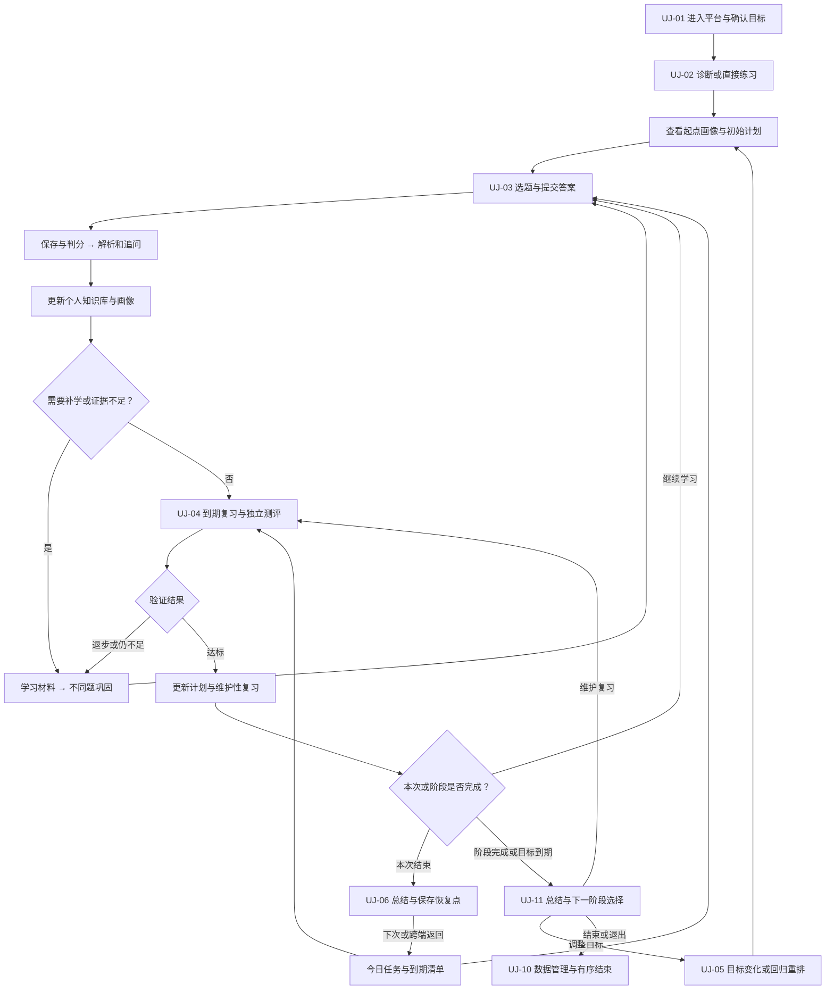
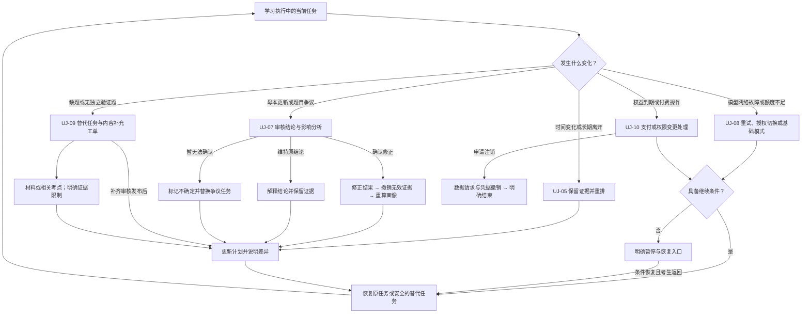

# 法考 Agentic 学习平台——业务与系统需求规格说明书

| 文档属性 | 内容 |
|---|---|
| 版本 | v0.2，需求评审稿；新增用户旅程与闭环审查 |
| 编写日期 | 2026-10-18 |
| 业务领域 | 中国国家统一法律职业资格考试学习与备考 |
| 首个业务场景 | 民法考点驱动的真题练习、学习与复习 |
| 目标读者 | 产品负责人、法考教研、内容运营、架构师、开发、测试、安全、运维、商业运营 |
| 文档定位 | 合并业务需求与系统需求的项目基线候选，作为后续架构、研发、验收的输入 |
| 当前状态 | 已完整承接对话需求；派生需求、指标、范围及待定项尚需评审，不等于已经逐条确认 |

## 1. 需求理解确认与原始需求基线

### 1.1 产品定义

本产品是企业级 Agentic 法考学习平台。系统以统一、权威、完善、持续更新的法考知识图谱及题库为母本，由 Agent 将答题、学习、复习串成持续闭环；随着考生不断作答和复习，形成与系统母本关联的个人知识库、个人知识掌握图和长期学习画像，并动态安排学习与复习，以帮助考生掌握考点、建立知识体系、提高备考效率。系统同时需要具备可持续商业化盈利能力。

“帮助通过考试”是产品目标，不构成通过率承诺；“完善”和“实时更新”必须通过覆盖度、更新时效及质量指标逐步验收，不能作为无边界承诺。

### 1.2 用户已确认需求及逐项追溯

| 来源编号 | 对话需求，按原意整理 | 本文主要承接位置 |
|---|---|---|
| SRC-01 | 构建企业级 Agentic 应用 | 第 5、8、11、12 章 |
| SRC-02 | 服务司法考试考生，通过刷题快速掌握考点 | 第 3、6、7 章 |
| SRC-03 | 根据考生答题判断其是否掌握知识点 | FR-ASM、第 9 章 |
| SRC-04 | 考生选择复习民法，系统按法考实战考点体系寻找对应真题 | UC-01、FR-KG、FR-QB、FR-PR |
| SRC-05 | Agent 判题、解析、记录作答 | FR-GRD、FR-EXP、FR-PR |
| SRC-06 | 根据答题生成学习计划和复习计划，持续调整 | FR-PLN、FR-REV |
| SRC-07 | 不断答题、复习、学习，建立知识体系和考生画像 | FR-PKB、FR-ASM、FR-RPT |
| SRC-08 | 采用最新且稳定的技术，考虑未来扩张，也采用开源技术 | 第 12 章 |
| SRC-09 | 系统接入互联网 | FR-NET、第 8、11 章 |
| SRC-10 | 接受考生自己配置 AI | FR-AI |
| SRC-11 | 支持 Web 和 App | FR-CH、第 10、11 章 |
| SRC-12 | 从考生角度，通过答题串联学习、复习，最终形成每个人的知识库和画像 | 第 4、6、9 章 |
| SRC-13 | 从系统角度，提供完善、权威、赚钱、实时更新的司法考试知识图谱和题库 | FR-KG、FR-QB、FR-CNT、FR-BIZ、第 11 章 |
| SRC-14 | 每位考生的知识图和做的题以系统图谱及题库为母本，通过持续做题形成个人法考画像 | 第 4、FR-PKB、FR-ASM、第 9 章 |
| SRC-15 | 专业结构的完整需求文档，包含业务需求、非功能需求，不丢失对话内容 | 本文全部及第 15 章 |
| SRC-16 | 增加分场景文字描述与 User Journey 图，串联需求，并检查闭环、连贯性及断点 | 第 6、7.8、14.2、15.4 章 |

### 1.3 需求状态与解释边界

- **已确认（C）**：SRC-01～SRC-16 所描述的业务意图及产品约束。
- **派生建议（D）**：为实现业务闭环、企业级质量及可验收性而提出的详细行为；不自动等于用户逐条认可。
- **待决定（T）**：需要产品负责人、教研或商业负责人确定的范围、规则、阈值和方案。
- 后文 FR、BR、NFR、DR、IR 细项默认是 D；其中直接承接 SRC 的核心能力为 C，具体实现方式和数值仍需评审。所有数值目标均是建议目标，除非另有说明。
- “赚钱”按商业化盈利理解；不擅自改成“准确”。准确性同时作为权威内容和企业级质量的派生要求纳入。
- “每个考试的知识图”按上下文理解为“每个考生的个人知识图”，如需支持多个考试产品，应另行确认。

## 2. 文档模板、依据与需求管理约定

### 2.1 模板确认

采用“业务需求文档（BRD）＋系统需求规格说明（SyRS/SRS）＋数据与验收附件”的组合结构，覆盖：业务目标、范围、干系人、领域模型、业务流程、功能需求、Agent 行为、数据、接口、非功能需求、技术约束、验收、发布范围、风险与待定项、追溯矩阵。

模板参考 ISO/IEC/IEEE 29148:2018 的需求工程框架，结合 NASA 系统工程公开材料关于良好需求、验证和双向追溯的指导。本文是针对本项目整理的模板，不是标准全文复制，也不宣称完全符合标准或已获认证。

参考资料：

1. [ISO/IEC/IEEE 29148:2018 官方条目](https://www.iso.org/obp/ui?_escaped_fragment_=iso%3Astd%3Aiso-iec-ieee%3A29148%3Aed-2%3Av1%3Aen)：需求工程框架参考。
2. [NASA Systems Engineering Handbook 附录](https://www.nasa.gov/reference/system-engineering-handbook-appendix/)：需求表达和验证信息参考。
3. [NASA Requirements Management](https://www.nasa.gov/reference/6-2-requirements-management/)：需求管理与追溯参考。

资料检索日期：2026-10-18。本文不引用或解释具体法律条文，不作为法律意见；内容合规细则需在部署地区和数据供应方案明确后专项核验。

### 2.2 需求条目模板

正式需求库应为每条需求维护：唯一编号、名称、需求陈述、来源、业务理由、状态、优先级、责任人、依赖、验收条件、验证方式、版本、变更记录、关联设计和测试用例。本文表格使用紧凑格式，责任人和测试用例在项目立项后补全。

优先级：P0 为首发业务闭环和基础质量必需；P1 为下一阶段的重要能力；P2 为拓展能力。优先级及分期均为建议。验收方式包括场景演示、数据核对、自动化测试、专家评审、性能测试及演练。

### 2.3 变更控制

新增或修改需求应记录原因、来源、受影响功能、数据、模型、成本和验收用例；业务、教研、技术责任人评审后形成版本基线。题库、图谱、法律依据及 AI 策略变更须与软件需求变更分别管理并关联追溯。未决事项不得被静默转换为默认实现。

## 3. 业务需求与成功标准

### 3.1 业务目标

| 编号 | 目标 | 结果度量与边界 |
|---|---|---|
| BR-01 | 提高考点掌握效率 | 观察单位有效学习时长内的掌握增长；使用独立、未见过的测评题验证，不能以重复题正确率代替 |
| BR-02 | 将刷题、学习、复习连接成闭环 | 统计完成答题后获得反馈、画像更新、计划更新的闭环完成率 |
| BR-03 | 建立个人知识体系和可解释画像 | 统计考点证据覆盖、画像可解释性和考生理解程度 |
| BR-04 | 建设权威且持续更新的系统内容母本 | 衡量考纲覆盖度、内容可追溯率、复核通过率和更新时效 |
| BR-05 | 支持个性化和长期学习 | 观察计划执行、复习完成、长期保持、留存与用户反馈 |
| BR-06 | 实现可持续盈利 | 统计付费转化、续费、净收入、退款、单用户贡献及获客回收；不预设价格 |
| BR-07 | 支持多端、模型选择和未来扩展 | 验证跨端连续学习、用户自配 AI、科目与模型扩展成本 |

### 3.2 度量定义

- 正确率：按首次答题、重复答题、有效作答分别统计；标注样本量、题目版本及时间窗口。
- 掌握变化：按知识点、证据数量、题目难度及时间衰减评估；必须区分模型估计与可观测事实。
- 保持率：在预设间隔后以独立测评验证；间隔和题集由教研确认。
- 内容覆盖率：已审核且可用的考点数／目标考试版本要求的考点数；必须公开分母定义。
- 内容时效：分别计量发现延迟、评审延迟和发布延迟，不能仅记录抓取成功时间。
- 商业贡献：净收入扣除模型、内容授权、支付、基础设施及可归属服务成本；自配 AI 和平台 AI 分开统计。
- 目标数值、统计窗口和实验样本规模在试点建立基线后确认；首发需具备指标采集能力，不承诺尚无证据的提分效果。

### 3.3 干系人与职责

| 角色 | 主要需求与职责 |
|---|---|
| 考生 | 练习、学习、复习、查看个人知识体系和画像、配置 AI、管理数据和订阅 |
| 教研专家／内容审核者 | 建设考点、复核题目解析、处理法律变化与争议、审核内容发布 |
| 内容运营 | 合法获取素材、导入清洗、来源维护、更新监控、反馈处理 |
| 产品／学习策略负责人 | 确定计划、评估策略、实验边界和学习成效指标 |
| 商业运营／客服 | 产品权益、付费、退款与对账、用户支持；按权限访问必要数据 |
| 平台管理员／安全／运维 | 账号权限、运行监控、密钥管理、审计、故障与恢复 |
| 模型服务商／内容提供者 | 外部依赖，须满足接口、质量、授权和服务约束 |

## 4. 系统范围与核心领域定义

### 4.1 三层知识体系

| 层次 | 定义 | 关系与责任边界 |
|---|---|---|
| 系统知识母本 | 平台维护的考纲、科目、章节、考点、规则、法条依据、案例、题目、答案、解析及关系 | 提供统一标识、来源、版本、审核和适用时间；是全体考生学习的公共基础 |
| 考生个人知识库／知识图 | 基于母本建立的个人学习集合、笔记、错因、解释、复习材料、证据及知识关联 | 通过母本实体 ID 和版本关联；允许个人补充，但不得自动反写公共权威内容 |
| 考生画像 | 基于学习证据形成的掌握估计、薄弱点、遗忘风险、进度、目标和学习偏好 | 画像是可修订的推断；必须能解释证据来源、置信程度和更新时间 |

个人知识库不要求为每位考生物理复制整套题库。实现可采用共享母本加个人关联与覆盖层，但数据存储方式留待架构设计。母本更新时保留个人历史所依赖的旧版本，并生成必要的重新学习或复核任务。

### 4.2 范围内

民法先行；系统知识图谱和真题库建设；选题与答题；判题解析；掌握评估；动态学习和复习；个人知识库和画像；联网检索；用户自配 AI；Web/App；内容后台；企业级运维和安全；商业化权益与计量。

### 4.3 暂不作为已确认范围

具体模型厂商、Agent 框架、图数据库或向量数据库、云厂商、微服务数量、App 技术路线、付费价格、全科首发、主观题自动评分、离线完整学习、培训机构多租户、教师班级、直播课程、社交社区、承诺通过考试。上述选项中部分作为 P1/P2 候选记录，需评审后决定。

## 5. 总体业务能力与系统边界

平台需提供以下逻辑能力，能力划分不等同于微服务划分：

1. 考生与身份、目标及学习偏好管理。
2. 内容母本：考点图谱、题库、来源、版本和审核发布。
3. 学习执行：练习、判题、解析、学习材料与复习。
4. Agent 编排：获取上下文、选择工具、执行计划、校验结果、记录与恢复。
5. 学习智能：掌握评估、个人知识库、画像、学习与复习计划。
6. 模型与联网接入：平台模型、自配模型、检索、访问控制和成本管理。
7. 商业与运营：订阅权益、用量、支付订单、内容和效果运营。
8. 支撑能力：权限、安全、审计、可观测、数据治理、备份与恢复。

外部边界包括内容来源网站和授权供应方、AI 服务商、消息推送服务、支付渠道、Web 和移动端系统服务。具体供应方待定。

## 6. 用户旅程（User Journey）、场景变化与业务流程

### 6.1 旅程目标与阅读方式

用户旅程以考生目标、行动、感受和下一步为主线，将内容母本、Agent、个人知识库、画像、计划和商业服务串联起来。它描述一段跨会话、跨天、跨端的学习经历，不以一次聊天或一次答题结束为终点。

每个场景必须明确：**进入条件 → 考生行动 → 系统响应 → 可见反馈 → 持久状态变化 → 下一步／退出／恢复**。下文感受与痛点是待用户研究验证的设计假设，不作为已验证调研结论。新增细节属于派生需求；未承诺考试通过率，也不自动扩大为全科或主观题首发。

### 6.2 分场景文字描述（先明确经历，再看旅程图）

#### UJ-01 首次进入：从“想复习民法”到“知道今天怎么开始”

- **进入条件与目标**：新考生首次进入，希望尽快开始民法复习，不清楚自身薄弱点。
- **行动与触点**：了解服务范围和内容版本，注册／登录，选择目标考试、民法和可用时间，选择平台 AI 或自配兼容 AI。尚无使用条件的 AI 选项不得默认视为已配置。
- **系统响应与反馈**：解释所需数据和 AI 费用；提供诊断或直接练习两条路径；自配 AI 不是强制前置。若模型暂不可用，可进入已有权限内的基础练习和已审解析。
- **状态变化**：建立目标、初始偏好及授权记录；个人考点标为未评估，不能凭注册资料生成“已掌握”结论。
- **下一步与恢复**：完成设置后进入 UJ-02；跳过的非必填信息可后补；未完成设置再次进入时从已保存位置继续。
- **潜在痛点与设计机会**：担心配置复杂、付费不透明；用明确的“开始学习”入口及费用说明降低阻力。

#### UJ-02 建立起点：从“做几道题”到“看懂初始学习路线”

- **进入条件与目标**：已选择目标范围，希望发现不足并获得可执行计划。
- **行动与触点**：参加诊断或直接按考点答题；可选择“不知道”或主动跳过，不能强迫猜答案。
- **系统响应与反馈**：选择已审且未过度暴露的匹配真题；每次明确区分答错、未作答和证据不足；展示初步薄弱点及其证据。
- **状态变化**：有效作答进入证据集；跳过只记录学习事件，不自动当作有效错误答案；形成初始画像和带版本的计划。
- **下一步与恢复**：考生查看、调整或接受计划后进入 UJ-03；放弃诊断仍可继续学习，画像保持不确定；题量不足转 UJ-09，不能无限等待凑齐题目。
- **潜在痛点与设计机会**：担心被少量题“定性”；展示证据数量和暂定状态，说明画像会随学习变化。

#### UJ-03 日常刷题与学习：从“做错一道题”到“补上相关知识”

- **进入条件与目标**：考生执行今日任务，或主动选择民法考点，希望弄懂并掌握相关规则。
- **行动与触点**：打开题目、提交答案、阅读解析、追问、记录错因或笔记，并打开推荐学习材料。
- **系统响应与反馈**：先确认答案已保存，再判分、给出有依据的解析；按作答表现推荐材料和巩固题；同时给出考生可选择的“继续／稍后学”。
- **状态变化**：作答与版本固定保存；错题、笔记和解释关联个人知识库；画像带证据更新；学习材料记录未开始／进行中／已完成，但读完不等于掌握。
- **下一步与恢复**：学习后以不同题验证理解；正确且证据充分转 UJ-04，连续错误则回到先修知识或调整解释；结束本次会话转 UJ-06。
- **潜在痛点与设计机会**：看懂解析却不会做新题；用“材料学习 → 独立巩固题”验证迁移，而非仅记录浏览完成。

#### UJ-04 到期复习与阶段检验：从“曾经会做”到“验证能否保持”

- **进入条件与目标**：任务到期或阶段目标完成，需要检验保持与迁移能力。
- **行动与触点**：从站内复习清单或已授权提醒进入，完成回忆、复习题或未见题测评；回忆自评和客观题证据分开标识。
- **系统响应与反馈**：比较历史表现，说明状态变化；证据不足时保持待验证，不为了完成计划而强行标记掌握。
- **状态变化**：更新保持证据、复习间隔、画像和个人知识图；达标则转维护性复习，退步则转补学；候选状态阈值由教研确认。
- **下一步与恢复**：根据结果回 UJ-03 或等待下一次复习；当前目标范围已完成则转 UJ-11。没有未见真题时转 UJ-09，明确证据限制。
- **潜在痛点与设计机会**：复习任务越积越多；在时间预算内重排并说明取舍，而非无限追加。

#### UJ-05 个性化变化：时间、目标改变或长期离开后回归

- **进入条件与目标**：考生减少每日时间、更改目标考试、扩大范围、暂停或长期未学习，希望系统适应现实安排。
- **行动与触点**：修改目标、报告时间变化、主动暂停／恢复，或再次登录。
- **系统响应与反馈**：解释受影响的范围、积压和版本；展示调整后的计划及差异，保留已完成内容；目标切换不等于旧证据全部适用。
- **状态变化**：形成新目标／计划版本；有效旧证据继续关联，新范围保持未知；时间衰减影响掌握估计而不改写历史答案。
- **下一步与恢复**：回 UJ-03／UJ-04；暂停后可恢复，已关闭提醒不因重新排程自动开启。

#### UJ-06 会话结束、跨端续学与中断恢复

- **进入条件与目标**：考生主动结束、切换 Web/App，或遇断网、关闭页面，希望下次准确接续。
- **行动与触点**：结束学习、查看总结，或在另一端重新进入。
- **系统响应与反馈**：主动结束时展示本次完成、变化及下一步；非正常中断时在恢复后展示最后确认状态，区分“答案已保存”和“分析尚未完成”。
- **状态变化**：保存任务进度和恢复点；后台允许画像／计划异步更新，但展示状态；成功作答不因会话结束而丢失。
- **下一步与恢复**：进入最近任务或今日计划；未确认提交的答案不得伪称已保存；按冲突规则解决两端并发。

#### UJ-07 规则变化与答案争议：从“不再适用／我觉得答案有误”到“修正并重新学习”

- **进入条件与目标**：母本变化或考生提出题目、答案、解析问题，希望获得可信结论并修正个人影响。
- **行动与触点**：查看更新说明、提交反馈、跟踪处理状态、参加补学和复核题。
- **系统响应与反馈**：相关题标记争议或历史口径；专家审核后给出处理结论；区分反馈已受理、处理中、已解决、无法确认，不以受理代替解决。
- **状态变化**：发布新母本版本或确认原结论；必要时修正评分、撤销无效证据、重算画像和计划；保留所有旧记录和理由。
- **下一步与恢复**：考生看到处理结果和受影响知识，回 UJ-03／UJ-04；无法确认时保留不确定状态，替换任务而非阻塞整段学习。

#### UJ-08 AI、网络或额度变化：从“服务不能继续”到“选择下一步”

- **进入条件与目标**：自配密钥失效、模型不支持所需能力、网络失败或额度不足，希望保留学习成果并有可行替代。
- **行动与触点**：查看失败原因，重试、修改 AI、主动选择另一已授权服务、使用基础能力或暂存退出。
- **系统响应与反馈**：展示可继续的功能、数据发送和费用变化；不得自动切换到需要新授权的付费服务或向新提供者发送个人数据。
- **状态变化**：保存已确认作答、执行进度和失败原因；更换模型不重建画像；恢复后对同一任务去重，不重复收费。
- **下一步与恢复**：具备条件后回到被中断任务；暂时无法继续时结束本次会话并保留入口。基础能力依现有权益提供，不表示额外承诺免费服务。

#### UJ-09 内容或证据不足：从“没有合适真题”到“知道还能做什么”

- **进入条件与目标**：某考点缺少合法可用题、题目已做完、来源失效或当前没有独立验证题。
- **行动与触点**：查看覆盖缺口，选择已有学习材料、相关考点、明确标识的重复题，或稍后返回。
- **系统响应与反馈**：说明为何无法给出强掌握结论；只有范围和质量审核已启用时才能提供明确标识的模拟题，不能临时生成并冒充真题。
- **状态变化**：保留该考点未验证状态，形成可追踪内容补充任务；提供替代学习，不把个人计划无限挂起。
- **下一步与恢复**：进入替代任务；内容补齐且审核发布后重新检查受影响计划，在站内告知并安排验证；外部提醒仍遵循授权。

#### UJ-10 付费、续费、退款或退出：从“是否值得付费”到“权益与数据有明确归属”

- **进入条件与目标**：需要付费权益、订阅到期、主动退款或不再使用服务。
- **行动与触点**：比较权益、购买／取消续费、查询订单、退款，或申请导出和删除个人数据。
- **系统响应与反馈**：显示实际权益与费用；支付成功后回到原任务，失败可重试；到期和退款说明剩余访问权限；导出／删除提供状态和结果。
- **状态变化**：订单、权益、计量按幂等规则更新；权限变更不改写历史答案和掌握事实；个人数据删除遵循确认后的保留政策，不能承诺退款即销毁所有记录。
- **下一步与恢复**：有权益继续原学习；无权益则在允许范围内查看记录、导出或选择续费；注销完成后有明确结束状态，撤销相关 AI 凭据。导出、删除期限及访问范围仍需决策。

#### UJ-11 阶段完成与考试后：从“今天完成了”到“下一阶段或有序结束”

- **进入条件与目标**：今日任务完成、民法阶段完成、目标日期到达，或考生主动结束备考。
- **行动与触点**：查看总结、阶段测评和知识图，选择维护复习、调整目标、暂停或结束；考试结果可自愿补充。
- **系统响应与反馈**：区分任务完成、范围覆盖、掌握验证和考试结果；到达目标日期不能自动判为通过或永久停止复习。
- **状态变化**：生成阶段快照和计划状态；保留个人知识资产；维护／新目标建立新计划，暂停或结束按偏好停用后续任务及提醒。
- **下一步与恢复**：继续 UJ-03／UJ-04、转 UJ-05，或按 UJ-10 导出／注销；产品范围之外的新科目明确说明尚未提供。

### 6.3 考生端到端用户旅程图

下图按体验阶段呈现主旅程及关键回路，箭头表示真实的下一步；场景编号对应 6.2。内容运营、模型、商业等支撑流程通过 6.5 的触发关系进入考生旅程。

### 6.4 旅程阶段体验与交付矩阵

| 阶段 | 考生核心问题／潜在感受 | 触点与系统交付 | 持久产物 | 下一步 | 观察指标 |
|---|---|---|---|---|---|
| 进入 UJ-01 | 适合我吗，配置麻烦吗 | 服务范围、目标设置、AI 与费用说明 | 目标、偏好、授权 | 诊断或练习 | 设置完成率、开始耗时 |
| 起点 UJ-02 | 我到底哪里不会 | 诊断与初步计划、证据说明 | 初始证据、画像、计划 | 日常学习 | 起点到首次任务完成率 |
| 学习 UJ-03 | 我为什么错，怎么学会 | 判分、解析、追问、材料、巩固题 | 作答、笔记、材料进度、画像 | 巩固或复习 | 答题反馈闭环率、巩固迁移表现 |
| 保持 UJ-04 | 过几天还会吗 | 到期任务、未见题、变化解释 | 保持证据、复习调度 | 补学或维护 | 延时保持、复习完成与积压 |
| 调整 UJ-05 | 时间变少还能跟上吗 | 计划差异、可执行取舍 | 目标及计划新版本 | 当前可执行任务 | 重排后执行率、回归恢复率 |
| 接续 UJ-06 | 我上次做到哪 | 总结、恢复点、同步状态 | 会话进度和下一步 | 原任务或今日计划 | 恢复成功率、跨端冲突率 |
| 变化 UJ-07～09 | 内容可靠吗，还能继续吗 | 纠错结果、替代内容、故障选择 | 复核、重算、恢复和补充任务 | 返回学习或明确暂停 | 问题解决时长、降级续学率 |
| 商业 UJ-10 | 钱花在哪，退出后数据呢 | 权益、订单、退款、数据管理 | 交易、权益、数据请求状态 | 原任务或有序退出 | 对账差异、投诉和请求完成率 |
| 阶段 UJ-11 | 我完成了什么，下一步呢 | 阶段快照、维护或新目标选择 | 阶段报告、目标状态 | 维护、扩展、暂停或结束 | 验证覆盖率、下一步选择完成率 |

指标目标沿用第 3、11 章待评审规则；不将可能的用户感受当作已测量数据。

### 6.5 变化触发与回流图

变化处理不能只停在通知；必须有受影响对象、状态更新和下一步。无授权不发外部通知，但在站内仍提供结果与待办。

### 6.6 状态变化与任务闭环规则

| 对象 | 主要状态与合法变化 | 防断路规则 |
|---|---|---|
| 作答 | 草稿 → 已接收 → 已判分；异常进入待处理／争议，修正形成新版本 | 未提交／跳过不作为普通错答；原始事实与后续修正可区分 |
| 材料学习 | 未开始 → 进行中 → 已完成／暂缓 | 记录完成后仍需独立证据验证掌握；重开材料可继续 |
| 掌握 | 未评估 → 学习中／待巩固 → 已掌握；到期或新证据可转需复习／待验证 | 状态阈值待教研确认；母本变化不得机械继承掌握 |
| 学习计划 | 草案 → 已生效 → 执行中 → 完成／暂停／被新版本替代／结束 | 首次接受或考生主动开始后生效；授权范围内自动微调可撤销，目标范围和费用改变需相应确认 |
| 学习任务 | 待执行 → 进行中 → 待验证／完成；可暂缓、取消或阻塞 | 每个阻塞记录原因和解决路径；阻塞时提供替代，不永久占用可执行清单 |
| 反馈与补充工单 | 已受理 → 分派／处理中 → 结论／发布 → 影响处理 → 已关闭 | 指定责任角色，超时升级；只有处理影响并可查看结果才算闭环，未解决不能静默关闭 |
| 数据请求 | 已提交 → 身份校验／处理中 → 完成／部分完成并说明／拒绝并说明 | 可查询进度；删除结果说明备份及必要留存边界；具体期限待定 |

同一对象的内部技术状态可以更细，但不得丢失以上业务区分。画像更新和计划重排的异步失败需进入重试／人工处理，不得永久显示已完成。

### 6.7 场景—需求—验收追溯

| 场景 | 主要需求 | 验收 |
|---|---|---|
| UJ-01 首次进入 | FR-USR-01～03、FR-AI-01～05、FR-JRN-01 | AC-01、07、13 |
| UJ-02 建立起点 | FR-PR-01～04、FR-ASM-01～04、FR-PLN-01、FR-JRN-02 | AC-01、02、14 |
| UJ-03 日常学习 | FR-GRD、FR-EXP、FR-PKB、FR-JRN-03～04 | AC-01、03、04、15 |
| UJ-04 复习测评 | FR-REV、FR-ASM、FR-JRN-06、FR-JRN-08 | AC-02、04、17、19 |
| UJ-05 目标变化 | FR-USR-02、FR-PLN-03～04、FR-REV-02、FR-JRN-05 | AC-04、16 |
| UJ-06 会话接续 | FR-CH-01～02、AR-01、04、FR-JRN-07 | AC-06、09、18 |
| UJ-07 内容与争议 | FR-CNT-03～05、FR-ASM-03、FR-JRN-09 | AC-05、20 |
| UJ-08 服务变化 | FR-AI-02～05、AR-05～06、FR-JRN-01、11 | AC-07、09、13、22 |
| UJ-09 缺题缺证据 | FR-KG-04、FR-QB-02、FR-JRN-06 | AC-12、17 |
| UJ-10 商业与退出 | FR-BIZ、DATA-06、FR-JRN-10～11 | AC-10、21～22 |
| UJ-11 阶段结束 | FR-RPT、FR-JRN-07～08 | AC-18～19 |

支撑需求的用户触点：内容授权和版本支撑 UJ-02／03／07／09；安全隐私支撑全部场景；可观测、恢复、成本和技术约束由 NFR、AR、CON 及 AC-08、11 验证，不强行改写成考生操作。商业化功能仅在启用收费时适用，主观题及其他扩展场景待范围确认后补充对应旅程。

### 6.8 关键业务用例细化

以下保留 UC-01～05 的业务流程，用于补充旅程的执行细节；用户旅程描述体验与跨场景衔接，用例描述单次业务执行。两者通过需求编号和验收用例关联。

#### UC-01 民法个性化学习闭环（主场景）

**参与者**：考生、学习 Agent、母本、评估与计划能力。**前置条件**：已登录，民法内容已审核发布，模型可用或允许基础练习模式。

1. 考生选择“复习民法”，设置或确认考试目标、可用时间和学习范围。
2. 新考生可以参加诊断或直接练习；老考生加载历史画像、计划与待复习项目。
3. 系统基于目标考试版本和民法考点体系，结合先修关系、薄弱点与复习优先级选取真题。
4. 展示题目并等待提交；作答前不泄露答案和解析。
5. 接收答案，保存原始作答；客观题依据已审核答案及评分规则判定。
6. Agent 基于对应版本的题目、解析及依据生成解释，展示关键考点、选项分析、错因和关联知识。
7. 更新作答证据，评估知识掌握状态，生成个人知识库关联及画像变化。
8. 根据不足安排学习材料、补充练习和间隔复习，并说明安排原因。
9. 考生确认或调整可用时间，继续学习；后续表现持续修订计划。
10. 阶段性通过独立测评验证掌握，展示知识体系和进度。

**后置条件**：作答、判分、解析版本、画像变更、计划变更可关联追溯；失败步骤可恢复，不重复计分或扣费。

**异常分支**：模型不可用时保留答题与已审核解析；题库不足时说明覆盖缺口；争议题进入复核并暂停作为强评估证据；过时内容触发版本提示；断网后可恢复未完成会话；重复提交返回同一结果。

#### UC-02 到期复习与计划调整

系统计算到期任务 → 考生进入复习 → 回忆或答题 → 对比历史证据 → 调整掌握估计与复习时间 → 更新阶段计划。考生缺席或连续低效时重排任务，避免无限累积；不得未经授权持续发送通知。

#### UC-03 系统母本更新

监控或人工提交变更 → 核验来源及使用权限 → 判断适用考试与生效时间 → 识别受影响考点、题目、解析和考生任务 → 专家审核 → 发布新版本 → 重建检索索引和必要缓存 → 通知相关考生 → 安排补学／复核。失败可回滚并保留审计。

#### UC-04 考生自配 AI

选择兼容服务／填写端点和密钥 → 展示数据发送范围与费用归属 → 显式确认 → 连通性与能力检测 → 保存凭据引用 → 学习时按策略调用 → 记录质量、用量与失败 → 可修改、撤销和删除。不得将用户密钥回显给模型、日志或其他用户。

#### UC-05 商业化服务

展示套餐与权益 → 下单支付 → 接收可信支付通知并核验 → 发放权益 → 按请求计量用量 → 提醒额度变化 → 支持续费、取消、退款和对账。未确认收费策略前不得把建议套餐当作既定商业规则。

## 7. 功能需求规格

以下各行均有独立需求编号；表中验收条件是对应需求的首轮验证入口。

### 7.1 身份、学习目标与多端

| 编号 | 优先级 | 需求 | 验收条件 |
|---|---|---|---|
| FR-USR-01 | P0 | 支持账号登录、会话退出与个人空间隔离 | A 用户不能访问或修改 B 用户的学习数据 |
| FR-USR-02 | P0 | 保存目标考试、目标时间、科目、可用学习时间及基础信息 | 修改目标后形成新计划，保留旧计划及修改原因 |
| FR-USR-03 | P0 | 支持新用户冷启动诊断和跳过诊断直接练习 | 跳过时标记证据不足，不编造掌握结论 |
| FR-CH-01 | P0 | Web 与 App 共享账号、作答历史、知识库、画像与计划 | 在两端切换能继续同一学习进度；并发修改冲突有确定处理规则 |
| FR-CH-02 | P0 | 支持会话恢复、弱网重试和重复提交保护 | 模拟中断后作答不丢失、不重复计分 |
| FR-CH-03 | P1 | 支持经用户授权的任务提醒与通知偏好 | 关闭通知后不再发送该类提醒；支持时区与静默时段 |

### 7.2 系统知识图谱

| 编号 | 优先级 | 需求 | 验收条件 |
|---|---|---|---|
| FR-KG-01 | P0 | 建立科目—章节—考点体系，支持先修、包含、关联、易混淆关系 | 民法样例可从科目定位到考点及相关题目，关系可解释 |
| FR-KG-02 | P0 | 考点关联适用依据、考试版本、重点和学习资料；区分教研判断与权威来源事实 | 任一发布考点可查看来源、版本、审核状态 |
| FR-KG-03 | P0 | 考点具备稳定 ID，支持拆分、合并、废弃及版本映射 | 迁移后旧答题证据可追溯，不能静默搬移为新考点已掌握 |
| FR-KG-04 | P0 | 维护目标考纲覆盖清单及缺口 | 可按科目输出覆盖率及缺失考点，不以自动生成内容冒充审核覆盖 |
| FR-KG-05 | P1 | 支持多科目及跨科考点关联 | 新科目可复用学习闭环，且不污染民法内容版本 |

### 7.3 题库与内容治理

| 编号 | 优先级 | 需求 | 验收条件 |
|---|---|---|---|
| FR-QB-01 | P0 | 管理题干、选项、题型、年份、来源、答案、解析、评分规则、考点映射和版本 | 发布题目关键字段齐全，可追溯原始素材 |
| FR-QB-02 | P0 | 真题与模拟题、AI 生成题分开标记；来源无法核实时不得标为官方真题 | 抽检来源标识与证据一致，生成题不进入真题统计 |
| FR-QB-03 | P0 | 支持单选、多选、不定项等已确定客观题型；具体题型和规则由教研确认 | 各题型按已审核规则处理漏选、错选，结果可复现 |
| FR-QB-04 | P0 | 题目可关联多个考点并记录主考点及权重／证据规则 | 多考点答错不会无依据地将全部考点判为未掌握 |
| FR-QB-05 | P0 | 标注历史作答依据与当前学习口径，处理失效题和争议题 | 可同时查看历史答案及当前提示，旧记录不被覆盖 |
| FR-QB-06 | P1 | 支持主观题与评分量表、人工复核入口 | 上线前以专家标注集验证；AI 评分明确是辅助评估 |
| FR-CNT-01 | P0 | 内容经过导入、清洗、去重、映射、审核、发布及归档流程 | 未审核内容不能以权威母本身份用于正式教学 |
| FR-CNT-02 | P0 | 记录内容来源、授权范围、有效期及使用限制 | 授权到期或被撤销时可阻止新增分发，并评估历史展示影响 |
| FR-CNT-03 | P0 | 持续监测相关官方或经审核来源的变化，并支持人工补录 | 变更任务具备发现时间、影响范围、审核状态和发布时间 |
| FR-CNT-04 | P0 | 发布前分析图谱、题目、解析、个人任务和缓存影响；支持回滚 | 用一次考点规则变更验证完整影响链和回滚 |
| FR-CNT-05 | P0 | 提供纠错、争议处理、审核职责分离和结果通知 | 反馈可追踪，关键答案变更需复核并留存发布者记录 |

### 7.4 选题、作答、判题与解析

| 编号 | 优先级 | 需求 | 验收条件 |
|---|---|---|---|
| FR-PR-01 | P0 | 按科目、考点、年份、学习目标和可用内容选择题目 | 选择民法时返回匹配且可用的真题，并说明选题原因 |
| FR-PR-02 | P0 | 根据掌握状态、到期复习、先修关系和题目暴露历史自适应选题 | 固定测试画像下选题符合策略，允许考生手动调整范围 |
| FR-PR-03 | P0 | 保存题目版本、答案、作答时间、提交时间、重做次数和可选自信度 | 可以还原一次完整作答；未填写自信度不阻断学习 |
| FR-PR-04 | P0 | 支持按考点练习、错题重练和阶段测评 | 各模式记录明确，重复练习与独立测评统计分开 |
| FR-GRD-01 | P0 | 客观题按审核答案与确定性规则判分，Agent 可调用判分工具但不得任意改分 | 相同题目版本、答案和规则得到相同分数，与模型选择无关 |
| FR-GRD-02 | P0 | 对争议、无答案或已失效题显示状态，限制其进入掌握评估 | 标记题不会继续产生未经核验的强证据 |
| FR-EXP-01 | P0 | Agent 解释正确答案、选项、关键规则、易错点及相关考点 | 解析与标准答案一致，有可访问的内部证据引用 |
| FR-EXP-02 | P0 | 解析优先使用审核内容和匹配版本依据；证据不足时显式说明 | 故意移除依据后不生成虚构引用，提供复核或已审解析 |
| FR-EXP-03 | P0 | 支持围绕本题追问，并将有价值解释保存到个人知识库 | 保存内容关联考点、题目、来源和生成版本 |
| FR-EXP-04 | P1 | 根据学习水平调整解释深度并提供关联考点梳理 | 考生可切换简洁与详细解释，不影响评分规则 |

### 7.5 掌握评估、个人知识库与画像

| 编号 | 优先级 | 需求 | 验收条件 |
|---|---|---|---|
| FR-ASM-01 | P0 | 基于多次有效证据评估考点掌握，考虑难度、近期表现、重复暴露和时间衰减 | 一次猜对不能直接认定稳定掌握；状态变化可解释 |
| FR-ASM-02 | P0 | 输出证据不足、学习中、待巩固、已掌握、需复习等业务状态及置信信息 | 考生可查看支撑状态的题目和更新时间，阈值可配置 |
| FR-ASM-03 | P0 | 区分事实、用户自述和系统推断，支持错误证据修正和重算 | 题目纠错后能定位受影响画像并重算、保留历史 |
| FR-ASM-04 | P0 | 使用未见题、延时复测等验证掌握，降低背答案造成的虚高 | 重做同题和独立验证产生不同证据权重并可审计 |
| FR-PKB-01 | P0 | 建立以母本考点 ID／版本为锚的个人知识集合 | 能从个人考点进入对应母本和个人作答／笔记 |
| FR-PKB-02 | P0 | 管理错题、错因、笔记、收藏、个人总结、复习材料及证据 | 内容持久保存，可检索、编辑和删除；个人文本不改公共母本 |
| FR-PKB-03 | P0 | 母本变更时保留历史关联，提示受影响个人知识并安排必要复习 | 旧笔记仍可查看，且显示依据更新提示 |
| FR-PKB-04 | P0 | 展示个人知识体系、薄弱点、已覆盖和未覆盖考点 | 未做过的考点显示未知或未评估，不显示为已掌握 |
| FR-RPT-01 | P0 | 提供进度、掌握分布、错因、复习负担和阶段报告 | 报告可追溯到证据，与统计口径一致 |
| FR-RPT-02 | P1 | 给出备考风险和预计计划完成情况，明确不确定性 | 不将预测展示为考试结果保证 |

### 7.6 学习计划与复习计划

| 编号 | 优先级 | 需求 | 验收条件 |
|---|---|---|---|
| FR-PLN-01 | P0 | 根据考试目标、可用时间、考点体系和画像生成阶段及每日计划 | 每项任务具备考点、任务类型、预计耗时、优先级及原因 |
| FR-PLN-02 | P0 | 计划串联答题诊断、材料学习、巩固练习、复习和复测 | 一个错题可触发关联学习与未来复习，而非只加入错题列表 |
| FR-PLN-03 | P0 | 随新证据、时间变化和考生反馈调整计划，保存变更理由 | 可查看计划版本，已完成任务不被重排成未完成 |
| FR-PLN-04 | P0 | 允许考生暂停、跳过、调整时间和任务；冲突时说明取舍 | 超出每日时间预算时给出可执行安排和积压提示 |
| FR-REV-01 | P0 | 按掌握与遗忘风险安排间隔复习，并根据结果重新调度 | 到期任务可查询，复习完成后产生新的调度结果 |
| FR-REV-02 | P0 | 处理逾期、长期离开、连续错误和母本更新 | 回归后生成恢复计划，不无限叠加不可执行任务 |
| FR-REV-03 | P1 | 提供考前冲刺策略与跨科时间分配 | 在明确目标及预算下展示安排依据，策略需教研审核 |

### 7.7 自配 AI、互联网与后台商业能力

| 编号 | 优先级 | 需求 | 验收条件 |
|---|---|---|---|
| FR-AI-01 | P0 | 支持考生配置兼容 AI 服务、端点、模型及密钥；具体协议清单待定 | 在至少两种经评审兼容服务上完成接入验证，失败提示明确 |
| FR-AI-02 | P0 | 检测连接、结构化输出、工具调用及上下文等任务所需能力 | 能力不足时限制相应功能或采用已披露降级方式 |
| FR-AI-03 | P0 | 保存凭据引用，支持更新、撤销、删除，展示发送数据范围 | 密钥不出现在明文日志、学习提示词或响应中；撤销后不再调用 |
| FR-AI-04 | P0 | 自配模型输出遵守统一答案、证据、权限及质量校验规则 | 自配模型无法修改权威答案或绕过画像写入校验 |
| FR-AI-05 | P0 | 区分平台模型与用户自配模型的费用、额度和数据处理边界 | 发起调用前可理解费用归属；切换付费提供者需显式授权 |
| FR-NET-01 | P0 | 支持受控联网检索、来源检查、引用和内容更新发现 | 记录检索时间、来源及用途，网络内容不自动成为权威母本 |
| FR-NET-02 | P0 | 外部内容视为不可信输入，隔离其指令并限制网络访问目标 | 提示注入与服务端请求伪造测试不能越权读取内部数据 |
| FR-OPS-01 | P0 | 后台管理内容、审核、策略、模型、反馈、用户支持与审计 | 各角色仅有必要权限，关键变更可追责 |
| FR-BIZ-01 | P0 | 建立权益、用量和单位成本统计基础 | 能区分平台／自配模型、免费／付费权益及真实调用成本 |
| FR-BIZ-02 | P1 | 支持套餐、订阅／用量等经确认收费模式及价格版本 | 购买时的权益可追溯，价格变更不静默修改已有约定 |
| FR-BIZ-03 | P1 | 支持订单、可信回调、权益发放、退款及对账 | 重复通知不重复发放，失败补偿可重试，订单和账务一致 |
| FR-BIZ-04 | P1 | 支持转化、续费、留存、成本与毛利分析 | 数据可按统计口径核对，退款与失败调用有明确处理 |

### 7.8 用户旅程衔接与闭环补充需求

| 编号 | 优先级 | 需求 | 验收条件 |
|---|---|---|---|
| FR-JRN-01 | P0 | 明确平台 AI、自配 AI、基础练习的进入条件和授权，不强制考生自配模型；未授权的服务不可自动切换 | 新用户未配密钥仍能进入已有权益允许的路径；更换提供者或费用变化前按规则告知并确认 |
| FR-JRN-02 | P0 | 区分已答、未知、跳过、未提交和中断，定义其评估语义 | 跳过／未提交不计普通错题；主动声明不会可作为低权重自述，不冒充有效作答 |
| FR-JRN-03 | P0 | 推荐学习材料具备考点映射、来源、版本、审核状态及可访问性，材料失效有替代或缺口状态 | 错题可进入可用材料；不可用链接不会使任务永久无下一步 |
| FR-JRN-04 | P0 | 持久保存材料学习进度；完成材料后安排巩固验证，不能直接升为已掌握 | 读完材料仅更新学习事件；不同题验证后再按策略更新掌握 |
| FR-JRN-05 | P0 | 目标版本、范围、时间变更后映射旧证据并重排；展示差异与待验证项 | 改目标不删除旧记录；新范围保持未知，不能未经检查继承旧掌握 |
| FR-JRN-06 | P0 | 内容／独立证据不足时提供替代任务和明确不确定性，生成有责任角色与状态的补充工单 | 缺题时计划可继续；补齐发布后定位原受影响用户并安排验证，不能冒充真题或强行认定掌握 |
| FR-JRN-07 | P0 | 提供学习会话总结、阶段快照和可恢复入口 | 结束或异常恢复后可见完成内容、待处理状态及下一步；跨端一致 |
| FR-JRN-08 | P0 | 处理今日完成、阶段完成、目标到期、暂停与结束，提供维护／调整／退出选择 | 目标到期不自动判通过；选择结束后按偏好停止任务及提醒，保留可恢复历史 |
| FR-JRN-09 | P0 | 反馈从受理到结论、个人影响处理和结果可见完整追踪；超时有升级，未决争议有替代任务 | 模拟答案修正，评分、证据、画像、计划均被处理；无变更／无法确认也给出理由和下一步 |
| FR-JRN-10 | P0 | 用户可发起并查询数据导出、删除与注销；执行凭据撤销及可见结果，遵循最终留存政策 | 导出隔离用户且不含密钥；注销后密钥停止调用；部分留存明确说明；期限待定 |
| FR-JRN-11 | P1 | 支付、到期、取消、退款及额度变化后回到原学习上下文或明确的权限受限页面 | 支付成功后可继续原任务；失去权益不改写掌握事实、不静默丢弃进度；可用范围待收费规则确认 |

以上为本次旅程审查识别的派生补充需求，不代替既有安全、商业和内容要求；FR-JRN-11 在正式收费前必须实现。FR-JRN-10 是个人数据管理的细化，不将收费功能提前列为 P0。

## 8. Agentic 行为与治理需求

### 8.1 行为闭环

Agent 执行“理解目标 → 读取画像及当前内容版本 → 制定任务 → 调用检索、选题、判题等受控工具 → 校验结果 → 保存证据及学习状态 → 安排后续学习与复习 → 评估效果”的闭环。是否采用多个 Agent、何种推理框架和编排组件，属于架构决策。

| 编号 | 优先级 | 需求与验证重点 |
|---|---|---|
| AR-01 | P0 | 记录任务状态：创建、执行、等待用户、完成、失败、取消；长任务可恢复，取消后不继续产生未经许可的副作用 |
| AR-02 | P0 | 区分当前会话上下文、长期个人知识和权威母本；上下文裁剪不得丢失题目版本、答题证据和权限约束 |
| AR-03 | P0 | 工具使用结构化输入输出及服务端校验；模型文本不能直接当数据库指令或权威结果 |
| AR-04 | P0 | 判分、保存作答、画像更新、任务调度与计费采用幂等操作；部分失败有补偿和对账 |
| AR-05 | P0 | 限制任务步数、重试、时间、Token 和费用；达到上限时返回可恢复结果，防止无限循环 |
| AR-06 | P0 | 对答案冲突、证据不足和低质量结果降级到已审内容或人工复核，保留原因 |
| AR-07 | P0 | 记录内容版本、模型及版本信息、提示模板、策略、工具结果摘要、延迟和成本；不要求保存模型私有推理链 |
| AR-08 | P0 | 新模型、提示及学习策略上线前执行独立基准评估；支持灰度和回退 |
| AR-09 | P0 | 互联网和用户笔记不得提升自身信任等级；用恶意材料验证提示注入隔离及跨用户访问阻断 |
| AR-10 | P0 | 更换模型不重置画像与计划；任务可识别模型能力差异，不假设任意端点均兼容 |
| AR-11 | P0 | Agent 自主生成的学习任务可在授权范围内保存；支付、外部通知、公共母本发布分别受对应业务权限和授权控制 |

### 8.2 自动化边界

Agent 可自动推荐题目、解释已审内容、更新带证据的掌握估计、生成和调整可撤销计划。母本发布、权威答案变更和争议裁定应由授权教研流程控制。考生可纠正个人信息、调整计划、提交申诉和反馈。系统不得把 AI 生成内容、互联网网页或考生主张直接当作权威结论。

## 9. 数据需求、画像规则与内容时态

### 9.1 核心数据实体

| 编号 | 实体 | 最小信息与关系 |
|---|---|---|
| DR-01 | 考试目标／考纲版本 | 考试、年度或适用版本、科目范围、目标时间；对应母本版本 |
| DR-02 | 知识节点／知识关系 | 稳定 ID、名称、类型、上下级、先修／关联、来源、状态、适用时间、版本映射 |
| DR-03 | 内容来源／依据 | 原始地址或授权标识、发布主体、采集时间、内容摘要校验、适用范围、授权和复核记录 |
| DR-04 | 题目／答案／解析 | 题型、年份、来源、版本、评分规则、考点映射、当前与历史适用口径 |
| DR-05 | 作答事件／评分结果 | 考生、题目版本、答案、时间、模式、结果、规则版本、事件唯一 ID |
| DR-06 | 个人知识条目／学习证据 | 母本关联、笔记、错因、资料、事实或生成标记、个人权限、来源和版本 |
| DR-07 | 掌握状态／画像快照 | 考点、估计、状态、置信程度、证据列表、策略版本、更新时间与变更原因 |
| DR-08 | 计划／任务／复习记录 | 版本、依赖、类型、目标考点、预算、到期时间、状态、重排理由 |
| DR-09 | AI 配置／执行记录 | 凭据引用、服务与能力、授权范围、任务 ID、版本、工具、质量、时延和成本 |
| DR-10 | 权益／订单／计量 | 套餐版本、有效期、订单状态、支付标识、用量、费用归属、退款和对账关系 |
| DR-11 | 反馈／审核／审计 | 提交者、对象版本、问题类型、处理流程、审核意见、操作者和时间 |

### 9.2 数据与评估规则

- **DATA-01**：原始作答事实与派生画像分开保存；修正通过留痕事件处理，不能覆盖到无法还原历史。
- **DATA-02**：内容同时记录发布时间／采集时间、业务生效及失效时间、系统版本时间，支持按考试口径和历史时间检索。
- **DATA-03**：多知识点题目需通过明确归因策略更新画像；答错并不必然证明每个关联知识点均不掌握。
- **DATA-04**：掌握策略可综合难度、独立题表现、重复暴露、自信度和时间衰减；公式及阈值由教研与数据评估确认，不在需求阶段锁定算法。
- **DATA-05**：同一考点的状态变化可解释、可重算；策略升级与内容更正应标记画像版本差异。
- **DATA-06**：建立用户导出、注销、删除、备份保留和审计留存策略；各类数据期限待专项确认，不能宣称“永久保存全部数据”。
- **DATA-07**：导入内容需校验完整性、重复、来源及引用关系；跨端时间采用统一时间标准并按用户时区展示。
- **DATA-08**：个人笔记与推断默认私有，不用于跨用户训练、共享或母本发布，除非具备独立明确的授权与处理规则。
- **DATA-09**：业务数据是长期资产，应能脱离特定模型与 Agent 框架迁移；模型密钥不包含在普通数据导出中。

## 10. 外部接口与用户体验需求

| 编号 | 需求 | 验证重点 |
|---|---|---|
| IR-01 | Web/App 通过版本化接口访问统一业务能力 | 权限、分页、错误码、兼容周期、幂等键和接口契约可测试 |
| IR-02 | 模型服务采用可替换适配边界，覆盖超时、限流、流式响应和能力差异 | 中断、异常格式及服务商故障不会破坏学习状态 |
| IR-03 | 联网和内容接入支持可配置来源及抓取／导入策略 | 遵守授权与来源使用条件，失败可告警与人工补录 |
| IR-04 | 支付和推送接口仅在相关功能启用后接入 | 回调核验、重试、对账、退订与权限一致 |
| UX-01 | 提供学习主页、练习页、解析追问页、复习清单、知识体系、报告和 AI 配置入口 | 用户可完成 UC-01～UC-04，不依赖技术术语理解学习操作 |
| UX-02 | 解释“为何推荐本题、为何复习、为何掌握状态变化” | 展示可理解的业务原因及证据，不展示内部推理链 |
| UX-03 | 正确呈现等待、失败、证据不足、内容变化和降级状态 | 不以流式文字掩盖失败或虚构已保存结果 |
| UX-04 | 支持手机与桌面布局、字体缩放、键盘操作及读屏语义 | 核心学习流程完成可访问性检查；具体标准等级待定 |
| UX-05 | 知识体系支持列表或层级视图，图形视图作为可选呈现 | 不以“画出复杂图”替代可用的考点导航和掌握说明 |

## 11. 非功能需求及建议质量指标

### 11.1 指标适用口径

以下为待评审目标，用于让“企业级”可验证；不代表已确认容量或服务承诺。压测采用受控测试集和指定模型，说明软硬件、请求构成、缓存、网络及第三方延迟。对用户体验同时记录端到端时延；不得仅排除慢模型后宣称全部达标。

| 编号 | 类别 | 需求与建议验收目标 | 验证方法 |
|---|---|---|---|
| NFR-01 | 可用性 | 核心非 AI 学习能力月可用性建议 ≥99.9%；平台内故障及端到端依赖分别统计，预先定义维护窗口和成功请求 | 监控报告、故障注入 |
| NFR-02 | 一般性能 | 在确认容量下，非 AI 读取 P95 ≤500ms，作答接收确认 P95 ≤1s；不等待解析完成再确认保存 | 接口及端到端压测 |
| NFR-03 | AI 体验 | 受控环境下建议首个有用反馈 P95 ≤5s，标准解析完成 P95 ≤30s；依模型分档公布 | 按模型和任务测试，超时可降级 |
| NFR-04 | 数据一致性 | 已确认保存的作答不得静默丢失；重试不重复计分、扣费；画像允许异步但需显示更新状态 | 中断和重试故障测试、对账 |
| NFR-05 | 恢复能力 | 灾难恢复建议 RPO ≤5min、RTO ≤60min；与普通进程故障分开验证，最终依成本确认 | 定期备份恢复演练 |
| NFR-06 | 容量扩展 | 记录注册、日活、同时在线、提交 QPS、AI 并发、题库规模及增长；建议首轮按 100 个同时活跃会话、20 次作答提交/秒验证，AI 并发单独限流 | 明确负载模型后压测；目标待确认 |
| NFR-07 | 身份与权限 | 用户、教研、运营、管理员最小权限；特权账号强认证；所有对象访问进行服务端授权 | 越权及会话安全测试 |
| NFR-08 | 凭据和传输 | 传输加密、敏感数据及密钥加密管理；凭据隔离、轮换、脱敏；自配端点限制私网和敏感地址访问 | 安全测试、密钥泄漏扫描 |
| NFR-09 | 隐私与数据治理 | 数据最小化；模型服务商及数据发送范围透明；个人数据访问、导出、删除有流程；跨境等事项按部署及供应商核验 | 数据流审查、用户请求演练 |
| NFR-10 | 内容正确性 | 正式发布题的答案与审核基准一致率 100%；来源、适用时间和审核信息完整率 100% | 发布校验及专家抽检；一致不等于永无争议 |
| NFR-11 | AI 质量 | 基准集答案一致性、依据可支持性、引用有效性、教学有效性分别评测；建议解析与标准答案一致率 ≥99%，引用字段可追溯率 100% | 独立题集、教研双人复核；样本规模待定 |
| NFR-12 | 画像质量 | 以未见题和延时复测检验估计校准及保持预测；不采用训练样本自证质量 | 试点形成基线，确认误判成本后设阈值 |
| NFR-13 | 内容更新 | “实时”指持续发现并按级别处理：建议来源检查间隔 ≤6h，关键变化发现后 24h 内完成评审或发布风险提示；确认后完成索引传播 ≤15min | 变更模拟与监控；来源可得性、教研值班待定 |
| NFR-14 | 可观测 | 业务、API、Agent、模型、检索和工具调用具有关联 ID；监测失败率、时延、成本、内容时效、画像更新积压 | 单次学习请求可贯穿追踪，敏感内容脱敏 |
| NFR-15 | 可维护 | 模块边界、接口契约、数据库迁移、策略和配置版本可管理；关键流程有回归测试 | 发布评审、契约测试和变更演练 |
| NFR-16 | 可移植 | 不将核心内容、画像和计划绑定单一模型；数据可导出，供应方可替换 | 执行模型切换及数据导出验证 |
| NFR-17 | 成本 | 支持按用户／任务／模型预算、限额、告警和降级；单元成本与定价联动 | 预算触发测试和成本报表 |
| NFR-18 | 发布运维 | 支持灰度、回滚、限流、队列背压、依赖隔离及故障告警 | 灰度和回滚演练，第三方故障测试 |
| NFR-19 | 滥用与可靠性 | 限制作答刷量、接口滥用及无界 AI 任务；保护正常考生体验 | 限流及恶意输入测试 |
| NFR-20 | 开源供应链 | 记录许可证、依赖、漏洞及维护情况；建立软件物料清单和升级策略 | 依赖扫描与许可证审查 |
| NFR-21 | 商业完整性 | 用量计费可核对，失败与取消请求的收费规则透明，退款和权限撤销一致 | 账务对账及异常交易场景测试 |
| NFR-22 | 兼容性 | 明确支持浏览器、移动操作系统版本及最低设备能力 | 发布前兼容性矩阵测试；版本范围待定 |

### 11.2 质量门禁

上线前不得存在可复现的跨用户数据访问、密钥泄漏、标准答案被模型改写、重复扣费等阻断问题。AI 测试集应覆盖正常题、争议题、过时题、无依据、恶意网页、自配低能力模型、长会话、网络失败等情况。不得用总体平均分掩盖关键失败类型。

## 12. 技术与架构约束

| 编号 | 约束 |
|---|---|
| CON-01 | 采用选型时最新的稳定可用版本或维护中的长期支持版本，比较成熟度、生态、安全、升级成本；不把预览版作为无替代的关键依赖 |
| CON-02 | 优先评估维护活跃、许可证适合商业使用的开源组件；开源不等于免费运营，也不要求所有组件必须开源 |
| CON-03 | 支持 Web/App 共用领域能力，用户数据与业务规则保持一致 |
| CON-04 | 支持科目、内容规模、用户规模、AI 服务和学习策略扩张，模块可独立演进 |
| CON-05 | 权威内容、判分规则、学习证据和派生画像边界清晰；模型输出必须经过业务规则校验 |
| CON-06 | 支持用户自配 AI、联网与企业安全控制并存；接入范围和网络策略可配置 |
| CON-07 | 数据模型需表达知识关系与版本；是否采用图数据库、向量检索或关系数据库组合由验证后的架构决定 |
| CON-08 | 避免在需求阶段承诺多 Agent、微服务或特定云；技术选型报告另行核验当时版本与维护状态 |

## 13. 商业化需求与运营原则

平台需要形成“权威母本＋个性化学习服务＋可验证学习价值”的商业价值。可评估订阅、分科权益、平台 AI 用量包、机构授权等模式，但价格、套餐和机构能力不是已确认需求。

- 商业权益与学习评估独立：付费状态不能改变答题对错或人为抬高掌握分数。
- 自配 AI 不等于平台服务免费；平台内容、学习策略和存储等权益是否收费应明确告知。
- 收费页面需解释内容范围、模型费用归属、额度、有效期、续费及退款条件。
- 运营需同时观察学习效果、用户留存和单位经济性，防止仅以调用次数或刷题数量代表价值。
- 正式收费前需完成支付渠道、合同及用户条款、内容授权、客服处理和账务规则评审；具体适用要求按商业模式专项核验。

## 14. 分期交付、验收与追溯

### 14.1 建议分期

| 阶段 | 交付范围 | 完成门槛 |
|---|---|---|
| M0 内容与需求验证 | 明确民法试点考点范围、授权真题来源、评估规则、原型与指标基线 | 内容来源可用，主流程和需求待定项有负责人 |
| M1 首个学习闭环 | 民法母本、客观真题、判题解析、作答、个人知识库和画像、动态学习复习、Web/App 核心入口、自配 AI、受控联网、后台、基础成本计量 | P0 核心场景完成；具体双端发布节奏可调整，但双端总目标不删除 |
| M2 商业运营 | 经确认的支付与权益、运营分析、提醒、质量优化、扩充民法内容 | 账务闭环、单位成本可测、上线质量门禁通过 |
| M3 扩展 | 多科目、主观题、机构等经批准能力 | 各新增范围单独形成需求和验证集 |

分期是执行建议；正式收费若在 M1 开始，FR-BIZ-02～04 与相关验收必须提前，不能绕过计费完整性要求。

### 14.2 核心验收用例

| 用例 | 场景及成功条件 | 主要关联 |
|---|---|---|
| AC-01 | 新考生选择民法，完成诊断／直接练习，取得匹配真题、判分、解析和后续学习任务 | SRC-02～06；FR-USR、FR-PR、FR-GRD、FR-EXP、FR-PLN |
| AC-02 | 多次不同题及延时复测后画像更新；猜对、重做、证据不足不会被简单判为掌握 | SRC-03、07；FR-ASM |
| AC-03 | 考生从个人知识图进入考点、错题、笔记及依据；与另一考生数据隔离 | SRC-12、14；FR-PKB；NFR-07、09 |
| AC-04 | 答错触发学习、巩固与后续复习；改时间预算后计划可执行且保留变更 | SRC-06、12；FR-PLN、FR-REV |
| AC-05 | 母本内容更新能定位受影响题目和考生任务；保留旧版本，并提示复核／补学 | SRC-13、14；FR-CNT；DATA-02、05 |
| AC-06 | Web 作答后 App 可继续，重试和并发不会重复计分或破坏已完成状态 | SRC-11；FR-CH；NFR-04 |
| AC-07 | 自配两类兼容 AI 完成测试；低能力、无效密钥及超时有明确降级和费用边界 | SRC-10；FR-AI；AR-10 |
| AC-08 | 恶意网页／笔记无法更改答案、读取他人资料或触发越权工具调用 | SRC-01、09；FR-NET；AR-09；NFR-07、08 |
| AC-09 | 模型故障时作答仍可保存，已审解析可用；恢复后任务可继续 | SRC-01；AR-01、04、06；NFR-01、04 |
| AC-10 | 购买、重复支付通知、退款及额度耗尽得到一致权益和账务结果 | SRC-13；FR-BIZ；NFR-17、21 |
| AC-11 | 完成性能、安全、内容质量与恢复验证；所有不达标项明确阻断或批准处理 | SRC-01、08；NFR 全部适用条目 |
| AC-12 | 内容覆盖、更新、学习效果和成本指标可按定义核对，无未授权素材被发布 | SRC-02、13；BR-01～06；FR-CNT |
| AC-13 | 无自配密钥的新用户能选择可用学习路径；切换服务不产生未授权费用或数据发送 | UJ-01、08；FR-JRN-01；FR-AI |
| AC-14 | 跳过、不知道、未提交和断网中断分别记录，统计与画像按各自语义处理 | UJ-02；FR-JRN-02 |
| AC-15 | 从错题打开已审学习材料，保存进度，再以不同题验证；浏览完成不会直接变为已掌握 | UJ-03；FR-JRN-03～04 |
| AC-16 | 更改目标考试版本和每日时间后保留旧证据，标记不可直接继承部分，展示新计划差异 | UJ-05；FR-JRN-05 |
| AC-17 | 故意耗尽独立真题，系统提示证据限制、提供替代任务；内容补齐后回流验证 | UJ-04、09；FR-JRN-06 |
| AC-18 | 正常结束及中断恢复均可查看最后已确认进度、总结和下一步，跨端状态一致 | UJ-06、11；FR-JRN-07 |
| AC-19 | 阶段完成和目标日期到达时提供维护、调整、暂停或结束，不自动认定通过 | UJ-04、11；FR-JRN-08 |
| AC-20 | 一次反馈经过处理后，能展示结论并完成评分／证据／画像／计划影响处理；未决有替代和升级 | UJ-07；FR-JRN-09 |
| AC-21 | 导出和注销可追踪，导出无其他用户数据和密钥，注销撤销凭据，说明保留边界 | UJ-10；FR-JRN-10 |
| AC-22 | 学习中购买后返回原任务；到期、退款和额度耗尽后权限准确、记录不变且有明确下一步 | UJ-08、10；FR-JRN-11 |

每条具体需求在进入开发前需关联到详细测试用例；本表是场景级追溯，不替代完整测试用例库。推荐建立 SRC → BR／FR／NFR → 设计 → 测试 → 发布证据的双向链接。

### 14.3 完成定义

需求已评审且无阻断性未决项；首发目标内容完成审核与授权；P0 功能通过场景验收；质量指标有实测证据；关键安全和账务问题清零；备份恢复、监控、客服和内容纠错流程可执行；所有已承诺需求都有验收证据或明确延期批准；已知限制向用户和运营可见。

## 15. 待决策事项、风险与覆盖核对

### 15.1 待决策清单

| 编号 | 事项 | 建议责任角色 | 对工作的影响 |
|---|---|---|---|
| T-01 | 首发民法范围、考试阶段、客观题题型及考纲版本 | 产品＋教研 | 内容范围、判题和验收基准 |
| T-02 | 真题、答案、解析及法条资料来源与商业使用权限 | 内容＋商业 | 母本是否可合法上线，最高优先级依赖 |
| T-03 | 权威来源优先级、争议答案处理、更新值班与时效目标 | 教研＋运营 | 内容可信度与“实时”能力 |
| T-04 | 掌握定义、评估阈值、错因分类、复习策略及验证样本 | 教研＋数据 | 个性化质量和有效性 |
| T-05 | 支持的 AI 协议、厂商、用户端点范围及费用分担 | 产品＋技术＋安全 | 接入、网络安全和成本 |
| T-06 | Web/App 首发顺序、原生／跨端路线、浏览器与系统支持范围 | 产品＋技术 | 交付与兼容成本 |
| T-07 | 用户规模、容量、可用性、恢复目标和基础设施预算 | 业务＋技术＋运维 | NFR 最终数值与部署设计 |
| T-08 | 收费方式、定价、免费权益、退款与自配 AI 权益 | 商业＋产品 | 上线商业范围和账务 |
| T-09 | 部署地区、服务对象、数据保存、模型数据处理及数据出境边界 | 业务＋安全＋专业支持 | 隐私、合同和部署要求 |
| T-10 | 个人知识库导入／导出范围、离线能力及通知渠道 | 产品 | 扩展功能边界 |
| T-11 | 主观题、全科、机构多租户是否进入近期路线图 | 业务＋产品 | P1/P2 是否升级 |
| T-12 | 学习成效试点周期、样本量、成功指标和发布质量阈值 | 产品＋教研＋数据 | 避免以主观体验代替效果证据 |

待定项后续需补充负责人姓名、截止日期、决策记录。本文没有因待定项遗漏核心要求，也没有将其假装成已达成共识。

### 15.2 主要风险与处置需求

| 风险 | 对应处置 |
|---|---|
| 真题或解析授权不足、原始答案不可核实 | 来源及授权台账、不可用内容阻断发布、替代资料方案 |
| 法律及考试口径变化导致解析过时 | 时态版本、影响分析、专家评审、风险提示及补学 |
| AI 幻觉、错误引用和模型间质量差异 | 已审母本约束、确定性判分、证据验证、评估与降级 |
| 重复做题产生虚假掌握感 | 去重证据、未见题和延时复测、置信提示 |
| 学习数据不足时画像过度推断 | 未知状态、最小证据门槛、解释和修正能力 |
| 自配服务泄露数据、成本失控或攻击内部网络 | 数据范围告知、凭据管理、端点限制和调用预算 |
| 长任务中断造成记录不一致 | 幂等、持久状态、补偿、重算和账务对账 |
| 教研及更新运营成本高于收入 | 单位经济性计量、分期范围、内容复用和价格验证 |
| 图谱过度复杂导致考生难用 | 以学习任务和考点导航为核心，图形展示可选 |
| 平台锁定单模型或开源组件维护失效 | 适配边界、可导出数据、维护与许可证审查 |

### 15.3 对话内容不遗漏核对

| 对话要求 | 核对结果 |
|---|---|
| 企业级 Agentic 应用 | 已纳入业务能力、Agent 治理、非功能及验收 |
| 司法考试刷题、民法实战考点对应真题 | 已纳入主场景、图谱、题库与选题 |
| Agent 判题、解析并记录答题 | 已纳入；客观题由 Agent 调用确定性判分工具完成，保证一致性 |
| 答题判断掌握、动态学习和复习 | 已纳入评估、计划与复测闭环 |
| 建立知识体系、每人知识库和画像 | 已明确个人知识库、个人知识图和画像的不同含义及关联 |
| 完善、权威、赚钱、实时更新的母本 | 已分别承接覆盖度、来源审核、商业化和更新时效 |
| 每个人以系统母本为基础持续形成画像 | 已纳入母本锚点、版本关联、证据与变更传播 |
| 最新稳定技术、开源、未来扩展 | 已纳入技术约束，具体技术选型留待后续核验 |
| 联网、考生自配 AI、Web/App | 已纳入独立功能、安全和跨端验收 |
| 专业、完整，含业务与非功能需求 | 已包含模板依据、业务、功能、数据、接口、质量、验收及追溯 |
| 场景文字、用户旅程图、变化及闭环断路检查 | 已增加第 6 章旅程与变化图、补充需求、验收和第 15.4 章审查记录 |

### 15.4 用户旅程闭环审查记录（v0.2）

**方法**：从 11 个场景逐一检查进入条件、用户操作、系统反馈、持久状态、下一步、异常恢复、责任与验收，再逆向检查功能是否有用户旅程或支撑流程承接。本次为文档级人工逻辑检查，不代表系统已实现或经过真实用户验证。

| 审查项 | v0.1 的断点／模糊处 | v0.2 补齐方式 | 闭环验证 |
|---|---|---|---|
| 首次进入 | 自配 AI 的能力明确，但不配时如何开始不明确 | UJ-01／08、FR-JRN-01 明确可用入口、服务和授权边界 | AC-13 |
| 不答题 | 只细化作答，没有明确跳过和未知如何影响画像 | UJ-02、FR-JRN-02 区分事件与证据 | AC-14 |
| 答题到学习 | 计划有学习材料，但材料治理、打开和进度要求不足 | UJ-03、FR-JRN-03～04 补齐材料、进度与验证 | AC-15 |
| 学习到掌握 | 看完解析或材料后如何证明学会衔接不足 | UJ-03／04、FR-JRN-04 强制区分完成与掌握 | AC-02、15 |
| 目标变化 | 修改目标仅写生成计划，旧画像适用性未明确 | UJ-05、FR-JRN-05 处理版本映射与新范围未知 | AC-16 |
| 题量耗尽 | 原文提示题库不足，但没有完整替代与补齐回流 | UJ-09、FR-JRN-06 增加替代、工单、发布后再验证 | AC-17 |
| 会话出口 | 有中断恢复，缺少正常结束总结和下一次入口 | UJ-06、FR-JRN-07 增加总结与恢复点 | AC-18 |
| 长期出口 | 有阶段报告，缺少阶段完成、到期和主动结束的选择 | UJ-11、FR-JRN-08 定义维护、调整、暂停、结束 | AC-19 |
| 纠错回流 | 有反馈和重算，但受理到结论、全部个人影响未串联 | UJ-07、FR-JRN-09 连接修分、撤证、画像、计划和结果 | AC-20 |
| 数据退出 | 有保留原则，缺少用户操作入口及结果追踪 | UJ-10、FR-JRN-10 定义导出、注销和凭据撤销 | AC-21 |
| 商业中断 | 有订单权益，缺少支付后回原任务及到期后的体验 | UJ-08／10、FR-JRN-11 串联权限变化与学习上下文 | AC-22 |
| 自动计划权限 | “考生确认计划”与“Agent 自动调整”边界易冲突 | 6.6 明确初次生效、可撤销微调和重大变化确认 | AC-04、16、22 |

**连贯性核对**：主路径覆盖进入、诊断、计划、答题、解析、学习、验证、复习、总结和接续；画像与个人知识库在各阶段持续累积；每条关键异常路径均有替代、恢复、暂停或明确结束。系统母本通过选题、学习、更新和补齐持续进入个人旅程；商业权益约束访问能力，不改变学业事实。

**仍需决策的闭环条件**：目标版本映射规则、掌握阈值、材料范围、补充工单和反馈时限、数据请求期限与保留边界、到期后可访问范围，仍依赖 T-01～04、08～10、12。未决定前不能宣称执行层面已闭环；这些事项须在对应功能开发／上线前形成业务规则与验收数据。

**审查结论**：v0.1 存在上述 12 类衔接缺口或歧义，v0.2 已补充对应需求、状态、下一步及验收入口；本轮文档级检查未发现未登记的关键主旅程断点。该结论限定在当前民法先行、客观题闭环范围，不等于证明全部未来扩展场景无遗漏。后续详细设计、原型走查和试点仍须验证实际可执行性。

### 15.5 本次变更记录

| 版本 | 日期 | 变更 |
|---|---|---|
| v0.1 | 2026-10-18 | 初始业务与系统需求评审稿 |
| v0.2 | 2026-10-18 | 第 6 章扩为用户旅程：11 个场景、2 张旅程与变化图、体验矩阵、状态规则和追溯；新增 FR-JRN-01～11、AC-13～22；增加 12 类衔接审查记录；保留原 UC-01～05 与原需求 |

## 附录 A：示例——母本与个人学习状态

母本考点 K-001（示意考点，非具体法律结论）关联真题 Q-001-v1、Q-002-v1 及审核解析。考生 A 做错 Q-001，形成作答证据 E-001 和个人错因笔记；系统给出“待巩固，证据有限”，生成学习任务与复习任务。考生 B 尚未作答，对同一考点显示“未评估”。A 后续完成不同题和延时复测后，才可能提升掌握状态。

当 K-001 的依据变化产生 v2 时，系统保留 A 在 v1 下的作答历史，提示相关内容已变化，重新评估是否需要复习；不能把旧版本的掌握结果直接当作新规则已经掌握。

## 附录 B：后续交付物

本需求文档评审后，可依次产出：领域模型与数据字典、内容母本与授权治理方案、学习评估和复习策略规格、企业级架构及技术选型、Agent 工具与状态规范、Web/App 交互原型、详细验收与评估方案、分期研发计划。各交付物均需追溯本文件需求编号。
