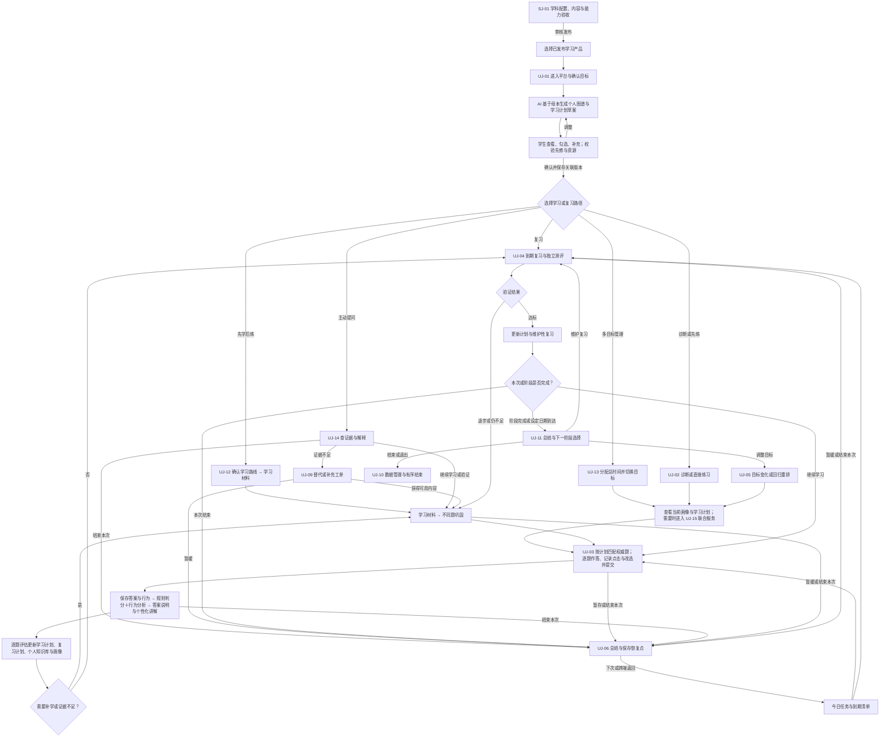
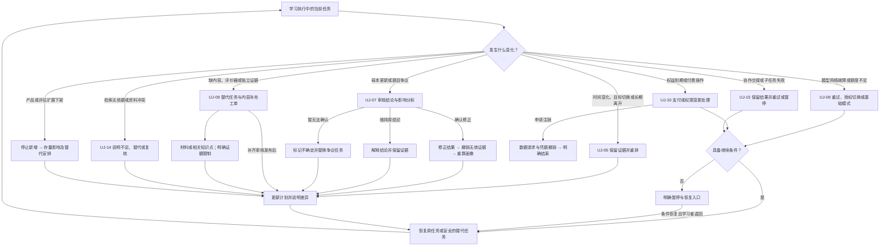
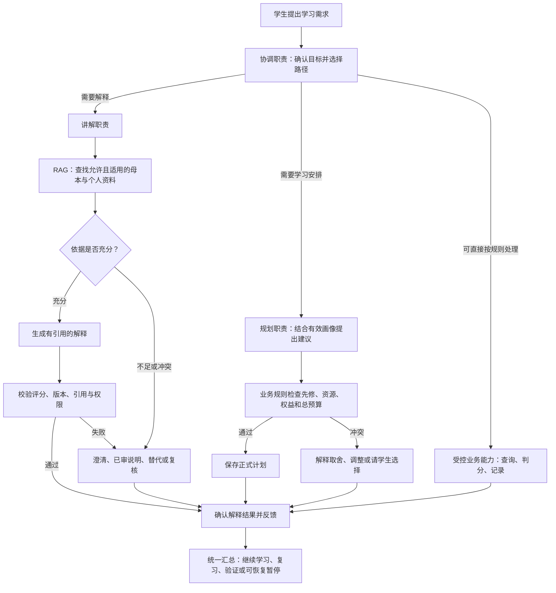

# 通用 Agentic 学习与考试平台——业务与系统需求规格说明书

| 文档属性 | 内容 |
|---|---|
| 版本 | 通用平台 v0.3，需求评审稿；补充首次共建图谱与计划、逐题行为驱动的核心学习闭环 |
| 编写日期 | 2026-10-18 |
| 业务领域 | 多学科知识学习、课程学习与考试备考；按已审核发布的学习产品提供服务 |
| 首个业务实例 | 中国国家统一法律职业资格考试，民法先行；第二学科仅用于抽象验证，尚未承诺商业上线 |
| 目标读者 | 产品负责人、学科教研、内容运营、架构师、开发、测试、安全、运维、商业运营 |
| 文档定位 | 在通用平台 v0.2 上补充四部分业务与治理需求；原通用 v0.1／v0.2 及法考文档保留，旧架构按归档索引保存 |
| 当前状态 | 已完整承接对话需求；派生需求、指标、范围及待定项尚需评审，不等于已经逐条确认 |

## 1. 需求理解确认与原始需求基线

### 1.1 产品定义

本产品是企业级通用 Agentic 学习与考试平台，面向多学科、多考试和非考试学习。平台维护分学科、分学习产品、分版本的可信知识图谱、题库及学习资源母本，由 Agent 把诊断、答题、材料学习、巩固、复习和测评串成长期闭环，逐步形成每位学习者的个人知识库、个人知识图和学习画像，并按证据动态调整计划。

司法考试是第一个业务实例，民法是该实例的首个落地范围；其真题、法律依据、适用时间、历史口径和教研审核要求完整保留。平台共性能力复用，领域差异通过版本化的学科／学习产品配置、受控评估扩展和专家治理承接。平台还需要可持续商业化盈利能力、Web/App、联网、用户自配 AI、稳定技术和开源生态支持。

“支持任何学科”定义为**具备持续接入不同学科和学习方式的扩展能力**，不是上线时已经拥有所有学科内容、所有题型或所有评分能力。某学科只有通过内容、评分、证据、资源与质量验收后才能发布。产品既支持有考试目标的备考，也支持没有考试日期和官方考纲的知识学习；不能强制后者填写虚构考试字段。

“完善”按指定范围覆盖验收，“权威”按来源类型和专家审核可追溯，“实时”按学科变更风险分级计量。“提高学习成效／帮助通过考试”是目标，不构成结果保证。无题库的学习可以先开展材料学习，但无独立证据时不能声称已经验证掌握；代码、口语、实验等特殊活动需对应扩展批准后才启用。

本版进一步明确：平台需要建设可治理的自有知识库；Agent 在适用场景检索知识后生成有依据的反馈（RAG）；多个职责明确的 Agent 可以交接、协作、处理失败并形成一份连贯的学习服务。自有指平台维护内容、来源、版本、个人关联和使用权限，不意味着取得第三方材料的知识产权，也不等于自行训练基础大模型。

本版是需求更新，回答“为谁、在何时、提供什么行为、受什么约束、怎样验收”。框架、数据库、向量引擎、通信协议、Agent 部署数量和具体检索算法属于后续架构决策；既有架构只能作为需求细化线索，不能反过来强制业务接受实现方案。

本次进一步明确四部分业务：学生在前台答题、学习、复习并管理计划；学习 Agent 群协同分析、辅导、提出规划并维护有证据的画像；知识运营 Agent 群主动关注配置来源、分析新知识及变化，与人工学科负责人共同建设和维护母本；系统管理员负责平台身份、配置、安全及运行。日常低风险且可撤销的调整在授权范围内自动执行，公共权威知识和标准答案的正式变更首期必须人工学科审核。

### 1.2 用户已确认需求及逐项追溯

以下 SRC-01～16 保留历史对话原意，不把法考实例中的专属需求错误改称所有学科通用规则；SRC-17 明确平台化方向，SRC-18 明确本次 RAG 与 Agent 协作需求更新。SRC-19 承接本轮四部分业务与人机共建要求；原编号承接位置仍有效，实例专属内容集中在附录 C。

| 来源编号 | 对话需求，按原意整理 | 本文承接位置（实例或平台） |
|---|---|---|
| SRC-01 | 构建企业级 Agentic 应用 | 第 5、8、11、12 章 |
| SRC-02 | 服务司法考试考生，通过刷题快速掌握考点 | 第 3、6、7 章 |
| SRC-03 | 根据考生答题判断其是否掌握知识点 | FR-ASM、第 9 章 |
| SRC-04 | 考生选择复习民法，系统按法考实战考点体系寻找对应真题 | UC-01、FR-KG、FR-QB、FR-PR |
| SRC-05 | Agent 判题、解析、记录作答 | FR-GRD、FR-EXP、FR-PR |
| SRC-06 | 根据答题生成学习计划和复习计划，持续调整 | FR-PLN、FR-REV |
| SRC-07 | 不断答题、复习、学习，建立知识体系和考生画像 | FR-PKB、FR-ASM、FR-RPT |
| SRC-08 | 采用最新且稳定的技术，考虑未来扩张，也采用开源技术 | 第 12 章 |
| SRC-09 | 系统接入互联网 | FR-NET、第 8、11 章 |
| SRC-10 | 接受考生自己配置 AI | FR-AI |
| SRC-11 | 支持 Web 和 App | FR-CH、第 10、11 章 |
| SRC-12 | 从考生角度，通过答题串联学习、复习，最终形成每个人的知识库和画像 | 第 4、6、9 章 |
| SRC-13 | 从系统角度，提供完善、权威、赚钱、实时更新的司法考试知识图谱和题库 | FR-KG、FR-QB、FR-CNT、FR-BIZ、第 11 章 |
| SRC-14 | 每位考生的知识图和做的题以系统图谱及题库为母本，通过持续做题形成个人法考画像 | 第 4、FR-PKB、FR-ASM、第 9 章 |
| SRC-15 | 专业结构的完整需求文档，包含业务需求、非功能需求，不丢失对话内容 | 本文全部及第 15 章 |
| SRC-16 | 增加分场景文字描述与 User Journey 图，串联需求，并检查闭环、连贯性及断点 | 第 6、7.8、14.2、15.4 章 |
| SRC-17 | 抽象为支持不同学科考试或学习的平台，司法考试是实例；另建文档，沿用 v0.2 格式、完整性、用户旅程及闭环审查要求 | 第 1、4、6、7.9、9.3、14、15.4 章及附录 C、D |
| SRC-18 | 将自建知识库、RAG、Agent 以及多 Agent 交互协作更新到需求文档；保留业务闭环、非功能、旅程与验收要求 | 第 1.4、4.5、6、7.10～7.11、8.4～8.6、9.4、11.3、14、15 章 |
| SRC-20 | 首次选择科目／子科目，AI 基于平台知识库生成个人图谱和学习计划，学生勾选补充确认；按计划逐题使用权威考题，采集点击及改选行为，结合行为判题分析和生成答案讲解，每题持续更新学习／复习计划、个人知识库和画像 | 第 1.5、6.2～6.8、7.14、9.6、14.2、15.9 节 |
| SRC-19 | 明确学生前台、学习 Agent 群、知识运营 Agent 群与人工学科负责人、系统管理员的业务分工；主动获取及分析领域新知识，人机共同维护母本；更新需求后按 4A 新建架构并归档旧版 | 第 3.4、6.2、7.12～7.13、8.4、14、15.8 章 |

### 1.3 需求状态与解释边界

- **已确认（C）**：SRC-01～SRC-20 所描述的业务意图及产品约束。
- **派生建议（D）**：为实现业务闭环、企业级质量及可验收性而提出的详细行为；不自动等于用户逐条认可。
- **待决定（T）**：需要产品负责人、教研或商业负责人确定的范围、规则、阈值和方案。
- 后文 FR、BR、NFR、DR、IR 细项默认是 D；其中直接承接 SRC 的核心能力为 C，具体实现方式和数值仍需评审。所有数值目标均是建议目标，除非另有说明。
- “赚钱”按商业化盈利理解；不擅自改成“准确”。准确性同时作为权威内容和企业级质量的派生要求纳入。
- “每个考试的知识图”在早期语境中指每个考生的个人知识图；本次明确新增多个学科／考试／学习产品，但各人的证据和画像仍按学习目标与版本隔离。

### 1.4 先用一个业务例子理解本次新增需求

学生提交一道民法题后问“我为什么又错了，接下来该怎么学？”：

1. 系统先保存答案、按已审规则判题；正确与否不能由多个 Agent 商量改写。
2. 学习协调职责识别“讲解＋后续学习安排”，确认当前学生、法考版本和已允许的操作。
3. 讲解职责查找适用的考点、题目解析和依据；需要个性化解释时，另查该学生当前目标内的错误记录与笔记。查到的个人主张不成为权威答案。
4. 讲解职责根据证据说明错因，提供可打开的引用；找不到充分依据时明确说明并提供替代或复核入口。
5. 学习规划职责结合已更新的画像提出补学与复习建议；业务规则检查先修、资源和总时间预算后形成可执行计划。
6. 平台给学生一个连贯的结果：已经保存的答题、依据和错因、知识状态变化、下一步任务。中间某个 Agent 失败时，已成功的答题和判分保留，未完成部分可恢复。

这里的“先检索证据再解释”是 RAG，“不同职责交接任务并共同完成服务”是多 Agent 协作。学生不必手工选择多个 Agent，也不必理解其内部技术。

本次没有确认自研基础大模型、微调、私有部署、所有模型任意混用或每次请求必须启动所有 Agent；此前关于平台自有 AI 的讨论不自动转化为这些承诺。

### 1.5 本轮需求理解与系统最核心业务

平台最核心的业务是：**选择学科或任意受支持的子科目 → AI 基于平台知识母本生成个人知识图谱与学习路线／计划草案 → 学生查看、勾选、补充 → 形成已确认的完整个人图谱和可执行计划 → 进入学习或复习 → 按计划关联知识点检索平台权威题库 → 逐题作答并采集过程行为 → 提交并判题 → 结合答案和行为分析生成答案说明与个性化讲解 → 更新学习计划、复习计划、个人知识库及用户画像 → 下一题或下一次学习／复习**。这是产品的主业务闭环，其他能力服务于此闭环。

1. 首次进入时，学生可选择整门科目或更细层级，例如“法考 → 民法 → 侵权”。系统保留所选节点的上下级和必要先修关系，不强迫学生学习整门课程。
2. AI 的“生成图谱”是基于平台已审核知识库组织个人目标范围、知识节点、关系和路线，不是凭模型记忆生成公共权威母本。图谱表达“学什么及其关系”，路线／计划表达“按什么顺序、何时、通过什么任务学”；两者关联展示和保存。初始计划不依赖先做诊断题，未测节点保持未评估。
3. 学生可勾选、取消、补充知识点或学习目标，系统解释先修和范围冲突，重新生成相关图谱及任务。个人补充标明来源和待映射／待核验状态，不自动成为权威知识。学生确认后，保存相互关联的图谱与计划版本；“完整”指覆盖本次确认范围，缺少内容、题目或先修条件必须显式列出，不能伪称全学科已覆盖。
4. 学习与复习均按当前有效计划定位知识点，再从平台知识库中的已审核权威题库选题，一道一道展示。法考优先匹配合法可用真题；模拟题与生成题明确区分，不冒充真题。缺题走 UJ-09，不临时生成题冒充权威题。
5. 每道题在页面展示后跟踪与本题学习相关的点击和作答行为，包括首次选项、后续改选、取消、操作顺序、时间、停留及提交。例如先选 A 后选 C，最终提交 C；最终答案与 A→C 的过程都应保留。事件用于分析概念混淆、犹豫和可能猜测，而非只统计最终对错。
6. 提交后 AI 完成判题服务：客观题调用已审答案与确定性规则得到分数；同时结合最终答案、过程行为及历史证据分析本题表现。AI 生成答案说明、选项／步骤讲解及针对行为线索的易混淆点解释。行为不改变客观题标准答案或分数；一次改选仅是可能混淆的线索，不能直接判定不掌握，缺事件也不等于无改选或已掌握。
7. 每次提交都触发学习计划、复习计划、个人知识库／知识图及用户画像的更新评估，保存实际变化或无需变化的原因，并向学生展示结果与下一步。答对但反复改选也可安排区分练习；答错则结合证据补学和复习。上述个人更新不自动修改公共题库或母本。

## 2. 文档模板、依据与需求管理约定

### 2.1 模板确认

采用“业务需求文档（BRD）＋系统需求规格说明（SyRS/SRS）＋数据与验收附件”的组合结构，覆盖：业务目标、范围、干系人、领域模型、业务流程、功能需求、Agent 行为、数据、接口、非功能需求、技术约束、验收、发布范围、风险与待定项、追溯矩阵。

模板参考 ISO/IEC/IEEE 29148:2018 的需求工程框架，结合 NASA 系统工程公开材料关于良好需求、验证和双向追溯的指导。本文是针对本项目整理的模板，不是标准全文复制，也不宣称完全符合标准或已获认证。

参考资料：

1. [ISO/IEC/IEEE 29148:2018 官方条目](https://www.iso.org/obp/ui?_escaped_fragment_=iso%3Astd%3Aiso-iec-ieee%3A29148%3Aed-2%3Av1%3Aen)：需求工程框架参考。
2. [NASA Systems Engineering Handbook 附录](https://www.nasa.gov/reference/system-engineering-handbook-appendix/)：需求表达和验证信息参考。
3. [NASA Requirements Management](https://www.nasa.gov/reference/6-2-requirements-management/)：需求管理与追溯参考。

模板参考资料沿用法考 v0.2 于 2026-10-18 核验的公开资料，本次未重新评估标准版本。本文描述产品要求，不提供学科专业结论；各领域内容、授权、适龄及数据要求在具体学习产品、部署地区和供应方案明确后专项核验。

### 2.2 需求条目模板

正式需求库应为每条需求维护：唯一编号、名称、需求陈述、来源、业务理由、状态、优先级、责任人、依赖、验收条件、验证方式、版本、变更记录、关联设计和测试用例。本文表格使用紧凑格式，责任人和测试用例在项目立项后补全。

优先级：P0 为首发业务闭环和基础质量必需；P1 为下一阶段的重要能力；P2 为拓展能力。优先级及分期均为建议。验收方式包括场景演示、数据核对、自动化测试、专家评审、性能测试及演练。

### 2.3 变更控制

新增或修改需求应记录原因、来源、受影响功能、数据、模型、成本和验收用例；业务、教研、技术责任人评审后形成版本基线。题库、图谱、学科依据及 AI 策略变更须与软件需求变更分别管理并关联追溯。未决事项不得被静默转换为默认实现。

## 3. 业务需求与成功标准

### 3.1 业务目标

| 编号 | 目标 | 结果度量与边界 |
|---|---|---|
| BR-01 | 提高知识点掌握效率 | 观察单位有效学习时长内的掌握增长；使用独立题目或已批准的迁移任务验证，不能以重复题正确率代替 |
| BR-02 | 将刷题、学习、复习连接成闭环 | 统计有效学习证据产生后获得反馈、画像更新、计划更新的闭环完成率；答题是首个证据入口 |
| BR-03 | 建立个人知识体系和可解释画像 | 统计知识点证据覆盖、画像可解释性和学习者理解程度 |
| BR-04 | 建设权威且持续更新的系统内容母本 | 衡量考纲／课程目标覆盖度、内容可追溯率、复核通过率和更新时效 |
| BR-05 | 支持个性化和长期学习 | 观察计划执行、复习完成、长期保持、留存与用户反馈 |
| BR-06 | 实现可持续盈利 | 统计付费转化、续费、净收入、退款、单用户贡献及获客回收；不预设价格 |
| BR-07 | 支持多端、模型选择和未来扩展 | 验证跨端连续学习、用户自配 AI、科目与模型扩展成本 |
| BR-08 | 形成可复用的多学科平台 | 衡量新学科接入周期、复用范围及核心改动；接入两个差异化验证实例，不以改名证明通用性 |
| BR-09 | 同时服务备考和非考试学习 | 无考试日期、无官方考纲时仍可完成目标、学习、验证、复习和总结；按目标衡量，不虚构考试通过率 |
| BR-10 | 建立可持续治理的自有知识与证据服务 | 按学科衡量来源、许可、审核、版本覆盖及反馈可核验程度；知识资产可导出、更新、纠错 |
| BR-11 | 通过职责分工提供连贯的智能学习服务 | 衡量复合任务完成率、交接失败、用户重复输入、质量、时延与成本；Agent 数量不作为成功指标 |

### 3.2 度量定义

- 正确率：按首次答题、重复答题、有效作答分别统计；标注样本量、题目版本及时间窗口。
- 掌握变化：按知识点、证据数量、题目难度及时间衰减评估；必须区分模型估计与可观测事实。
- 保持率：在预设间隔后以独立测评验证；间隔和题集由教研确认。
- 内容覆盖率：已审核且可用的目标节点数／目标考纲、课程或学习范围要求的节点数；必须公开分母定义。
- 内容时效：分别计量发现延迟、评审延迟和发布延迟，不能仅记录抓取成功时间。
- 商业贡献：净收入扣除模型、内容授权、支付、基础设施及可归属服务成本；自配 AI 和平台 AI 分开统计。
- 目标数值、统计窗口和实验样本规模在试点建立基线后确认；首发需具备指标采集能力，不承诺尚无证据的提分效果。

### 3.3 干系人与职责

| 角色 | 主要需求与职责 |
|---|---|
| 学习者（备考时称考生） | 选择学习或考试目标，练习、学习、复习、查看个人知识体系和画像、配置 AI、管理数据和订阅 |
| 教研专家／内容审核者 | 建设知识点、复核题目解析、处理领域规则变化与争议、审核内容发布 |
| 内容运营 | 合法获取素材、导入清洗、来源维护、更新监控、反馈处理 |
| 产品／学习策略负责人 | 确定计划、评估策略、实验边界和学习成效指标 |
| 商业运营／客服 | 产品权益、付费、退款与对账、用户支持；按权限访问必要数据 |
| 平台管理员／安全／运维 | 账号权限、运行监控、密钥管理、审计、故障与恢复 |
| 模型服务商／内容提供者 | 外部依赖，须满足接口、质量、授权和服务约束 |
| 学科负责人／学习产品发布者 | 定义学科标准、目标、来源层级、评分和掌握策略，负责版本发布与下架 |
| 评估扩展维护者 | 为非通用题型提供受控适配、评测集与版本兼容承诺；不能绕过平台权限 |

### 3.4 四部分业务与责任边界

| 业务部分 | 主要参与者与职责 | 结果／权责 |
|---|---|---|
| 学生学习 | 学生通过 Web/App 选择目标、答题、学习、复习、查看画像并管理计划 | 学生可理解当前状态、调整偏好、暂停、恢复和选择下一步 |
| 个性化智能教学 | 协调、学情分析、辅导、规划与画像维护等 Agent 职责协作 | 解释与候选判断有依据；正式评分、画像及计划写入经过业务规则，不把所有职责强制拆成独立模型 |
| 学科知识运营 | 知识发现、内容分析整理、影响分析职责与学科负责人合作 | AI 提出可追溯草稿，负责人审核来源、学科结论和发布；最新、已生效和适用当前目标分别判断 |
| 平台系统运维 | 系统管理员、安全与运维人员维护账号角色、配置、模型接入、服务、监控及恢复 | 技术管理权限不自动获得修改权威答案、发布学科内容或读取全部私人记录的权限 |

本版将知识运营从“可选内容辅助”提升为核心业务能力。首发必须完成受控来源发现／接入、分析建议、人工审校、发布及个人影响回流的小范围闭环；覆盖所有互联网来源、全自动内容生成和无人审核发布均不属于首发承诺。

自动化边界：既定范围、授权、费用和时间预算内的普通推荐、解释与可撤销任务微调可自动执行；改变目标范围、超预算、换数据目的地等取得相应选择或授权；公共权威内容、标准答案与学科争议由人工学科流程决定；运维紧急停用可先阻断风险，但恢复教学结论仍经学科确认。

## 4. 系统范围与核心领域定义

### 4.1 三层知识体系

平台定义层为：**平台 → 学科领域 → 学习产品（考试备考／课程／主题学习）→ 目标标准版本 → 知识／能力节点与资源**；学习者在已发布学习产品及版本上建立**个人目标实例**，关联个人知识、证据、画像和计划。学习产品是对学习范围、内容、策略和权益的定义，不等同于一个收费套餐，也不等同于一个企业租户。

例如“法律 → 法律职业资格考试 → 对应考试版本 → 民法知识点”；非考试例子为“数学 → 基础代数主题学习 → 课程目标版本 → 方程与运算节点”。同一学科可以有多个考试或课程，同一学习者可以有多个个人目标。个人目标包含模式、学习范围、目标水平、时间预算和可选截止日期；考试日期只对适用模式要求。

| 层次 | 定义 | 关系与责任边界 |
|---|---|---|
| 系统知识母本 | 平台按学科／学习产品维护的考纲或课程标准、知识／能力节点、先修关系、规则、依据、案例、题目、学习资源、答案或评分量表及关系 | 提供统一标识、来源、版本、审核和适用时间；是全体学习者学习的公共基础 |
| 学习者个人知识库／知识图 | 基于母本建立的个人学习集合、笔记、错因、解释、复习材料、证据及知识关联 | 通过母本实体 ID 和版本关联；允许个人补充，但不得自动反写公共权威内容 |
| 学习者画像 | 基于学习证据形成的掌握估计、薄弱点、遗忘风险、进度、目标和学习偏好 | 画像是可修订的推断；按目标、学科和能力维度分区，必须能解释证据来源、置信程度和更新时间 |

个人知识库不要求为每位学习者物理复制整套题库。实现可采用共享母本加个人关联与覆盖层，但数据存储方式留待架构设计。母本更新时保留个人历史所依赖的旧版本，并生成必要的重新学习或复核任务。

### 4.2 范围内

通用平台共性：学习产品目录与选择、考试／非考试目标、知识与能力母本、题库与学习资源、答题与受控评价、证据、个性化学习与复习、个人知识库及画像、用户旅程、联网、自配 AI、Web/App、后台、企业级质量、商业权益与成本管理。

首个真实交付实例：法律职业资格考试，民法先行，沿用 v0.2 的真题、解析、版本和完整学习闭环。平台通用性需以第二个差异化、受限范围的验证实例证明；建议采用“无考试日期的基础代数学习”，可用人工审核的小型材料及选择题／数值作答集，不代表承诺完整数学产品上线。

### 4.3 暂不作为已确认范围

首发覆盖所有学科、所有考试、全年龄用户、所有语言；主观题自动终审、口语音视频自动评价、代码执行和实验仿真；机构多租户、教师班级、直播、社区、官方证书颁发、完整离线学习；具体模型、数据库、云、微服务或 App 技术路线。上述能力部分可以作为扩展候选，但均需单独评审和验证。

第二验证实例的学科、内容规模、评分方式和投产范围待 T-13 确认。若首发服务未成年人或启用录音、上传、代码执行等能力，必须先补齐相应需求和上线门禁；不将其隐含在“通用”二字中。

### 4.4 平台共性、领域配置与扩展边界

| 层次 | 统一能力 | 允许变化的内容 | 约束 |
|---|---|---|---|
| 平台内核 | 身份、目标、版本、证据、个人知识库、任务、权限、Agent、计量、审计 | 提供受控配置入口 | 核心事实、授权、租户／用户隔离和幂等规则不能被学科插件覆盖 |
| 领域与学习产品配置 | 发布与治理流程、配置格式及兼容规则 | 术语、知识／能力模型、考试或课程标准、题型清单、材料、来源优先级、计划策略、评分与掌握阈值、更新等级 | 配置有版本、责任人、测试和回滚；同一名词不代表跨域等价 |
| 受控评估扩展 | 提交／评价／证据的统一契约 | 数值容差、过程评分、量表及将来的口语、编程、实验评价器 | 缺失扩展时不启用对应活动；运行权限、预算、输入输出、复核规则和故障边界受平台约束 |
| 业务实例 | 复用完整旅程及质量门禁 | 法考民法等具体内容和领域规则 | 内容和策略须验收；特定领域代码不得通过硬编码侵入共享学习流程 |

非考试领域没有官方标准时，可采用可追溯教材、公开标准或专家审核材料，明确来源类型及争议。平台不能统一声称所有领域资料“官方权威”。单一标量分数也不能天然代表数学推理、语言表达和法律判断的全部能力。

### 4.5 自建知识库、RAG 与 Agent 的业务含义

| 名称 | 本产品中的含义 | 边界 |
|---|---|---|
| 平台知识库 | 来源材料、已审母本、知识关系、题库、解析、学习材料及其授权与版本的集合 | 维护和控制不等于拥有第三方版权；不只是一份文档或向量索引 |
| 个人知识库 | 与母本关联的个人笔记、错因、解释和学习证据 | 默认私有并按目标隔离；可作为个性化上下文，不能自动改写公共母本 |
| RAG（检索增强生成） | 在回答或讲解前，查找有权使用且适用于当前目标的资料，再基于证据生成并校验反馈 | 不能取代判分规则、内容审核或掌握验证；不要求所有操作都走语义检索 |
| Agent | 在授权与边界内理解目标、选择动作、使用工具并跟进结果的职责角色 | 不等于一个大模型；不能自行扩大权限、发布权威答案或决定收费 |
| 多 Agent 协作 | 具有不同职责的 Agent 交接任务、共享必要证据、汇总结果并处理冲突和失败 | 不要求多厂商或多部署；不能把互相聊天、投票或审查意见当权威真值 |
| 学习证据 | 支撑掌握判断的有效作答、评价和复测等记录 | 与解释引用的“资料证据”区分；检索命中、读过材料、Agent 同意都不直接证明掌握 |

平台必须能分别回答：内容来自哪里、是否允许使用、当前版本是什么、学生自己的知识是什么、这次结论由什么资料和学习证据支撑。RAG 是访问知识的能力，Agent 是完成学习任务的角色，两者协同而非互相替代。

## 5. 总体业务能力与系统边界

平台需提供以下逻辑能力，能力划分不等同于微服务划分：

1. 学习者与身份、个人目标、多学习产品及偏好管理。
2. 分学科内容母本：知识／能力图谱、题库、学习资源、来源、版本和审核发布。
3. 学习执行：练习、判题、解析、学习材料与复习。
4. Agent 与多 Agent 协作：理解目标、职责分派、必要上下文交接、受控工具使用、结果汇总、冲突处理、取消与恢复。
5. 学习智能：掌握评估、个人知识库、画像、学习与复习计划。
6. 模型与联网接入：平台模型、自配模型、能力与数据授权、受控出网、用量和成本管理。
7. 商业与运营：订阅权益、用量、支付订单、内容和效果运营。
8. 支撑能力：权限、安全、审计、可观测、数据治理、备份与恢复。
9. 学科接入与学习产品治理：配置、能力声明、受控评价扩展、验收、发布、升级及下架。
10. 自建知识与 RAG 服务：资料接入与审核、权威及个人知识检索、版本与权限过滤、证据组织、引用、生成校验和质量评估。

外部边界包括内容来源网站和授权供应方、AI 服务商、消息推送服务、支付渠道、Web 和移动端系统服务。具体供应方待定。

## 6. 用户旅程（User Journey）、场景变化与业务流程

### 6.1 旅程目标与阅读方式

用户旅程以学习者目标、行动、感受和下一步为主线，将内容母本、Agent、个人知识库、画像、计划和商业服务串联起来。它描述一段跨会话、跨天、跨端及多目标切换的学习经历，不以一次聊天或一次答题结束为终点。

每个场景必须明确：**进入条件 → 学习者行动 → 系统响应 → 可见反馈 → 持久状态变化 → 下一步／退出／恢复**。下文感受与痛点是待用户研究验证的设计假设，不作为已验证调研结论。新增细节属于派生需求；未承诺考试通过率，也不自动扩大为所有学科或复杂题型首发。考试与非考试模式共用主旅程，但目标、内容和评价随学习产品适配。

### 6.2 分场景文字描述（先明确经历，再看旅程图）

#### UJ-01 首次进入：选择范围并共同确认知识图谱与学习计划（核心入口）

- **进入条件与目标**：首次进入，选择已发布学习产品及版本，确定科目或子科目，例如法考民法下的侵权；设置可用时间及适用的目标信息，平台 AI／自配 AI 与费用说明沿用原要求。
- **行动与触点**：AI 基于平台知识母本生成个人知识图谱和学习路线／计划草案；学生查看知识点、关系、先修、顺序及任务，可勾选、取消、补充并再次查看调整结果。
- **系统响应与反馈**：解释覆盖范围、先修冲突、资源缺口与调整影响；补充项区分已映射母本与待核验个人目标。图谱与计划在答题前形成，不要求先完成诊断。
- **状态变化**：保存草案和学生选择，确认后形成关联的个人图谱／计划版本；无证据知识点为未评估，勾选不代表掌握。
- **下一步与恢复**：确认后选择学习或复习，进入 UJ-03／04，也可选 UJ-02 诊断或 UJ-12 材料学习；离开后恢复草案，缺资源转 UJ-09。模型不可用时保留草案，允许已有权限内基础练习及已审解析，不伪称生成完成。
- **潜在痛点与设计机会**：图谱过大或路线不符合目标；支持子科目聚焦、列表与图形等价浏览、查看任务对应知识点及一键确认。

#### UJ-02 可选诊断：用证据细化已确认的初始路线

- **进入条件与目标**：已有 UJ-01 确认的图谱和计划，学生希望进一步定位起点。
- **行动与触点**：逐题诊断，可选“不知道”或跳过；过程行为按 UJ-03 记录。
- **系统响应与反馈**：按范围选择已审、适用且未过度暴露的题目；区分答错、未作答和证据不足，结合行为解释初步薄弱点。
- **状态变化**：有效作答进入证据集，细化画像及计划；跳过不自动计错，不因少量题把学生定性。
- **下一步与恢复**：展示计划变化后继续 UJ-03；放弃诊断仍使用既有计划，题量不足转 UJ-09。

#### UJ-03 逐题学习：作答过程与结果共同驱动教学（核心循环）

- **进入条件与目标**：执行已确认计划或在授权范围内调整后的任务，定位当前知识点。
- **行动与触点**：系统从平台权威题库取适用题，一次展示一道；学生选择、改选、取消并提交。例如先 A 后 C，系统记录完整顺序及最终 C，提交前不泄露答案。
- **系统响应与反馈**：先保存本题答案及可用行为；AI 调用规则判分，结合行为、答案和历史证据分析，输出正确答案说明、依据、选项／步骤讲解和可能混淆点。答对但改选仍可提示需进一步验证；展示事实与推断的区别。
- **状态变化**：作答、行为、判题及讲解关联保存；每题评估并更新学习计划、复习计划、个人知识库／知识图与画像，保留版本、证据、变更或不变原因；个人笔记和有价值讲解按权限归档。
- **下一步与恢复**：展示计划变化与下一任务，学生继续下一题、补学后做不同题、进入复习或结束会话；过程采集／讲解／更新失败时分别标记待处理，可重试且不重复计分或重复排任务。事件缺失不阻断已保存答案的判题。
- **潜在痛点与设计机会**：只看最终答对掩盖混淆，或一次误触被过度解释；以可查看的行为依据、置信提示及独立题复核支持判断。

#### UJ-04 到期复习与阶段检验：从“曾经会做”到“验证能否保持”

- **进入条件与目标**：任务到期或阶段目标完成，需要检验保持与迁移能力。
- **行动与触点**：从站内复习清单或已授权提醒进入，完成回忆、复习题或未见题测评；回忆自评和客观题证据分开标识。
- **系统响应与反馈**：比较历史表现，说明状态变化；证据不足时保持待验证，不为了完成计划而强行标记掌握。
- **状态变化**：更新保持证据、复习间隔、画像和个人知识图；达标则转维护性复习，退步则转补学；候选状态阈值由教研确认。
- **下一步与恢复**：根据结果回 UJ-03 或等待下一次复习；当前目标范围已完成则转 UJ-11。没有未见题或独立迁移任务时转 UJ-09，明确证据限制。
- **潜在痛点与设计机会**：复习任务越积越多；在时间预算内重排并说明取舍，而非无限追加。

#### UJ-05 个性化变化：时间、目标改变或长期离开后回归

- **进入条件与目标**：学习者减少每日时间、更改目标考试或课程、扩大范围、暂停或长期未学习，希望系统适应现实安排。
- **行动与触点**：修改目标、报告时间变化、主动暂停／恢复，或再次登录。
- **系统响应与反馈**：解释受影响的范围、积压和版本；展示调整后的计划及差异，保留已完成内容；目标切换不等于旧证据全部适用。
- **状态变化**：形成新目标／计划版本；有效旧证据继续关联，新范围保持未知；时间衰减影响掌握估计而不改写历史答案。
- **下一步与恢复**：回 UJ-03／UJ-04；暂停后可恢复，已关闭提醒不因重新排程自动开启。

#### UJ-06 会话结束、跨端续学与中断恢复

- **进入条件与目标**：学习者主动结束、切换 Web/App，或遇断网、关闭页面，希望下次准确接续。
- **行动与触点**：结束学习、查看总结，或在另一端重新进入。
- **系统响应与反馈**：主动结束时展示本次完成、变化及下一步；非正常中断时在恢复后展示最后确认状态，区分“答案已保存”和“分析尚未完成”。
- **状态变化**：保存任务进度和恢复点；后台允许画像／计划异步更新，但展示状态；成功作答不因会话结束而丢失。
- **下一步与恢复**：进入最近任务或今日计划；未确认提交的答案不得伪称已保存；按冲突规则解决两端并发。

#### UJ-07 规则变化与答案争议：从“不再适用／我觉得答案有误”到“修正并重新学习”

- **进入条件与目标**：母本变化或学习者提出题目、答案、解析问题，希望获得可信结论并修正个人影响。
- **行动与触点**：查看更新说明、提交反馈、跟踪处理状态、参加补学和复核题。
- **系统响应与反馈**：相关题标记争议或历史口径；专家审核后给出处理结论；区分反馈已受理、处理中、已解决、无法确认，不以受理代替解决。
- **状态变化**：发布新母本版本或确认原结论；必要时修正评分、撤销无效证据、重算画像和计划；保留所有旧记录和理由。
- **下一步与恢复**：学习者看到处理结果和受影响知识，回 UJ-03／UJ-04；无法确认时保留不确定状态，替换任务而非阻塞整段学习。

#### UJ-08 AI、网络或额度变化：从“服务不能继续”到“选择下一步”

- **进入条件与目标**：自配密钥失效、模型不支持所需能力、网络失败或额度不足，希望保留学习成果并有可行替代。
- **行动与触点**：查看失败原因，重试、修改 AI、主动选择另一已授权服务、使用基础能力或暂存退出。
- **系统响应与反馈**：展示可继续的功能、数据发送和费用变化；不得自动切换到需要新授权的付费服务或向新提供者发送个人数据。
- **状态变化**：保存已确认作答、执行进度和失败原因；更换模型不重建画像；恢复后对同一任务去重，不重复收费。
- **下一步与恢复**：具备条件后回到被中断任务；暂时无法继续时结束本次会话并保留入口。基础能力依现有权益提供，不表示额外承诺免费服务。

#### UJ-09 内容或证据不足：从“没有合适题目或验证任务”到“知道还能做什么”

- **进入条件与目标**：某知识点缺少合法可用题／任务、题目已做完、来源失效或当前没有独立验证题。
- **行动与触点**：查看覆盖缺口，选择已有学习材料、相关知识点、明确标识的重复题，或稍后返回。
- **系统响应与反馈**：说明为何无法给出强掌握结论；只有范围和质量审核已启用时才能提供明确标识的模拟题，不能临时生成并冒充真题。
- **状态变化**：保留该知识点未验证状态，形成可追踪内容补充任务；提供替代学习，不把个人计划无限挂起。
- **下一步与恢复**：进入替代任务；内容补齐且审核发布后重新检查受影响计划，在站内告知并安排验证；外部提醒仍遵循授权。

#### UJ-10 付费、续费、退款或退出：从“是否值得付费”到“权益与数据有明确归属”

- **进入条件与目标**：需要付费权益、订阅到期、主动退款或不再使用服务。
- **行动与触点**：比较权益、购买／取消续费、查询订单、退款，或申请导出和删除个人数据。
- **系统响应与反馈**：显示实际权益与费用；支付成功后回到原任务，失败可重试；到期和退款说明剩余访问权限；导出／删除提供状态和结果。
- **状态变化**：订单、权益、计量按幂等规则更新；权限变更不改写历史答案和掌握事实；个人数据删除遵循确认后的保留政策，不能承诺退款即销毁所有记录。
- **下一步与恢复**：有权益继续原学习；无权益则在允许范围内查看记录、导出或选择续费；注销完成后有明确结束状态，撤销相关 AI 凭据。导出、删除期限及访问范围仍需决策。

#### UJ-11 阶段完成与目标结束（考试后亦适用）：从“今天完成了”到“下一阶段或有序结束”

- **进入条件与目标**：今日任务完成、所选目标阶段完成、目标日期到达（仅限设定日期的目标），或学习者主动结束学习／备考。
- **行动与触点**：查看总结、阶段测评和知识图，选择维护复习、调整目标、暂停或结束；考试结果可自愿补充。
- **系统响应与反馈**：区分任务完成、范围覆盖、掌握验证和考试结果；到达目标日期不能自动判为通过或永久停止复习。
- **状态变化**：生成阶段快照和计划状态；保留个人知识资产；维护／新目标建立新计划，暂停或结束按偏好停用后续任务及提醒。
- **下一步与恢复**：继续 UJ-03／UJ-04、转 UJ-05，或按 UJ-10 导出／注销；产品范围之外的新科目明确说明尚未提供。

#### UJ-12 非考试的学习优先路径：从“想学一个主题”到“以证据验证理解”

- **进入条件与目标**：学习者选择已发布的课程／主题学习，希望先学习概念；没有考试日期、官方考纲或真题也可建立目标。
- **行动与触点**：选择目标范围和期望水平，查看学习路线，先读材料、看案例或进行引导式学习，再完成当前已支持的练习／验证任务。
- **系统响应与反馈**：按先修关系提供材料；允许跳过起点诊断。学习完成时仅更新过程进度，使用题目或已批准的迁移任务验证理解，解释评价依据。
- **状态变化**：保存材料进度、目标版本、提交、评价维度及证据；没有可用评价器时标记“已学习、待验证”，不伪造分数和已掌握。
- **下一步与恢复**：回到 UJ-03 的巩固、UJ-04 的复习及 UJ-11 的阶段选择；缺资源转 UJ-09，日期为空不触发逾期或强制冲刺。
- **潜在痛点与设计机会**：担心只能刷题；允许先学后练，同时明确“看完”和“学会”的差别。

#### UJ-13 多学科与多目标切换：从“同时学两门”到“计划不会互相挤占或污染”

- **进入条件与目标**：同一学习者拥有两个以上考试或课程目标，希望保留各自进度，合理分配总时间。
- **行动与触点**：从学习产品目录进入，建立第二目标，切换目标或调整各目标时间与优先级。
- **系统响应与反馈**：仅加载当前目标的适用内容、画像和评价规则；显示个人总时间预算冲突，允许手动分配或接受推荐分配。
- **状态变化**：个人知识库按目标／学科分区，统一身份下保留各自画像和计划；总览不将不同量表的分数直接相加。仅经批准且可解释的等价映射能复用证据。
- **下一步与恢复**：继续相应 UJ-03／12；暂停一个目标不暂停其他目标；未发布、无权益或已下架产品显示原因和可选路径，不直接创建无法执行的任务。

#### SJ-01 学科运营支撑旅程：从“接入新学科”到“学习者可用且可持续维护”

- **参与者与触发**：学科负责人提出新学习产品，需接入平台；这是支撑用户旅程的服务流程，不伪装成考生操作。
- **执行链**：定义目标与版本、来源信任规则 → 导入知识／能力体系和合法资源 → 配置题型、评分、证据与复习策略 → 声明所需评价扩展 → 验证内容覆盖和完整学习闭环 → 审核发布 → 学习者在目录中可见并进入 UJ-01／12。
- **变更与失败**：缺评分器、版权或质量证据时停留在草稿／试点，不对外宣称已支持；发布后监测更新，连接 UJ-07。下架时停止新增目标并按政策处理存量计划、访问和退款，提供替代与可见通知。
- **持久产物与责任**：形成版本化学习产品清单、验收记录、责任人、运行成本和回滚方案；不得只上传材料就把学科标记为已上线。

#### SJ-03 主动发现新知识到人机共建发布

- **参与者与触发**：知识运营 Agent 发现配置来源的新发布／修订，或学科负责人主动补录资料；不要求全网实时监控。
- **执行链**：检查来源及许可 → 保留原始版本和发现时间 → 去重与差异分析 → 区分新发布、生效和考试／课程适用 → 提出知识、题目、解析及个人影响建议 → 学科负责人接受／修改／驳回／待核验 → 验证后发布 → 通知受影响学生并安排必要补学。
- **失败与回流**：来源失联或抓取失败显示未完成，不报告为没有变化；资料不可信或授权不足进入待核验，不形成权威知识；驳回有原因和重新提交入口，反复发现同一变化合并工单。
- **完成条件**：审核结论、发布版本及个人影响处理有记录；新内容不适用于当前备考范围时解释限制，保留历史口径而非全量覆盖。

#### SJ-04 系统管理与运行保障

- **参与者与目标**：系统管理员、安全及运维人员管理身份、配置、模型接入、运行、故障和恢复，支撑学习及知识运营连续服务。
- **执行链**：按角色进入工作台 → 查看告警／变更请求 → 校验权限、范围、费用及影响 → 执行配置或运行操作 → 验证、留痕及必要回滚 → 用户可恢复继续原学习。
- **权限边界**：系统管理员无权仅凭技术身份修改标准答案；内容正确性由学科负责人裁定，私人数据访问需必要范围和审计。
- **异常闭环**：技术故障可降级或暂停风险功能；恢复后检查已保存作答、画像任务、内容发布和账务一致性，不以服务进程启动代替业务恢复。

#### UJ-14 有依据的追问：从“我不理解”到“看到适用资料和下一步”

- **进入条件与目标**：学生在题目、材料或知识点页追问，希望得到与当前目标、版本和个人情况一致的解释；不要求必须先答题才能学习概念。
- **行动与触点**：提出问题；遇到歧义时补充必要信息；打开引用，或反馈依据错误。
- **系统响应与反馈**：识别题目／概念及适用范围，查询母本和获准使用的个人知识，基于证据解释。问题会跨目标或扩大数据发送范围时先提示并取得必要选择。
- **状态变化**：记录本次问题、允许的上下文、所用资料、解释结果及版本；按既有保存偏好进入个人知识库，但不能仅因读过解释就提升为已掌握。
- **下一步与恢复**：有依据时进入材料、巩固题或复习；证据不足时保留问题，提供已审说明、替代或补充工单；争议进入 UJ-07，资源不足进入 UJ-09。
- **潜在痛点与设计机会**：担心回答“说得像对的却没依据”；引用可打开，区分官方／教材／教研／个人笔记和生成解释。

#### UJ-15 多职责联合服务：从“帮我弄懂并安排后续学习”到“得到一份可执行结果”

- **进入条件与目标**：学生同时需要解释、了解薄弱点并调整计划，或目标变化需要综合处理。
- **行动与触点**：提出复合学习意图，查看进度；必要时补充目标、确认重大变更，可取消或稍后继续。
- **系统响应与反馈**：协调职责分派讲解和规划等子任务，传递必要证据与版本。讲解不改评分，规划建议经业务规则验证；对学生汇总为一个结果，不要求其在多个聊天窗口间搬运信息。
- **状态变化**：保存主任务、子任务、交接、各自产出与最终结果，记录哪些已完成、哪些待处理；最新学习证据尚未就绪时明确说明或等待，不能声称计划已包含尚未保存的结果。
- **下一步与恢复**：完整完成后继续 UJ-03／04／12；局部失败保留已完成部分，提供重试、已审反馈或暂停入口。分歧按规则与审核依据处理，无法裁定转待选择或人工复核。
- **潜在痛点与设计机会**：担心等待漫长、重复提问和互相矛盾；提供业务进度及唯一最终结果，不把内部 Agent 对话当作学生必须阅读的内容。

#### SJ-02 自建知识库运营：从“有一批资料”到“可用于可信教学并持续更新”

- **参与者与触发**：教研及内容负责人新增资料、补齐缺题、处理学生反馈或发现来源变化。
- **执行链**：确认范围与许可 → 接入保留来源 → 清洗和结构化 → 关联知识／题目／材料 → 专家审核 → 建立检索可用内容 → 用独立问题及参考证据检验 → 发布 → UJ-14／15 使用并反馈。
- **变更与失败**：AI 整理只生成草稿；来源、授权或质量不满足时不可标为权威。更新、撤销和删除必须处理检索结果、历史引用、个人影响及替代入口。
- **持久产物与责任**：来源、版本、审核、可用状态、质量记录和影响工单；补齐后回流原受影响学习任务。责任人与处理时效按学科确认。

### 6.3 学习者端到端用户旅程图

下图按体验阶段呈现主旅程及关键回路，箭头表示真实的下一步；场景编号对应 6.2。内容运营、模型、商业等支撑流程通过 6.5 的触发关系进入学习者旅程。

### 6.4 旅程阶段体验与交付矩阵

| 阶段 | 学习者核心问题／潜在感受 | 触点与系统交付 | 持久产物 | 下一步 | 观察指标 |
|---|---|---|---|---|---|
| 进入 UJ-01 | 适合我吗，配置麻烦吗 | 范围选择、AI 图谱与计划草案、勾选补充和确认 | 目标、授权、关联图谱与计划版本 | 学习、复习或可选诊断 | 设置完成率、开始耗时 |
| 起点 UJ-02 | 我到底哪里不会 | 可选诊断与既有计划细化、证据说明 | 初始证据、画像、计划 | 日常学习 | 起点到首次任务完成率 |
| 学习 UJ-03 | 我为什么错，怎么学会 | 权威题、过程行为记录、判分、个性化讲解与下一步 | 作答、行为、个人知识与画像、学习／复习计划版本 | 巩固或复习 | 答题反馈闭环率、巩固迁移表现 |
| 保持 UJ-04 | 过几天还会吗 | 到期任务、未见题、变化解释 | 保持证据、复习调度 | 补学或维护 | 延时保持、复习完成与积压 |
| 调整 UJ-05 | 时间变少还能跟上吗 | 计划差异、可执行取舍 | 目标及计划新版本 | 当前可执行任务 | 重排后执行率、回归恢复率 |
| 接续 UJ-06 | 我上次做到哪 | 总结、恢复点、同步状态 | 会话进度和下一步 | 原任务或今日计划 | 恢复成功率、跨端冲突率 |
| 变化 UJ-07～09 | 内容可靠吗，还能继续吗 | 纠错结果、替代内容、故障选择 | 复核、重算、恢复和补充任务 | 返回学习或明确暂停 | 问题解决时长、降级续学率 |
| 商业 UJ-10 | 钱花在哪，退出后数据呢 | 权益、订单、退款、数据管理 | 交易、权益、数据请求状态 | 原任务或有序退出 | 对账差异、投诉和请求完成率 |
| 学习优先 UJ-12 | 没有考试，怎样学会 | 材料与先修路线、受控验证任务 | 材料进度、评价证据 | 巩固、复习或待验证 | 非考试闭环完成率 |
| 有据追问 UJ-14 | 回答依据是什么 | 引用、适用版本、个人上下文说明 | 问题与解释、资料引用 | 巩固或复核／缺口处理 | 证据支持质量、问题解决率 |
| 联合服务 UJ-15 | 解释与后续安排能连起来吗 | 统一进度、汇总结果、局部失败反馈 | 主子任务、交接、已完成与待处理 | 学习、复习或可恢复暂停 | 复合任务完成、交接错误、成本 |
| 多目标 UJ-13 | 两门课时间冲突怎么办 | 学习产品目录、分区画像、总预算 | 分目标计划、预算分配 | 进入选定目标 | 总预算超配率、目标切换成功率 |
| 阶段 UJ-11 | 我完成了什么，下一步呢 | 阶段快照、维护或新目标选择 | 阶段报告、目标状态 | 维护、扩展、暂停或结束 | 验证覆盖率、下一步选择完成率 |

指标目标沿用第 3、11 章待评审规则；不将可能的用户感受当作已测量数据。

### 6.5 变化触发与回流图

变化处理不能只停在通知；必须有受影响对象、状态更新和下一步。无授权不发外部通知，但在站内仍提供结果与待办。

### 6.6 状态变化与任务闭环规则

| 对象 | 主要状态与合法变化 | 防断路规则 |
|---|---|---|
| 作答 | 草稿 → 已接收 → 已判分；异常进入待处理／争议，修正形成新版本 | 未提交／跳过不作为普通错答；原始事实与后续修正可区分 |
| 材料学习 | 未开始 → 进行中 → 已完成／暂缓 | 记录完成后仍需独立证据验证掌握；重开材料可继续 |
| 掌握 | 未评估 → 学习中／待巩固 → 已掌握；到期或新证据可转需复习／待验证 | 状态阈值待教研确认；母本变化不得机械继承掌握 |
| 学习计划 | 草案 → 已生效 → 执行中 → 完成／暂停／被新版本替代／结束 | 首次确认关联图谱与计划版本后生效；授权范围内自动微调可撤销，目标范围和费用改变需相应确认 |
| 学习任务 | 待执行 → 进行中 → 待验证／完成；可暂缓、取消或阻塞 | 每个阻塞记录原因和解决路径；阻塞时提供替代，不永久占用可执行清单 |
| 反馈与补充工单 | 已受理 → 分派／处理中 → 结论／发布 → 影响处理 → 已关闭 | 指定责任角色，超时升级；只有处理影响并可查看结果才算闭环，未解决不能静默关闭 |
| 学习产品／学科包 | 草稿 → 验证／试点 → 已发布 → 暂停／被新版本替代／下架 | 缺必要能力不得发布；下架处理存量任务、权益和历史访问，不能直接断开学习者旅程 |
| 联合学习任务 | 已创建 → 执行中 → 待用户／部分完成／完成／失败／取消 | 主任务与子任务状态分开；完成需要业务结果确认，局部失败不能清除已保存作答 |
| 知识可用性 | 原始／草稿 → 已审核 → 检索就绪 → 已发布 → 被替代／撤销 | 发布、检索与授权一致；撤销后新回答不可继续引用为有效依据，历史展示按权限和口径处理 |
| 数据请求 | 已提交 → 身份校验／处理中 → 完成／部分完成并说明／拒绝并说明 | 可查询进度；删除结果说明备份及必要留存边界；具体期限待定 |

同一对象的内部技术状态可以更细，但不得丢失以上业务区分。画像更新和计划重排的异步失败需进入重试／人工处理，不得永久显示已完成。

### 6.7 场景—需求—验收追溯

| 场景 | 主要需求 | 验收 |
|---|---|---|
| UJ-01 首次进入 | FR-CORE-01～02、FR-USR-01～03、FR-AI-01～05、FR-JRN-01 | AC-01、07、13、58～59 |
| UJ-02 建立起点 | FR-PR-01～04、FR-ASM-01～04、FR-PLN-01、FR-JRN-02 | AC-01、02、14 |
| UJ-03 日常学习 | FR-CORE-03～06、FR-GRD、FR-EXP、FR-PKB、FR-JRN-03～04 | AC-01、03、04、15、60～64 |
| UJ-04 复习测评 | FR-REV、FR-ASM、FR-JRN-06、FR-JRN-08 | AC-02、04、17、19 |
| UJ-05 目标变化 | FR-USR-02、FR-PLN-03～04、FR-REV-02、FR-JRN-05 | AC-04、16 |
| UJ-06 会话接续 | FR-CH-01～02、AR-01、04、FR-JRN-07 | AC-06、09、18 |
| UJ-07 内容与争议 | FR-CNT-03～05、FR-ASM-03、FR-JRN-09 | AC-05、20 |
| UJ-08 服务变化 | FR-AI-02～05、AR-05～06、FR-JRN-01、11 | AC-07、09、13、22 |
| UJ-09 缺题缺证据 | FR-KG-04、FR-QB-02、FR-JRN-06 | AC-12、17 |
| UJ-10 商业与退出 | FR-BIZ、DATA-06、FR-JRN-10～11 | AC-10、21～22 |
| UJ-11 阶段结束 | FR-RPT、FR-JRN-07～08、FR-DOM-02 | AC-18～19、24 |
| UJ-12 非考试先学 | FR-DOM-02、05～08、FR-JRN-03～04 | AC-24～26 |
| UJ-13 多目标切换 | FR-DOM-01、09～10、13 | AC-23、27～28 |
| UJ-14 有据追问 | FR-RAG-01～14、FR-KB、FR-EXP | AC-34～42、46、49 |
| UJ-15 联合服务 | MAC-01～14、AR、FR-PLN、FR-ASM | AC-43～47、49 |
| SJ-03 新知识发现与人机维护 | FR-KOP-01～10、MAC-14、FR-KB、FR-CNT | AC-50～54、57 |
| SJ-04 系统管理与运行保障 | FR-ADM-01～05、FR-BOP-01～03 | AC-55～57 |
| SJ-02 知识库运营 | FR-KB-01～08、FR-RAG-09～14 | AC-34～35、39～42、48～49 |
| SJ-01 学科接入与维护 | FR-DOM-03～08、11～15 | AC-23、25～26、29～33 |

支撑需求的用户触点：内容授权和版本支撑 UJ-02／03／07／09；安全隐私支撑全部场景；可观测、恢复、成本和技术约束由 NFR、AR、CON 及 AC-08、11 验证，不强行改写成学习者操作。商业化功能仅在启用收费时适用，复杂主观题和工具型活动启用后需补充具体交互子旅程；未通过能力门禁时不能给学习者展示可执行入口。

### 6.8 关键业务用例细化

以下保留并泛化 UC-01～05 的业务流程，用于补充旅程的执行细节；用户旅程描述体验与跨场景衔接，用例描述单次业务执行。两者通过需求编号和验收用例关联。

#### UC-01 学科个性化学习闭环（首例：法考民法）

**参与者**：学习者、学习 Agent、母本、评估与计划能力。**前置条件**：已登录，所选学习产品及内容已审核发布，模型可用或允许基础练习模式。

1. 学习者选择学科或子科目（如“法考 → 民法 → 侵权”）和学习产品（如法考中的“复习民法”），设置或确认学习／考试目标、可用时间和学习范围。
2. 首次 AI 基于平台母本生成个人图谱与计划草案，学生勾选、补充，校验范围、先修与资源后确认关联版本，再进入学习或复习；诊断可选。老学习者加载已确认图谱、历史画像、有效计划与待复习项目。
3. 系统基于所选学习产品版本和知识／能力体系，结合先修关系、薄弱点与复习优先级选取已审核且适用于该学习产品的题目；法考实例优先选择对应真题。
4. 一道一道展示题目，记录本题点击、首次选择、改选／取消、顺序和时间；提交前不泄露答案和解析。
5. 接收最终答案并关联保存过程事件，客观题按已审规则判分；AI 同时结合行为与历史证据分析掌握及可能混淆，行为不改变客观分数。
6. Agent 基于对应版本的题目、解析、依据及本题行为分析生成答案说明与个性化解释，展示关键知识点、选项分析、错因和关联知识。
7. 更新作答证据，评估知识掌握状态，生成个人知识库关联及画像变化。
8. 每题评估并更新学习计划、复习计划、个人知识库／知识图与画像，保存变更或无需变化原因；根据不足安排材料、补充练习和间隔复习。
9. 学习者确认或调整可用时间，继续学习；后续表现持续修订计划。
10. 阶段性通过独立测评验证掌握，展示知识体系和进度。

**后置条件**：作答、判分、解析版本、画像变更、计划变更可关联追溯；失败步骤可恢复，不重复计分或扣费。

**异常分支**：模型不可用时保留答题与已审核解析；题库不足时说明覆盖缺口；争议题进入复核并暂停作为强评估证据；过时内容触发版本提示；断网后可恢复未完成会话；重复提交返回同一结果。

#### UC-02 到期复习与计划调整

系统计算到期任务 → 学习者进入复习 → 回忆或答题 → 对比历史证据 → 调整掌握估计与复习时间 → 更新阶段计划。学习者缺席或连续低效时重排任务，避免无限累积；不得未经授权持续发送通知。

#### UC-03 系统母本更新

监控或人工提交变更 → 核验来源及使用权限 → 判断适用考试／课程目标及生效时间 → 识别受影响知识点、题目、解析和学习者任务 → 专家审核 → 发布新版本 → 重建检索索引和必要缓存 → 通知相关学习者 → 安排补学／复核。失败可回滚并保留审计。

#### UC-04 学习者自配 AI

选择兼容服务／填写端点和密钥 → 展示数据发送范围与费用归属 → 显式确认 → 连通性与能力检测 → 保存凭据引用 → 学习时按策略调用 → 记录质量、用量与失败 → 可修改、撤销和删除。不得将用户密钥回显给模型、日志或其他用户。

#### UC-05 商业化服务

展示套餐与权益 → 下单支付 → 接收可信支付通知并核验 → 发放权益 → 按请求计量用量 → 提醒额度变化 → 支持续费、取消、退款和对账。未确认收费策略前不得把建议套餐当作既定商业规则。

## 7. 功能需求规格

以下各行均有独立需求编号；表中验收条件是对应需求的首轮验证入口。

### 7.1 身份、学习目标与多端

| 编号 | 优先级 | 需求 | 验收条件 |
|---|---|---|---|
| FR-USR-01 | P0 | 支持账号登录、会话退出与个人空间隔离 | A 用户不能访问或修改 B 用户的学习数据 |
| FR-USR-02 | P0 | 保存学习产品、考试／非考试模式、目标范围和水平、可选截止日期、可用学习时间及基础信息 | 修改目标后形成新计划，保留旧计划及修改原因 |
| FR-USR-03 | P0 | 支持新用户冷启动诊断和跳过诊断直接练习 | 跳过时标记证据不足，不编造掌握结论 |
| FR-CH-01 | P0 | Web 与 App 共享账号、作答历史、知识库、画像与计划 | 在两端切换能继续同一学习进度；并发修改冲突有确定处理规则 |
| FR-CH-02 | P0 | 支持会话恢复、弱网重试和重复提交保护 | 模拟中断后作答不丢失、不重复计分 |
| FR-CH-03 | P1 | 支持经用户授权的任务提醒与通知偏好 | 关闭通知后不再发送该类提醒；支持时区与静默时段 |

### 7.2 系统知识图谱

| 编号 | 优先级 | 需求 | 验收条件 |
|---|---|---|---|
| FR-KG-01 | P0 | 建立科目—章节—知识点体系，支持先修、包含、关联、易混淆关系 | 样例可从学习产品定位到知识点及相关题目，关系可解释 |
| FR-KG-02 | P0 | 知识点关联适用依据、考试／课程版本、重点和学习资料；区分教研判断与权威来源事实 | 任一发布知识点可查看来源、版本、审核状态 |
| FR-KG-03 | P0 | 知识点具备稳定 ID，支持拆分、合并、废弃及版本映射 | 迁移后旧答题证据可追溯，不能静默搬移为新知识点已掌握 |
| FR-KG-04 | P0 | 维护目标考纲／课程标准／自定义学习范围的覆盖清单及缺口 | 可按学科和学习产品输出覆盖率及缺失知识点，不以自动生成内容冒充审核覆盖 |
| FR-KG-05 | P0 | 支持多学科及同学科多学习产品隔离；跨科知识点关联作为 P1，按 FR-DOM-13 审核启用 | 新学科和同学科不同考试／课程可复用闭环，互不污染内容与画像 |

### 7.3 题库与内容治理

| 编号 | 优先级 | 需求 | 验收条件 |
|---|---|---|---|
| FR-QB-01 | P0 | 管理题干、选项、题型、年份、来源、答案、解析、评分规则、知识点映射和版本 | 发布题目关键字段齐全，可追溯原始素材 |
| FR-QB-02 | P0 | 真题与模拟题、AI 生成题分开标记；来源无法核实时不得标为官方真题 | 抽检来源标识与证据一致，生成题不进入真题统计 |
| FR-QB-03 | P0 | 支持单选、多选、不定项等已确定客观题型；具体题型和规则由教研确认 | 各题型按已审核规则处理漏选、错选，结果可复现 |
| FR-QB-04 | P0 | 题目可关联多个知识点并记录主知识点及权重／证据规则 | 多知识点答错不会无依据地将全部知识点判为未掌握 |
| FR-QB-05 | P0 | 标注历史作答依据与当前学习口径，处理失效题和争议题 | 可同时查看历史答案及当前提示，旧记录不被覆盖 |
| FR-QB-06 | P1 | 支持主观题与评分量表、人工复核入口 | 上线前以专家标注集验证；AI 评分明确是辅助评估 |
| FR-CNT-01 | P0 | 内容经过导入、清洗、去重、映射、审核、发布及归档流程 | 未审核内容不能以权威母本身份用于正式教学 |
| FR-CNT-02 | P0 | 记录内容来源、授权范围、有效期及使用限制 | 授权到期或被撤销时可阻止新增分发，并评估历史展示影响 |
| FR-CNT-03 | P0 | 持续监测相关官方或经审核来源的变化，并支持人工补录 | 变更任务具备发现时间、影响范围、审核状态和发布时间 |
| FR-CNT-04 | P0 | 发布前分析图谱、题目、解析、个人任务和缓存影响；支持回滚 | 用一次知识点规则变更验证完整影响链和回滚 |
| FR-CNT-05 | P0 | 提供纠错、争议处理、审核职责分离和结果通知 | 反馈可追踪，关键答案／评分量表变更需复核并留存发布者记录 |

### 7.4 选题、作答、判题与解析

| 编号 | 优先级 | 需求 | 验收条件 |
|---|---|---|---|
| FR-PR-01 | P0 | 按科目、知识点、年份、学习目标和可用内容选择题目 | 选择学科产品时返回匹配且可用的题目；法考实例验证真题匹配，并说明选题原因 |
| FR-PR-02 | P0 | 根据掌握状态、到期复习、先修关系和题目暴露历史自适应选题 | 固定测试画像下选题符合策略，允许学习者手动调整范围 |
| FR-PR-03 | P0 | 保存题目版本、答案、作答时间、提交时间、重做次数和可选自信度 | 可以还原一次完整作答；未填写自信度不阻断学习 |
| FR-PR-04 | P0 | 支持按知识点练习、错题重练和阶段测评 | 各模式记录明确，重复练习与独立测评统计分开 |
| FR-GRD-01 | P0 | 适用确定性判分的客观题按审核答案与规则判分；数值等扩展按所启用规则处理，Agent 可调用判分工具但不得任意改分 | 相同题目版本、答案和规则得到相同分数，不因解释模型选择变化；开放任务见 FR-DOM-06 |
| FR-GRD-02 | P0 | 对争议、缺少已审答案／评分依据或已失效活动显示状态，限制其进入掌握评估；开放任务无唯一答案不等于缺少依据 | 无有效评分依据的活动不产生强证据；已审量表任务可按其规则形成证据 |
| FR-EXP-01 | P0 | Agent 按活动类型解释答案／评价结论、选项或步骤、关键规则、易错点及相关知识点 | 有标准答案的题目与其一致；开放任务按已审评分量表反馈，有可访问的依据引用 |
| FR-EXP-02 | P0 | 解析优先使用审核内容和匹配版本依据；证据不足时显式说明 | 故意移除依据后不生成虚构引用，提供复核或已审解析 |
| FR-EXP-03 | P0 | 支持围绕本题追问，并将有价值解释保存到个人知识库 | 保存内容关联知识点、题目、来源和生成版本 |
| FR-EXP-04 | P1 | 根据学习水平调整解释深度并提供关联知识点梳理 | 学习者可切换简洁与详细解释，不影响评分规则 |

### 7.5 掌握评估、个人知识库与画像

| 编号 | 优先级 | 需求 | 验收条件 |
|---|---|---|---|
| FR-ASM-01 | P0 | 基于多次有效证据评估知识点掌握，考虑难度、近期表现、重复暴露和时间衰减 | 一次猜对不能直接认定稳定掌握；状态变化可解释 |
| FR-ASM-02 | P0 | 输出证据不足、学习中、待巩固、已掌握、需复习等业务状态及置信信息 | 学习者可查看支撑状态的题目和更新时间，阈值可配置 |
| FR-ASM-03 | P0 | 区分事实、用户自述和系统推断，支持错误证据修正和重算 | 题目纠错后能定位受影响画像并重算、保留历史 |
| FR-ASM-04 | P0 | 使用未见题、延时复测等验证掌握，降低背答案造成的虚高 | 重做同题和独立验证产生不同证据权重并可审计 |
| FR-PKB-01 | P0 | 建立以母本知识点 ID／版本为锚的个人知识集合 | 能从个人知识点进入对应母本和个人作答／笔记 |
| FR-PKB-02 | P0 | 管理错题、错因、笔记、收藏、个人总结、复习材料及证据 | 内容持久保存，可检索、编辑和删除；个人文本不改公共母本 |
| FR-PKB-03 | P0 | 母本变更时保留历史关联，提示受影响个人知识并安排必要复习 | 旧笔记仍可查看，且显示依据更新提示 |
| FR-PKB-04 | P0 | 展示个人知识体系、薄弱点、已覆盖和未覆盖知识点 | 未做过的知识点显示未知或未评估，不显示为已掌握 |
| FR-RPT-01 | P0 | 提供进度、掌握分布、错因、复习负担和阶段报告 | 报告可追溯到证据，与统计口径一致 |
| FR-RPT-02 | P1 | 给出备考风险和预计计划完成情况，明确不确定性 | 按适用目标解释风险；非考试模式不生成考试通过预测 |

### 7.6 学习计划与复习计划

| 编号 | 优先级 | 需求 | 验收条件 |
|---|---|---|---|
| FR-PLN-01 | P0 | 根据学习目标、可用时间、知识／能力体系和画像生成阶段及每日计划；考试模式额外考虑考试安排 | 每项任务具备知识点、任务类型、预计耗时、优先级及原因 |
| FR-PLN-02 | P0 | 计划串联答题诊断、材料学习、巩固练习、复习和复测 | 一个错题可触发关联学习与未来复习，而非只加入错题列表 |
| FR-PLN-03 | P0 | 随新证据、时间变化和学习者反馈调整计划，保存变更理由 | 可查看计划版本，已完成任务不被重排成未完成 |
| FR-PLN-04 | P0 | 允许学习者暂停、跳过、调整时间和任务；冲突时说明取舍 | 超出每日时间预算时给出可执行安排和积压提示 |
| FR-REV-01 | P0 | 按所配置学科策略、掌握与保持需求安排复习／再实践，并根据结果重新调度 | 到期任务可查询，复习完成后产生新的调度结果 |
| FR-REV-02 | P0 | 处理逾期、长期离开、连续错误和母本更新 | 回归后生成恢复计划，不无限叠加不可执行任务 |
| FR-REV-03 | P1 | 提供考前冲刺策略与多目标时间分配 | 在明确目标及预算下展示安排依据，策略需教研审核 |

### 7.7 自配 AI、互联网与后台商业能力

| 编号 | 优先级 | 需求 | 验收条件 |
|---|---|---|---|
| FR-AI-01 | P0 | 支持学习者配置兼容 AI 服务、端点、模型及密钥；具体协议清单待定 | 在至少两种经评审兼容服务上完成接入验证，失败提示明确 |
| FR-AI-02 | P0 | 检测连接、结构化输出、工具调用及上下文等任务所需能力 | 能力不足时限制相应功能或采用已披露降级方式 |
| FR-AI-03 | P0 | 保存凭据引用，支持更新、撤销、删除，展示发送数据范围 | 密钥不出现在明文日志、学习提示词或响应中；撤销后不再调用 |
| FR-AI-04 | P0 | 自配模型输出遵守统一答案、证据、权限及质量校验规则 | 自配模型无法修改权威答案或绕过画像写入校验 |
| FR-AI-05 | P0 | 区分平台模型与用户自配模型的费用、额度和数据处理边界 | 发起调用前可理解费用归属；切换付费提供者需显式授权 |
| FR-NET-01 | P0 | 支持受控联网检索、来源检查、引用和内容更新发现 | 记录检索时间、来源及用途，网络内容不自动成为权威母本 |
| FR-NET-02 | P0 | 外部内容视为不可信输入，隔离其指令并限制网络访问目标 | 提示注入与服务端请求伪造测试不能越权读取内部数据 |
| FR-OPS-01 | P0 | 后台管理内容、审核、策略、模型、反馈、用户支持与审计 | 各角色仅有必要权限，关键变更可追责 |
| FR-BIZ-01 | P0 | 建立权益、用量和单位成本统计基础 | 能区分平台／自配模型、免费／付费权益及真实调用成本 |
| FR-BIZ-02 | P1 | 支持套餐、订阅／用量等经确认收费模式及价格版本 | 购买时的权益可追溯，价格变更不静默修改已有约定 |
| FR-BIZ-03 | P1 | 支持订单、可信回调、权益发放、退款及对账 | 重复通知不重复发放，失败补偿可重试，订单和账务一致 |
| FR-BIZ-04 | P1 | 支持转化、续费、留存、成本与毛利分析 | 数据可按统计口径核对，退款与失败调用有明确处理 |

### 7.8 用户旅程衔接与闭环补充需求

| 编号 | 优先级 | 需求 | 验收条件 |
|---|---|---|---|
| FR-JRN-01 | P0 | 明确平台 AI、自配 AI、基础练习的进入条件和授权，不强制学习者自配模型；未授权的服务不可自动切换 | 新用户未配密钥仍能进入已有权益允许的路径；更换提供者或费用变化前按规则告知并确认 |
| FR-JRN-02 | P0 | 区分已答、未知、跳过、未提交和中断，定义其评估语义 | 跳过／未提交不计普通错题；主动声明不会可作为低权重自述，不冒充有效作答 |
| FR-JRN-03 | P0 | 推荐学习材料具备知识点映射、来源、版本、审核状态及可访问性，材料失效有替代或缺口状态 | 错题可进入可用材料；不可用链接不会使任务永久无下一步 |
| FR-JRN-04 | P0 | 持久保存材料学习进度；完成材料后安排巩固验证，不能直接升为已掌握 | 读完材料仅更新学习事件；不同题验证后再按策略更新掌握 |
| FR-JRN-05 | P0 | 目标版本、范围、时间变更后映射旧证据并重排；展示差异与待验证项 | 改目标不删除旧记录；新范围保持未知，不能未经检查继承旧掌握 |
| FR-JRN-06 | P0 | 内容／独立证据不足时提供替代任务和明确不确定性，生成有责任角色与状态的补充工单 | 缺题时计划可继续；补齐发布后定位原受影响用户并安排验证，不能冒充真题或强行认定掌握 |
| FR-JRN-07 | P0 | 提供学习会话总结、阶段快照和可恢复入口 | 结束或异常恢复后可见完成内容、待处理状态及下一步；跨端一致 |
| FR-JRN-08 | P0 | 处理今日完成、阶段完成、目标到期（如有）、暂停与结束，提供维护／调整／退出选择 | 目标到期（如有）不自动判通过；选择结束后按偏好停止任务及提醒，保留可恢复历史 |
| FR-JRN-09 | P0 | 反馈从受理到结论、个人影响处理和结果可见完整追踪；超时有升级，未决争议有替代任务 | 模拟答案修正，评分、证据、画像、计划均被处理；无变更／无法确认也给出理由和下一步 |
| FR-JRN-10 | P0 | 用户可发起并查询数据导出、删除与注销；执行凭据撤销及可见结果，遵循最终留存政策 | 导出隔离用户且不含密钥；注销后密钥停止调用；部分留存明确说明；期限待定 |
| FR-JRN-11 | P1 | 支付、到期、取消、退款及额度变化后回到原学习上下文或明确的权限受限页面 | 支付成功后可继续原任务；失去权益不改写掌握事实、不静默丢弃进度；可用范围待收费规则确认 |

以上为本次旅程审查识别的派生补充需求，不代替既有安全、商业和内容要求；FR-JRN-11 在正式收费前必须实现。新增平台要求见 7.9，不因抽象删除已有旅程。FR-JRN-10 是个人数据管理的细化，不将收费功能提前列为 P0。

### 7.9 多学科平台、学习模式与受控扩展需求

| 编号 | 优先级 | 需求 | 验收条件 |
|---|---|---|---|
| FR-DOM-01 | P0 | 提供学科／学习产品目录、适用标准版本、已支持模式与能力清单，按权限和发布状态进入 | 同一学科可展示考试与课程两个产品；未发布、无权益或能力缺失时有明确下一步 |
| FR-DOM-02 | P0 | 支持考试备考与非考试学习；截止日期可选，目标含范围、水平和预算；允许从学习材料进入 | 无考试日期及官方考纲也能完成 UJ-12；不出现虚构考试、过期或冲刺任务 |
| FR-DOM-03 | P0 | 按版本管理学科包：术语、标准、知识／能力模型、来源、内容映射、活动、评分、证据、复习及兼容声明 | 配置可验证、发布、比较和回滚；新增第二实例不修改共享判分／计划流程中的学科硬编码 |
| FR-DOM-04 | P0 | 支持知识节点与能力维度、先修与组成等关系；维度及聚合规则由学科声明 | 两个产品可使用不同维度，不强制所有能力变成一个正确率；图关系约束经过校验 |
| FR-DOM-05 | P0 | 统一描述学习／评价活动的输入、提交格式、评分方式、所需模型或工具、证据类型、复核与资源限制 | 选择题、材料学习及验证实例中的数值题可经统一活动流程执行；未安装能力不能发布为可执行活动 |
| FR-DOM-06 | P0 | 区分确定性答案、数值容差／等价规则、评分量表及无可验证评价；保留维度得分和置信信息 | 确定性评分可复现；数值规则含单位和精度；量表结果可复核；未批准的评分器返回待验证，不伪造分数 |
| FR-DOM-07 | P0 | 按学科配置有效证据、最低证据、迁移验证及掌握标准，保留策略版本 | 同一答题表现按两个不同学科配置可得不同合法状态，但可解释；没有独立证据不认定掌握 |
| FR-DOM-08 | P0 | 复习与计划策略可随学科和目标变化；记忆复习、概念巩固及能力再实践可区分 | 非考试目标无强制考试冲刺；启用能力只安排可执行的活动，不能给未支持实操生成自动评分任务 |
| FR-DOM-09 | P0 | 同一用户多目标分区保存知识、画像和任务；目标切换保持各自版本与状态 | 同名知识点不会因名称相同合并；法考作答不更新数学画像，暂停一个目标不影响另一目标 |
| FR-DOM-10 | P0 | 多目标计划遵守个人总时间预算，允许手动分配、优先级及冲突提示 | 两个目标各需 60 分钟而总预算 60 分钟时，系统不得宣称两份计划均可当天完成 |
| FR-DOM-11 | P0 | 维护领域来源信任层级、更新风险等级和审核责任；没有官方依据时准确标识来源性质 | 法考可追溯法律及考试口径；非考试材料显示教材／标准／专家等来源，不冒称官方 |
| FR-DOM-12 | P0 | 新学科依次完成配置、授权内容、评价能力、质量基准、整段旅程、版本迁移及发布审批 | 第二验证实例通过 AC-23～30；缺任一必需项不可标记已支持，试点与正式产品区别可见 |
| FR-DOM-13 | P1 | 支持显式审核的跨产品等价／先修映射；默认不跨学科转移掌握结论 | 只有名称相同不能复用证据；启用映射后显示来源、适用版本及置信变化，可撤销重算 |
| FR-DOM-14 | P0 | 学科包、学习产品及评估扩展升级／下架时分析在学目标、计划、个人证据与权益影响 | 阻止新增无效活动；保留合法历史访问及替代入口，费用按已确认规则处理；核心不受影响 |
| FR-DOM-15 | P0 | 受控评价扩展具备版本契约、最小权限、超时、配额、失败状态和禁用开关 | 畸形输出、超时、依赖失效不会直接写入有效证据或阻塞其他学科；输入输出验证可审计 |
| FR-DOM-16 | P1 | 商业权益可按学习产品／学科／活动／模型声明，说明跨产品组合和到期行为 | 一个产品到期不误禁用另一已购买产品；权益变化只影响访问，不改历史学业事实 |

本节优先级属于待评审交付建议。P0 表示首发必须具有通用契约、配置隔离、考试与非考试路径以及受限第二实例的验证能力，不表示所有评价器都要在首发实现。FR-DOM-06 的首轮范围建议为客观答案及第二实例所需数值规则；完整量表评分属于已批准扩展上线前门禁，FR-QB-06 的主观题分期不变。

### 7.10 自建知识库需求

| 编号 | 优先级 | 需求 | 验收条件 |
|---|---|---|---|
| FR-KB-01 | P0 | 建设由平台治理的知识库，分别管理原始资料、已审母本、个人知识及检索内容；保留知识关系、题库、材料与来源 | 从一条正式解释可定位母本和来源；个人内容不混入公共母本；AC-34 |
| FR-KB-02 | P0 | 资料接入记录来源、许可、使用范围、适用时间、版本与责任人；接入与公开／发送模型的权限分别核查 | 缺许可、超范围或已撤销资料不进入相应分发／模型处理；AC-34、41 |
| FR-KB-03 | P0 | 支持接入、清洗、去重、结构化、关联、审核、检索可用性检查、发布与归档；AI 产出明确标记草稿 | AI 标注或解析未经审核不能直接成为权威；人工导入同样执行质量门禁；AC-34、48 |
| FR-KB-04 | P0 | 知识、题目、答案、材料和检索内容保持版本及关系一致；支持变更追溯和恢复到已验证状态 | 更新后可区分新旧依据，检索不混用不兼容版本；AC-35、41 |
| FR-KB-05 | P0 | 保留知识层次、先修、易混淆及适用场景，向选题、学习和解释提供可理解关系 | 同一考点的题、资料与先修可互相定位，检索切分不丢必要上下文；AC-35、36 |
| FR-KB-06 | P0 | 支持经授权的个人知识检索与积累；明确笔记、自述、生成解释和已验证学习证据的性质 | 私人意见不覆盖标准答案，读取个人资料不自动取得训练或共享许可；AC-37、42 |
| FR-KB-07 | P0 | 支持知识缺口、争议、授权撤销和纠错的工单、影响处理与回流 | 无依据问题有替代和补齐路径；更新落实到原引用和受影响计划；AC-39、41、49 |
| FR-KB-08 | P0 | 知识资产及个人关联可按许可和用户权限导出／迁移，不能只能存在某模型的记忆或专有会话中 | 可核对实体、来源、版本和个人关联；导出不含密钥、他人资料或超许可内容；AC-42、48 |

### 7.11 RAG：基于检索证据的生成需求

| 编号 | 优先级 | 需求 | 验收条件 |
|---|---|---|---|
| FR-RAG-01 | P0 | 在解析、概念答疑、关联知识解释及适用的规划说明中，检索当前学习任务可用的知识依据再生成反馈 | 正式回答可核对使用的资料及目标；已能用规则或精确查询完成的操作不强制生成；AC-35、36 |
| FR-RAG-02 | P0 | 检索及生成均受用户、目标、学科、产品、内容版本、适用时间、权限和权益约束 | 同名节点、其他学生资料和其他目标不能被检索、缓存或交接泄漏；AC-37 |
| FR-RAG-03 | P0 | 支持精确题目／知识关系查询与适用的文本语义检索，适配学科术语、别名和中文表达；具体组合由质量验证决定 | 固定问题能找到审核标注的适用依据；确切题号不误匹配近似题；AC-35、36 |
| FR-RAG-04 | P0 | 公共母本与个人知识可在授权范围内共同支持个性化解释，并明确来源性质和可信用途 | “教材依据”和“我的笔记”区别可见，私人内容不成为公共权威；AC-37、38 |
| FR-RAG-05 | P0 | 对教学性事实结论提供可打开的引用、版本、定位和必要时间说明；个人化推断关联学习证据 | 引用存在、可访问且实际支持相应结论；数学推导等也需有可核验步骤或规则；AC-38 |
| FR-RAG-06 | P0 | 生成结果校验题目、评分、版本、引用与内容一致性；不得编造来源或以生成解释直接改分 | 故意诱导与标准答案冲突时不改分，错误引用被阻止或进入复核；AC-38、46 |
| FR-RAG-07 | P0 | 对证据不足、歧义、冲突和适用范围不明确显式说明，提供澄清、已审说明、替代或复核 | 无资料不虚构权威；历史／当前口径冲突可解释并有下一步；AC-39 |
| FR-RAG-08 | P0 | 联网资料和私人文本视为不可信输入；未经审核不得变成权威母本，不得赋予工具指令权限 | 恶意网页、笔记和引用文本不能触发越权、泄密或答案篡改；AC-37、49 |
| FR-RAG-09 | P0 | 内容发布、撤销、删除、权限及版本变化同步影响检索、生成和历史引用展示 | 撤销后的新回答不继续使用失效依据，历史记录保留适用口径且不绕过许可；AC-41 |
| FR-RAG-10 | P0 | 检索或模型不可用时提供已审内容、其他可用检索或明确暂停，保留已保存学习成果 | 降级可见、有原任务恢复入口，不能把无证据生成当成功替代；AC-40 |
| FR-RAG-11 | P0 | 嵌入、重排或生成使用第三方服务时，能力、费用和数据发送范围纳入授权；自配聊天模型不默认具备其他能力 | 未授权的个人笔记不发往新的服务；能力缺失可退回允许路径；AC-42 |
| FR-RAG-12 | P0 | 记录问题／任务、资料引用、内容与检索规则版本、生成版本、质量状态、时延及成本；按数据保留策略治理 | 一次错误回答可还原其引用和版本，不要求保存私有推理链或密钥；AC-48 |
| FR-RAG-13 | P0 | 建立分学科、分任务的独立检索与生成基准，分别评估正确资料命中、适用性、引用支持、答案一致及无权限泄漏 | 内容、检索、模型或策略变化后可回归；不能只凭“返回了文字”通过；AC-48 |
| FR-RAG-14 | P0 | 允许将有价值解释按用户操作或既定保存偏好关联个人知识库；保留来源与生成标识 | 后续可查、可纠正、可删除；阅读／保存解释不直接证明掌握；AC-36、38、49 |

对学生呈现的业务流程为：**提出问题 → 确认范围 → 查找允许的依据 → 判断是否足够 → 有据解释或明确不足 → 查看引用／保存 → 学习或验证 → 更新个人学习状态**。RAG 是平台能力要求，不在此指定数据库、向量算法、检索框架或模型供应商。

### 7.12 四部分业务与人机知识运营需求

| 编号 | 优先级 | 需求 | 验收条件 |
|---|---|---|---|
| FR-BOP-01 | P0 | 明确学生、学习 Agent 群、知识运营 Agent 群、学科负责人及系统管理员的职责、工作入口和业务结果 | 学生端、教研工作台、系统管理入口各有清楚任务，职责交接可追踪；AC-55、57 |
| FR-BOP-02 | P0 | 对日常可撤销自动动作、需学生授权的变更、需学科审核的内容和运维紧急停用分别设规则 | 普通推荐可执行，跨目标／费用／数据授权变更不越界，权威内容无审核不发布；AC-54、56 |
| FR-BOP-03 | P0 | 学情分析与画像维护可由专责 Agent 辅助，但持久化结论由可追溯学习证据及规则约束 | Agent 不能直接凭语言结论修改标准成绩或将未验证标已掌握；AC-57 |
| FR-KOP-01 | P0 | 各学科维护获准监测来源、信任等级、许可范围、检查周期、责任人和关注内容 | 可按学科启停来源并查询最近成功／失败状态；AC-50 |
| FR-KOP-02 | P0 | 支持定期发现、受控抓取／接入及人工补录新资料，保留出处、原始修订、发布及发现时间 | 新内容进入待处理清单；来源不可达产生异常而非“无更新”；AC-50 |
| FR-KOP-03 | P0 | 对新资料去重、分类、比对现有知识和识别冲突，明确新发布、生效及目标适用时间 | 同一变化合并处理，不把新发布自动当当前考试已适用；AC-51 |
| FR-KOP-04 | P0 | 知识运营 Agent 提出可审阅的新增／修订／关联、题目解析和影响建议，显示来源与不确定性 | 负责人可对照原文及现有版本审阅，不仅收到无证据摘要；AC-51、52 |
| FR-KOP-05 | P0 | 学科负责人可接受、修改、驳回或待核验建议；公共权威内容与标准答案正式变更首期必须人工审核 | AI 无法自审自发，系统管理员身份不能绕过审核；AC-52、54 |
| FR-KOP-06 | P0 | 审核结论与原因返回原建议／工单，保留修订和再次提交路径 | 被驳回不自动删证据或循环重新发布；重复建议可归并；AC-52 |
| FR-KOP-07 | P0 | 内容发布前完成许可、适用性、关联、题库及检索质量检查，并支持回退和紧急撤销 | 未就绪不发布，失效依据不在新解释中继续当权威；AC-53、54 |
| FR-KOP-08 | P0 | 更新后识别个人知识、历史引用、评分、画像和计划影响，区分需修分、仅补学及无影响 | 不适用的新规则不改历史成绩；受影响学生有说明和下一步；AC-53、57 |
| FR-KOP-09 | P0 | 对发现、分析、人工评审、发布及个人影响处理设置责任、状态、服务时钟和升级路径 | 不能仅以已发现或已通知宣称完成；失败和待核验可见；AC-50～53 |
| FR-KOP-10 | P0 | 评估人机维护的有效发现、误报、审核改动、覆盖、时效、质量和成本 | AI 建议数量不等于有效知识增长；独立样例可核对；AC-50～54、57 |

### 7.13 系统管理需求

| 编号 | 优先级 | 需求 | 验收条件 |
|---|---|---|---|
| FR-ADM-01 | P0 | 管理账号、角色和必要授权，区分学生、学科、运营、客服、管理员及安全职责 | 授权最小化，提权、禁用及高风险操作可审计；AC-55 |
| FR-ADM-02 | P0 | 维护平台允许的模型、能力、凭据状态、费用上限和网络策略；不暴露用户密钥 | 配置变更可验证和撤销，访问密钥及数据受限；AC-55、56 |
| FR-ADM-03 | P0 | 提供运行、任务、来源接入、知识更新及费用异常的监控和处理入口 | 定位故障范围和在途任务，降级／恢复后可核对业务结果；AC-56、57 |
| FR-ADM-04 | P0 | 管理技术配置与运行权限不自动授予学科内容编辑发布或全部个人数据读取权限 | 管理员尝试越权改答案／读私有记录被拒绝或进入独立授权流程；AC-54、55 |
| FR-ADM-05 | P0 | 支持按审计和权限执行风险停用、发布回退、备份恢复及跨角色事件协同 | 技术恢复不替代学科审核，恢复后事实、派生状态及账务有验证；AC-56、57 |

### 7.14 核心学习闭环补充需求（SRC-20，P0）

本节与已有 FR 联合生效；首次计划在答题前确认，诊断用于后续细化。日常已授权微调沿用原自动化边界，范围扩张仍需学生选择。

| 编号 | 优先级 | 需求 | 验收条件 |
|---|---|---|---|
| FR-CORE-01 | P0 | 支持科目及子科目层级选择，AI 基于母本生成个人图谱和可执行路线／计划草案 | 选择侵权时得到该范围节点、关系、必要先修和关联任务，未测节点未评估；AC-58 |
| FR-CORE-02 | P0 | 学生可查看、勾选、取消、补充图谱与计划，系统校验后保存确认版本 | 补充有来源状态，变动同步到关联任务，未确认草案可恢复，不能悄悄丢弃选择；AC-58～59 |
| FR-CORE-03 | P0 | 学习和复习按有效计划节点检索权威题库并逐题呈现 | 可追溯计划任务、节点、题目及版本，缺题显式回流，不以生成题冒充权威题；AC-60 |
| FR-CORE-04 | P0 | 采集本题相关点击、选项选择／改选／取消、顺序、时间和提交行为，并关联一次作答 | 可还原 A→C→提交 C；区分未改选与采集缺失；AC-61、64 |
| FR-CORE-05 | P0 | AI 判题服务结合最终答案与过程行为分析，生成有依据的答案说明和个性化讲解 | 标准分数按规则确定；行为影响混淆分析和讲解，不改变权威答案；AC-62 |
| FR-CORE-06 | P0 | 每次提交触发学习计划、复习计划、个人知识库／知识图和画像的更新评估 | 四项结果均可追溯至本题和行为证据，展示变化或不变原因及下一步；局部失败可恢复；AC-63～64 |

## 8. Agentic 行为与治理需求

### 8.1 行为闭环

Agent 执行“理解目标 → 读取画像及当前内容版本 → 制定任务 → 调用检索、选题、判题等受控工具 → 校验结果 → 保存证据及学习状态 → 安排后续学习与复习 → 评估效果”的闭环。平台需要支持职责明确的 Agent 及受控多 Agent 协作；具体角色部署数量、编排框架、消息和调用协议属于架构决策，不能把某个框架倒写成业务需求。

| 编号 | 优先级 | 需求与验证重点 |
|---|---|---|
| AR-01 | P0 | 记录任务状态：创建、执行、等待用户、完成、失败、取消；长任务可恢复，取消后不继续产生未经许可的副作用 |
| AR-02 | P0 | 区分当前会话上下文、长期个人知识和权威母本；上下文裁剪不得丢失题目版本、答题证据和权限约束 |
| AR-03 | P0 | 工具使用结构化输入输出及服务端校验；模型文本不能直接当数据库指令或权威结果 |
| AR-04 | P0 | 判分、保存作答、画像更新、任务调度与计费采用幂等操作；部分失败有补偿和对账 |
| AR-05 | P0 | 限制任务步数、重试、时间、Token 和费用；达到上限时返回可恢复结果，防止无限循环 |
| AR-06 | P0 | 对答案冲突、证据不足和低质量结果降级到已审内容或人工复核，保留原因 |
| AR-07 | P0 | 记录内容版本、模型及版本信息、提示模板、策略、工具结果摘要、延迟和成本；不要求保存模型私有推理链 |
| AR-08 | P0 | 新模型、提示及学习策略上线前执行独立基准评估；支持灰度和回退 |
| AR-09 | P0 | 互联网和用户笔记不得提升自身信任等级；用恶意材料验证提示注入隔离及跨用户访问阻断 |
| AR-10 | P0 | 更换模型不重置画像与计划；任务可识别模型能力差异，不假设任意端点均兼容 |
| AR-11 | P0 | Agent 自主生成的学习任务可在授权范围内保存；支付、外部通知、公共母本发布分别受对应业务权限和授权控制 |

### 8.2 自动化边界

Agent 可自动推荐题目、解释已审内容、更新带证据的掌握估计、生成和调整可撤销计划。母本发布、权威答案变更和争议裁定应由授权教研流程控制。学习者可纠正个人信息、调整计划、提交申诉和反馈。系统不得把 AI 生成内容、互联网网页或学习者主张直接当作权威结论。

### 8.3 学科上下文与活动治理

- AR-12（P0）：每次 Agent 与工具调用绑定用户、个人目标、学科／产品、内容版本和策略版本；服务端校验，不依赖提示词自觉隔离。
- AR-13（P0）：评分器能力与活动要求匹配后才执行；失败输出保持待处理或待验证，不直接进入掌握证据。
- AR-14（P0）：根据已发布的产品配置选择任务、解释和复习策略；不得临时生成未经批准的领域评分标准或评价工具。

### 8.4 Agent 职责与协作边界

| 职责角色 | 面向的业务任务 | 输出与责任边界 |
|---|---|---|
| 学习协调 Agent | 理解学习目标、澄清意图、选择处理路径和跟进任务 | 给出任务分派、进度与汇总，不替代评分、授权和财务规则 |
| 讲解与答疑 Agent | 基于知识与个人学习上下文解释题目、概念及错因 | 给出有依据的解释、引用、限制及下一步建议；不能改写已审答案 |
| 学习规划 Agent | 综合目标、画像、先修与预算提出学习复习方案 | 输出候选安排与理由，经业务规则检查后形成正式计划 |
| 知识运营 Agent 群（P0 范围内） | 知识发现、内容分析整理、变更和影响分析等职责 | 形成可审建议并与学科负责人闭环协作；不能自审自发或认定生成题是真题 |
| 学情分析／画像维护职责 | 辅助分析学生表现、错因、关联和长期变化 | 采用有效学习证据与已审策略，不能凭 Agent 语言结论直接改成绩或掌握状态 |

学习协调、讲解、规划、学情分析、画像维护及知识运营是需支持的业务职责，并不要求每项职责独立部署、各自使用模型或每次全部运行。可直接按规则处理时不必调用推理角色；其他专业 Agent 的增加需说明业务价值、权限、质量、成本和失败路径。现有判题、证据与画像能力可作为 Agent 调用的受控工具，不要求全部改成自治 Agent。

### 8.5 多 Agent 交互与协作需求

| 编号 | 优先级 | 需求 | 验收条件 |
|---|---|---|---|
| MAC-01 | P0 | 支持协调、讲解、规划等职责按任务分工协作，明确各自输入、输出和允许动作 | 同一复合意图可完成讲解及后续安排，不以“Agent 数量”代替业务完成；AC-43 |
| MAC-02 | P0 | 协调职责识别目标、范围和所需能力；不明确或超授权时澄清，不擅自新增考试／学习目标 | 歧义与跨目标请求有可理解选择，原学习上下文不丢；AC-43、47 |
| MAC-03 | P0 | 交接记录任务关系、目标与版本、必要输入／证据、预期结果、权限、预算及期限 | 接收职责可理解任务并再校验作用域，无需学生重复搬运上下文；AC-43、47 |
| MAC-04 | P0 | 各角色只获得必要上下文与工具权限；交接不能提升材料可信度或扩大用户授权 | 子任务篡改目标、请求密钥或扩大工具范围被阻断；AC-37、47 |
| MAC-05 | P0 | 明确任务先后依赖，独立子任务可并行，依赖最新画像的计划应使用已完成更新的状态或说明限制 | 未处理作答不能被声称已计入新计划，旧子结果不覆盖新状态；AC-44、49 |
| MAC-06 | P0 | 对学生提供统一业务进度和一份连贯汇总，区分已保存、待完成、失败及需选择内容 | 学生不用管理内部 Agent 聊天；部分失败不显示全部成功；AC-43、44 |
| MAC-07 | P0 | 角色输出经结构、依据、权限和业务约束验证后才能写正式记录 | 候选计划不直接变正式，解释不直接改评分／掌握／权益；AC-44、46 |
| MAC-08 | P0 | 冲突依据已审内容、评分规则和业务约束处理；无法裁定进入澄清或人工复核 | 多 Agent 一致或多数投票不成为权威，计划冲突有明确取舍；AC-46 |
| MAC-09 | P0 | 联合任务及子任务可跟踪、暂停、恢复和取消；保留已完成事实，不重复保存或计费 | 在交接、生成、保存前后注入中断，恢复后结果唯一，取消停止后续未开始动作；AC-45 |
| MAC-10 | P0 | 对整个联合任务及子任务约束调用、重试、时间、层级和费用，不能通过分派绕过上限 | 子任务各自追加预算造成的超额被阻止；费用不确定有待对账状态；AC-45、47 |
| MAC-11 | P0 | 角色间可按已验证能力使用相同或不同模型；数据目的地和费用改变遵循既有授权 | 自配模型能力不足时有兼容／降级路径，不静默换供应方；AC-40、47 |
| MAC-12 | P0 | 保存交接、角色／模型／策略版本、证据引用、校验和业务结果，支持诊断与质量评估 | 能定位错误来自检索、角色、交接或规则；不要求公开模型推理链；AC-48 |
| MAC-13 | P0 | 以完整学习任务评估协作收益及失败，而非只测试每个 Agent 可回应 | 统计整体完成、交接正确、事实一致、时延及成本，并覆盖局部失败；AC-48、49 |
| MAC-14 | P0 | 知识运营职责支持受控新知识发现、内容分析整理、关联与影响建议，并与人工学科审核形成闭环 | 未审核草稿无法流入正式母本或正式评分；首发验证小范围完整维护流程，非承诺所有来源和自动生成；AC-34、48、50～54 |

### 8.6 多 Agent 与 RAG 的业务协作图

联合请求由协调职责跟踪必需子任务并汇总，图中各路并非任一完成就代表全部完成。需要最新画像的规划遵循 MAC-05 的依赖；不需要所有角色每次都运行。学生答题事实、评分、证据、画像与计划的写入仍遵循原需求的规则和权限。Agent 或 RAG 缺失时，原有基础练习和已审内容按已有权益继续，不默默扩大免费范围或付费授权。

## 9. 数据需求、画像规则与内容时态

### 9.1 核心数据实体

| 编号 | 实体 | 最小信息与关系 |
|---|---|---|
| DR-01 | 学习目标／标准版本 | 学习产品、目标模式、考试年度／课程标准版本、范围、目标水平、可选截止时间；对应母本版本 |
| DR-02 | 知识节点／知识关系 | 稳定 ID、名称、类型、上下级、先修／关联、来源、状态、适用时间、版本映射 |
| DR-03 | 内容来源／依据 | 原始地址或授权标识、发布主体、采集时间、内容摘要校验、适用范围、授权和复核记录 |
| DR-04 | 题目／答案／解析 | 题型、年份、来源、版本、评分规则、知识点映射、当前与历史适用口径 |
| DR-05 | 作答事件／评分结果 | 学习者、题目版本、答案、时间、模式、结果、规则版本、事件唯一 ID |
| DR-06 | 个人知识条目／学习证据 | 母本关联、笔记、错因、资料、事实或生成标记、个人权限、来源和版本 |
| DR-07 | 掌握状态／画像快照 | 知识点、估计、状态、置信程度、证据列表、策略版本、更新时间与变更原因 |
| DR-08 | 计划／任务／复习记录 | 版本、依赖、类型、目标知识点、预算、到期时间、状态、重排理由 |
| DR-09 | AI 配置／执行记录 | 凭据引用、服务与能力、授权范围、任务 ID、版本、工具、质量、时延和成本 |
| DR-10 | 权益／订单／计量 | 套餐版本、有效期、订单状态、支付标识、用量、费用归属、退款和对账关系 |
| DR-11 | 反馈／审核／审计 | 提交者、对象版本、问题类型、处理流程、审核意见、操作者和时间 |

### 9.2 数据与评估规则

- **DATA-01**：原始作答事实与派生画像分开保存；修正通过留痕事件处理，不能覆盖到无法还原历史。
- **DATA-02**：内容同时记录发布时间／采集时间、业务生效及失效时间、系统版本时间，支持按考试／课程版本口径和历史时间检索。
- **DATA-03**：多知识点题目需通过明确归因策略更新画像；答错并不必然证明每个关联知识点均不掌握。
- **DATA-04**：掌握策略可综合难度、独立题表现、重复暴露、自信度和时间衰减；公式及阈值由教研与数据评估确认，不在需求阶段锁定算法。
- **DATA-05**：同一知识点的状态变化可解释、可重算；策略升级与内容更正应标记画像版本差异。
- **DATA-06**：建立用户导出、注销、删除、备份保留和审计留存策略；各类数据期限待专项确认，不能宣称“永久保存全部数据”。
- **DATA-07**：导入内容需校验完整性、重复、来源及引用关系；跨端时间采用统一时间标准并按用户时区展示。
- **DATA-08**：个人笔记与推断默认私有，不用于跨用户训练、共享或母本发布，除非具备独立明确的授权与处理规则。
- **DATA-09**：业务数据是长期资产，应能脱离特定模型与 Agent 框架迁移；模型密钥不包含在普通数据导出中。

### 9.3 通用平台附加数据与不变量

| 编号 | 实体／规则 | 必须表达的信息 |
|---|---|---|
| DR-12 | 学科与学习产品 | 领域 ID、产品 ID、考试／非考试模式、目标标准版本、能力清单、来源治理及发布状态 |
| DR-13 | 学科包与策略 | 配置版本、结构版本、评分／证据／掌握／复习策略引用、兼容声明、责任人及发布和回滚记录 |
| DR-14 | 活动与评价提交 | 活动类型、输入／答案格式、附件引用（若已启用）、提交版本、评价器版本、量表或规则、单位／容差、维度结果及异常状态 |
| DR-15 | 跨产品映射 | 源和目标实体 ID／版本、等价或先修关系、审核依据、适用范围、有效期、撤销及重算记录 |
| DR-16 | 总时间预算与分配 | 个人周期预算、目标分配、优先级、冲突与用户选择；不覆盖各目标历史计划 |

- DATA-10：所有领域内容、证据、个人状态和模型检索带明确产品／目标作用域；同名节点和同 ID 的不同命名空间不能混淆。
- DATA-11：成绩保留原量表、维度和评价方法；跨域汇总可显示进度或任务负担，不能把不同分制简单相加成通用掌握分。
- DATA-12：考试年份、官方真题、考试日期等是适用实例的属性；非考试目标允许为空，不用占位假数据补齐数据库限制。
- DATA-13：共同概念的跨学科复用采用审核映射，不通过复制个人状态或节点名称匹配自动转移掌握证据。
- DATA-14：评分、证据和画像的策略升级分别版本化，旧数据可解释和重算；产品下架不等于立即删除需合法保留的原始事实。

### 9.4 知识检索与协作数据需求

| 编号 | 实体／规则 | 必须表达的信息 |
|---|---|---|
| DR-17 | 知识资料及可检索版本 | 来源与许可、语义定位、母本节点／活动关联、适用时间、可见范围、审核与检索可用状态 |
| DR-18 | 检索请求与资料证据集合 | 问题／任务、用户及目标作用域、内容版本、检索规则版本、候选／采用资料引用、充分性及限制 |
| DR-19 | 有据解释记录 | 生成结果、结论与引用关系、校验状态、模型及策略版本、生成标记、个人保存关联和后续纠错 |
| DR-20 | 联合任务及交接记录 | 主子任务、职责、依赖、必要输入引用、允许动作、授权、预算、期限、状态、交接与校验结果 |
| DR-21 | 整体协作及质量记录 | 最终汇总、部分完成项、失败原因、恢复点、业务保存结果、用量、时延与评测版本 |

- DATA-15：资料引用支撑解释，学习证据支撑掌握；不能以检索命中、Agent 共识或阅读量代替有效学习证据。
- DATA-16：资料、检索可用版本、生成结果、个人引用及撤销／删除状态可关联；删除、授权变化和恢复不能通过索引或缓存复活不允许展示的内容。
- DATA-17：多 Agent 交接保留来源与权限，不以摘要丢失关键评分、版本和限制；传递最小必要数据，不传密钥或不必要的完整私人对话。
- DATA-18：主子任务业务结果分别确认，重试、恢复和并发不会重复保存事实或结算；外部调用结果未知独立记录，不假定供应方副作用可撤回。

### 9.5 知识运营与系统管理数据

| 编号 | 实体 | 必须表达的信息 |
|---|---|---|
| DR-22 | 来源监测规则及发现记录 | 来源、许可、关注范围、检查周期、最后成功／失败、原始修订和发现时间 |
| DR-23 | 变化分析与建议 | 去重关联、原版／新版差异、发布／生效／适用时间、知识与题目影响、AI 限制 |
| DR-24 | 人工审校与发布决定 | 学科审核人、意见、修改、驳回／待核验原因、审批与发布版本、职责分离 |
| DR-25 | 运行变更与事件 | 操作者、授权、技术范围、风险停用／回退、执行及恢复验证、相关学科工单 |
| DR-26 | 自动化授权规则 | 用户／业务范围、可自动动作、费用和数据边界、可撤销性、需学生选择／学科审核条件 |

### 9.6 核心闭环数据与行为证据

| 编号 | 实体 | 必需内容 |
|---|---|---|
| DR-27 | 个人图谱与计划共建记录 | 目标范围及层级、母本版本、草案、勾选／取消／补充内容与来源状态、先修／资源校验、确认时间、关联图谱与计划版本 |
| DR-28 | 逐题行为事件 | 用户与目标、会话／作答尝试 ID、题目版本、事件唯一 ID、事件类型、选项前后值、顺序、发生／接收时间、端来源与采集完整性 |
| DR-29 | 行为分析及闭环更新记录 | 事件范围、最终答案与判分、行为特征、事实／推断、可能混淆及置信限制、模型／策略版本、讲解引用、四项更新关联与各自完成／待处理状态 |

- DATA-19：最终提交答案是判分输入，过程事件是教学辅助证据；改选、时长或点击不能单独证明不掌握，也不能改写标准分数。多知识点归因继续遵守 DATA-03。
- DATA-20：事件按一次作答尝试隔离；跨端、乱序、重复、迟到和断网补传应可识别、去重与还原。提交时标记已收到事件范围及完整性；迟到事件若触发重算，保留分析和更新版本，不重复计分或增加复习任务。
- DATA-21：仅采集本题教学分析所需行为，向学生说明用途；不采集无关页面输入或凭据。适用授权、访问、导出／删除和留存规则，具体期限待确认；向外部 AI 只传已授权必要摘要，采集缺失显示证据限制。
- DATA-22：每次作答关联图谱／计划版本、知识点、权威题、最终答案、行为、判分、讲解及四项个人更新；局部成功分别保存，重试幂等，学生可查看已完成与待处理项。

## 10. 外部接口与用户体验需求

| 编号 | 需求 | 验证重点 |
|---|---|---|
| IR-01 | Web/App 通过版本化接口访问统一业务能力 | 权限、分页、错误码、兼容周期、幂等键和接口契约可测试 |
| IR-02 | 模型服务采用可替换适配边界，覆盖超时、限流、流式响应和能力差异 | 中断、异常格式及服务商故障不会破坏学习状态 |
| IR-03 | 联网和内容接入支持可配置来源及抓取／导入策略 | 遵守授权与来源使用条件，失败可告警与人工补录 |
| IR-04 | 支付和推送接口仅在相关功能启用后接入 | 回调核验、重试、对账、退订与权限一致 |
| UX-01 | 提供学习主页、练习页、解析追问页、复习清单、知识体系、报告和 AI 配置入口 | 用户可完成 UC-01～UC-04，不依赖技术术语理解学习操作 |
| UX-02 | 解释“为何推荐本题、为何复习、为何掌握状态变化” | 展示可理解的业务原因及证据，不展示内部推理链 |
| UX-03 | 正确呈现等待、失败、证据不足、内容变化和降级状态 | 不以流式文字掩盖失败或虚构已保存结果 |
| UX-04 | 支持手机与桌面布局、字体缩放、键盘操作及读屏语义 | 核心学习流程完成可访问性检查；具体标准等级待定 |
| UX-05 | 知识体系支持列表或层级视图，图形视图作为可选呈现 | 不以“画出复杂图”替代可用的知识点导航和掌握说明 |

补充接口与体验约束：IR-05（P0）定义学科配置与评价扩展的版本契约、能力发现、校验和错误码；UX-06（P0）提供学习产品目录、考试／非考试路径及多目标切换；UX-07（P0）按已发布产品能力呈现内容，对公式、符号、单位与适用媒体验证正确展示，不隐含首发支持所有媒体。

新增接口与体验要求：

| 编号 | 优先级 | 需求 | 验证重点 |
|---|---|---|---|
| IR-06 | P0 | 检索与生成调用传递作用域、内容及规则版本、资料引用、质量状态和错误语义 | 接入不同能力不绕过权限，缺证据／不可用有明确返回；AC-35～42 |
| IR-07 | P0 | 联合任务交接与结果查询支持职责、依赖、授权、限制及可恢复状态；协议由架构确定 | 接口不兼容、重复交接及越权结果不可直接写业务；AC-43～48 |
| UX-08 | P0 | 解释页可查看依据及适用版本，区分正式资料、个人笔记、生成解释和待复核内容 | 引用可打开，缺资料和失效提示有下一步；AC-38～41 |
| UX-09 | P0 | 统一呈现联合任务进度、部分完成、所需选择与最终结果；不要求管理内部 Agent 对话 | 中断可恢复，已保存答题不会因子任务失败消失；AC-43～45 |

## 11. 非功能需求及建议质量指标

### 11.1 指标适用口径

以下为继承 v0.2 的待评审目标，用于让“企业级”可验证；不代表已确认容量或服务承诺。压测采用受控测试集和指定模型，说明软硬件、请求构成、缓存、网络及第三方延迟。对用户体验同时记录端到端时延；不得仅排除慢模型后宣称全部达标。

| 编号 | 类别 | 需求与建议验收目标 | 验证方法 |
|---|---|---|---|
| NFR-01 | 可用性 | 核心非 AI 学习能力月可用性建议 ≥99.9%；平台内故障及端到端依赖分别统计，预先定义维护窗口和成功请求 | 监控报告、故障注入 |
| NFR-02 | 一般性能 | 在确认容量下，非 AI 读取 P95 ≤500ms，作答接收确认 P95 ≤1s；不等待解析完成再确认保存 | 接口及端到端压测 |
| NFR-03 | AI 体验 | 受控环境下建议首个有用反馈 P95 ≤5s，标准解析完成 P95 ≤30s；依模型分档公布 | 按模型、学科、活动和任务测试；音视频／代码等新类型另定目标，超时可降级 |
| NFR-04 | 数据一致性 | 已确认保存的作答不得静默丢失；重试不重复计分、扣费；画像允许异步但需显示更新状态 | 中断和重试故障测试、对账 |
| NFR-05 | 恢复能力 | 灾难恢复建议 RPO ≤5min、RTO ≤60min；与普通进程故障分开验证，最终依成本确认 | 定期备份恢复演练 |
| NFR-06 | 容量扩展 | 记录注册、日活、同时在线、提交 QPS、AI 并发、题库规模及增长；建议首轮按 100 个同时活跃会话、20 次作答提交/秒验证，AI 并发单独限流 | 明确负载模型后压测；目标待确认 |
| NFR-07 | 身份与权限 | 用户、教研、运营、管理员最小权限；特权账号强认证；所有对象访问进行服务端授权 | 越权及会话安全测试 |
| NFR-08 | 凭据和传输 | 传输加密、敏感数据及密钥加密管理；凭据隔离、轮换、脱敏；自配端点限制私网和敏感地址访问 | 安全测试、密钥泄漏扫描 |
| NFR-09 | 隐私与数据治理 | 数据最小化；模型服务商及数据发送范围透明；个人数据访问、导出、删除有流程；跨境等事项按部署及供应商核验 | 数据流审查、用户请求演练 |
| NFR-10 | 内容正确性 | 确定性题目的答案与审核基准一致率 100%；开放任务必须有通过审核的量表及评价边界；来源、适用时间和审核信息完整率 100% | 发布校验及专家抽检；一致不等于永无争议 |
| NFR-11 | AI 质量 | 基准集答案一致性、依据可支持性、引用有效性、教学有效性分别评测；确定性题建议解析与标准答案一致率 ≥99%，引用字段可追溯率 100%；开放任务按学科设一致性和误判门槛 | 独立题集、教研双人复核；样本规模待定 |
| NFR-12 | 画像质量 | 以未见题和延时复测检验估计校准及保持预测；不采用训练样本自证质量 | 试点形成基线，确认误判成本后设阈值 |
| NFR-13 | 内容更新 | “实时”指按学科与来源风险分级持续发现：法考等高时效产品建议检查间隔 ≤6h，关键变化发现后 24h 内评审或提示；确认后索引传播 ≤15min；稳定课程可采用较低频率，经负责人确认 | 变更模拟与监控；来源可得性、教研值班待定 |
| NFR-14 | 可观测 | 业务、API、Agent、模型、检索和工具调用具有关联 ID；监测失败率、时延、成本、内容时效、画像更新积压 | 单次学习请求可贯穿追踪，敏感内容脱敏 |
| NFR-15 | 可维护 | 模块边界、接口契约、数据库迁移、策略和配置版本可管理；关键流程有回归测试 | 发布评审、契约测试和变更演练 |
| NFR-16 | 可移植 | 不将核心内容、画像和计划绑定单一模型；数据可导出，供应方可替换 | 执行模型切换及数据导出验证 |
| NFR-17 | 成本 | 支持按用户／任务／模型预算、限额、告警和降级；单元成本与定价联动 | 预算触发测试和成本报表 |
| NFR-18 | 发布运维 | 支持灰度、回滚、限流、队列背压、依赖隔离及故障告警 | 灰度和回滚演练，第三方故障测试 |
| NFR-19 | 滥用与可靠性 | 限制作答刷量、接口滥用及无界 AI 任务；保护正常学习者体验 | 限流及恶意输入测试 |
| NFR-20 | 开源供应链 | 记录许可证、依赖、漏洞及维护情况；建立软件物料清单和升级策略 | 依赖扫描与许可证审查 |
| NFR-21 | 商业完整性 | 用量计费可核对，失败与取消请求的收费规则透明，退款和权限撤销一致 | 账务对账及异常交易场景测试 |
| NFR-22 | 兼容性 | 明确支持浏览器、移动操作系统版本及最低设备能力 | 发布前兼容性矩阵测试；版本范围待定 |

### 11.2 通用平台附加质量要求

| 编号 | 类别 | 需求与验收 | 验证方法 |
|---|---|---|---|
| NFR-23 | 产品与目标隔离 | 同用户不同目标及不同用户均不因检索、缓存、重算和模型上下文产生内容或画像串用 | 并发双实例和相同名称节点测试 |
| NFR-24 | 学科扩展性 | 第二差异化验证实例通过配置与受控适配接入，共享闭环无学科名称硬编码；记录实际接入成本 | 变更审查及 AC-23／24，不以文件换名为证据 |
| NFR-25 | 评价可靠性 | 按活动分别验证确定性评分、数值边界或量表一致性；通用平均准确率不能掩盖单学科关键错误 | 独立分层题集及专家复核；门槛按学科确认 |
| NFR-26 | 扩展故障隔离 | 单一学科配置／评价扩展故障可禁用和回滚，不破坏其他已发布实例与核心作答 | 超时、错误输出、版本不兼容演练 |
| NFR-27 | 内容表达与可访问 | 发布产品的文本、数学符号、单位和图表在 Web/App 一致；特殊媒体声明支持范围 | 支持矩阵与跨端渲染抽检；未启用能力不作承诺 |
| NFR-28 | 多产品成本与公平性 | 按产品／任务／用户计量和限流；高成本活动不能无限挤占其他产品 | 双实例压力及成本归属验证，具体容量仍待定 |

### 11.3 RAG 与多 Agent 的附加质量要求

| 编号 | 类别 | 需求与验收口径 | 验证方法 |
|---|---|---|---|
| NFR-29 | 检索与解释质量 | 正确资料命中、适用时间／版本、引用有效及语义支持、答案一致、无依据回应分别统计；阈值按学科与风险确认 | 独立标注问题与参考证据集，错误类型及样本量可核对；不能用总平均掩盖关键错误 |
| NFR-30 | 检索隔离与数据处理 | 跨用户／目标无授权泄漏为阻断问题；个人资料不得经嵌入、重排、交接或缓存发送至未获准目的地 | 恶意问题、同名节点、混合检索、缓存及角色上下文测试 |
| NFR-31 | 协作可靠性 | 主子任务与业务保存状态一致，依赖明确；交接失败、取消及恢复不丢已确认事实、不重复结算 | 注入重复、乱序、中断、旧画像和局部失败；联合结果可核对 |
| NFR-32 | 整体时延与成本 | 在原 NFR-03 及任务分类目标下计算完整检索与协作耗时；限制调用、重试和费用，额外角色需证明收益 | 区分排队、检索、各职责、校验和总时延；统计完整成功与降级率，不用进度动画冒充有效反馈 |
| NFR-33 | 更新与可追溯 | 内容更新／撤销在原 NFR-13 适用目标内传递到检索和回答；一次解释与协作结果可关联来源及版本 | 发布、回退、撤销、数据删除与恢复验证；紧急撤销不能只等待缓存过期 |
| NFR-34 | 回归与可替换 | 内容、检索、模型、角色、提示及策略变化均评估影响，保留可回退方案；知识资产不锁定单一模型 | 固定版本回归、完整旅程对比与导出验证；测试通过不等于真实学习效果已证明 |

以上新增项沿用既有质量目标，不另行承诺未经验证的 RAG 准确率、协作时延或费用。参考集、门槛、处理时效与预算列入 T-21～25。

新增业务质量要求：

| 编号 | 类别 | 需求与验证 |
|---|---|---|
| NFR-35 | 知识运营时效与有效性 | 分别统计来源成功覆盖、发现、分析、人工评审、发布和个人影响时延；失败不能计为无变化；沿用分学科 NFR-13，周期／人员待确认 |
| NFR-36 | 职责隔离与审校完整 | 公共权威变更未经学科授权审核为阻断问题；管理员、Agent 不因技术权限获得学科发布权；验证越权与审校回退 |

### 11.4 质量门禁

上线前不得存在可复现的跨用户数据访问、密钥泄漏、标准答案被模型改写、重复扣费等阻断问题。AI 测试集应覆盖正常题、争议题、过时题、无依据、恶意网页、自配低能力模型、长会话、网络失败等情况。不得用总体平均分掩盖关键失败类型。

## 12. 技术与架构约束

| 编号 | 约束 |
|---|---|
| CON-01 | 采用选型时最新的稳定可用版本或维护中的长期支持版本，比较成熟度、生态、安全、升级成本；不把预览版作为无替代的关键依赖 |
| CON-02 | 优先评估维护活跃、许可证适合商业使用的开源组件；开源不等于免费运营，也不要求所有组件必须开源 |
| CON-03 | 支持 Web/App 共用领域能力，用户数据与业务规则保持一致 |
| CON-04 | 支持科目、内容规模、用户规模、AI 服务和学习策略扩张，模块可独立演进 |
| CON-05 | 权威内容、判分规则、学习证据和派生画像边界清晰；模型输出必须经过业务规则校验 |
| CON-06 | 支持用户自配 AI、联网与企业安全控制并存；接入范围和网络策略可配置 |
| CON-07 | 数据模型需表达知识关系与版本；是否采用图数据库、向量检索或关系数据库组合由验证后的架构决定 |
| CON-08 | 避免在需求阶段承诺多 Agent、微服务或特定云；技术选型报告另行核验当时版本与维护状态 |

补充约束：CON-09 要求领域配置和评价扩展版本化，与平台核心松耦合；CON-10 要求考试专属字段不成为所有学习流程的必填前置；CON-11 要求第二差异化实例验证后再确认抽象有效，避免为了未知场景提前实现所有插件和基础设施。

本版技术边界补充：RAG、职责分工及协作结果为需求；具体向量引擎、图检索算法、Agent 框架、角色部署方式和通信协议由架构比较决定。既有架构中的建议参数、模型数量和组件不能直接作为本版已确认需求。

## 13. 商业化需求与运营原则

平台需要形成“可信领域母本＋个性化学习服务＋可验证学习价值”的商业价值，并区分通用平台投入和各学习产品内容及运营成本。可评估订阅、分科权益、平台 AI 用量包、机构授权等模式，但价格、套餐和机构能力不是已确认需求。

- 商业权益与学习评估独立：付费状态不能改变答题对错或人为抬高掌握分数。
- 自配 AI 不等于平台服务免费；平台内容、学习策略和存储等权益是否收费应明确告知。
- 套餐可覆盖单学科、单考试／课程或组合产品；商业授权与内容共享边界分别定义，购买某学科不默认获得全部学科。
- 收费页面需解释内容范围、模型费用归属、额度、有效期、续费及退款条件。
- 运营需同时观察学习效果、用户留存和单位经济性，防止仅以调用次数或刷题数量代表价值。
- 正式收费前需完成支付渠道、合同及用户条款、内容授权、客服处理和账务规则评审；具体适用要求按商业模式专项核验。

## 14. 分期交付、验收与追溯

### 14.1 建议分期

| 阶段 | 交付范围 | 完成门槛 |
|---|---|---|
| M0 平台边界与实例验证 | 确认法考民法首例、第二验证实例、领域配置和评价契约、内容来源、非考试原型及指标 | 来源和授权可用，两个实例差异及阻断项明确 |
| M1 通用闭环＋首例交付 | 通用目录与目标、母本、答题学习复习、个人知识库和画像、双端核心入口、自配 AI、联网、运营和计量；增加有据解释及受控讲解／规划协作；法考民法客观题真实交付 | P0 与原法考验收均通过；RAG 和协作完成适用 AC-34～49；受限第二实例验证非考试及多目标，不自动作为商业产品上线 |
| M2 商业化与学科扩展 | 经确认的收费、权益、运营、法考内容扩充；第二学科达到内容和运营标准后再决定投产 | 账务和单位成本可测；每个正式学习产品单独通过发布门禁 |
| M3 复杂活动与生态 | 经批准的主观量表、口语、代码、实验、机构等扩展 | 每个扩展补充旅程、资源限制、评测集和专项需求；不以通用平台名义免验收 |

分期是执行建议；正式收费若在 M1 开始，FR-BIZ-02～04 与相关验收必须提前，不能绕过计费完整性要求。

### 14.2 核心验收用例

| 用例 | 场景及成功条件 | 主要关联 |
|---|---|---|
| AC-01 | 新学习者选择已发布学科产品，完成诊断／直接练习，取得适用题目（法考实例为匹配真题）、判分、解析和后续学习任务 | SRC-02～06、17；FR-USR、FR-PR、FR-GRD、FR-EXP、FR-PLN |
| AC-02 | 多次不同题及延时复测后画像更新；猜对、重做、证据不足不会被简单判为掌握 | SRC-03、07；FR-ASM |
| AC-03 | 学习者从个人知识图进入知识点、错题、笔记及依据；与另一学习者数据隔离 | SRC-12、14；FR-PKB；NFR-07、09 |
| AC-04 | 答错触发学习、巩固与后续复习；改时间预算后计划可执行且保留变更 | SRC-06、12；FR-PLN、FR-REV |
| AC-05 | 母本内容更新能定位受影响题目和学习者任务；保留旧版本，并提示复核／补学 | SRC-13、14；FR-CNT；DATA-02、05 |
| AC-06 | Web 作答后 App 可继续，重试和并发不会重复计分或破坏已完成状态 | SRC-11；FR-CH；NFR-04 |
| AC-07 | 自配两类兼容 AI 完成测试；低能力、无效密钥及超时有明确降级和费用边界 | SRC-10；FR-AI；AR-10 |
| AC-08 | 恶意网页／笔记无法更改答案、读取他人资料或触发越权工具调用 | SRC-01、09；FR-NET；AR-09；NFR-07、08 |
| AC-09 | 模型故障时作答仍可保存，已审解析可用；恢复后任务可继续 | SRC-01；AR-01、04、06；NFR-01、04 |
| AC-10 | 购买、重复支付通知、退款及额度耗尽得到一致权益和账务结果 | SRC-13；FR-BIZ；NFR-17、21 |
| AC-11 | 完成性能、安全、内容质量与恢复验证；所有不达标项明确阻断或批准处理 | SRC-01、08；NFR 全部适用条目 |
| AC-12 | 内容覆盖、更新、学习效果和成本指标可按定义核对，无未授权素材被发布 | SRC-02、13；BR-01～06；FR-CNT |
| AC-13 | 无自配密钥的新用户能选择可用学习路径；切换服务不产生未授权费用或数据发送 | UJ-01、08；FR-JRN-01；FR-AI |
| AC-14 | 跳过、不知道、未提交和断网中断分别记录，统计与画像按各自语义处理 | UJ-02；FR-JRN-02 |
| AC-15 | 从错题打开已审学习材料，保存进度，再以不同题验证；浏览完成不会直接变为已掌握 | UJ-03；FR-JRN-03～04 |
| AC-16 | 更改目标考试或课程版本和每日时间后保留旧证据，标记不可直接继承部分，展示新计划差异 | UJ-05；FR-JRN-05 |
| AC-17 | 故意耗尽独立验证题（法考实例验证真题边界），系统提示证据限制、提供替代任务；内容补齐后回流验证 | UJ-04、09；FR-JRN-06 |
| AC-18 | 正常结束及中断恢复均可查看最后已确认进度、总结和下一步，跨端状态一致 | UJ-06、11；FR-JRN-07 |
| AC-19 | 阶段完成和目标日期到达（仅限设定日期的目标）时提供维护、调整、暂停或结束，不自动认定通过 | UJ-04、11；FR-JRN-08 |
| AC-20 | 一次反馈经过处理后，能展示结论并完成评分／证据／画像／计划影响处理；未决有替代和升级 | UJ-07；FR-JRN-09 |
| AC-21 | 导出和注销可追踪，导出无其他用户数据和密钥，注销撤销凭据，说明保留边界 | UJ-10；FR-JRN-10 |
| AC-22 | 学习中购买后返回原任务；到期、退款和额度耗尽后权限准确、记录不变且有明确下一步 | UJ-08、10；FR-JRN-11 |
| AC-23 | 法考民法和受限第二实例采用同一平台闭环，不通过分支写死学科；能发布、选择、切换和追溯版本 | SRC-17；SJ-01；FR-DOM-01、03、12；NFR-24 |
| AC-24 | 无考试日期、无官方考纲的学习者从材料开始，验证、复习、总结完整执行，无虚构考试字段 | UJ-12；FR-DOM-02、08；DATA-12 |
| AC-25 | 同一活动契约执行选择题和已配置数值题；容差、精度、单位边界正确；无评价器则待验证 | FR-DOM-05～07；DR-14；NFR-25 |
| AC-26 | 两个学科不同能力维度、证据规则及复习策略可独立运行；材料完成不等于能力达标 | UJ-12；FR-DOM-04、07～08 |
| AC-27 | 同一用户多目标切换不串用检索、缓存、画像、笔记和任务；重算也保持作用域 | UJ-13；FR-DOM-09；AR-12；NFR-23 |
| AC-28 | 总时间不足时多目标计划显示冲突并按分配执行；暂停一个目标不暂停另一个 | UJ-13；FR-DOM-10；DR-16 |
| AC-29 | 来源分类、审核和更新频率按学科生效；未有官方依据的材料不会被标成官方 | SJ-01；FR-DOM-11；NFR-13 |
| AC-30 | 第二实例缺来源、评价能力、覆盖或质量证据时不能正式发布；补齐后可再次验收 | SJ-01；FR-DOM-12；NFR-24～25 |
| AC-31 | 学科包升级／下架、扩展超时或畸形输出时，不生成虚假证据；存量计划有替代，其他产品仍可用 | FR-DOM-14～15；AR-13；NFR-26 |
| AC-32 | 未启用跨域映射时不转移掌握；批准映射后有依据和置信提示，撤销可重算 | FR-DOM-13；DATA-13 |
| AC-33 | 产品组合购买、局部到期、下架退款按范围影响权益；内容成本和模型成本可分产品核对 | FR-DOM-16；FR-BIZ；NFR-28 |
| AC-34 | 合法资料从接入、结构化、关联到专家审核与发布可追踪；未授权资料和 AI 草稿不能进入正式教学 | FR-KB-01～03、MAC-14 |
| AC-35 | 同一知识的新旧内容、题目及解释版本可核对，准确问题定位正确资料，不混用其他考试／课程口径 | FR-KB-04～05、FR-RAG-01～03 |
| AC-36 | 学生主动提问或答题后追问，系统依据知识关系与资料解释，并能进入学习／巩固；保存解释不直接变已掌握 | UJ-14、FR-RAG-01、03、14 |
| AC-37 | 公共资料和获准个人知识可用于个性化，但其他用户／目标、恶意笔记、缓存及交接均不产生越权或权威污染 | FR-KB-06、FR-RAG-02、04、08、MAC-04 |
| AC-38 | 引用存在、可访问且支持结论；个人推断有对应学习证据；错误引用和与标准评分冲突不能直接正式输出 | FR-RAG-04～06、14、UX-08 |
| AC-39 | 无依据、语义歧义、冲突资料或来源不可用时，解释限制，保留问题并提供澄清、替代或复核入口 | FR-KB-07、FR-RAG-07、UJ-14 |
| AC-40 | 检索、模型或某职责不可用时，原答题与已审内容保留，可降级或恢复，不静默更换数据目的地或费用方案 | FR-RAG-10、MAC-11、UJ-08 |
| AC-41 | 内容更新／撤销／删除同步影响新回答与历史引用展示，旧记录可解释且不绕过许可；个人影响进入原纠错闭环 | FR-KB-02、04、07、FR-RAG-09 |
| AC-42 | 未授权嵌入／重排服务不收到个人资料；知识导出按许可与用户范围执行，模型更换不丢知识关联 | FR-KB-06、08、FR-RAG-11 |
| AC-43 | 一个“讲解并安排后续学习”的意图通过协调、讲解、规划分工形成统一反馈，学生无需重复搬运上下文 | UJ-15、MAC-01～03、06、UX-09 |
| AC-44 | 规划依赖正确画像版本；候选任务经资源、先修及总预算检查后保存，部分完成和未完成明确区分 | MAC-05～07、FR-PLN、FR-ASM |
| AC-45 | 在交接、生成和保存等步骤中断、重复或取消，恢复不丢已确认事实、不重复记录或结算，未开始动作停止 | MAC-09～10、AR-01、04～05 |
| AC-46 | 多 Agent 对答案或计划意见不一致时，标准评分不被投票改写，规则冲突有取舍、澄清或人工复核 | FR-RAG-06、MAC-07～08 |
| AC-47 | 子任务不能扩大权限、目标、工具、预算、时间或提供者数据授权；能力不足有明确兼容或暂停路径 | MAC-02～04、10～11 |
| AC-48 | 能追溯资料、检索、生成、角色交接和保存的版本与结果；变更运行独立质量回归，统计完整任务效果和成本 | FR-KB-03、08、FR-RAG-12～13、MAC-12～14 |
| AC-49 | 从答题／主动问题经检索讲解、证据更新、规划校验到学习复习完整走通；缺证据、协作失败、纠错和补齐各有回流 | UJ-03、07、09、14～15、SJ-02；全部已启用新增能力的场景级联验 |
| AC-50 | 配置学科来源后发现一项新发布，保留出处与时间；重复合并、失联告警，不能把抓取失败当无更新 | SJ-03；FR-KOP-01～03、09～10 |
| AC-51 | 对照现有母本分析新资料，区分发布、生效和目标适用，提出带依据和不确定性的知识／题目／影响建议 | FR-KOP-03～04 |
| AC-52 | 负责人接受、修改、驳回及待核验均可追踪，意见反馈到原建议；AI 无法绕过人工审核发布 | FR-KOP-04～06、09 |
| AC-53 | 审核发布前校验内容、许可及检索；发布后处理个人引用、评分／补学、画像和计划，并可回退 | FR-KOP-07～09；UJ-07 |
| AC-54 | Agent 和系统管理员尝试擅改答案、发布未审内容或将最新资料直接视为适用规则时被阻止 | FR-BOP-02、FR-KOP-05、07、FR-ADM-04；NFR-36 |
| AC-55 | 学生、学科负责人、运营及管理员入口权限分离；账号和模型配置变更不泄密、不自动扩大私人数据访问 | FR-BOP-01、FR-ADM-01～04 |
| AC-56 | 授权范围内日常调整可自动完成，重大范围／费用／数据变化需相应选择；风险停用和技术恢复留痕且不绕过学科确认 | FR-BOP-02、FR-ADM-02～05 |
| AC-57 | 从学生作答、分析、辅导、画像、计划到新知识发现、人工发布和个人补学全链贯通；运维故障恢复保留事实与责任记录 | FR-BOP-01～03、FR-KOP、FR-ADM；SJ-03～04 |
| AC-58 | 首次选择“法考 → 民法 → 侵权”，不先做题即可得到母本关联图谱和计划；勾选、取消、补充后确认，图谱与任务一致、版本关联，节点不被标为已掌握 | SRC-20；FR-CORE-01～02；DR-27 |
| AC-59 | 补充母本外目标、取消先修或退出草案时，显示待核验／依赖及资源缺口，保留学生选择并支持恢复，不自动发布公共知识 | FR-CORE-02；UJ-01 |
| AC-60 | 从已确认计划分别进入学习及复习，逐题匹配对应知识点的已审权威题；真题来源可追溯，无适用题转 UJ-09 | FR-CORE-03；UJ-03～04 |
| AC-61 | 执行选 A→取消→选 C→提交，能够还原顺序、时间、最终答案及本次尝试；重做同题不混入上次事件 | FR-CORE-04；DR-28 |
| AC-62 | 同一题最终答案相同但过程不同，标准分数一致，分析可按证据提示可能混淆并调整讲解；不能仅凭改选认定不掌握，引用与权威答案一致 | FR-CORE-05；DATA-19 |
| AC-63 | 每题提交后核对学习计划、复习计划、个人知识库／知识图与画像的更新结果、原因和证据；答对但犹豫可安排区分验证，界面提供下一题或下一任务 | FR-CORE-06；DR-29 |
| AC-64 | 注入重复／乱序／迟到／缺失事件和讲解或个人更新失败，答案仍可保存判分，缺失有标记，恢复不重复计分或排任务；行为数据遵守授权及数据管理范围 | FR-CORE-04～06；DATA-20～22 |

每条具体需求在进入开发前需关联到详细测试用例；本表是场景级追溯，不替代完整测试用例库。推荐建立 SRC → BR／FR／NFR → 设计 → 测试 → 发布证据的双向链接。

### 14.3 完成定义

需求已评审且无阻断性未决项；首发目标内容完成审核与授权；通用核心和法考实例的 P0 功能通过场景验收，第二验证实例证明非考试与多目标可执行；新增知识治理、RAG 与协作的适用场景通过，解释引用和学习证据区分清楚；质量指标有实测证据；关键安全和账务问题清零；备份恢复、监控、客服和内容纠错流程可执行；所有已承诺需求都有验收证据或明确延期批准；已知限制向用户和运营可见。

## 15. 待决策事项、风险与覆盖核对

### 15.1 待决策清单

| 编号 | 事项 | 建议责任角色 | 对工作的影响 |
|---|---|---|---|
| T-01 | 首发法考民法范围、考试阶段、客观题题型及考纲版本 | 产品＋教研 | 内容范围、判题和验收基准 |
| T-02 | 首例真题、答案、解析及各实例学习资源来源与商业使用权限 | 内容＋商业 | 母本是否可合法上线，最高优先级依赖 |
| T-03 | 权威来源优先级、争议答案处理、更新值班与时效目标 | 教研＋运营 | 内容可信度与“实时”能力 |
| T-04 | 掌握定义、评估阈值、错因分类、复习策略及验证样本 | 教研＋数据 | 个性化质量和有效性 |
| T-05 | 支持的 AI 协议、厂商、用户端点范围及费用分担 | 产品＋技术＋安全 | 接入、网络安全和成本 |
| T-06 | Web/App 首发顺序、原生／跨端路线、浏览器与系统支持范围 | 产品＋技术 | 交付与兼容成本 |
| T-07 | 用户规模、容量、可用性、恢复目标和基础设施预算 | 业务＋技术＋运维 | NFR 最终数值与部署设计 |
| T-08 | 收费方式、定价、免费权益、退款与自配 AI 权益 | 商业＋产品 | 上线商业范围和账务 |
| T-09 | 部署地区、服务对象、数据保存、模型数据处理及数据出境边界 | 业务＋安全＋专业支持 | 隐私、合同和部署要求 |
| T-10 | 个人知识库导入／导出范围、离线能力及通知渠道 | 产品 | 扩展功能边界 |
| T-11 | 主观题、全科、机构多租户是否进入近期路线图 | 业务＋产品 | P1/P2 是否升级 |
| T-12 | 学习成效试点周期、样本量、成功指标和发布质量阈值 | 产品＋教研＋数据 | 避免以主观体验代替效果证据 |
| T-13 | 第二差异化验证实例的学科、题型、非考试目标、内容规模及是否投产 | 产品＋学科负责人 | 验证通用性；建议基础代数，尚未确认 |
| T-14 | 学科配置最小字段、能力维度、评分／证据及策略扩展契约 | 产品＋教研＋技术 | 决定配置与代码边界，避免硬编码 |
| T-15 | 多目标总时间分配和跨目标证据映射规则 | 产品＋教研 | 个性化冲突处理及画像有效性 |
| T-16 | 无官方标准领域的来源层级、审核责任、更新等级 | 学科负责人＋运营 | 可信母本与更新成本 |
| T-17 | 主观、口语、编程、实验等扩展顺序和预算、专项数据要求 | 产品＋技术＋安全 | P1／P2 范围及上线门禁 |
| T-18 | 学科包／学习产品／评价扩展的发布、升级、下架及存量服务规则 | 产品＋运营＋技术＋商业 | 旅程恢复和商业责任 |
| T-19 | 服务年龄、语言、地区及适龄、媒体和无障碍范围 | 产品＋业务＋安全 | 新受众和数据形式不得默认为已批准 |
| T-20 | 多产品组合定价、目录可见性、单位成本与到期保留权限 | 商业＋产品 | 商业扩展和账务作用域 |
| T-21 | 各学科检索与生成的参考集、正确证据定义、充分性和质量门槛 | 教研＋产品＋测试 | 决定引用、无依据和回归验收，不能仅采用模型自评 |
| T-22 | 自有知识库首发资料范围、格式、许可、补充与审核责任及服务时限 | 内容＋教研＋产品 | 决定知识建设与缺口回流可执行性 |
| T-23 | 首发职责分工、复合意图范围、自动执行与需用户选择的边界；内容辅助是否启用 | 产品＋教研＋架构 | 确定协作范围，不提前指定框架或独立服务数 |
| T-24 | 文本、嵌入、重排等能力的提供者与数据授权、费用归属和失败处理 | 产品＋安全＋商业＋技术 | 自配聊天配置不能隐含许可向新服务发送资料 |
| T-25 | 联合任务及子任务的预算、期限、重试限制、质量评估与升级规则 | 产品＋技术＋测试＋运营 | 防止额外 Agent 放大费用或形成无限处理；具体参数待验证 |
| T-26 | 各学科获准监测来源、周期、变更级别、有效发现质量集及人员时效 | 教研＋内容＋运营 | 不默认全网抓取或所有新知识即时适用 |
| T-27 | 首发自动化授权细则、知识运营职责覆盖和运维／学科交接升级 | 产品＋教研＋安全＋运维 | 默认权威发布需人工，日常低风险可撤销调整自动执行，细项需落实 |

待定项后续需补充负责人姓名、截止日期、决策记录。本文没有因待定项遗漏核心要求，也没有将其假装成已达成共识。

### 15.2 主要风险与处置需求

| 风险 | 对应处置 |
|---|---|
| 真题或解析授权不足、原始答案不可核实 | 来源及授权台账、不可用内容阻断发布、替代资料方案 |
| 法律及考试口径变化导致解析过时 | 时态版本、影响分析、专家评审、风险提示及补学 |
| AI 幻觉、错误引用和模型间质量差异 | 已审母本约束、确定性判分、证据验证、评估与降级 |
| 重复做题产生虚假掌握感 | 去重证据、未见题和延时复测、置信提示 |
| 学习数据不足时画像过度推断 | 未知状态、最小证据门槛、解释和修正能力 |
| 自配服务泄露数据、成本失控或攻击内部网络 | 数据范围告知、凭据管理、端点限制和调用预算 |
| 长任务中断造成记录不一致 | 幂等、持久状态、补偿、重算和账务对账 |
| 教研及更新运营成本高于收入 | 单位经济性计量、分期范围、内容复用和价格验证 |
| 图谱过度复杂导致学习者难用 | 以学习任务和知识点导航为核心，图形展示可选 |
| 过度抽象或仅换学科名称 | 第二差异化实例验证、领域配置契约和共享核心变更审查 |
| 无官方依据领域被误标权威 | 明确来源类型、专家责任和争议处理 |
| 多目标证据串用、总预算冲突 | 命名空间隔离、受控映射、总预算和冲突提示 |
| 评价扩展失效、产品下架阻断学习 | 能力门禁、禁用回滚、存量影响和替代路径 |
| 平台锁定单模型或开源组件维护失效 | 适配边界、可导出数据、维护与许可证审查 |

新增风险：知识检索命中但不支持答案、引用版本过时、个人笔记污染权威、多 Agent 交接丢失限制、局部成功被汇总成全部成功、跨服务数据发送未授权、角色数量放大费用。分别由 FR-RAG、MAC、NFR-29～34 及 AC-34～49 承接，不以“增加 RAG／多个 Agent”本身视为解决。

### 15.3 对话内容不遗漏核对

| 对话要求 | 核对结果 |
|---|---|
| 企业级 Agentic 应用 | 已纳入业务能力、Agent 治理、非功能及验收 |
| 司法考试刷题、民法实战考点对应真题 | 平台主场景与附录 C 保留，其他学科按适用资源适配 |
| Agent 判题、解析并记录答题 | 已纳入；客观题由 Agent 调用确定性判分工具完成，保证一致性 |
| 答题判断掌握、动态学习和复习 | 已纳入评估、计划与复测闭环 |
| 建立知识体系、每人知识库和画像 | 已明确个人知识库、个人知识图和画像的不同含义及关联 |
| 完善、权威、赚钱、实时更新的母本 | 已分别承接覆盖度、来源审核、商业化和更新时效 |
| 每个人以系统母本为基础持续形成画像 | 已纳入母本锚点、版本关联、证据与变更传播 |
| 最新稳定技术、开源、未来扩展 | 已纳入技术约束，具体技术选型留待后续核验 |
| 联网、学习者自配 AI、Web/App | 已纳入独立功能、安全和跨端验收 |
| 专业、完整，含业务与非功能需求 | 已包含模板依据、业务、功能、数据、接口、质量、验收及追溯 |
| 场景文字、用户旅程图、变化及闭环断路检查 | 第 6 章包含 15 个学习者场景、SJ-01～04 及 3 张图；第 15.7 节检查本轮闭环，第 15.4 节保留上一版记录 |
| 支持多学科考试与非考试学习，法考是实例 | 第 4、7.9、9.3 章与附录 C、D 明确平台、配置、扩展及双实例验证 |
| 自建知识库与 RAG | 第 4.5、7.10～7.11 章定义资料治理、检索、有据解释、权限和更新；不等同于训练模型 |
| Agent 及多 Agent 交互协作 | 第 8.4～8.6 章定义职责、交接、汇总、冲突、恢复、预算及业务写入边界 |

### 15.4 通用 v0.1 的平台化闭环审查记录（历史保留）

本节是上一版通用 v0.1 的审查记录；历史增量见第 15.7 节，当前核心业务结论见第 15.9 节。

**方法与范围**：继承法考 v0.2 全部 11 个学习者场景与 12 类衔接修补，新增 UJ-12 非考试先学、UJ-13 多目标，以及 SJ-01 学科接入服务流程。按“触发、行动、反馈、持久状态、下一步、异常、责任、验收”检查，并逆向查验平台共性与领域专属要求。该结果为文档逻辑审查，不是代码实现、性能实测或真实用户验证结论。

| 审查项 | 潜在断点／不连贯之处 | 本文处理 | 验收 |
|---|---|---|---|
| 原有 12 类衔接 | 入口、跳过、材料治理、材料到掌握、目标变更、题耗尽、会话结束、长期出口、纠错、数据退出、商业中断、计划授权 | 保留 FR-JRN-01～11、原场景与状态规则，全部泛化为适用学习产品 | AC-13～22 |
| 非考试目标 | 仍要求考试日期、考纲和真题，导致课程学习无法建立目标 | 模式与可选日期、课程标准及自定义范围、学习优先入口 | AC-24 |
| 没有题库／评分器 | 把材料浏览当掌握，或生成不可执行练习 | 过程证据与掌握证据分离；能力门禁、待验证及替代任务 | AC-17、25～26 |
| 多学科目录 | 只换名称，学习者不能选择不同产品，也无发布条件 | 领域层级、产品目录、SJ-01 的接入发布链 | AC-23、30 |
| 评分差异 | 把所有领域都压成标准答案和单一正确率 | 评分类型、维度、量表、容差及策略版本契约 | AC-25～26 |
| 跨域画像污染 | 同名节点、缓存或模型上下文错误转移掌握 | 目标命名空间、检索作用域、默认禁止证据迁移 | AC-27、32 |
| 多目标超预算 | 每门课计划都合理，但总时间不可执行 | 总预算、分配、优先级及冲突解释 | AC-28 |
| 来源与时效失配 | 无官方标准的课程冒称官方，稳定学科被迫高频抓取 | 领域信任规则与风险分级更新 | AC-29 |
| 新学科上线 | 只导入材料，无题型、评价、复习和质量基线 | 版本化学科包、能力清单、完整旅程验收 | AC-23、30 |
| 扩展故障／下架 | 评分器失效导致任务永远阻塞或污染其他学科 | 禁用与回滚、待处理状态、替代路径及存量影响处理 | AC-31 |
| 跨产品收费 | 一个产品到期误禁用全平台，或成本无法归属 | 产品作用域权益、局部访问变化、成本拆分 | AC-33 |
| 法考要求丢失 | 泛化后只剩“通用题库”，遗失真题和法律口径治理 | 附录 C 明确法考实例强制约束，原 SRC 和验收保留 | AC-01～12、29 |
| 未来扩展越界 | “任何学科”被误读为所有媒体、年龄和评价器已支持 | 支持等级和不承诺范围、T-13～20、逐项门禁 | AC-30～31 |

**闭环判断**：考试路径“目标 → 诊断／练习 → 判分反馈 → 学习 → 验证 → 复习 → 画像与计划更新 → 下一阶段”完整；非考试路径“目标 → 先修路线与材料 → 练习／已批准活动 → 评价证据 → 复习／再实践 → 总结”完整；无独立证据时明确停在待验证，并有替代和补齐回流。学科运营连接目录入口与内容更新，多目标、故障、下架、付费和退出均有下一步或明确结束。

**仍需决策的执行条件**：第二实例范围与评价方式、学科包契约、掌握阈值、更新和反馈时限、跨目标分配与映射、收费及下架存量规则、数据留存期限尚待确认，均列于 T-01～20。文档已登记这些依赖，不能视为已在系统中解决。

**结论与限制**：本轮未发现未登记的关键主旅程断点；本结论限于已定义的考试／非考试知识学习、首例法考和第二实例验证范围。实践操作、口语、代码执行等扩展尚无具体已验收旅程，不能宣称已覆盖。后续原型走查、两实例贯通测试和真实学习试点仍是上线前必要证据。

### 15.5 文档来源与变更记录

| 文档／版本 | 日期 | 关系与变更 |
|---|---|---|
| 法考实例 v0.1 | 2026-10-18 | 初始法考业务与系统需求 |
| 法考实例 v0.2 | 2026-10-18 | 11 个场景、2 张图、旅程补充需求和闭环审查；原文件保留不变 |
| 通用平台 v0.1 | 2026-10-18 | 独立新文档；沿用 15 章结构、既有编号和验收要求；新增平台层级、学科配置与评价边界、非考试／多目标／学科运营旅程、平台需求和审查；法考作为实例完整保留 |
| 通用平台 v0.2 | 2026-10-18 | 保留 v0.1；补充自建知识库、RAG、Agent 职责和多 Agent 协作，更新场景、非功能、数据、验收与闭环；未采纳未确认的自研模型或具体技术实现 |
| 通用平台 v0.3 本轮核心业务补充 | 2026-10-18 | 新增 SRC-20、FR-CORE-01～06、DR-27～29、DATA-19～22、AC-58～64；改写首次共建和逐题行为主旅程，保留更新前比对及异常恢复；未同步修改架构 |
| 通用平台 v0.3（本文） | 2026-10-18 | 明确四部分业务和职责、核心知识运营及人工审校、系统管理和自动化边界；更新场景、数据、质量及验收；建立新的 4A 架构基线 |

### 15.6 v0.1 已有需求继承与抽象检查（保留）

| 法考 v0.2 内容 | 通用 v0.1 的处理（历史保留） | 检查边界 |
|---|---|---|
| 原始 SRC-01～16 | 保留历史原意，新增 SRC-17 | 法考专属要求进入附录 C，非所有学科强制 |
| BR-01～07、FR 各模块、FR-JRN-01～11 | 保留编号和业务目的，泛化目标与作用域；新增 BR-08～09 和 FR-DOM | 编号只在各文档版本内唯一；相同编号不代表全文完全不变 |
| UJ-01～11、UC-01～05 | 保留并适配学习产品，新增 UJ-12～13 与 SJ-01 | 不以新增非考试路径替代原刷题闭环 |
| 数据、接口、NFR、Agent 与技术约束 | 保留，增加领域命名空间、非考试字段、评价契约及跨域隔离 | 原性能阈值仍为待评审建议，不推广为所有未来媒体承诺 |
| AC-01～22 | 保留并适配学科范围；新增 AC-23～33 | 原法考实例必须重跑适用的原验收，新实例增加独立验证 |
| 分期、商业、风险和待定事项 | 改为平台＋首例＋差异化验证；新增 T-13～20 | 第二实例未自动承诺投产，机构多租户未自动纳入 |

### 15.7 通用 v0.2 增量与闭环记录（历史保留）

本节为上一版需求记录，四部分业务和架构基线见第 15.8 节，本轮核心业务增量见第 15.9 节。

| 检查链 | 本版补齐 | 验收 |
|---|---|---|
| 自建资料到可用知识 | 来源／许可、处理、关联、专家审核、检索就绪和发布，不以导入完成代替可信 | AC-34～35、48 |
| 提问到有据解释 | 作用域、适用版本、检索、充分性、引用支持与错误校验，区分资料与学习证据 | AC-35～39 |
| 无依据到后续动作 | 澄清、已审内容、替代、工单、补齐后回流，未解决不能静默关闭 | AC-39～41、49 |
| 个性化到权限 | 母本与私人知识用途分开，嵌入／重排／交接／缓存均受授权约束 | AC-37、42、47 |
| 复合意图到联合结果 | 协调、讲解、规划、依赖与汇总；正式状态经业务规则确认 | AC-43～44、46、49 |
| 局部失败到恢复 | 主子任务、已完成事实、取消、重试、预算与外部结果未知分别处理 | AC-40、45、47 |
| 更新与删除到引用及个人影响 | 新检索停止失效使用，历史展示按口径和许可处理，纠错连接评分／画像／计划 | AC-41、49 |
| 设计选择到需求 | 要求能力、行为、质量和验收，不把数据库／框架／拓扑写成业务前提 | 第 1.1、7.11、8.4、12 章 |

本轮新增 UJ-14／15、SJ-02；新增 FR-KB-01～08、FR-RAG-01～14、MAC-01～14、DR-17～21、DATA-15～18、IR-06～07、UX-08～09、NFR-29～34、AC-34～49、T-21～25，以及业务目标 BR-10～11 和来源 SRC-18。既有编号及原意保留；第 8.1 节原本把“是否多 Agent”留待架构选择的表述，调整为已需支持受控协作、具体实现仍待架构决定。

检查结论限于需求文档：本轮主路径和新增异常路径均有反馈、状态、下一步及验收，未发现未登记的关键断点；T-21～25 的规则、阈值、许可和人员依赖仍需在对应交付前闭合。没有运行代码、模型或实际教学试点，不能宣称这些能力已经实现或质量达标。

既有总体架构、专项与验证矩阵仍绑定通用需求 v0.1，**不会因本次需求更新自动成为 v0.2 的架构基线**。后续按已讨论的业务架构—应用／数据架构—技术架构重新组织设计，并更新需求到架构及测试的追溯；本轮仅更新需求，未修改旧架构或其检查报告。

### 15.8 v0.3 变更、闭环与 4A 基线

本版新增 SRC-19、FR-BOP-01～03、FR-KOP-01～10、FR-ADM-01～05、DR-22～26、NFR-35～36、AC-50～57、T-26～27 和 SJ-03～04。MAC-14 从 P1 候选调整为 P0 小范围核心知识运营：这是本次业务范围的明确变化，未将其余可选高级生成、全网发现或复杂评价器同时升级。

闭环检查：学生学习有辅导／画像／计划及独立验证；新知识发现有来源、差异、适用性、人工结论和正式发布；发布后有个人影响及补学；系统运维有授权、异常、恢复和业务核对。管理员、学科负责人及 Agent 权责分离；来源失败、审核驳回、规则尚未生效、个人不受影响等分支均有明确状态和下一步。

当前需细化 T-26～27 及原 T 项人员、来源、周期和自动化规则；未做真实抓取、模型评测或生产演练。新架构见[4A 总体架构设计](../architecture/通用Agentic学习与考试平台-4A总体架构设计-v1.0.md)，依次按业务、应用、数据、技术架构描述，旧架构按[归档索引](../architecture/archive/README.md)保存，不再作为本版现行设计。

### 15.9 本轮核心业务比对与闭环审查（SRC-20）

以下“更新前”指本轮编辑前的 v0.3 文档，结论为需求覆盖审查，不代表软件实现验收。

| 用户要求 | 更新前覆盖情况 | 本轮处理 |
|---|---|---|
| 首次选择科目或更细子科目，如民法／侵权 | 部分：目标范围和按知识点练习已有，首次层级选择不明确 | 第 1.5、UJ-01、FR-CORE-01 |
| AI 基于自有知识库生成个人图谱与学习路线 | 部分：有母本、个人图和计划，缺少答题前同时生成的主流程 | 第 1.5、UJ-01、DR-27 |
| 展示给学生，勾选或补充，形成完整图谱与计划 | 部分：已有计划调整，缺图谱共建和关联确认版本 | FR-CORE-02、AC-58～59 |
| 确认后进入学习或复习，按计划知识点选权威题，逐题答 | 基础已覆盖：选题、真题和复习存在，但未连到共建入口 | UJ-01／03／04、UC-01、FR-CORE-03 |
| 跟踪页面点击及 A→C 等改选过程 | 缺失：FR-PR-03 仅记录答案、作答时间等结果 | FR-CORE-04、DR-28、DATA-20～21 |
| 判题时结合行为分析识别可能知识模糊 | 缺失：已有多证据评估，未明确过程行为输入及边界 | FR-CORE-05、DATA-19、AC-62 |
| AI 生成答案与讲解 | 基础已覆盖：权威答案约束下解析；缺行为个性化串联 | UJ-03、FR-CORE-05；保留确定性评分和依据约束 |
| 每题更新学习计划、复习计划、个人知识库和画像 | 基础已覆盖：各模块存在；缺每题四项联动的明确要求 | FR-CORE-06、DR-29、AC-63～64 |
| 将整条链作为最核心业务及 User Journey | 部分：原旅程以诊断／练习为起点，无共建和行为分析完整链 | 第 1.5、UJ-01～03、第 6.3 图、UC-01、附录 C.2 |

**审查结论**：更新前部分满足，尚未完整覆盖本轮意图。本轮把首次共建确认和逐题行为分析纳入 P0 主链，补充数据、异常恢复和验收。已确认个人图谱／计划是学习复习入口；诊断仅细化已有计划。每题按“计划节点 → 权威题 → 过程与最终答案 → 判分及行为分析 → 答案讲解 → 四项更新 → 下一任务”贯通，缺资源、缺事件或局部失败均有明确状态与恢复路径。

**待细化边界**：行为特征、置信阈值、事件留存期限及图谱交互细节属于派生设计待评审，不影响上述已确认业务主链。当前 4A 架构尚未随 SRC-20 同步，后续需按本轮新增需求补齐追溯；本次仅修改需求文档。

## 附录 A：示例——母本、个人目标与学习状态

法考产品的知识节点 LEGAL:K-001-v1 与数学验证产品的 MATH:K-001-v1 属于不同命名空间，即使名称相似也不能混用。学习者 A 在法考产品做错 Q-001，产生证据 E-001、错因笔记及复习任务，只更新该目标的画像；数学目标保持未评估。

法考节点更新为 v2 时，保留 A 的 v1 作答与笔记，提示变化并安排适用复核；不能把旧规则的掌握直接当成新规则已掌握。A 在数学产品读完一份材料，只形成过程证据，待完成已支持且经审核的验证题后再评估掌握。

## 附录 B：后续交付物

本版评审后，先更新架构基线，再逐项细化知识建设、RAG 质量、Agent 协作及验收；不把旧架构评审稿当作本版已验证实现。原后续交付顺序继续保留：平台／领域配置模型与数据字典、学科接入及评价契约、内容母本与授权治理方案、学习评估和复习策略规格、企业级架构及技术选型、Agent 工具与状态规范、Web/App 交互原型、详细验收与评估方案、分期研发计划。各交付物均需追溯本文件需求编号。

## 附录 C：司法考试首个业务实例（保留原需求，不降格为演示）

### C.1 实例定义与专属规则

| 维度 | 法考实例要求 | 对应平台能力 |
|---|---|---|
| 领域与范围 | 中国国家统一法律职业资格考试；民法先行，具体年度、阶段及范围待确认 | 学科、学习产品、目标标准版本 |
| 权威母本 | 法考实战考点体系、适用法律依据、考试口径、案例、来源和专家审核 | 领域知识／能力图谱及来源信任配置 |
| 真题库 | 对应考点的真实历年题、明确来源与商业使用权限；真题、模拟题、生成题分开 | 版本化题库、来源分类与授权 |
| 判题 | 已确定客观题按审核答案和对应规则确定性判分；Agent 调用工具、解释结果 | 通用活动及确定性评分；不受解释模型任意改写 |
| 解析 | 说明答案、各选项、相关规则、易混淆点及可核验依据 | 基于来源、版本与证据的解释能力 |
| 时效 | 区分法规生效时间、历史题适用口径、当前学习依据和目标考试版本 | 内容时态、版本映射、风险分级更新 |
| 个人积累 | 反复答题、学习、复习形成个人法考知识库、掌握图与画像 | 目标作用域个人知识库与证据驱动画像 |
| 学习计划 | 根据民法薄弱点、先修关系、时间和考试目标动态安排学习及复习 | 学科配置的计划、复习和验证策略 |
| 商业与多端 | 权威内容与个性化服务可商业化；Web/App、联网、自配 AI | 平台权益、模型接入、双端与安全能力 |

### C.2 民法完整业务旅程

考生选择法考及目标版本 → 选择民法或侵权等子科目 → AI 基于母本生成个人图谱与计划 → 学生勾选、补充并确认 → 进入学习／复习（诊断可选） → 按计划考点逐题匹配权威真题 → 记录点击、选项改选与时间 → 提交最终答案、保存行为并确定性判题 → Agent 结合行为和适用法律生成答案说明与个性化讲解 → 每题更新学习计划、复习计划、个人法考知识库／知识图及画像 → 推荐学习材料与不同真题巩固 → 到期复习和未见题测评 → 动态重排 → 阶段报告与持续复习。

法律或考试口径变化 → 教研评审与新版本发布 → 定位受影响真题、解析及个人知识 → 保留历史并提示差异 → 必要时修分、撤销失效证据、重算画像与计划 → 重新学习和验证。该实例必须通过原 AC-01～22 中适用用例及通用隔离、来源和升级验收。

### C.3 不可被泛化删除的验收约束

真题来源及授权可追溯；按民法实战考点匹配；历史题和当前依据可区分；模型不能改写标准答案；持续答题驱动个人法考画像；母本变化落实到个人复习；商业价值、多端、自配 AI 和企业级质量保持原要求。平台化不意味着把这些规则降成无须实现的“示例文字”。

## 附录 D：第二差异化验证实例建议（待确认，不承诺完整数学产品）

| 项目 | 建议验证范围 |
|---|---|
| 产品 | 数学领域的基础代数主题学习；无考试日期，不依赖官方真题 |
| 母本 | 经审核的目标范围、概念／运算能力、先修关系、小型教材或专家资料集 |
| 活动 | 先学习材料，再做选择题及受限数值作答；明确单位、精度和容差规则 |
| 差异点 | 无考试日期、非真题内容、不同能力维度和评分规则、领域来源与更新频率不同 |
| 共用能力 | 身份、目标、版本、内容、活动契约、证据、画像、学习复习、个人知识库、双端、AI、成本和审计 |
| 明确不含 | 全数学课程、自动证明、任意符号等价、手写识别、代码执行或完整教学认证 |
| 验证终点 | UJ-12 非考试闭环＋UJ-13 双目标预算与隔离；通过 AC-23～31；若启用映射和收费再执行 AC-32～33 |

此验证实例用于反证“平台只适合法考”的隐藏假设。若确认其他学科作为第二实例，应保证仍能验证无考试日期、不同内容来源／评分／能力维度等差异，不可仅复制法考结构并更换标题。

## 附录 E：本版新增内容阅读导航

| 想了解的问题 | 建议阅读 |
|---|---|
| RAG、知识库和多个 Agent 到底在做什么 | 第 1.4 节业务例子、第 4.5 节术语 |
| 学生实际经历有什么变化 | UJ-14、UJ-15、更新后的第 6 章旅程图 |
| 知识从哪里来，怎样可信并持续更新 | SJ-02、第 7.10 节 |
| 回答怎样查资料、引用、处理缺依据 | 第 7.11 节 |
| 多职责如何合作、失败和冲突怎么办 | 第 8.4～8.6 节及业务协作图 |
| 怎样验收，而不只看能否生成文字 | NFR-29～34、AC-34～49、第 15.7 节 |
| 哪些仍待决策，是否已经采用某技术 | T-21～25、第 1.1、12、15.7 节；框架与部署未锁定 |

v0.3 新增阅读入口：第 3.4 节四部分业务、SJ-03／04、第 7.12～7.13 节知识运营和系统管理、第 15.8 节当前闭环。

本导航不替代原有十五章；前文 v0.1 的多学科、双端、自配 AI、商业、数据、安全及法考实例要求继续有效。

本轮核心业务阅读入口：第 1.5 节、UJ-01～03、第 6.3 节主旅程图、第 7.14 节、9.6 节、AC-58～64 和第 15.9 节比对记录（SRC-20）。
