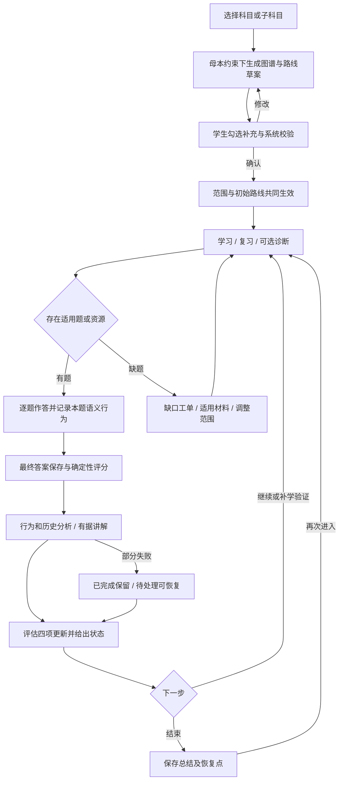
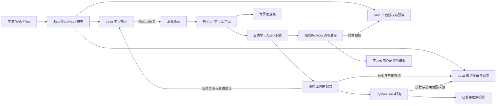
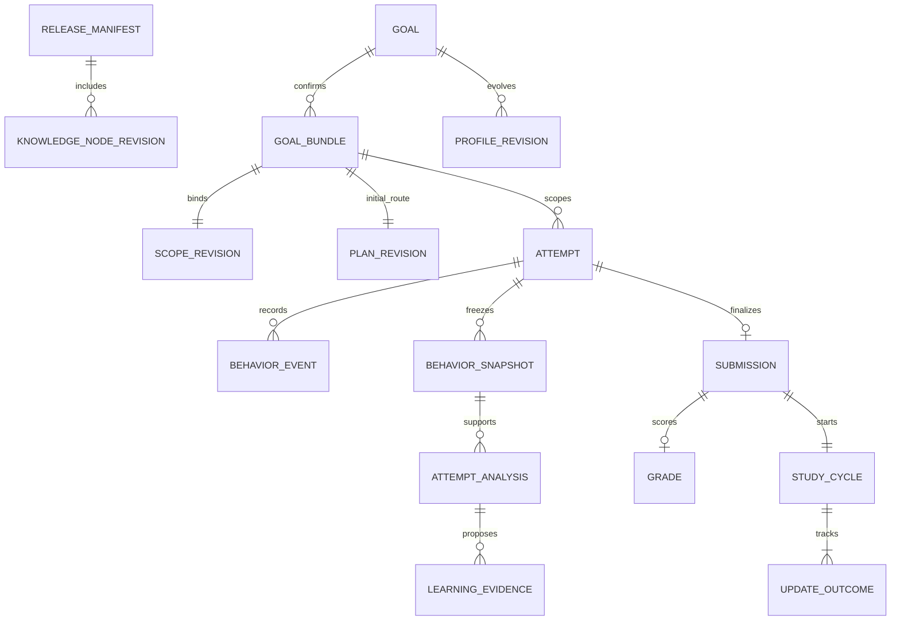
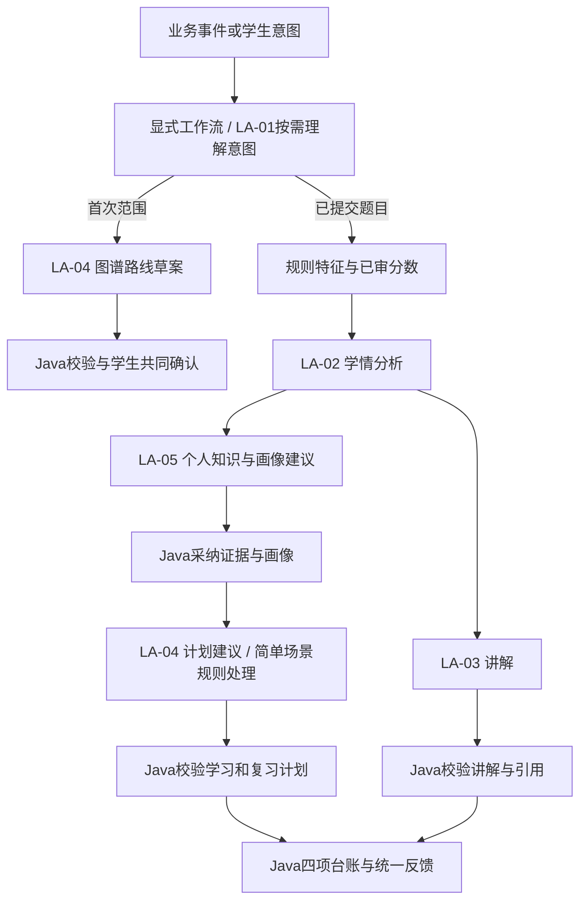
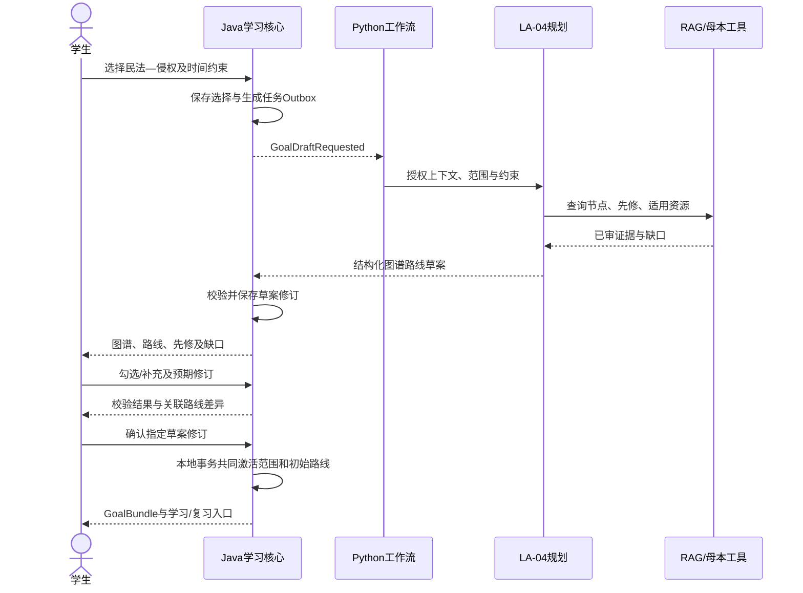
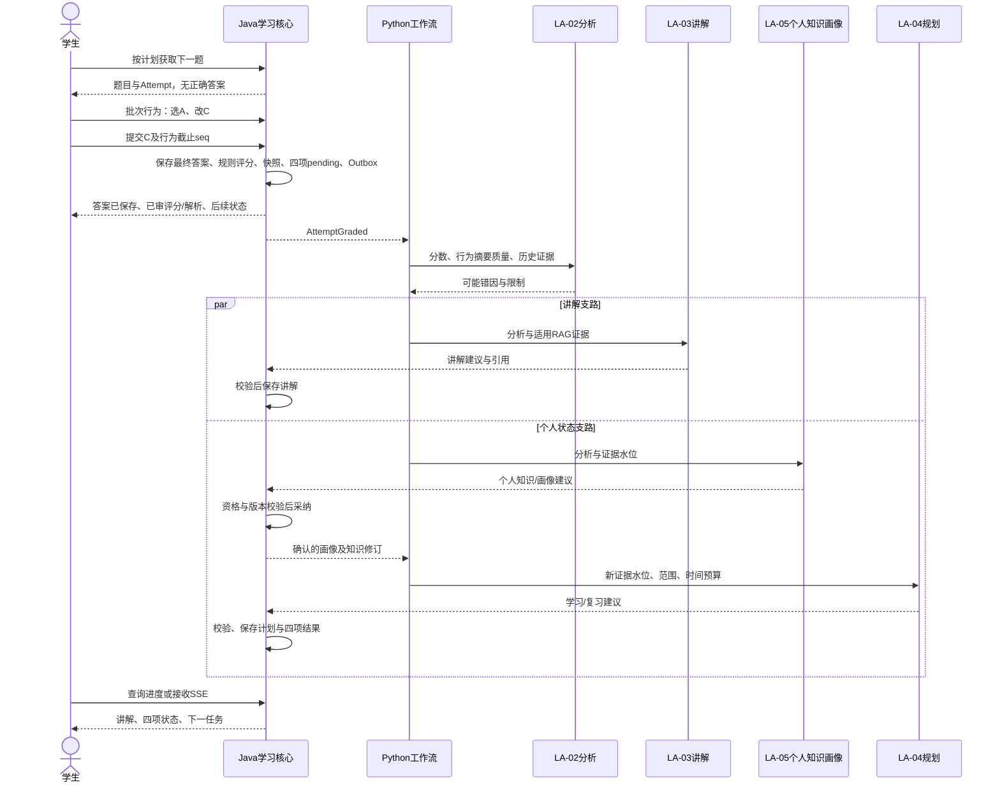

# 学生持续学习——多 Agent 与 RAG 4A 专项架构设计 v1.0

| 文档属性 | 内容 |
|---|---|
| 日期与状态 | 2026-10-18；目标设计评审稿，未实现，未完成兼容性、模型质量、性能或恢复验证 |
| 需求基线 | [通用平台需求 v0.3](../requirements/通用Agentic学习与考试平台-系统需求规格说明书-v0.3.md)，重点第1.5节、UJ-01～04、FR-CORE-01～06及RAG/协作要求 |
| 上位架构 | [4A总体架构 v1.1](通用Agentic学习与考试平台-4A总体架构设计-v1.1.md)，重点第2.4节及第3～5章；[返回核心业务价值流](通用Agentic学习与考试平台-4A总体架构设计-v1.1.md#24-价值流一学生的持续学习平台核心业务) |
| 本篇范围 | 选择范围、共建图谱路线、学习/复习、逐题行为与提交、分析讲解、四项更新、恢复、母本变更输入 |
| 技术约束 | Java＋Spring Boot/Spring Cloud/Spring Cloud Alibaba承接应用；Python承接Agent/RAG；Kubernetes、DevSecOps、CI/CD承接运行交付 |
| 设计性质 | 五类学习Agent是本篇建议的职责划分，待评审；不新增自研基础模型、自动发布公共知识或所有学科评分能力的承诺 |
| 配套状态 | 本篇细化v1.1；既有v1.0契约、全量追溯及检查报告未全部同步，不能据此宣称全套架构已验收；历史归档不改 |

## 1. 阅读方式与架构边界

开发实施配套：[AI Agent群详细设计 v1.0](../design/学生持续学习-AI-Agent群详细设计-v1.0.md)。在本篇4A架构基础上提供逐Agent规格、工作流状态机、Java/Python契约、数据/事务、RAG算法、部署与验收，附Schema、OpenAPI及合成验证样例。两篇均为未实施的评审稿。

程序级配套：[AI Agent群程序设计与工程脚手架 v1.0](../design/学生持续学习-AI-Agent群程序设计与工程脚手架-v1.0.md)，提供可编码的组件、算法和工程验收规格；与本篇及详细设计共同评审。

本篇以“学生选择民法—侵权，然后持续答题、学习、复习”为一条完整业务展开。第2章BA说明业务与责任，第3章AA说明应用协作，第4章DA说明数据及一致性，第5章TA说明实现与运行；第6章专门说明多Agent与RAG，第7章将四层串成场景，第8章给出验证和实施门禁。

主文档继续承担平台全局架构；本篇负责学生持续学习的详细设计。涉及公共母本审核、商业账务、身份治理时调用对应领域能力，不能在本篇另建一套权威数据。未来两篇冲突必须通过需求与架构评审修正，不以“专项更详细”自动覆盖上位约束。

首次确认后的诊断可选；先生成路线不依赖先答题。没有可用题时显式进入内容缺口/替代材料路径。概念问答是允许的辅助入口，不绕过新目标正式学习的共同确认。学习不保证通过考试。

## 2. BA 业务架构：学生如何持续学习

### 2.1 价值与责任

| 角色 | 业务动作与责任 | 可见结果 |
|---|---|---|
| 学生 | 选择/调整目标与范围、确认路线、作答、学习和复习 | 草案、有效版本、答案、讲解、个人变化、下一任务与恢复入口 |
| 学习Agent群 | 组织范围与路线、分析、讲解、建议个人更新 | 有依据、有边界的结构化建议和连贯反馈 |
| 学习业务服务 | 验证范围、评分、采纳建议、保存事实与计划 | 明确的成功/不变/冲突/待处理状态 |
| 学科负责人 | 审核母本、题目答案、评分与教学策略；复核疑义 | 发布版本、适用说明、复核结论 |
| 运维/安全/支持 | 故障处理、权限和数据请求、费用及服务保障 | 工单与恢复证据；不擅自修改权威知识 |

### 2.2 全旅程与分支



### 2.3 分阶段业务规则

| 阶段 | 必须完成 | 失败/例外出口 |
|---|---|---|
| 范围共建 | 绑定学科产品及已审母本，明确先修、个人补充及资源缺口；未测节点未评估 | 生成失败保存选择；人工列表编辑/重试；不能静默确认 |
| 学生确认 | 共同激活个人范围和初始路线；只确认本次范围，不声称覆盖全学科 | 版本冲突展示差异并重新确认；无响应不等于接受 |
| 学习选题 | 从有效计划节点匹配许可、版本、难度/题型适用的已审题，避免不必要重复 | 无适用题记录缺口，可改用材料；不即时造题冒充真题 |
| 作答提交 | 最终答案与过程分别保存，重复提交不重复计分 | 事件缺失不阻断答案保存；网络中断展示未确认状态并安全重试 |
| 分析讲解 | 标准分数由审核规则确定；行为只是线索；引用适用且允许访问 | 低证据说明限制，返回已审解析；争议进入学科复核 |
| 四项更新 | 学习计划、复习计划、个人知识、画像逐项有结果、依据及版本 | 可以无需变化；部分失败单独恢复；旧分析不得覆盖新选择 |
| 持续复习 | 根据现有证据和批准策略安排回顾、区分练习、独立验证 | 无历史时称回顾/验证，不虚构遗忘；目标变化重新校验路线 |

学生可主动调整时间与范围，查看变更理由并撤销允许撤销的建议。跨目标共享时间预算由业务规则控制；不能各目标独立排满同一时段。母本变更触发学习影响检查，历史答案保留当时口径。

### 2.4 UI/UE与人工交接

首次入口支持层级搜索、图谱和列表等价视图、选中范围及先修提示、路线预览、差异和确认；小屏不要求学生拖拽复杂图才能完成操作。个人补充与已审核节点用明确文字区分。

答题页支持键盘/触屏/无障碍语义事件，说明采集目的；最终选择即时反馈，批次传输不阻塞点击。提交后先展示答案保存与判分，再展示“观察到的事实”“可能解释及限制”“四项更新状态”。不显示模型私有推理链，不用进度动画冒充讲解结果。

未采集/不同意可选行为处理时，按授权政策降低分析范围，核心作答仍可继续。对错误答案、引用失效、误判画像均提供反馈入口，复核结果可纠正派生状态但不抹除历史审计。

## 3. AA 应用架构：谁提供哪些能力

### 3.1 逻辑组件与部署责任



AA-04/05/06/15在首发Java学习核心内按模块隔离，分别承接作答与台账、个人证据/画像、学习复习计划、图谱共建；共同确认使用本地短事务。AA-07的Agent执行在Python，AA-10的RAG执行在Python；正式授权和发布信息仍由Java所有者管理。AA-09/14管理公共母本与产品，AA-11/12/13提供调用授权、预算、权益和治理。逻辑模块不强制一模块一服务。

### 3.2 应用与Agent的权限分工

| 能力 | 决策/执行所有者 | Agent参与 |
|---|---|---|
| 解析范围、先修与资源校验 | Java学习核心＋知识域 | 生成可读组织与路线候选 |
| 取题与确定性判分 | Java学习核心，读取审核题目/答案 | 可建议题型与知识点；不能改标准分数 |
| 行为接收与摘要 | Java接收与版本冻结；Python执行特征/推断任务 | 在质量限制下分析摘要 |
| 个人知识和画像 | Java证据规则、版本及持久化 | 分析和整理候选变更 |
| 学习及复习计划 | Java计划约束和任务生效 | 提出顺序、补学与复习建议 |
| 公共知识发布 | Java知识域＋人工学科审批 | 本篇Agent只能报告缺口，不直接发布 |
| 模型调用和费用 | Java预算/Invocation账本＋隔离Python Provider | 只在授予的目的地、预算和能力内调用 |

### 3.3 建议接口与消息契约

以下为待实现的版本化接口，不表示已经存在HTTP服务。所有命令携带幂等键、目标引用和预期版本；身份从可信认证上下文取得，不接受客户端指定任意user_id获得权限。

| 接口/事件 | 输入及输出 | 关键条件 |
|---|---|---|
| POST /v1/goal-drafts | 产品、范围节点、目标/时间约束 → draft_id、run_id | 异步生成；学生选择先持久化 |
| PATCH /v1/goal-drafts/{id} | expected_revision、勾选/补充 → 新草案与缺口 | 乐观并发；未知补充不改母本 |
| POST /v1/goal-drafts/{id}/confirm | expected_revision、草案关联的计划修订 → GoalBundle | 重查权限、母本适用及资源；原子激活 |
| POST /v1/goals/{id}/attempts | bundle/plan/task引用、学习模式 → attempt与题目版本 | 服务端选题；不提前向学生端发送正确答案 |
| POST /v1/attempts/{id}/behavior-batches | writer_epoch、stream_id、事件序列 → 已收区间/缺口 | 本题归属、租约、白名单、去重及限流 |
| POST /v1/attempts/{id}/submit | final_answer、提交边界和可选未确认尾部 → submission、grade、cycle_id | 最终答案独立保存；评分不依赖模型 |
| GET /v1/study-cycles/{id} | 当前用户授权 → 评分/讲解/四项状态和下一步 | SSE/轮询共用权限及重连游标 |
| POST /internal/v1/learning-proposals | 输入版本、建议、证据/限制 → accepted/rejected/conflict及业务引用 | Python受限身份；Java重新校验，不允许任意patch领域对象 |
| AttemptGraded / GoalDraftRequested | 事件信封＋受控输入引用 → Python任务 | Java事务Outbox发布，消费者Inbox去重 |
| AnalysisProposed / ExplanationProposed / PersonalUpdateProposed / PlanProposed | run、输入版本、结构化产出和引用 | Java校验后才成为正式结果；到达不代表采纳 |
| StudyCycleChanged / ReleaseActivated / ReleaseRevoked | 状态版本/影响范围 → 学生进度或失效处理 | 不携带不必要个人正文；撤销实时授权检查优先 |

错误类别至少包括unauthorized、version_conflict、invalid_scope、resource_gap、rate_limited、evidence_insufficient、provider_unavailable、budget_exhausted、result_unknown；区分可重试与需要学生/学科处理。

## 4. DA 数据架构：母本、个人状态与协作证据

### 4.1 核心实体与所有者

| 数据组 | 实体及关键字段 | 写入所有者 |
|---|---|---|
| 母本 | KnowledgeNodeRevision、RelationRevision、QuestionRevision、ScoringRuleRevision、Passage、ReleaseManifest；来源/许可/适用时间/审核状态 | Java知识域；人工发布 |
| 范围与路线 | GoalDraft、ScopeRevision、GoalBundle、PlanRevision、PlanTask；母本引用、先修/缺口、预算 | Java学习核心 |
| 答题事实 | Attempt、Submission、Grade；题目/规则修订、最终答案、模式、幂等键 | Java学习核心 |
| 行为 | BehaviorEvent、BehaviorSnapshot；event_id、stream/seq、writer_epoch、选项、client_monotonic_ms、received_at、截止seq和quality | Java接收与冻结，原事件不由Agent改写 |
| 分析与证据 | FeatureRevision、AttemptAnalysis、LearningEvidence；输入快照、算法/策略版本、支持/反证、限制、资格 | Python产建议，Java保存采纳的派生结果 |
| 个人资产 | PersonalKnowledgeLink、ProfileRevision、PlanRevision、ReviewTask | Java规则采纳；解释正文收藏按学生偏好 |
| 每题台账 | StudyCycle、UpdateOutcome；四类结果、input_watermark、cause、业务修订引用 | Java学习核心 |
| AI运行 | Run、Step、Checkpoint、ToolCall、EvidenceSet、Invocation引用；图/提示/模型/索引代际版本 | Python专属状态；费用账本归Java |



图为核心关系示意：每个StudyCycle最终必须存在四类逻辑结果，图的通用“一对多”记法不表达恰好四项；一个Bundle绑定初始路线，后续计划另行产生修订；待判或复核题允许暂无Grade。本篇逐题主线一次Attempt最多一个最终Submission，重做产生新Attempt；不覆盖原作答。

### 4.2 个人图谱与掌握状态

个人图谱关联已审核节点和关系，叠加本次范围、自评、学习证据、掌握估计、待复习和个人笔记，不完整复制公共母本。范围选择、是否学习过、是否掌握是不同维度；学生取消先修不使先修关系消失。

画像保留输入证据水位、正反证、策略版本及不确定性。一次A→C可表示推理纠正或误触，不自动减掌握分；同一道题反复练习不能等价于多道独立题证明掌握。阈值和复习间隔在教研试点中校准，不能让Agent临时编造统一能力分。

### 4.3 确认、提交与四项更新不变量

1. 共同确认在Java本地事务中写ScopeRevision、初始PlanRevision、GoalBundle、激活指针和Outbox；模型生成在事务之外。并发冲突返回差异，不能部分生效。
2. 提交事务保存最终答案、评分或明确待判状态、行为快照边界、StudyCycle及四项pending结果和Outbox。网络重试返回同一提交；客户端不能改变已提交答案。
3. 四项结果分别是learning_plan、review_plan、personal_knowledge、profile；状态为pending、updated、no_change、failed、superseded，保留原因、证据和输出版本；讲解另有独立状态。两项计划允许共用一次PlanRevision，但结果分别记录。
4. 采用依赖版本比较和幂等键，例如submission_id＋analysis_revision＋outcome_type；有冲突则重新读取当前状态评估，不用旧结果覆盖新范围/计划。
5. 个人证据与画像可先完成，规划再读其确认版本；计划失败不回滚答案和已生效证据。没有新证据也要给no_change及原因，不能用空结果假装完成。

### 4.4 行为边界及迟到处理

单次Attempt使用active_writer_epoch和stream_id，事件在流内单调seq；跨端转移写入租约时旧epoch隔离，不能按设备墙上时钟合并为真实总顺序。选项ID必须属于本题版本。重复event_id/seq内容相同可确认，内容冲突拒绝并记录；异常量和字段先限流校验。

提交固定当前epoch、expected_last_seq和服务器已收到的事件。可携带尾部补传但不等待所有行为到齐；客户端错误或尾部非法也不应阻断合法最终答案，分别返回采集错误。采集质量区分received_contiguous、gaps、unavailable、conflicted：序号连续只表示客户端声明范围已收齐，不能证明实际动作完整。

迟到只接收冻结epoch/流内、seq不超过截止值且在批准窗口内的合法事件；提交之后新增动作不得进入本题分析。接受补齐形成新Snapshot/AnalysisRevision，重评个人建议，不重复判分、计费结算或新增同一个逻辑复习任务；无法确认的外部模型费用按Invocation对账。晚于期限的补传记录处理结果，不无限重启分析。

### 4.5 版本、隐私与删除

答案和解释绑定题目、评分、母本、证据及生成版本；历史法考口径与现行法律解释分别标注。知识撤销进入当前授权拒绝集合，阻止新回答使用；已生成回答可标为需复核，历史保存与对外展示按许可和隐私政策处理。

原事件、特征、画像、RAG资料集、检查点和缓存都有数据清单及留存政策。模型出站只发授权所需摘要；不发完整点击日志、密钥、无关目标或其他学生资料。删除请求贯穿在线数据、派生索引、AI检查点、缓存和外部供应商政策；备份恢复先重放删除/账号禁用账本。具体时长和同意策略沿用T-29，不在设计中虚设法定期限。

## 5. TA 技术架构：实现与运行

### 5.1 确定方向与技术边界

| 层面 | 方案 | 实施要求 |
|---|---|---|
| Java应用 | Spring Boot、Spring Cloud、Spring Cloud Alibaba；Gateway入口、Nacos治理 | JDK/Boot/Cloud/Alibaba成组锁BOM并验证；Nacos负责Java发现/动态业务配置，Kubernetes负责基础Service/DNS，每路径一个主要发现机制 |
| Python AI | LangGraph显式工作流＋领域工具适配，Python受支持稳定线 | 不引入另一个权威业务库；HTTP入口具体框架E0评估；依赖锁定与图版本兼容测试 |
| 消息 | RabbitMQ、Java Spring AMQP、Python标准消息适配 | 跨语言版本化JSON消息，Outbox/Inbox及死信；不让Java依赖Celery内部协议 |
| 存储 | PostgreSQL领域事实、独立权限AI检查点；S3兼容原文；pgvector检索投影、Valkey可重建缓存 | 私有领域表不跨服务直写；索引和缓存不能成为授权真相 |
| 运行 | Kubernetes独立Java/Python/Provider/抓取工作负载、资源配额与网络策略 | ServiceAccount最小权限、探针/优雅退出、PDB/跨故障域、任务租约与水平扩容 |
| 交付 | DevSecOps＋CI/CD；制品签名/SBOM、受保护生产部署 | 同一产物晋级，API/事件/数据库迁移兼容，AI评测与业务验证共同作为门禁 |

[Spring Cloud官方](https://spring.io/projects/spring-cloud/)说明其版本管理方式；本篇不独立宣布新的具体版本。LangGraph的[持久化机制](https://docs.langchain.com/oss/python/langgraph/persistence)提供检查点能力；它不能取代业务落库及幂等。[中断/恢复机制](https://docs.langchain.com/oss/python/langgraph/interrupts)用于等学生确认，恢复可能重新执行节点，含副作用的工具必须可幂等重入。上述为方案依据，不等于平台已经使用或验证这些能力。

### 5.2 运行、通信与安全

Java事务提交后Outbox异步投递；Python消费者领取run租约、校验状态和调用预算后执行。长推理用任务ID和消息回执，Web通过BFF SSE/轮询读取；同步业务查询设置超时和连接池，禁止持数据库事务等待模型。

Python普通Agent不能解密模型密钥，Provider进程按Invocation授权调用平台/学生配置模型。初版同一run固定获准提供者策略，跨提供者回退必须另有授权，不能以“自动容灾”扩大数据目的地。用户配置URL通过DNS/重定向/私网/元数据地址检查并受网络出站控制，RAG嵌入和重排也执行同一目的地规则。

服务间使用可验证工作负载身份与最小作用域，工具调用重新校验目标与操作；消息只带短期能力引用或上下文引用，不带长期用户Token。上下文通过服务端组装，学生正文/检索内容不能覆盖系统指令或授予工具权限。审计关联请求/run/attempt/cycle/step/tool/Invocation，敏感正文和私有推理链不进入日志。

### 5.3 性能、成本和隔离

沿用需求的待评审基线：100活跃会话、20提交/秒短时突发；非AI读取P95≤500ms、提交保存P95≤1s；AI首个有用反馈P95≤5s、标准解析P95≤30s需受控模型验证。排队时间计入端到端，降级与完整成功分别统计，不能宣称八类职责同时调用仍天然达标。

行为事件吞吐按活跃答题人数×语义事件率另建模型，批量、压缩/体积限制和专用连接配额不能挤占提交。模型并发按队列年龄、预算及提供者上限控制；优先复用有效已审解析和规则，只有需要时才新生成。按run设总预算、调用/Token上限、期限和有界重试；提供者结果未知先对账，不能盲目重发收费请求。

API、Agent、Provider、检索索引构建、内容解析分资源池和队列；AI停机不影响已审题作答。数据库/身份/队列的HA与备份独立验收；Kubernetes调度恢复不等于业务数据恢复。

### 5.4 DevSecOps、观测与运行手册

Java/Python独立构建和锁依赖，共享OpenAPI与事件Schema的兼容测试；CI执行静态/密钥/依赖/镜像/IaC/许可证检查、真实数据库与队列集成、授权与领域不变量、固定模型/提示/索引的离线评测。经预发验证、受保护发布和灰度观察后晋级；数据库采用扩展—回填—切换—收缩，不能盲目逆向DDL回滚。

核心指标包括草案生成/确认冲突、答案保存、行为缺口/延迟、RAG召回/引用、完整教学结果、四项pending年龄、版本冲突、模型费用与未知调用、队列水位。避免用学生ID等高基数字段作常规指标标签；详细关联放受控追踪。

| 故障 | 首要处置与责任 | 恢复验证 |
|---|---|---|
| 模型/Agent超时 | AI运维熔断，保留run；学生看到已审反馈/待分析 | 按预算恢复步骤，不重提答案 |
| RAG无依据/引用撤销 | 检索Owner停止该证据生成，教研复核 | 新检索通过适用性校验，旧反馈标记 |
| 行为服务拥塞 | 学习服务优先提交，标记缺采集 | 补传窗口与快照规则正确，不伪造完整 |
| 四项局部失败 | 学习Owner按台账重试依赖步骤 | 输入水位有效，无重复任务及旧覆盖 |
| 队列/节点/网络故障 | 运维恢复租约与消息通道，必要时暂停新AI任务 | Inbox/Outbox核对及死信重放 |
| 凭据泄漏/越权 | 安全禁用凭据、工作负载与在途授权 | 数据目的地/审计复核，审批后恢复 |
| 数据恢复 | 数据Owner隔离写入并恢复到批准点 | 重放删除禁用账本、核对外部调用后开放 |

## 6. 多 Agent 与 RAG 专项设计

### 6.1 Agent数量与职责

自然语言协调入口的独立设计见[LA-01需求与C4详细设计](../design/agents/LA-01-学习协调Agent-需求与C4详细设计-v1.0.md)，细化本节LA-01及应用/Agent交互，不改变平台4A组织。

本篇设计**五类学习Agent**；平台另有三类知识运营职责，因此全局可理解为八类。新增的“个人知识与画像Agent”细化主架构原“规划与画像辅助”，本篇完成后主架构按同一口径说明。八类是职责，不是八个微服务、八个常驻实例、八套模型或每题八次调用。

| 编号/职责 | 输入 → 输出 | 可用工具 | 禁止及失败处理 |
|---|---|---|---|
| LA-01 学习协调 | 意图、任务/权限上下文 → 路由和统一结果 | 读任务、调度已批准子图、读取业务结果 | 不扩大预算/权限；固定答题路径可由规则路由，不调用协调LLM |
| LA-02 学情分析 | 最终答案/分数、行为特征质量、有效历史 → 支持/反证、可能错因及限制 | 读本题证据、选项考点映射、必要RAG | 不改分、不凭点击定掌握；证据不足返回insufficient |
| LA-03 辅导讲解 | 审核答案、证据集、错因摘要 → 可读讲解及引用 | RetrieveEvidence、ReadApprovedExplanation、提复核建议 | 不把生成内容冒充真题答案；低证据退已审解析 |
| LA-04 学习规划 | 范围/先修/资源、已确认画像水位、时间预算 → 初始路线或学习/复习变更建议 | ReadScope、ReadProfile、FindResources、ValidatePlanPreview | 不直接激活计划；新范围/预算授权交学生确认 |
| LA-05 个人知识与画像 | 经审核资格的证据与分析、旧个人状态 → 知识关联/画像候选及理由 | ReadPersonalEvidence、ReadProfile、ProposePersonalUpdate | 不自动收藏全部生成正文、不改母本；冲突按当前状态重算 |
| 外部 KO-01 知识发现 | 获准来源 → 新资料线索 | 知识运营工具 | 本篇只消费其后续审核发布结果 |
| 外部 KO-02 内容整理 | 新旧资料 → 知识/题目关联草稿 | 知识运营工具 | 未审内容不进入权威学习依据 |
| 外部 KO-03 知识影响 | 版本变更 → 受影响目标/证据建议 | 影响查询与工单 | Java及学科负责人确认学习侧处理 |

规则评分、资源筛选、行为特征提取、证据资格、约束求解、引用检查和调度是确定性组件；RAG是共享检索能力；它们不计为独立自主Agent。LA-02分析本次表现，LA-05聚合长期证据，画像规则校准在Java/版本化策略中控制；若拆分无收益，可在同一次执行中组合，保留逻辑输出责任。

### 6.2 协作拓扑与依赖



常规下一题无需全套Agent；首次用LA-04，复杂意图才用LA-01；逐题分析按配置调用LA-02，LA-03与LA-05可在分析后并行，规划必须读确认的个人证据水位。LA-03失败不阻止已满足依赖的个人更新，LA-05失败时规划标pending或明确使用批准的旧水位，不谎称基于新画像。

无相互无限讨论或投票改分。分歧由审核答案、证据资格和业务规则裁决；无法确定进入学科复核。每次循环有最大步骤/重试/预算和截止，新增角色要通过消融对比证明质量或维护收益。

### 6.3 Agent与应用的交接信封

下面为内部消息最小示例；字段具体Schema在E0代码化，schema_version不是学科或计划版本。服务端校验context_ref绑定的用户/目标，工作负载身份另行验证；消息中传引用不等于获得权限。

```json
{
  "schema_version": "1.0",
  "event_id": "evt_01",
  "correlation_id": "req_01",
  "causation_id": "submission_01",
  "run_id": "run_01",
  "step_id": "analyze_01",
  "role": "LA-02",
  "context_ref": "authorized_context_01",
  "input_refs": {
    "attempt_id": "attempt_01",
    "submission_id": "submission_01",
    "goal_bundle_id": "bundle_03",
    "release_manifest": "legal_release_12",
    "behavior_snapshot_revision": 2,
    "profile_revision": 7
  },
  "policy_ref": "learning_policy_02",
  "authorization_ref": "task_grant_01",
  "budget_reservation_ref": "budget_01",
  "deadline_at": "2026-10-19T02:00:00Z",
  "idempotency_key": "submission_01:snapshot_2:LA-02"
}
```

结果必须带status、output_schema、input_refs、proposal/evidence引用、limitations、用量、完成时间和错误类别。Java分别进行结构、授权、输入版本、业务约束、引用及语义质量校验；拒绝原因回传工作流。只有Java返回accepted和业务修订引用，协调职责才报告“已更新”；模型声称调用成功不算落库成功。

### 6.4 运行状态、记忆与恢复

Run状态：queued、running、waiting_input、partial、completed、failed、cancelled、superseded；completed指全部必需步骤达到成功或批准的降级/不变结果，不等于所有Agent都运行。Step单独记录状态和重试，业务四项状态与图节点状态分别存储。

短期记忆为任务检查点和会话必要上下文；长期个人资产以Java领域记录为准；公共知识以发布母本为准。检查点保留引用、步骤、图/提示版本和限制，不存凭据或无必要个人全文。等待学生确认释放执行资源，恢复重新验证身份、授权和版本；学生编辑过草案后旧确认提示不能直接生效。

图版本按run固定，旧run在兼容Worker完成或显式迁移/暂停，不能用新节点结构随意解释旧检查点。取消阻止未开始副作用，已保存答案不撤回；在途模型费用标结果未知并对账。用户禁用或目标撤销后，回执仍可记录审计，但不能继续写有效学习状态。

### 6.5 RAG知识准备链

| 步骤 | 输入/输出 | 发布与质量条件 |
|---|---|---|
| 来源登记与接入 | 获准资料 → 原文、来源修订、许可和时间 | 允许解析/存储/模型处理，抓取失败不记无变化 |
| 解析与切片 | 原文 → 按条款/标题/题目语义边界的Passage | 保留定位、上下文和内容摘要；题干/选项/答案结构化，切片长度经测试 |
| 节点与关系关联 | 候选知识、先修/包含/易混等关系及题目映射 | 人工学科审校；来源与关系类型可追溯 |
| 发布清单 | 审核内容、适用产品/时间 → ReleaseManifest | 答案、许可、关系/先修及覆盖校验通过 |
| 索引构建 | 发布清单 → 词项/向量/关系读模型代际 | 记录嵌入模型、维度、切片/分词版本；完整性和查询集验收 |
| 激活与撤销 | 有效清单与索引代际 → 检索可用范围 | staged→ready→active；切换原子指针；紧急撤销先阻断访问，再清索引/缓存 |

知识存储并不等于向量库：正式知识、关系、题库及个人事实在领域数据层，向量/词项索引为可重建投影。个人笔记单独命名空间，未经学科审批不得混入公共权威集合。知识运营内部实现是外部依赖，本篇不另定义完整运营Agent流程。

### 6.6 RAG在线检索链

1. **绑定上下文。** Java签发当前用户/目标、产品、有效母本与授权范围引用，区分公共证据与个人证据；嵌入和重排目的地同样纳入授权。
2. **分类任务。** 取题/答案使用结构化精确查询；概念解释使用词项＋语义；先修/易混通过审核关系扩展；个性化再查当前目标个人证据。
3. **先限制再召回。** 在允许的内容修订、产品、许可、适用时间、发布状态与个人边界内召回。禁止全库私有召回后交LLM过滤。
4. **合并与排序。** 中文术语/别名与固定分词流程，精确命中、词项和向量结果按配置融合，按需重排；重排只接收已获准候选。关系扩展设类型、深度和节点数上限。
5. **判断证据。** 去重、保留来源上下文，检查标准答案/适用性矛盾；相似度不是可信度。缺证据返回insufficient；明确冲突进入复核，不让模型凑足引用。
6. **组织生成。** EvidenceSet记录Passage、版本/定位、用途、支持点及限制，提示区分权威知识与个人线索；引用使用服务端证据ID而非模型自造URL。
7. **校验与展示。** Java/检索服务验证引用存在、允许且未撤销，答案与评分一致；语义支持性另用评测/抽检，程序引用校验不能保证无幻觉。学生打开引用再次授权。

首发沿用主架构的PostgreSQL关系查询＋词项/术语索引＋pgvector，不在缺少基准时增加独立图数据库。高选择性过滤优先在允许集合精确检索，近似索引的过滤可能影响返回数/召回，需要独立验证；[pgvector官方说明](https://github.com/pgvector/pgvector)作为实现参考。复杂图、中文召回或负载实测不达标，再评估专用读模型，不改变知识所有者。

### 6.7 缓存、撤销与质量

公共检索缓存键包含产品、适用版本、许可范围、查询/检索配置及索引代际；个人缓存额外绑定用户、目标、证据水位及授权版本。不同用户、不同提供者授权及个人上下文不能共用生成结果。缓存命中仍查紧急撤销/禁用状态，不能仅等TTL自然过期。

母本发布生成新索引代际并验证后切换；撤销事件更新拒绝集合、失效缓存并触发受影响解释/计划复核。学生历史题记录保留原版本，不能把当年标准答案静默换成现行口径。

RAG评测分别检查精确题目/答案正确性、授权隔离、召回覆盖/排序、证据充分性、引用可追溯与语义支持、最终讲解一致性、耗时费用；无证据和应拒答集合也必须存在。具体样本、Top-k、阈值和门槛经T-21～25及教研批准，不虚设统一“准确率”。

## 7. 四层贯穿的关键场景

### 7.1 首次选择侵权并共同确认



BA：学生确认学什么；AA：LA-04生成、Java校验；DA：共同生效Bundle；TA：异步生成、短事务确认。确认冲突返回最新差异，未测知识未评估；未知补充留待映射。生成出错可恢复选择与已有草案，不自动开始新范围主线。

### 7.2 一道题：A改C，提交C



若原标准答案为C，最终评分正确；改选可提示区分验证，也可能不引起任何个人安排变化。没有选项考点映射时，不编造“A意味着某具体概念错误”。讲解或规划失败保留已完成支路，下一题使用当前有效且兼容路线并披露待处理；不能把建议直接当生效计划。

### 7.3 复习、恢复、改目标与母本更新

| 触发 | 四层处理 | 闭环出口 |
|---|---|---|
| 到期复习 | Java认领到期任务、校验当前范围与证据水位、按知识点选题；Python只处理需要的分析/辅导 | 新Submission进入同一四项流程；没有历史则标回顾/验证 |
| 退出后恢复 | Java保存有效任务与提交；Python检查点恢复未完成步骤；重新鉴权及校验输入版本 | 返回已保存结果和剩余动作，不重新算分/重复安排 |
| 学生改范围/时间 | 新草案保留旧有效范围，LA-04提出路线差异；学生确认后激活新版本 | 旧任务按兼容性迁移/停用，旧回执标superseded |
| 母本新发布/撤销 | 接收知识域事件、判断引用影响；撤销先阻断新检索；历史题口径保留 | 生成补学/复核或no_change，必要时学生确认，不全量清空画像 |
| 缺题/争议/弱证据 | 记录内容缺口/复核，明确限制；材料学习不自动证明掌握 | 后续题目/复核到位后验证并补充证据 |

## 8. 可落地验证、追溯与决策

### 8.1 需求到四层的落点

| 需求与验收 | BA | AA | DA | TA与验证 |
|---|---|---|---|---|
| FR-CORE-01～02、IR-08、UX-10；AC-58～59、65 | 范围共建与确认 | AA-15/06、LA-04 | Draft、Bundle、初始PlanRevision | 并发确认、生成失败/恢复、未知补充/先修缺口 |
| FR-CORE-03；AC-60 | 按计划逐题学习/复习 | AA-04/09/14、资源工具 | PlanTask、QuestionRevision | 许可/版本过滤、无题回流、真题标识 |
| FR-CORE-04、IR-09、NFR-37；AC-61、64、66、69 | 保留答案和过程 | AA-04、特征处理 | Event、Snapshot、Submission | 批次/乱序/重复/缺失/迟到/跨端/非法尾部与提交独立性 |
| FR-CORE-05、NFR-38；AC-62、67 | 有限行为推断及讲解 | LA-02/03、AA-10 | Analysis、EvidenceSet、Grade | 同最终答案同分、误触/后台/无障碍、引用和独立验证 |
| FR-CORE-06、NFR-39；AC-63、68 | 每题四项评估 | AA-05/06/04、LA-05/04 | Evidence/Profile/Plan、StudyCycle | no_change/局部失败/晚回执/输入冲突/不重复排任务 |
| NFR-27～34、AR/MAC及RAG相关要求 | 有依据连续教学 | 工作流、工具、RAG、Provider | 检查点、授权/预算引用、版本 | 协作故障、提示注入、跨用户/目标隔离、提供者替换及回归 |
| NFR-01～18、35～36、T-21～30 | 可用、运营及治理 | 应用/知识/治理边界 | 删除/撤销/审计及影响记录 | 故障注入、容量、恢复演练、教研与安全门禁 |

此为本篇范围的分组追溯，不替代平台逐条追溯矩阵；所有验证均待执行。NFR-27～34等原始要求以需求原文为准，分组不修改其编号与定义。

### 8.2 测试与发布门禁

- 产品/UI：共建/冲突/缺口/小屏无障碍、四项异步状态、下一题与恢复原型走查；验收完整正常与例外旅程。
- Java/Python：领域单测、Schema契约、真实PostgreSQL/RabbitMQ集成；重复回执、过期授权、旧证据水位、模型结果未知和取消后到达。
- AI/教研：开发集与独立黄金集分离，固定内容/模型/提示/图/检索配置；分别评估学情推断、讲解、规划可执行性；与规则基线/合并职责做消融，确认额外Agent的收益及代价。
- RAG/安全：同名知识、历史与现行口径、无依据、撤销、跨学生/跨目标、个人笔记注入、引用打不开、重排外发、缓存越权和删除恢复。
- 性能/运行：提交与事件独立压测；AI端到端含队列；Nacos/消息/节点/模型故障、密钥轮换、镜像灰度、数据库恢复与四项积压处置。

阻断项包括：越权、未审母本被当权威、改选改变客观分数、答案静默丢失、重复账务/复习任务、确认部分生效、旧回执覆盖新目标。教学质量门槛与预算在试点前明确并记录；软件测试不能单独证明真实学习效果。

### 8.3 实施顺序与待评审项

| 阶段 | 交付与依赖 | 退出证据 |
|---|---|---|
| S0 契约与PoC | 确认职责、工具授权、行为/版本Schema；锁Java/Python组合；共建及提交原型 | 可执行契约、真实集成结果、成本/安全评审 |
| S1 规则闭环 | 已审母本/题库、首次确认、逐题提交评分、四项台账和已审解析 | AC-58～69适用规则分支通过，AI停机仍可学习 |
| S2 AI与RAG | LA-02/03、RAG；再接LA-05及LA-04复杂重排，LA-01按需意图路由 | 各职责独立及端到端评测、预算和版本冲突通过 |
| S3 持续与生产门禁 | 复习/母本影响/删除/恢复、Kubernetes与DevSecOps、安全和容量 | 全旅程回归、灾备演练、值班及可回滚发布 |

待评审：五类学习职责的拆分收益、行为窗口与保留(T-28～29)、画像校准与证据资格、首次编辑和先修取舍(T-30)、检索Top-k/切片/排序与质量集、模型目的地和预算、支持题型与争议流程、生产容量及具体版本。明确这些参数不应阻止先完成规则和契约骨架，但必须在相应能力上线前关闭。

### 8.4 本篇决策与变更管理

| 决策 | 理由与代价 | 重审条件 |
|---|---|---|
| 五类学习职责＋外部三类运营职责 | 本次与长期分析分开，调用增加须证明收益 | 质量/时延/费用对比无收益则合并执行 |
| 显式工作流＋按需协调Agent | 可检查依赖、预算与恢复，减少无界对话 | 新复杂业务需额外动态路径时有界扩展 |
| Java确认事实、Python提交建议 | 保护业务事务与权威边界，跨语言需契约维护 | 服务拆分/存储变化时重评事务和补偿 |
| 结构化＋混合检索＋受限关系扩展 | 精确题目与知识证据采用合适方式，投影可重建 | 查询和负载实测不足才扩展检索存储 |
| 独立专项与主文档双向链接 | 主架构保持全局可读，专项保留实施细节 | 每次变更同时检查需求、主架构、专项和验收；完成修改后Git commit |

本篇不覆盖或改写历史归档。当前仅完成文档设计与结构检查；将来的模型、代码、压测、安全及学习成效证据必须单独记录。
