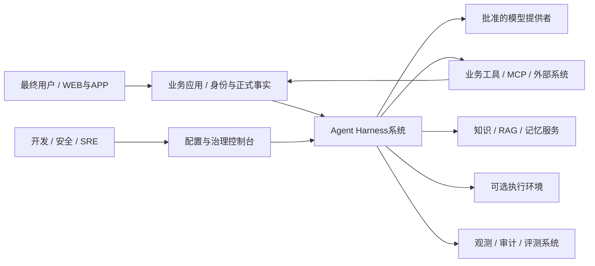
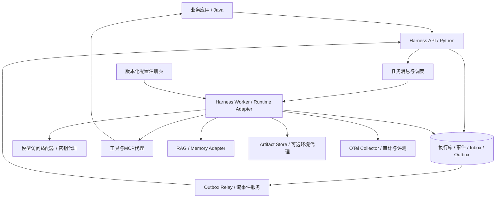
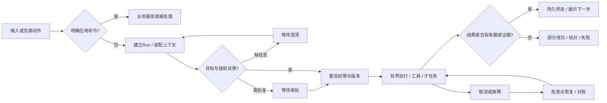
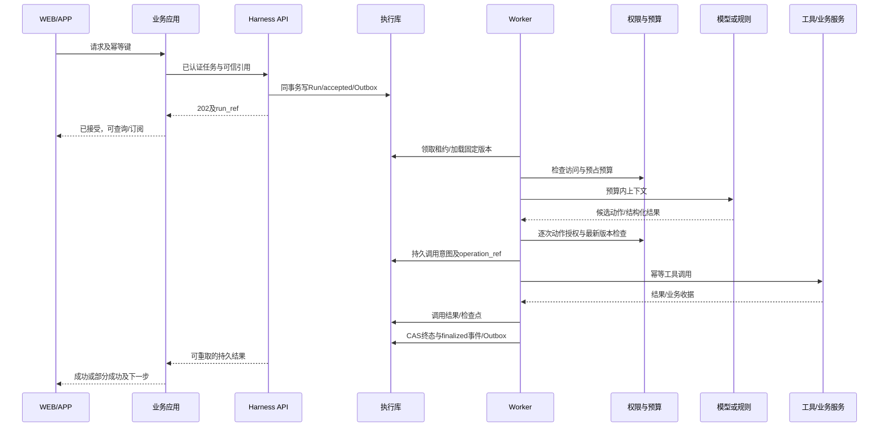
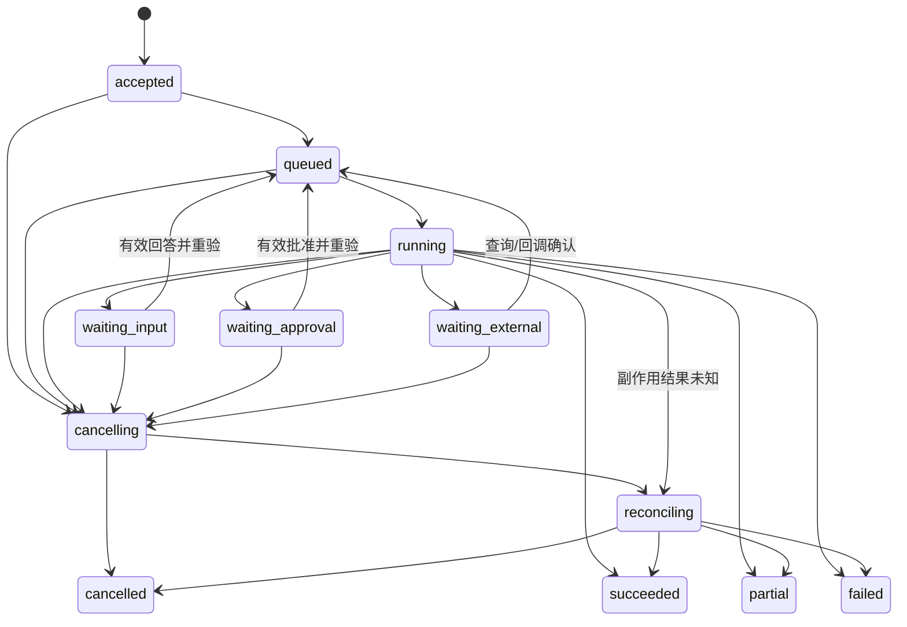
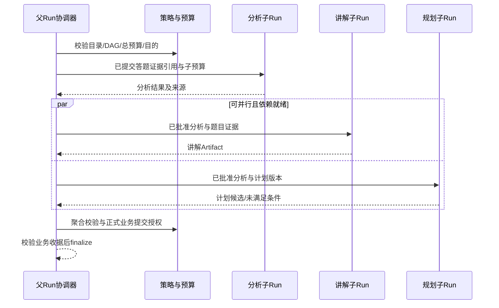
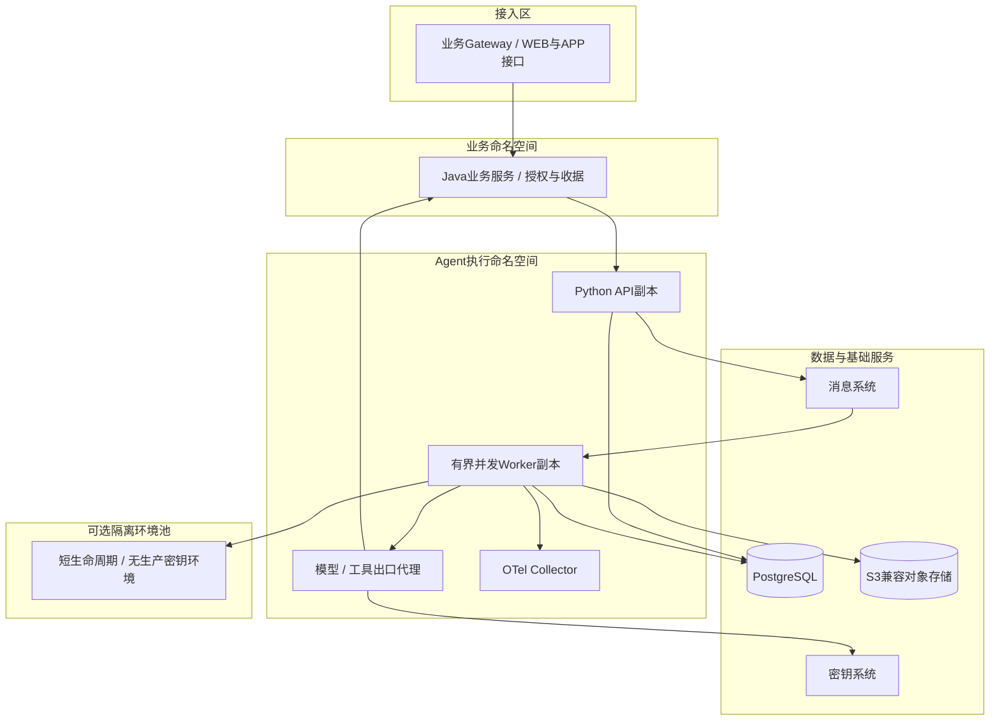

# 通用 Agent Harness 参考架构与工程规范 v1.0

| 属性 | 内容 |
|---|---|
| 日期 / 状态 | 2026-10-19；参考架构与工程规范评审稿；尚未实现或通过生产验证 |
| 文档结构 | arc42 十二章＋C4结构视图＋运行时旅程/时序/状态图＋Harness专项规格＋ADR |
| 适用对象 | 产品、UI/UE、架构、Java/Python开发、测试、安全、SRE与学科运营负责人 |
| 范围 | 可复用Agent执行底座；适用于协调、辅导、研究、知识维护等业务角色；按Profile启用能力 |
| 依据性质 | 官方工程实践和开放协议的交叉参考；本文是项目提出的参考规范，不宣称是统一行业标准 |
| 规范措辞 | “必须/不得”为本参考设计的约束；“建议”为可经ADR调整的方案；“可选”由角色和风险决定 |
| 生产使用条件 | 角色需求、契约、依赖锁定、真实集成/安全/恢复/质量评测及运维门禁全部完成后，才能作为生产发布基线 |
| 交付形态 | 本次仅新增本文；配置、契约示例及检查说明均内嵌于附录，不生成代码、附件或修改其他文档 |

关联文件：[需求v0.3](../requirements/通用Agentic学习与考试平台-系统需求规格说明书-v0.3.md)、[4A总体架构v1.1](通用Agentic学习与考试平台-4A总体架构设计-v1.1.md)、[多Agent/RAG专项](学生持续学习-多Agent与RAG-4A专项架构设计-v1.0.md)、[Agent群详细设计](../design/学生持续学习-AI-Agent群详细设计-v1.0.md)、[程序设计与脚手架](../design/学生持续学习-AI-Agent群程序设计与工程脚手架-v1.0.md)、[LA-01独立设计](../design/agents/LA-01-学习协调Agent-需求与C4详细设计-v1.0.md)。

本篇建立通用基准，不替换现有业务契约、不自动批准增加Agent权限、不更改LA-01职责。LA-01与通用架构的正式Gap矩阵后续独立评审。既有局部API与本篇概念接口需经适配与版本映射，不能直接拼接上线。

阅读路线：产品/UI先读1、3、6、10；开发先读4、5、6、8及附录；SRE/安全读2、7、8、10；架构负责人审阅9、11与追踪矩阵。

## 1. 引言与目标

### 1.1 定义与业务价值

Agent Harness是围绕业务Agent的受控执行体系：把用户目标、可信状态和角色配置转为有界的规则/模型/工具执行，管理上下文、权限、预算、交接、恢复、证据与结果交付。它不是模型、提示模板、另一个业务Agent，也不等于某个框架。

业务Agent定义“做什么”；Workflow定义步骤依赖与分支；Harness约束“如何安全可靠地执行”；Runtime提供图执行、检查点、流等机制；业务应用拥有账户、业务规则和正式事实。Session持久历史与模型可见上下文必须分离。该分解参考[Anthropic工程架构](https://www.anthropic.com/engineering/managed-agents)，本文的接口、阈值与技术组合是项目设计。

目标：开发者新增角色时复用治理机制；用户理解任务进度与真实结果；故障后恢复已接受任务；安全团队能证明谁访问了什么；运营人员用失败样本持续改进。

### 1.2 用户与责任

| 角色 | 目标 | 交付/责任 |
|---|---|---|
| 最终用户 | 完成任务、了解进度、控制授权、取回结果 | 输入、澄清、必要确认；可查询/取消 |
| 产品/UI/UE | 将Agent能力变成可理解的产品流程 | 状态/失败/待确认文案、操作入口与可用性验收 |
| Agent开发者 | 实现领域策略、输出和工具 | RoleProfile、Prompt、Schema、评测集及领域正确性 |
| Harness开发者 | 保证通用执行不变量 | 内核、端口、恢复、权限/预算集成及兼容性 |
| 业务应用开发者 | 管理权威业务事实与用户边界 | 身份、命令、事务、幂等、收据与业务授权 |
| 安全/数据负责人 | 限制数据用途与操作风险 | 策略、保留/删除、模型/工具目的地审核 |
| SRE/测试 | 证明可运行和可恢复 | 容量、监控、演练、故障注入、质量门禁 |

### 1.3 功能需求

编号H-FR仅属于本篇通用设计，不冒充已批准的平台业务需求。

| 编号 | 必须支持的能力 | 优先级 |
|---|---|---|
| H-FR-01 | 经可信入口创建Session/Run，绑定主体、租户、目的与幂等键 | P0 |
| H-FR-02 | 加载固定版本Profile/Workflow/Prompt/Schema/工具目录，规则优先并有界执行 | P0 |
| H-FR-03 | 构建预算内、可追溯、按目的隔离的上下文，管理摘要与记忆有效性 | P0 |
| H-FR-04 | 经模型适配器调用批准模型，验证结构、限制重试并登记费用 | P0 |
| H-FR-05 | 工具逐次授权、幂等/副作用控制、结果验证，支持直接服务与可选MCP | P0 |
| H-FR-06 | 持久化事件/检查点，去重、并发控制与故障恢复 | P0 |
| H-FR-07 | 澄清/审批/外部等待持久暂停；用户查询、取消、恢复与明确终态 | P0 |
| H-FR-08 | 类型化多Agent任务、依赖、预算与结果聚合，防止循环委派 | 启用多Agent时P0 |
| H-FR-09 | 按角色发现、验证、按需加载Skills；脚本需独立执行授权 | 启用Skills时P0 |
| H-FR-10 | 将RAG视为证据服务，保留版本/权限/引用与不足结论 | 启用RAG时P0 |
| H-FR-11 | 提供脱敏可观测、审计、离线回放及评测改进闭环 | P0 |
| H-FR-12 | 提供可选Artifact/执行环境生命周期，不把沙箱绑定每个Run | 启用执行环境时P0 |
| H-FR-13 | 配置审批、版本晋级、兼容迁移、灰度与回滚 | P0 |
| H-FR-14 | 隔离租户、用户自配模型密钥与目的地，支持撤销和删除传播 | P0 |

### 1.4 质量目标与适用等级

质量按正确性、安全、可靠性、性能/成本、可观测、可维护、隐私、可用性分别验收，指标见第10章。通用层不设一个覆盖所有Agent的回答时限或Token窗口。

| Profile类型 | 默认策略 | 可选扩展 |
|---|---|---|
| 协调型 | 一次意图识别或规则分流、固定模板、无任意代码执行 | 澄清、有限多Agent交接 |
| 辅导型 | 权威证据检索、有界讲解、引用与事实校验 | 流式讲解、受审材料生成 |
| 研究/知识维护型 | 有界检索、来源对比、候选变更 | 长任务、人工审核、受控网络/沙箱 |
| 编码/操作型 | 明确资源与变更范围、执行隔离、操作审计 | 文件、Shell、浏览器；必须单独过安全门禁 |

只启用业务需要的能力；“通用”不意味着每个角色都获得浏览、动态规划、Shell或跨用户记忆。

## 2. 架构约束

### 2.1 责任与信任边界

| 边界 | 所有者 | 强制约束 |
|---|---|---|
| 产品身份/业务事实 | 业务应用；本项目Java | 用户身份由服务端绑定；正式分数、计划、画像及知识发布由业务服务提交 |
| 执行状态 | Harness/Runtime；本项目Python | 管理Run/Step/工具调用，不另建业务账本；结果以领域收据为准 |
| 权限与批准 | 权威策略/业务服务 | 模型、Skill、工具说明、Agent交接均不得自授权限 |
| 费用/配额 | 业务账务服务＋执行用量适配器 | 预占、结算、对账；提供者超时的用量可unknown，不伪造为0 |
| 工具/网络/代码 | 受控代理或独立执行环境 | 最小权限、目的地白名单、输出不可信、密钥不可由模型读取 |
| 持久化/检索 | 数据服务 | 租户/主体/目的过滤先于返回；删除同步缓存、向量索引与派生记忆 |

身份包含tenant_id、subject_ref、actor_kind、delegation_chain、purpose和有效期。租户可为单租户部署的固定命名空间，但不得从用户正文推断。工作负载身份与最终用户授权同时校验。

### 2.2 技术与工程约束

通用规范保持端口中立；本项目采用Java/Spring Cloud/Alibaba业务服务、Python Agent、Kubernetes与DevSecOps。具体版本须通过兼容PoC和锁文件批准，不能把本文调研日视作所有依赖的稳定性保证。

服务间API需版本化，外部输入使用严格Schema/大小限制。模型提供者只由Provider Adapter调用；密钥保存在Vault或等效密钥系统。自配AI仍受数据出境/目的地、模型能力、费用与权限限制；不得因用户有Key而将全部学习记录发送给任意地址。

数据库、对象存储与消息系统是信任边界。检查点只接受受信写入、验证版本与完整性的数据，禁止反序列化来源不明的任意对象。该风险参考[Microsoft检查点说明](https://learn.microsoft.com/en-us/agent-framework/workflows/checkpoints)。

## 3. 上下文与范围

### 3.1 C4 Level 1：系统上下文

下图用Mermaid表达C4语义，方框为系统边界，不代表已部署服务。



范围内：执行契约、角色配置、状态与上下文、工具治理、多Agent协作、恢复、遥测及部署规范。范围外：公共知识内容的权威裁定、考试评分规则、基础模型训练、计费产品定价、完整业务页面和知识图谱本体；它们经端口连接，保留领域所有权。

### 3.2 与4A及LA-01的关系

| 视角 | 本文贡献 | 业务文档继续负责 |
|---|---|---|
| BA业务架构 | 通用任务旅程与人机控制点 | 学生持续学习、知识维护的价值流与业务规则 |
| AA应用架构 | 角色/Workflow/应用/Harness边界与交互 | LA-01～05职责及领域服务划分 |
| DA数据架构 | Session/Run/事件/记忆/Artifact元数据 | 权威题库、图谱、答题事实与个人资产 |
| TA技术架构 | Python执行、部署、观测、安全与交付 | 全平台网络、资源与业务服务运行架构 |

LA-01是协调型Profile的使用者，确定页面操作仍可直接走Java。参考架构与现有设计的差异须分类为通用抽象、角色特化、待实现或不适用，不以增加复杂度作为完整性的证明。

## 4. 解决方案策略

### 4.1 分离四种变化

1. 业务角色：目标、提示、输出、证据要求与允许的工作流。
2. Harness策略：上下文装配、Hook、循环、重试、权限和预算集成。
3. Runtime机制：图执行、持久暂停、检查点、调度和流。
4. 基础设施：存储、模型提供者、工具传输和可选环境。

依赖方向为角色→自有端口→适配器。业务Agent不得直接导入数据库驱动、厂商模型SDK或执行环境凭证。框架对象在适配层内转换为项目DTO，公共契约不暴露框架私有序列化对象。

[Deep Agents架构](https://github.com/langchain-ai/deepagents/blob/main/libs/ARCHITECTURE.md)展示了Harness策略、中间件、后端及底层Runtime的分工。本文采用该分层思想；并不据此要求引入完整Deep Agents，也不把其默认自主规划行为复制给LA-01。

### 4.2 关键策略

| 决策点 | 默认策略 | 变更条件 |
|---|---|---|
| 编排 | 确定性图＋受限模型决策 | 动态委派需限定Agent目录、深度、预算和停止条件，独立评测 |
| 持久性 | 外置Run/事件/检查点，Worker可替换 | 短时内存PoC不得标为可恢复生产实现 |
| 交付语义 | 消息/工具按可能重复设计 | 外部副作用靠操作键、收据/查询与对账，不能依赖“正好一次”承诺 |
| 人机交互 | 默认页面任务与明确结果，聊天为可选输入形式 | 对话输入不绕过业务确认、授权和版本检查 |
| 检索 | 每角色/任务检索最小必要证据 | 不默认每个Agent都RAG，不把向量相似度当正确性 |
| 环境 | 工具优先、无沙箱默认 | 仅有代码/文件/浏览需求的Profile按需申请隔离环境 |
| 微服务 | 逻辑组件先清晰、物理服务按隔离/扩缩容拆分 | 不要求每个Agent一个Pod/服务 |

### 4.3 依赖故障与降级

模型不可用时可返回规则菜单、排队或明确失败；不得伪造已完成。授权服务无法验证时，新的受保护访问/副作用失败关闭；已缓存授权仅可在显式允许且未过期的只读策略内使用。RAG无可用证据时返回不足或转审核。执行库不可写时不能接受“可恢复任务”或继续不可追踪副作用。业务提交失败保留候选与状态，交由幂等重试/对账。

## 5. 构建块视图

### 5.1 C4 Level 2：容器视图



API可多副本；Run执行不依赖HTTP连接存活。Queue提供唤醒与背压，执行库决定状态。Registry控制面管理版本，Worker执行面读取已发布快照。初期API/Worker可在同一代码库、独立进程部署；模型/工具代理的物理拆分取决于密钥和网络隔离要求。

### 5.2 C4 Level 3：Worker组件与端口

| 组件 / 端口 | 输入 → 输出 | 所有状态与失败行为 |
|---|---|---|
| RunController / RuntimePort | Run引用 → 可执行Step/检查点 | 租约、fencing_token、截止；旧Worker不能推进状态 |
| RoleResolver / RegistryPort | Profile版本 → 不可变配置 | 发布清单校验；引用不存在/撤销则拒绝启动 |
| ContextBuilder / ContextPort | 任务/事实引用 → ContextManifest及模型输入 | 超窗/缺保护事实失败或澄清，不能静默删约束 |
| MemoryManager / MemoryPort | 查询/派生写入 → 有效记忆 | 保存来源/隔离/保留；冲突不覆盖权威事实 |
| DecisionEngine / ModelPort | 规则或规范化模型请求 → 候选动作 | 严格校验、有限修复；不直接触发业务提交 |
| PolicyGate / PolicyPort | 主体/动作/资源/目的 → permit/deny/approval | 逐次检查，策略超时不视为允许 |
| BudgetManager / BudgetPort | 预占/用量/结算 → 预算收据 | 原子分配、未知用量对账，禁止并发超卖 |
| ToolExecutor / ToolPort | 已批准调用 → ToolResult | 调用台账、操作键、结果哈希、unknown处理 |
| AgentCoordinator / DelegationPort | 类型化任务 → 子Run与聚合结果 | DAG/深度、子预算、取消传播；不广播全历史 |
| SkillResolver / SkillPort | 角色/意图 → 经审Skill集合 | 验签/哈希/权限交集，脚本另过门禁 |
| RetrievalAdapter / EvidencePort | 范围/查询/版本 → EvidenceBundle | ACL前置、出处/有效期/不足信息 |
| OutcomeFinalizer / OutcomePort | 经校验结果/业务收据 → 终态 | 收据引用、CAS、事件/Outbox同事务 |
| Telemetry / AuditPort | 执行事件 → Trace/指标/审计记录 | 脱敏、有界队列；高风险操作审计不可用则拒绝 |

### 5.3 C4 Level 4：建议代码组织

```text
src/harness/
  domain/          # Run、Step、Outcome、Event、Profile值对象；不导入框架
  application/     # create_run、advance、resume、cancel、finalize
  ports/           # model、runtime、policy、budget、tool、memory、evidence等Protocol
  policies/        # 上下文、重试、终止、委派、数据目的地策略
  adapters/        # langgraph、postgres、http、mcp、provider、otel
  api/             # 认证后的DTO、REST/SSE，不承载领域决策
  workers/         # 队列消费、租约、恢复与对账入口
profiles/          # 已审批角色配置，不含明文密钥
contracts/         # Schema/OpenAPI/事件协议；实现阶段补齐可执行契约
migrations/        # 执行库迁移
tests/              # 单元、契约、集成、故障、评测分层
```

建议Protocol示意（DTO须按第8章契约生成，代码不可直接运行）：

```python
class ModelPort(Protocol):
    async def generate(self, request: ModelRequest) -> ModelResult: ...

class ToolPort(Protocol):
    async def execute(self, call: AuthorizedToolCall) -> ToolResult: ...
    async def reconcile(self, operation_ref: str) -> OperationStatus: ...

class RuntimePort(Protocol):
    async def advance(self, run_ref: str, fence: int) -> AdvanceResult: ...

class OutcomePort(Protocol):
    async def finalize(self, command: FinalizeCommand) -> OutcomeReceipt: ...
```

新增Agent应增加Profile、领域策略、契约、工具适配与测试，不修改内核权限逻辑。禁止以继承大基类隐藏业务提交、网络访问或预算扣减。

## 6. 运行时视图与User Journey

### 6.1 贯穿任务的用户旅程

| 阶段 | 用户/操作人员行为 | 系统行为 | 可见结果与异常继续路径 | 对应需求 |
|---|---|---|---|---|
| J01 进入 | 页面操作或自由输入 | 应用绑定身份/对象/范围；明确命令可绕过Agent | 已接受或明确未接受；重复请求返回同Run | 01、02、14 |
| J02 理解 | 查看识别的目标 | 装配可信上下文，规则/模型生成候选 | 目标明确；含糊则一个可回答的澄清入口 | 02～04、07 |
| J03 授权 | 必要时确认数据/操作范围 | 核验工具、预算、目的地与业务前置 | 允许/拒绝/待批准；澄清不等于批准 | 05、07、14 |
| J04 执行 | 查看进度，可切走 | 有界模型/工具/RAG/子Agent执行并持久记录 | 运行中、排队、部分结果；断线可恢复查询 | 04～06、08～10、12 |
| J05 中断 | 回答问题、审批、取消或离线 | 持久等待、释放Worker；继续时重验授权/版本 | 等待原因/有效期/影响明确；超时有出口 | 06、07 |
| J06 完成 | 阅读结果并进入下一业务动作 | 校验结果/业务收据，持久终态后发布 | 成功/部分成功/失败及未完成项；不只显示“完成” | 05～08、11 |
| J07 恢复 | 重连/重试，SRE处理故障 | 重放记录、对账unknown、重用已完成结果 | 已保存结果可取回，未确认副作用显示核对中 | 06、07、11 |
| J08 改进 | 用户反馈，开发者复盘 | 脱敏样本→评测→批准新版本→灰度/回滚 | 用户见反馈入口；运维有版本与效果证据 | 11、13 |

数字为H-FR后缀。J04的工具、RAG、Skill、环境均按Profile选配。UI不得要求用户理解模型、MCP或子Agent内部术语；可用“正在查找依据”“正在生成方案”“等待确认”表达实际状态。



### 6.2 正常执行与提交时序



模型文本可以逐步预览，但业务变更只有业务服务收据才表示已提交。若仅生成解释且不写业务资产，终态仍须包含通过输出校验的Artifact或结构化结果引用。

### 6.3 Run状态机



succeeded/partial/failed/cancelled为不可变终态。等待阶段超期且无未知副作用可转failed(reason=deadline_exceeded)；有未知副作用必须转reconciling，不能为了关单把它当失败。Worker崩溃不直接改变业务结果；租约失效后由恢复器重入。终态后的补充账务/审计记录可追加事件，但不得覆盖已交付结果；需业务补偿或修正时建立关联新任务。

取消是请求，不保证撤销已提交副作用。cancelled表示停止进一步执行并已登记已知影响；尚有未知副作用时保持reconciling。提供者用量未知可独立保持账务待对账，不阻止已确定业务结果的结束。

### 6.4 异常与恢复场景

| 场景 | 必须行为 | 用户出口 |
|---|---|---|
| HTTP接受后断线 | 以相同幂等键返回同Run，不重新创建 | 查询/重连 |
| 模型响应格式错误 | 校验失败；按独立预算有限修复；不执行坏动作 | 菜单/重试/失败原因 |
| 提交工具成功后Worker崩溃 | 按operation_ref查询结果，复用收据 | “正在核对”，不诱导重复提交 |
| 工具不支持幂等或结果查询 | 禁止自动重试未知写操作，人工核对 | 已知影响与待核对项 |
| 等待中权限撤销/版本更新 | 重新校验，必要时拒绝/重新确认 | 说明范围变化与继续选项 |
| 子任务部分失败 | 保留成功结果，标注缺失，按策略是否重试/继续 | partial而非笼统成功 |
| 用户取消时提交已在途 | 停止新动作，核对在途收据，必要补偿走业务流程 | 显示已保存与未执行项 |
| 数据删除与恢复竞争 | 删除标记先于恢复读取；被删除主体禁止重建派生记忆 | 任务终止或最小合规记录 |

恢复允许工具再次被执行，需按至少一次风险设计，参考[Google ADK恢复说明](https://adk.dev/runtime/resume/)。重放历史事件用于恢复状态，不等于重新向真实外部工具发送历史调用。

### 6.5 多Agent运行视图



这是通用机制的学习场景示意；实际LA-01仍按已注册模板确定LA-02～05的具体依赖，不因本图更改既有契约。子Agent的“成功”仅表示其子任务结果成立，不能推导整个用户目标或业务提交完成。

## 7. 部署视图

### 7.1 本项目建议部署映射



Kubernetes命名空间不是完整安全边界；必须结合工作负载身份、RBAC、NetworkPolicy、出口控制、只读根文件系统、非root、资源限制和运行时隔离。高风险不可信代码需要独立节点池/更强沙箱或微虚拟机，经威胁模型决定。

### 7.2 容量与高可用

API按请求/连接负载扩容；Worker按可执行队列年龄、任务并发和提供者配额扩容。设租户/模型/工具/环境四级并发上限，扩容不得突破提供者速率或数据库连接池。容量估算：所需活跃槽位≈到达率×平均占用时长，再通过压测确定裕量；持久等待不占Worker槽位。

API/Worker至少跨故障域部署，健康检查区分存活、就绪、依赖降级。停机先拒新任务，再checkpoint/释放租约；未完成任务交恢复器。PostgreSQL高可用/备份、消息持久化、对象版本与密钥恢复按第10章目标演练，不能把副本数量当灾备证据。

### 7.3 DevSecOps与发布

代码检查→契约兼容→单元/性质测试→真实集成→故障/安全测试→固定数据集模型评测→镜像/SBOM/漏洞与许可证扫描→签名产物→测试环境→灰度→指标与人工验收→晋级。GitOps配置、镜像摘要、依赖锁、模型/Profile/Prompt/Workflow/Schema/Skill/策略/遥测映射版本形成release_manifest。

现有Run固定原版本，补丁安全策略可收紧但不能静默扩大权限。旧Worker保留到旧Run结束或执行已验证迁移。应用回滚前先验证数据库向后兼容；Run迁移不能靠替换图版本字符串。若新版本质量回退，暂停新任务进入并回滚流量，保留旧Run与证据供核对。

### 7.4 运维Runbook

| 触发 | 首要动作 | 恢复/验收 |
|---|---|---|
| 队列年龄增长 | 检查配额/连接池/慢工具，限流低优先租户 | 队列恢复SLO且无重复提交 |
| 模型错误率升高 | 熔断该配置，启用已评测回退或菜单 | 对比失败类型与质量，不能只看HTTP成功率 |
| stuck Run/租约异常 | 查询持有者/fence/最后事件，不手工改成功 | 隔离旧Worker，恢复并对账 |
| 重复副作用告警 | 暂停相关写工具，按operation_ref核对 | 业务负责人确认补偿，追加审计 |
| 数据越权/外泄 | 撤销凭证与出口/隔离版本，保全最小证据 | 安全事件流程、影响范围、删除传播与复测 |
| 存储故障 | 停止新接受与不可追踪写操作 | 恢复备份/日志、核对已接受Run与Outbox |

## 8. Harness横切机制与工程规范

本章为核心实施规范。各能力均按职责、契约、状态、异常、安全、观测与验证定义；可选能力一旦启用，其安全和恢复约束即成为必须项。

### 8.1 执行内核、Hook与停止规则

每次模型调用、工具执行和子Agent启动都必须经过不可绕过的宿主控制链。Prompt中的“不要越权”不能代替代码闸门。

```text
advance(run, fencing_token):
  load pinned release and durable state
  verify lease, tenant, cancellation, deadline, authorization freshness
  reconcile any pending or unknown external operation before resending
  select ready step from approved workflow
  assemble protected context; resolve approved skills; reserve model budget
  choose deterministic rule OR invoke approved model
  validate candidate schema, evidence and legal action set
  for each selected action within bounded concurrency:
    verify dependency, latest scope, cancellation and resource revision
    authorize action; reserve its budget
    persist tool/delegation intent with stable operation_ref
    execute via adapter, record result OR unknown status
    validate output, sanitize untrusted content, record usage/receipt
  checkpoint durable progress
  evaluate done / wait / no-progress / budget / deadline / cancellation
  finalize atomically OR persist wait / enqueue next bounded step
```

模型候选、已授权命令、工具结果是不同DTO。只有宿主能从候选构造AuthorizedToolCall；模型不能填写permit=true跳过校验。

| Hook顺序 | 必须行为 | 出错处理 |
|---|---|---|
| on_run_load | 校验版本、租户、lease/fence、删除标记 | 不启动模型/工具 |
| before_context | 重读必要事实、检查目的与授权 | 拒绝或澄清 |
| before_model | 计数、目的地检查、预算预占、取消检查 | 降级/等待/失败 |
| after_model | 记录实际用量，校验Schema/动作范围，处理拒答 | 不合法输出不得进入工具层 |
| before_action | 最新权限、批准、参数/资源版本、幂等与预算检查 | 拒绝/等待批准，不执行 |
| after_action | 记录原始结果引用/哈希与收据；标注unknown | 记录失败不能覆盖外部已提交事实 |
| before_checkpoint | 输入/输出/调用状态一致，CAS提交 | CAS失败停止旧Worker推进 |
| before_finalize | 聚合结果、业务收据、未完成/未知事项与账务状态 | 进入等待/核对/部分完成 |
| after_finalize | 从Outbox发布终态与遥测 | 仅重试发布，不重执业务 |

第三方中间件只可在声明位置运行，不可包裹并绕过核心before_action。Hook不得隐式调用模型/外部写服务；需要该行为时必须声明独立Step、权限、预算和幂等键。清理Hook必须幂等、有时限，不因遥测失败无限阻塞终态。

停止条件至少包含：目标成立、用户取消、绝对截止、步骤/委派/Token/费用耗尽、无进展、不可恢复错误、需人工输入。无进展通过动作/参数/证据哈希和状态变化检测，不能只看模型是否又输出文字。任意循环的次数、总时长与成本都必须有上限。

### 8.2 统一对象与契约规则

| 对象 | 必填字段类别 | 约束 |
|---|---|---|
| Session | session_id、tenant_id、subject_ref、purpose、retention_policy、revision | 历史容器，不等于一个模型窗口；可含多个Run |
| Run | run_id、session_id、request_hash、idempotency_key、profile/release_ref、status、revision、deadline、budget_ref、input_refs | 主体服务端绑定；release不可变；幂等键按租户/主体/入口作用域唯一 |
| Step | step_id、run_id、kind、dependencies、state、attempt_no、input/output_refs | 同Step重试增加attempt，不能换操作键重复副作用 |
| Event | event_id、run_id、sequence、type、occurred_at、schema_version、payload_ref、trace_ref | Run内严格递增；跨Run不承诺全局顺序 |
| ToolCall | call_id、step_id、operation_ref、tool/version、args_hash、authorization_ref、status、receipt_ref | 状态planned/dispatched/confirmed/rejected/unknown；重试保持operation_ref |
| Checkpoint | run/step_ref、event_watermark、state_schema、workflow_version、fence、state_hash | 只存序列化DTO/引用；恢复核验来源与兼容性 |
| Approval | approval_id、subject、action/args_hash、resource_revision、scope、expiry、approver、decision | 一次性或显式有限范围；参数/对象变更需重批 |
| Outcome | status、result_refs、receipt_refs、completed/unmet、reason_codes、usage_state | succeeded必须满足全部必需目标；可独立标用量unknown |

所有时间为UTC带时区格式；所有金额包含币种和精度定义；引用必须有租户归属及访问检查。Hash用于完整性和对账，不能代替加密或授权。错误只返回安全的reason_code、是否可重试和用户动作，不暴露凭证、堆栈或其他租户对象。

### 8.3 Session、事件、检查点与并发

建议执行库逻辑表：sessions、runs、steps、run_events、checkpoints、tool_calls、approvals、delegations、budget_reservations、usage_records、artifact_refs、inbox、outbox。它们不保存题库/正式画像的第二份主表。各表带tenant_id，外键/查询使用复合租户键；应用层隔离与可选数据库RLS共同验证。

创建Run、accepted事件、Outbox同事务提交后才返回accepted。每次状态推进以revision和fencing_token做CAS；事件序号在同一事务分配。消费者Inbox按message_id去重；Outbox可重复投递，接收者仍须幂等。消息确认发生在持久状态提交之后。

租约由数据库或等价一致性存储控制，包含owner、expires_at与单调fence。租约续约失败的Worker停止调度新动作。fence防止旧Worker写执行状态，但无法自动阻止已发出的外部副作用；工具服务必须使用操作键/资源版本再次防重，或进入unknown对账。

检查点是状态加速快照，事件/调用台账/业务收据负责还原与核对；不要求完整业务事件溯源。快照失败不能丢掉已确认工具收据。恢复时重读当前授权、取消和事实版本，历史状态用于判断已完成工作，不能恢复旧权限。默认禁止多个Run并发修改同一业务对象；需并发时由业务服务expected_revision裁决。

保留策略允许对敏感payload加密/分离存储和到期删除。事件元数据逻辑追加不代表个人数据永久不可删除；采用payload引用、删除标记和密钥销毁策略满足保留/删除约束，审计保留期限由数据负责人确定。

### 8.4 上下文工程与长上下文

上下文总量包括系统指令、角色Prompt、工具定义、输出Schema、历史、Skill正文、证据、子Agent结果与工具返回。当前消息限长不能代替总预算。

```text
effective_window = min(provider_verified_window, role_window_limit)
input_limit = effective_window - output_reserve - protocol_safety_margin
assembled_input_tokens <= input_limit
run_total_tokens and money <= parent_remaining_allocation
```

必须使用模型适配的计数或经过验证的保守估算；工具Schema和协议开销计入，计数结果/方法/误差余量进入ContextManifest。没有可靠计数策略的模型不得启用接近窗口上限的运行配置。

装配优先级：受保护身份/权限/目的/禁止事项/当前目标→当前请求及未完成诉求→最新业务事实/收据→当前Step所需证据→选定Skill→相关短期历史→带来源摘要→其他低优先材料。不同消息角色和来源标签保留，工具/RAG文本不得进入系统指令区。

| 机制 | 工程约束 | 失败与验证 |
|---|---|---|
| 选择与排序 | 按任务相关性、来源、时效和授权；记录选中/丢弃引用及理由 | 禁止仅保留最近N轮而丢当前约束 |
| 大返回卸载 | 保存Artifact并返回摘要/分页引用，限制大小/嵌套深度 | 防止工具输出耗尽窗口或内存 |
| 历史压缩 | 保存覆盖水位、原文引用、摘要版本、冲突/否定/未完成项 | 摘要不可重写权限、已确认事实与收据 |
| 重新检索 | 摘要不足时按受控引用读取原片段 | 原文过期/删除则承认不可恢复 |
| Prompt缓存 | 缓存稳定前缀；按供应商能力与租户隔离策略启用 | 缓存不是记忆真相；删除/权限变化需失效 |
| 截断 | 仅对明确可丢内容按结构裁剪，登记缺失 | 保护片段放不下则澄清/缩小任务/失败 |

ContextManifest至少记录模型/Profile版本、计数方法、总量/保留量、片段ref/hash/source/trust/revision、压缩覆盖水位、丢弃理由和权限快照引用。Manifest默认不复制敏感正文。压缩本身若调用模型，需独立Step、预算、时延和失败策略；短路径禁止偷偷追加昂贵总结调用。

模型升级、摘要策略变更后评测关键否定、数值、前置条件、冲突和未完成子诉求保真率；不能仅评“摘要读起来顺畅”。

### 8.5 记忆管理

| 类型 | 权威性与所有者 | 读写方式 |
|---|---|---|
| 业务事实 | Java/领域服务权威 | 通过只读视图/引用重读；写入走领域命令 |
| 工作记忆 | 当前Run派生状态 | 生命周期内有界，检查点引用 |
| 会话摘要 | 模型/规则派生 | 可撤销、有来源和水位，不作授权凭据 |
| 个人长期记忆 | 用户确认偏好＋可追溯证据 | 区分confirmed/inferred/disputed；范围与有效期明确 |
| 程序记忆 | 版本化Prompt/Skill/策略 | 经审核发布，固定版本 |

MemoryRecord包含tenant/owner、purpose、goal_scope、kind、trust、source_refs/revisions、status、valid_from/expires_at、supersedes、deletion_marker。写入推断须验证来源与对象归属；冲突保留候选，不把新推断覆盖已确认事实。跨会话/设备读取以当前授权为准，跨租户默认禁止。

删除流程：权威删除请求→打墓碑并阻止新读取→撤销缓存/向量/摘要/Artifact派生引用→后台清理→记录删除完成或保留例外。备份恢复需重放删除账本，不能复活已删除数据。具体保留期限必须在角色上线前审批。

### 8.6 模型适配、结构化结果与费用

ModelProfile包含provider/model_revision、能力探测结果、窗口/输出上限、Schema模式、流式能力、工具调用模式、计数器、数据目的地、速率、超时、价格版本和经评测的回退链。模型别名可能变动，无法固定权重版本时记录实际返回标识与调研/评测时间。

模型支持结构化输出不代表业务正确。结果仍必须通过独立Schema、语义、资源/权限和证据检查。修复输出不得改变用户目标或授予权限；达到修复次数上限返回可理解的失败。

重试区分：未发出请求可重试；模型请求发出后超时可能已经计费，先记录usage_unknown；安全的生成重试也需新费用预占和attempt记录。回退只允许进入批准的模型/数据目的地，不能为了可用性把敏感数据发往未授权供应商。

BudgetPort提供reserve/allocate/record_usage/settle/release/reconcile语义。父预算分配子预算必须原子化，所有子分配＋父已花费不得超过总上限；预占不是已收费。并发步骤、自动修复、总结、RAG重排和子Agent均计入成本。价格与Token用量分开保留，避免用新价格改写旧账。

### 8.7 工具执行、MCP与副作用

ToolDescriptor必须声明工具ID/版本、参数/结果Schema、权限、资源作用域、目的地、读写属性、超时、并发、幂等/查询能力、输出上限和数据分类。只读标签需本地审批，不信任远端自报。模型只能看见本次Profile与授权交集中的工具。

| 调用结果 | 恢复策略 |
|---|---|
| 未发送或明确拒绝 | 在总预算与重试规则内可重新发起 |
| 已确认成功 | 复用收据，不重发同业务操作 |
| 已确认无副作用失败 | 按错误分类有限重试 |
| 已发送、结果未知 | 先查询operation_ref；支持幂等的服务可同键重试；否则人工核对 |

operation_ref必须在发送前持久保存，绑定工具、资源、参数哈希与业务目的；同键不同参数拒绝。领域服务操作台账应与业务变更同事务提交；若第三方无此能力，则降低自动化等级，不承诺无重复。

MCP是可选工具传输适配，不替代授权、Workflow或Agent协作协议。本项目已有直接HTTP业务工具无需强制改MCP。启用MCP时：端点审核、协议版本固定、Client/Server兼容、认证、权限、资源大小/内容类型、工具目录变更检测、取消和结果对账必须测试。

本次参考[MCP 2026-07-28规范](https://modelcontextprotocol.io/specification/2026-07-28)的版本化协议；旧2025-11-25等实现采用独立兼容Profile。逐请求能力机制、旧生命周期握手和可选扩展不得混写成一套流程，需按具体版本/SDK实现互操作测试。默认禁用采样、额外回调与远端自动技能安装等未审核扩展。

MCP接入记录Host/Client/Server身份、工具Schema哈希、批准的用户数据范围和凭证作用域。OAuth/短期凭证由代理持有，不透传未经校验的用户Token到任意Server。远端工具描述更新后重新审批；相同名称不同参数语义不得静默替换。任何回退到HTTP必须保持相同权限/副作用语义。

### 8.8 Skills生命周期

Skill是可发现、可按需加载的任务指导包，不是权限来源、独立Agent或自动可执行程序。[Agent Skills规范](https://agentskills.io/specification)定义了以SKILL.md为入口的目录格式；签名、审批、隔离与发布门禁是本文额外的企业治理要求。

流程：提交包→格式/路径/依赖/许可证扫描→Prompt注入/越权审查→测试→负责人批准→版本/内容摘要固定→发布→按Role筛选元数据→按需加载正文/引用→记录使用→撤销/升级。归档与解压必须防路径穿越、符号链接逃逸和超大包；引用不能跳出批准资源边界。

有效权限=用户授权∩工作负载授权∩Profile允许∩Skill声明需求∩工具批准范围。若缺必需工具则该Skill不可启用；可选工具缺失须有明确降级路径。allowed-tools字段即使存在也不能替代宿主授权。

脚本默认禁用。启用脚本需独立环境、依赖锁定、资源/网络限制及工具式调用台账。每次Run固定Skill版本，撤销的高风险Skill立即阻止新执行；继续运行或迁移由安全策略决定，不静默加载新正文。

### 8.9 多Agent协议与协作治理

Agent数量由业务职责决定，Harness不规定固定数目，也不是群聊广播。默认使用固定目录与DAG；动态委派为独立可选能力。

Handoff最少包含：task_id、parent_run、child_role/profile_ref、objective、input_refs、expected_output_schema、dependency_refs、scope/purpose、authorization_ref、allocated_budget、absolute_deadline、max_depth、cancellation_ref、trace_parent。接收方重新验证输入、授权和能力，不因父Agent生成字段就信任。

ChildResult包含：task_id、status、output/evidence_refs、completed/unmet、reason_codes、business_receipt_refs、usage_state、checkpoint_ref。status使用succeeded/partial/failed/cancelled/needs_input；needs_input由父协调器聚合为清晰的用户问题，不让多个子Agent同时轰炸用户。

| 控制点 | 规则 |
|---|---|
| 委派 | 仅白名单角色/模板；限制深度、总子任务数、并发与相同任务循环 |
| 上下文 | 传必要证据/约束引用，不传全历史和兄弟Agent私有推断 |
| 预算 | 子任务原子分配；未用额度结算回收，未知费用保留占用待对账 |
| 依赖 | 前置结果版本固定；兄弟结果不得覆盖同一权威对象 |
| 取消 | 父取消向子Run传播；子在途操作独立核对 |
| 聚合 | 必需子目标全满足才succeeded；有失败明示partial或failed |
| 扩展 | 外部Agent协议经DelegationPort适配，跨组织身份/数据目的地另审 |

Agent间自由文本可作为说明，不得成为可执行控制协议。MCP连接工具，DelegationPort连接任务责任；两者即使共用HTTP传输也必须区分语义。

### 8.10 RAG与知识服务

Harness通过EvidencePort访问RAG，不在内核中写死学科本体、Embedding或图库实现。RAG流水线可为：授权范围解析→关键词/向量/图谱候选→融合/重排→版本/有效性/冲突过滤→证据装配→引用校验。具体检索技术由语料与评测决定，不是每次请求都必须经过所有阶段。

EvidenceBundle最少包含query_ref、tenant/scope、corpus/version、retrieval_config_ref、items(doc/chunk/source/revision/validity/authority/quote_location)、conflicts、insufficiency、retrieved_at。检索相似分数不能直接当可信度。知识失效、考试年度不符、许可不足或权威来源冲突须显式暴露；不得用模型常识填补并标成权威。

生成输出引用必须解析到用户有权访问、当时有效的证据；校验“引用存在”和“证据支持结论”是两个测试。公共知识候选由人工负责人批准发布，Agent不因生成了新知识就直接修改已审母本。个人知识和公共知识分区，学生答题行为不能自动训练/污染公共答案。

知识入库链属于知识运营应用，Harness可承载抓取/对比/审核辅助角色；版本发布、版权/许可和权威审核仍由领域服务负责。

### 8.11 人工介入、UI与输出安全

澄清补信息；审批授予具体操作许可；业务确认提交用户选择，三者独立记录。审批页面展示对象、差异、目的地、数据类别、费用范围和有效期。过期批准、参数哈希/资源版本变化、主体撤销后不得复用。

持久等待保存resume_token的哈希、绑定主体/Run/问题版本和expiry。恢复请求需认证、幂等、一次性消费/CAS；Token不是免认证入口。批准拒绝默认结束相应步骤，可提供安全的只读替代，不循环索取同一权限。

UI状态包括：排队、运行中、待补充、待确认、核对中、成功、部分成功、失败、取消。业务状态与传输连接状态分开。流式内容标“生成中/预览”，最终化后再展示已保存。工具返回和模型Markdown需HTML清理、URL/附件安全校验，禁止任意脚本执行；网页和App需同样的业务权限与恢复语义。

不要展示模型隐藏推理；向用户提供可解释的结论、依据、操作摘要和未完成原因即可。不要把屏幕点击/改答案等行为直接当知识薄弱事实；学习业务的行为分析须区分观察、推断和证据置信度。

### 8.12 流式协议、顺序与背压

对外通过业务应用转发状态，不直接向客户端暴露内部工具凭证。参考REST语义如下，实际路径在应用契约阶段与既有API映射：

| 操作 | 参考接口 | 语义 |
|---|---|---|
| 创建 | POST /v1/harness/runs | accepted后202；同键同内容复用，同键异内容409 |
| 查询 | GET /v1/harness/runs/{id} | 返回持久状态、revision及结果引用 |
| 订阅 | GET /v1/harness/runs/{id}/events?after={cursor} | SSE或等价流，授权后按Run序号续读 |
| 补充/批准 | POST /v1/harness/runs/{id}/responses | expected_revision、待办引用、幂等键；冲突409，过期410 |
| 取消 | POST /v1/harness/runs/{id}/cancel | 202表示接受取消请求，不保证回滚 |

持久事件使用event_id/run_id/sequence/type/schema_version/payload_ref；客户端按event_id去重，不按网络到达时间推断顺序。游标绑定租户与Run，不允许枚举他人事件；保留期外游标返回明确expired和当前快照入口。

Token增量可为临时预览流，标记非权威，不承诺逐Token持久重放；重连返回持久状态及最近预览快照/最终Artifact。run.finalized必须由终态事务的Outbox发出，客户端收到完整句子或流关闭均不能推断终态。

对慢客户端使用有界缓冲，可合并/丢弃临时Token增量，但不得丢持久状态转换；队列满则断开并给重连策略。代理断线不自动取消Run。事件大小、连接数、心跳、空闲超时和快照频率作为部署配置经过压测。

### 8.13 Artifact与可选执行环境

Artifact不可变内容＋元数据：artifact_id、tenant/owner、run/step、media_type、size、hash、source、classification、retention、scan_status。下载链接短期、按次授权；不能把公开桶URL当访问控制。大文件、工具输出、压缩前原始历史使用引用，不能塞进每个Checkpoint。

EnvironmentPort语义：provision(profile, resource_budget)→environment_ref；execute(env_ref, authorized_operation)→result；snapshot/restore可选；terminate/reap必须幂等。文件状态与Run状态分别持久化，重建环境不意味着重执已提交业务。

环境必须限制CPU/内存/时间/磁盘/网络出口，移除宿主套接字、服务账户和生产凭证；只挂载必要Artifact。命令、浏览器和代码执行均视作高风险工具。环境创建失败可回退无执行能力的角色或失败，不能把不可信代码直接放在Harness Worker中运行。无环境Profile的LA-01无需承担这些启动成本。

### 8.14 安全与威胁控制

| 威胁 | 强制控制 | 验证 |
|---|---|---|
| 间接Prompt注入 | 来源标签、工具/RAG内容隔离、动作白名单与逐次授权 | 恶意网页/题干/Skill要求泄密与越权的对抗集 |
| 跨租户/跨目标泄露 | 服务端身份绑定、复合租户键、检索过滤、目的隔离 | 伪造ID/缓存命中/子Agent越界测试 |
| 工具投毒/替换 | 工具目录审批、Schema哈希/版本固定、变更阻断 | 同名异Schema、异常超大返回、端点替换 |
| 凭据窃取与外传 | 密钥代理、短期最小权限、批准出口、日志脱敏 | Prompt/日志/Artifact/错误信息泄漏测试 |
| Agent失控与资源耗尽 | 截止、预算、并发、深度、无进展检测 | 循环委派、重复无效工具、极大输入 |
| 记忆污染 | 来源/信任/确认状态与写权限，派生不能升格权威 | 伪造用户偏好、过期摘要、跨会话污染 |
| 审批绕过 | 绑定主体/操作哈希/资源版本/expiry，一次消费 | 重放、参数替换、取消后恢复 |
| SSRF/恶意文件 | 模型URL/工具端点白名单、私网/元数据地址限制、扫描 | 重定向/DNS变化/压缩炸弹/路径穿越 |

控制必须在宿主代码和代理执行，输出护栏不能替代输入/工具边界控制。高风险业务审批由领域策略决定，不要求用户每次只读查询都重复批准；可使用事先明确、可撤销的有限范围授权。

### 8.15 Agentic可观测、审计与回放

Trace最小关联：tenant的受控标识、request/session/run/step/parent_run/tool_call、release/profile、模型实际标识、策略版本、业务cycle/attempt引用。高基数字段只进Trace/日志索引，不全部作为指标标签。

建议Span：run.accept、context.build、memory.read、skill.resolve、model.generate、policy.evaluate、tool.execute、agent.delegate、checkpoint.save、outcome.finalize。记录等待/执行分段时延、Token/费用、重试、上下文丢弃量、证据缺失、unknown副作用、恢复次数与用户目标完成率。

[OpenTelemetry GenAI语义约定](https://opentelemetry.io/docs/specs/semconv/gen-ai/)作为映射参考；实现必须固定所用语义版本和自定义命名空间，不把仍在变化的字段当永恒标准。业务收据、最终任务结果需与模型Span关联，不能仅用LLM HTTP 200计算成功。

默认不记录完整Prompt/回答/点击明细/工具正文，更不记录密钥或隐藏推理。调试全文采样需独立授权、短保留、脱敏与访问审计；生产错误响应不回显敏感上下文。

审计是安全证据，与可采样Trace分开。审计包含主体/目的/操作/资源/批准/结果/版本/收据，防篡改保留且有访问控制。高风险操作的必要审计不可写时拒绝动作，低风险遥测故障可有界缓冲并告警。

区分三种回放：事件重建只恢复内部状态；离线决策回放用录制/模拟工具且无真实副作用；在线恢复在新授权下继续未完成任务。模型版本与采样不确定性使逐字复现不可保证；比较结构化决策、证据与目标结果。

### 8.16 评测、反馈与持续改进

闭环：用户反馈/失败Trace→脱敏归因→加入版本化数据集→离线回归→安全与成本验证→负责人批准→灰度→线上任务结果监控→晋级或回滚。自动生成修复建议不等于自动发布策略/Prompt。

| 层级 | 评测内容 | 证据 |
|---|---|---|
| 确定性约束 | Schema、权限、预算、版本、幂等、状态机不变量 | 可重复自动测试，关键负例全部拒绝 |
| Agent决策 | 意图/澄清/工具选择/交接/停止 | 标注集、误差分类、模型/Prompt版本与重复采样 |
| RAG与事实 | 检索召回、引用支持、时效/冲突、证据不足 | 按学科/年度/来源切片，不只看相似度 |
| 长任务 | 摘要保真、恢复、依赖、取消、副作用、最终目标 | 多轮场景与故障注入 |
| 产品效果 | 用户任务完成、学习价值、等待/成本可接受度 | 产品实验与人工学科审核；不只看满意措辞 |

训练/调参样本、调试样本与独立测试集分离，避免泄漏。模型裁判只能辅助，安全不变量和关键业务事实使用规则/专家判定。模型、框架、Skill、工具Schema或上下文策略变化都触发相应回归；改动范围决定测试范围。

## 9. 架构决策与技术选型

### 9.1 ADR摘要

以下为本参考设计提出的决策；上线批准需负责人签认并附PoC证据，不表示已经完成实施。

| ADR | 上下文与备选 | 决策 | 代价与重新评估条件 |
|---|---|---|---|
| H-ADR-01 文档组织 | 4A适合整体业务分解，C4主要表达结构，均不足以单独覆盖运行规范 | arc42为正文，C4/时序/状态图为视图，保留4A映射 | 内容较长，需追踪矩阵；业务边界变化时复审 |
| H-ADR-02 内核归属 | 可全量采用厂商托管Harness、开源Harness或自有治理层 | 自有契约与策略，复用开源Runtime/SDK；托管方案经适配可选 | 承担集成维护；托管方案满足隔离/数据/成本时可替换Adapter |
| H-ADR-03 执行方式 | 开放ReAct、固定工作流、受控混合 | 默认确定性工作流＋受限模型决策；动态委派独立启用 | 灵活性受限但便于验收；探索任务需求明确时扩展Profile |
| H-ADR-04 持久化 | 仅内存、仅框架Checkpoint、自有完整事件溯源 | 执行库＋调用台账＋事件＋检查点；不要求业务事件溯源 | 双层状态需适配；框架升级必须测试状态兼容 |
| H-ADR-05 副作用 | 假设框架保证一次、自动重试所有失败、显式对账 | 按至少一次风险设计，操作键/收据/unknown对账 | 第三方无幂等时需人工路径；不能保证所有操作自动恢复 |
| H-ADR-06 工具协议 | 全部直连、全部MCP、两者并存 | ToolPort治理统一，HTTP与MCP适配并存 | 多适配器维护；协议迁移需契约测试 |
| H-ADR-07 执行环境 | 每Agent绑定容器、直接宿主执行、按需隔离 | 可选EnvironmentPort，按Profile申请环境 | 初期治理工作较多；LA-01等无需求角色不启用 |
| H-ADR-08 可观测 | 全量记录正文、仅基础指标、分层记录 | 脱敏Trace＋独立审计＋受控内容采样＋任务评测 | 调试便利度降低；通过引用/授权调试弥补 |
| H-ADR-09 Java/Python | 双端编排、Python全业务、自有分工 | Java管事实/授权/提交，Python管Agent执行；协议桥接 | 跨服务对账与版本管理复杂，但避免影子账本 |

### 9.2 本项目参考技术映射

| 能力 | 建议落点 | 生产锁定前的验证 |
|---|---|---|
| 业务入口/事实 | 既有Java、Spring Boot/Cloud/Alibaba | 成组BOM兼容、认证/事务/Outbox、长任务不占HTTP线程 |
| Harness API/DTO | Python、FastAPI、Pydantic、自有JSON Schema | 严格模式、异步阻塞检查、API与Schema一致性 |
| Workflow/Checkpoint | LangGraph候选，经RuntimePort封装 | 暂停恢复、并行状态合并、迁移、故障与lease/fence集成 |
| 自主任务Harness参考 | Deep Agents可选，非默认强制依赖 | 中间件可控性、权限不可绕过、工具/文件默认行为、许可证 |
| 执行持久化 | PostgreSQL、迁移工具、Outbox/Inbox | CAS、唯一键、租户隔离、备份恢复与连接池 |
| 唤醒/队列 | 沿既有RabbitMQ方向，经QueuePort隔离 | 消息确认/重投、死信、背压与数据库一致性 |
| 缓存 | 沿既有Valkey方向 | 不作权威状态/预算账本，隔离与失效验证 |
| Artifact | S3兼容对象存储 | 授权下载、扫描、生命周期、加密与删除 |
| RAG | 复用知识服务；关系/词项/向量/图按语料评测 | 中文与学科检索、权限过滤、版本/引用支持 |
| 模型/工具 | ProviderPort、ToolPort、版本化MCP适配 | 真实计数/结构化输出/流/鉴权/超时/用量与副作用 |
| 观测与部署 | OpenTelemetry、Prometheus/Grafana、OCI/Kubernetes、GitOps | 语义映射、脱敏、容量、故障域、升级与回滚 |

本篇不重新指定精确Python/JDK/Spring/LangGraph版本。已有脚手架中的候选兼容线也需通过当前依赖求解、官方支持窗口、安全扫描和PoC再锁定。交付必须附BOM/锁文件、镜像摘要、SDK/协议版本和模型能力评测报告。

### 9.3 自建与复用边界

应自有：业务责任、角色/授权策略、外部契约、预算与收据语义、租户/目的隔离、评测集和生产门禁。应优先复用：模型SDK、图执行、协议Client、数据库驱动、遥测、密钥和部署基础设施。禁止重复实现通用模型训练或协议栈以追求“自研”，也不能把框架默认行为直接当作业务需求。

## 10. 质量要求、测试与验收

### 10.1 可量化质量场景

以下为参考试点验收目标，不是已测结果或全平台SLA。产品/SRE需按角色、规模与故障预算批准；超过本表负载须重新压测。

| 编号 | 场景/刺激 | 参考响应与验收标准 |
|---|---|---|
| H-NFR-01 正确性 | 关键非法动作/越权输入 | 固定负例集全部被拦；不存在由模型直接提交正式业务事实的路径 |
| H-NFR-02 幂等 | 同操作重复投递10次并注入崩溃 | 支持幂等的领域工具只产生1个业务变更；不支持的未知写操作不自动重发 |
| H-NFR-03 恢复 | 已接受任务Worker崩溃 | PoC租约30秒、恢复扫描10秒配置下，95%可恢复Run在60秒内重新可调度；故障期排队时间单独计量 |
| H-NFR-04 接受时延 | 试点10请求/秒、100并发活跃Run | 不含模型/外部工具的接受接口p95≤500ms，状态查询p95≤300ms；记录环境/数据量 |
| H-NFR-05 限额 | 并发子Run争抢余额 | 原子预占不超批准总额；未知用量有待对账状态，不报0费用 |
| H-NFR-06 隔离 | 跨租户ID/缓存/检索/委派访问 | 所有安全负例拒绝；错误、日志和事件中无其他主体敏感内容 |
| H-NFR-07 可观测 | 任一已接受Run | 能关联入口、版本、模型/工具/子任务、终态或等待原因；必要审计完整率100% |
| H-NFR-08 流与取消 | 客户端断线、重复取消、慢消费者 | 重连可取最终结果；取消接受后不再启动新的未授权动作；在途项显式核对 |
| H-NFR-09 容灾 | 执行库故障域丢失 | 试点目标RPO≤5分钟、RTO≤60分钟；已接受Run潜在丢失范围与业务收据逐项核对 |
| H-NFR-10 隐私删除 | 合法删除/撤销触发 | 新读取立即受墓碑限制；在线派生清理试点≤24小时；备份保留例外有记录和恢复后删除重放 |
| H-NFR-11 变更兼容 | Profile/框架/Schema升级 | 旧Run恢复、契约兼容、回滚演练通过；不支持迁移则保留旧版本或明确终止 |
| H-NFR-12 可用性/质量 | 角色上线和模型变更 | 验证任务结果、证据支持、无进展停止与降级；角色阈值、样本量与置信区间上线前批准 |

模型TTFT、端到端回答时延、任务质量和单任务成本按Profile另定，不能用API接受时延替代。灾备RPO可能造成近期执行记录丢失，恢复期间必须先核对业务收据与外部操作，不能对未知状态盲重试。

### 10.2 测试分层

| 层级 | 必测内容 | 实施证据 |
|---|---|---|
| 单元/性质 | 状态机合法转换、预算守恒、权限交集、终态不可变、上下文保护 | 自动化报告、随机种子与失败样本 |
| 契约 | DTO/JSON Schema/OpenAPI、事件、Agent交接、工具版本 | 正负例、兼容差异报告 |
| 集成 | PostgreSQL事务/唯一键、消息重投、模型Mock与真实SDK、MCP Client/Server | 真实依赖容器与SDK版本、网络错误记录 |
| 恢复/混沌 | 发送前/后、业务提交后/Checkpoint前崩溃，旧Worker恢复，租约丢失 | operation_ref/收据/状态证明无重复或明确unknown |
| 安全 | 注入、越权、SSRF、Skill供应链、凭证泄露、恶意Checkpoint | 攻击集与拦截证据、遗留风险审批 |
| 模型/长上下文 | 多轮澄清、否定保真、证据不足、错误修复、委派与停止 | 固定数据集、真实模型参数、专家标注与切片结果 |
| 性能/容量 | 真实流、慢客户端、队列积压、配额、连接池、环境启动 | 环境、数据、负载曲线、p95/p99与成本 |
| 产品端到端 | WEB/APP输入→结果→业务下一步，离线/重连/取消/部分成功 | 可复现旅程及用户可见状态 |
| 运维 | 灾备、删除重放、回滚、凭证撤销与安全隔离 | 演练记录与实际恢复耗时 |

静态文档检查和Mock通过不能替代真实模型、真实数据库/MCP、生产网络、学科质量及灾备验证。

### 10.3 需求闭环矩阵

| 功能 | Journey | 主组件/机制 | 契约 | 核心验收 |
|---|---|---|---|---|
| H-FR-01 | J01 | API/RunStore | Run/创建API | 同键复用、身份不可伪造 |
| H-FR-02 | J01～04 | Registry/Runtime | Profile/release_manifest | 固定版本、无任意动作 |
| H-FR-03 | J02/04/07 | Context/Memory | Manifest/MemoryRecord | 超窗、否定/事实保护、删除 |
| H-FR-04 | J02/04 | Model/Budget | ModelProfile/Usage | 格式/重试/目的地/用量unknown |
| H-FR-05 | J03/04/06/07 | Policy/Tool/Finalizer | ToolCall/Approval/Receipt | 逐次授权、提交后崩溃对账 |
| H-FR-06 | J01/04/05/07 | Store/Runtime/Relay | Event/Checkpoint | Inbox/Outbox、CAS/fence、恢复 |
| H-FR-07 | J02/03/05/07 | Controller/UI | Response/Cancel/Outcome | 过期/重复恢复、取消在途核对 |
| H-FR-08 | J04～07 | Coordinator | Handoff/ChildResult | DAG、父子预算、部分失败 |
| H-FR-09 | J02/04/08 | SkillResolver/Registry | Skill包/版本摘要 | 未审版本/缺必需权限拒绝 |
| H-FR-10 | J02/04/06 | EvidencePort | EvidenceBundle | ACL/失效/冲突/引用支持 |
| H-FR-11 | J04/06～08 | Telemetry/Audit/Eval | Trace/Event/评测集 | 无真实副作用回放、结果关联 |
| H-FR-12 | J04/07 | Environment/Artifact | 环境与Artifact引用 | 按需隔离、清理、无凭证泄漏 |
| H-FR-13 | J08 | Registry/CI/CD | release_manifest/ADR | 旧Run兼容、灰度回滚 |
| H-FR-14 | J01～08 | 身份/数据/密钥代理 | Scope/Policy/Deletion | 自配AI出口、跨租户与删除测试 |

质量追踪：NFR-01/06→2、8.7/14；02/03/09→6.4、8.3/7；04→7.2、8.12；05→8.6/9；07→8.15；08→6.3/4、8.12；10→8.3/5；11→7.3、9；12→8.16及各角色Profile。矩阵证明设计有落点，不证明所有实施用例已通过。

### 10.4 生产门禁与分工

| 门禁 | 交付与通过条件 | 负责人 |
|---|---|---|
| G0 范围/技术PoC | Profile、角色需求、版本/锁文件、真实计数/恢复/工具互操作、许可证 | 架构＋开发 |
| G1 契约/确定性 | 完整可执行Schema/API、状态/预算/幂等/隔离不变量测试通过 | 开发＋测试 |
| G2 模型/安全 | 角色质量阈值、独立评测集、关键安全负例全部通过，风险有签认 | 领域专家＋安全＋产品 |
| G3 运维/体验 | WEB/APP旅程、压力、恢复、删除、灾备、监控、Runbook演练 | UI/UE＋测试＋SRE |
| G4 灰度/运营 | 小流量目标完成率、费用、unknown积压和反馈满足批准阈值 | 产品＋业务负责人＋SRE |

任何关键隔离、授权或重复副作用失败均阻断发布。暂不支持的可选能力必须在Profile显式禁用，不能留一个默认开放实现。门禁不等于每次所有变更重跑全部测试，需按影响分析选择覆盖并记录依据。

## 11. 风险、技术债务与实施路线

### 11.1 风险登记

| 风险 | 影响 | 控制/残余风险 | 所有者 |
|---|---|---|---|
| 模型或别名漂移 | 决策/质量回退 | 版本记录、回归、灰度；无法保证逐字重现 | Agent负责人 |
| 框架状态语义变化 | 恢复失败/旧Run不可读 | RuntimePort、固定版本、迁移/旧Worker；需持续维护 | Harness负责人 |
| 摘要不可逆损失 | 约束/未完成目标遗漏 | 原片段引用、保真评测；已删除原文不可恢复 | 数据/Agent负责人 |
| 第三方写工具无幂等 | 重复副作用 | 降低自动重试、人工核对；不能消除外部系统缺陷 | 工具负责人 |
| 过度多Agent化 | 成本/时延/错误传播 | 先证明单角色不足，再拆职责；每跳评测 | 架构＋产品 |
| 自配AI出口 | 隐私/合规/质量不一致 | 目的地批准、最小上下文、能力门禁；用户Key不是豁免 | 安全＋产品 |
| 协议/遥测演进 | 兼容性失败 | 锁定版本、独立Profile与适配测试 | 平台负责人 |
| 评测不代表真实学生 | 表面指标好、学习效果差 | 场景切片、专家复核、真实旅程反馈 | 产品＋学科负责人 |
| 文档先于实现 | 将设计当已交付 | 每项标明规格/Mock/集成/生产证据等级 | 架构＋测试 |

### 11.2 实施增量

1. 先建无模型垂直切片：创建Run→Mock决策→只读工具→终态→重连；实现身份、幂等、事件与最小观测。
2. 加入一个真实模型、真实计数、严格结构输出、预算和权限代理；确认无数据/凭证泄漏。
3. 加入一个幂等领域写工具与收据，对“提交后崩溃”做恢复测试；验证取消/unknown/对账。
4. 接入LA-01协调型Profile和固定模板，保留Java直接页面动作；再加子Run预算与取消传播。
5. 按业务需要启用RAG、Skills、MCP、长任务/环境；每项独立完成门禁，不先全量开放。
6. 压力/灾备/安全/产品验收后灰度，建立反馈评测闭环。

### 11.3 当前明确未交付项

本文未生成完整应用、数据库迁移、正式OpenAPI/JSON Schema、框架适配器、Kubernetes清单、真实模型报告或可运行脚手架。附录是规格示例，不可直接部署。LA-01已有局部契约继续有效，后续必须做名称/状态/预算语义的逐项适配与Gap评审，不能将本文概念字段视为已完成迁移。

## 12. 术语与参考资料

### 12.1 术语

| 术语 | 本文含义 |
|---|---|
| Agent | 完成特定领域职责的规则/模型能力单元 |
| Harness | 约束Agent执行的上下文、循环、工具、治理与可靠性体系 |
| Runtime | 承载图/步骤/暂停/恢复等执行机制的底层运行库或服务 |
| Profile | 某角色允许的能力、策略、限额及版本引用 |
| Session / Run / Step | 历史容器 / 一次用户目标执行 / 可追踪执行单元 |
| Checkpoint | 带版本和水位的可恢复状态快照 |
| Handoff | 有任务责任、约束、预算和输出契约的Agent委派 |
| MCP | 模型应用访问工具/资源等能力的版本化协议，不等于多Agent协作 |
| Skill | 任务指导与配套资源包，权限仍由宿主决定 |
| RAG | 检索证据支撑生成的机制，不等于权威知识或永久记忆 |
| Artifact | 可引用、可授权、具生命周期的输出/材料对象 |
| Fencing Token | 单调执行代次，用于阻止过期执行者推进状态 |
| Receipt | 领域服务或执行系统对已验证操作结果的收据 |
| unknown | 请求可能已生效但结果/用量未能确认，需对账 |

### 12.2 一手资料及使用边界

调研核对日：2026-10-19。链接中main和在线文档会变化，实现应保存具体提交/协议/SDK版本；调研页不构成兼容认证。

| 来源 | 参考作用 | 不应推导出的结论 |
|---|---|---|
| [arc42模板](https://arc42.org/overview/) | 十二章组织结构 | 模板本身保证系统实现完整 |
| [C4 Model](https://c4model.com/) | 上下文/容器/组件/代码视图概念 | C4图可替代运行、安全和验收规范 |
| [Anthropic Managed Agents工程说明](https://www.anthropic.com/engineering/managed-agents) | 会话、执行循环和环境边界 | 必须购买托管产品或为每个Agent启动沙箱 |
| [Anthropic长期Agent Harness实践](https://www.anthropic.com/engineering/effective-harnesses-for-long-running-agents) | 长任务进度与验证意识 | 教学Agent必须拥有Git/Shell |
| [Deep Agents架构源码](https://github.com/langchain-ai/deepagents/blob/main/libs/ARCHITECTURE.md) | Harness/Runtime/中间件/后端分层 | 其默认配置适合所有业务Agent |
| [Google ADK恢复](https://adk.dev/runtime/resume/) | 持久恢复与重复工具执行风险 | 恢复天然保证外部副作用正好一次 |
| [Microsoft检查点](https://learn.microsoft.com/en-us/agent-framework/workflows/checkpoints) | 状态恢复与检查点信任边界 | 任意来源序列化状态可安全加载 |
| [MCP版本规范](https://modelcontextprotocol.io/specification/2026-07-28) | 工具/资源传输与版本能力 | 协议自动提供领域权限或业务事务 |
| [Agent Skills规范](https://agentskills.io/specification) | SKILL.md及目录格式 | 包中声明自动授予工具权限 |
| [OpenTelemetry GenAI](https://opentelemetry.io/docs/specs/semconv/gen-ai/) | GenAI遥测映射参考 | Span成功等于用户目标成功 |

## 附录A：角色Profile与契约示例

以下JSON为设计示例，尚未提供完整JSON Schema；配置解析器、价格/限额和API路径需实施时验证。数字为演示值，不替换LA-01已定义的PoC预算，也不表示已批准上线。

### A.1 协调型Profile

```json
{
  "profile_id": "coordinator-example",
  "profile_version": "1.0.0",
  "mode": "approved_workflow",
  "workflow_catalog_ref": "learning-catalog@approved-version",
  "model_profile_ref": "approved-model@verified-version",
  "output_schema_ref": "IntentProposal@mapped-version",
  "capabilities": {
    "mcp": false,
    "skills": false,
    "rag": false,
    "environment": false,
    "dynamic_delegation": false
  },
  "limits": {
    "max_decision_calls": 1,
    "max_repair_calls": 0,
    "max_delegation_depth": 1,
    "max_child_runs": 4,
    "max_parallel_children": 2
  },
  "context_policy_ref": "coordinator-context@approved-version",
  "budget_policy_ref": "parent-approved-budget@version",
  "tool_allowlist": ["read_authorized_context", "propose_approved_workflow"],
  "business_commit": "domain_service_receipt_required",
  "fallback": "supported_actions_menu"
}
```

tool_allowlist为概念名称，必须与实际工具注册表映射；propose_approved_workflow只产生候选，不直接提交。role允许的子Agent仍须由目录和当前用户授权求交集。

### A.2 事件与最终结果

```json
{
  "schema_version": "harness-event-example/1.0",
  "event_id": "evt-example-003",
  "run_id": "run-example",
  "sequence": 3,
  "type": "run.finalized",
  "occurred_at": "2026-10-19T12:00:00Z",
  "payload": {
    "status": "partial",
    "result_refs": ["artifact:explanation-example"],
    "receipt_refs": [],
    "completed": ["explanation"],
    "unmet": ["plan_change"],
    "reason_codes": ["PLAN_CONFIRMATION_DECLINED"],
    "usage_state": "pending_reconciliation"
  }
}
```

示例表示讲解成功、用户拒绝计划变更、费用待核对。若仍存在业务副作用未知，则Run应保持reconciling，不使用此终态示例。

### A.3 错误分类与重试

| reason_code类别 | 自动重试 | 用户动作/处理 |
|---|---|---|
| INPUT_AMBIGUOUS | 否 | 澄清后新推进 |
| AUTHORIZATION_DENIED/EXPIRED | 否 | 明确拒绝或重新授权 |
| REVISION_CONFLICT | 否 | 展示当前差异后确认 |
| MODEL_RATE_LIMIT/TEMPORARY_UNAVAILABLE | 有界且预算允许 | 等待或已批准回退 |
| MODEL_SCHEMA_INVALID | 按Profile有限修复 | 菜单/失败，不执行坏动作 |
| TOOL_OUTCOME_UNKNOWN | 不盲重试 | operation_ref核对/人工处理 |
| BUDGET_EXHAUSTED/DEADLINE_EXCEEDED | 否 | 停止并保留已完成结果 |
| EVIDENCE_INSUFFICIENT | 否 | 缩小问题/补资料/转人工 |
| RELEASE_INCOMPATIBLE | 否 | 用旧Worker/经批准迁移 |

## 附录B：开发交付清单与文档闭环检查

### B.1 每个角色上线前必须提交

- 功能/非功能需求、User Journey和预期结果，标明通用能力适用性。
- 固定版本RoleProfile、Workflow、Prompt、输出Schema、工具目录和release_manifest。
- 实际OpenAPI/JSON Schema/事件契约、兼容策略、DTO与适配映射。
- 状态持久化、事务/唯一键/租约/操作键、恢复与业务收据流程。
- 上下文计数/保真、数据目的地、权限/预算、取消/unknown/审批策略。
- 模型与RAG评测、确定性/集成/故障/安全/容量测试及未通过项。
- 可观测仪表盘、告警、保留/删除、Runbook、灾备和灰度回滚证据。
- 产品/UI与领域专家验收，以及各生产门禁负责人的签认。

### B.2 本次交付与验证边界

本次仅新增本文，不修改需求、总体架构、LA-01或已有契约；关联均为本文单向引用。没有生成运行工程，也没有执行真实模型、MCP、数据库、Kubernetes、压力或灾备测试。

文档级检查覆盖：十二章和必需专题存在、Mermaid代码围栏配对、JSON示例语法、现有本地文件链接可解析、14项H-FR在闭环矩阵有落点、Git提交仅包含本文。图形仅进行源文本检查，未进行Mermaid视觉渲染；语义与生产可用性仍需评审与实施验证。

后续LA-01 Gap评审应以本篇能力为列，以LA-01现有设计/实现证据为行，记录“已覆盖、需细化、需抽象、待实现验证、不适用”，并给出风险、负责人、验收与优先级。当前文档不预先宣称这些Gap已经修复。
