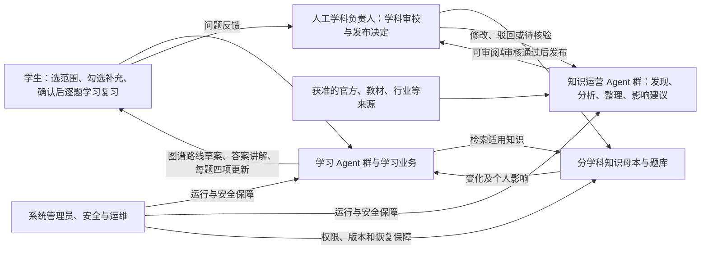
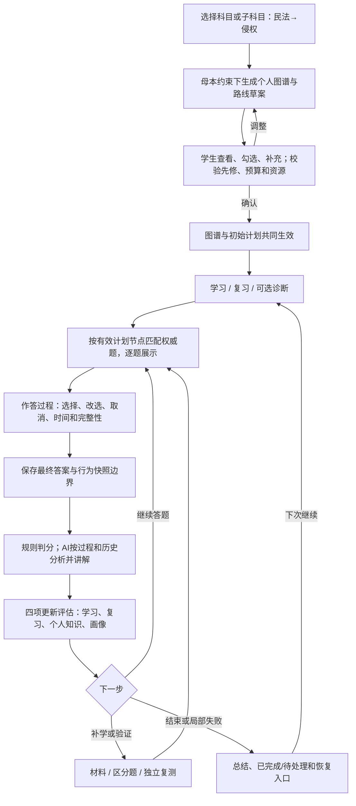
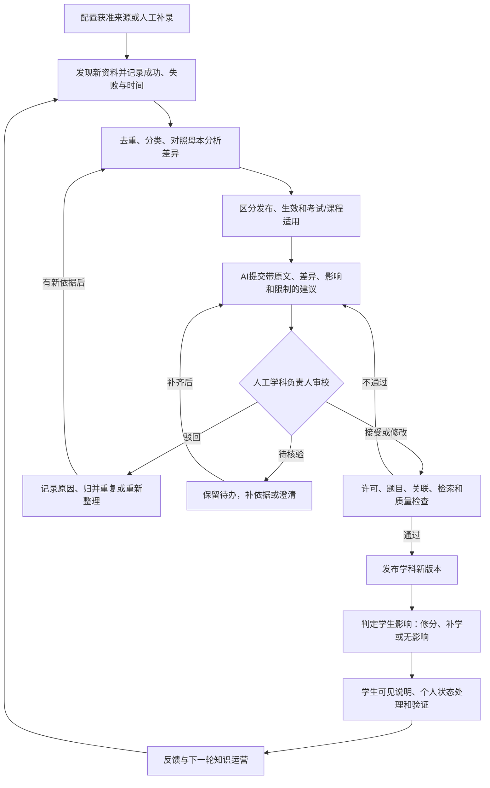
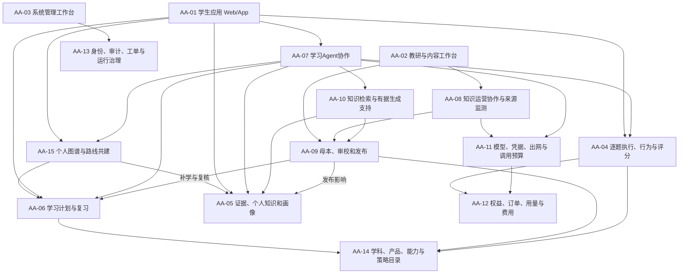
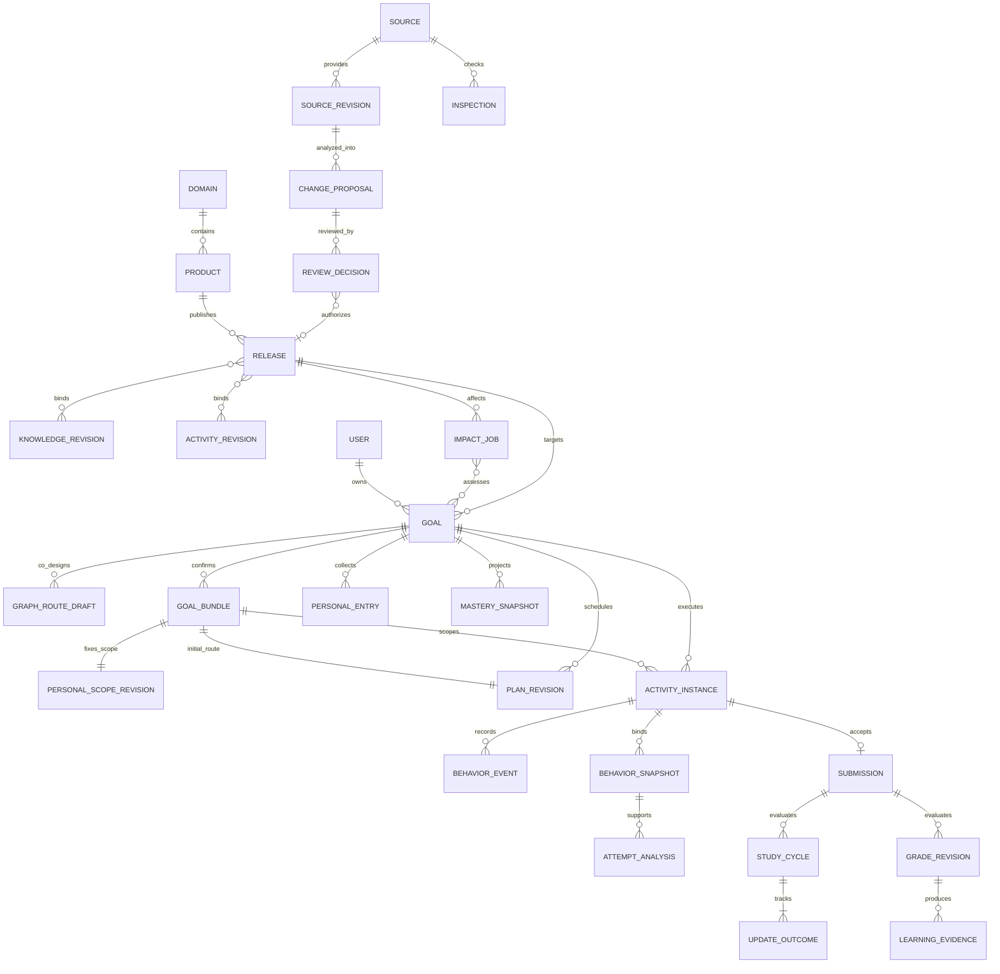
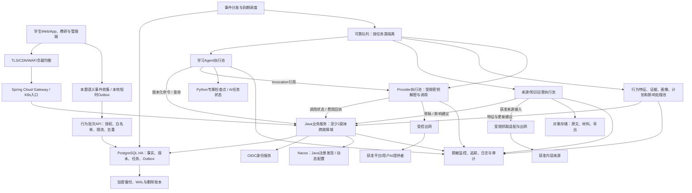
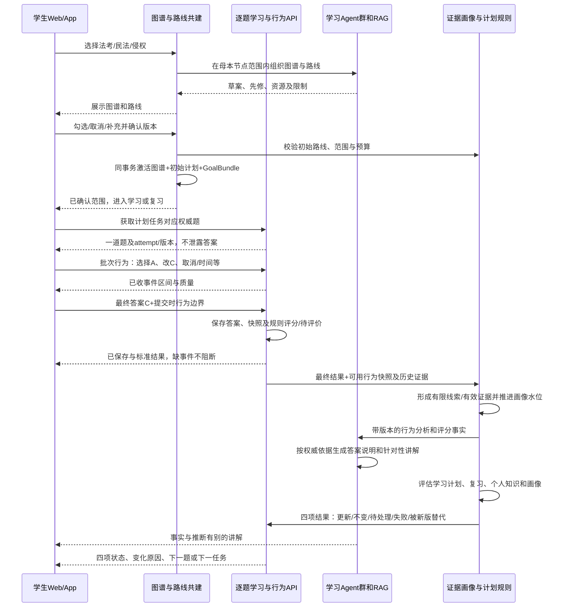
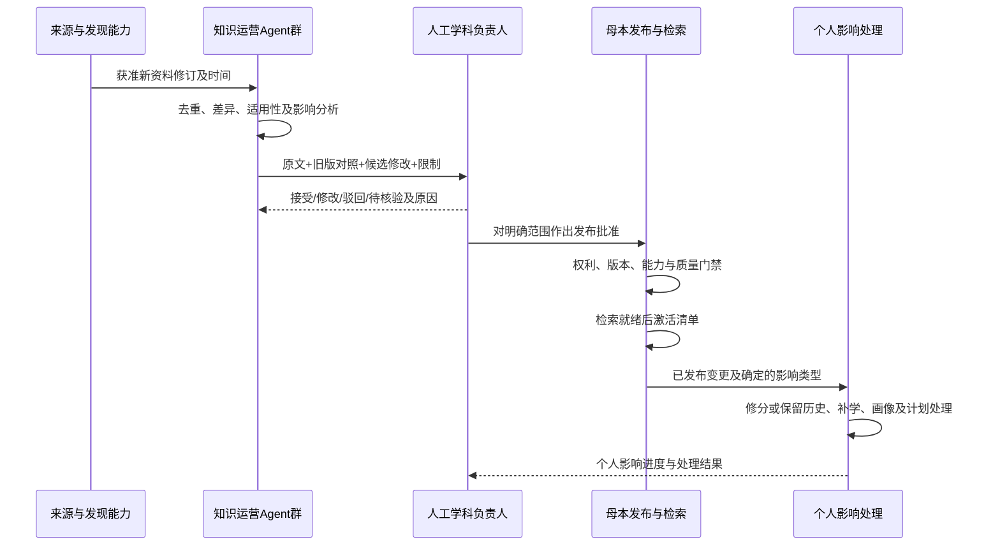

# 通用 Agentic 学习与考试平台——4A 总体架构设计 v1.1

| 文档属性 | 内容 |
|---|---|
| 日期与状态 | 2026-10-18；目标架构评审稿，尚未实施或验证上线指标 |
| 当前需求基线 | [通用平台需求 v0.3](../requirements/通用Agentic学习与考试平台-系统需求规格说明书-v0.3.md) |
| 架构组织 | 业务架构 BA → 应用架构 AA → 数据架构 DA → 技术架构 TA |
| 首个实例 | 司法考试，民法先行；保留通用学科、非考试学习及第二实例验证 |
| 本次重要变化 | SRC-20核心链修订：科目／子科目选择、个人图谱与路线共建确认、权威题逐题作答、行为辅助分析、每题四项个人更新；四部分业务继续保留 |
| 本轮修订记录 | 新建 v1.1；4A编号延续，v1.0 原文及附件保存于修订前归档；本版及配套契约、追溯和检查仍在同步修订中 |
| 旧版处理 | [旧架构归档索引](archive/README.md)；原文、附件及关联需求快照逐字节保存 |
| 决策性质 | 业务目标来自需求，技术与实施细节是推荐方案；待定业务参数仍由相应负责人决定 |

## 1. 先看懂整个系统

### 1.1 用四句话理解

**学生使用平台学习。** 学生在 Web/App 选择科目或细到“民法—侵权”的子科目，查看AI基于母本生成的个人图谱和路线，勾选、补充并确认后进入学习／复习；按计划逐题作答，过程行为与最终答案共同用于个性化分析，每题查看四项更新和下一步。

**学习 Agent 群协作提供个性化教学。** 它们组织个人图谱与路线草案、分析最终答案及本题过程行为、检索依据、辅导答疑、逐题评估学习／复习计划和个人知识／画像；正式评分、有效证据、预算和权限由业务规则保障。

**知识运营 Agent 群与学科负责人共同维护母本。** AI 从获准来源发现新资料，分析差异、适用性和影响，形成可审核建议；学科负责人决定接受、修改、驳回、待核验和正式发布，发布后处理学生侧影响。

**系统管理员保障服务安全可靠运行。** 管理身份角色、配置、模型接入、费用上限、告警和恢复；技术管理权限不自动获得修改权威答案或读取全部私人记录的权利。

### 1.2 四部分业务总览图

图中箭头先表示业务关系，不等于技术服务或网络调用。学生看见的是一份连贯服务，不需要自己在多个 Agent 聊天窗口间调度。

### 1.3 4A 分别回答什么

| 架构层 | 核心问题 | 本文主要内容 |
|---|---|---|
| BA 业务架构 | 谁为谁完成什么业务，谁负责，结果是什么 | 第2章：角色、能力、价值流、自动化与人机边界 |
| AA 应用架构 | 哪些应用与模块承接业务，它们如何协作 | 第3章：三个工作入口、领域模块、Agent、RAG及接口 |
| DA 数据架构 | 内容、证据和个人状态有哪些关系，如何产生与治理 | 第4章：母本、个人知识、画像、版本、数据流与一致性 |
| TA 技术架构 | 选择哪些运行技术和设施，怎样满足质量 | 第5章：技术选型、部署、通信、身份、运行与交付 |

应用架构与数据架构共同描述本项目的信息系统架构，不再额外并列一层重复的“信息系统架构”。四部分业务也不是四个技术服务；一个应用可以承接多个业务能力，一个 Agent 职责也可以复用多个业务模块。

本组织方式借鉴企业架构的业务、应用、数据、技术视角，[The Open Group 的架构工具说明](https://www.opengroup.org/ArchitectsToolkit)提供相应领域背景；本文是项目化设计，不宣称通过 TOGAF 认证或完整执行其所有过程。

### 1.4 阅读路线与文档包

产品及业务负责人先读第1～2、6章；UI/UE读第3.2、6章；开发读第3～5章及关键契约；教研读第2.4～2.6、3.4、4章；测试读第6～8章和追溯矩阵；运维、安全读第4.5、第5及7章。每个章节先解释业务意义，再展开必要细节。

配套文件：

- [LA-01学习协调Agent：需求与C4详细设计](../design/agents/LA-01-学习协调Agent-需求与C4详细设计-v1.0.md)：自然语言入口的局部需求、C4架构、受控协作、协议及验收。

- [AI Agent群详细设计 v1.0](../design/学生持续学习-AI-Agent群详细设计-v1.0.md)：学生持续学习的开发实施规格及机器可读契约，与多Agent/RAG专项架构配套。

- [学生持续学习：多Agent与RAG 4A专项设计](学生持续学习-多Agent与RAG-4A专项架构设计-v1.0.md)：围绕第2.4节，按4A细化首次共建、逐题学习与复习，独立说明五类学习Agent的交互、Java/Python边界和RAG。

- [4A关键契约与实施约束](4A-关键契约与实施约束-v1.0.md)：上下文、提交、知识变化、发布和交接的字段与并发约束。
- [4A架构决策与实施门禁](4A-架构决策与实施门禁-v1.0.md)：方案取舍、分期、运行处置和上线证据。
- [4A需求追溯与验证矩阵](verification/4A-需求追溯与验证矩阵-v1.0.md)：逐项需求及验收的架构落点。
- [学生核心学习链差距审查](学生核心学习链-需求与架构差距审查-v1.0.md)：哪些原先已覆盖、部分覆盖或缺失，以及跨四层修订落点。
- [4A文档检查报告](verification/4A-文档检查报告-v1.0.md)：版本、归档、链接、编号及结构核对结果。

## 2. 业务架构 BA：业务怎样运转

### 2.1 服务对象、目标与范围

产品帮助学生建立知识体系和长期学习能力，以有证据的评价驱动学习、巩固和复习。备考学生按考试与适用版本学习；非考试学生按课程或主题目标学习，日期可空。首例为法考民法，第二差异化实例建议基础代数小范围验证，不自动承诺全部学科或复杂题型正式上线。

平台建设分学科可信母本并具备商业化能力；“自有”指平台可维护来源、内容关联、版本和使用规则，不等于拥有第三方版权。当前不承诺自研基础大模型、微调、全网无边界抓取、无人审核发布、机构多租户、代码执行或口语实验评价；这些需另行确认范围和门禁。

### 2.2 角色与责任

| 角色 | 负责的业务 | 可以决定 | 不能凭此身份决定 |
|---|---|---|---|
| 学生 | 目标、作答、学习、复习、个人笔记与计划偏好 | 目标选择、可用时间、授权、暂停恢复、个人数据请求 | 公共标准答案和权威内容 |
| 学习 Agent 职责群 | 协调、学情分析、讲解、规划、画像辅助 | 授权内推荐、草稿建议、受控工具调用 | 擅改评分、伪造掌握、扩大数据或付费授权 |
| 知识运营 Agent 职责群 | 发现、去重、差异分析、内容整理与影响建议 | 创建可追溯候选与草稿 | 自审自发、以最新替代适用、把生成题认定真题 |
| 学科负责人／授权审核者 | 学科体系、来源信任、答案、策略和内容审校 | 审批、修改、驳回、待核验、学科发布或撤销 | 绕过安全、资料许可、个人数据授权和财务规则 |
| 内容运营 | 来源维护、资料接入、工单跟进、发布执行 | 职责内处理与调度 | 没有审批直接确认学科结论 |
| 系统管理员／运维／安全 | 账号角色、技术配置、服务、监控、风险停用和恢复 | 授权的运行变更与技术处置 | 默认替代学科审批、无理由读取全部私人记录 |
| 商业／客服 | 套餐权益、费用、退款、问题响应 | 授权范围的权益处理和支持 | 以付费状态改变学生成绩或掌握结论 |

管理员可以紧急停止有风险的来源、模型或活动；停止不等于已经确认内容正确。恢复技术服务、恢复资料许可和恢复学科结论分别由对应职责确认。小团队可以一人兼多角色，但每次操作按所授角色记录，关键权威变更不得让 AI 或同一未复核草稿自行通过。

### 2.3 业务能力地图

| 能力编号 | 业务能力 | 输入 → 业务结果 | 责任与度量 |
|---|---|---|---|
| BA-01 | 学习范围共建与逐题执行 | 科目／子科目、学生选择 → 确认图谱路线、按计划权威题、作答及行为事实 | 学生／产品；有效执行与恢复 |
| BA-02 | 学情分析与评价 | 最终答案、可用过程行为、历史证据和复测 → 错因、可能混淆及限制 | 教研／学习智能；独立验证质量 |
| BA-03 | 个性化辅导 | 问题、适用资料、个人上下文 → 有依据解释 | 讲解职责／教研；引用支持和问题解决 |
| BA-04 | 计划与复习 | 共建范围、逐题证据、画像、先修和预算 → 学习／复习更新或不变原因与到期安排 | 规划职责／学生；完成、保持与时间冲突 |
| BA-05 | 个人知识与画像 | 资料关联、笔记、学习证据 → 个人知识体系及掌握估计 | 学生／证据规则；可解释、可修正 |
| BA-06 | 知识发现 | 获准来源、周期、人工线索 → 新资料与变化记录 | 知识发现职责／内容运营；成功覆盖、误报、发现时效 |
| BA-07 | 知识分析与草稿 | 新旧资料、学科规则 → 差异、关联及影响建议 | 分析整理职责／学科负责人；可审阅与有效建议 |
| BA-08 | 学科审校与发布 | 建议、依据和质量记录 → 正式版本或明确结论 | 学科负责人；审核质量、时效及许可完整性 |
| BA-09 | 更新与纠错回流 | 发布、反馈、撤销 → 个人影响、修分／补学及复核 | 教研／运营；影响处理完成而非仅已通知 |
| BA-10 | 平台运行保障 | 身份、配置、告警 → 可用、安全、可恢复服务 | 管理员／安全／运维；SLO与演练证据 |
| BA-11 | 商业及支持 | 订单、用量、问题 → 权益、账务与支持结果 | 商业／客服；对账、成本和持续价值 |
| BA-12 | 授权与数据治理 | 用户选择、许可与角色 → 受控访问、导出和删除 | 用户／安全／数据Owner；无越权和可查请求 |

### 2.4 价值流一：学生的持续学习（平台核心业务）

本节说明业务全貌；完整4A实施设计、Agent协作、接口、RAG、数据与验证见[学生持续学习：多Agent与RAG 4A专项设计](学生持续学习-多Agent与RAG-4A专项架构设计-v1.0.md)。

**选择科目／子科目 → 基于母本生成个人图谱＋学习路线草案 → 学生勾选、取消、补充 → 共同确认关联版本 → 学习或复习 → 按计划知识点匹配权威题，一道一道展示 → 记录本题选择／改选／取消和有效时间 → 提交最终答案 → 规则判分＋行为辅助分析 → 有据答案说明和个性化讲解 → 每题评估更新学习计划、复习计划、个人知识库／知识图和画像 → 下一题、补学、验证或下一次复习。**

#### 2.4.1 第一次进入先共同确定“学什么、怎么学”

学生可选整门或任意受支持的子科目，如“法考→民法→侵权”。协调/规划职责从已审母本组织该范围节点、关系与必要先修，形成个人图谱和路线；图谱回答学什么、彼此什么关系，路线回答顺序、任务和时间。未测节点保持未评估，不要求先答诊断题才能生成。

学生可直接接受推荐，也可勾选、取消或补充。取消先修、超预算、缺题或超出现有母本时，系统解释影响并提供保留先修、调整范围、待核验个人目标或替代；个人补充不自动改公共母本。“完整”是本次确认范围及明确缺口的完整表达，不冒称全学科知识完整。

确认保存一个共同生效的个人范围版本（GoalBundle），绑定图谱和初始路线；保存失败或冲突时不出现新图谱配旧计划。退出恢复草案，不丢选择。新目标未确认不能静默开始正式主线；已有确认目标可续学，临时概念问答保持其独立允许入口。诊断是确认后可选的细化路径。

#### 2.4.2 每次作答同时保留“最终答案”和“过程”

系统按已生效计划任务定位知识点，从平台已审且许可/时间适用的题库匹配，逐题呈现；法考优先合法可用真题，模拟/生成题如启用需单独标识，缺题进入原缺口工单与替代路线。题目始终关联个人范围、图谱、计划、节点和题目版本。

页面采集与本题相关的语义操作：展示、首次选择、改选、取消、聚焦/前后台与提交等。例：先选A后改C，最后提交C。原始选择序列、接收完整性和最终答案分开保存；键盘、触屏和无障碍操作按同一语义记录，不采无关页面、通用键盘原文或凭据。

客观题按最终答案和已审规则判分，行为不能改变标准答案/分数。AI结合可用过程、最终对错、选项含义和历史证据给出“可能混淆、需要区分验证”等分析，并生成针对性讲解。改选也可能是正常推理或误触，后台停留不等于思考时间；缺事件不等于未改选。事实、推断与限制必须区分，必要时安排独立题验证。

#### 2.4.3 每题都有四项更新评估和一个可继续的结果

每次提交都形成StudyCycle：学习计划、复习计划、个人知识库／知识图、画像分别记录已更新、无需变化及理由、待处理、失败或被新版替代。并非强制每题改动四份内容，而是四项都被评估并可追溯。系统学习记录按规则进入个人资产，个人正文笔记或生成解释收藏仍按既有保存偏好。

解释、画像或计划可异步；明确显示答案已保存与各自进度。子步骤失败可恢复，迟到行为只产生新分析/更新版本，不重复判分、不重复增加复习任务、不覆盖学生后来确认的范围和较新状态。下一题使用当前有效且兼容的路线；若关键调整尚未就绪，说明继续旧路线的范围或提供显式等待/替代，不能伪称已全部更新。

学习和复习都按当前确认范围执行；首次主动进入复习但没有历史时可做知识回顾/验证，不虚构遗忘或已完成复习。会话结束保存总结和恢复点，阶段完成后仍可维护、改目标、暂停或结束；不能自动认定通过考试。

### 2.5 价值流二：人机共同维护学科知识

“最新”只说明时间新，不说明更可信、已生效或适用当前目标。来源按学科配置：法考重视官方与考试口径，课程学习可以使用教材或专家审核材料并标明性质。首发人工录入获准来源与受控定期接入，不默认从任意站点抓取所有内容。

抓取失败记录“未检查成功”并告警，不能记录“没有变化”。同一变化用原文修订或摘要与业务关联去重；无实质变化可以关闭为无需更新并说明依据。AI建议须展示原文、旧版差异和不确定性，不能只给一段无法核对的摘要。

### 2.6 价值流三：治理、安全与运行

**告警／管理请求 → 校验角色与范围 → 识别学习、内容或账务影响 → 处理或风险停用 → 验证／回退 → 恢复原业务 → 留痕与复盘。**

系统管理员关注技术运行，学科负责人关注内容正确性，商业人员关注权益和费用。一次事件可能需要跨角色协作，例如来源站变更导致解析错误：运维恢复接入，学科负责人审校，运营处理个人影响，学生获得可解释补学安排，不能以服务器恢复作为全部完成。

### 2.7 自动化与人工决策矩阵

| 动作 | 默认处理 | 必需边界 |
|---|---|---|
| 范围内推荐、解释、普通到期重排 | 已授权条件下自动 | 可撤销、费用与数据范围未扩大、状态可见 |
| 改目标、超预算、换数据目的地 | 学生相应确认／授权 | 无响应不能视作同意，不因Agent交接扩大权限 |
| 发现资料、提差异与关联 | 自动建议 | 受控来源、许可和预算，保留原始证据与失败状态 |
| 公共权威内容或标准答案变更 | 首期必须人工学科审校 | 审核和发布决定可追溯，AI不能自审自发 |
| 争议和冲突结论 | 已审规则优先，必要时人工复核 | 多Agent投票不定义真理；历史/当前口径可并存 |
| 紧急安全或许可风险 | 授权角色可先停用 | 审计、影响处理、恢复时分别校验技术和学科条件 |
| 扣费、退款、权限和正式写入 | 受控业务用例执行 | Agent不能用语言直接决定资金与授权状态 |

### 2.8 学科扩展与业务实例

法考民法采用已授权真题、客观评分、适用法律与考试时间；代数验证实例采用非考试目标、概念/运算维度、材料先学和受限数值题。二者使用同一学习价值流和知识治理流程，来源等级、关系类型、评价及复习策略由学科包声明。没有已安装评价器的活动不能发布为可执行能力。

商业模式可按产品、学科、活动或模型能力计量；具体定价待定。默认平台AI入口与自配AI沿用既有需求范围，自有AI服务不等于自主训练模型。内容授权、教学维护和运行成本需归属到产品，平台盈利不能靠抬高画像分数或隐藏调用费。

## 3. 应用架构 AA：应用和模块怎样分工

### 3.1 三个工作入口与共享业务能力

学生学习应用（Web/App）、教研与内容工作台、系统管理与运行工作台面向不同角色，后端共享受控领域能力。它们可以在同一工程中实现独立路由及授权，但不能仅靠前端隐藏菜单隔离权限。

图表示职责与接口依赖，不代表15个微服务。新增AA-15承接共同确认，复用既有个人知识和计划能力；行为收集归AA-04，不为每次点击调用Agent。Java业务后端采用Spring Boot、Spring Cloud和Spring Cloud Alibaba，Python承接Agent/RAG；按领域聚合部署服务，模块内部保持清晰边界，不按每个Agent拆服务。Kubernetes承载运行单元，部署与治理见技术架构。

### 3.2 学生与工作台体验设计

| 应用 | 主要页面与用户任务 | 必需状态与UI/UE验收 |
|---|---|---|
| AA-01学生应用 | 科目层级/个人图谱与路线编辑确认、今日任务、多目标、逐题题目、材料、解释与行为依据、四项更新、AI/费用、订单/数据管理 | 草案/校验缺口/待确认/确认冲突、未评估/待验证、未提交/已保存/解析中、行为缺失/辅助推断、四项更新/无需变化/待处理、局部失败、争议与恢复；正常流程和空/失败/受限状态都交付 |
| AA-02教研工作台 | 来源清单、发现任务、变化建议、原文/旧版/新版对照、知识与题库、审校、发布、影响工单和质量 | 新发现、重复、待分析、待审、待核验、驳回、待检索就绪、已发布、影响处理中/完成；可核对原文和原因 |
| AA-03管理工作台 | 用户角色、模型能力、凭据状态、额度、来源接入运行、任务队列、告警、发布回退、审计和数据请求 | 受限操作、二次验证、变更范围/风险、执行中、验证失败、恢复；不展示用户完整密钥，不默认开放所有私人记录 |

Web重视键盘、对照和多栏阅读；App重视触屏、返回、前后台和弱网恢复。共享API类型、状态语义和设计Token，分别实现端适配，不要求全部UI组件同构。公式、单位、长法条、引用定位、字体缩放和读屏必须在双端检查。图谱提供层级/列表入口，图形不是唯一可用方式。

学生看到统一业务结果；内部Agent对话和检索轨迹仅按权限用于诊断。界面可以说明“正在核对依据、正在更新计划”，但动画不代表已完成或有用反馈。引用需可打开，明确官方/教材/教研/私人笔记/生成解释的性质。

首次范围编辑页将层级/图谱与路线联动展示，每次勾选能看到节点、任务与先修变化；个人新增项区分已映射与待核验。确认按钮展示范围、时间和缺口，重复点击幂等，两端改动冲突不静默覆盖。

题目页以同一状态处理鼠标、触屏、键盘和读屏触发的选项语义；提交前不泄露答案。结果页先呈现已存最终答案和标准分数，再展示过程事实（如A→C）、有条件的混淆解释、资料引用和四项更新状态。采集用途说明与隐私控制不埋在调试日志，采集受限/缺失时学习照常并标明分析限制。

### 3.3 领域模块、接口与数据所有权

| 应用模块 | 职责与权威数据 | 关键命令/查询或事件 | 不可越界与验证 |
|---|---|---|---|
| AA-04学习执行 | 逐题活动、行为批次/快照、提交、评分修订及StudyCycle更新台账 | CreateActivity、AppendAttemptEvents、Submit、GetCycle；SubmissionAccepted/BehaviorSnapshotRevised | 最终答案可独立保存，过程不改分；尝试/事件去重和迟到版本化 |
| AA-05个人状态 | 行为特征及有限推断、有效学习证据、私人条目、画像与快照 | AnalyzeAttempt、ApplyEvidence、ExplainMastery、Rebuild；AnalysisReady/MasteryChanged | 原始行为属AA-04；特征与推断分开，缺失和改选不能直接判弱，旧重算不覆盖新状态 |
| AA-06计划调度 | 初始路线、学习计划、复习安排、任务及个人总预算 | ValidateDraftRoute、CommitInitialRoute、EvaluateCyclePlan、DueReviews | 与图谱版本共同确认，逐题学习/复习分别给结果，先修/资源/预算/并发校验 |
| AA-07学习协作 | 主子任务、职责交接、执行结果和检查点引用 | Coordinate、Explain、Analyze、ProposePlan、Cancel/Resume | 上下文最小化，工具受控，主子共享授权与预算 |
| AA-08知识运营 | 来源规则、发现任务、原始修订、差异/建议/影响候选 | InspectSource、Compare、SubmitProposal；ChangeDetected | 内容未审为草稿，发现时间不等生效时间，失败不等无变化 |
| AA-09母本发布 | 节点关系、题库、答案/量表、材料、学科审校、内容清单 | Review/Approve/Reject、Stage/Activate/Revoke；ReleaseActivated | 人工审校，许可和索引就绪，版本与影响追溯 |
| AA-10检索 | 作用域检索、资料集合、引用和充分性结果 | RetrieveEvidence、ValidateCitation | 公共/个人分区，版本适配，不能取代正式评分 |
| AA-11模型网络 | 能力、密钥引用、Invocation、调用预算和出网控制 | CheckCapability、Invoke、ReconcileOutcome | 提供者角色独立解密，禁止任意内部网络访问 |
| AA-12商业 | 价格快照、订单、权益、账务与退款 | CheckEntitlement、Reserve/Settle、Reconcile | 可信回调、唯一账务，付费状态不改变学业事实 |
| AA-13平台治理 | 身份映射、授权/同意、技术变更、审计、工单、通知与数据请求 | Authorize、Disable、Incident、Export/Delete | 职责分离，账号禁用和删除阻止新副作用 |
| AA-14目录配置 | 学科/产品、目标标准、学科包、能力/策略版本及启停 | ResolveManifest、ValidatePackage、RetireProduct | 产品不是租户，能力声明必须经验证 |
| AA-15个人图谱共建 | 科目/子科目范围、个人图谱草案、勾选补充、ScopeRevision和GoalBundle | Generate/Edit/Validate/ConfirmGoalBundle；GoalBundleConfirmed | 基于母本，不自动改权威；图谱和初始路线原子激活，未知补充与先修缺口显式处理 |

模块通过公开业务接口协作，不直接修改其他模块的私有表。读取聚合视图需注明所有者和作用域，跨模块事实以引用或领域事件连接。管理应用和Agent均调用相同受控用例，不能另设“管理员或AI直写数据库”通道。

### 3.4 两类 Agent 群及人机交接

| Agent职责 | 业务时机 | 主要输入 → 输出 | 写入和人工边界 |
|---|---|---|---|
| 学习协调 | 目标、复合意图或会话路由 | 学生目标/任务状态 → 子任务与汇总 | 服务端绑定目标和版本，不能随意扩大范围 |
| 学情分析 | 每题提交、行为补齐、复测与长期变化 | 最终答案、可用行为快照/特征、有效历史证据/归因规则 → 可能错因与维度分析 | 正式证据资格由规则决定，不把语言推测当成绩 |
| 辅导讲解 | 解析、追问和概念理解 | 题目、已审评分、RAG资料和必要错因 → 有据解释 | 不改分、引文和结论校验；无依据有替代 |
| 规划与画像辅助 | 初始图谱路线、逐题更新、复杂调整与阶段分析 | 确认范围、画像/行为分析版本、先修/预算 → 图谱路线候选或四项更新建议 | 画像和计划由领域规则校验、存储；常规重排可不用LLM |
| 知识发现 | 获准来源周期或人工触发 | 来源/许可/关注项 → 原始修订、变化线索 | 受控抓取，不因页面含指令提升工具权限 |
| 内容分析整理 | 新资料、变更和缺口 | 原文/旧母本/学科规则 → 差异、关联、草稿和限制 | 不自审自发，不把生成题标真题 |
| 知识影响分析 | 候选变更或正式发布 | 版本引用/个人关联 → 影响清单与建议 | 学科负责人确认变更类别，业务模块执行修正和补学 |

这是主架构层的职责概览。学生专项将“规划与画像辅助”细化为学习规划、个人知识与画像两类，形成五类学习职责＋三类知识运营职责，详见[学生持续学习：多Agent与RAG 4A专项设计](学生持续学习-多Agent与RAG-4A专项架构设计-v1.0.md)。不强制八个常驻独立服务或每题调用八次模型。协调图对确定性场景可直接路由工具；复杂自然语言才需要额外推理。增加Agent需证明质量或维护收益，不能靠多角色“互相认可”代替独立评估。

交接携带主子任务ID、角色、目标/版本、必要输入与证据引用、允许动作、预算和期限、输出类型及去重标识；接收者再授权。结果包含状态、产出、证据、限制、用量及已确认保存的业务引用，不传密钥与私有推理链。需要最新画像的规划等待对应证据完成或明确使用旧水位及限制。

分歧以已审评分、资料适用性和业务约束处理，不能靠投票裁定权威；无法裁定进入澄清/学科复核。子任务失败保留已完成事实，取消后停止未开始动作；在途外部调用可能已产生费用，单列结果未知并对账，不保证外部收费恰好一次。

AA-15的生成路径先解析所选节点与子树、目标标准和必要先修，再由规划职责在已审节点/资源范围内组织草案。学生补充无法映射母本的内容单独标记，不能生成看似权威的新节点；确认前不写已掌握。学情分析接收服务端行为摘要而非无关页面原文，推断需有特征与原事件引用。每题四项更新通过领域模块确认，主Agent只在台账确认后报告完成。

### 3.5 RAG 如何服务教学和知识运营

主线选题先从已确认范围和计划任务精确定位知识点，再查权威题库；不通过相似文本“生成标准答案”。个人图谱草案以已审节点和关系组织，RAG补足材料与先修依据，不能凭模型记忆发明公共母本。

RAG在当前目标下查找允许、适用的资料，再支持生成和校验。题号、标准答案和知识关系先精确查询；概念或自然语言问题可结合词项、语义和有限关系扩展。个人记录仅用于该用户有权使用的目标上下文，个人意见不能覆盖母本。针对改选行为的讲解先读取已审选项/考点映射，只有足够依据才解释可能混淆；无法把某选项归到具体知识点时明确限制。

流程：确定上下文 → 公共及个人分区检索 → 合并、去重和适用性核对 → 判断证据充分性 → 组织资料集合 → 生成解释 → 核对结论与引用 → 反馈或明确不足 → 按偏好保存和安排学习。互联网新资料进入运营草稿区，不能绕过人工审校直接加入权威回答。

检索命中是资料证据，不是学习证据。学生保存解释、读完材料或Agent判断“理解了”，均不能直接更新为已掌握。知识运营中的相似资料检索可辅助比对现有母本，也必须保留原文、来源、时间和限制。

### 3.6 接口、事件和通信语义

| 业务接口 | 主要输入/输出 | 关键约束 |
|---|---|---|
| 个人图谱与路线 | 产品/科目节点/时间、学生勾选和补充、期望草案版本 → 草案/校验/GoalBundle | 未确认可恢复；图谱与初始计划共同生效，个人补充不写母本 |
| 学习活动/行为/提交 | bundle/计划/节点/尝试、批次事件与最终答案 → 收件确认、快照、评分及cycle_id | 最终答案独立保存，行为缺失不阻断；同尝试去重，快照界限与四项状态可查 |
| 证据/画像/计划 | 输入证据水位与策略、期望版本 → 状态、证据引用、计划差异 | 并发版本检查、总预算、未知与更新中可见 |
| 联合任务 | 意图、必要授权、目标 → 主子任务状态和汇总 | 角色权限、共享预算、可恢复与取消 |
| 来源检查/变化建议 | 来源与周期、原始修订 → 检查结论、差异、影响建议 | 成功无变化与失败区分，候选不等已审 |
| 审校/发布/影响 | 建议和期望修订、审核身份 → 接受/修改/驳回/待核验、发布及处理结果 | 人工学科审批，内容与检索就绪、变更分类与回流 |
| 模型与费用 | 能力、数据授权、预算 → 受控调用、用量/未知结果 | 费用及目的地变化不静默授权，密钥不回显 |
| 管理/数据请求 | 角色、变更范围/申请 → 审计、恢复或导出删除结果 | 系统权限不替代学科权利，私有数据最小访问 |

API采用版本化契约；长任务返回已持久化任务状态，通过查询或带授权进度订阅续接。重要事件包括GoalBundleConfirmed、AttemptEventsAccepted、BehaviorSnapshotRevised、AttemptAnalysisReady、StudyCycleEvaluated、SubmissionAccepted、GradeCorrected、EvidenceChanged、MasteryChanged、PlanRevised、SourceInspectionCompleted/Failed、ChangeProposalSubmitted、ReviewDecided、ReleaseActivated/Revoked、ImpactProcessed、EntitlementChanged、AccountDisabled。事件只传安全引用，不携带全部私人对话或密钥；详细字段见关键契约。

## 4. 数据架构 DA：知识和个人学习怎样关联

### 4.1 五类数据与事实边界

| 数据类别 | 内容 | 权威所有者及使用方式 |
|---|---|---|
| 学科定义与权威母本 | 学科/产品、节点关系、题目、答案/量表、材料、学科策略、内容清单 | AA-09/14治理，发布版本不可原地覆盖；公共基础可共享 |
| 来源与知识运营 | 许可、原始资料修订、成功/失败检查、变化、AI草稿、人工意见和影响 | AA-08/09；AI建议与人工决定分开，保留双向关联 |
| 学习事实与个人资产 | 确认图谱/路线、逐题事件与快照、最终作答、评分修订、材料进度、笔记、错因、个人引用 | AA-04/05/15；原始事实不可静默覆盖，私人内容默认隔离 |
| 派生状态与计划 | 行为特征/有限推断、有效证据、掌握投影、画像快照、学习/复习计划、预算与逐题结果 | AA-05/06；估计可重算，用户计划决定和私人笔记不能当缓存丢弃 |
| 执行、治理与财务 | Agent交接、调用、预算、订单权益、审计、工单、导出删除 | 对应模块；外部未知费用、授权与恢复有独立状态 |

### 4.2 核心关系图

此图是逻辑关联：GoalBundle中的initial_route只绑定该次确认的初始计划修订，后续计划保留相同范围引用并独立演进；不是所有后续计划都只能属于一个bundle或禁止未来版本。一个发布可综合多个审核决定，一个批准决定不必立即形成发布；发布清单固定绑定多项修订。实现采用显式关联实体并保留审批效力、适用范围与校验结果，不能仅靠有一条ReviewDecision就允许任意发布。

### 4.3 母本—个人知识—画像—计划

母本是统一学科定义；首次通过科目/子科目选择生成个人范围图谱及路线草案，学生勾选/补充后形成GoalBundle。ScopeRevision定义本次确认的节点、关系、必要先修及缺口，PlanRevision定义初始任务、顺序和时间；两者分别表达范围与执行，确认时共同激活，不能把生成草案当掌握状态。

个人知识通过ID/版本引用母本，并增加个人条目和学习证据，不给每个学生物理复制全套题库。画像按目标、维度、证据及策略形成，计划据此安排任务。相同名称不代表跨学科相同实体；同一用户法考和代数也要隔离。

已发布内容有稳定实体ID与不可变修订ID；学生活动绑定适用清单，后续改版保留原口径。公共资料可用于多人，私人解释/笔记及缓存不跨人共享；跨目标掌握迁移默认关闭，必须有审核映射和撤销重算机制。

补充项分为已映射母本节点、待核验个人目标和无资源阻塞项，均保留学生原意与确认结果；进入可执行学习的节点必须有合法可用资源。后续学习只更新个人图谱的掌握/证据标注和任务，扩大或删改确认范围需新的范围修订及必要学生确认。

### 4.4 来源、时态和人机维护记录

至少区分：原始发布日期、系统发现时间、检查成功/失败时间、业务生效/失效时间、目标考试/课程适用版本、审核时间、正式发布时间和个人影响完成时间。网页URL不是稳定版本，需原文修订或摘要校验、定位及许可引用。

来源检查状态区分成功有变化、成功无变化、失败、受限和暂停；变化建议区分待分析、重复归并、待审、待核验、接受/修改/驳回；正式内容区分草稿、审核通过、检索就绪、发布、撤销/替代。检查失败不能标成功无变化，批准草稿不能跳过发布质量门禁。

发布清单引用审核的内容、学科包、评分和学习策略、资料许可及检索代际。索引先准备并验证，再原子激活清单；紧急撤销用单独即时状态阻断新分发，不仅等待缓存过期。已下载内容无法保证远程收回，需明确许可与事件处理边界。

### 4.5 一致性、并发和恢复

1. 作答正式提交与确定性评分修订、待分发事件在同一数据库事务保存后才返回“已保存”。开放评价先保存待评价任务。重复正式提交由活动实例和幂等键双重防护。
2. 重要后续工作采用事务内待发事件（Outbox）和消费者处理记录（Inbox），允许重复投递但业务副作用去重；发送后确认前崩溃时重复是预期，不声称消息全链恰好一次。
3. 画像保存输入证据序号、策略与内容版本，旧Worker不得覆盖新状态；计划同时检查画像、预算和计划版本，总预算按用户周期协调。
4. 内容影响按引用定位学生和历史解释，明确需修分、仅补学或无影响；重算采用新一代影子结果，校验后切换，不能先清空在线画像。
5. 图谱/初始路线草案经校验后，同事务保存ScopeRevision、初始PlanRevision和GoalBundle及激活指针；并发确认校验目标/草案/预算版本。后续计划仍引用有效范围，不覆写确认历史。
6. 每题StudyCycle记录四项逻辑结果与依赖版本，结果为updated/no_change/pending/failed/superseded；同因果版本去重。迟到行为触发新快照及分析，不重新判分，旧分析不得覆盖新图谱选择。
7. 模型调用先登记预算和唯一Invocation，结果未知单列对账；外部收费、已发送通知等不能靠数据库回滚假装未发生。

以上方案选择短事务、幂等和可解释的最终一致性；代价是要有状态、补偿、工单和重算。详细合同字段与故障断点见关键契约，不把“有消息队列”当作数据一致性保证。

行为日志不能成为提交的强一致前置：提交在短事务内冻结可用事件快照边界、最终答案和事件接收质量后确认，行为服务故障时标为partial/missing并继续。补传只有符合本尝试、提交边界和接收窗口的历史事件可形成新快照，提交后的新操作不进入同一次分析。完整性是按协议可核对的接收情况，不证明客户端捕获了每个真实动作。

### 4.6 检索数据和知识资产治理

原始对象、结构化母本、个人数据、检索投影分开。分片/向量/词项可重建，正式提交、笔记、审核和账务不可当可丢缓存。每条检索记录带产品、清单、许可、可见范围及来源定位；授权过滤在召回前生效，生成前再检查撤销和适用性。

嵌入、重排和文本生成是不同处理能力。用户配置聊天模型不等于同意向另一家服务发送笔记；个人资料向外处理需要相应授权，无授权时使用允许的结构/词项路径或获准本地能力。更换嵌入版本重建检索代际，比较质量后切换，不混用不同向量空间。

### 4.7 数据保留、导出、删除与质量

数据按原始资料、母本、个人事实、逐题原始行为、行为特征/推断、运行对话、索引、审计和账务分类，期限由部署、许可和业务政策确认，不擅设法定时长。导出按用户与许可过滤，不含密钥或他人记录；注销先禁用身份、模型凭据和未开始任务，再处理在线数据、索引、缓存、检查点及对象。

必要保留的例外说明类型、理由与期限；备份有有限保留和删除账本，灾难恢复先重放删除/禁用记录再开放访问。数据质量检查覆盖悬空引用、重复来源、关系循环（按关系类型）、标准答案与版本、授权完整、未审内容误发布、跨目标引用和派生水位。

### 4.8 本题行为与逐题结果的数据契约

| 对象 | 关键字段与所有者 | 约束与用途 |
|---|---|---|
| GraphRouteDraft/GoalBundle | AA-15：所选层级、母本、学生增删、来源状态、scope_revision、initial_plan_revision、确认与预算版本 | 未确认草案可恢复，确认同版生效；节点选中不是已掌握 |
| BehaviorEvent | AA-04：event_id、attempt_id、writer_epoch、client_seq、type、前后选项集合、单调耗时及可选客户端时间、received_at | 服务端派生用户/目标/题目，不信任客户端身份；本题白名单字段；重复相同返回确认，不同内容冲突隔离 |
| BehaviorSnapshot | AA-04：revision、提交冻结边界、已收区间/缺口、source_stream、接收质量和使用事件引用 | missing/partial/contiguous_client_reported等状态不伪装全量观察；同次提交后新点击排除 |
| AttemptAnalysis | AA-05：submission/grade/snapshot、特征和规则版本、有限推断、依据/限制、input_watermark | 特征事实与可能混淆分开；最终分数不受行为更改，不能单次改选直接判弱 |
| StudyCycle/UpdateOutcome | AA-04台账：submission、analysis_revision、scope/plan输入版本、解释状态及四项逻辑结果的status/ref/reason | 每题四项均评估，没变化也有原因；计划与复习可共用一次PlanRevision但结果分别列示；局部恢复可查 |

原始事件按尝试与写入租约隔离，跨端切换明确交接/新epoch，不以不同设备时钟拼出伪总顺序。客户端恢复事件与服务器已收区间比对，不将重做题的事件混入旧attempt。数据来自客户端只能作为有限教学线索，不能当防作弊证明或绝对心理状态。

## 5. 技术架构 TA：怎样实现与运行

### 5.1 明确的首发技术方案

本次由用户确定技术方向：**Java应用后端＋Python Agentic＋Kubernetes运行平台＋DevSecOps与CI/CD交付**。Java采用Spring Boot、Spring Cloud、Spring Cloud Alibaba，Python负责Agent、多Agent编排、RAG、模型适配及AI评测。按领域聚合服务，服务内部模块化；逻辑模块不等于独立服务。原工作区不被视为已有平台代码，以下为目标设计，尚未完成兼容PoC。

| 技术能力 | 推荐基线 | 选择理由及验证要求 |
|---|---|---|
| Web与运营前台 | React19.3、TypeScript、Vite8受支持稳定线 | SPA适合登录后学习与工作台；营销SEO可单独处理。沿用本次会话官方版本核验，PoC锁补丁与依赖 |
| 移动App | Expo SDK57兼容的React Native0.86/React19.2系列 | 按官方组合而非强制跟Web React升级；[Expo矩阵](https://docs.expo.dev/versions/latest/)；实机和最低OS待产品确认 |
| 业务API/后台 | Java受支持LTS、Spring Boot、Spring Cloud、Spring Cloud Alibaba | Java为业务事实与事务的所有者；JDK与三个框架必须按官方兼容矩阵成组锁定，禁止分别追新。通过Spring Cloud BOM及Alibaba BOM管理依赖；[Spring Cloud](https://spring.io/projects/spring-cloud)、[Alibaba版本说明](https://sca.aliyun.com/en/docs/2025.x/overview/version-explain/) |
| Agent协作 | Python受支持稳定线、LangGraph稳定1.x与自有业务用例；Python HTTP入口框架在E0验证 | 采用显式职责、任务状态和检查点，业务事实留在领域库；图/策略/提示有版本。基线来源：[官方稳定版说明](https://www.langchain.com/blog/langchain-langgraph-1dot0) |
| 业务与图关系 | PostgreSQL18维护补丁 | 事务、版本与有限图查询统一；[官方版本政策](https://www.postgresql.org/support/versioning/)；不采用尚未确认稳定/支持的主版 |
| 检索 | 结构化、中文术语/词项与pgvector0.8稳定线 | 中文默认分词不够，建立审核术语与固定分词流程并验证查询集；[pgvector官方](https://github.com/pgvector/pgvector) |
| 任务与缓存 | RabbitMQ作为跨语言消息通道；Java消费者用Spring AMQP；Python消费者使用明确消息协议的适配器；Valkey缓存 | 业务消息采用版本化JSON Schema和统一信封，不让Java依赖Celery私有任务协议。Celery如采用，仅用于Python内部任务；缓存可重建，业务幂等在领域数据库完成 |
| 身份与凭据 | Keycloak26.x稳定维护线、部署方KMS | OIDC、MFA及凭据加密；[Keycloak官方](https://www.keycloak.org/downloads)；具体补丁、地区及替代服务待验证 |
| 对象、部署与观测 | S3 API兼容对象存储；Kubernetes、Helm/Kustomize、IaC；OpenTelemetry及Prometheus/Grafana | Kubernetes为确定的容器编排方向；自管/托管、节点和控制平面HA在E0评审；Java/Python统一追踪上下文，数据库/消息的HA与备份独立验收 |
| 服务治理 | Spring Cloud Gateway、Spring Cloud Alibaba Nacos；Sentinel按治理需求启用 | Nacos负责Java服务注册发现与动态业务配置；Kubernetes Service/DNS负责基础寻址，Python优先经Service访问。每条调用路径仅指定一个发现与负载均衡责任；不叠加同用途治理链 |
| 工程交付 | DevSecOps、CI/CD、GitOps部署、制品仓库、镜像签名与SBOM | 流水线平台在E0确定；构建一次、验证后逐环境晋级，集群凭据与发布权限分离，保留可审计的灰度与回滚证据 |

新文档的建议重新按四层组织，并未把旧文档当已验证实现。当前仅对日期敏感的核心支持线重新核验，其余引用为本次会话已核验资料；所有组件在安装时再次核对维护状态、漏洞、兼容性和许可。没有完整兼容PoC前不得声称这套组合已经工作。开源组件按实际锁定版本、插件和发行方式核验LICENSE及SBOM，记录商业使用与分发条件；开源不等于运营免费或没有许可要求。

技术方向已确定，具体受支持版本在E0核验官方兼容矩阵、维护窗口和安全公告后锁定，不将“最新”理解为各组件各自选最新。Nacos不存模型密钥；凭据由KMS/专用密钥系统管理并按工作负载身份授权。Seata、RocketMQ、Service Mesh等组件仅在有明确需求与PoC证据后引入，本版保留Outbox、幂等消费和补偿，不默认引入跨Java/Python的全局事务。

### 5.2 运行单元与部署图

Provider调用进程是实际安全身份边界：API只能加密写入凭据，普通Agent和内容进程无解密权限；提供者进程按Invocation再校验账号、授权、预算和配置后调用。来源抓取不持有模型密钥，也不能任意访问内部管理网。Java与Python使用独立镜像、运行身份和资源池，通过Kubernetes Deployment/Job等运行；共享契约但不共享领域写库凭据。Provider读取最小授权Invocation接口并通过Java受控接口回报调用状态；Python检查点与AI内部任务状态使用专属存储权限。

生产应用至少双故障域；数据库HA和PITR要确认实际服务能力。自管RabbitMQ quorum建议3节点跨3独立故障域或等价托管容错；不能用同机多容器宣称同等HA。身份服务也有多副本与独立凭据/备份，是否独立物理数据库按隔离和预算决定。

### 5.3 存储、连接与任务机制

Java拥有的PostgreSQL领域表持久保存业务事实、配置和任务；Python仅写专属检查点/AI执行状态，通过Java命令提交领域变更；对象存储保存合法原文、材料和导出；Valkey保存缓存、限流辅助和进度唤醒，丢失不改变成绩和余额。连接池按API/派生/内容/Provider分配上限，批量索引和内容处理不能占满交互连接。

任务按学习推理、Provider、内容发现/分析、派生影响、运营处理独立队列和配额。Scheduler用租约认领数据库到期任务，不把数月复习或来源检查全部塞进队列倒计时。消费者事件有去重和输入版本，过期租约可恢复，毒消息有死信工单和修复重放，不能清空队列假装消除问题。

Agent检查点保存步骤与引用、图版本、工具调用ID、等待原因；领域事实另存。等待学生或学科审核的任务不占用执行进程。升级图时让旧任务在兼容版本完成或显式迁移/暂停，不用新代码随意解释旧检查点。

### 5.4 RAG和来源发现的技术控制

RAG先按身份、产品、目标、发布清单、适用时间及许可过滤，再进行精确/词项/语义召回和关系扩展；引用在生成前和打开时检查。高选择性过滤可先在允许集合内精确向量查询，不能无界召回私有数据再交模型过滤。索引代际包含嵌入版本、维度、分片规则和内容清单，切换前独立评估、失败可回退。

中文法考查询采用固定术语、别名、分词与人工标注查询集验证；缺向量能力可退到允许的结构和词项查询，若证据不足则明确限制。模型输出结构、标准评分一致与引用有效性用程序校验；语义支持和教学质量仍需基准及专家抽检，不能误称自动引用检查解决全部幻觉。

来源发现由白名单/获准域、周期、请求量、文件大小、超时及许可控制，支持人工补录。抓取端阻断私网/环回/元数据地址，检查DNS、IPv6和每跳重定向，网络防火墙提供独立防线。页面、文件和个人笔记都视为不可信材料，不能改变Agent指令或工具授权。大文件、复杂解析和未来浏览器抓取须隔离资源与网络，首发优先可受控的文本/资料接入。

### 5.5 身份、权限与安全

Web采用OIDC授权码及BFF会话，浏览器持HttpOnly/Secure Cookie，写操作CSRF与来源检查；App采用系统浏览器授权码＋PKCE，Refresh Token放系统安全存储，不嵌客户端密钥。管理员MFA，API校验签名、issuer、audience、时效与本地禁用状态，不以Token中有admin角色替代资源授权。

授权同时校验角色、对象、目标、产品、内容许可、有效发布、权益和数据同意。学科审批、运行操作、私人访问和账务处理分别检查；服务端才构建Agent上下文。密钥不进入提示、队列、日志、进度、检查点和导出；高风险动作审计，客服只读必要信息。

发布与审核状态由AA-09强制，UI菜单隐藏不构成审批控制。紧急停用可以由运维或安全在权限内执行，内容恢复另需学科决策及许可检查。个人表可用复合约束及经PoC的RLS纵深保护，运行角色不得绕过，连接复用/Worker上下文需实测；应用层授权始终保留。

### 5.6 性能、成本与容量的工作假设

初始压测基线沿用需求：100活跃会话、20提交/秒短时突发；AI初始并发建议10、有限等待队列并提供已审反馈或显式排队选择。这些是测试假设，不是注册规模和持续吞吐承诺。

例如20提交/秒中20%需要15秒新生成，约需60个在途调用，高于10；必须通过已审反馈、缓存、排队、配额或扩容取舍。不能同时宣称低并发低成本和所有请求30秒完成。统计排队、检索、各角色、校验、端到端、完整成功与降级率，进度动画不计有用反馈。

预算先以数据库原子预留，父子任务共享总体授权和上限；模型能力、步骤、重试、输出、截止时间和费用受限。缓存限流不替代财务预算。供应方结果未知时保留Invocation和预留，查询或人工对账，不无限重试或自动重复收费；用户取消不意味着在途供应方零费用。

### 5.7 开发、测试与交付技术

推荐单仓分`apps/student-web`、`apps/staff-web`、`apps/mobile`；`services/java`按领域组织Spring Boot应用及domain/application/infrastructure/interfaces；`services/python`组织Agent、RAG、模型适配与AI Worker；`contracts`保存OpenAPI/JSON Schema及跨语言生成类型；`infra`保存IaC、Kubernetes清单和环境差异；`pipelines`保存CI/CD与安全策略。Java用Maven/Gradle锁BOM，Python使用独立锁文件和受控镜像；技术骨架在E0生成，此处不是已有代码。

前端采用选择状态单一来源：UI先更新本题状态并追加语义事件，交互不等待网络。恢复草案按用户/目标/尝试隔离，登出和删除清理本地缓存。后端行为批次API与提交API分别限流和监控，事件写入拥塞不抢占所有作答连接。

CI执行类型/格式、领域不变量、模块依赖、契约兼容、真实数据库/队列集成、迁移、密钥/漏洞和许可证检查。CD锁依赖和镜像摘要，同一产物逐环境晋级；软件、配置、学科包、内容、策略、图和提示分别版本化。数据库采用扩展—回填—切换—收缩，应用回滚不盲目反向破坏DDL。

测试覆盖图谱/路线共同确认与并发、按节点逐题选权威题、A→C/取消/键盘操作、提交边界、事件重复/乱序/缺失/迟到及跨端隔离、每题四项状态及无需变化、确定性评分、数值容差/单位、证据资格、双目标预算、时间与夏令时、来源失败/重复、人工审校越权、旧版本、提示注入、复合任务、外部未知费用、灰度回退和数据恢复。黄金集独立于开发集，授权资料不复制到无权环境；模型调用测试有预算，不在CI无限使用外部服务。

### 5.8 运维、恢复与运行手册

监控草案生成/确认成功与冲突、图谱路线引用一致性、行为批次接收/拒绝/缺口/延迟/本地积压、StudyCycle四项未完成年龄、API成功与延迟、提交持久化、队列/Outbox积压、派生水位、来源成功率、发现/审核/发布/影响时钟、RAG质量、协作失败、模型费用未知、支付差异及删除请求。追踪关联request/run/event/proposal/release/impact/incident ID，指标标签控制基数，私人全文和密钥不进日志。

候选告警包括提交5xx持续、P95超1秒、Outbox最老事件超60秒、画像/计划落后、来源连续失败、审核工单超时、未核对费用和任意账务差异；阈值按试点确认，业务Owner处理教学时钟，运维处理技术故障。

备份含业务事实、身份、内容元数据和对象，数据库持续WAL与基础备份加密存独立故障域；按RPO≤5分钟/RTO≤60分钟目标实际演练。恢复先隔离写入、确认恢复点、恢复并验证、重放删除和账号禁用账本、核对外部支付/调用、重建派生索引，再逐步开放；灾难目标不等于绝对零数据丢失。

运行处置至少覆盖模型/RAG故障、重复提交、队列积压、错画像、来源失联、错误知识发布、凭据泄漏、支付差异、数据库恢复及导出注销。每项明确Owner、风险停用、恢复验证和审计，具体检查点见实施门禁附件；本版未执行真实演练。

### 5.9 首次确认与逐题行为的执行机制

**共同确认。** AA-15负责共建命令，调用AA-06的规则校验与初始路线提交用例，在同一短事务内保存ScopeRevision、PlanRevision、GoalBundle和激活指针及事件；字段和权限仍归各模块。规划模型生成在事务外完成，确认时重新检查草案、母本撤销、预算和目标版本。若将来拆成独立存储服务，需暂存＋共同激活协议再迁移，不能仍宣称跨服务天然原子。

**采集与提交。** Web用IndexedDB、App用本地受控存储做短时事件Outbox，按题目显示、选项操作、取消、前后台/聚焦和提交等有限语义白名单记录；不收无关DOM、屏幕录制、通用键盘文本或凭据。界面即时响应，批次按数量/间隔触发并在提交时带未确认尾部尝试补传；具体大小、频率、上限和迟到窗口在T-28～29及压测确定。

每个批次按attempt/active_writer_epoch校验、按event_id及stream/seq去重、限制体积和事件类型、校验选项属本题并确认已收区间。服务端received_at只说明接收时刻，不能取代客户端语义顺序；不可信/不完整数据标记限制，不自动修造缺失行为。多端同题采用可转移写入租约，旧tab事件被隔离或拒绝，不把两个流按设备时间盲拼。

提交调用不等待整个行为链“全到齐”：固定最终答案、writer_epoch和expected_last_seq（客户端提交时声明的界限）及服务器已收事件，保存behavior_snapshot_revision/quality。迟到事件只允许已授权同流、seq在冻结界限内且在窗口内补齐，提交后的新seq不影响本次；若前后关系冲突，保留质疑状态并降低分析使用，不覆写答案。即使客户端声明seq连续，也只是协议接收完整性，无法证明真实动作无遗漏。

**行为分析与四项更新。** 派生任务从快照提首次/末次、候选集合变化、改选/取消次数、有效前台时长及质量限制等特征，按固定版本规则形成给Agent的必要摘要。不给每次点击发起模型调用，也不每点击改计划。每题分析完成后AA-05确认个人证据/画像，AA-06分别评估学习与复习安排，AA-05确认个人知识关联，AA-04记录四项结果和解释状态；可先返回已审答案再补齐推理结果。

迟到快照重算保留旧新analysis_revision及因果键，不重复评分，不重复增加逻辑复习任务；已有更高证据水位或新范围版本时标superseded并按当前状态重评，不能回写旧计划。即便答案正确、行为无需改变安排，四项仍给出no_change及原因。原始事件保留期、摘要外发、用户查阅和删除均按T-29控制；采集受限仍可正常答题并显示分析限制。

### 5.10 双语言服务边界与事务

| 运行单元 | 技术与职责 | 数据与授权边界 |
|---|---|---|
| 入口/BFF | Spring Cloud Gateway及Java BFF；认证入口、路由、流式进度 | 服务端资源授权仍由领域服务执行，浏览器不直连内部Agent |
| 学习核心服务 | Java；AA-04/05/06/15，答题、确定性评分、个人证据/图谱/画像、学习/复习计划和StudyCycle | 首发聚合在同一领域服务及数据库，图谱/初始路线共同确认可用短本地事务；AA-05的AI推断由Python生成，最终采纳由Java校验 |
| 知识运营服务 | Java；AA-09/14等内容母本、适用版本、人工审核和发布 | Python仅提交草稿和分析；学科负责人批准后Java执行发布 |
| 平台服务 | Java；身份集成、权益、预算、凭据元数据、账务、系统管理 | 初期按边界聚合，Provider无权自行修改余额和授权 |
| 学习/运营Agent与RAG | Python；多Agent图、检索、特征分析、解释/规划建议、内容解析与来源分析 | 通过授权工具/API读业务上下文，输出结构化建议；不能直接写成绩、掌握状态、已发布母本或账务表 |
| Provider与来源处理 | Python；模型调用、受限抓取、隔离解析 | 独立ServiceAccount、出网与密钥授权；模型凭据与抓取身份分离 |

API使用版本化OpenAPI与明确错误码，事件使用版本化JSON Schema和统一信封：event_id、schema_version、correlation_id、causation_id、目标/尝试/输入版本及必要授权引用；队列不传播长期用户Token或密钥。Java↔Python同步调用设截止时间、连接池和熔断；慢推理采用任务ID＋事件回执，Web通过BFF的SSE或轮询查看进度。消费者重试、死信、去重和结果未知有明确状态，Java验证输入版本及证据后才采纳AI结果。

Java负责行为事件接收、最终答案提交、评分和四项更新台账；Python消费行为摘要进行辅助分析。Java事务内写业务事实与Outbox，Python结果回传后Java再次事务落库；不在持数据库事务时等待模型。服务拆分后跨服务流程采用可恢复编排与补偿，不假定共享数据库事务。AI不可用时仍保存答案、返回已审核标准答案和解析，并显示个性化更新待处理。

### 5.11 Kubernetes与DevSecOps落地约束

Kubernetes区分开发/测试/预发/生产；生产与非生产隔离，Namespace配合RBAC、NetworkPolicy和资源配额，不能仅靠命名空间声称强隔离。Java、Python Agent、Provider、抓取分别配置ServiceAccount和最小权限，非root、只读根文件系统及受控临时目录；凭据按工作负载授权注入，禁止进入Git、ConfigMap和镜像。Nacos、集群控制平面与管理端不暴露公网。

应用配置requests/limits、startup/readiness/liveness探针、优雅终止、滚动升级、PDB和跨故障域调度；JVM启动与内存和Python Worker并发分别压测。健康探针区分进程健康与服务就绪，不能因外部模型故障触发全体重启。API按延迟与负载、Worker按队列年龄/积压扩缩容，并受模型并发、预算和数据库连接上限约束。Kubernetes本身不替代数据备份、灾备与持久化组件HA。[探针依据](https://kubernetes.io/docs/concepts/workloads/pods/probes/)、[安全控制依据](https://kubernetes.io/docs/concepts/security/security-checklist/)。

交付链为：需求/架构与威胁评审 → 提交/PR → Java/Python/前端静态检查和测试 → 契约/数据库/队列集成 → AI离线评测 → SAST、SCA、密钥、IaC和镜像扫描 → 生成SBOM并签名镜像 → 测试/预发验收 → 受保护的生产发布 → 灰度观察与回滚。CI使用短时身份和隔离Runner；CD/GitOps控制器只部署获准摘要及配置，部署准入校验来源、签名和安全策略。严重漏洞的阻断标准与例外审批须可审计；生产数据不直接复制到测试。

发布应用、数据库、API/事件、模型配置、提示、Agent图与知识索引分别版本化；旧新消费者兼容后再切换，失败时回滚应用/配置或前向修复数据库。发布门禁包括首次确认事务、Java↔Python超时/重复/乱序回执、AI停机后答案保存、Nacos故障、Kubernetes节点驱逐、队列重放、四项更新恢复、跨语言追踪及权限绕过验证。流水线成功不等于学习质量与生产恢复已验证。

## 6. 把四层串起来：三个关键场景

### 6.1 首次共建到逐题分析与四项更新（核心业务全链）

| 层次 | 本场景如何完整实现 |
|---|---|
| BA | 选择侵权范围，AI给图谱路线，学生勾选补充确认；按有效计划逐题学/复习，最终对错＋过程线索驱动四项个人更新 |
| AA | AA-15共建→AA-06路线→AA-04取题/事件/提交→AA-05分析证据画像→AA-07辅导→AA-06与AA-05确认四项→AA-04汇总 |
| DA | Scope/Plan/Bundle→任务与节点/权威题/attempt→事件与提交快照/grade→analysis→四项UpdateOutcome，均带版本及质量 |
| TA | 草案恢复、共同确认事务、语义事件Outbox/批次去重、独立可靠提交、异步分析/幂等更新、CAS水位和可查进度 |

同最终答案但不同过程必须同分，讲解可以按可核对线索不同；A→C不直接判不掌握。行为传输、模型或派生步骤中断时保留已存答案，分别显示缺采集、解析失败或四项待处理，恢复不重复改分或排复习。迟到行为只补提交前同尝试界限内事件；提交后的阅读/再点击不进入本次判断。

首次选择复习但尚无历史，只在已确认范围回顾或验证，不能伪造保持记录。新目标或母本外补充有先修/资源缺口时，先由学生确认范围与可执行部分；旧目标继续使用自身已确认版本，不能被未确认草稿影响。

### 6.2 发现一项新规则并共同维护知识

| 层次 | 本场景发生什么 |
|---|---|
| BA | AI发现变化并提出建议，负责人决定是否及何时适用，学生获得必要补学 |
| AA | 来源监测/分析 → 审校工作台 → 发布/检索 → 个人影响模块 |
| DA | 原始修订、发布/发现/生效/适用时间、建议、审批决定、发布清单、影响记录 |
| TA | 受控定时接入、去重、持久任务、人工审批校验、预构建索引、原子发布及幂等重算 |

负责人驳回时不触发发布；暂未生效或不适用当前考试时保留相应口径，可能仅安排未来学习。抓取失败不进入成功发现链。工单完成需要学科结论、发布/无需发布决定和个人影响处理状态，不只发通知。

### 6.3 系统管理员处理模型与来源故障

BA上保障学习和知识运营可继续；AA-13定位受影响提供者/来源，AA-11停用危险调用，AA-04保留作答和已审内容，AA-08将来源检查记失败并升级。DA保留Run、Invocation、检查失败、费用未知及事件；TA隔离、回退、限流和恢复验证。管理员可恢复技术接入，不能凭恢复动作把错误知识标为已审。

用户看到可继续的基础能力和原任务恢复入口。其他学科、已完成事实、已购买权益不能因单模型/来源故障被静默清空或全局禁用。涉及密钥泄漏先按安全事件处置，修改价格、模型或数据目的地遵循既有授权。

## 7. 功能与非功能怎样验收

### 7.1 质量场景到四层措施

| 需求族 | 业务与应用措施 | 数据与技术措施 | 验证入口 |
|---|---|---|---|
| NFR-01～06 可用、性能、一致、恢复、容量 | 保存确认和基础学习独立于模型；失效有替代 | 多副本、HA/PITR、短事务、幂等、水位和容量测试 | AC-01、06、09、11；突发/耐久与恢复演练 |
| NFR-07～09 权限、密钥与隐私 | 学生/学科/管理员权责分离，数据处理授权 | OIDC、对象作用域、受限KMS进程、SSRF与删除账本 | AC-03、07～08、21、27、42、47、54～56 |
| NFR-10～13 内容、AI、画像和时效 | 审校、有效证据、独立验证、分级更新 | 版本、资料/学习证据区分、索引代际和时钟 | AC-02、05、12、25～26、29、34～41、48、50～53 |
| NFR-14～20 观测、维护、移植、成本、发布、滥用、供应链 | 清楚Owner、限额、变更与故障责任 | 追踪、模块/契约、锁文件/SBOM、预算、灰度和回滚 | AC-07、09、11、23、30～31、45、47～48、56 |
| NFR-21～22 商业完整与兼容 | 明确权益/费用、双端恢复和状态语义 | 价格快照、唯一账务、可信回调、SDK/API兼容 | AC-06、10、18、22、33、55 |
| NFR-23～28 隔离、扩展、评价、故障、表达、公平成本 | 多目标和学科配置，不混分、不超总时间 | 复合约束、过滤检索、受限评价器、队列和配额 | AC-23～33、37、42、44～47 |
| NFR-29～34 RAG与协作质量 | 有据解释、冲突复核、统一结果、局部恢复 | 独立基准、版本追踪、授权及预算、主子任务状态 | AC-34～49 |
| NFR-37～39 核心学习链 | 共建确认、行为有限使用、四项可见结果与恢复 | 原子GoalBundle、独立答案提交、批次/seq/快照/水位、StudyCycle | AC-58～69；事件/作答分别压测 |
| NFR-35～36 知识运营与审校 | 成功发现/失败区分、人工决定、发布后回流 | 来源与建议状态、审批范围、即时撤销、分阶段时钟 | AC-50～57 |

原建议值继续为评审目标：核心非AI月可用≥99.9%，非AI读P95≤500ms、提交确认≤1s，有用反馈≤5s、标准解释≤30s，灾难RPO≤5分钟/RTO≤60分钟。角色协作、检索与排队全部计入相应端到端口径；关键调用不足用降级或显式等待，报告完整成功率与降级率，不能排除慢请求后宣称全部达标。

### 7.2 教学、RAG与知识运营评估

分别评估正确评分、正确资料命中、适用版本、引用有效/语义支持、教学正确、证据归因、掌握误判和延时保持。引用存在不等于支持结论，检索命中不等于学生掌握。独立参考集标注学科、难度、时态、争议和来源，训练/开发与保留验证分离；不能只靠另一LLM自评。

知识运营评估成功检查覆盖、有效发现率/误报、重复归并、人工修改/驳回、发布质量、个人影响完成时长和单位成本。AI建议变多不代表知识增长更有效。新来源、模型、角色、提示、检索规则、内容或策略变更均回归受影响集，专家复核关键风险类型。

学习效果需真实试点与合理对照/基线、观察样本与置信限制，当前未有实测证据。首发小范围黄金集可验证工程流程，但不足以单独证明99%质量或考试通过效果。

### 7.2.1 行为分析与共建的专项评测

基准包含：首次选侵权且未测、取消必要先修、补充母本外目标、两端编辑/重复确认；最终同为C但直接选C、A→C、误触/取消后C、键盘或读屏操作；后台停留、断网/缺事件、乱序/迟到/混入他人尝试。评分必须一致，分析只在有校准支持时提示可能混淆并说明限制，不将采集更完整的学生判得更差。

逐题检查四项都至少有状态和理由，验证updated/no_change/pending/failed/superseded及新证据覆盖边界；同一题两次独立重做必须分attempt。压测分别给提交QPS、事件/秒、批次/秒与队列积压，测试采集故障下提交仍达原目标；不以界面响应正常证明事件不丢。

### 7.3 各角色交付与上线阻断

| 角色 | 交付物 | 不能缺少的证据 |
|---|---|---|
| 产品经理 | 场景、规则、范围、自动化/人工边界、权益及指标 | UJ-01～15和SJ-01～04均有下一步，T项有责任与阶段 |
| UI/UE | 三工作入口原型、设计Token、全状态、引用和原文对照 | 弱网/部分失败/受限/争议/恢复、键盘读屏及真机走查 |
| 教研/内容 | 授权范围、标准、来源、评测与审校质量 | 真题来源、适用时间、人工审批和个人影响样例 |
| 开发/AI/数据 | 契约、模块、迁移、工具权限、角色/检索/规则版本 | 真实事务/队列/并发、两实例、双提供者及故障回归 |
| 测试 | 详细用例、数据集、执行报告与残余风险 | AC-01～69适用项，全部NFR的测试或演练证据 |
| 安全/运维 | IaC、权限、告警、备份、运行手册及值班Owner | 越权/密钥/来源故障/发布与恢复/删除重放演练 |
| 商业/客服 | 费用、权益、退款、对账和支持流程 | 正式收费前支付与模型成本闭环，用户原任务回流 |

跨域泄漏、密钥泄漏、Agent越权改分、未经人工授权发布权威内容、确认作答丢失、重复扣费、来源失败误报为已检查成功及无法恢复的迁移均阻断对应上线。文档追溯仅证明设计落点，不能填作已通过测试。

## 8. 实施路线、决策与演进

### 8.1 分期顺序与依赖

| 阶段 | 实际交付 | 完成条件 |
|---|---|---|
| E0 业务与技术验证 | 增加共建确认/行为提交边界/四项状态原型及契约；确认首例范围/许可、来源、教研人员、自动化边界及关键T项；三入口原型；Java/Spring组合、Java↔Python契约、Nacos/Kubernetes分工、CI/CD安全门禁及OIDC/事务/任务/检查点/检索/权限PoC | 有可执行契约、样例和实测结果，不是仅搭聊天页面 |
| E1 首个学习闭环 | 法考民法/侵权范围共建、图谱/路线确认、权威题逐题、行为/答案保存、规则评分及个性化辅导、四项更新、学习复习与恢复 | AC-58～69与原适用AC；先确认再主线，过程不改分，四项含不变原因，迟到和局部失败可恢复 |
| E2 核心知识运营 | 获准来源发现、差异/影响建议、人工审校、发布、学生影响及管理故障入口 | P0知识运营必须有小范围全链验收，不能延后为仅P1可选功能 |
| E3 通用与质量验证 | 非考试第二实例、多目标预算隔离、双端、自配提供者、来源/模型/权限故障及恢复 | 原与新增AC/NFR有对应证据，课堂/机构等未批准能力不混入 |
| E4 商业首发 | 权益、支付、费用、退款对账、客服与运行值班 | 如果前阶段收费，商业门禁必须提前；不能先收费后补对账 |
| E5 按证据扩展 | 更多学科/来源、复杂评价、机构/地区或本地模型 | 每项补范围、许可、成本、安全与质量，保留完整闭环 |

不在缺团队、预算、资料与供应商条件时虚构日历工期。来源、许可、学科负责人和评测是并行关键路径；E0明确阻断首个验证的事项，剩余T项在对应阶段关闭，不要求一次决定全部未来功能。

### 8.2 推荐决策与重审条件

| 决策 | 推荐及代价 | 重审证据 |
|---|---|---|
| AD-10 共建版本与逐题行为闭环 | 图谱范围和初始路线共同激活；原始事件/特征/推断/评分分开，每题记录四项逻辑结果 | 误触、缺事件、跨端或学习效果校准不能支持当前推断时收紧策略，不改客观评分 |
| AD-01 Java业务＋Python AI，按领域聚合服务 | 用户确定Spring Cloud/Alibaba；学习核心保留本地事务，跨语言靠契约/Outbox；双栈需双套构建、观测与排障 | 跨域发布、容量或事务边界变化时重新拆分 |
| AD-11 Kubernetes、DevSecOps与CI/CD | 用户确定编排与交付方向；需平台运维、供应链安全和灾备投入 | 依据容量、成本、维护能力和恢复演练调整托管方式与拓扑 |
| AD-02 母本/事实关系存储＋检索投影 | 版本和事务集中，复杂图/中文检索需验证 | 查询/召回/资源竞争优化后仍不达标 |
| AD-03 两类Agent群受控协作 | 角色、权限和产出明确，交接与费用有成本 | 增加角色没有质量收益时合并或规则替代 |
| AD-04 核心知识运营＋人工学科发布 | 来源、分析与审核成闭环；依赖教研产能 | 未来要自动发布须另改需求和风险门禁 |
| AD-05 事实与派生分离、幂等最终一致 | 可恢复可重算，但需水位、工单和用户状态 | 长期补偿复杂超出团队维护能力 |
| AD-06 双端共享契约而非强制UI | 保留端体验，但有双端测试成本 | 新原生能力或团队资源改变 |
| AD-07 提供者进程凭据隔离 | 保护密钥但增加异步交接与运行单元 | 更高隔离/地区/专用推理需求出现 |
| AD-08 技术权限与学科权限分离 | 避免管理身份替代内容治理，需清楚兼任与审校规则 | 组织、机构或委托模式变化 |

具体方案、替代、验证和运行处置见配套决策文件。技术更新采取受支持稳定线与兼容PoC，不能为了“最新”引入未经验证预发布依赖；同时不能长期冻结过期版本。

### 8.3 待决策与残余风险

需求T-01～30继续有效。首例来源和许可、知识运营时效与人员、评分/证据阈值、自动化授权细则、AI/嵌入/重排数据目的地与费用、第二实例、容量/地区、双端设备、数据保留、商业政策和下架责任仍需负责人确认。T-28～30新增行为类型/窗口/校准、采集授权与留存、共建交互与缺口取舍，属于规则及实现待评审，不撤销已确认核心主线。

最大设计风险是把Agent建议当权威、把新发布当当前适用、把技术恢复当业务完成，以及内容人工审核产能不足。以审批/版本/影响机制和实际人员时钟治理，而非只增加技术组件。架构中不声称已部署、已抓取全部新知识或已达到学习成效。

## 9. 追溯、归档与文档治理

### 9.1 四层追溯主线

**需求及旅程 → BA业务能力与责任 → AA应用/模块与接口 → DA数据及不变量 → TA机制与部署 → 验收与运行证据。**

配套矩阵逐项保留需求编号和来源行；本版全部适用NFR、15个学生场景、4个支撑流程和AC-01～69均有设计或验证入口。SRC-20、FR-CORE-01～06、DR-27～29、DATA-19～22、IR-08～09、UX-10～11、NFR-37～39和AC-58～69在本轮补齐；逐项改动和原缺口见核心学习链审查。原P1/P2未启用能力保留预留与上线门禁，不因追溯表有一行就宣称首发实现。MAC-14升级为P0及新增知识运营/管理要求为本次明确范围变化。

### 9.2 旧文档归档与新基线

旧总体架构、专项、契约、决策、运行手册、矩阵、检查脚本及报告保留原字节，并附当时需求快照和SHA-256清单，位置见[归档索引](archive/README.md)。本轮修改前的4A包和已补SRC-20的需求输入另存pre-core-learning快照，保留当时“需求已补、架构未同步”的状态；旧路径Markdown仅保留历史入口，不把旧内容复制成另一份现行设计。旧检查报告的“通过”只指旧文档检查，不能用于本版架构或实现验收。

现行需求是通用v0.3，现行目标架构是本文及4A配套文件；历史通用v0.1/v0.2和法考需求不删。任何后续架构变更记录需求影响、取舍、成本、安全、迁移、回滚和测试变化，更新四层映射与质量证据；用户阅读正文不需要面对原始HTML锚点。

### 9.3 本轮完成与验证限制

本轮完成需求更新、四层设计、配套关键契约/决策和文档级追溯。自动核对内容、编号、链接、JSON与图结构及归档校验，结果见检查报告。尚未执行系统代码PoC、真实来源抓取、模型/RAG及画像效果、压力、安全、真机或恢复演练；这些分别是后续交付门禁，不能用文档结构证明系统达标。

本轮除第2.4节外，同步修改摘要、业务能力、应用图/UI与模块、Agent输入、RAG选题边界、接口/事件、DA关系与一致性、TA采集/部署/性能/隐私、核心时序、测试/阶段门禁及追溯。检查报告只说明文档结构和设计覆盖，不能证明行为推断准确或系统已经工作。

## 附录 A：术语与易混淆点

| 术语 | 简明解释 |
|---|---|
| 母本与个人知识 | 平台共享的已审定义与资料，以及个人在其上的学习积累；不等于每人复制全库 |
| GoalBundle与StudyCycle | 前者共同确认个人图谱范围和初始路线，后者跟踪每题四项更新评估；图谱选中或计划完成都不直接等于掌握 |
| 行为事实与推断 | A→C是已记录操作，可能混淆是需验证推断；缺事件不等未改选，客户端数据不是绝对能力证明 |
| RAG与评分 | RAG查资料支持解释；评分依已审规则或经批准量表，不能靠相似检索决定对错 |
| 资料证据与学习证据 | 前者支撑回答，后者支撑掌握判断；读过解释不等于已掌握 |
| Agent职责与部署 | 分工的智能职责不等于一职责一模型/一微服务；自动规则路径可以不调用LLM |
| 发布、生效、适用 | 新资料发出、规则开始有效、对当前考试/课程有用是不同时间与条件 |
| 审核与发布 | 认可某项内容不等于立刻分发，许可、关联、检索与质量还需就绪 |
| Outbox/Inbox | 与业务同时记录待发事件和已处理事件，用于故障恢复与重复去重 |
| CAS/水位 | 写入时比较版本和已处理证据进度，防止旧结果覆盖新状态 |
| RPO/RTO | 灾难下可接受恢复数据缺口与恢复耗时目标，必须演练，不等于零丢失 |
| 产品与租户 | 法考/课程是学习产品；机构租户涉及另一层组织授权，未自动纳入首发 |
