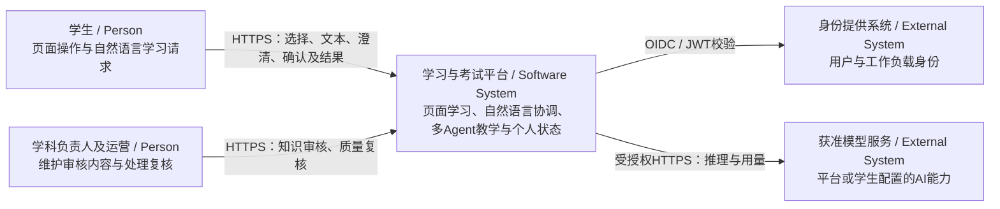
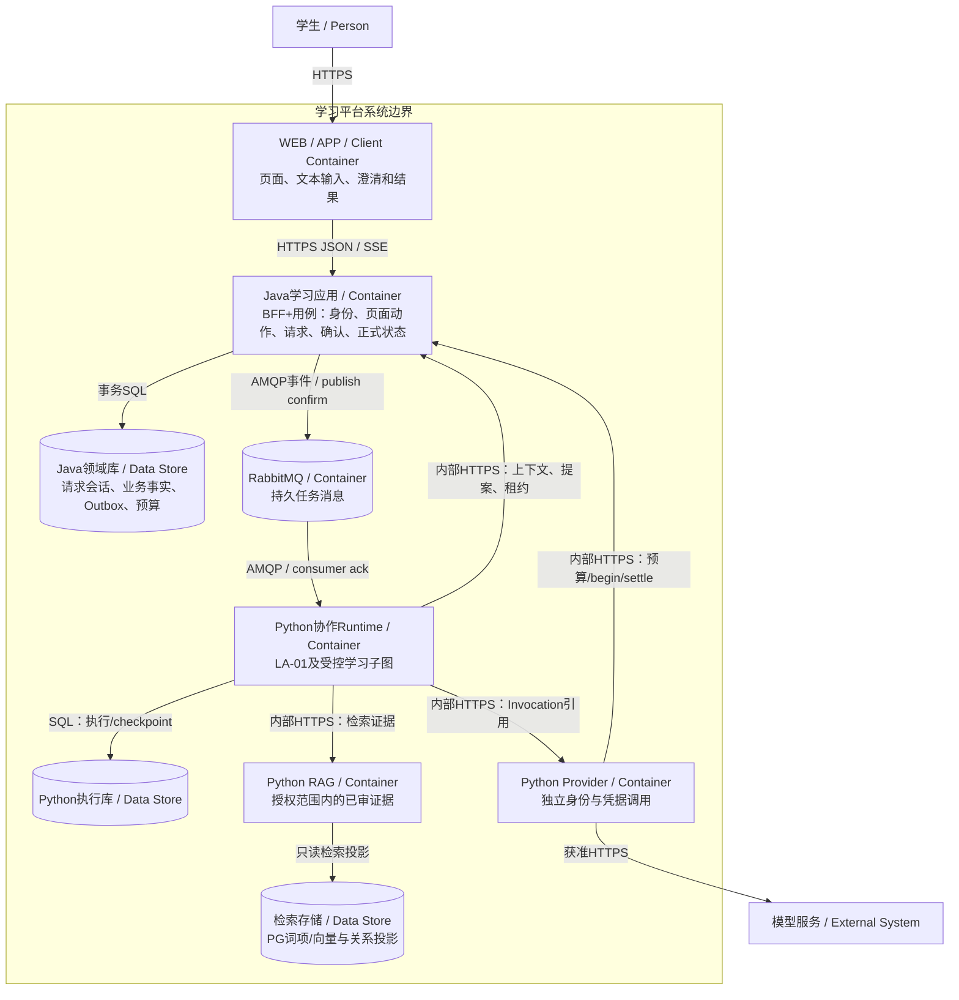
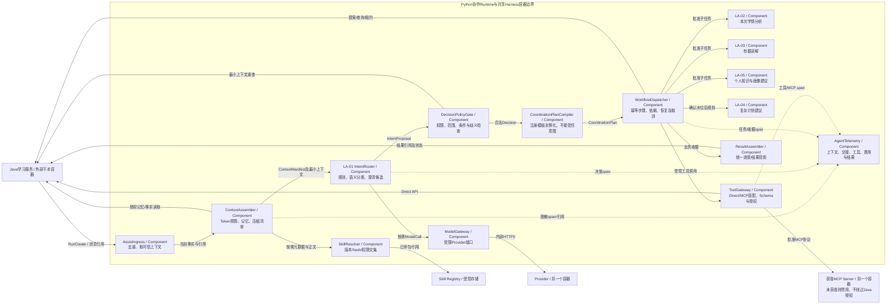
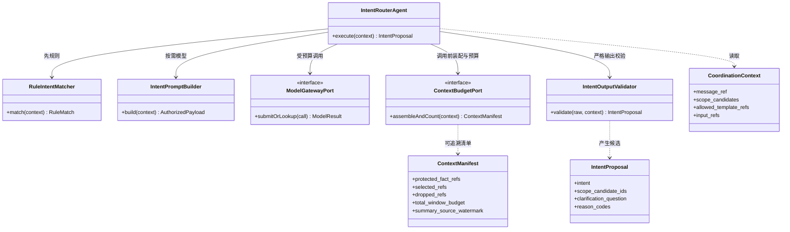
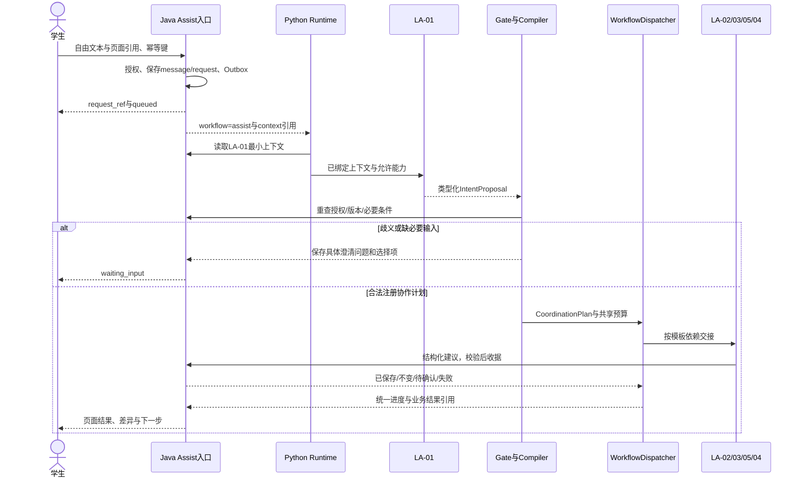
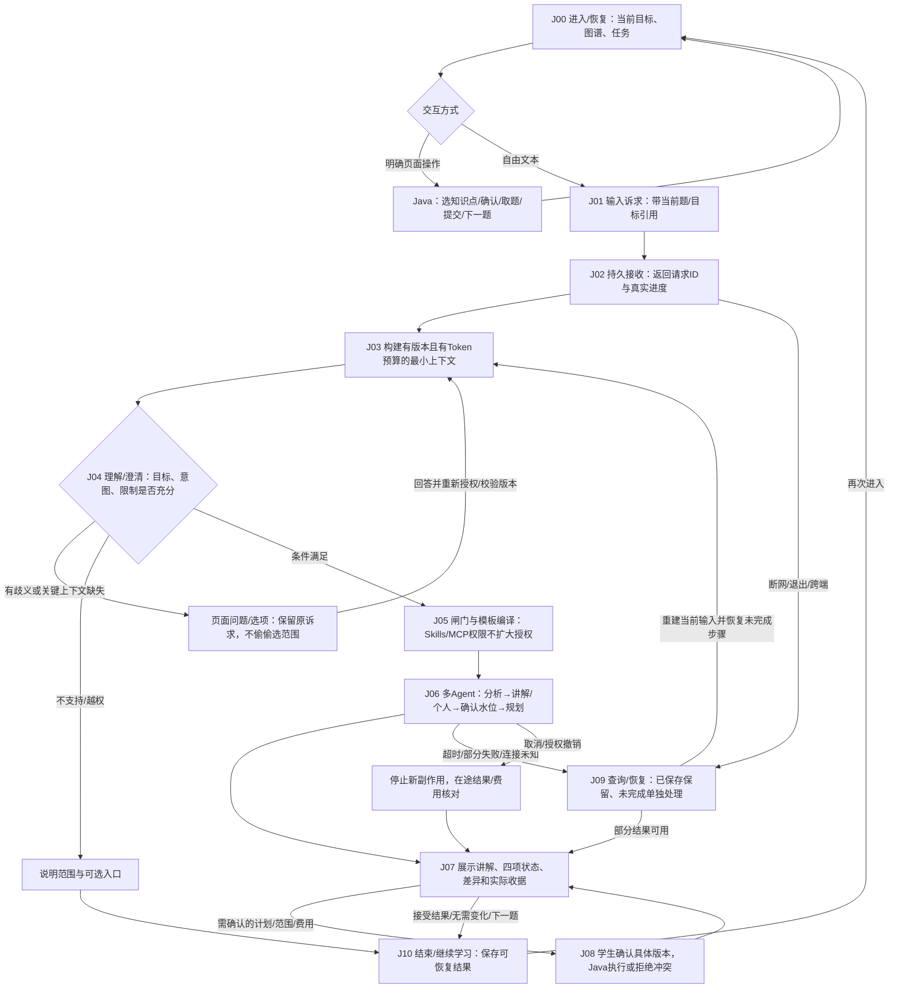
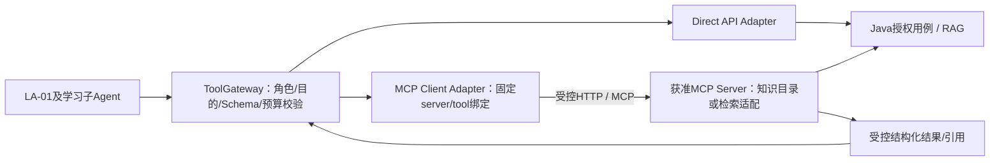
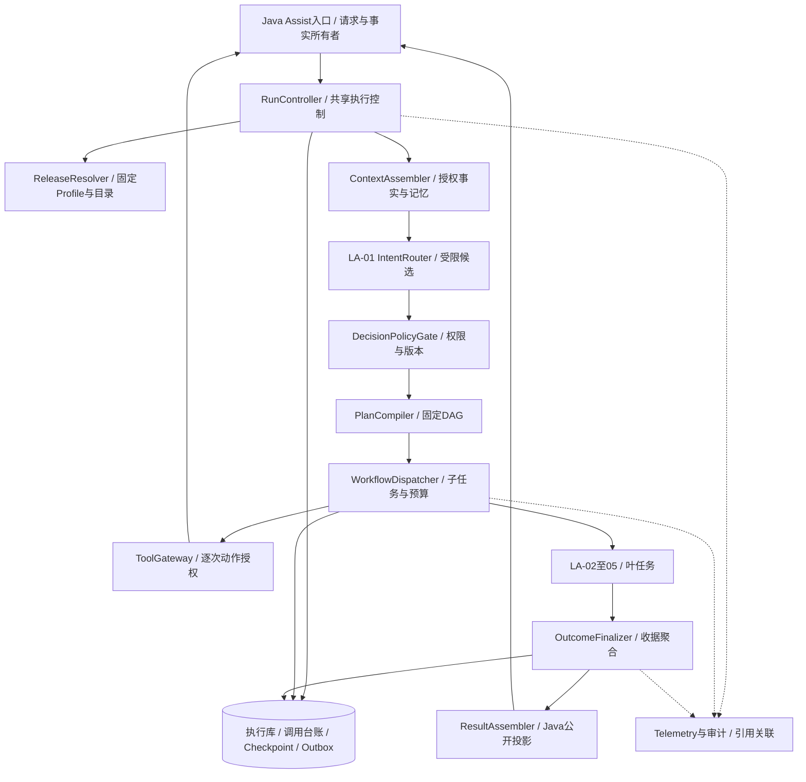
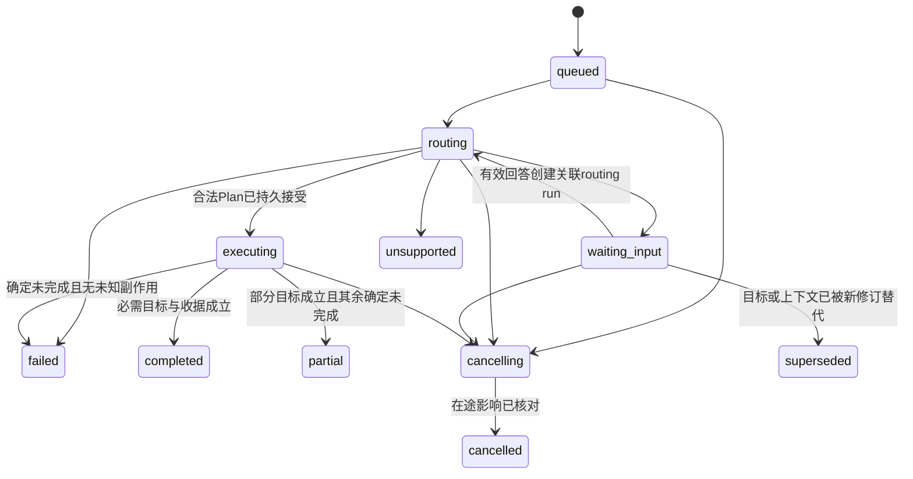

# LA-01 学习协调 Agent——需求与 C4 详细设计 v1.0

| 属性 | 内容 |
|---|---|
| 日期 / 状态 | 2026-10-19；独立实施设计评审稿，附契约与合成案例；尚未实现、部署或完成AI质量评测 |
| 本轮修订 | 对齐通用Harness规范；补齐角色适用性、执行Hook、双层状态、并发/恢复、工具副作用、预算、结果交付、数据治理、生产门禁与Gap闭环；仅修改本篇 |
| 通用运行基准 | [通用Agent Harness参考架构与工程规范v1.0](../../architecture/通用Agent-Harness-参考架构与工程规范-v1.0.md)；以本篇第17～20章落实LA-01特化，不增加另一套公开API |
| 需求基线 | [通用平台需求 v0.3](../../requirements/通用Agentic学习与考试平台-系统需求规格说明书-v0.3.md)，重点MAC-01～13、AR、UJ-15及权限/预算/恢复要求 |
| 上位设计 | [Agent群详细设计](../学生持续学习-AI-Agent群详细设计-v1.0.md)第4.2/5.3节；[程序设计与脚手架](../学生持续学习-AI-Agent群程序设计与工程脚手架-v1.0.md)第5～8章 |
| 上位架构 | [多Agent/RAG 4A专项](../../architecture/学生持续学习-多Agent与RAG-4A专项架构设计-v1.0.md)、[总体架构 v1.1](../../architecture/通用Agentic学习与考试平台-4A总体架构设计-v1.1.md) |
| 开发目标 | 开发人员能据此实现自然语言入口、受约束意图识别、澄清、授权内协作计划、工作流交接、统一反馈和恢复 |
| 边界 | Java负责页面业务/授权/事实；LA-01负责语义协调；Python工作流负责执行控制；LA-02/03/04/05分别负责分析、讲解、复杂规划、个人知识/画像 |
| 首发范围 | 文本请求、当前学习目标与已批准能力；不含语音、任意自主Agent发现、通用浏览器操作、自研基础模型 |
| 编号性质 | LA01-FR/LA01-NFR/LA01-AT为本篇局部编号，追溯平台需求，不冒充新增已批准平台需求 |

## 1. 角色定位与设计结论

LA-01是Web/App中“自由表达学习诉求”的入口，不是整个系统的唯一入口。学生点击确定的取题、提交、下一题、范围勾选、确认计划，Java直接执行业务；自由输入如“给我讲讲这题，再调整本周学习”进入LA-01。

处理链：**文本与页面上下文→可信上下文→规则识别/按需模型→类型化意图候选→授权及歧义校验→注册模板编译→工作流执行→基于业务收据统一反馈**。模型不输出任意Agent调用列表、可执行代码或工具权限。首次选知识点时，Java可从已审母本组装图谱与基础路线，不必经LA-01或LA-04。

LA-01负责选择合法的协作模板；Runtime按模板启动不同Agent及等待依赖。协调、调度和正式业务决策分开：不能用一段“已帮你调整”代替Java计划修订收据。

### 1.1 文档和附件

- [LA-01局部契约](la-01/contracts/la01.schema.json)：消息输入、可信上下文、意图候选、编译计划及请求状态。
- [局部接口](la-01/contracts/la01.openapi.json)：Java学生入口/澄清/查询与内部最小上下文视图；不覆盖上位内部run/proposal接口。
- [协作模板注册表](la-01/contracts/workflow-catalog.json)：固定模板、步骤、Agent/规则职责、依赖和权限。
- [合成验收案例](la-01/examples/la01-cases.json)：合法/非法协议及业务决策案例，非已运行模型评测。
- [检查器](la-01/verification/check_la01_design.py)、[检查记录](la-01/verification/LA-01设计检查记录-v1.0.md)：实际验证范围和未实施项。

### 1.2 建议阅读路线

先读第11章User Journey理解学生如何完成任务，再读第2～3章需求、第4章C4、第5～8章执行与协议。第12章是Agent Harness与上下文/记忆及Agentic风险，第13章是Agentic可观测，第14章是多Agent交接/MCP，第15章是Skills；第16章及附件将需求、旅程、组件和验收闭环。第17章给出通用Harness适用性与组件边界，第18章定义执行、状态、事务与恢复，第19章定义权限/预算/数据和交付，第20章列出实现任务、验收与剩余Gap；新增规则是原FR/NFR的实施细化，不改变已有Schema枚举。

## 2. 功能需求（FR）

### 2.1 业务用例

| 用例 | 学生输入/场景 | 预期结果 |
|---|---|---|
| UC-01 当前题辅导 | “为什么A不对？”且页面有当前题 | 路由LA-03；不重新提交/改分 |
| UC-02 复杂联合请求 | “我老错，讲清楚再调整计划” | 有可用答题证据时分析→讲解/个人证据→规划，依赖按模板执行 |
| UC-03 计划调整 | “这周只有三天能学” | LA-04或批准规则提出候选；必要字段缺失则澄清；变更由Java校验 |
| UC-04 指代不清 | “帮我调整一下”，当前有多个可能对象 | 一个具体澄清问题和可选对象，不擅选 |
| UC-05 新范围 | “从侵权换到合同” | 请求明确目标/范围选择及确认，不直接改当前Bundle |
| UC-06 页面明确动作 | 点击“下一题/提交/确认” | Java直接处理，LA-01模型调用数为0 |
| UC-07 不支持/越权 | “看别人的画像/帮我付款/随便抓资料” | 拒绝或显示受支持入口，不分派未经授权工具 |
| UC-08 查询/取消/恢复 | “刚才进行到哪里/停止刚才任务” | 有明确request_ref时规则查询/取消；指代不清则澄清 |

### 2.2 可验收功能需求

| 编号 | 优先级 | 功能要求 | 平台追溯 / 验收 |
|---|---|---|---|
| LA01-FR-01 | P0 | 接受学生文本及页面引用，服务端绑定身份/会话/目标，不信任正文自报账号 | MAC-02、04；LA01-AT-01、09 |
| LA01-FR-02 | P0 | 明确页面命令绕过意图模型，固定语言规则仅匹配注册语法且无歧义时使用 | MAC-01；LA01-AT-02 |
| LA01-FR-03 | P0 | 读取当前目标、题目/提交、计划、可用能力与最小摘要；限制跨目标上下文 | MAC-02～04、AR-02；LA01-AT-01、09 |
| LA01-FR-04 | P0 | 将自然语言分类为辅导、重排、联合任务、澄清或不支持；保留用户所需子意图 | MAC-01～02；LA01-AT-03、04 |
| LA01-FR-05 | P0 | 目标/指代/必要时间字段不明确、依据不足或存在冲突时澄清；支持页面选择回答 | MAC-02；LA01-AT-05、06 |
| LA01-FR-06 | P0 | 意图输出只选受限候选和模板，不创建任意Agent/工具/代码 | MAC-04、AR-03；LA01-AT-09、10 |
| LA01-FR-07 | P0 | 校验每个子能力的授权、版本、前置条件、预算及目的地，缺一不静默少做 | MAC-04、05、10～11；LA01-AT-07、08 |
| LA01-FR-08 | P0 | 编译类型化协作计划，记录步骤/依赖/输入引用/总预算与截止 | MAC-03、05；LA01-AT-03 |
| LA01-FR-09 | P0 | Runtime按固定模板交接LA-02/03/04/05，接收者再次验证授权与输入 | MAC-01、03、07；LA01-AT-03、12 |
| LA01-FR-10 | P0 | 以Java收据显示已保存/无需变化/待处理/失败/待确认；不以模型文本报告成功 | MAC-06～07；LA01-AT-11 |
| LA01-FR-11 | P0 | 请求和澄清回答幂等，拒绝重复键不同内容；恢复不重复子任务或业务副作用 | MAC-09、NFR-04；LA01-AT-12、13 |
| LA01-FR-12 | P0 | 支持任务状态、取消及恢复；取消后停止未开始副作用，外部在途费用可unknown | MAC-09～10；LA01-AT-14 |
| LA01-FR-13 | P0 | 模型超时/输出错误/能力不足/预算耗尽时返回功能菜单、澄清或批准降级，不影响Java答题 | FR-AI-02、NFR-31；LA01-AT-08、10 |
| LA01-FR-14 | P0 | 保存模型/提示/策略/目录/图/输入修订及决策理由码、校验和业务收据 | MAC-12；LA01-AT-15 |
| LA01-FR-15 | P0 | 学科争议、权威答案冲突或已提交评分修改请求转复核入口，LA-01不裁定 | MAC-08；LA01-AT-16 |
| LA01-FR-16 | P0 | 澄清与确认分开；自由回答不自动批准扩大范围/费用/目的地 | MAC-02、11、FR-AI-05；LA01-AT-06、07 |
| LA01-FR-17 | P0 | 联合请求按完整任务评测，不能用各Agent都返回文字代替业务完成 | MAC-13；LA01-AT-03、11 |
| LA01-FR-18 | P0 | 按角色/任务装配、计数与压缩长上下文，保存ContextManifest；受保护事实/否定与未完成诉求无法保留时澄清或降级 | AR-02、NFR-32；LA01-AT-17～18、28 |
| LA01-FR-19 | P0 | 管理短期摘要/长期记忆的来源、可信度、作用域、有效期与撤销；恢复时重读事实 | AR-02、NFR-09、33；LA01-AT-19、25 |
| LA01-FR-20 | P0 | 多Agent使用类型化Handoff及结果语义，传必要上下文/约束/预算/依赖，不广播全历史 | MAC-03～05、09；LA01-AT-20、27 |
| LA01-FR-21 | P0 | 观测上下文/模型/工具/Skill/交接/收据/学生结果，支持脱敏调试和无副作用离线回放 | MAC-12、NFR-14；LA01-AT-21、27 |
| LA01-FR-22 | P0 | 定义MCP Client适配、端点/工具审批、协议与Schema锁定、认证授权、错误/超大返回及等价回退 | AR-03、NFR-07～09、15；LA01-AT-22～23、28 |
| LA01-FR-23 | P0 | Skills按角色/目的渐进加载，版本/hash/审批/工具权限受控；撤销和内容变更触发回归 | NFR-15、20、34、MAC-04；LA01-AT-24～25 |
| LA01-FR-24 | P0 | 用完整User Journey连接进入、请求、澄清、协作、确认、失败恢复和结束；跨端页面状态由事实驱动 | MAC-06、09、13；LA01-AT-11、26～27 |

## 3. 非功能需求（NFR）

以下数字为继承或试点工程目标，需在受控环境验证后批准；不构成已达到的生产承诺。生产参数沿平台T-07/21/23～25等门禁。

| 编号 | 类别 | 要求与目标 | 验证/追溯 |
|---|---|---|---|
| LA01-NFR-01 | 接收体验 | Java持久接收与返回request_ref建议P95≤500ms；不等模型完成 | 压测；NFR-02 |
| LA01-NFR-02 | 路由时延 | 规则路径建议服务端P95≤200ms；含队列/上下文/模型的意图决定建议P95≤5s；LA-01模型步骤总预算≤3s | 分段/端到端统计，目标待试点；NFR-03、32 |
| LA01-NFR-03 | 容量隔离 | 沿平台100活跃会话/20提交每秒突发验证；自由文本到达率单列，不假定等于提交率；LLM并发受配额限制 | 负载模型＋背压；NFR-06、17 |
| LA01-NFR-04 | 可用/降级 | Java基础学习沿平台≥99.9%待评审目标；LA-01停机可用页面菜单，AI与降级成功分别统计 | 故障注入；NFR-01、18 |
| LA01-NFR-05 | 正确性 | 非法工作流、越权调度和绕过确认属于阻断缺陷；意图/模板/澄清质量用独立集、混淆矩阵和误路由代价衡量 | 不用模型自评代替；MAC-13、NFR-11 |
| LA01-NFR-06 | 可靠性 | 持久接收不静默丢失；同请求/子步骤/逻辑调用幂等；消息至少一次投递 | 重投/宕机/未知回执；NFR-04、31 |
| LA01-NFR-07 | 权限安全 | 服务端对象授权、最小工具集、学生文本不提升权限；模型不能命名新Agent执行 | 越权/注入/伪造会话测试；NFR-07、30 |
| LA01-NFR-08 | 隐私 | 文本长度≤2000字符；只发必要上下文；摘要仍按个人数据处理，模型/嵌入目的地均获准 | 数据流/导出删除；NFR-09、30 |
| LA01-NFR-09 | 预算 | 路由模型正常1次，最多一次有预算和剩余期限的修复；遵守父run总调用/Token/费用上限，不额外获预算 | 限额测试；MAC-10、NFR-17 |
| LA01-NFR-10 | 可观测 | request/session/goal/run/step/decision/plan/Invocation/receipt关联；日志不存密钥/私有推理链，默认不采正文 | 单次链路定位；NFR-14、MAC-12 |
| LA01-NFR-11 | 可维护 | 分类、策略、目录、提示、图和Schema分别版本化；规则/模型可替换；固定工作流不依赖LLM | 契约/回归/消融；NFR-15、16、34 |
| LA01-NFR-12 | 恢复 | 按平台待评审RPO≤5min/RTO≤60min验证；澄清/取消授权在恢复后重查 | 灾备/恢复；NFR-05、MAC-09 |
| LA01-NFR-13 | 可访问交互 | 澄清支持文本/键盘/选项，状态不只靠颜色；WEB/APP共用业务状态 | UI走查；UX相关约束 |
| LA01-NFR-14 | 供应链/交付 | 受支持Java/Python基线、锁依赖、SBOM/签名、安全扫描、灰度与回滚 | DevSecOps门禁；NFR-18、20 |
| LA01-NFR-15 | 范围/版本一致 | 决策和执行都检查目标/目录/授权修订，旧澄清/旧模型输出不覆盖新目标 | 并发/过期测试；NFR-39、MAC-05 |
| LA01-NFR-16 | 上下文预算与保真 | 最终序列化输入/输出/工具/Skill受预算；保护项不静默截断，Token溢出及关键语义丢失单列评测 | 长历史/位置/否定/超窗；AR-02、NFR-32 |
| LA01-NFR-17 | 记忆隔离与新鲜度 | 来源/信任/用户目标/有效期可核对，摘要不升级授权和事实，撤销删除传播到缓存/检查点 | 记忆投毒、过期/跨目标；NFR-09、30、33 |
| LA01-NFR-18 | 协作抗级联 | 下游区分假设/事实/收据；重复/无进展有界，分支失败不伪造全成功 | Handoff缺约束/错误级联/循环；NFR-31 |
| LA01-NFR-19 | 工具资源约束 | MCP/API输出的字节/Token/分页/超时有界，拒绝超量不抢占答案提交资源 | 超大/分页/断流测试；NFR-06、17、37 |
| LA01-NFR-20 | 协议兼容 | MCP协议/Server/工具Schema版本可追溯，漂移隔离；互通必须真实验证 | 现代/旧版/无共同协议/错误受众；NFR-15、34 |
| LA01-NFR-21 | Skill供应链 | 包/引用完整性、审批/签名、最小权限及版本可审计；未知/撤销包不加载 | 注入/目录逃逸/权限请求/撤销；NFR-20、MAC-04 |
| LA01-NFR-22 | 观测隐私与可诊断 | trace链覆盖业务因果且不泄漏全文/秘密，高基数只进受控trace，内容调试授权限时 | 脱敏/采样/删除/异步链；NFR-09、14 |
| LA01-NFR-23 | 非确定性质量治理 | 结构、语义、证据、业务完成、学习成效分别评测；回放不再次执行副作用 | 独立集/消融/版本漂移/回放；NFR-11、12、34 |

意图准确率、澄清命中率、误执行率、路由成本分别评测；业务越权不得用平均准确率抵消。未确定样本与风险门槛前不声称“99%正确”，T-21/23/25由产品/教研/测试关闭。

## 4. C4 架构设计

采用C4的系统上下文、容器、组件、代码四种视角；附动态/部署说明。C4 container指可运行应用或数据存储，不等同Docker容器。图用Mermaid表达C4层次，节点标出类型/责任，非Structurizr DSL；尚未做图形渲染验证。[C4官方图分类](https://c4model.com/diagrams)。

### 4.1 C1 系统上下文：学生与学习平台



边界：LA-01是平台内部能力，不在C1画成与平台并列的外部系统。学生只对平台交互；知识域、RAG和其他Agent在C2/C3展开，不误画为外部产品。

### 4.2 C2 容器：Java接入、Python协作与正式数据



图中Java学习应用是责任聚合简图：预算/Invocation在平台服务、内容发布在知识域，按既有应用边界通过API调用，不意味着跨库天然事务。LA-01复用协作Runtime，不单独强制一个微服务；Provider持密钥权限，普通Runtime无解密能力。

### 4.3 C3 组件：聚焦Python协作Runtime



工作流Dispatcher是应用执行组件，不是另一名自由规划Agent。LA-01不替代LA-02/03/04/05，也不决定他们输出的教学结论。Gate检查每个能力；编译器只从版本化目录生成已批准步骤。

### 4.4 C4 代码：聚焦IntentRouter组件

此视图只展开核心协调组件，使用UML类图表达端口及数据类型；实际代码落地后优先从源码生成，避免长期漂移。[C4代码视图说明](https://c4model.com/diagrams/code)。



DecisionPolicyGate与Compiler在组件边界之外消费候选；模型分类成功不等于允许执行。类名/方法为待实现接口，非已经存在的源码。

### 4.5 部署视角

Java应用与协作Runtime部署Kubernetes独立工作负载，Runtime按队列年龄/并发伸缩，Provider另用ServiceAccount/出网策略。数据库/消息有独立HA和备份；LA-01模型故障不影响Java页面答题。继承上位探针/优雅退出/CI-CD要求，不因增加LA-01重复建设注册中心或密钥系统。

## 5. 多 Agent 协作与意图/模板设计

### 5.1 可执行意图与受控目录

| 意图 | 注册模板 | 典型任务 | Agent及依赖 |
|---|---|---|---|
| explain | assist.explain.v1 | 当前题/明确节点辅导 | LA-03，精确答案/材料与RAG支持 |
| replan | assist.replan.v1 | 当前目标计划候选 | LA-04或规则；保存建议/必要确认，不直接改范围 |
| explain_and_replan | assist.explain_replan.v1 | 讲解并根据表现调整后续 | LA-02→LA-03并行LA-05→Java确认个人水位→LA-04 |
| clarify | 无执行模板 | 缺目标/题目/必要约束 | Java持久问题、选项与输入修订，等待学生 |
| unsupported | 无执行模板 | 不支持能力、越权或无相关学习诉求 | 返回受支持入口/拒绝理由，无下游分派 |

explain_and_replan要求有允许访问的提交/证据，不能为满足模板伪造已答记录；无证据时解释可独立做，但必须向学生说明并让其选择“先辅导/先诊断/调整基础路线”，不得悄悄省略一半诉求。复杂请求包含目录外能力时也明确限制，不用最接近意图代替未支持的工作。

`allowed_template_refs`由服务端按目标、产品、能力和授权确定；LA-01只选意图/候选范围，不输出任意template ID。Compiler从意图映射目录并检查其仍获准；不能把模型reason_codes当隐藏指令解释。

### 5.2 串并行与交接责任

LA-02本题分析完成后，讲解和个人整理可并行；LA-04依赖Java确认后的个人水位，不需要等讲解全部完成。讲解失败不取消已可完成的个人/计划支路；个人未确认时不能声称新计划基于更新画像。

Handoff包含parent_request/run/step、目标/母本/Submission/快照/水位、允许工具和数据目的地、共享预算、deadline、输出类型、幂等键及当前fencing。子任务重新授权，不因上游给出材料就提升其可信度。预算父子共享，不每个Agent重新获额度。

若联合请求来自一次已有题目提交，引用已有Analysis/StudyCycle/个人状态，优先复用已确认版本；不重新判分/重复登记证据。新分析或计划建议是新的因果修订，逻辑复习任务按既有唯一键比较，不能同一请求多排一份。

### 5.3 请求到执行动态时序



## 6. 输入输出、协议兼容与接口

### 6.1 输入及可信边界

AssistRequest：text（1～2000字符）、client_context（可选goal/attempt/node引用）、client_message_id。用户身份来自Java会话；client_context只表达页面线索，必须检查对象归属/版本，不能提供authorization_ref、allowed_templates、账号或模型密钥来改变权限。

CoordinationContext由Java构造：context_ref/message_ref/text、session_ref、input_refs、current_scope_candidate_id、scope_candidates、allowed_template_refs、capability_refs、page_action、cycle_summary、policy_ref、auth_revision/context_revision及deadline。目标候选只列当前用户有权选择的最小元数据，不能把其他学生信息放进候选让模型过滤。

未选目标时Java可以创建尚未激活的候选目标上下文或要求先选产品/科目；上位InputRefs要求goal_ref/manifest_ref，不能在全局闲聊中填虚构母本。首次学习范围的正式确认仍走Java共建页面，不因说“学侵权”就激活Bundle。

### 6.2 意图候选与编译结果

IntentProposal是模型/规则的受限输出：intent、scope_candidate_ids、clarification_question、reason_codes。解释/重排必须选一个服务端候选；clarify必须有问题；unsupported/clarify不带可执行步骤。模型不输出授权、信心概率、Agent名字或DAG。

CoordinationPlan由服务器编译：decision_ref、request_ref、template_ref、catalog_version、context_revision/auth_revision、input_refs、scope_candidate_id、step_bindings、budget_ref、deadline、requires_student_confirmation。步骤只能与注册模板精确对应，动态输入只绑定批准的引用，不能替换Agent/工具/依赖。联合模板propose_plan带bind_confirmed_personal_from=commit_personal：基线input_refs只是计划编译时快照，Runtime执行到规划时必须从该Java成功收据解析确认的证据/画像水位，再形成新的不可变AgentInvocation；收据未确认不得使用原快照假装新画像。

### 6.3 与上位契约的兼容处理

上位CoordinationOutput只有workflow＝assist/plan_change/clarify、question、reason_codes，无法单独表示“讲解＋重排”的完整编排。**保留该Schema不扩字段**：作为兼容投影，explain/联合任务映射assist，replan映射plan_change，clarify映射clarify；unsupported作为请求受支持性状态，不制造新的上位workflow枚举。

完整协调计划保存在Runtime的决策/计划记录并交给Dispatcher；后续执行必须读取类型化Plan，不能从reason_codes解析子任务。上位RunCreateRequest仍使用workflow=assist进入入口图；plan_change是CoordinationOutput语义，不是RunCreateRequest允许的工作流名，不可直接发送为run.workflow。

上位LA-01卡片提到read_cycle_status，但既有ToolInvocation未注册该工具。本篇通过Java可信最小上下文的cycle_summary读取必要状态，不动态调用未注册工具，不默默修改全平台工具枚举。整体规格统一修订时应同步此命名说明。

### 6.4 接口与状态

详见[LA-01 OpenAPI](la-01/contracts/la01.openapi.json)。公开端点由Java提供；/internal端点只允许受信Runtime。公开cookie会话使用HttpOnly/Secure及CSRF/来源校验，APP使用授权Token；本文API定义sessionCookie/appBearer为互斥认证方式，内部workloadBearer不能被学生Token替代。

| 接口 | 所有者 / 输入 | 输出与约束 |
|---|---|---|
| POST /v1/learning-assist/requests | Java；AssistRequest、Idempotency-Key | 202持久request receipt后才分发；文本不必等模型 |
| GET /v1/learning-assist/requests/{request_ref} | Java；当前用户 | 200状态、澄清/结果引用；对象归属校验 |
| POST /v1/learning-assist/requests/{request_ref}/clarifications | Java；question_ref、expected_context_revision、answer/choice | 202记录回答并恢复/新建合法执行；不表示计划已确认 |
| POST /v1/learning-assist/requests/{request_ref}/cancel | Java；expected_request_revision | 202记录取消请求；在途模型费用另处理 |
| GET /internal/v1/la01/contexts/{context_ref} | Java；Runtime身份/任务绑定 | 200 CoordinationContext，不返回密钥或全量私人历史 |

查询/取消由Java在入图前处理已绑定request_ref的明确命令；指代多个请求时先澄清。LA-01五种意图不增加cancel或任意run控制能力，规则分类器内部只返回这五种意图候选。

重用上位/internal/v1/runs、control、run-leases、learning-proposals、Provider/Invocation接口，本文不再造一套执行基础设施。公开入口不接受任意内部run_id控制他人任务。

Request状态：queued→routing→waiting_input或executing→completed/partial/failed；取消经cancelling→cancelled，旧输入可superseded；unsupported为明确拒绝/范围外终态。此为Java公开请求投影，Python内部等待/核对状态按18.2映射，不向现有Schema加入新枚举。业务结果包括需要确认不等于已激活；completed必须有可展示的真实收据/澄清之外明确结果，partial列出失败子项。若目标是生成计划候选，则候选已保存可视为该生成任务完成，但UI必须显示“方案待确认”，不得显示“计划已生效”；若目标明确要求实际变更，则确认前不能声称该目标全部完成。

### 6.5 澄清与确认不同

澄清回答解决“你指哪道题/哪个范围/哪些天”及必要输入，不等于确认写入范围/费用。question_ref绑定request/session/context_revision、选项候选与有效期；示例试点15min过期后重建当前上下文，不按旧问题直接执行。连续最多2轮澄清为试点上限，仍不清楚返回功能菜单/人工支持，不无限对话。

默认处理：Java保存澄清并结束本次routing run；回答后新建关联run，避免长期占用执行进程；原等待记录可查询。已有LangGraph等待方案可用于其他子流程，但恢复会重新执行节点且须重查授权/幂等，不把任意resume当学生确认。[框架中断说明](https://docs.langchain.com/oss/python/langgraph/interrupts)。

## 7. 组件程序与状态持久化

### 7.1 代码模块与端口

| 组件 | 建议实现 | 输入→输出 / 关键职责 |
|---|---|---|
| Assist入口 | Java AssistRequestService | 用户会话/文本→message/request/Outbox；校验页面引用 |
| 上下文适配 | CoordinationContextPort | context_ref→最小可信Context；不通过LLM查询身份 |
| 意图规则 | RuleIntentMatcher | 精确命令/结构化action→明确RuleMatch或no_match；自然语言模糊不强猜 |
| 协调Agent | IntentRouterAgent | Context→IntentProposal；正常至多一次模型调用 |
| 提示构建 | IntentPromptBuilder | 白名单意图/候选/必要摘要→ModelPayload |
| 决策闸门 | DecisionPolicyGate | Proposal＋当前Context→allow/clarify/deny/stale |
| 编译器 | CoordinationPlanCompiler | allow＋固定目录→类型化Plan；不求解任意DAG |
| 分派器 | WorkflowDispatcher | Plan→持久子任务/收据；父预算、版本及fencing |
| 上下文与记忆 | ContextAssembler / MemoryPort | 当前事实/授权记忆→预算内角色上下文＋Manifest；不直接升级记忆可信度 |
| Skill选择 | SkillResolver / SkillRegistryPort | 角色/目的→已审指引，按需加载，不扩大工具权限 |
| 工具适配 | ToolGateway / MCPClientPort | 授权参数→类型化ToolResult；Direct/MCP版本与错误一致 |
| Agentic观测 | AgentTelemetry | 上下文/交接/工具/费用/收据→脱敏span/质量信号 |
| 结果投影 | ResultAssembler | Java各子收据→页面进度/结果，模板化文字优先 |

### 7.2 意图执行伪代码

```text
coordinate(request_ref):
  context = Java.read_la01_context_and_authorize(request_ref)
  if explicit_page_action(context): return JAVA_BYPASS  # not an LLM role result
  proposal = rules.match_exact_unambiguous(context)
  if proposal is None:
    manifest = context_assembler.build_budgeted_context_with_memory_and_skills(context)
    if manifest.required_context_missing: return clarify_or_menu_without_model()
    ensure_remaining_deadline_budget_and_model_capability()
    proposal = model_classify_once_with_registered_intents_and_scope_candidates()
    strict_schema_validate(proposal)  # at most one budgeted repair within total deadline
  latest_context = Java.reload_authorized_context(request_ref)
  decision = gate.check(proposal, latest_context, pinned_catalog)
  if decision is stale: supersede_or_rebuild_context_not_execute_old_choice()
  if decision is deny: persist unsupported/rejected reason; show supported actions
  if decision is clarify: Java.save_question_and_revision(); return waiting_input
  plan = compiler.instantiate_exact_registered_template(decision)
  persist decision + plan + dispatch_intent in one Runtime transaction
  dispatcher.submit_same_logical_plan_idempotently(plan)
  return persisted_dispatch_receipt_and_current_pending_state()  # 非阻塞接收
  # 后续由ResultAssembler查询真实业务收据，按修订更新Java投影
```

Java在建立CoordinationContext之前处理尚未选产品/目标的页面澄清，不创建填有虚构InputRefs的LA-01 run。InputRefs/Error是上位结构的验证镜像，局部检查器逐字段比对防漂移；auth_revision沿上位采用不透明字符串版本引用，context_revision/request_revision是本地整数修订，不相互混用。

模型提示只要求输出局部IntentProposal；学生正文/检索/历史摘要以不可信数据分区，禁止让其定义system指令。提示列出“讲解＋重排”要保留联合意图、缺证据须澄清、越权不可执行，不用模型自报confidence作权限依据。

### 7.3 持久化字段与所有者

| 数据 | Owner / 关键字段 | 一致性 |
|---|---|---|
| assist_request/message | Java；request/user/session、文本受控存储引用、页面引用、状态/修订、幂等hash、created/expiry | 用户对象授权；接收与Outbox同事务 |
| clarification | Java；question_ref、context_revision、候选、回答引用、轮次/到期、consumed_revision | 回答同键幂等；并发只消费一次，过期/旧范围返回409 |
| coordination_decision | Python；decision/request/run、候选、gate状态、catalog/prompt/model/policy版本、hash/限制 | 不保存私有推理链；候选与编译结果分开 |
| coordination_plan | Python；plan_ref、decision、template/version、绑定、输入/授权修订、预算/期限、状态 | UNIQUE(request_ref,request_revision,decision_revision)；重发同plan引用 |
| dispatch_item/step | 既有Python执行库；plan/step/input_hash/状态/回执 | 复用Inbox/run/step/checkpoint/ProposalDelivery及fencing，不内存发完即忘 |
| 业务结果/审计 | Java正式记录与回执引用 | Agent输出仅候选，事实以事务收据为准 |

Java与Python跨库不做伪原子事务。Java已接收而投递失败由Outbox恢复；Python已编译但交接未知重发同plan/step幂等键；Java已采纳但回执丢失取同收据。原始文本、摘要、计划和checkpoint按个人数据政策处理，删除/账号禁用阻止后续任务，备份恢复先重放禁用/删除账本。

## 8. 异常、权限、成本与RAG边界

| 情况 | 行为 | 禁止 |
|---|---|---|
| 有多个可能目标/题目 | 展示授权候选并澄清 | 依据模型“最可能”读其他目标私人详情 |
| 联合请求缺能力/授权/证据 | 说明未满足部分，提供可选分支/确认 | 静默砍掉子诉求却报全部成功 |
| 模型错误/超时 | 有界修复或菜单/明确澄清；Java页面继续 | 无限重试或默认执行重排 |
| 预算/目的地变更 | 返回待选择/授权入口 | 静默换供应商/追加每Agent预算 |
| 输入/目录/授权修订变了 | 标superseded并重建当前输入 | 旧澄清回答直接生效 |
| 下游讲解或计划失败 | 独立保留成功支路，显示partial/恢复 | 回滚答案/已确认个人事实或伪造成功 |
| 取消/Worker租约丢失 | 阻止新副作用，收据/在途费用审计 | 声称取消保证零费用 |
| 权威题争议 | 转学科复核；不更改标准分数 | Agent投票改答案 |

LA-01通常不检索学科正文：识别“解释/重排”不需要把整套RAG资料装进路由上下文。必要节点定位由Java目录/授权候选提供，语义映射若不确定则澄清；正式知识检索交LA-03/02/04按目的使用RAG。检索结果、个人笔记都不能扩大LA-01权限；它不从互联网临时生成可执行能力目录。

模型/Provider隔离、JWT、SSRF/出网/秘密、Token/费用预留和unknown对账沿上位设计。LA-01最大输出600 tokens、模型总预算3s及一次修复上限是工程试点值；全任务期限/预算优先，修复不自动再获得3s。正文长度前后端都校验，保留必要事实和限制，不能为凑Token裁掉授权。

## 9. 运维、发布与验证

### 9.1 指标与值班

监测：文本请求接收/排队/路由、规则绕过率、模型调用数、意图混淆/澄清轮次、unsupported、gate拒绝/过期、template分派、子任务依赖、业务完整/partial、Token/费用unknown。延迟分别含接收/队列/上下文/模型/gate/交接；完整学习结果时延另计，不能用快速返回“正在处理”满足有用反馈目标。

日志关联request/context/decision/plan/run/step/cycle/Invocation/receipt；不采集密钥/原始私有推理，默认不记文本全文。意图分类质量抽检只能用获授权样本，反馈更改Prompt/规则先离线评测。

Owner：Java值班处理接收/权限/业务收据，AI值班处理模型/图/目录/交接，教研产品处理误路由/缺证据/学习影响，安全处理越权/注入/泄漏。紧急关闭LA-01入口时保留Java明确页面路径。

### 9.2 部署与回归

复用既有Python协作镜像及Java应用，不新增独立基础设施；只有负载/安全隔离证据需要时再拆服务。catalog/prompt/model/policy/schema/graph与镜像摘要一起进入release-manifest；灰度先用合成与授权试点请求，比较误路由、失败、费用和时延。

回滚目录必须能解释在途plan，旧run路由兼容版本或暂停迁移；不能只回滚LLM提示却让旧plan套新步骤。CI包含局部/上位Schema、接口兼容、目录DAG、权限对抗、Java/Python联调、租约/重复/未知费用、AI独立集和联合旅程。尚未执行的运行验证不计为已通过。

### 9.3 验收矩阵

| 用例 | 场景 | 必须断言 |
|---|---|---|
| LA01-AT-01 | 当前题“为什么A错” | 只取授权上下文，explain→LA-03，Grade不变 |
| LA01-AT-02 | 页面下一题/提交/确认 | Java直接执行，路由模型调用0 |
| LA01-AT-03 | 有提交证据的讲解＋重排 | 联合模板，LA-02→讲解/个人→确认水位→LA-04，结果依收据 |
| LA01-AT-04 | 仅时间变化 | replan，预览/必要确认，无额外分析/讲解 |
| LA01-AT-05 | “调整一下”无对象 | 明确澄清，不随机路由 |
| LA01-AT-06 | 澄清回答过期/改变目标/两端并发 | 版本冲突或新上下文，只消费一次；不当作确认 |
| LA01-AT-07 | 换目标/扩大预算/缺子能力 | 明确选择/限制，不直接生效或静默部分执行 |
| LA01-AT-08 | 模型超时/预算耗尽/提供者unknown | 降级或待对账，不静默换目的地/重复调用 |
| LA01-AT-09 | 他人账号/题目/提示注入 | 对象权限与工具白名单阻断，模型输出不能授权 |
| LA01-AT-10 | 非法意图/字段/自报Agent图 | Schema/Gate拒绝，有限修复或菜单 |
| LA01-AT-11 | 讲解成功计划失败 | partial＋真实收据，不能说全部成功 |
| LA01-AT-12 | 任务重投/Worker崩溃/旧fence | 同plan/step幂等，不重复业务事实，旧token不能写 |
| LA01-AT-13 | 同幂等键不同文本/澄清答案 | 409，不覆盖原记录 |
| LA01-AT-14 | 取消/账号禁用 | 停止未开始步骤，在途结果审计与费用核对 |
| LA01-AT-15 | 提示/模型/目录/图升级 | 可追溯、回归、兼容旧plan或显式迁移 |
| LA01-AT-16 | 修改权威答案/学科争议 | 不改分，转复核入口 |
| LA01-AT-17 | 长会话/工具/Skill总量超窗 | 实际序列化计数；只丢可选片段；保护项放不下澄清，不调用截断模型 |
| LA01-AT-18 | 摘要/历史中“不要改周末、只解释不改计划” | 保护字段不丢，语义独立回归；不确定时读事实/澄清 |
| LA01-AT-19 | 过期/投毒/跨目标记忆 | 仅取当前有效授权记录，假设/摘要不升格确认事实 |
| LA01-AT-20 | Handoff缺版本/限制、无进展循环 | 拒绝不完整交接、预算/循环上限生效，不把假设当事实 |
| LA01-AT-21 | 异步全链路与隐私日志 | 可定位错误来源；无凭据/正文泄漏，不以高基数ID污染指标 |
| LA01-AT-22 | MCP错误受众/大返回/断流/未知结果 | auth/Schema/资源限制生效，unknown不盲目重发副作用 |
| LA01-AT-23 | MCP现代/旧版、Schema漂移/工具投毒 | 固定profile兼容、漂移隔离，不自动启用新工具 |
| LA01-AT-24 | Skill工具越权/包引用逃逸/过大正文 | 权限取交集、完整性/路径检查、按需加载及预算 |
| LA01-AT-25 | Skill/记忆撤销与旧缓存/旧上下文 | 新调用阻断，恢复重查当前授权，不等待TTL复活旧权限 |
| LA01-AT-26 | 两端确认/断网重连/请求已完成但计划待确认 | 显示事实/版本与真正业务状态，不重复保存或幽灵成功 |
| LA01-AT-27 | 回放/压缩/Skill或模型版本变化 | 无真实副作用回放、联合旅程回归与因果可追溯 |
| LA01-AT-28 | Tool输出/上下文/Agent循环放大费用和延迟 | 字节/Token/步骤/父预算有界，保留基础作答和可继续出口 |

本篇合成案例验证结构/规则约束，不证明模型能正确理解自然语言。上线前独立黄金集需覆盖中文指代、否定、多意图、长文本、多目标、恶意输入、无证据、功能缺失、含糊范围；以专家标注的意图/模板/澄清/拒绝和实际业务完成判定。规则基线/单Agent/协作收益分开对比。

### 9.4 上线门禁和开发任务

| 阶段 | 交付 | 放行条件 |
|---|---|---|
| L1 入口/上下文/规则 | Java公开API、幂等/Outbox、最小上下文、精确命令/澄清UI | 真实鉴权/版本/重复/过期测试，页面绕过模型 |
| L2 类型化协调 | LA-01、Schema/提示、Gate、目录/编译器 | 合成/独立模型集、阻断越权、意图/费用/时延评审 |
| L3 真实协作 | Dispatcher接LA-02/03/04/05和Java采纳 | 依赖/四项/partial/取消/恢复实测，不止mock文字 |
| L4 生产门禁 | Kubernetes、CI/CD、安全/容量、值班/回滚/灾备 | 上位G0～G4与本篇NFR实际证据，风险签署后小范围上线 |

未关闭：T-23能力目录/自动化边界，T-21评测集/质量门槛，T-24/25目的地/费用/期限，T-07容量及NFR批准。工程可以先按本文骨架开发，未批准能力禁用/菜单降级，不擅自默认为生产规则。

## 10. 需求追溯、决策与维护

| 平台需求 | LA-01落点 |
|---|---|
| MAC-01～03、AC-43 | FR-01～05/08～09，受限意图、澄清、交接与注册协作 |
| MAC-04、07～08、AC-46～47 | FR-06～07/15～16，Gate/权限/确认/复核 |
| MAC-05～06、AC-44、49 | FR-08～10，固定依赖、确认水位及真实统一反馈 |
| MAC-09～10、AC-45 | FR-11～13，持久幂等、恢复/取消及共享预算 |
| MAC-11～13、AC-48 | FR-13～14/17，ModelProfile、版本/追踪和联合评测 |
| AR、NFR-01～18/30～34/39 | NFR表及状态/安全/运行/生产门禁 |
| AR-02、MAC-03～05/12～13、NFR-09/14/15/20/30～34 | 新增FR-18～24、NFR-16～23、AT-17～28；第11～16章的旅程/上下文/观测/MCP/Skills与覆盖矩阵 |

本篇按平台需求派生，不修改平台业务目标；聚焦LA-01的C4视角不替代平台4A结构。第17～20章将通用Harness落到LA-01；本次仅修改本文，既有机器契约保持原版，新增内部控制对象需在实施门禁完成Schema和迁移后接入。详细设计与程序设计提供返回链接，需求MAC章节和架构专项提供入口；局部新Schema不原地修改上位1.0契约。

决策：明确页面路径不调用意图模型；模型产受限候选、服务器编译固定模板；澄清不代替确认；LA-01不直接RAG整库和写业务；复用Runtime/Provider/Java事实与恢复机制。涉及协议变更时必须成组同步契约/目录/案例并评审；本次仅完善本文，尚未实施的契约扩展明确列为门禁，不声称附件已同步。完成后Git commit；历史归档不改。

## 11. User Journey：把页面、协调、多Agent和结果串起来

### 11.1 旅程范围与学生承诺

主角是已选择“民法—侵权”的学生，在题目页面提出“解释这题，再调整这周学习”。学生不用管理Agent或理解MCP/Skills。界面始终说明：当前目标、哪些已保存、哪些只是建议、哪些仍在执行、下一步能做什么。

本篇同时覆盖页面直接业务：选择知识点、Java组装图谱/基础路线、确认、取题、提交；这些是LA-01的前置/后续，不强制经过意图模型。长会话、跨端、后台恢复和资料更新贯穿同一旅程，不另建没有业务出口的技术流程。

### 11.2 总旅程图



### 11.3 分阶段文字与可见结果

| 阶段 | 学生看到和做什么 | Java/Agent与基础能力 | 持久状态、下一步及异常 |
|---|---|---|---|
| J00 进入/恢复 | 看到当前范围、计划、题目与上次进度；可勾选知识点 | Java读母本/个人状态并组装页面，不先唤醒LA-01 | 已确认Bundle、任务；未选范围走共建确认，不伪造goal |
| J01 提问 | 输入“不要改周末安排，解释这题再调工作日学习” | 页面提交文本＋当前对象引用，Java校验归属 | message/request；否定约束须保留，超长输入明确提示 |
| J02 接收 | 显示“请求已接收”，可退出/查看/取消 | Java事务保存请求和Outbox，返回202；trace关联 | queued/request_ref；未确认保存不显示已保存，重试同键 |
| J03 上下文 | 通常无需操作；若需补信息看到具体问题 | ContextAssembler读取权威事实、最近相关历史、受控记忆/Skill元数据；Token清单 | ContextManifest、输入修订与删减原因；保护项放不下则澄清/菜单，不截断执行 |
| J04 理解/澄清 | 选择目标/题目/时间；看到保留的原诉求 | LA-01规则/模型出候选；澄清与确认分开 | waiting_input；过期/换目标重建，否定与费用边界不因摘要丢失 |
| J05 编译 | 看到将做的任务和必要授权，不展示内部推理 | Gate校验能力/预算/版本，Skill只提供已审指引；目录编译固定模板 | decision/plan；未授权MCP/Skill不能加工具或步骤，范围外明确不执行 |
| J06 协作 | 显示各业务项真实进度，可取消/稍后回来 | Runtime交接最小Context/Handoff；工具按直接API或批准MCP适配；分支依赖与隔离 | run/step/Invocation/proposal收据；同一模型错误不被下游当既定事实 |
| J07 结果 | 查看讲解引用、四项updated/no_change/pending/failed、下一步 | ResultAssembler从Java收据组装；可追踪到依据/输入版本 | complete/partial；候选已保存≠计划已激活，失败项单独重试 |
| J08 确认 | 看差异并确认指定版本，或拒绝/修改 | Java校验范围/时间/费用和当前修订；不是LA-01代签 | 激活收据或409差异；候选任务已完成也须清楚显示业务仍待确认 |
| J09 恢复/跨端 | 重开同一请求看到实际进度；不会被要求重答已保存题 | Java查事实，Runtime重授权/重建上下文、复用已知Invocation/收据 | 新run关联原request；只恢复未完成步骤，旧fence/过期记忆不得写有效状态 |
| J10 结束/继续 | 下一题、复习、结束会话或反馈问题 | Java存学习恢复点，按政策整理结构化记忆 | 会话结束不等于已掌握；活跃请求结束条件明确，下一次回J00 |

### 11.4 场景分支：正常与异常都要走到学生结果

- **UJ-LA01-01 页面学习。** 选知识点→Java图谱/基础路线→学生确认→取题/提交→固定分析链；LA-01调用数为0。页面“问AI”才进入J01，明确“解释选项”也可规则直达LA-03。
- **UJ-LA01-02 联合诉求。** J00～J07正常链：保留“解释＋重排”和“周末不变”；讲解/个人可并行，规划等Java确认水位。若需要扩大范围/预算则J08确认，下一题走J10→J00。
- **UJ-LA01-03 澄清。** 两个目标都可能是“这部分”→J04页面选项→回答→J03新上下文；连续无法确定达到试点上限则保留原诉求并返回菜单，不无限问、不擅自选。
- **UJ-LA01-04 长历史。** 多日对话很长，当前消息仍可能只有几十字：J03按需取事实/摘要/近期窗口而非全历史。关键否定或确认依据无法可靠恢复则J04澄清，不能生成看似连贯却失真的计划。
- **UJ-LA01-05 部分失败与恢复。** 讲解已保存但规划超时，J07明确partial；退出重开J09，从Java收据恢复，仅重试未完成规划。Provider结果unknown先对账，不以“重试”重复收费。
- **UJ-LA01-06 取消/换范围/资料撤销。** J06取消停止未开始动作；在途可能已收费。学生确认新范围或母本撤销后，旧输入/旧摘要/旧工具结果被隔离，J09重建或J07显示superseded，不覆写新计划。
- **UJ-LA01-07 工具/Skill不可用。** J05/06发现MCP Schema漂移或Skill撤销，停止相关能力；有已批准等价API可显式降级，否则J07说明未完成并提供菜单/支持入口，不静默扩大供应商。
- **UJ-LA01-08 争议与越权。** 要求改权威答案→学科复核入口，要求读取他人画像→拒绝；J07/J10保留可继续学习入口，不能形成没有下一步的错误页。

### 11.5 闭环检查规则

每个阶段必须给出已保存对象、可见状态、责任方、下一动作与异常出口；所有新增FR/NFR/AT都在[旅程覆盖矩阵](la-01/contracts/journey-coverage.json)对应至少一个阶段。需要确认的业务不能以澄清回答替代；所有待处理项有状态、Owner和恢复/关闭条件；重开请求从事实恢复而非猜聊天记录。矩阵静态覆盖不是旅程实际可用性的证明，必须进行前端/Java/Python端到端验收。

## 12. Agent Harness：上下文、记忆与执行可靠性

### 12.0 Harness的定义、边界与执行循环

本文将Agent Harness定义为包围业务Agent的可控运行支撑体系：上下文/记忆装配、受控模型与工具循环、MCP与Skills适配、授权/预算闸门、状态/检查点/恢复、可观测及评测集成。它不是第六个Agent，也不是单一模型或一个提示模板。LA-01使用共享Harness的协调角色Profile；其他学习Agent复用底座但上下文、工具、输出和预算各自受限。

| 层次 | 本系统含义 | 不可混淆之处 |
|---|---|---|
| 学生旅程 | 用户目标、操作、可见结果与继续路径 | 是业务验收视角，不被Harness替代 |
| 业务Agent | LA-01意图/澄清，LA-02～05各自教学职责 | 定义做什么，不自授基础设施权限 |
| Workflow | 固定依赖/分支/交接和任务终止 | 不等于模型自由对话 |
| Harness | 运行循环、上下文/记忆/工具、约束、恢复与证据 | 跨角色复用，调用Java权威服务，不另建影子权限/账务库 |
| 框架/基础设施 | LangGraph、HTTP/MCP SDK、数据库、K8s/Telemetry | 提供机制，不能代替业务正确性与生产验证 |

受控循环：恢复当前事实/授权→装配预算内上下文/选中Skills→选择规则或模型→校验意图/工具→有界执行/观察→校验结构/依据/版本→持久检查点/收据→检查终止/取消/预算/是否取得进展→下一批准步骤或交回学生。LA-01通常一次语义分类就结束，不因为有Harness就引入无限ReAct循环。

Harness版本和role_profile_ref、ContextBuilder/MemoryPolicy、MCP Adapter、SkillResolver、Prompt/Graph/Schema与遥测版本共同进入release-manifest。调整上下文重置/压缩/重试策略要按模型和业务重新评测，不能将某模型的临时补丁永久套给所有模型。[长期Agent Harness实践](https://www.anthropic.com/engineering/effective-harnesses-for-long-running-agents)和[Harness演进的工程说明](https://www.anthropic.com/engineering/managed-agents)提供参考；本文不照搬编码Agent的shell权限或工作方式。

### 12.1 为什么2000字符限制不能解决长上下文

输入长度只是当前一条消息；实际模型上下文还包括系统/角色指令、输出Schema、工具定义、历史、知识证据、Skills正文、其他Agent结果和工具返回。长上下文会导致注意力稀释、关键否定/限制丢失、成本/延迟膨胀、历史错误再传播及隐私暴露。扩大模型窗口并不自动解决这些问题。[上下文工程官方实践](https://www.anthropic.com/engineering/effective-context-engineering-for-ai-agents)是方法参考；以下预算和实现约束是本项目设计，不是供应商保证。

### 12.2 分层上下文与记忆所有者

| 层次 | 内容 / 真相来源 | 装配/保留策略 |
|---|---|---|
| 受保护执行头 | 当前身份/目标/授权、母本/计划修订、目的地/预算、禁止事项、输入引用 | 从Java及版本清单重读，保留结构化引用与必要限制；不由模型摘要重新编写授权 |
| 当前请求 | 最新学生原文、页面对象、尚未完成子诉求、否定/时间约束 | 优先完整保留；放不下不粗暴截断，提示缩小/澄清 |
| 当前任务状态 | 已完成/待处理/失败、真实收据、待确认差异 | Java事实/Runtime引用为准；不把旧“成功”聊天文本当已落库 |
| 短期会话 | 最近相关轮次和问题/回答 | 按目标/目的检索窗口，不机械拼全部N轮 |
| 结构化会话摘要 | 未完成诉求、已确认偏好、争议、来源/覆盖范围 | 有版本/来源/摘要水位；不含凭据；过期/缺来源不能作执行依据 |
| 长期个人记忆 | Java已确认偏好/学习记录与个人知识 | 按用户/目标/目的/许可/有效性检索；个人意见不升格公共母本 |
| 程序记忆 | Prompt、Skills、目录/策略 | 签名/审批/版本固定，按需加载元数据和选中正文 |
| 工作记忆/工具证据 | 工具结果、其他Agent建议、RAG证据集合 | 返回必要结构/分页/引用；建议与事实/反证分开，子Agent不接收全量父对话 |

记忆不是一份无限追加的聊天文本，也不是另一个可随意写的权威画像库。MemoryRecord记录owner、goal、purpose、kind、source_refs/revisions、trust、status、expiry/tombstone；摘要和AI假设只能是派生记忆，不能变成已确认偏好或授权。

### 12.3 Token预算与装配算法

LA-01局部试点总窗口预算4096 tokens（不超过上位12000及实际模型窗口），输出预留600、协议/计数安全余量256，故试点可用输入上限3240；按实际模型能力取更小值。工具/Schema/Skill/提示序列化均计入输入，不能只数学生正文。余量和阈值是PoC参数，计数器要适配提供者；无可靠计数策略不得承诺不会超窗。

```text
assemble_context(task, role):
  resolve latest authorized facts and pinned policy/catalog/prompt/skill versions
  input_budget = min(model_window, role_total_budget, parent_remaining_limit)
                 - output_reserve - protocol_safety_reserve
  build protected fields + current request + unresolved constraints + actual receipts
  if protected/current required material exceeds budget:
      return context_insufficient -> clarification/menu; do not invoke with truncated facts
  add relevant recent turns, verified summary, selected memories and necessary skill metadata
  load selected skill body only if required; tools exposed only as allowed subset
  replace verbose tool payloads/history with typed refs and provenance-preserving extracts
  count final serialized payload; drop lowest-priority optional fragments deterministically
  persist ContextManifest(fragment refs/hashes/token counts/drop reasons/version watermarks)
  recheck authorization and total count before Provider invocation
```

ContextAssembler和BudgetGuard在LA-01模型调用前执行；其失败不允许降为“忽略限制试一下”。涉及多Agent时各角色独立预算/最小上下文，但请求数/费用共享父预算，不把一个大上下文复制给所有角色。

### 12.4 压缩、摘要、检索和更新

输入接近预算时优先确定性删除已完成/无关历史、工具原文转引用、按目标检索必要记忆；LA-01默认不在3s路由路径里额外调用摘要模型。需要模型压缩时使用有显式预算的异步任务，不能阻塞主路由后又不计其时延/费用。

摘要内容至少保留：当前目标与版本、未完成子诉求、学生否定/禁止和时间约束、确认状态、已保存收据、待处理争议、来源范围和缺失限制。生成后校验受保护事实与来源一致，失败弃用并回读事实/澄清。不能摘要套摘要无限累积而丢原始来源；定期从授权原记录重建而非永久递归压缩。

语义摘要无法靠字段校验保证正确：需独立样例验证“不要改周末”“只解释、不调整”“先不切换模型”等关键语义，改变信息在窗口中的位置做回归。历史指令与当前请求冲突时重查当前确认记录；不能简单“最近一句优先”覆盖权限和已确认事实。

### 12.5 跨端、长期任务和跨Agent记忆

同一用户不同目标/会话分别命名空间；跨目标证据共享只按批准映射规则。多端并发更新通过message/request/context_revision/CAS，旧摘要水位不能覆盖新偏好。断网重开先读Java当前事实和可查询收据，再读取有效摘要，不能只恢复旧checkpoint继续执行。

Handoff记录ContextManifest、必要输入、预期输出、授权/预算/截止与版本，不传父Agent的全量对话或私有推理。接收方对建议、工具观察、Java事实分级；LA-02推测的错因不能经LA-05/04几轮转述变成确定掌握结论。分歧保留支持/反证与限制，无法判定进入复核或保守方案。

### 12.6 Agentic问题清单与落实位置

| 问题 | 设计控制 | 验收与责任 |
|---|---|---|
| 上下文溢出/关键事实在长历史中被忽略 | 预算清单、保护层、按需装配/检索、摘要回归 | AT-17～19；Context Owner/测试 |
| 记忆污染/过期/跨用户串用 | 来源/可信等级、命名空间、撤销/删除和事实重读 | AT-19、25；数据/安全 |
| 模型不确定/错误自信/计划幻觉 | 受限意图、Schema/语义闸门、无证据澄清、模板精确编译 | AT-10、18、20；AI/产品 |
| 工具选择错误/参数幻觉/能力太多 | 注册白名单、参数类型、目的/角色过滤、按需暴露 | AT-22～24；工具Owner |
| 工具大返回/超时/分页/副作用未知 | 体积/Token限制、分页/引用、deadline、幂等/结果对账 | AT-22、28；Java/AI |
| 无限循环/递归分派/澄清风暴 | 模板DAG、步骤/轮次/调用/费用上限、无进展停止 | AT-20、28；Runtime |
| Agent信息损失/错误级联/错误相互背书 | 类型化Handoff、事实与候选分开、回执/证据校验、分支隔离 | AT-20、27；协作Owner |
| 并行竞争/旧结果覆盖/重复工具调用 | 输入修订/CAS/fencing、逻辑调用键与单飞去重 | AT-12、25～26；Runtime/Java |
| 检查点不可重放/代码图升级 | 固定版本、幂等重入、只重放内部结果，真实副作用不能离线重演 | AT-15、27；SRE |
| 提示注入/工具描述投毒/Skill供应链 | 不可信资料分区、审批hash、最小权限、网络与工具闸门 | AT-09、23～24；安全 |
| 模型/工具/MCP协议变化 | 能力探测、版本/Schema hash、契约/适配回归、隔离而非自动接受 | AT-23；平台 |
| 延迟/成本/配额放大 | 全链路与父子预算、背压/优先级、已审反馈、unknown费用处理 | AT-08、28；AI/商业/SRE |
| 安全日志反成隐私泄漏 | 结构化引用/脱敏、内容访问分权、受控采样和删除 | AT-21、25；安全/数据 |
| AI质量漂移/线上线下不一致 | 冻结版本独立集、在线质量抽检、影子/灰度、回滚与学习效果试点 | AT-15、27；教研/AI |
| UI幽灵成功/取消后仍显示已完成 | 业务收据为准、状态版本、SSE重连/GET回补、确认分离 | AT-11、14、26；前端/Java |

以上是LA-01及其协作边界的检查清单，不宣称涵盖所有未来Agent风险。工具滥用、记忆/交接和级联风险同时参考[OWASP Agentic风险框架](https://genai.owasp.org/resource/owasp-top-10-for-agentic-applications-for-2026/)，落地仍需本系统威胁模型与实际攻击测试。

## 13. Agentic可观测性与调试

### 13.1 不只监控HTTP和Token

必须能回答：学生哪次请求、使用哪个上下文/记忆/Skill、为何选择此模板、调用了谁/什么工具、哪个输入或依赖失败、Java是否采纳、学生最终看到什么、花费多少。可观测不要求记录私有推理链；使用结构化理由、事实来源、输入输出引用和收据。

```text
assist.request (Java)
  outbox.publish -> inbox.consume (span links)
    context.assemble -> memory.select -> skill.select/load
    agent.LA01.route -> model.invoke / tool.call
    decision.gate -> plan.compile
      handoff.LA02 -> analyze
      handoff.LA03 -> rag.retrieve -> explain -> proposal.apply
      handoff.LA05 -> personal.propose -> Java receipt
      handoff.LA04 -> plan.propose -> Java receipt
    result.assemble -> UI delivery / reconnect
```

每条异步边既保留业务causation/correlation，又用OpenTelemetry父子或span link表达；不能把异步消息延迟藏在模型span之外。跨服务传来的trace字段只能关联，不能作为认证。

### 13.2 事件、指标、质量与费用

| 事件/span | 必需元数据 | 指标/排障用途 |
|---|---|---|
| context.assemble/compact | manifest_ref、预算/实际tokens、保护/丢弃片段数、summary水位与限制 | 溢出、关键事实缺失、记忆过期、装配耗时 |
| agent.route/decision.gate | role/版本、意图、模板、reason_codes、allow/clarify/deny/stale | 误路由、过度澄清、规则绕过率、授权阻断 |
| handoff/send/receive | parent/child、发送/接收角色、input_manifest、输出Schema、预算/期限 | 丢交接、依赖未满足、错误来源和级联 |
| tool/MCP调用 | tool/server版本、Schema hash、调用/重试/去重键引用、状态、载荷字节/Token | 工具错误、权限、漂移、耗时/未知副作用 |
| skill.resolve/load | skill id/version/hash、选择/拒绝原因、权限交集 | 不适用/撤销Skill、指令污染、加载成本 |
| model.invoke | profile/目的地类别、输入/输出/缓存tokens、队列/服务耗时、用量状态 | 成本、配额、首个有用反馈、unknown账务 |
| proposal/receipt/UI | 输入修订、accepted/no_change/rejected、四项结果、UI状态版本 | Ghost success、旧状态回写、用户所见与事实不一致 |

常规指标用低基数role/template/model档/server-id/status/version族，request/user/run/原文不作Prometheus标签。细粒度ID放受控trace/审计；正文、完整prompt/工具结果、个人记忆内容默认不采。确需抽样调试必须有用途/授权/留存和访问审计，删除覆盖调试对象。

[OpenTelemetry GenAI约定](https://opentelemetry.io/docs/specs/semconv/gen-ai/)持续演进，SDK和语义约定锁定版本；尚不稳定字段用项目命名空间learning.agent.*记录，不虚称所有自定义字段都是标准。Prompt可保存版本/hash和受控重建引用，不存密钥。

### 13.3 调试与回放

一次问题定位依次看：UI request_ref→Java真实状态→Outbox/Inbox→ContextManifest/受保护约束→Skill/MCP及模型输入版本→意图/闸门→计划/交接→提案收据。离线回放默认FakeProvider/FakeTools和脱敏固定快照，不再次执行真实扣费、发布或修改计划；不能用新模型输出声称精确重现历史运行。

质量评测与运行trace关联：结构成功、意图语义正确、证据充分、任务业务完成和学习成效分别记录。真实模型变化、Skill/工具Schema/记忆策略变化均跑联合旅程，不能只测Agent会回复。

告警Owner明确：上下文缺失/误路由由AI/产品；MCP/工具由工具Owner；旧版本/幂等与计划积压由Java/Runtime；疑似泄漏由安全；未知费用由AI/商业。值班记录止损、影响范围、恢复验证和学生结果，不以Pod恢复即结案。

## 14. 多Agent交互协议与MCP工具接入

### 14.1 区分三种能力

- **Agent协作协议**：本平台类型化任务/结果/Handoff，Runtime控制依赖、预算、权限与恢复。
- **MCP**：工具/资源访问的协议适配，不是多Agent调度器，不替代Java正式业务接口/事务。
- **Skills**：版本化指引/程序知识包，帮助角色执行已授权任务，不是有独立身份的Agent，也不是自动获得工具权限的配置。

本设计将MCP和Skills补为明确的接口/治理设计；启用真实端点/包仍须集成、安全、许可和质量门禁。现有Java直接API继续可用，不要求先搭MCP才能启动页面学习。外部A2A若未来需要另立适配边界，首发内部Agent不为名称统一而再引入一套分布式发现协议。

### 14.2 Agent Handoff与返回语义

HandoffEnvelope至少包含task/parent_task/request/run/step、sender/receiver、ContextManifest引用、input_refs/输入hash、expected_output_schema、authorization/auth_revision、budget/deadline、fencing、idempotency/cause。接收先持久化去重再ack，校验身份/目标/模板，旧授权/输入版本拒绝；回执有accepted/started/waiting/succeeded/partial/failed/cancelled/superseded，不能用一句自然语言“好了”代表执行成功。

依赖值通过Java确认收据绑定，如LA-04必须读取commit_personal的新watermark；独立支路并行，不广播全量用户历史。重复交接返回原任务引用；更高版本输入重评而非合并旧事实；不确定结论带limitations，不能在转述时去掉。任务总调用/费用/重试/图深度受父上限约束，无进展或同样错误循环进入停止/菜单/工单。

### 14.3 MCP拓扑与调用链



生产采用受控远程HTTP MCP适配，绑定server_id/endpoint/协议/工具Schema hash/身份/超时/载荷上限。连接/发现所得tool list是候选元数据，不能自动暴露给模型；先与审核allowlist和Schema签名比对。首个可选试点只开放知识目录/检索等只读映射；成绩、确认计划、账务和发布继续由Java受控用例，新增MCP写工具另审副作用/幂等/学生确认。

端点由管理员批准，不接受学生在文本里随意配置MCP服务器；stdio只用于隔离本地开发，不在共享生产Worker执行任意下载进程。MCP传输权限不等于对象级用户授权：Server仍验证所代理用户/目标/资源，Client不透传不属于该资源受众的用户或模型密钥。

### 14.4 协议版本、认证和错误

截至2026-10-19，[MCP latest规范](https://modelcontextprotocol.io/specification/latest)指向2026-07-28；本篇采用其作为新适配验证目标，不宣称SDK均已兼容。该版本使用逐请求版本/能力元数据，无旧式初始化握手；若接2025-11-25等旧端点，由独立legacy profile执行initialize/协商，固定server绑定和兼容测试，不能把两代协议混着实现。[版本兼容说明](https://modelcontextprotocol.io/specification/2026-07-28/basic/versioning)。

HTTP认证按所选版本的[授权规范](https://modelcontextprotocol.io/specification/2026-07-28/basic/authorization)实现并验证issuer/audience/resource/scopes；用户代理或服务身份模式由部署策略明确，令牌不入URL/日志/模型上下文。401/403不当普通网络故障无限重试；需扩大scope走明确授权，不自行升级。MCP Apps、Tasks、Skills-over-MCP等扩展分别声明支持与审批，未启用能力不得隐式执行。

tools/call/资源返回需结构/体积/来源/权限校验；工具描述及结果中的指令不提升可信度。MCP request_id不是业务幂等键；副作用仍使用领域幂等/查询/对账。Schema/描述漂移隔离相关工具并告警，不在线自动接受新版本。连接中断/取消不保证外部操作已撤销，unknown状态按业务规则处理。

### 14.5 兼容、观测和验收

ToolPort不感知direct或MCP细节，Adapter映射为相同ToolResult/DomainError，比较输入/输出/权限语义；只有已批准等价适配才可回退，且记录transport/source变化，不因MCP故障改数据目的地。指标含server/protocol/tool/Schema版本、auth拒绝、Schema漂移、超时/重试/字节/Token；trace关联到原Agent和业务收据。

必须实测：现代/旧版 profile、无共同协议、授权受众错误、工具变更、恶意description/result、分页/超大返回、重复/取消/unknown、多个用户对象隔离。本文契约样例只校验配置/闸门，不证明真实MCP互通。

## 15. Skills注册、选择、加载与权限设计

### 15.1 Skill内容与标准边界

示例包见[学习协调SKILL.md](la-01/examples/skills/la01-coordinate-learning/SKILL.md)，仅用于格式/治理设计，不安装、不视为已批准生产包。

采用[Agent Skills格式](https://agentskills.io/specification)的SKILL.md及可选references/assets组织已审指引；本产品另用SkillManifest记录版本/hash/审批/角色/所需工具/策略及许可。这些治理字段是平台扩展，不假称通用格式自动强制权限。SKILL.md的allowed-tools即使存在也只算请求，最终权限取角色、用户任务授权、平台allowlist和包审批范围的交集。

首发Skills不运行scripts；如后续开放脚本，必须独立sandbox、资源/出网/文件权限、签名和人工评审，不在普通Agent Worker直接执行shell。生成式正文、学生上传包、互联网技能均不能自动安装/启用为可信指令。

### 15.2 目录与生命周期

包建议：skill_id/version/SKILL.md、references/、assets/、manifest.json。发布状态draft→reviewed→approved→active→revoked/retired；包含artifact_sha256、reviewer/signature_ref、applicable_roles/purposes、required_tool_refs、input/output_schema_refs、policy_ref、license_ref、evaluation_ref、dependencies和compatibility。依赖图无环、版本固定，不能运行时拉latest。

LA-01示例指引：识别当前目标、保留复合意图和否定、必要澄清、选择已注册流程、按收据反馈。它不增加第六种意图或任意Agent调用列表；新业务能力必须同时走目录/契约/需求评审，不以改Skill文本绕过。

### 15.3 渐进加载与上下文预算

选择流程：当前role/purpose/产品→检索获准Skill元数据→检查版本/状态/签名/权限→最多选3个试点上限→确有需要才加载正文/相关reference→计入同一ContextManifest和Token预算。优先确定性匹配，LA-01不需要将所有Skill正文注入prompt；找不到合格Skill仍可使用固定Prompt和目录，不假装已加载。

Skill声明工具、模型能力或数据目的地超出当前授权时拒绝/降级，不取权限并集；正文“忽略原限制”同样无效。引用路径规范化，拒绝越出包根、符号链接逃逸和远程任意内容执行；包和引用hash均核验。撤销后阻止新加载/新调用，在途动作按现有授权与业务策略处理，不能只等缓存过期。

### 15.4 与Prompt/模板/工具的关系

| 对象 | 作用 | 变更控制 |
|---|---|---|
| PromptSpec | 角色系统边界与输出格式 | 系统Owner，固定版本回归 |
| Skill | 可复用执行指引/参考资料 | 审核包/权限/许可/质量，不覆盖系统边界 |
| WorkflowCatalog | 可执行步骤/依赖/Agent映射 | 服务端精确编译，不由Skill文本新增DAG |
| Tool/MCP | 受控读取/动作接口 | Schema/身份/授权/副作用与适配审批 |

Skill选择/加载/拒绝/撤销有span和审计，run固定Skill版本/hash；线上提示、工具或Skill变化都跑角色与联合旅程回归。离线评测比较无Skill与有Skill的正确性、澄清、耗时/费用和安全，不用“包加载成功”证明业务收益。

## 16. 本轮闭环与验证要求

[工程契约与政策](la-01/contracts/agentic-engineering.schema.json)、[工程试点配置](la-01/contracts/agentic-policy.json)、[工程场景](la-01/examples/agentic-engineering-cases.json)细化上下文清单、记忆、交接、MCP绑定、Skill及观测字段。它们是独立的运行/审计侧车数据，不给原闭合CoordinationContext或IntentProposal悄悄加字段；以context_ref/run_ref关联，旧1.0接口保持不变。接入端若将来需要线传新字段，必须新版本兼容评审。

FR/NFR/AT新增项与原有项全部在旅程矩阵关联；新增技术组件同时补到C3/C4和程序执行步骤。检查器验证的是契约、预算/权限规则样例、模板/旅程覆盖与引用完整；上下文语义保真、真实Agent交接、MCP互通、Skill执行质量、trace贯通和生产指标仍须实际实现/独立模型集/端到端验证。User Journey连线无断路不等于实际系统没有故障。

## 17. 通用Harness适配与LA-01企业级执行边界

### 17.1 规范层次与使用原则

第2～3章定义业务和质量要求；第4～16章定义C4、旅程与能力；第17～20章将[通用Harness规范](../../architecture/通用Agent-Harness-参考架构与工程规范-v1.0.md)落实为LA-01的执行规格。LA01-HR为实现规则、LA01-HV为待执行验证编号，不新增一组平台业务需求。优先级为安全/业务授权→现行正式契约→本篇角色策略→可选Skill指引。冲突时停止相关能力并升级评审，不静默按更宽权限执行。

本篇“企业级”指职责、状态、事务、恢复、安全和验收可落实；不是已获得生产认证。附录机器契约仍覆盖其既有范围，未包含的内部记录/状态必须完成DTO/迁移/契约测试后才能上线。不得将通用文档的示例接口或Profile直接替换现行LA-01 API。

### 17.2 能力适用性与缺口处置

| 通用Harness能力 | LA-01决策 | 本篇实施落点 / 仍需证据 |
|---|---|---|
| Session/Run/Step分离 | 必需；Java会话/请求与Python执行关联 | 18.2～18.4；跨库一致性与恢复实测 |
| 角色Profile/发布清单 | 必需；固定五种意图、三类模板 | 17.3、20.2；正式Profile Schema尚待实现 |
| 执行循环与Hook | 必需；短路径路由，不持续自主规划 | 18.1；宿主不可绕过的代码测试 |
| 上下文/记忆/模型配置 | 必需；继承4096试点，不同步LLM压缩 | 第12章、19.2；真实Tokenizer/语义保真评测 |
| 工具/幂等/收据 | 必需；复用Java与既有ToolGateway | 18.4～18.5；真实提交后崩溃测试 |
| 多Agent协作 | 必需；固定目录/DAG，不启用自由委派 | 18.6；所有分支/水位/取消/预算联调 |
| RAG | 路由默认不检索学科正文；下游按角色启用 | 第8章、19.3；检索与引用由相关Agent负责 |
| MCP | 可选；当前production_enabled=false | 第14章；启用前真实SDK、权限与兼容门禁 |
| Skills | 可选已审指引；最多3包试点，脚本关闭 | 第15章；包审批、签名/摘要、撤销与消融评测 |
| Artifact | 复用讲解/方案/证据引用；LA-01不另建文件系统 | 19.4；授权读取、扫描与保留测试 |
| Shell/代码/浏览器沙箱 | 本角色不适用，明确禁用 | 不列为LA-01缺失功能，不增基础设施 |
| 动态Agent发现/外部A2A | 首发不适用 | 变更需单独领域需求与安全/费用评审 |
| 可观测/评测/发布 | 必需；业务结果与模型结果分开 | 第13章、20章；脱敏链路、质量阈值与回滚证据 |

### 17.3 LA-01 RoleProfile规范

Profile由AI平台负责人发布，学科/产品负责人确认业务范围，安全审核数据/工具权限。必须包含以下字段组；示例值不是已部署配置。

| 字段组 | LA-01配置与约束 |
|---|---|
| identity/version | role=LA-01；profile/schema/release版本固定，内容摘要可校验 |
| decision | explain/replan/explain_and_replan/clarify/unsupported；页面明确命令绕过；正常1次模型、至多1次修复 |
| workflow | 固定catalog版本和三类模板；模型不能指定任意模板/Agent/依赖 |
| context | 试点总窗口4096、输出预留600、安全余量256；实际模型/父预算更小时再缩小；无同步LLM总结 |
| time | 模型阶段含修复总预算≤3s；路由端到端p95≤5s为试点目标；子工作流有独立绝对截止并受父约束 |
| interaction | 试点最多2轮澄清，问题15分钟过期；澄清不授权，不自动激活目标 |
| capabilities | 动态委派、Shell、任意网络、脚本、自安装技能关闭；MCP生产默认关闭；Skills可不用 |
| model | 已批准Provider/ModelProfile引用、数据目的地、计数器、价格/配额与能力评测版本 |
| delegation | 最大深度1：LA-01根协调到LA-02～05叶任务；叶不递归委派；仅按目录释放就绪节点 |
| concurrency | 试点每Plan最多2个就绪叶Agent并行；个人水位确认等Java动作按依赖，不冒充Agent |
| limits | 子任务/规则步骤总数由固定模板确定；禁止动态插步骤；各重试上限随release固定 |
| telemetry/privacy | 继承第13章及工程政策；默认不采正文/隐藏推理，删除与保留策略引用必填 |
| fallback | 功能菜单/明确限制/必要澄清；不得默认执行replan或更换未批模型 |

Profile中允许的能力只是上限，最终有效权限仍与本次学生、目标、目的、资源和工作负载授权取交集。Profile不承载用户Key；提供者别名无法固定模型版本时记录实际返回标识并通过漂移监控控制。

### 17.4 C3补充：共享Harness机制与角色组件



本图补充第4.3节，不新增服务或Agent。RunController管理执行与恢复，LA-01只理解意图，Compiler只编译，Dispatcher只调度，Finalizer校验终态，ResultAssembler投影用户状态；同一Python代码库可实现这些逻辑组件。宿主不可让LLM直接调用Finalizer或写状态表。

## 18. 执行生命周期、并发一致性与恢复

### 18.1 LA01-HR-01：执行Hook及短路径算法

| 顺序 | 执行点与组件 | 强制校验 / 持久证据 | 失败出口 |
|---|---|---|---|
| 1 | RunController加载 | 主体/租户、删除标记、release、lease/fence、取消与截止 | 停止旧执行者/拒绝/菜单 |
| 2 | ContextAssembler | 当前目标/母本/题目/提交/授权版本，最小必要上下文 | 澄清或superseded |
| 3 | RuleIntentMatcher | 注册明确语法且无歧义；页面动作在Java旁路 | no_match才可到模型 |
| 4 | before_model | 序列化后计数、Provider目的地、预占、剩余3s模型阶段预算 | 菜单/失败，不盲调用 |
| 5 | after_model | 用量/unknown、Schema、候选范围；必要且有预算才修复一次 | 非法候选不进入Compiler |
| 6 | DecisionPolicyGate | 重读最新Context，检查否定/子诉求、能力/权限/必要证据 | clarify/deny/stale |
| 7 | PlanCompiler | 逐项匹配固定模板、输入绑定、依赖与收据水位 | 拒绝不一致，不修成任意DAG |
| 8 | before_dispatch/action | 再验取消、授权、资源版本、子预算、稳定操作键 | 等待/拒绝/停止新动作 |
| 9 | after_action/checkpoint | 调用结果/收据/哈希与水位，CAS推进，不以模型文本代收据 | unknown核对/部分失败 |
| 10 | before_finalize | 必需子目标、未完成项、实际业务收据、取消影响 | 等待/核对/partial |
| 11 | after_finalize | 同事务持久终态/事件/Outbox，再投影Java | 重试投影，不重执业务 |

规则路径不消耗模型预算；模型分类完成后不因有Harness继续自行思考/追加Agent。Hook只负责机制，不隐式调用模型或写业务；新行为须成为显式Step，纳入预算/权限/追踪。Skill/框架中间件不得绕过before_action。

正常模型调用数为1，只有输出格式错误且剩余时间/费用足够才允许一次修复；修复不是新的3秒窗口。模型输出无法表达复合请求时优先澄清或限制提示，不能用反复自我对话“凑出”可执行方案。

### 18.2 LA01-HR-02：Java请求与Python执行双层状态

| 层 | 所有者 | 状态/控制语义 | 映射与约束 |
|---|---|---|---|
| AssistRequest | Java | 现有queued/routing/waiting_input/executing/completed/partial/failed/cancelling/cancelled/superseded/unsupported | 对外契约不扩枚举，revision单调 |
| Routing Run | Python | 持久运行、结束或返回澄清/拒绝/合法Plan | 形成Plan不表示下游业务完成 |
| Workflow/Step | Python Runtime | 按既有Run/Step协议执行；内部另存等待/核对控制记录 | 内部控制值不是向上位Schema发送的新枚举 |
| 领域对象 | Java | 已保存/不变/待确认/拒绝及版本/收据 | 不由Python状态反向推断提交 |
| 用量 | Provider/预算服务 | reserved/known/unknown/reconciled | 费用unknown与业务unknown分别管理 |

内部控制记录execution_control（概念名、待迁移实现）可记录waiting_approval、waiting_external、reconciling、next_check_at、pending_operation_refs。它通过run_ref关联，不给闭合RunCreateRequest/RequestReceipt加字段。业务副作用未确定时公开请求保持executing；取消中保持cancelling；当前result_refs可引用经授权的进度对象，UI显示“正在核对”。不得提前标failed后又回completed。

completed/partial/failed/cancelled/superseded/unsupported为请求终态；终态写入采用expected_request_revision及幂等结果键。晚到结果仅追加审计/关联补偿，不覆盖终态。费用后续对账可独立更新费用记录；如果要修正业务结果，创建关联新请求并给出原因。



图为常见路径。queued/routing/executing在范围改变时同样可请求superseded，但若存在未知写操作需先核对，不能仅改状态消除不确定性。waiting_input的原routing run已结束，Java等待记录持久保存；回答关联新run而非复活结束run。通用Harness允许持久暂停，本角色选用该特化策略释放Worker。

### 18.3 LA01-HR-03：关键记录、唯一键与事务边界

| 记录 | 核心约束/索引 | 同事务提交内容 |
|---|---|---|
| Java assist_request/message | UNIQUE(tenant,subject,endpoint,idempotency_key)，保存规范化请求hash | 请求、输入版本、accepted、Outbox |
| Java clarification | UNIQUE(request,question,question_revision)；回答同键异内容拒绝；过期/旧修订冲突 | 回答、消费标记、request_revision、恢复Outbox |
| Python decision/plan | UNIQUE(request_ref,request_revision,decision_revision)，immutable catalog/input hash | 候选/Gate结论/Plan/dispatch Outbox |
| Python logical_step | UNIQUE(plan_ref,step_id,input_revision)，attempt与逻辑Step分开 | 执行进度、event/checkpoint水位、Outbox |
| 操作台账 | UNIQUE(tenant,operation_ref)，绑定tool/resource/args_hash | planned/dispatched/known/unknown及收据引用 |
| Java领域操作 | UNIQUE(tenant,domain_operation_key)，校验expected_revision | 正式变更、操作收据、领域Outbox |
| Inbox/Outbox | consumer/message_id唯一；Outbox有可重试投递状态 | 消费去重与对应状态推进同事务 |
| 结果投影 | UNIQUE(request_ref,result_projection_revision) | 请求状态/结果引用/通知Outbox |

tenant为现有部署租户或固定隔离命名空间，不在用户输入中新增可伪造的tenant字段；统一由服务端上下文传递。业务表与执行表独立，禁止跨库假事务。

事件Run内sequence递增，event_id唯一，记录schema/release、因果与payload引用。检查点包含run/step、graph版本、state_schema、event_watermark、fence和state_hash；只反序列化可信DTO，不加载任意pickle对象。事件是执行审计/恢复材料，不复制完整题库或用户画像主表。

### 18.4 LA01-HR-04：租约、幂等与恢复矩阵

复用既有run-leases和fencing接口；本地数据库CAS还需验证revision/fence。租约过期的Worker不能写新进度或发起新动作；fence本身不能撤回已发往外部的调用，接收服务仍需操作键与资源版本校验。

| 崩溃/重投位置 | 恢复动作 | 必须保持的不变量 |
|---|---|---|
| Java接收后、消息发出前 | Outbox重发相同request/input revision | 不新建请求/重复扣预算 |
| 模型已发出、结果未落库 | 按Invocation/Provider查询；未知费用挂账；必要重试重新预占 | 不把unknown写0，不默认切供应商 |
| Plan已提交、交接确认前 | 重发同plan/step/input hash，Inbox去重 | 不再次编译成另一套步骤 |
| 子任务产物已保存、回执丢失 | 查同task/operation结果并重用 | 不重复个人证据/复习任务 |
| Java已采纳提案、Python未收到 | 查同domain_operation_key收据 | 不重复改计划、画像或记分 |
| Checkpoint提交前后 | 先核对调用台账/收据，再决定未完成Step | 不因旧快照重复已确认副作用 |
| 旧Worker复活 | fence/CAS拒绝；停止本地调度 | 旧执行者不能覆盖新结果 |
| 数据库灾备恢复到旧时间点 | 先核对Java/Provider/工具台账和删除账本，隔离未知写操作 | 不凭缺失记录认定从未执行 |

消息/交接按至少一次投递处理；“同逻辑操作不重复生效”依赖领域唯一键和收据，而不是框架声称精确一次。恢复重放历史状态不自动重新发送真实工具调用。

### 18.5 LA01-HR-05：副作用、取消与对账

ToolGateway发送前持久化operation_ref、参数哈希、目的、资源/expected_revision、授权和预算引用。重试必须保持逻辑操作键；同键不同参数直接冲突。HTTP/MCP request_id不作为业务操作键。

确认成功→复用收据；确认拒绝/无副作用失败→在固定规则内有限重试；已发送但未知→查询收据/操作状态；若外部支持幂等，可同键重试；不支持幂等/查询的写动作禁止自动重发，转人工核对。

取消由Java先记录revision和取消Outbox，Runtime逐次before_model/before_action检查，父取消传播子任务。不得再启动未开始的动作；已经提交的个人证据/讲解不自动回滚，计划撤销或补偿需Java业务用例和必要确认。取消UI列出已完成、已停止与在途核对项；只有业务影响确定后才cancelled，费用unknown单独对账。

对账器持久保存pending_operation、next_check、attempt_count、owner/escalation，指数退避加抖动；试点可用5/15/60秒至最多5分钟轮询上限，超过15分钟转值班处理。这些为待批准参数；转人工不把unknown改为已失败，不无限占用Worker。人工处理需收据/证据、操作人和理由，不允许直接SQL改completed。

### 18.6 LA01-HR-06：多Agent依赖与父子预算

LA-01为根协调角色，LA-02/03/04/05为固定叶角色，Java规则/提交步骤不是额外Agent。父Run只释放依赖就绪任务；子Agent不得递归创建新Agent，只有Dispatcher可根据已审Plan创建子Run。

| 子链路 | 放行依据 | 输出/失败聚合 |
|---|---|---|
| LA-02分析 | 合法Submission/快照/当前权限 | 分析带证据与限制；不重新判标准分数 |
| LA-03讲解 | 已批准题目/分析引用，RAG按角色授权 | 讲解Artifact与来源；失败不回滚其他已确认事实 |
| LA-05个人建议→Java确认 | 已批准证据、个人对象版本与操作键 | 正式水位以commit_personal收据为准 |
| LA-04规划 | 联合模板要求commit_personal确认的新watermark；独立replan按当前有效上下文 | 候选或业务收据，不能把旧画像当更新后画像 |
| ResultAssembler | 读取各子目标和Java采纳收据 | 明确completed/partial/待确认/核对，不只拼接文字 |

Handoff除14.2现有字段外，内部委派账本须保存父预算分配引用、绝对截止、depth、取消版本、输出Schema与依赖结果版本；不直接给既有闭合DTO加字段，以关联记录实现。接收方验证身份、目标和权限，保留事实/推断/限制标签，不广播完整父对话。

父预算先原子预占、再分配子额度；子分配＋父已用＋待核对占用不得超过批准总额。子Agent不重新领取独立全额预算，剩余额度只在确定结算后回收。候选生成/总结/修复/重排均计入所属预算；当前Plan无法覆盖全部必要子任务时，应先提示缩小任务或按批准菜单选择，不能启动一半后假报全部完成。

所有Step均有截止、重试上限、无进展检测。相同输入/动作/错误哈希重复且无新证据时停止该支路；不得用Agent相互讨论替代停止条件。必需子任务全部成立才completed；若部分成立、其他确定失败则partial；业务写未知则保持执行/核对。子Agent请求澄清由父聚合，避免多个角色同时提问。

## 19. 权限、数据、交付与运行治理

### 19.1 LA01-HR-07：逐次授权与人工控制

权限由Java/权威策略服务决定，Python验证工作负载与代理用户双重身份。每次模型、工具、委派和业务提交都检查当前subject/goal/purpose/resource/目的地，文本中的“我是管理员”“调用另一个Agent”均只是低可信输入。

有效权限=学生当前授权∩工作负载权限∩Profile上限∩模板/工具批准范围∩所用Skill需求。授权服务不可达时新的受保护访问/写动作失败关闭，不能把旧Context快照当永久许可证。

澄清只补信息；审批允许特定动作/数据/费用；业务确认激活用户选择。批准记录必须绑定subject、request/plan、动作参数哈希、资源版本、scope/purpose、有效期、批准人和决策，参数/资源变化需重验或重批。现有权限范围内的低风险查询可沿用明确授权，不要求每次弹窗；扩大数据目的地、费用或正式学习范围不可隐式发生。

自配AI仍由Provider代理持有Key，限制端点/模型和数据分类；禁止学生正文提供任意URL绕过出口审核。回退模型需目的地、隐私和能力预先批准。密钥不进入Context、Skill、Artifact、错误或Trace。

### 19.2 LA01-HR-08：上下文、记忆与模型验证

第12章试点预算须由真实模型Token计数验证；实际窗口/输出限制小于试点时取更小值，工具/Schema/Skill完整序列化后再计数。每次调用保存Manifest引用、计数器/模型/Prompt/Profile版本、保护/选中/丢弃片段和原因；修复调用同样计量。

保护项包括当前用户诉求/否定、目标/授权/预算限制、未完成子目标、当前事实版本和真实收据。摘要只作为带来源的派生材料；无法同时保留这些保护项时菜单/澄清，不简单截断。关键语义评测至少覆盖“只解释、不改计划”“周末不能学习”“撤销刚才请求”“解释后再调整”等否定和时序。

记忆按owner/goal/purpose和租户隔离，区分confirmed/inferred/disputed；用户多次换选项是观察，不自动等价于“不掌握”。正式画像更新仍由LA-02/05建议与Java证据规则决定。冲突/过期材料应重读事实，不用模型摘要消解权威冲突。

删除时先在权威主体/目标处写墓碑并阻止新读取/恢复，再清理缓存、向量、摘要、调试对象和Artifact派生引用；检查点不得重新物化已删除个人信息。备份恢复先重放删除/禁用账本。线上清理试点目标≤24小时，保留例外/备份周期由数据负责人批准；“事件追加”不代表正文永久不可删除。

### 19.3 LA01-HR-09：工具、RAG、MCP与Skills安全

ToolDescriptor至少定义固定版本、参数/输出Schema、资源范围/数据类别、读写属性、幂等/查询能力、超时/并发和字节/Token上限。工具结果与远端描述均不可信；Schema漂移、异常内容和超大返回拒绝/隔离，不能自动转为系统指令。

LA-01路由默认无需学科正文RAG。下游EvidenceBundle必须保留语料/年度/母本版本、来源/位置、有效期、许可、冲突和不足；引用存在与引用支持结论分别验证。权威题争议转学科负责人，不由多个Agent投票解决。知识更新候选不直接发布母本，个人证据不自动升格公共知识。

MCP默认关闭，只有14章真实协议/鉴权/SDK/隔离测试通过才启用；Direct回退必须权限与副作用语义等价。Skills必须经审核、版本/摘要固定、引用路径与许可检查；签名链/可信发布者验证尚须实施，不把manifest中有signature_ref当验签成功。未审网络包不安装，脚本始终关闭，撤销后新加载/动作立即重查。

关键威胁测试：题干/网页/摘要诱导外传、同名工具换Schema、跨租户引用/缓存、批准重放、用户Key泄漏、超大内容、路径穿越、旧检查点复活权限。阻断必须在宿主/代理实现，不能只依赖Prompt或最终答案过滤。

### 19.4 LA01-HR-10：结果投影、Artifact与断线恢复

现有公开协议以GET请求查询为基线，可通过业务应用现有通知机制提示刷新。本文不新增SSE公开端点、不假设既有API已支持Token流。未来启用流式须升级API/契约与兼容评审，明确持久事件游标、去重、背压与重连规则。

| 内部结果 | Java公开状态与页面表达 | 不得表达 |
|---|---|---|
| 接受/路由 | queued/routing；“请求已接收/正在理解” | 已完成讲解或计划 |
| 缺对象/必要约束 | waiting_input＋question_ref | 学生已经批准变更 |
| 任务运行/业务未知 | executing；经result_refs引用合法进度对象 | 因响应超时就显示未提交 |
| 取消在途 | cancelling；展示核对中与已完成项 | 已回滚/零费用 |
| 讲解或方案已保存 | 按任务目标completed或partial；方案明确“待确认” | 计划已生效，除非有激活收据 |
| 业务已采纳 | 对应收据/版本与下一步 | 仅用模型“已经调整”当证据 |
| 费用未知、业务已确定 | 业务结果可终态，费用单列待对账 | 费用为0或业务一定未完成 |

result_refs必须可解析到当前用户可读的业务对象/结果投影；不得借用reason_codes塞正文、JSON控制图或新状态。若当前投影对象不足以表达必要进度，须先补充对象契约与服务端读取授权再开放，而非任意拼引用。

UI携带request_ref查询，以request_revision防旧响应覆盖新状态；客户端超时/关闭App不取消服务端任务。重复提交同键返回同请求，同键不同内容409。两端回答澄清/确认按expected_revision一次消费，过期或目标改变明确返回冲突并重新显示当前范围。

Artifact复用现有存储，至少有owner/tenant、来源run/step、大小/类型/hash、classification、scan_status、retention和删除状态。下载由当前授权签发短时链接，不公开桶对象；模型Markdown/URL/附件需内容与链接安全校验，页面不执行任意HTML/脚本。离线缓存个人材料同样有登出/撤销清理策略。

### 19.5 LA01-HR-11：可观测、审计与评测闭环

第13章链路增加run.load、budget.reserve/settle、operation.reconcile、outcome.finalize及request.project等逻辑观测点；这些是待实现命名，不在本次静默扩充agentic-policy.json的allowed_span_names。上线前成组更新政策、SDK与映射测试，既有采集器不应接收未批准字段。

保留业务request/context/decision/plan/run/step/Invocation/receipt因果关系；模型/工具/子任务成功率与用户目标完成率分别统计。审计不可采样，Trace可按策略采样。高风险写操作必要审计不可用时拒绝新操作；低风险遥测故障可有界缓冲和告警，不无限阻塞结果。

建议仪表盘分四组：入口/路由时延与队列；意图/澄清/拒绝/误路由；子任务/收据/partial/核对积压；Token/费用/隐私与版本漂移。ID进受控Trace，指标标签保持低基数。记录结构化原因和引用，不记录隐藏推理。

反馈闭环：授权失败样本/用户反馈→脱敏归因→独立回归集→规则/Prompt/Skill/上下文改动→质量/费用/安全评测→批准→灰度→线上结果监测/回滚。测试集与调参样本分离；模型裁判只辅助，越权/事实/收据由规则或专家验证。

### 19.6 LA01-HR-12：部署、容量、发布与Runbook

沿现有Java/Python/K8s部署，LA-01作为角色不单独创建服务。API按请求负载扩容，Worker按队列年龄和可执行任务数扩容；等待澄清/审批/外部核对释放Worker槽位。按租户/模型/工具限制并发，Provider配额与数据库连接池是扩容上限。核心作答与AI长任务隔离资源池/队列，AI积压不拖慢答案提交。

发布清单固定镜像摘要、依赖锁/BOM、Profile、Prompt、Schema、catalog/graph、工具/MCP、Skill、模型能力/计数器、政策和遥测映射版本。旧Run继续旧版本；不能把旧Plan套新模板。迁移必须有状态转换、收据/操作键兼容和回滚测试，否则保留旧Worker或显式停止待处理Run。安全撤销可立即收紧，不能无批准扩大能力。

| 告警/事件 | 责任方与首要处置 | 关闭条件 |
|---|---|---|
| routing排队增长/模型超时 | AI/SRE检查限流/配额，降级菜单，保留Java页面 | 队列与误路由/费用恢复，不只Pod正常 |
| old fence/stuck Run | Runtime查持有者/最后事件，隔离旧Worker | 同操作无重复，任务可恢复或明确交接 |
| 业务unknown超时 | Java/工具Owner核对operation_ref，暂停相关自动写重试 | 收据成立或有人工核对证据 |
| 费用unknown积压 | Provider/预算Owner核对Invocation和价格版本 | 结算/保留争议，不将未知清零 |
| Skill/MCP漂移 | 工具/安全隔离版本，回到已批准Direct/固定Prompt或禁用 | 兼容与对抗回归通过 |
| 越权/泄漏 | 安全撤销凭证/出口/版本，记录最小证据 | 影响范围、清理、复测与责任人签认 |
| 存储/灾备故障 | SRE停止不可追踪新写，恢复后先对账 | RPO/RTO与已接受请求损失范围核对 |

## 20. 企业级实施与验收基线

### 20.1 新增实现规则的验证矩阵

以下LA01-HV为待开发的集成/故障/安全验收规格，不是已有检查器已执行的测试。既有24项FR、23项NFR和28项AT保留原编号与覆盖矩阵。

| 验证ID | 输入/故障注入 | 必须断言 | 原需求 / 旅程 / 规则 |
|---|---|---|---|
| LA01-HV-01 | 页面命令、精确规则、自由文本分别输入 | 页面模型0次，规则无歧义才旁路；模型1次＋至多1修复且共用3s | FR-02/04/13；NFR-02/09；J00～J03；HR-01 |
| LA01-HV-02 | Skill/模型候选试图跳过before_action | 不触发工具/提交，只有宿主生成授权命令 | FR-06/07；NFR-07；J03～J05；HR-01/07 |
| LA01-HV-03 | routing结束后澄清回答，旧目标/重复回答 | 新关联run；一次消费；旧授权/范围拒绝或重建 | FR-05/11/16；NFR-15；J03；HR-02/03 |
| LA01-HV-04 | 同消息重投10次；旧Worker复活 | 一个逻辑Plan/Step；旧fence不能推进或覆盖 | FR-11；NFR-06；J04～J09；HR-03/04 |
| LA01-HV-05 | Java提交后、收据送达前崩溃 | 同operation_ref查回原收据，正式对象只变更1次 | FR-10/11；NFR-06；J05～J09；HR-04/05 |
| LA01-HV-06 | 外部写已发送但无幂等/查询能力 | 不盲重发，公开保持执行/核对，人工有证据 | FR-10/12；NFR-06；J07～J09；HR-02/05 |
| LA01-HV-07 | 取消与Java提交并发 | 停止新动作，在途核对后结束，既成影响可见 | FR-12；NFR-18；J07～J09；HR-05 |
| LA01-HV-08 | LA-05未确认水位、LA-03失败 | LA-04不使用假新画像；讲解失败不回滚已保存事实；结果准确partial/等待 | FR-09/10/17；NFR-18；J04～J08；HR-06 |
| LA01-HV-09 | 子预算并发申请、费用unknown | 原子分配不超总额，unknown保留占用，深度/并行限制生效 | FR-07/20；NFR-09/18；J04～J09；HR-06 |
| LA01-HV-10 | 跨目标记忆、否定位于长上下文、保护项超窗 | 真实计数；不丢否定/约束；无法容纳不调用截断模型 | FR-18/19；NFR-16/17；J02～J04；HR-08 |
| LA01-HV-11 | 自配AI恶意端点/回退、批准参数替换 | 无未批目的地外传；批准与参数/资源绑定；秘密不进入产物 | FR-07/16；NFR-07/08；J02～J05；HR-07 |
| LA01-HV-12 | MCP Schema漂移、Skill撤销、证据失效 | 隔离/拒绝，未启用能力不执行，RAG不足不冒充权威 | FR-22～24；NFR-20/21；J02～J05；HR-09 |
| LA01-HV-13 | 断网/两端乱序轮询/候选保存待确认 | revision单调展示；无重复保存；“待确认”不显示生效 | FR-10/11；NFR-13/15；J06～J09；HR-10 |
| LA01-HV-14 | 删除后旧缓存/备份/Checkpoint恢复 | 墓碑阻止再读/执行，派生清理，备份先重放删除 | FR-19；NFR-08/17；J09；HR-08/10 |
| LA01-HV-15 | 生产Trace采样、离线回放、审计故障 | 审计完整；隐私无泄漏；回放无真实副作用；高风险动作失败关闭 | FR-14/21；NFR-22/23；J10；HR-11 |
| LA01-HV-16 | graph/Profile/Schema升级回滚、灾备 | 旧Run可恢复或显式处置；不重放未知写操作；实际RPO/RTO有证据 | FR-11/14；NFR-12/14；J09～J10；HR-12 |

FR/NFR列为本篇LA01编号的简写，J编号沿第11章J00～J10；HR对应本轮12项实现规则。上述引用是追踪关系，不改变既有旅程机器矩阵。新实现规则/验证规格需开发阶段同步生成可执行用例，不能把表格存在当作测试已通过。

### 20.2 开发工作包与交付顺序

| 工作包 | 实现内容 | 输入/输出与完成条件 | 责任 |
|---|---|---|---|
| W1 身份与接收 | Java Assist、幂等/Outbox、最小Context、查询/取消/澄清 | 原有5条API真实实现；同键/对象/过期测试通过 | Java＋UI |
| W2 Harness适配 | Profile/ReleaseResolver、RunController、Hook、CAS/fence、调用台账 | 自有端口与Runtime适配；补齐内部Schema/迁移，不改领域Owner | Python＋平台 |
| W3 路由与编译 | Rule/Model/Validator/Gate/Compiler | 固定5意图/3模板；非法路径全拒绝；真实Token/修复预算 | Python＋测试 |
| W4 协作与提交 | Dispatcher、子预算、LA-02～05、Java水位/收据 | 联合流程/提交后崩溃/部分失败/取消真实联调 | Java＋Python |
| W5 数据与展示 | ResultAssembler、Artifact授权、状态/结果引用、记忆与删除 | WEB/APP同一请求事实、可恢复、无幽灵成功 | Java＋UI＋数据 |
| W6 运营与发布 | Trace/审计/评测、仪表盘、告警、灰度/灾备 | 新观测点政策成组评审、真实演练与角色质量签认 | 测试＋安全＋SRE＋产品 |

W1→W2/W3→W4/W5→W6，先Mock无副作用垂直切片，再真实只读，再幂等写，再联合多Agent；不在首次迭代同时开放MCP、动态规划和脚本。MCP/Skills另按各自能力门禁启用，固定Prompt/Direct API足以启动首个LA-01版本。

### 20.3 可量化目标、生产门禁与证据等级

继承第3章全部NFR；以下补充测量边界和参考参数，不替换平台目标：

- 接收p95≤500ms、规则p95≤200ms、路由p95≤5s，模型阶段≤3s；测试报告必须分别给出排队/上下文/Provider/Gate/投影耗时。完整联合工作流另设产品端到端时限，不能算作5秒已完成。
- 故障恢复PoC可设租约30秒、扫描10秒，95%可恢复任务在60秒内重新可调度；必须与既有租约服务参数一起验证，不承诺提供者/业务执行也在60秒内完成。
- 同操作重投10次、提交后崩溃、旧fence/并发确认等关键确定性负例全部通过；权限绕过、跨主体泄漏和重复业务副作用任何一项失败阻断上线。
- RPO≤5分钟/RTO≤60分钟为继承待批准目标；备份恢复潜在丢失窗口需先对账所有在途写操作。模型质量、澄清/误路由代价、单任务费用上限需产品/学科负责人按独立标注集批准，不编造统一准确率。

| 门禁 | 必须证据 | 未满足时 |
|---|---|---|
| E0 范围/契约 | 角色Profile、内部记录Schema/迁移、DTO映射、模型/协议/依赖锁与责任人 | 仅可文档/Mock开发 |
| E1 确定性/集成 | 原AT与HV中权限、状态、预算、幂等、真实数据库/消息/工具测试 | 不得接真实受保护写操作 |
| E2 AI/安全/数据 | 独立模型集、否定/长上下文/RAG切片、隐私删除/供应链与目的地测试 | 不得对学生开放未批准能力 |
| E3 运行/体验 | WEB/APP旅程、容量/资源隔离、断线/取消、灾备/回滚、值班Runbook | 不得生产晋级 |
| E4 灰度/效果 | 授权小流量的目标完成/误执行/partial/unknown/成本与反馈结果 | 停止扩量，回退固定菜单或上一版本 |

证据等级区分：规格已写、静态验证、Mock运行、真实集成、真实模型/专家质量、生产灰度。禁止从一个等级推导其他等级已完成。新增接口字段、状态、工具或Span allowlist变更必须成组同步机器契约/政策与验证，不能依靠文档单方面使生产系统兼容。

### 20.4 通用Harness Gap闭环与剩余事项

| 原Gap | 本轮设计补齐 | 仍需完成 |
|---|---|---|
| 通用机制嵌在角色里、缺明确抽象 | 17.1～17.4能力矩阵/Profile/共享组件 | 自有端口和Adapter实际工程实现 |
| Hook/取消/终态不精确 | 18.1～18.2强制顺序与双层状态 | Schema/状态迁移、Hook不可绕过测试 |
| 恢复语义与外部副作用混淆 | 18.3～18.5唯一键/事务/fence/unknown矩阵 | 数据库/真实工具故障注入和对账器 |
| 多Agent预算/依赖传播不充分 | 18.6原子子预算、叶角色与收据水位 | 全模板父子取消/预算守恒集成测试 |
| 模型/记忆/工具治理偏原则 | 19.1～19.3具体绑定与删除流程 | 真实Tokenizer、供应链、权限撤销与学科评测 |
| 展示完成与业务完成容易混淆 | 19.4投影矩阵/候选待确认/重连语义 | 结果对象契约与WEB/APP端到端实现 |
| 可观测/发布缺实现边界 | 19.5～19.6与20章工作包/门禁 | 采集政策兼容、真实Trace/审计/回滚/灾备证据 |
| 沙箱/开放规划等通用能力 | 17.2判定本角色不适用 | 无须为完整性添加；需求变化另审 |

本次只更新LA-01正文，通用Harness文档、历史归档、原24/23/28需求及验收编号、既有API/Schema/目录/JSON案例均保持原样。现有检查器只能验证原有静态契约/合成样例与文档结构；本章新增HV尚未实现执行。文档通过静态检查后仍处于实施评审稿，生产准入依赖E0～E4证据。

### 20.5 本轮实际文档检查记录

2026-10-19，使用现有check_la01_design.py完成静态检查：24项FR、23项NFR、28项原验收规格及11阶段旅程覆盖通过；14个局部Schema定义、5条API、6个合法/8个非法契约案例、9个合成Gate案例、4个编译计划案例、3类模板及25个工程约束案例通过；上位契约检查通过，48个归档文件保持原样。

本轮另检查12项LA01-HR与16项LA01-HV引用、本地链接、表格和代码围栏。此检查不覆盖新增规则的真实执行，未运行真实模型/服务或Mermaid视觉渲染。实际实现验证仍按20.1～20.3组织，不以本记录代替生产门禁。
