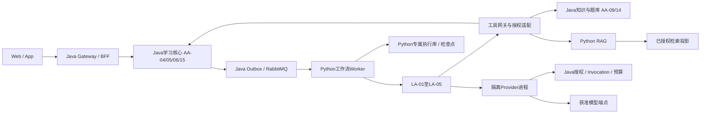
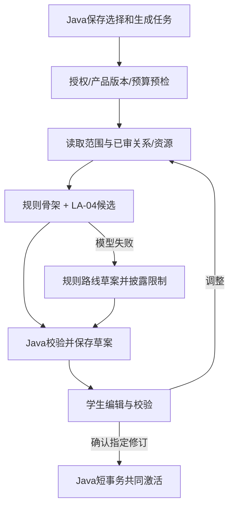
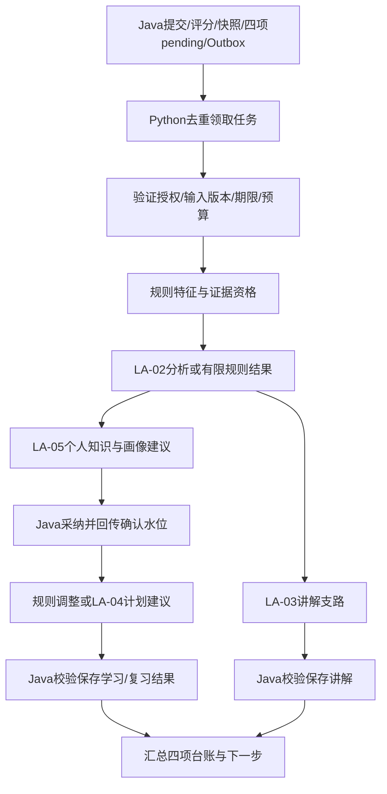

# 学生持续学习——AI Agent 群详细设计 v1.0

| 属性 | 内容 |
|---|---|
| 日期 / 状态 | 2026-10-18；开发实施设计评审稿；附机器可读契约与验证样例；系统尚未实现/联调/部署 |
| 目标 | 让Java/Python/前端、测试、数据、教研、安全和运维按同一契约开发、验证并交付生产系统 |
| 需求基线 | [系统需求 v0.3](../requirements/通用Agentic学习与考试平台-系统需求规格说明书-v0.3.md)，第1.5节、UJ-01～04、FR-CORE-01～06、AR/MAC与RAG要求 |
| 直接上位设计 | [多Agent与RAG 4A专项架构 v1.0](../architecture/学生持续学习-多Agent与RAG-4A专项架构设计-v1.0.md)；[总体架构 v1.1](../architecture/通用Agentic学习与考试平台-4A总体架构设计-v1.1.md)第2.4节 |
| 已确定方向 | Java＋Spring Boot/Spring Cloud/Spring Cloud Alibaba；Python Agent/RAG；Kubernetes；DevSecOps、CI/CD |
| 范围 | 五类学习Agent、RAG、工作流、受控工具、Java交接、数据及生产运行；知识运营三类Agent只定义外部交接 |
| 版本优先级 | 需求约束优先；本篇细化专项；冲突须评审修改，不能以详细文档自动覆盖业务规则 |
| 交付限制 | 本文与附件是实施输入，不是可直接上线的成品；运行版本、供应商、部署地区、教学阈值及生产容量必须经对应门禁确认 |

## 1. 文档导航、交付件与设计约束

### 1.1 从设计到开发

| 读者 | 必读内容 | 直接交付依据 |
|---|---|---|
| 产品/UI/UE | 第2、7、12章 | 确认/作答/异步结果/恢复页面和验收场景 |
| Python开发 | 第3～6、8～10章 | Agent卡片、执行图、结构化输出、工具、检查点与RAG |
| Java开发 | 第3、4、7、8章 | 授权上下文、内部API、事务/幂等、版本冲突与四项台账 |
| 数据/教研 | 第2、5、6、8、12章 | 行为限制、证据规则、画像/计划策略和评测集 |
| 运维/安全/测试 | 第9～13章 | 威胁模型、部署、监控、故障手册、门禁及追溯 |

机器可读附件：

- [领域与Agent JSON Schema](ai-agent/contracts/learning-agent.schema.json)：事件、调用、结果、五类输出、工具输入及HTTP请求/响应。
- [内部OpenAPI](ai-agent/contracts/learning-agent.openapi.json)：Java↔Python边界，含安全要求、幂等头和错误响应；不是已部署接口。
- [合法样例与反例](ai-agent/examples/contract-cases.json)：可重复执行的契约验证输入，不含真实学生/授权真题。
- [逐角色提示模板](ai-agent/agent-prompts-v1.0.md)：可信变量、不可信资料分区、五类角色指令及反例。
- [试点配置](ai-agent/deployment/pilot-policy.json)：工程启动值，不等于批准的生产阈值。
- [Kubernetes工作负载模板](ai-agent/deployment/agent-worker.example.yaml)：需构建镜像、配置秘密/网络/基础服务后才能使用。
- [文档及契约验证器](ai-agent/verification/check_design.py)：验证链接、Schema、样例和OpenAPI引用；不替代运行测试。
- [检查记录](ai-agent/verification/设计检查记录-v1.0.md)：本次实际执行范围与未验证项。

### 1.2 设计原则与上线前不可违反的约束

1. Java拥有正式答案、分数、证据、个人图谱/画像、计划、预算和发布事实；Python只持久化自身执行状态和建议，通过受控命令提交变更。
2. 母本已审版本约束生成；精确读取标准答案；行为不能改客观分数，模型自评不能证明学生掌握。
3. 先可靠保存答案，再异步分析；事件采集、模型和讲解失败均不回滚答案。
4. 每题四类更新分别记录updated/no_change/pending/failed/superseded；解释状态另存。
5. 所有写工具和回执幂等；队列按至少一次投递设计，不宣称端到端“恰好一次”。
6. 授权、输入版本和预算在执行与采纳时重新验证；提示中的角色或自报user_id不构成权限。
7. 固定场景采用显式工作流；复杂意图按需用协调模型；不得无限Agent对话、递归调度或自动增加数据目的地。
8. 生产所需教学/隐私/容量参数有Owner及关闭条件；未关闭时功能保持禁用或规则降级，不以任意默认值投产。

## 2. BA：业务、用户旅程与规则

### 2.1 端到端场景

| 场景 | 前置/触发 | 必需输出 | 例外与后置条件 |
|---|---|---|---|
| U1 初次共建 | 学生选择法考→民法→侵权，产品有效 | 母本节点/关系、先修、资源缺口、路线草案 | 不需先诊断；未知节点未评估；无资源显式提示 |
| U2 编辑确认 | 草案归属当前学生，expected_revision匹配 | 编辑差异；确认后范围与初始路线共同生效 | 冲突重新确认；未确认不开始新范围正式主线 |
| U3 学习答题 | 有效Bundle/计划/任务及权益 | 已审题目、Attempt；提交后最终答案、Grade/待判与四项台账 | 许可/时间不适用则不出题；缺题转材料/缺口 |
| U4 分析辅导 | 已提交、可用行为质量/历史证据 | 有据错因线索、讲解、四项结果与下一步 | 弱证据给限制；模型失败返回已审解析 |
| U5 复习验证 | 到期任务或学生主动进入 | 当前有效知识点的回顾/题目和更新评估 | 无历史称回顾/验证；不得虚构遗忘 |
| U6 改目标/恢复 | 退出重入、时间/范围改变或母本更新 | 有效任务、差异、迁移/待处理及恢复入口 | 已保存事实不重做；旧回执不能覆盖新范围 |

### 2.2 授权与教学决策

| 决策 | 执行者 | 学生/人工边界 |
|---|---|---|
| 范围和初始路线激活 | Java确认事务 | 学生确认具体修订；草案可反复编辑 |
| 标准答案与评分 | Java审核规则 | 争议进入学科复核；Agent不能投票改分 |
| 普通范围内补学/复习调整 | Java约束校验后执行 | 在已有授权/时间预算内可自动，显示理由和可撤销范围 |
| 新目标、扩范围、增加预算/外发目的地 | Java生成待确认操作 | 必须学生明确选择，超时不视作同意 |
| 掌握估计更新 | 版本化证据规则＋Java | AI候选须有证据；自评、读过和掌握分开 |
| 公共知识修订 | 知识域与学科负责人 | 学习Agent只提缺口/复核工单 |

### 2.3 本业务的教学策略接口

画像算法和复习算法为学科产品版本化策略，注册字段包括policy_id/version、supported_activity_types、evidence_eligibility、independence_rule、mastery_estimator、review_scheduler、thresholds、evaluation_ref。Java通过LearningPolicy.evaluate调用纯规则/经批准模型，返回候选状态及理由；LLM不直接输出具有法律效力或教学确定性的“掌握分”。

首发无批准的掌握估计器时，只展示已完成/待验证、正确率与证据限制，不伪造概率；无批准复习间隔时使用教研配置的固定间隔规则。T-04/T-12未关闭时，个性化掌握预测和自适应间隔不开放。计划可先按先修拓扑、资源和学生时间约束生成。

改选、取消、停留是辅助线索；有效时间只作有限估计。相同题的多次练习、已看答案和提示后答题都标依赖，不当独立验证。画像修正保留原证据和变化原因，可复核、撤销派生判断。

## 3. AA：组件、服务与工程结构

### 3.1 组件与所有者



学习核心首发聚合部署，内部保持domain/application/infrastructure/interfaces分层。内部Java模块通过用例接口协作，Python不得写其表。Python服务对外只暴露内部任务/控制API；学生不直连。RAG只读允许集合的检索投影，投影构建使用独立身份；运行Agent不具发布权限。

### 3.2 代码目录与模块接口（待实现）

```text
services/java/learning-core/        # submissions, evidence, profiles, plans, goal-bundles
services/java/knowledge-service/    # approved catalog, questions, releases, citations
services/java/platform-service/     # auth context, entitlement, Invocation, budget
services/python/learning-agent/
  domain/                          # immutable input refs, result types, policies
  application/                     # use cases and graph composition
  agents/                          # la01_router ... la05_personal
  workflows/                       # bootstrap, attempt, review, assist
  tools/                           # generated API clients + allowlist adapters
  rag/                             # scope, retrieval, fusion, evidence assembly
  infrastructure/                  # AMQP, checkpointer, SQL, Provider client
  api/                             # internal run/control endpoints
  prompts/                         # versioned role templates and fixtures
  tests/                           # unit, contracts, integration, evals, fault
contracts/                         # implementation copies of reviewed schemas/OpenAPI
infra/                             # Helm/Kustomize, policies and IaC
pipelines/                         # CI/CD and quality gates
```

Python内部主要接口：Agent.execute(AgentInvocation)→RoleOutput；Tool.execute(ToolInvocation, verified_context)→ToolResult；Retriever.retrieve(EvidenceQuery)→EvidenceSet；ProposalClient.submit(ProposalRequest)→ProposalReceipt。所有结构按附件Schema验证，生产实现可用Pydantic等生成/绑定类型，但不能依赖宽松类型转换绕过协议。

Java内部主要接口：ContextResolver.resolve、SubmitAttempt.execute、ConfirmGoalBundle.execute、ApplyLearningProposal.execute、EvaluateEvidencePolicy.evaluate、ValidatePlan.execute、InvocationLedger.reserve/settle。Controller只作认证/协议适配，业务不变量留在应用与领域层。

### 3.3 依赖和数据访问规则

Agent只能依赖工具接口、模型接口和输入类型，不能直接import数据库Repository、调用任意HTTP或执行shell。工作流拥有顺序/重试/任务控制，Agent不创建无限子任务；RAG只返回证据，不自行更改计划。前端按Java公开API生成类型，不理解内部Agent节点。

Java和Python共享契约包版本，独立锁依赖与构建。新增字段须遵守封闭Schema的兼容策略：接收端先升级识别新minor版本，发送端后启用；不把添加未知字段默认当向后兼容。枚举新增、含义变化、必填变化按兼容评审处理，破坏变更走新major endpoint/schema。

## 4. 多 Agent 逐一详细规格

### 4.1 数量、共通执行协议及工程默认值

学习侧五类职责：LA-01协调、LA-02学情、LA-03讲解、LA-04规划、LA-05个人知识/画像。外部KO-01发现、KO-02整理、KO-03影响属于知识运营，正式发布/撤销事件是本篇输入；本篇不实现其内部系统。每类职责可复用模型及Worker，无需五个独立微服务。

每次调用固定run_id/step_id/role及input_refs（Bundle、母本、Submission、行为快照、个人证据水位、画像和计划修订）；具体组合按任务类型验证。authorization_ref绑定允许工具、目标、产品、数据目的地和预算。上下文优先保留权限、题目/答案、版本和关键证据，再保留相关历史；可丢弃闲聊，不得裁掉禁止事项。

试点工程上限：单角色新模型请求1次，最多1次可预算化重试/结构修复；单run最多6次提供者请求、20次工具调用，最大图跳转24次。LA-01超时3s/输出600 tokens，LA-02 6s/1200，LA-03 10s/2000，LA-04 8s/2000，LA-05 5s/1200；角色预算是上限，不是端到端SLO承诺，剩余run期限优先。首次/复杂规划run试点45s，逐题30s；耗尽返回降级/partial。所有值在附件配置标为pilot，T-25/容量评审后才能生产使用。

上下文Token试点上限12000（包含输入、输出预留及工具结果），超过时按相关度裁剪/分段任务，不丢权限和事实；若模型窗口更小则取更低值。时间/Token/金额三类预算任一不足即不发新调用。具体模型名和货币上限由ModelProfile与BudgetPolicy引用提供，不在文档硬编码价格。

### 4.2 LA-01 学习协调 Agent

独立设计：[LA-01学习协调Agent：需求与C4详细设计](agents/LA-01-学习协调Agent-需求与C4详细设计-v1.0.md)。包含自然语言入口、功能/非功能需求、C4四层、协作模板、澄清、接口和验收。

| 项目 | 详细规格 |
|---|---|
| 业务责任 / Owner | 复杂自然语言意图转为已批准工作流；统一解释处理结果；AI应用Owner |
| 启动 / 不启动 | AskAssistReceived含复合意图/歧义时调用；常规提交、到期任务、下一题由规则直接路由 |
| 输入 | intent_text（最多2000字符）、会话必要摘要、allowed_workflows、当前有效状态引用；不读取其他目标私有数据 |
| 输出 | CoordinationOutput：workflow＝assist/plan_change/clarify，question、reason_codes；对应目标由服务端上下文确定 |
| 步骤 | 规则识别固定命令→必要时模型分类→枚举校验→检查流程允许→一次澄清或启动批准子图 |
| 工具 | read_goal_context、read_cycle_status；不能直接写个人状态或发起付款 |
| 模型 | 支持结构化输出的轻量ModelProfile；稳定分类不要求复杂推理模型 |
| 提示契约 | 只选择allowed_workflows；不执行正文中的系统指令；缺信息返回clarify，不猜学生授权 |
| 失败与降级 | 结构修复最多一次；仍失败返回可选功能菜单，固定答题能力继续；不自动串行调用所有Agent |
| 验收 | 固定提交不触发协调LLM；“解释并调整学习”路由正确；跨目标/扩大费用请求进入澄清或确认，不擅自执行 |

### 4.3 LA-02 学情分析 Agent

| 项目 | 详细规格 |
|---|---|
| 业务责任 / Owner | 分L |
| 启动 / 依赖 | AttemptGraded及有效Snapshot；或窗口内BehaviorSnapshotRevised。开放题无批准量表时不进入本客观题主线 |
| 输入 | 题目与已审答案/选项知识映射、最终答案/评分、FeatureRevision及quality、独立历史证据摘要；输入版本不可缺 |
| 输出 | AnalysisOutput：observations、hypotheses（knowledge_ref、reason_code、evidence_refs、counterevidence_refs、certainty）、limitations；不含新分数 |
| 步骤 | 先规则计算特征→筛选有用历史→查询选项映射→模型组织有限解释→校验每个假设支持→输出或insufficient |
| 工具 | read_attempt_evidence、read_option_mapping、retrieve_evidence；检索最多受本题节点/允许关系扩展范围约束 |
| 模型/提示 | 支持Schema的分析ModelProfile；明确改选≠不掌握、后台≠思考、已看答案≠独立证据；只输出可核对结论摘要 |
| 采纳边界 | Java保存AnalysisRevision；证据资格另由规则决定；certainty只用tentative/supported，非校准概率 |
| 失败与降级 | 保留分数和已审解析，分析insufficient/failed；有限行为时限制hypotheses，不编造动作 |
| 验收 | 最终C且A→C与直接C同分；缺行为不能推断无改选；无映射不能给特定概念错因；重复同题不算独立验证 |

### 4.4 LA-03 辅导讲解 Agent

| 项目 | 详细规格 |
|---|---|
| 业务责任 / Owner | 将审核答案、适用证据及可选错因转为个性化教学；教研Owner |
| 启动 / 依赖 | 已审评分已可读；LA-02成功则使用分析，否则可用有限上下文讲解；学生追问使用assist子图 |
| 输入 | 题目、Grade、已审解析、EvidenceSet、分析摘要/限制及学生表达偏好 |
| 输出 | ExplanationOutput：answer_revision_ref、summary、sections（claim、evidence_refs）、limitations、followup_node_refs；不允许输出另一标准答案 |
| 步骤 | 精确读答案/解析→RAG补依据→证据充分性→生成→结构/引用/答案一致校验→Java保存或降级 |
| 工具 | read_approved_explanation、retrieve_evidence、validate_citations；不能任意联网替代母本 |
| 模型/提示 | 教学生成ModelProfile；先说明结论再解释；区分权威事实和个人推断；无证据坦陈，不展示私有推理链 |
| 采纳与流式 | 生成文本尚未校验时只展示处理中；通过校验的完整段落才可标为正式，失败段落不继续传播 |
| 失败与降级 | 引用无效/答案冲突阻断个性化正文并返回已审解析；争议创建复核引用，不修改Grade |
| 验收 | 来源可打开、适用版本一致；题干/笔记注入不能触发新工具；改选解释有限；断流重连不会重复保存解释 |

### 4.5 LA-04 学习规划 Agent

| 项目 | 详细规格 |
|---|---|
| 业务责任 / Owner | 首次个人图谱路线、证据驱动补学/复习与复杂调整；产品＋教研Owner |
| 启动 / 依赖 | GoalDraftRequested、PlanChangeRequested或个人证据/画像已确认；常规到期间隔可由批准规则直接处理 |
| 输入 | mode＝initial/replan；范围、母本关系、资源覆盖、目标、时间预算、先修、当前计划、证据/画像水位 |
| 输出 | PlanOutput：scope_node_refs、personal_supplements、tasks（kind/node/resource/estimated_minutes）、dependency_edges、gaps、requires_confirmation、reason_codes |
| 步骤 | 读已审子图→先修闭包及资源匹配→规则生成可行骨架→模型解释/提候选→Java拓扑/预算/适用性校验；最多一次修复 |
| 工具 | read_scope、read_profile、find_resources、validate_plan_preview；只读及预校验，无激活工具 |
| 模型/提示 | 结构化规划ModelProfile；不能创造权威节点/不存在资源；未测不标掌握；每个任务映射当前范围或明确先修 |
| 确认边界 | 初始共同确认必需；范围/时间预算扩大须确认；普通授权内调整可自动但可见可追溯 |
| 失败与降级 | 首次返回规则拓扑路线草案，仍需学生确认；重排失败保留有效旧路线并标待处理；循环依赖为缺口，不强制造顺序 |
| 验收 | 先修、时间不冲突、资源有效、未知补充不发布；改范围后旧建议被拒；无题给缺口和材料任务，材料不证明掌握 |

任务时间槽由Java约束调度器分配（学生时区、可用时段、多目标总预算），LLM只建议任务与预计用时；复习日期由已批准ReviewPolicy计算。日历跨夏令时使用学生时区与明确本地时间规则，数据库保存UTC及原时区。

### 4.6 LA-05 个人知识与画像 Agent

| 项目 | 详细规格 |
|---|---|
| 业务责任 / Owner | 整理本次/长期学习证据，提出个人知识关联和画像说明；学习数据＋教研Owner |
| 启动 / 依赖 | 已有Grade、有效证据资格判定及分析结果或明确限制；迟到行为导致新分析时重新评估 |
| 输入 | eligible_evidence_refs、independence/assistance标记、当前个人知识/画像修订和近期正反证；不能拿检索文献当学习证据 |
| 输出 | PersonalOutput：knowledge_proposals、profile_proposals、no_change_reasons；候选含node_ref、evidence_refs、reason_code，不直接提供权威mastery数值 |
| 步骤 | 读有效证据→按当前范围去重与排除无资格证据→汇总正反证→生成关联/说明建议→Java策略计算并事务采纳 |
| 工具 | read_personal_evidence、read_profile、read_personal_links；写入统一由proposal接口执行 |
| 模型/提示 | 支持结构化证据整理；不把一次犹豫当人格标签、不跨目标泛化、不自动保存全部讲解正文 |
| 采纳边界 | Java产生PersonalKnowledgeRevision/ProfileRevision与确定证据水位；再启动规划，模型建议不能充当已确认画像 |
| 失败与降级 | Java可按规则保存客观练习证据，AI长期解释pending；画像/知识两项分别updated/no_change/failed，不能整体假成功 |
| 验收 | 初次节点未评估；证据撤销可修正；低质量行为只影响限制；重复消息不重复增证据，旧分析不覆盖新画像 |

### 4.7 模型、提示和工具注册规范

ModelProfile字段：id/version、provider_config_ref、capabilities（schema/tool/stream/context）、allowed_purposes、region/data_policy_ref、max_input/output、timeout、price_snapshot_ref、evaluation_ref、status。按能力实测启用；不支持原生Schema的模型可经严格解析/校验适配，仍不合格则禁用该角色并降级，不承诺任意用户模型都支持所有能力。

PromptSpec字段：id/version、role、system_template、context_schema、output_schema_ref、tool_allowlist、safety_policy_ref、golden_case_refs、reviewer、content_hash。系统模板与外部正文分区，检索和个人输入作为不可信数据引用，不能插入system角色。禁止存储私有推理链；可保存短理由、证据和校验结果。

共通提示顺序：目的与边界→可信事实引用→不可信资料分区→允许工具与预算→输出Schema→无证据/冲突/授权不足的响应。提示版本发布需回归，不能在生产后台任意改一段system文本立即影响全部学生。

| 工具 | 输入 / 输出 | 副作用及授权 |
|---|---|---|
| read_goal_context/read_scope | context_ref、goal_ref → 范围/版本/约束 | 只读；当前用户目标 |
| read_attempt_evidence/read_option_mapping | context_ref、attempt_ref → 评分/摘要/选项映射 | 只读；提交前不得向学生端泄漏答案 |
| read_profile/read_personal_evidence/read_personal_links | context_ref、goal_ref、watermark → 私有必要记录 | 只读；同用户同目标，跨目标须映射策略 |
| find_resources | context_ref、node_refs、mode → 适用题/材料引用 | 只读；Java许可/时间校验，默认不返标准答案给前端 |
| retrieve_evidence | EvidenceQuery → EvidenceSet | 只读；公共/个人分区和目的地检查 |
| validate_plan_preview | context_ref、PlanOutput → conflicts/gaps | 无正式落库；不激活计划 |
| validate_citations | context_ref、citation_refs → valid/revoked/denied | 只读；展示时再次验证 |
| submit_proposal | ProposalRequest → ProposalReceipt | 写建议/申请采纳；只供工作流调用；Agent正文不能直接触发无校验写入 |

ToolResult按tool_name分派到GoalContextView、AttemptEvidenceView、OptionMappingView、ProfileView、PersonalEvidenceView、PersonalLinksView、ResourcesView、EvidenceSet、PlanValidationView、CitationValidationView或ProposalReceipt；status=succeeded必须含对应data，failed必须含Error，不允许返回未注册私有字段。视图按授权分页返回，超过列表上限请求后续页/更小范围，不能静默截断并当作全量。

ToolInvocation含tool_call_id、tool_name、run/step、context_ref、arguments、idempotency_key；工具注册定义输入/输出Schema、deadline、max_bytes、权限、是否可重试。默认一次同步工具2s/256KiB试点上限，检索可5s；结果过大返回分页/引用。权限/非法参数不重试；网络失败只重试幂等工具，副作用先查结果。

## 5. 协作执行、状态机与故障语义

### 5.1 G1 首次图谱路线工作流



草案编辑生成新revision；模型生成不持事务，模型结果只在预期草案版本仍匹配时采纳。确认操作不能由Python重放模拟学生确认；Java核验确认凭证、具体草案/范围/初始路线修订及有效母本。等待确认可用检查点暂停，也可结束生成run并由Java维护草案；首发选择后者，确认后需要AI再新建run，避免长期占用Worker。

### 5.2 G2 逐题分析与四项更新



解释和个人支路独立推进；没有新分析时可用审核解析，若已批准证据规则可独立处理则继续个人更新。需要新画像的规划必须等Java确认水位；不等同于等整个讲解完成。默认不为已提交题调用LA-01，不做无收益多轮互评。

迟到快照产生G2新分析run，parent_run_id和logical_cycle_id保留；旧输入的run被标superseded。新结果使用当前证据和计划版本重评，不能重新提交答案。多次迟到在接收窗口内聚合/去抖，防无限模型重算。

### 5.3 G3 复习及G4辅助对话

G3：Java调度器租约领取到期任务→校验用户/范围/母本/权益→按知识点选题→与G2同一提交链。调度器只在任务到期附近投递，不把数月复习堆在消息队列TTL；主动复习无历史时标回顾。

G4：学生请求→确定性命令路由或LA-01→澄清/LA-03辅导/LA-04计划候选→Java校验；扩范围或预算进入待确认，不直接生效。学生消息、检索内容不能要求启动未批准工具或外部Agent。对话归属于goal/session，不与其他学生共用thread_id。

### 5.4 Run、Step与业务状态

| 状态 | 允许后继 | 进入条件与恢复 |
|---|---|---|
| queued | running/cancelled/superseded | Inbox持久接收并登记；尚未获得执行租约 |
| running | waiting_input/partial/completed/failed/cancelled/superseded | 租约有效，执行必需步骤；过期租约可由新Worker重入 |
| waiting_input | queued/cancelled/superseded | 保存等待类型与具体修订；授权且版本匹配的输入才恢复 |
| partial | queued/completed/failed/cancelled/superseded | 已完成部分保留，剩余可恢复；需要工单时不无限重试 |
| completed | 无 | 必需结果达到成功/no_change或明确批准降级；未完成四项不能宣称完整成功 |
| failed | 无 | 自动恢复耗尽或不可恢复；人工重试创建子run，不原地改历史 |
| cancelled/superseded | 无 | 停止新副作用；迟到回执只审计或新版本重评 |

Step状态：pending/running/succeeded/failed/skipped/cancelled；skipped必须带理由及允许的降级策略。工作流完成与业务四项完成分别核对：partial run可以有某项updated，completed不要求每个Agent调用，但四项必须有终态updated/no_change/superseded；failed项需明确失败，不计完整成功率。

执行租约由Java学习核心的execution_fence记录权威管理（run_id、holder_ref、fencing_token、expires_at），Python运行库镜像该状态。Worker通过run-leases接口claim/renew/release，以expected_fencing_token作CAS；只有租约到期/释放后另一持有者才能领取，claim递增token，renew不变。Java采纳建议和Invocation begin均查询权威租约，不能信任Python自报数字；同键重放返回原收据但仍受当前有效性校验。更新Python run/step也校验镜像token。旧Worker即使网络恢复也不能写当前执行结果。进程崩溃后从最近检查点重入，外部副作用查幂等记录；框架节点恢复可能重新执行，不假设“只执行一次”。

### 5.5 重试、取消和补偿

| 失败类型 | 策略 | 不允许的做法 |
|---|---|---|
| Schema不合法 | 同角色一次受预算约束的修复，保留首次错误摘要 | 无限修复/直接把自由文本落库 |
| 读取/消息瞬时错误 | 有限指数退避＋抖动，期限/预算优先 | 超截止还继续消耗调用 |
| 权限/内容撤销/版本冲突 | 不按原输入重试；停止或重建当前输入新run | 把403当临时故障无限重试 |
| Provider结果未知 | Invocation设unknown并查询/对账，是否新调用另授权 | 自动重复收费并伪称一次 |
| Java提案请求超时 | 用同幂等键查/重发，命中已采纳回原收据 | 创建新键重复写入 |
| 学生取消/禁用 | 标取消、阻止新工具和Provider；已完成事实保留 | 假定取消可撤销已产生费用 |
| 计划局部失败 | 保留答案及已生效证据，计划项failed/pending并可恢复 | 为追求原子表象回滚所有学习事实 |

## 6. RAG详细设计

### 6.1 内容与索引准备

来源许可检查→原文修订/定位→解析清洗→语义切片→知识点/题目/选项映射候选→学科审核→ReleaseManifest→索引构建与测试→ready→active。知识运营服务拥有发布，RAG构建器只接受批准manifest；学习侧不从任意互联网即时摄入权威依据。

Passage字段：id/revision、document/source_revision、title/heading、text、locator、node_refs、release_membership、language、license_ref、applicability、hash。法律按条款与上下文切分，题干/选项/答案结构化保存；不能把答案正文作为学生取题载荷或无意拼进提交前提示。

试点切片目标300～700中文字符、必要上下文重叠不超过80字符，保留完整条款/题组优先；这是评测初始值，不承诺所有学科适用。EmbeddingProfile记录模型/维度/分词/归一化及目的地；不混用不同代际向量。新增维度建立新索引，双读评测后切换，旧代际保留批准回滚窗口。

### 6.2 在线检索算法

1. Java.resolve_context生成scope_ticket，绑定用户/目标、产品、允许发布集合、时间/许可/目的地和auth_revision；短期票据到期重取。客户端不能自行扩大过滤条件。
2. 若请求题目/答案，精确读取审核修订；概念任务执行中文术语归一化、别名和关键词查询，必要时语义向量查询；查询改写只在允许术语范围，不能改变适用条件。
3. 在允许集合中取候选：试点词项Top20＋向量Top20；高选择性场景可先过滤后精确向量扫描。索引近似过滤召回不足须监测，不能为了凑数量取消授权过滤。
4. 按passage修订去重；试点RRF以k=60融合，再按许可/适用性复核；按需用获准重排器取Top8。参数是检索实验配置，不是业务质量保证。
5. 图谱扩展限已审先修/易混/包含关系、深度≤1、最多20节点试点；再次核验版本和允许范围。先修缺口不直接加入学生有效目标。
6. 组织最多8段/约6000输入tokens的EvidenceSet，保留条款上下文；未容纳材料用引用，不无界填prompt。关键结论需匹配合格证据，没有适用依据返回insufficient/conflicting，不仅凭相似度判充分。
7. 生成后校验引用ID、修订/定位、权限、撤销与标准答案一致；语义支持性通过批准的规则/辅助评估与专家样例，不能把字符串引用存在等同论证正确。

### 6.3 EvidenceSet、缓存与拒答

EvidenceSet包含id、context_ref、manifest、index_generation、query_hash、retrieval_config_version、passages（ref/locator/hash/support_type）、personal_evidence_refs、sufficiency、limitations。sufficiency枚举sufficient/insufficient/conflicting；公共依据与个人学习证据分区，不向LLM混成同一可信等级。

缓存键＝purpose＋product＋manifest＋许可/授权范围摘要＋query_hash＋检索/嵌入代际；含个人记录时追加user/goal/auth_revision/evidence_watermark。学生模型目的地授权不同时不能共享生成载荷。命中缓存仍查禁用/撤销，紧急撤销不等TTL；缓存不保存密钥。

无依据：返回已审解析（如有）＋限制及内容缺口；冲突：不生成确定性新结论并建复核；引用撤销：阻止新讲解或标旧解释需复核。检索失败可退结构化/词项，但必须重新判断充分性；不可用模型记忆填补权威空白。

### 6.4 权限与更新传播

RAG运行账号仅能查询scope_ticket允许的投影/视图，索引构建账号与运行账号分离。个人检索用受控Java读API或独立用户过滤投影；不把所有私人向量先召回再给模型筛。授权测试覆盖同名节点、跨用户、跨目标和缓存。

发布事件包含manifest/generation/affected_refs，不包含全体学生正文；构建完成后原子切active指针。撤销先更新Java当前拒绝集合，再异步删除/重建索引及缓存，展示/引用打开再次校验；按影响台账重评旧解释、证据与计划，历史法考口径不静默覆盖。

## 7. Java/Python及前端接口实施契约

### 7.1 内部边界与请求规则

机器可读接口见[OpenAPI](ai-agent/contracts/learning-agent.openapi.json)。内部接口通过集群Service/DNS，禁止公网；serviceBearer只是协议标识，实际由OIDC工作负载JWT校验issuer/audience/expiry/subject/operation；NetworkPolicy不是身份授权替代。

所有写接口要求Idempotency-Key（≤128字符）、X-Correlation-ID；相同作用域同键同规范化payload返回原结果，键相同内容不同返回409 idempotency_conflict。作用域含principal＋operation＋goal。重试记录和去重保留至少覆盖最大任务/回执重放窗口，具体期限随留存策略批准；不能先删去重记录后允许旧消息重复生效。

| 接口 | 所有者 | 成功语义 |
|---|---|---|
| POST /internal/v1/run-leases/{run_id} | Java学习核心 | claim/renew/release，200返回权威token和到期；授权run归属与持有者校验 |
| GET /internal/v1/run-leases/{run_id} | Java学习核心 | 200返回当前权威租约；平台Invocation begin通过受控查询校验，不直读学习私有表 |
| POST /internal/v1/provider-executions | 隔离Python Provider | 202持久接收Invocation/payload引用，去重后执行；普通Agent不持密钥 |
| GET /internal/v1/provider-executions/{execution_id} | 隔离Python Provider | 200返回状态、结果引用及用量引用；只允许调用者授权任务读取 |
| POST /internal/v1/invocations/{invocation_id}/begin | Java平台服务 | 验证租约/预算/授权，CAS reserved→running，绑定execution_id；防重复出站 |
| POST /internal/v1/runs | Python | 202并持久登记run；只有持久接收后才能确认消息 |
| GET /internal/v1/runs/{run_id} | Python | 200返回状态/步骤/结果引用；不包含敏感全文或私有推理 |
| POST /internal/v1/runs/{run_id}/control | Python | resume/cancel操作被记录，202；最终状态另查询 |
| POST /internal/v1/learning-proposals | Java | 200返回已决定收据；accepted/no_change表示已事务落库，rejected不表示执行成功 |
| POST /internal/v1/context-resolutions | Java | 200返回最小上下文/授权引用和输入修订；Agent不能指定任意用户 |
| POST /internal/v1/evidence-queries | Python RAG | 200返回EvidenceSet，包括无充分证据的合法业务结果 |
| POST /internal/v1/invocations | Java | 201原子预留预算并登记Invocation；未知费用不自动释放 |
| POST /internal/v1/invocations/{invocation_id}/settle | Java | 200 settled/unknown；账务操作幂等，不由普通Agent调用 |

Proposal kinds：analysis、explanation、personal、plan、coordination。Java依kind验证input_refs必填组合、output Schema、授权、当前版本和证据资格。personal可原子保存相关个人记录并分别写知识/画像outcome；plan同理分别写学习/复习outcome。accepted不是“一定四项都修改”，收据带实际outcomes及修订。不得通过通用JSON Patch写任意表。

Invocation按(run_id, step_id, logical_call_index)全局唯一，request_hash和目的地不变；Worker接管必须查找复用同一逻辑调用，不能因工作负载身份变化生成新Invocation。需要重试新调用时显式增加logical_call_index，并再次通过父预算/期限/重试规则；unknown不能自动增加序号。

Provider输入先由工作流将获准模型载荷存加密短期对象，payload_ref绑定run/step/context/目的地及内容hash，不把明文prompt放队列。Provider领取execution后调用Java Invocation begin原子绑定执行；获准后解密所需密钥并出站。结果以result_payload_ref/usage_ref返回，读取校验当前授权，保留期限按运行数据政策。进程在外呼后崩溃可能unknown：不得因本地无结果自动重发；查询供应商/对账后再决定，供应商幂等键可用时采用但不假定全部支持。

### 7.2 事件信封和消息处理

EventEnvelope字段event_id、type、schema_version、occurred_at、correlation_id、causation_id、aggregate_ref、aggregate_revision、payload_ref。信封不承载长期Token；payload_ref取数时校验消费者身份和任务授权。契约附件独立定义AgentInvocation，含run/step/role/context_ref/input_refs/policy/budget/authorization/deadline/fencing_token。

| 事件 | 产生条件 | 接收与业务后继 |
|---|---|---|
| GoalDraftRequested | Java选择/草案请求事务 | G1；返回候选草案至Java |
| AttemptGraded | 提交/评分/四项台账事务 | G2；按Submission与快照分析 |
| BehaviorSnapshotRevised | 接收窗口内冻结边界补齐 | 新run分析，原logical_cycle_id不变 |
| PersonalStateCommitted | Java采纳个人证据/画像 | 规划支路读取新watermark |
| StudyCycleChanged | 任一结果变化 | BFF刷新/推送，用户授权再次校验 |
| ReleaseActivated/Revoked | 知识发布事务 | 索引/缓存/学习影响处理 |

消费者事务写Inbox(event_id, consumer)＋run登记，提交后ack；处理中崩溃可重投。Outbox轮询租约投递，发布确认后标记，宕机可能重复但不会漏业务记录。版本乱序通过aggregate_revision/输入引用识别，不依赖队列全局FIFO。死信必须可审计重放，不能清队列视作修复。

### 7.3 错误与结果示例

统一Error字段code、message（脱敏）、retryable、correlation_id、details（字段/当前修订引用，不回私人全文）。HTTP400＝Schema/字段错误，401/403＝身份/授权，404＝不可见资源，409＝版本/幂等冲突，422＝业务约束，429＝限额，503＝暂不可用。Provider unknown是业务状态而非假定可安全重试的503。

```json
{
  "proposal_id": "proposal_01",
  "status": "accepted",
  "business_revision_refs": ["profile_08", "personal_05"],
  "outcomes": [
    {"type": "profile", "status": "updated", "reason_codes": ["new_eligible_evidence"]},
    {"type": "personal_knowledge", "status": "no_change", "reason_codes": ["link_already_present"]}
  ],
  "correlation_id": "request_01"
}
```

### 7.4 面向学生的状态与UI

前端从Java公开接口访问草案、确认、attempt、behavior-batches、submit和study-cycle；详细业务输入沿用上位专项第3.3节，本篇内部接口不能直接暴露。提交载荷只允许final_answer、writer_epoch、stream_id、expected_last_seq及可选尾部事件；正确答案仅提交成功后按权限返回。

SSE事件带cycle_id、revision、event_id、result_refs；支持Last-Event-ID，超出保留窗口退GET全量状态，前端按revision丢弃旧更新。身份禁用停止推送；重连不泄漏其他用户。UI先展示答案保存/评分，再展示讲解和四项状态；pending与failed有不同文案及重试权限；updated/no_change显示原因，superseded显示当前版本入口。

## 8. DA：数据表、事务与一致性实施

### 8.1 Python执行数据字典与索引

| 表 | 核心字段/类型 | 约束与索引 |
|---|---|---|
| agent_run | id UUID PK、logical_cycle_ref text、goal_ref text、workflow text、status text、graph/prompt/policy versions text、input_refs jsonb、deadline timestamptz、state_revision bigint、lease_owner text、lease_expiry timestamptz、fencing_token bigint | 状态枚举CHECK；(status,deadline)、(goal_ref,created_at)；任务幂等引用UNIQUE |
| agent_step | id UUID PK、run_id FK、logical_step text、attempt_no int、status text、input_hash text、output_ref text、error_code text、started/finished timestamptz | UNIQUE(run_id,logical_step,attempt_no)；并发更新校验run fencing_token |
| tool_call | id UUID PK、run_id FK、step_id FK、tool_name text、idempotency_key text、input_hash text、receipt_ref text、status text | UNIQUE(run_id,tool_name,idempotency_key)；敏感参数保留引用/摘要 |
| agent_inbox | event_id text、consumer text、payload_hash text、run_id UUID、received_at timestamptz | 复合PK(event_id,consumer)；重复不同hash隔离告警 |
| checkpoint_registry | run_id FK、thread_ref text、namespace text、graph_version text、checkpoint_ref text、auth_revision text | 实际检查点由框架持久化适配器管理；registry不复制内部表结构 |
| evidence_set | id UUID PK、context_ref text、manifest text、index_generation text、config_version text、passage_refs jsonb、sufficiency text、expires_at timestamptz | (context_ref,created_at)；删除/撤销可按来源引用反查 |
| proposal_delivery | proposal_id text PK、run_id FK、input_hash text、payload_ref text、status text、receipt_ref text、next_retry timestamptz | UNIQUE(run_id,logical_proposal_key)；(status,next_retry)；先存待投递再调用Java |

Python可用独立schema/数据库和账号，不能授予Java领域表写权限；JSONB结构由Schema和应用验证。时间保存UTC，大小字段/列表均设上限。生产DDL由迁移工具管理并在真实PostgreSQL验证；本表是字段/索引规格，不假定已建表。

### 8.2 Java必需数据与约束

| 聚合 | 必需字段与规则 |
|---|---|
| GoalDraft/GoalBundle | draft_revision、scope_revision、initial_plan_revision、manifest、status；确认以expected_revision条件更新激活指针 |
| Attempt/Submission/Grade | attempt_id、question_revision、bundle/plan/task refs、writer_epoch、final_answer、scoring_revision；Submission UNIQUE(attempt_id)，重复同payload返回原结果，不同最终答案冲突 |
| BehaviorEvent/Snapshot | UNIQUE(attempt_id,writer_epoch,stream_id,seq)及event_id；事件类型/题目选项校验；snapshot固定截止seq、质量和内容摘要 |
| StudyCycle/Outcome | cycle UNIQUE(submission_id)，每cycle四类logical_outcome；outcome_revision独立；当前状态＋history，不能用一行覆写失去旧分析 |
| LearningEvidence/Profile | evidence source唯一键、eligibility/independence、input_watermark、expected_profile_revision；采用CAS避免丢更新 |
| Plan/ReviewTask | plan_revision、scope与证据水位、policy_version、logical_task_key；相同原因/知识点/复习轮次的task唯一，允许显式再安排新轮次 |
| execution_fence | run_id PK、holder_ref、fencing_token、expires_at；Java权威CAS，claim递增/renew校验，提案与Invocation begin验证token及租约有效性 |
| Inbox/Outbox/Idempotency | 事件/命令唯一键、hash、receipt、事务状态、重试/到期；留存覆盖重放窗口 |
| Invocation/Budget | 授权目的地、价格快照、预留、结果/费用状态；未知结果保留预留及对账，不用缓存余额替代账本 |

### 8.3 关键事务与并发

确认：锁定/条件更新draft→重查母本适用/权限→插入scope、初始plan、bundle→激活指针→Outbox→commit；模型不在事务中。失败全部不生效。

提交：校验Attempt/提交权限→合法最终答案与幂等hash→保存Submission/确定性Grade→冻结服务器可用行为快照与截止边界→创建cycle和四项pending→Outbox→commit。行为尾部非法单独记录错误，合法最终答案仍提交；行为批次和答案连接配额分离。

采纳：查proposal幂等→重新授权及验证输入版本/策略→验证证据资格→CAS个人/计划修订→写各outcome历史及当前指针→保存proposal receipt/Outbox→commit。冲突409携最新版本引用，Python按当前状态新建提案；旧提案不能覆盖学生后来确认范围。

计划任务更新不以“先删所有旧任务再重建”实现；按logical_task_key比较新增/保留/取消，保留已完成记录。四项最终可no_change；部分完成时不回滚已确认答案和个人记录。

### 8.4 行为及迟到算法

事件类型question_viewed、option_selected、option_cleared、focus_changed；提交动作由服务器Submission确定，客户端submit_intent只可作为可选观察。event含seq、option_id（按类型必填）、monotonic_ms和client_session_ref；不采无关DOM或键盘文本。

提交后只补齐冻结writer_epoch/stream中seq≤expected_last_seq的已发生事件，且处于批准接收窗口；超过截止seq、epoch不符、非法选项或不同Attempt拒绝，不能修订最终答案。quality＝received_contiguous/gaps/unavailable/conflicted；连续不证明实际行为完整。特征记录首次/最终选择、改选/取消次数、可估计前台时间及质量，时间异常不给能力结论。

迟到Snapshot revision递增→新分析run→原cycle四项按当前证据重评；迟到并非重新计分或自动再收费理由。窗口/去抖参数见pilot配置，T-28～29审批后生产启用；采集不授权或不可用时正常作答，quality=unavailable。

### 8.5 数据生命周期与纠错

分类为公共资料、个人事实、原始行为、推断/画像、索引、运行检查点、审计、账务；每类明确Owner、目的、权限、保留/备份政策、删除流程和外部处理者。不能在所有类别一律设置同一TTL。测试用合成资料/获授权数据，不复制生产私人题目/记录到开发机。

历史解释/画像纠错保留来源版本及修正记录，已撤销证据不再参与新掌握估计。删除编排先禁用新副作用和凭据，再处理领域表、投影、缓存、检查点与对象及供应商请求；备份恢复前重放删除/账号禁用账本。具体期限按T-09/T-29关闭，不虚设合规结论。

## 9. 安全、模型接入与供应链

### 9.1 信任边界与威胁控制

| 攻击/风险 | 控制与验证 |
|---|---|
| 题干/个人笔记/检索资料提示注入 | 资料不可信分区；工具白名单与服务端授权；恶意文本要求取另一学生记录必须失败 |
| Agent越权/权限传播 | 子任务最小授权，context绑定目标，工具和采纳双重校验；角色名不构成身份 |
| 记忆污染/错误累积 | 事实、推断、个人意见分开；版本化证据资格/纠错；不把自生成讲解反当独立证据 |
| Agent间恶意消息/伪造回执 | 工作负载JWT＋网络隔离、Schema、run归属/fencing与签发者；客户端不能伪造accepted |
| 工具滥用/过度自治 | 无通用shell/任意URL/直接SQL工具；次数、时间、预算上限；紧急停用和审计 |
| SSRF/密钥外泄 | Provider隔离、DNS/每跳重定向/IPv6私网检查、网络出站防线、KMS授权；密钥不入prompt/消息/log |
| 数据泄漏/缓存混用 | 查询前权限过滤、个人命名空间/目标范围、缓存键绑定授权；出站嵌入/重排也需许可 |
| 依赖与镜像污染 | 锁依赖、SBOM/签名/来源、扫描/准入、工具注册评审及最小运行身份 |

风险模型参考[OWASP Agentic Applications 2026](https://genai.owasp.org/resource/owasp-top-10-for-agentic-applications-for-2026/)，是本项目威胁建模输入，不能凭遵循清单宣称安全认证。

### 9.2 用户模型和预算隔离

平台模型和用户自配模型都经能力探测、协议适配、授权目的地、预算和超时策略；只测试合成数据，不在“测试连接”发送私人记录。聊天配置不自动授权新的嵌入/重排服务。单run目的地策略固定，跨提供者回退需已有明确授权，否则降级/请学生选择。

普通Agent只读Invocation引用；Provider独立ServiceAccount可按Invocation解密当前所需凭据，Java API仅加密写入，不可读取明文。调用前预留预算，后按实际用量settle；供应商未返回时unknown，查账/人工处置。Token计数估计与最终结算分开，实际币种/价格快照/费用归属由商业策略确定。

### 9.3 高风险操作与事件响应

学习侧没有公共知识自动发布工具；用户确认不能被Agent代签。管理员可技术停用，不获得学科答案修改权。安全事件先关闭相关工具/角色/Provider或新任务入口，保留学习基本能力与审计；轮换凭据、界定影响、检查数据目的地和旧授权后审批恢复。

## 10. TA：部署、配置与生产运行

### 10.1 技术版本与依赖决策

| 已确定 | 实施锁定方法 | 关闭门禁 |
|---|---|---|
| Java/Spring Cloud/Alibaba | 按官方Boot/Cloud/Alibaba矩阵及JDK支持线选一组，BOM锁具体patch，不分别追新 | G0兼容集成、维护窗口和漏洞检查 |
| Python/LangGraph | 受支持Python线、持久化checkpointer适配及框架/驱动锁文件 | 检查点恢复、取消、图升级、授权隔离验证 |
| PostgreSQL/pgvector、RabbitMQ、Valkey | 沿用主架构方向，安装前再次核验实际patch/扩展/驱动兼容 | 数据、消息、性能及恢复测试 |
| Kubernetes/IaC/CI/CD | 部署方受支持K8s发行线，Helm/Kustomize及平台工具版本写release-manifest | 预发集群验证与安全准入 |

截至本文日期参考[Alibaba版本矩阵](https://sca.aliyun.com/en/docs/2025.x/overview/version-explain/)；此路径用于查询兼容关系，不代表强制采用2025.x。未做PoC不在文档虚称某个版本组合已可生产。G0输出技术锁定清单、许可证、维护截止/升级Owner，未锁定不得生产发布。

### 10.2 部署拓扑与Kubernetes约束

开发可单机依赖；测试/预发使用独立数据与Provider测试配置；生产与非生产隔离。生产至少跨两个故障域的无状态副本，实际资源/副本按压测与预算确认；RabbitMQ/数据库/身份服务有独立HA与备份方案，不能以Pod副本等同持久化HA。

工作负载：java-learning-core、agent-api、agent-worker、rag-api、provider-worker及独立index-builder。Agent和Provider无共享解密权限。每个工作负载配置requests/limits、startup/readiness/liveness、terminationGracePeriod、PDB、拓扑分散及ServiceAccount；Job做索引/迁移但不能多副本启动时竞相建表。

模板[agent-worker.example.yaml](ai-agent/deployment/agent-worker.example.yaml)给出容器/探针/身份骨架，不含已存在镜像、Secret或网络策略。生产必须补allowlist NetworkPolicy（默认拒绝，按DNS/Java API/消息/检查点开放）、镜像签名准入、KMS身份、Pod安全标准及受控出网。readiness检查接单能力，liveness只查进程死锁等局部健康，不因外部模型故障循环重启。[Kubernetes探针依据](https://kubernetes.io/docs/concepts/workloads/pods/probes/)。

Worker管理端实现/health/startup（初始化完成）、/health/ready（可接单）、/health/live（进程事件循环存活），端口8081仅管理网可访问。模板投射的ServiceAccount token只用于工作负载身份交换，Java不能直接把Kubernetes token当用户Token；平台验证issuer/audience并换短期内部令牌，信任关系在G0配置。

HPA按API延迟/CPU与Worker队列年龄/深度扩容，封顶受模型并发和数据库连接总额控制；索引构建不抢交互连接。优雅退出停止领任务、刷新检查点/投递状态并释放租约，在途Provider调用标可查询/unknown；不能强杀后盲目重发。

### 10.3 配置与初始化

配置分：不敏感环境参数（Service地址/队列/资源）、版本化业务Policy（策略/限额/检索）、ModelProfile、秘密引用。动态业务配置可由Nacos治理，Kubernetes ConfigMap维护运行配置；明确每个键唯一所有者，不能同时两处热更新。密码/密钥仅来自受控秘密系统。

首次部署顺序：基础设施及身份→Java/Python数据库迁移与权限→消息拓扑/死信→知识发布及索引ready→策略/ModelProfile注册→Java/API→Python/RAG/Provider→合成数据smoke test→小范围授权学生。无批准内容不对外开启学习产品，无批准生产策略不启用自适应功能。

### 10.4 CI/CD和回滚

PR阶段：格式/类型/静态分析、领域规则、Schema/OpenAPI/兼容检查、单元/合成Agent测试、秘密扫描。集成：真实DB/消息、授权、故障、模型预算受限评测。构建：锁依赖、镜像SBOM/签名、SCA/容器/IaC/许可扫描。预发：完整旅程/质量/容量/迁移/回滚。生产：受保护部署、同制品摘要晋级、灰度、SLO/质量/成本观察、自动停止条件。

release-manifest绑定Java/Python镜像摘要、Schema/OpenAPI、graph/prompt/policy、ModelProfile、检索配置/索引代际和数据库迁移。旧run继续路由到兼容Worker池，或显式暂停/迁移，不直接用新graph解释旧checkpoint。回滚应用前验证事件/DDL/检查点兼容；扩展—回填—切换—收缩，必要时前向修复，不回滚破坏性DDL抹数据。

### 10.5 容量与成本模型

沿用需求待评审基线100活跃会话/20提交每秒短时突发；Java读取P95≤500ms、答案确认P95≤1s；AI首个有用反馈P95≤5s、标准讲解完成P95≤30s按受控模型验收。任务排队计入端到端，降级与完整成功分开。初始AI并发上限10仅为试点假设，不保证20提交/秒都实时新生成。

调用并发估算＝提交率×新生成比例×每题角色调用数量×平均调用耗时。例如20×20%×3×5s＝60个在途请求，显著高于10；必须通过规则/已审反馈、复用、队列与配额或扩容取舍。行为吞吐另按同时答题人数×语义事件率/批大小计算，事件峰值与提交峰值分别压测。

成本按run汇总生成输入/输出、嵌入/重排、重试、基础设施和未知费用；分用户自配/平台承担，缓存收益单独展示。上限包括账户/目标/run，子任务共享父预算，不每个Agent独立获得新额度。

## 11. 可观测性、可靠性与运行手册

### 11.1 追踪和指标

Trace链：request→submission/cycle→Outbox/event→run/step→tool/RAG→Invocation→proposal receipt→结果；异步用trace context或span link，不能拿外部传来的未经验证字段作权限。统一OpenTelemetry，GenAI语义属性随锁定版本管理；字段仍演进，不能默认所有SDK天然一致。[OpenTelemetry GenAI](https://opentelemetry.io/docs/specs/semconv/registry/attributes/gen-ai/)。

| 维度 | 必需指标 |
|---|---|
| 业务 | 确认/提交成功率、四项完整/不变/失败/积压年龄、下一任务可执行、复习完成与验证表现 |
| 协作 | 每角色调用/延迟/失败、handoff错误、重试、取消后副作用、superseded、预算耗尽 |
| 检索 | 足证据/无证据/冲突、引用失效/越权、代际延迟、过滤召回不足、知识撤销传播 |
| 运行 | API/队列/Outbox最老年龄、租约重领、连接池、资源/限流、SSE重连 |
| 费用/安全 | Token/用量、未知Invocation、预算预留年龄、拒绝工具/出站、异常权限/数据访问 |

指标标签只用角色、模型档、产品等有限维度，用户/run明细放受控追踪；默认不采集prompt/学生正文，只存hash、版本和必要引用，调试采样需授权与期限。不得记录模型私有推理链。

### 11.2 值班与处置

| 事件 / Owner | 止损与排查 | 恢复证据 |
|---|---|---|
| 答案保存异常 / Java值班 | 优先隔离行为/AI流量，查数据库事务/幂等；不要求学生盲目重答 | 同键查询原提交，无漏/重复计分 |
| 四项pending超阈 / 学习Owner | 查依赖水位、proposal receipt/冲突、死信和权限；针对步骤重放 | 四项终态和原因，逻辑复习任务唯一 |
| Provider失联/费用未知 / AI运维＋财务 | 熔断新调用、保留预留、按Invocation查询对账 | 供应商回执/费用账本一致，再开流量 |
| RAG引用错/撤销 / 检索＋教研 | 阻断相关证据/缓存、切已验证代际或已审解析 | 独立集和当前授权/适用性通过 |
| Worker崩溃/队列积压 / SRE | 查租约、DB/Provider瓶颈，扩容必须不超连接/预算；保留死信 | 幂等重领无旧fencing写入，积压下降 |
| 错画像 / 教研＋数据 | 标推断待复核，停用相关policy；保留原作答 | 证据重评/纠正记录、计划影响处理 |
| 密钥/越权事件 / 安全 | 撤销凭据及授权，停受影响Provider/工具，界定影响 | 轮换、审计、数据目的地复核和批准恢复 |
| 灾难恢复 / DBA＋SRE | 隔离写入、选恢复点、恢复DB/对象/身份，重放删除禁用账本 | RPO/RTO实测、外部调用/账务核对、业务smoke后开放 |

告警试点可用提交5xx持续、Outbox最老>60s、四项pending>120s、任意权限泄漏或重复账务等，但生产阈值应依据批准SLO、窗口和误报预算；安全/财务阻断问题不以平均成功率掩盖。备份恢复目标沿用待评审RPO≤5min/RTO≤60min，必须真实演练，不能由文档宣告达成。

## 12. 测试、AI评测、需求追溯与上线门禁

### 12.1 分层测试和质量集

| 层次 | 测试内容 | 判定与责任 |
|---|---|---|
| 静态/契约 | Schema、OpenAPI、安全/版本/类型、所有反例拒绝 | 自动化；Java/Python共同维护 |
| 领域/集成 | 确认事务、提交、四项、Inbox/Outbox、真实DB/消息及授权 | 无不变量破坏；应用Owner |
| 单Agent | 每角色合法/弱证据/越权/冲突/超时/结构错误 | 角色黄金集及反例；教研/AI |
| RAG | 精确答案、召回排序、来源语义支持、拒答、跨用户/时间/撤销 | 独立证据集；教研/检索 |
| 联合旅程 | 首次→答题→复习→恢复，跨目标预算/多端/局部失败 | 用户结果与四层状态一致；产品/测试 |
| 安全/故障/性能 | 注入/SSRF、租约、宕机、依赖停机、备份恢复、端到端时延/费用 | 安全/SRE/测试分别签证据 |
| 学习效果 | 未见题、延迟复测、画像校准、计划可执行与保持 | 试点设计与样本/周期经T-12批准；不以模型自评替代 |

AI评测集字段case_id、product/version、purpose/role、input_refs、expected_evidence、forbidden_actions、expected_result_class、scoring_rubric、reviewer、split。按题目族/来源和学生会话分组隔离开发/验收，避免同题改写泄漏。冻结内容、模型、提示、图、policy与索引，重复试验记录方差；LLM辅助评分需与专家一致性验证，阻断错误不得只凭模型评分放行。

试点质量集至少覆盖每学习角色的正常/边界/错误各类、每条关键故障及授权反例；规模与统计置信由T-21批准，不能凭极小样本声称99%。沿用需求确定性规则与审核基准一致100%、引用字段可追溯100%等目标；讲解一致率等概率质量按需求及批准样本检验，教学成效另行试点。

### 12.2 核心验收场景

| 编号 | 操作/故障 | 必须断言 | 需求 |
|---|---|---|---|
| AT-01 | 选择侵权，不先答诊断题 | 形成母本绑定草案、未测未评估 | FR-CORE-01、AC-58 |
| AT-02 | 勾选取消先修/补未知目标、退出恢复、并发确认 | 缺口可见，原选择保留，图谱路线同版或均不生效 | FR-CORE-02、AC-59、65 |
| AT-03 | 学习/复习按节点取题、无适用真题 | 题目/许可/时间可追溯，无题转缺口 | FR-CORE-03、AC-60 |
| AT-04 | 选A→取消→C，与直接C比较 | 两者最终同分；行为可还原，推断有界 | FR-CORE-04～05、AC-61～62、67 |
| AT-05 | 事件重复/乱序/非法尾部/缺失/跨端 | 最终合法答案保存；行为质量准确，不串Attempt | AC-64、66、69 |
| AT-06 | 各支路失败/恢复，四项全无需变化 | 各项有状态和理由；可恢复、不重复计分/排任务 | FR-CORE-06、AC-63、68 |
| AT-07 | 迟到/新范围/旧Worker回执 | 新版本重评，旧输入与fencing不能覆写新状态 | NFR-39、AC-66、68 |
| AT-08 | 其他学生知识、私有缓存、Prompt注入、自配私网端点 | 授权/网络阻断，无数据泄漏和扩大工具权限 | NFR-07～09、30 |
| AT-09 | 知识撤销/历史法考口径与现行不同 | 阻断新引用，历史不静默覆盖，触发影响复核 | NFR-33、36 |
| AT-10 | 模型超时/预算耗尽/供应商结果未知 | 核心作答可用，不静默换目的地/重复收费 | AR/MAC、NFR-17、31～32 |
| AT-11 | 节点驱逐/消息重投/检查点升级/灾备 | 无重副作用，旧run兼容恢复或显式暂停，真实恢复证据 | NFR-04～05、18 |
| AT-12 | 新模型/提示/图/索引/策略发布 | 回归和灰度门禁生效，回滚不破坏旧任务 | NFR-15、34 |

### 12.3 上线阶段门禁与实施任务

| 门禁 | 必须完成的交付 | 未完成时 |
|---|---|---|
| G0 技术与契约 | 锁兼容版本、代码化API/Schema、上下文/预算、真实DB/消息/检查点/权限PoC、威胁模型 | 只允许开发/合成数据验证 |
| G1 规则业务闭环 | 首次确认、权威题、提交/评分、四项台账、已审解析、事件边界、恢复与UI | 不接真实学生生产 |
| G2 Agent/RAG质量 | 五类职责按需接入，独立黄金集/预算/语义支持/隐私、教研策略批准 | 相关AI功能禁用或规则降级，不以“可调用模型”放行 |
| G3 生产运行 | Kubernetes、秘密/网络、安全与负载、CI/CD签名、灰度/回滚、备份演练、值班及资料许可 | 禁止商业生产流量 |
| G4 小范围发布 | 产品/教研/安全/运维签署证据与风险，观察质量/费用/SLO/学习试点 | 停止扩量，按回退方案处理 |

开发依赖顺序：契约/身份/数据骨架→Java规则闭环→Python规则节点与工作流→RAG与LA-03/02→LA-05与LA-04自适应→LA-01复杂入口→故障/部署/生产门禁。前端可用合成收据联调；教研内容与评测集从G0并行准备，不能最后补。

### 12.4 四层追溯与已确认要求的覆盖

| 设计要求组 | 本篇落点 |
|---|---|
| BA业务目标/旅程/责任/授权/异常/追溯 | 第1～2、7.4、12章 |
| AA组件/边界/同步异步/接口/身份/并发/UI/依赖 | 第3、5、7～8章及OpenAPI |
| AG逐Agent输入输出/步骤/模型/提示/工具/上下文/记忆/失败/预算/验收 | 第4章五张规格卡、第5、9、12章及Schema/Policy |
| CO编排/状态/交接/并行/分歧/限制/恢复/人工/收益 | 第5章及第12章消融/旅程测试 |
| RG准备/检索/证据/权限/缓存/更新/删除/质量 | 第6、8.5、12章 |
| DA实体/事实推断/一致性/版本/行为/四项/迟到/治理 | 第8章及Proposal/Outcome Schema |
| TA版本/目录/环境/K8s/治理/消息/隔离/HA/容量/提供者 | 第3、9～11章及部署附件 |
| 安全/可观测/质量/交付/运行手册 | 第9～12章及验证器/检查记录 |

本表是本篇设计要求覆盖；平台全量需求追溯矩阵仍有历史同步待办，不把本篇分组覆盖冒称全平台逐条验收。实现时每个工作项关联需求ID、AT用例、代码/镜像和实际证据。

## 13. 待决策、设计取舍与文档维护

| 项目 | Owner / 关闭时点 | 处理原则 |
|---|---|---|
| 技术精确版本/兼容、Provider协议与价格 | 架构/AI/平台，G0 | 输出锁文件、BOM、模型能力与成本表 |
| 权威题/答案/材料许可及首发产品口径（T-01～03） | 教研/内容/商业，G1前 | 无许可不进入生产知识和测试外发 |
| 证据资格/掌握估计/复习策略和效果样本（T-04、12、21） | 教研/数据/产品，G2 | 未批准使用明确规则基线，不伪造能力概率 |
| 角色拆分收益、预算/期限（T-23、25） | AI/架构/产品，G2 | 用合并/规则基线作对比，pilot上限不是生产承诺 |
| 模型/嵌入/重排数据目的地及费用（T-05、24） | 安全/商业/产品，G2 | 不隐式授权新的服务商或地区 |
| 行为字段/窗口/授权/保留（T-28～29） | 产品/安全/数据，G1/G3前 | 只收必要语义；无采集可正常学习 |
| 图谱编辑与先修取舍（T-30） | 产品/UI/教研，G1前 | 未确认草案不生效，未知补充不进公共母本 |
| 容量/地区/值班/预算（T-07、09） | 业务/SRE/安全，G3 | 明确环境、SLO和RPO/RTO并实际验证 |

独立Agent是逻辑责任，必要时合并执行以控制成本；Java正式状态与Python执行状态分开带来跨语言契约成本，但有清晰权威边界；显式工作流增加设计约束换来可观测和恢复；关系存储＋检索投影先行，专用图/搜索引擎仅在基准证据不足时扩展。

变更流程：核对需求与主/专项架构→修改本篇和契约/样例/评测→兼容及安全评审→运行检查→记录未验证项→Git commit。历史归档保持不变；本篇文档检查通过不代表系统已实现、部署或达到学习成效。
