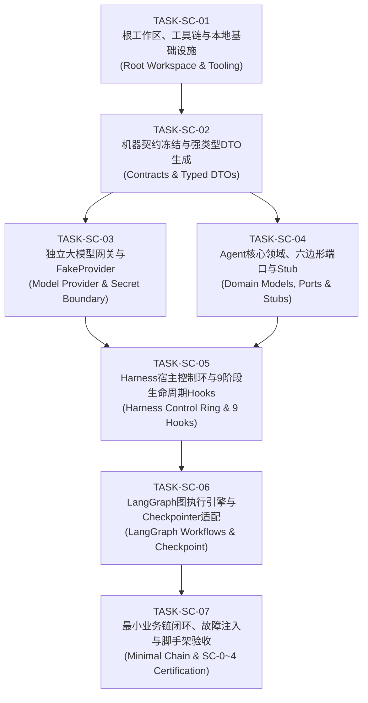

# AI Agent Harness 工程脚手架分步实现与验收计划 (Implementation & Acceptance Plan) v1.0

| 元数据属性 | 规范内容 |
|---|---|
| **计划版本** | v1.0 (2026-10-19) |
| **所属里程碑** | M03 / Scaffold Phase (对应落地主计划 Lane I 共享与 Lane A Python 基础) |
| **上位架构依据** | [AI-Agent-Harness-企业级通用脚手架详细设计 v1.0](../architecture/AI-Agent-Harness-企业级通用脚手架详细设计-v1.0.md) / [EN Version](../architecture/AI-Agent-Harness-Enterprise-Scaffold-Detailed-Design-v1.0.md) |
| **直接设计依据** | [学生持续学习-AI-Agent群程序设计与工程脚手架 v1.0](../design/学生持续学习-AI-Agent群程序设计与工程脚手架-v1.0.md) / [EN Version](../design/Continuous-Learning-AI-Agent-Group-Program-Design-and-Engineering-Scaffold-v1.0.md) |
| **落地总计划** | [LA-01与Agent-Harness-AI工程落地-Master-Plan-v1.0.md](LA-01与Agent-Harness-AI工程落地-Master-Plan-v1.0.md) |
| **代码交付路径** | `services/cogniva-learning-agent/`, `services/cogniva-model-provider/`, `contracts/`, `infra/local/`, `Makefile` |
| **分支策略** | 严格基于任务创建分支 `task/<TASK_ID>-<kebab-case>`，完成验证后 Conventional Commit 合并回 `main` |
| **验收硬门禁** | 满足 SC-0 ～ SC-4 阶段验收门禁，并通过 S-NFR-01 ～ S-NFR-06 六大非功能性硬指标 |

---

## 1. 计划目标与核心架构原则 (Architecture & Goals)

### 1.1 核心目标
构建一个**企业级、主流、高确定性、且严格符合 Harness 规范**的 Python AI Agent 群脚手架（Scaffold），杜绝玩具式 Demo，为学生持续学习平台提供高可靠、带事务防护与确定性回放能力的 Agent 宿主环境。

### 1.2 铁律与架构原则 (Invariants)
1. **控制环与图执行引擎分工 (Host Control Ring vs. LangGraph Engine)**：
   LangGraph 仅作为有向状态图执行引擎（StateGraph、Nodes、Edges），Harness 必须作为**外层受控宿主（Control Ring & Host）**，所有节点调用均受 Harness 的 9 阶段生命周期钩子管控。
2. **物理密钥边界隔离 (Secret Boundary)**：
   `cogniva-learning-agent` 绝对不持有或读取任何大模型 API Key，模型外呼只能通过 `cogniva-model-provider` 隔离进程。本地与 CI 自动化测试 100% 使用内置确定的 `FakeProvider`，断网可用。
3. **安全核心闸门 (The `before_action` Gate)**：
   模型只产生不可信的候选提案（Candidate Proposal）。只有宿主代码在 `before_action` 阶段依据调用者身份、配额、期望版本号与策略白名单构造 `AuthorizedToolCall`。模型自报 `permit=true` 必须被代码拦截并报错。
4. **操作幂等与未知对账 (Operation Ref & Reconciliation)**：
   每次工具执行和外部提案必须先持久化业务唯一键（`operation_ref`）。遭遇网络超时标记为 `unknown`，由专职对账器（Reconciler）异步轮询，严禁盲目自动重试非幂等写操作。
5. **单调自增 Fencing Token 防脑裂**：
   状态检查点与状态转移必须基于单调递增的 `fencing_token` 实施 CAS 乐观锁，旧 Worker 的延迟写入 100% 被拒绝。

---

## 2. 任务拆解与分步执行清单 (Task Breakdown)

脚手架实现细化为 **7 个不可跳跃的原子 Task**，每个 Task 均具备清晰的前提依赖、交付物、实现细节、自动化验证命令与验收标准。



---

### TASK-SC-01: 根工作区、工具链与本地基础设施 (Root Workspace & Tooling)

- **任务 ID**: `TASK-SC-01`
- **目标**: 搭建标准微服务仓库根结构、Python uv 构建管理体系、本地 Docker Compose 环境与统一命令入口。
- **依赖前置**: 已完成 I-01 基线审计。
- **交付物路径**:
  - `Makefile` (实现 `bootstrap`, `dev-up`, `dev-down`, `test-unit` 等标准命令入口)
  - `infra/local/docker-compose.yml` (PostgreSQL 16 + pgvector, RabbitMQ 3.13, Valkey 7.2)
  - `.env.example` (明确声明本地安全默认配置，禁止生产秘钥)
  - `services/cogniva-learning-agent/pyproject.toml` (定义依赖与 uv 锁定)
  - `services/cogniva-model-provider/pyproject.toml` (定义 Provider 依赖与 uv 锁定)
- **实现要点**:
  1. 使用 macOS 上的 `/Users/allen/.local/bin/uv` 管理 Python 3.12/3.14 虚拟环境与依赖。
  2. `pyproject.toml` 中采用 `src/` 规范布局，严格声明 FastAPI, Uvicorn, Pydantic v2, SQLAlchemy 2, psycopg 3, LangGraph 1.x, aio-pika, httpx, pytest 等。
  3. 运行 `uv lock` 生成确定的 `uv.lock`，锁定全部第三方依赖哈希。
  4. 根 `Makefile` 封装统一开发与质检指令，保证命令在无网络时也能进行本地测试。
- **验证命令**:
  ```bash
  make bootstrap
  uv run python --version
  git status
  ```
- **验收标准**:
  - `make bootstrap` 执行成功，两个 Python 服务的依赖树均能无冲突解析并生成 `uv.lock`。
  - Docker Compose 文件格式与端口配置正确无冲突。
- **分支与提交规范**:
  - 分支名: `task/SC-01-root-workspace-and-tooling`
  - Commit: `chore(scaffold): initialize root workspace, uv toolchain and local infra`

---

### TASK-SC-02: 机器契约冻结与强类型 DTO 生成 (Contracts & Typed DTOs)

- **任务 ID**: `TASK-SC-02`
- **目标**: 建立中心化的契约目录，根据上位 JSON Schema 与 OpenAPI 规范生成强类型、严格冻结的 Python Pydantic v2 DTO，杜绝字段松散解析。
- **依赖前置**: `TASK-SC-01`
- **交付物路径**:
  - `contracts/schemas/` (导入上位 `learning-agent.schema.json` 与核心事件定义)
  - `contracts/openapi/` (导入上位 `learning-agent.openapi.json`)
  - `scripts/generate_contracts.py` (从 Schema 生成强类型 DTO 脚本)
  - `services/cogniva-learning-agent/src/cogniva_agent/domain/dto/` (生成的 Pydantic v2 DTO)
  - `services/cogniva-learning-agent/tests/contract/test_dto_contracts.py`
- **实现要点**:
  1. DTO 必须配置 `frozen=True` 和 `extra="forbid"`，禁止未知字段注入。
  2. 严格遵循类型限制：禁止宽松类型隐式转换（例如把 boolean 当 int 解析）。
  3. 实现 Canonical JSON 规范哈希函数（对字典键排序、UTF-8 编码、去除动态追踪头），用于幂等键校验。
  4. 编写契约测试，断言合法与非法载荷反序列化行为完全符合契约规范。
- **验证命令**:
  ```bash
  make contracts
  uv run pytest services/cogniva-learning-agent/tests/contract/ -v
  ```
- **验收标准**:
  - 契约生成无报错，生成的 DTO 导入无语法/类型错误。
  - 针对正例样本解析成功；针对非法字段、越界类型的负例样本 100% 触发 `ValidationError`。
- **分支与提交规范**:
  - 分支名: `task/SC-02-contracts-and-typed-dtos`
  - Commit: `feat(contracts): freeze schemas and generate strict Pydantic v2 DTOs`

---

### TASK-SC-03: 独立大模型网关与 FakeProvider (Model Provider & Secret Boundary)

- **任务 ID**: `TASK-SC-03`
- **目标**: 实现物理隔离的大模型网关服务 `cogniva-model-provider`，确立进程间秘钥物理边界，并提供 100% 确定性的 `FakeProvider` 实现。
- **依赖前置**: `TASK-SC-02`
- **交付物路径**:
  - `services/cogniva-model-provider/src/cogniva_provider/domain/models.py` (`ModelProfile`, `TokenUsage`)
  - `services/cogniva-model-provider/src/cogniva_provider/ports/provider_port.py` (统一模型出网接口)
  - `services/cogniva-model-provider/src/cogniva_provider/adapters/fake_provider.py` (确定性 Mock 实现)
  - `services/cogniva-model-provider/src/cogniva_provider/server/app.py` (内部 HTTP/gRPC 出网代理)
  - `services/cogniva-model-provider/tests/unit/test_fake_provider.py`
- **实现要点**:
  1. `FakeProvider` 支持根据输入 prompt/schema 预设固定响应，或根据 JSON Schema 规则生成确定性模拟返回。
  2. 内置 Token 估算器与延迟模拟器，模拟真实大模型的调用耗时与用量计算。
  3. 支持模拟故障注入：网络超时（返回 HTTP 504）、结构损坏（返回非 JSON 文本）、限流阻断（HTTP 429）。
  4. 单测不依赖外网 API Key，完全在本地内存中执行完成（耗时 < 1 秒）。
- **验证命令**:
  ```bash
  cd services/cogniva-model-provider && uv run pytest tests/unit/ -v
  ```
- **验收标准**:
  - `FakeProvider` 能根据请求意图稳定返回预期的合规结构化 JSON。
  - 针对超时的请求能正确抛出 `ProviderTimeoutError`，并附带用于对账的 `provider_request_id`。
  - 0 生产密钥泄露风险。
- **分支与提交规范**:
  - 分支名: `task/SC-03-model-provider-and-fake`
  - Commit: `feat(provider): implement isolated model provider gateway and deterministic FakeProvider`

---

### TASK-SC-04: Agent 核心领域、六边形端口与 Stub (Domain Models, Ports & Stubs)

- **任务 ID**: `TASK-SC-04`
- **目标**: 按照六边形架构实现 `cogniva-learning-agent` 的纯净领域模型、抽象端口（Ports）以及轻量级内存 Stub。
- **依赖前置**: `TASK-SC-02`
- **交付物路径**:
  - `services/cogniva-learning-agent/src/cogniva_agent/domain/entities.py` (`Run`, `Step`, `Event`, `Session`, `IntentProposal`, `ContextManifest`)
  - `services/cogniva-learning-agent/src/cogniva_agent/domain/enums.py` (`RunStatus`, `RoleName`, `StepStatus`)
  - `services/cogniva-learning-agent/src/cogniva_agent/ports/` (`model_port.py`, `policy_port.py`, `budget_port.py`, `checkpoint_port.py`, `receipt_port.py`, `tool_port.py`, `lease_port.py`)
  - `services/cogniva-learning-agent/src/cogniva_agent/adapters/stubs/in_memory_stubs.py` (`InMemoryCheckpointPort`, `JavaStub`)
  - `services/cogniva-learning-agent/tests/unit/domain/test_entities.py`
- **实现要点**:
  1. 领域实体完全不依赖外部框架（无 FastAPI、SQLAlchemy、LangGraph 引用）。
  2. 实现六大核心端口抽象：`ModelPort`、`PolicyPort`、`BudgetPort`、`CheckpointPort`、`ReceiptPort`、`ToolPort`。
  3. 编写 `JavaStub`：模拟 Java 业务核心的草案确认、题目获取、答题提交、四项收据发放与 CAS 租约校验。
  4. 编写 `InMemoryCheckpointPort`：基于内存字典实现带有单调递增 `fencing_token` 与 CAS 锁的状态仓储。
- **验证命令**:
  ```bash
  cd services/cogniva-learning-agent && uv run pytest tests/unit/domain/ -v
  ```
- **验收标准**:
  - 领域模型和端口签名 100% 具备 mypy 类型注解并通过检查。
  - 内存 Stub 准确模拟并发冲突（CAS 失败返回冲突错误）。
- **分支与提交规范**:
  - 分支名: `task/SC-04-domain-models-and-ports`
  - Commit: `feat(agent): define pure domain entities, hexagonal ports and in-memory stubs`

---

### TASK-SC-05: Harness 宿主控制环与 9 阶段生命周期 Hooks (Harness Control Ring & 9 Hooks)

- **任务 ID**: `TASK-SC-05`
- **目标**: 实现 Harness 的核心驱动循环 `advance()`，严格装配不可绕过的 9 阶段生命周期钩子，实现原子预算扣减、保护项装配、安全工具授权与单调 CAS 防脑裂。
- **依赖前置**: `TASK-SC-03`, `TASK-SC-04`
- **交付物路径**:
  - `services/cogniva-learning-agent/src/cogniva_agent/harness/engine.py` (核心驱动循环 `advance`)
  - `services/cogniva-learning-agent/src/cogniva_agent/harness/hooks.py` (9 阶段拦截器规范与默认拦截器链)
  - `services/cogniva-learning-agent/src/cogniva_agent/harness/context_assembler.py` (长上下文保护项装配器)
  - `services/cogniva-learning-agent/src/cogniva_agent/harness/budget_guard.py` (原子预算守恒器)
  - `services/cogniva-learning-agent/src/cogniva_agent/harness/circuit_breaker.py` (死循环与无进展熔断器)
  - `services/cogniva-learning-agent/tests/unit/harness/test_lifecycle_hooks.py`
  - `services/cogniva-learning-agent/tests/unit/harness/test_harness_engine.py`
- **实现要点**:
  1. 完整实现 9 阶段拦截器调用链：
     `on_run_load` $\to$ `before_context` $\to$ `before_model` $\to$ `after_model` $\to$ `before_action` $\to$ `after_action` $\to$ `before_checkpoint` $\to$ `before_finalize` $\to$ `after_finalize`。
  2. **`before_action` 拦截验证**：拦截模型在 payload 中自报 `permit=true` 的提权攻击；仅允许宿主按白名单铸造 `AuthorizedToolCall`。
  3. **`ContextManifest` 保护**：保证负向约束（如“周末不学民法”）与核心目标为第一保护级，防滑动窗口盲目截断。
  4. **预算原子守恒**：`child_allocation + parent_spent <= total_budget`，超限立即熔断。
  5. **死循环熔断**：检测连续 3 次相同的输入/动作哈希无状态变化，强制熔断退出。
- **验证命令**:
  ```bash
  cd services/cogniva-learning-agent && uv run pytest tests/unit/harness/ -v
  ```
- **验收标准**:
  - 9 阶段 Hook 按照顺序 100% 触发且日志完整。
  - 模型越权提权测试用例被 `before_action` 100% 阻断抛出 `SecurityPolicyViolation`。
  - 死循环与预算耗尽场景成功触发熔断退出，Run 状态更新为 `failed` 并附带诊断原因。
- **分支与提交规范**:
  - 分支名: `task/SC-05-harness-control-ring-and-hooks`
  - Commit: `feat(harness): implement advance loop, 9 lifecycle hooks and security invariants`

---

### TASK-SC-06: LangGraph 图执行引擎与 Checkpointer 适配 (LangGraph Workflows & Checkpoint)

- **任务 ID**: `TASK-SC-06`
- **目标**: 将 LangGraph 引入作为有向图执行引擎，建立 `StateGraph` 工作流模板，将 LangGraph 节点包装进 Harness 受控上下文，实现状态持久化与步骤重入。
- **依赖前置**: `TASK-SC-05`
- **交付物路径**:
  - `services/cogniva-learning-agent/src/cogniva_agent/workflows/base.py` (受 Harness 约束的 LangGraph 包装器)
  - `services/cogniva-learning-agent/src/cogniva_agent/workflows/attempt_flow.py` (逐题作答 G2 工作流模板)
  - `services/cogniva-learning-agent/src/cogniva_agent/adapters/checkpointer/sa_checkpointer.py` (SQLAlchemy 2 异步检查点适配器)
  - `services/cogniva-learning-agent/tests/unit/workflows/test_attempt_flow.py`
  - `services/cogniva-learning-agent/tests/unit/workflows/test_checkpointer_replay.py`
- **实现要点**:
  1. LangGraph 的每个 Node 执行体内部必须受 Harness 生命周期包裹，不能脱离 Harness 裸调模型或工具。
  2. 实现 G2 `attempt_flow` 的拓扑结构：`authorize` $\to$ `extract_features` $\to$ `analyze` $\to$ 并行分支 (`explain` 与 `personal` $\to$ `plan`) $\to$ `collect`。
  3. 支路容错机制：`explain` 支路与 `personal` 支路独立捕获异常，某一分支失败不取消另一分支的合法成果。
  4. 实现基于 `fencing_token` 的异步 Checkpointer，验证故障中断后的从点重放恢复。
- **验证命令**:
  ```bash
  cd services/cogniva-learning-agent && uv run pytest tests/unit/workflows/ -v
  ```
- **验收标准**:
  - G2 状态图在内存/Mock 环境下顺利运转，并行节点正确汇聚至 `collect`。
  - 模拟第 3 步崩溃并重启，能够从第 2 步的持久化 Checkpoint 恢复并继续完成流程。
- **分支与提交规范**:
  - 分支名: `task/SC-06-langgraph-workflows-and-checkpointer`
  - Commit: `feat(workflows): integrate LangGraph StateGraph with Harness-supervised nodes`

---

### TASK-SC-07: 最小业务链闭环、故障注入与脚手架验收 (Minimal Chain & SC-0~4 Certification)

- **任务 ID**: `TASK-SC-07`
- **目标**: 串联 FastAPI 服务入口、Worker 异步执行器、FakeProvider 与 JavaStub，打通最小完整业务链，执行 10 次重投、Worker 强杀、失效 Fence 等故障注入，完成 SC-0 ～ SC-4 验收并生成正式验收报告。
- **依赖前置**: `TASK-SC-06`
- **交付物路径**:
  - `services/cogniva-learning-agent/src/cogniva_agent/adapters/http/app.py` (FastAPI 启动入口与健康探针)
  - `services/cogniva-learning-agent/src/cogniva_agent/adapters/worker/runner.py` (Worker 后台消费与执行入口)
  - `services/cogniva-learning-agent/tests/integration/test_minimal_viable_chain.py` (端到端集成测试)
  - `services/cogniva-learning-agent/tests/fault/test_fault_injection.py` (重复投递、强杀恢复、脑裂拦截)
  - `scripts/verify_scaffold.py` (自动化脚手架验收检查器)
  - `execution/evidence/SC-M03/scaffold-acceptance-report.md` (正式验收报告与证据)
- **实现要点**:
  1. **最小业务链闭环**：
     构造合成作答提交 $\to$ Worker 认领 $\to$ 路由至 LA-02/03 $\to$ 产出候选提案 $\to$ JavaStub 验签与采纳 $\to$ 4 项收据落地 $\to$ GET 状态查询。
  2. **高可靠幂等测试**：
     将同一事件消息并发或顺序投递 10 次，验证最终业务收据与事实仅变更 1 次，其余 9 次均返回原始收据。
  3. **崩溃自愈验证**：
     在 Worker 执行到 `explain` 节点时模拟强杀进程，重新启动后 Worker 自动从上一 Checkpoint 恢复并完成整个生命周期。
  4. **CAS 乐观锁防脑裂验证**：
     注入持有旧 `fencing_token` 的假冒 Worker 执行写操作，100% 触发版本冲突并被拒。
  5. 运行 `make smoke-learning` 与 `make fault-redelivery`，收集证据。
- **验证命令**:
  ```bash
  make test-unit
  make test-contract
  uv run python scripts/verify_scaffold.py
  ```
- **验收标准**:
  - SC-0 ～ SC-4 阶段验收门禁全部通过。
  - S-NFR-01 ～ S-NFR-06 六大硬指标全部满足（脱敏无密钥、单测 < 5s、幂等 10 次安全、故障自愈正常）。
- **分支与提交规范**:
  - 分支名: `task/SC-07-minimal-chain-and-scaffold-acceptance`
  - Commit: `feat(scaffold): complete minimal viable chain, fault injection and scaffold certification`

---

## 3. 验收门禁 (SC-0 至 SC-4) 判定协议 (Scaffold Definition of Done)

脚手架必须依次通过以下 5 级门禁，方可判定工程脚手架验收合格：

| 门禁代号 | 门禁名称 | 必须满足的硬性检验条件 | 不允许的妥协行为 |
|---|---|---|---|
| **SC-0** | **构建与打包 (Build & Package)** | `make bootstrap` 成功；`uv.lock` 确定且无外网漂移；`make contracts` 生成 DTO 一致；`ruff` 与 `mypy` 0 报错；Docker 镜像构建成功。 | 仅有目录或宽泛的未锁定版本范围；忽略类型报错。 |
| **SC-1** | **本地启动与就绪 (Local Startup)** | `make run-agent-api` 与 `make run-provider` 能成功拉起；`/health/live` 与 `/health/ready` 探针返回 200；测试环境 0 生产密钥。 | 启动单个 FastAPI 返回静态 200，内部无真实组件初始化。 |
| **SC-2** | **最小业务链 (Minimal Chain)** | 合成作答 $\to$ Worker 驱动 Harness $\to$ LA-02 分析 $\to$ 提案提交 $\to$ JavaStub 采纳 $\to$ 状态与收据查询全链路畅通。 | Agent 仅在控制台 `print` 文本字符串，无状态与收据落库。 |
| **SC-3** | **韧性与安全隔离 (Fault & Security)** | 同一作答消息投递 10 次严格幂等；Worker 进程强杀后重启自动从 Checkpoint 续跑；旧 Fence 写操作被 100% 阻断；模型越权输出被代码拦截。 | 仅验证 Happy Path 正常流，不测试重投、冲突与故障恢复。 |
| **SC-4** | **交付准备 (Staging Readiness)** | K8s/Compose 清单渲染无误；环境配置与代码解耦；OpenTelemetry 追踪日志串联完整；输出正式验收交付证据。 | 依赖开发者本地机器绝对路径；环境密钥硬编码在代码中。 |

---

## 4. 非功能性指标 (S-NFR) 验证矩阵

| 指标编号 | 指标名称 | 验证方法与用例 | 预期合格基线 |
|---|---|---|---|
| **S-NFR-01** | **安全零信任** | Worker 环境变量检查 + 模型构造 `permit=true` 攻击用例 + 日志脱敏断言 | Worker 进程 0 密钥泄露；`before_action` 100% 拦截非法提权；日志中手机/邮箱/姓名自动脱敏。 |
| **S-NFR-02** | **高可靠幂等与自愈** | 重复投递 10 次测试 + `kill -9` 强杀恢复用例 + 注入旧 `fencing_token` 用例 | 业务状态仅变更 1 次；强杀后 100% 自动从检查点恢复；旧 Worker 写操作 100% 发生 CAS 冲突被拒。 |
| **S-NFR-03** | **本地确定性** | 断网离线运行 `make test-unit` 与 `make test-contract` | 100% 测试脱机通过，全部单测耗时 $< 5$ 秒。 |
| **S-NFR-04** | **并发与递归有界** | 启动 100 个并发模拟 Run + 子 Agent 委派深度断言 | 异步无锁阻塞；单 Run 子 Agent 最大递归深度 `max_depth <= 2`，超时自动熔断。 |
| **S-NFR-05** | **可观测审计** | 检查单次任务的日志与 Span 记录 | 完整串联 `trace_id`、`run_ref`、`step_index`、`operation_ref`；高风险操作 100% 记录审计日志。 |
| **S-NFR-06** | **架构纯粹性** | 替换底层模型为规则引擎，或替换 LangGraph 为原生状态机 | Agent 领域层代码与业务规则 0 修改。 |

---

## 5. 状态机与执行台账关联 (Execution Ledger Mapping)

本计划中的任务与项目的整体执行台账保持严格双向映射：
- `execution/task-state.json`：
  - 本脚手架涵盖 **Lane I 的 `I-03`、`I-04`** 以及 **Lane A 的 `A-01`、`A-02`、`A-03`、`A-05`、`A-06`**。
  - 任务启动时状态从 `todo` 转为 `in_progress`；完成并合入 main 后更新为 `done`。
- `execution/evidence/`：
  - 每个 Task 在完成时必须将验证命令的执行日志与结果输出至 `execution/evidence/<TASK_ID>/attempt-1/result.json` 与 `review.md`。

---

## 6. AI 结对执行指导与下一步行动 (Next Step Instruction)

AI 助手与开发者在执行本计划时，必须严格遵守以下执行规程：
1. **单任务聚焦**：每次只执行一个 Task，禁止跨 Task 批量编码；
2. **分支隔离**：任务开始时切出专属分支 `task/<TASK_ID>-...`；
3. **测试先行/伴随**：每个 Task 必须伴随自动化测试文件；
4. **验证门禁**：在当前任务的测试命令 100% 通过前，禁止宣称完成；
5. **规范提交与合并**：生成英文 Conventional Commit，通过 `--no-ff` 合并回 `main`，并同步推送远程；
6. **更新状态台账**：在 `execution/task-state.json` 与 `execution/handoff.md` 中记录进展。

**立即执行下一步**：切入分支开始执行 `TASK-SC-01`（根工作区、工具链与本地基础设施搭建）。
