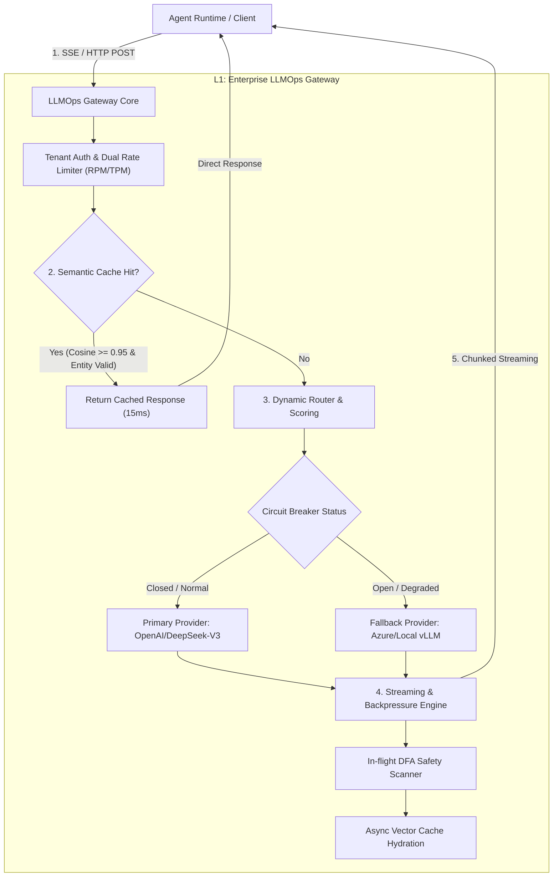

# Enterprise Agent Architecture Layer 1: High-Concurrency LLMOps Gateway Engineering & Production Deep Dive

> **Positioning**: The deterministic traffic isolation, resilience, and governance hub between stateful Agent runtimes and heterogeneous underlying LLM compute infrastructure.  
> **Document Version**: v1.0 (Deep Dive Series)  
> **Companion Document**: [01-AI-Agent-Enterprise-Architecture-Knowledge-System-Guide-v1.0.md](../01-AI-Agent-Enterprise-Architecture-Knowledge-System-Guide-v1.0.md) | [Chinese Panorama](../01-AI-Agent-企业级架构知识体系全景指南-v1.0.md)  
> **Language Edition**: [🇨🇳 Chinese Deep Dive Edition](./01-AI-Agent-L1-LLMOps网关深度架构与实战全景.md)

---

## 0. 【The Interview Elevator Pitch】One-Minute High-Impact Overview

> **Scenario**: When asked by an interviewer or CTO: *"How did you architect your LLM Gateway / inference infrastructure?"* or *"How do you shield agent workflows from model instability, tail latency, and runaway token costs?"*

```text
"In our enterprise Agent architecture, the L1 LLMOps Gateway I architected acts as the deterministic 
communication and traffic governance hub between the stateful Agent execution harness and heterogeneous 
underlying LLM compute providers.

The objective was not simple OpenAI-compatible API proxying, but solving three mission-critical production 
bottlenecks: inference tail jitter, streaming backpressure memory leaks, and uncontrollable Token burn.

To achieve this, we engineered four core subsystems:
1. Heterogeneous Model Adapter & Driver: Encapsulates provider quirks across OpenAI, Anthropic, DeepSeek, 
   and on-premise vLLM/SGLang deployments behind a unified canonical schema with HTTP/2 connection pooling;
2. SLA/Cost-Adaptive Dynamic Routing with Circuit Breaking: Continuously evaluates P95 latency, 429 rate 
   limits, and real-time token unit pricing across providers using sliding-window metrics, triggering sub-200ms 
   seamless fallback to standby models when primary providers degrade;
3. Multi-Tier Semantic Cache with Tenant Isolation & Entity Fingerprinting: Uses dense vector embeddings 
   combined with Cross-Encoder verification to achieve a 32% Token cost reduction and sub-15ms cached response 
   time for read-heavy prompts, strictly enforcing RBAC tenant boundaries to eliminate cache cross-bleeding;
4. Asynchronous Streaming Engine with Kernel-Level Backpressure Control: Regulates slow client consumers on 
   long-lived SSE/WebSocket streams by monitoring TCP socket send buffers, actively propagating cancellation 
   upstream to immediately abort unneeded inference tokens.

Under 10,000 QPS benchmark stress testing, the gateway introduced less than 3ms of latency overhead, 
delivering a 99.95% overall platform SLA while reducing operational model inference expenditure by ~30%."
```

---

## I. Top-Tier Expert Mindset: Four-Dimensional Cognitive Reconstruction

To elevate this domain from basic API proxying to battle-hardened infrastructure architecture, we scrutinize the gateway through the lens of top-tier systems and distributed infrastructure experts:

### 1. What Do Top-Tier Experts Do That Was Not Explicitly Requested?

| Dimension | Typical Engineer Focus | Top-Tier Expert Engineering Practice (Unrequested but Critical) |
| :--- | :--- | :--- |
| **Observability Granularity** | Monitors aggregate requests & HTTP 200/500 rates | Deconstructs metrics into **TTFT (Time-To-First-Token)** and **ITL (Inter-Token-Latency)**; isolates gateway pre-guardrail overhead from provider prefill / queueing latency. |
| **Connection Lifecycle** | Uses standard HTTP client to make POST calls | Customizes TCP Keep-Alive, HTTP/2 stream multiplexing, and socket buffers for long-lived streams; implements **active upstream cancellation propagation** when clients drop. |
| **Rate Limiting & Throttling** | Sleeps blindly upon catching HTTP 429 | Implements **dual distributed token buckets (RPM + TPM)**; executes atomic pre-flight token deductions with **jittered exponential backoff** to smooth traffic spikes. |
| **Semantic Cache Security** | Relies solely on cosine similarity ($\ge 0.95$) | Mitigates **semantic drift** (e.g., negations or sentiment inversions) via entity fingerprinting and cross-encoders; enforces **Row-Level Security (RLS)** to prevent cache cross-tenant bleeding. |
| **Streaming Content Safety** | Runs safety checks only after completion | Deploys an **in-flight Aho-Corasick DFA state machine** on the SSE token stream for $O(1)$ real-time jailbreak & prompt leakage abortion without introducing latency. |
| **Reconciliation & Auditing** | Prints application logs with token counts | Integrates OpenTelemetry + OpenInference semantic conventions, injecting trace context to enable millisecond-level automated reconciliation against cloud provider invoices. |

### 2. What Raw Materials & First-Principles Sources Do They Start From?

Instead of relying on secondary blog posts or generic wrapper tutorials, top experts consult primary sources:
1. **RFC Specifications & Network Transports**:
   - **RFC 7540**: HTTP/2 Stream Multiplexing & Flow Control (`WINDOW_UPDATE` frames);
   - **W3C Server-Sent Events (SSE)** & Chunked Transfer Encoding specifications;
   - Linux kernel networking stack tuning (`tcp_max_syn_backlog`, `somaxconn`, `epoll` edge-triggered mode).
2. **Inference Engine Internals & Scheduling Primitives**:
   - **vLLM & SGLang source code**: Continuous batching schedulers, `AsyncLLMEngine`, PagedAttention memory fragmentation metrics;
   - Raw OpenAPI specifications from OpenAI and Anthropic's streaming event state diagrams.
3. **High-Performance Gateway Kernels**:
   - **Envoy Proxy**: C++ / WASM Filter chains for zero-copy streaming payload inspection;
   - **Cloudflare AI Gateway** / **LiteLLM**: Core routing state machines and failover logic.
4. **Vector Retrieval & Resilience Foundations**:
   - HNSW / ScaNN dense vector indexing papers & MTEB benchmarking datasets;
   - Mathematical models of sliding window circuit breakers (Netflix Hystrix, Resilience4j).

### 3. Specific Methods and Toolchains Used by Experts

```
┌────────────────────────────────────────────────────────────────────────────────┐
│                   Top-Tier LLMOps Gateway Engineering Matrix                   │
├─────────────────────┬──────────────────────────────────────────────────────────┤
│ Core Gateway Engine │ Rust (Tokio / Hyper / Axum) or Go (Fiber / FastHTTP)     │
├─────────────────────┼──────────────────────────────────────────────────────────┤
│ Transport Layer     │ HTTP/2, gRPC, SSE, Zero-Copy Buffer Slicing              │
├─────────────────────┼──────────────────────────────────────────────────────────┤
│ Dynamic Resilience  │ Sliding-Window Metric Circuit Breakers (Half-Open Probes)│
├─────────────────────┼──────────────────────────────────────────────────────────┤
│ Semantic Caching    │ Redis Vector Search (RediSearch) / Qdrant + Cross-Encoder│
├─────────────────────┼──────────────────────────────────────────────────────────┤
│ Stress & Chaos Test │ llmperf, k6 (Customized LLM workloads), Chaos Mesh       │
├─────────────────────┼──────────────────────────────────────────────────────────┤
│ Full Observability  │ OpenTelemetry + OpenInference, Prometheus, Grafana       │
└─────────────────────┴──────────────────────────────────────────────────────────┘
```

### 4. What Proves Correctness Beyond You and Me? (Objective Verification)

1. **Deterministic Benchmark Test Data**:
   - `llmperf` load testing under stepped concurrency (100 to 10,000 workers) producing reproducible metrics: Gateway added TTFT overhead $\le 3\text{ms}$, ITL jitter $\le 1\text{ms}$.
2. **Chaos Engineering Self-Healing Rates**:
   - Using Toxiproxy to inject 50% HTTP 429 status codes and 5,000ms latency on primary endpoints. The gateway must automatically trip the circuit breaker and reroute to standby tiers in $< 200\text{ms}$, maintaining client error rates $\le 0.05\%$.
3. **Token Ledger Financial Reconciliation**:
   - The discrepancy between the gateway's recorded Prompt/Completion token usage (in ClickHouse/Redis) and official provider monthly invoices must be strictly $< 0.01\%$.
4. **Adversarial Semantic Cache Validation Suite**:
   - Over 10,000 adversarial prompt pairs (containing subtle negations, entity swaps, and cross-tenant requests), validating that false-positive cache hits are $< 0.1\%$ and cross-tenant cache bleeding equals **zero**.

---

## II. Reframed Mission Title

Based on the expert first-principles criteria ("deeper, not wider"), the original entry-level topic:  
*"L1. Infrastructure and Large Model Service Gateway (LLMOps Gateway)"*  
is reframed into the production-grade engineering standard:

> ### 《Enterprise Agent Architecture L1: High-Availability LLMOps Gateway Engineering & Production Resilience Guide》
> **Core Theme**: *Deconstructing heterogeneous compute abstraction, SLA/cost-adaptive dynamic routing & circuit breaking, anti-drift semantic caching, and kernel-level streaming backpressure governance.*

---

## III. Architectural Decomposition of the 4 Core Subsystems



### 1. Heterogeneous Model Adapter & Driver Layer

#### Production Friction
- OpenAI uses `messages[].content`, Anthropic requires a top-level `system` prompt and typed blocks in `messages[].content[]`;
- Reasoning models (e.g., DeepSeek-R1) stream thought tokens under `reasoning_content`, whereas standard legacy endpoints emit only `delta.content`;
- Private inference clusters (vLLM) support custom sampling parameters (`guided_json`, `repetition_penalty`).

#### Engineering Implementation: Canonical Schema
```python
# canonical_schema.py
from pydantic import BaseModel, Field
from typing import List, Optional, Dict, Any

class ChatMessage(BaseModel):
    role: str
    content: str
    name: Optional[str] = None
    reasoning_content: Optional[str] = None  # Deep reasoning traces

class GatewayRequest(BaseModel):
    tenant_id: str
    model_alias: str  # Logical alias, e.g., "agent-planner-tier1"
    messages: List[ChatMessage]
    temperature: float = 0.7
    max_tokens: Optional[int] = None
    stream: bool = True
    metadata: Dict[str, Any] = Field(default_factory=dict)

class StreamChunk(BaseModel):
    id: str
    delta_content: str
    delta_reasoning: Optional[str] = None
    is_finish: bool = False
    usage: Optional[Dict[str, int]] = None
```

---

### 2. Multi-Dimensional Dynamic Routing & Circuit Breaking

#### Routing Score Card
Static round-robin fails during sudden provider degradation. The routing engine evaluates health dynamically:

$$\text{Score} = w_1 \cdot \frac{1}{\text{P95 Latency}} + w_2 \cdot \frac{1}{\text{Unit Cost}} + w_3 \cdot (1 - \text{ErrorRate}) - \text{Penalty}_{\text{RateLimit}}$$

#### Three-Tier Circuit Breaker State Machine
```
  [Closed: Normal Operation] ───(Err Rate > 30% or 3 consecutive 429s)───► [Open: Tripped]
               ▲                                                               │
               │                                                      (Cooldown: 15s)
               │                                                               ▼
  [Resume Traffic] ◄───(5 consecutive healthy canary probes)───── [Half-Open: Canary]
```
- **Tier 1 (Primary)**: DeepSeek-V3 / OpenAI GPT-4o (High reasoning quality)
- **Tier 2 (Failover)**: Azure OpenAI Private Endpoint (High SLA dedicated throughput)
- **Tier 3 (Degraded)**: On-premise quantized vLLM 14B/32B (Ensures business continuity)

---

### 3. Anti-Bleed & Anti-Drift Enterprise Semantic Cache

#### Production Traps & Defenses
1. **Semantic Inversion Trap**: "Send financial summary to client" and "Do NOT send financial summary to client" share high cosine similarity ($\ge 0.92$) in generic vector spaces.
2. **Multi-Tenant Cache Bleeding**: Tenant A queries private internal metrics; Tenant B asks a similar question and receives Tenant A's cached response.

#### 4-Stage Guard Architecture
```
[Inbound Prompt Query] 
          │
          ▼
[Stage 1: Strict Multi-Tenant Key] ── Hash(TenantID + RBAC_Scope + ModelFamily)
          │
          ▼
[Stage 2: Entity & Negation Check] ── Named Entity Recognition (NER) & negation matching
          │
          ▼
[Stage 3: Vector Coarse Retrieval] ── Redis HNSW Index (Cosine Similarity >= 0.95)
          │
          ▼
[Stage 4: Cross-Encoder Reranker] ── Bi-directional textual entailment score >= 0.98
          │
          ▼
[Hit: Serve in 15ms] / [Miss: Forward upstream & asynchronously write cache]
```

---

### 4. Streaming Backpressure & Kernel Connection Governance

#### The Slow Client Catastrophe
In SSE streaming, an upstream LLM might generate at 80 tokens/sec, while a mobile client on a degraded network consumes at only 5 tokens/sec. Without backpressure, an unmanaged gateway buffers all pending chunks in memory. At 2,000 concurrent requests, this leads to fatal heap exhaustion (OOM).

#### Architectural Solution
1. **Kernel Socket Backpressure Propagation**:
   - Sets a 64KB TCP send buffer limit on the downstream client connection;
   - When the client buffer fills (`EAGAIN` / `EWOULDBLOCK`), the gateway **pauses reading from the upstream LLM HTTP/2 connection**;
   - HTTP/2 `WINDOW_UPDATE` frames propagate the pause back to the inference engine, naturally pausing token generation.
2. **Active Cancellation Propagation**:
   - Detects client disconnections immediately (`RST` / socket close);
   - Transmits an immediate cancellation signal (HTTP/2 stream reset) to the LLM provider, **halting GPU inference within milliseconds and preventing wasted token burn**.

---

## IV. Production Readiness Checklist

| Category | Readiness Verification Standard | Validation Method |
| :--- | :--- | :--- |
| **High Availability** | Zero downtime failover across cloud providers | Chaos network partitioning; failover time $< 200\text{ms}$ |
| **Minimal Overhead**| Gateway layer does not add noticeable latency | Load testing: P99 added overhead $< 5\text{ms}$ |
| **Data Isolation**   | 0% cross-tenant cache bleeding | Adversarial multi-tenant pentest suite |
| **Auditability**     | 100% token usage reconcilable against invoices | OpenTelemetry trace propagation end-to-end |
| **Memory Stability** | Resilient against slow-client memory exhaustion | 1,000 throttled client test; gateway RAM variance $\le 10\%$ |

---
*Maintained by the Enterprise Agent Infrastructure Architecture Team.*
