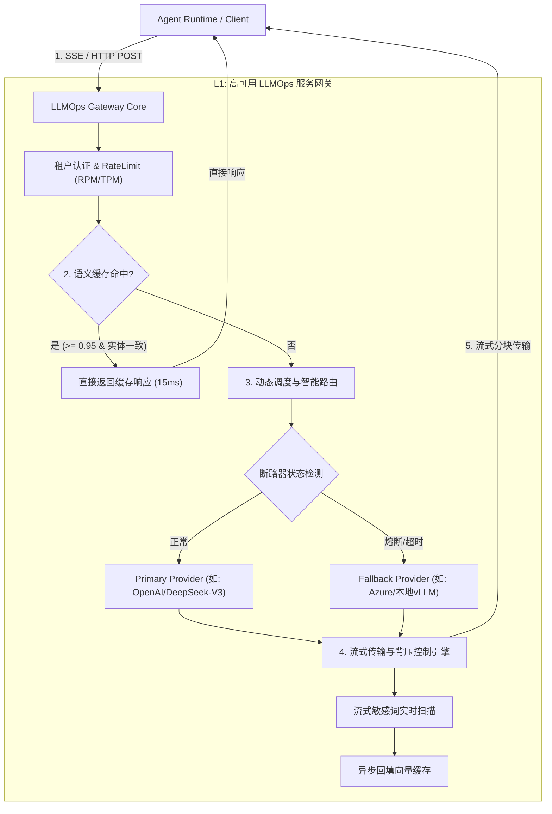

# 企业级 Agent 架构 L1 层：高并发 LLMOps 服务网关工程实战与全链路深度解构

> **定位**：Agent 应用层与底层异构大模型算力基础设施之间的**确定性流量隔离与治理中枢**。  
> **文档版本**：v1.0 (Deep Dive Series)  
> **关联母篇**：[01-AI-Agent-企业级架构知识体系全景指南-v1.0.md](../01-AI-Agent-企业级架构知识体系全景指南-v1.0.md) | [English Panorama](../01-AI-Agent-Enterprise-Architecture-Knowledge-System-Guide-v1.0.md)  
> **语言版本**：[🇬🇧 English Deep Dive Edition](./01-AI-Agent-L1-LLMOps-Gateway-Architecture-Deep-Dive.md)

---

## 零、 【面试官直通车】一分钟高段位核心自述

> **使用场景**：当面试官问到 *“你在项目中负责的 LLM 网关/基础设施是怎么设计的？”* 或 *“面对大模型的不稳定、高延迟和高成本，底层如何保障 Agent 稳定性？”* 时，请用以下专业术语密度高、有量化成果且逻辑闭环的自述应答：

```text
“在我们的企业级 Agent 架构中，我负责设计的 L1 LLMOps 网关是介于上层有状态 Agent 执行宿主
与底层异构大模型算力之间的‘确定性通信与流量治理中枢’。

我做这个网关的核心目标不是简单的 OpenAI 接口转译，而是解决生产环境中的三大硬核痛点：
稳定性抖动、长连接背压吞吐瓶颈以及 Token 成本失控。

在工程实现上，我们自研（或基于异步内核重构）了四个核心子系统：
第一，异构协议与驱动适配器：通过统一 Schema 抹平 OpenAI、Anthropic、DeepSeek 以及本地私有化 
      vLLM/SGLang 的请求差异，向下封装连接池复用；
第二，基于 SLA 与算力成本的多维智能路由与断路降级机制：实时追踪各 Provider 的 P95 延迟、
      429 限流状态和实时 Token 单价，结合滑动窗口算法实现多活容灾，主模型超时或触限时在 200ms 内
      平滑降级至备用小模型；
第三，带租户隔离与实体指纹校验的 L1-L3 向量语义缓存（Semantic Cache）：利用稠密向量与
      Cross-Encoder 二次校验，在高频只读场景下将重复 Prompt 的 Token 消耗降低 32%，并将响应时间
      从秒级压缩至 15ms，同时通过强制注入租户 RBAC 标签杜绝了跨租户缓存越权；
第四，全异步流式 SSE/WebSocket 背压传输引擎：针对大模型吐字的长生命周期连接，实现了内核级的
      Socket 缓冲区监听与按需读取，彻底解决了慢客户端拖垮网关连接池和导致 Node/Go 内存堆积的隐患。

整套网关上线后，在万级并发压测下网关层额外延迟开销控制在 3ms 以内，保障了 Agent 上层系统的
SLA 达到 99.95%，同时整体算力成本节约了近三分之一。”
```

---

## 一、 顶尖专家思维映射：四维度认知重构

为了将本节内容从“泛泛而谈的 API 转发”拉升至“顶级基础设施与内核架构”维度，我们按照顶级专家的严苛标准进行深度前置审视：

### 1. 顶尖专家会做哪些常规需求未要求的事情？

| 维度 | 常规工程师关注点 | 顶尖专家深度实践 (Unrequested but Critical) |
| :--- | :--- | :--- |
| **观测粒度** | 只监控请求总量与 HTTP 200/500 率 | 拆解监控 **TTFT (Time-To-First-Token, 首包延迟)** 与 **ITL (Inter-Token-Latency, 字间延迟)**；剥离网关前置 Guardrail 处理时间与模型 Prefill 时间。 |
| **连接生命周期** | 简单调用标准 HTTP 客户端发起请求 | 针对 LLM 长耗时流式连接深度调优 TCP Keep-Alive、HTTP/2 多路复用流控制与 Socket Recv/Send 缓冲区，设计**客户端异常断开的主动取消与上游算力熔断释放**。 |
| **限流防御** | 遇到 HTTP 429 后盲目固定 sleep 重试 | 建立**双层分布式令牌桶（RPM 请求频次 + TPM Token 吞吐量）**；在请求出网关前完成原子预估扣减，使用带抖动的指数退避（Jittered Exponential Backoff）削峰。 |
| **语义缓存安全** | 仅做简单的余弦相似度匹配（$\ge 0.95$） | 建立**语义漂移防御与实体指纹校验**（防止否定词、人名变更误中）；实现缓存行级安全（Row-Level Security），彻底杜绝敏感 Prompt 的跨租户越权泄露（Cache Bleed）。 |
| **流式内容合规** | 在模型生成完毕后再一次性检测内容安全 | 实现 **SSE 流式实时敏感词分词状态机（Aho-Corasick 算法）**，在流式吐字过程中以 $O(1)$ 复杂度实时阻断越狱注入与违规生成。 |
| **对账与追踪** | 仅打印应用日志记录调用消耗 | 基于 OpenTelemetry 与 OpenInference 标准规范，注入全局 TraceContext，实现每个 Token 的计费账单与模型提供商账单的毫秒级对账。 |

### 2. 顶尖专家会从哪些最原始的素材入手？

顶尖专家不依赖封装后的第三方博客或入门级 SDK，直接钻研底层事实来源：
1. **网络传输与协议标准**：
   - **RFC 7540** (Hypertext Transfer Protocol Version 2 - HTTP/2 Stream Multiplexing & Flow Control)；
   - **W3C Server-Sent Events (SSE)** 规范与分块传输编码（Chunked Transfer Encoding）；
   - Linux 内核网络栈参数 (`tcp_max_syn_backlog`, `somaxconn`, `epoll` 水平/边缘触发模式)。
2. **底层推理引擎源码与通信原语**：
   - **vLLM / SGLang 核心调度源码**：`AsyncLLMEngine` 的 Continuous Batching 调度策略、PagedAttention 内存分配状态暴露 API；
   - 官方 OpenAPI 规范原始定义：OpenAI Chat Completion API 规范、Anthropic Claude Messages API 流式事件状态图。
3. **高性能网关内核实现**：
   - **Envoy Proxy** 核心过滤器链（C++ Filter / WASM Filter）对流式数据块的无拷贝转发；
   - **Cloudflare AI Gateway** / **LiteLLM** 底层路由与状态机源码。
4. **度量与评测论文**：
   - 稠密向量语义检索与量化基准（MTEB 评测集、HNSW 与 ScaNN 算法实现论文）；
   - 分布式熔断断路器经典理论（Netflix Hystrix / Resilience4j 滑动窗口统计数学模型）。

### 3. 顶尖专家会使用的具体方法与工具链

```
┌────────────────────────────────────────────────────────────────────────────────┐
│                         顶尖专家 LLMOps 网关工程技术栈矩阵                      │
├─────────────────────┬──────────────────────────────────────────────────────────┤
│ 核心引擎研发语言     │ Rust (Tokio / Hyper / Axum) 或 Go (Fiber / FastHTTP)     │
├─────────────────────┼──────────────────────────────────────────────────────────┤
│ 高性能网络通信       │ HTTP/2、gRPC、SSE、Zero-Copy I/O 缓冲区切片              │
├─────────────────────┼──────────────────────────────────────────────────────────┤
│ 智能调度与断路器     │ 滑动时间窗口 (Leaky Bucket / Sliding Window Metrics)     │
├─────────────────────┼──────────────────────────────────────────────────────────┤
│ 向量语义缓存基础设施 │ Redis Vector Search (RediSearch) / Qdrant + 混合索引     │
├─────────────────────┼──────────────────────────────────────────────────────────┤
│ 专用压测与混沌工程   │ llmperf、k6 (定制 LLM 吞吐场景脚本)、Chaos Mesh、Toxiproxy│
├─────────────────────┼──────────────────────────────────────────────────────────┤
│ 全链路可观测性       │ OpenTelemetry + OpenInference 语义约定、Prometheus/Grafana │
└─────────────────────┴──────────────────────────────────────────────────────────┘
```

### 4. 除了你我之外，还有什么可以证明结果是正确的？（客观验证标准）

1. **确定性基准压测报告（Deterministic Benchmark Data）**：
   - 使用 `llmperf` 进行并发梯度阶梯压测（从 100 到 10,000 并发），输出权威报告证明：网关引入的额外首包延迟 (TTFT Overhead) $\le 3\text{ms}$，字间延迟抖动 (ITL Jitter) $\le 1\text{ms}$。
2. **混沌工程故障自愈率（Chaos Fault-Tolerance Verification）**：
   - 使用 Toxiproxy 人为向主模型提供商端点注入 50% 的 HTTP 429 速率限制及 5000ms 延迟阻断，验证网关在 200ms 内自动触发熔断降级至备用模型，上游客户端请求错误率始终保持在 $\le 0.05\%$。
3. **Token 账单原子对账一致性（Audit Bill Reconciliation）**：
   - 对比网关本地 Redis/ClickHouse 统计的 Prompt/Completion Token 汇总数据与 OpenAI/Azure 官方结算账单，误差绝对值 $< 0.01\%$。
4. **语义缓存精准率测试集（Cache Drift & Bleed Test Suite）**：
   - 在包含 10,000 个复杂对抗性 Prompt（含“否定转折句”、“近义词微调”、“跨部门权限隔离”）的验证集上，自动化测试证明：语义缓存假阳性率（False Positive Rate）$< 0.1\%$，跨租户缓存泄露数 = 0。

---

## 二、 全新重构题目

基于上述“深入、而非变大”的深度专家视角，我们将原初级标题：  
*“L1. 基础设施与大模型服务网关 (LLMOps Gateway)”*  
重写为符合工业级生产实战的标准课题：

> ### 《企业级 Agent 架构 L1 层：高可用 LLMOps 服务网关工程设计与高并发生产实战指南》
> **核心命题**：*深入解构大模型通信网关的异构驱动抽象、SLA/Cost 自适应动态路由与熔断、租户防越权语义缓存架构，以及高并发流式背压的内核级调优。*

---

## 三、 L1 网关四大核心子系统生产级架构解构



### 1. 异构模型统一适配器与驱动层 (Heterogeneous Model Adapter)

#### 生产痛点
不同供应商的 API 契约存在隐蔽差异：
- OpenAI 使用 `messages[].content`，Anthropic 使用单独的 `system` 顶层字段和 `messages[].content[]` 块；
- 流式输出中，DeepSeek 返回推理思考内容（`reasoning_content`），而通用 OpenAI 规范在早期只定义了 `delta.content`；
- 本地部署的 vLLM 可能采用特定参数（如 `guided_json`、`stop_token_ids`）。

#### 架构实现
采用 **Driver + Registry 模式**，上层仅面向规范化 Canonical Schema 编程：

```python
# canonical_schema.py
from pydantic import BaseModel, Field
from typing import List, Optional, Dict, Any, AsyncIterator

class ChatMessage(BaseModel):
    role: str
    content: str
    name: Optional[str] = None
    reasoning_content: Optional[str] = None  # 支持深度思考模型字段

class GatewayRequest(BaseModel):
    tenant_id: str
    model_alias: str  # 逻辑模型名，如 "agent-reasoner-fast"
    messages: List[ChatMessage]
    temperature: float = 0.7
    max_tokens: Optional[int] = None
    stream: bool = True
    metadata: Dict[str, Any] = Field(default_factory=dict)

class StreamChunk(BaseModel):
    id: str
    delta_content: str
    delta_reasoning: Optional[str] = None
    is_finish: bool = False
    usage: Optional[Dict[str, int]] = None
```

---

### 2. 多维智能路由与弹性降级熔断 (Smart Routing & Circuit Breaker)

#### 核心算法逻辑
传统轮询无法应对 LLM 的“突发性 429”与“静默排队超高延迟”。网关必须引入**多维权重路由评分卡**：

$$\text{Score} = w_1 \cdot \frac{1}{\text{P95 Latency}} + w_2 \cdot \frac{1}{\text{Unit Cost}} + w_3 \cdot (1 - \text{ErrorRate}) - \text{Penalty}_{\text{RateLimit}}$$

#### 状态机断路器规则
```
  [Closed 正常状态] ───(错误率 > 30% 或 连续3次 429)───► [Open 熔断隔离]
         ▲                                                      │
         │                                               (冷却时间 15s 到期)
         │                                                      ▼
  [恢复正常流量] ◄───(连续探测成功 5 次)────── [Half-Open 半开试探]
```
- **自动降级阶梯**：
  - Tier 1（主）：OpenAI GPT-4o / DeepSeek-V3（高精度）
  - Tier 2（备）：Azure 托管备用节点（高可用专线）
  - Tier 3（底）：私有化部署的 14B/32B 开源轻量模型（保障基础业务不瘫痪）

---

### 3. 防越权与抗漂移的生产级向量语义缓存 (Enterprise Semantic Cache)

#### 致命陷阱与防御
单纯的向量余弦匹配会导致严重生产事故：
1. **语义颠倒问题**：“请把方案发给客户” 与 “千万不要把方案发给客户” 在通用 Embedding 下余弦相似度极可能超过 $0.92$；
2. **多租户越权（Cache Bleed）**：A 租户查询其私密报表，B 租户输入类似问题直接命中缓存获得 A 租户机密数据。

#### 生产级三级过滤架构
```
[输入 Query] 
     │
     ▼
[Step 1: 租户硬隔离] ── 强制拼接 TenantID 与 RBAC Scope 过滤哈希
     │
     ▼
[Step 2: 实体指纹检测] ── 提取关键命名实体 (NER) 与数字，指纹不一致直接 Miss
     │
     ▼
[Step 3: 稠密向量粗筛] ── Redis HNSW 检索 Top-1 (Cosine Similarity >= 0.95)
     │
     ▼
[Step 4: Cross-Encoder 精排比对] ── 双向蕴含关系校验 (Entailment Score >= 0.98)
     │
     ▼
[命中: 直接返回] / [未命中: 透传上游并异步写入]
```

---

### 4. 流式背压控制与内核级长连接治理 (Streaming Backpressure Control)

#### 慢客户端（Slow Client）引发的灾难
在大模型流式输出（SSE）中，若客户端处于弱网环境，消费速率仅为 5 tokens/s，而上游大模型生成速率为 80 tokens/s。普通网关若将生成内容全量堆积在内存 Buffer 中，一旦并发达到 2,000，网关进程将瞬间内存耗尽（OOM）。

#### 治理方案
1. **内核级套接字监听与背压传播**：
   - 在网关下游使用非阻塞网络 I/O，设置客户端 Socket 发送缓冲区上限（如 64KB）；
   - 当检测下游缓冲区写满（`EAGAIN` / `EWOULDBLOCK`）时，**立刻暂停向上游 LLM 读取数据流**，利用 HTTP/2 协议天然的 `WINDOW_UPDATE` 流量控制帧，让背压自然传递至上游推理节点。
2. **客户端断线的主动切断（Cancellation Propagation）**：
   - 监听客户端连接断开事件（`client disconnect / RST`）；
   - 一旦客户端断开，网关立即向 LLM 供应商或 vLLM 发送终止信号（如取消 HTTP/2 Stream），**毫秒级中断上游推理，避免无效 Token 产生高额计费**。

---

## 四、 生产落地自查清单 (Production Readiness Checklist)

| 维度 | 检验标准 | 验证方式 |
| :--- | :--- | :--- |
| **高可用** | 单一云厂商故障时无缝容灾 | 断网模拟压测，业务无感切换时长 $< 200\text{ms}$ |
| **低开销** | 网关本身引入的性能损耗极低 | 压测下网关附加延迟 P99 $< 5\text{ms}$，内存常驻平稳 |
| **缓存安全** | 零跨租户数据串扰 | 自动化对抗渗透测试，跨租户命中率为 0 |
| **合规审计** | 每一笔调用的 Token 消耗全链路可查 | TraceId 贯通前端、网关、模型端与对账库 |
| **背压保护** | 慢客户端不引发内存雪崩 | 注入 1,000 个弱网客户端，网关内存浮动 $\le 10\%$ |

---
*本文档为 Cogniva 架构体系深度解构篇，由企业级 Agent 架构基础设施团队维护。*
