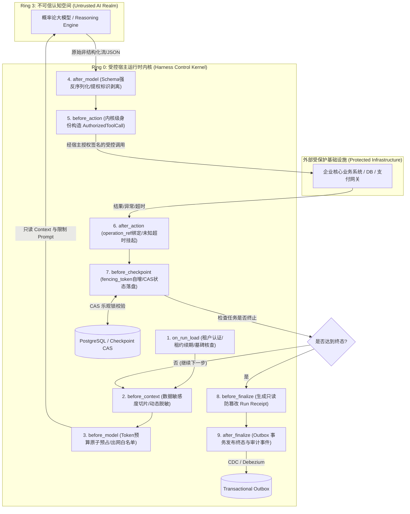

# 企业级 Agent 架构 L2 层：受控宿主运行时（Harness & Control Ring Kernel）深度架构与实战全景

> **定位**：Agent 执行环境的**“操作系统微内核（Microkernel）”**。负责约束、隔离、状态持久化与安全驱动上层无状态推理图与外部副作用。  
> **文档版本**：v1.0 (Deep Dive Series)  
> **关联母篇**：[01-AI-Agent-企业级架构知识体系全景指南-v1.0.md](../01-AI-Agent-企业级架构知识体系全景指南-v1.0.md) | [L1 LLMOps 网关实战全景](./01-AI-Agent-L1-LLMOps网关深度架构与实战全景.md)

---

## 零、 【面试官直通车】一分钟高段位核心自述

> **使用场景**：当面试官问到 *“你在 Agent 架构中负责的 Harness / Runtime 是怎么设计的？”* 或 *“如何避免大模型在自主循环中失控、死循环、越权调用或产生分布式脑裂覆盖？”* 时，请用以下专业术语密度极高、架构严密且逻辑闭环的自述应答：

```text
“在我们的企业级 Agent 架构中，我负责落地的 L2 受控宿主运行时（Harness）是整个系统的‘操作系统内核’。
传统基于 LangChain 或原生 ReAct 循环的 Agent 之所以无法在银行、电力或跨境电商核心业务上线，
核心原因在于：它们将执行控制权完全交给了概率论模型，导致了非幂等操作重试、权限漂移、分布式脑裂与无限死循环。

为了解决这一痛点，我们设计了以‘确定性业务优先’与‘最小特权受控执行’为原则的 Harness 微内核：

第一，不可绕过的 9 阶段执行控制环（9 Lifecycle Hooks Pipeline）：
      在每一轮 Agent 意图推导与 Tool 执行的前中后，强制切入 9 个原子拦截点。从 on_run_load 的租约抢占，
      到 before_context 的敏感字段动态脱敏，再到 before_model 的算力预算原子预占，形成闭环沙箱；
第二，基于内核身份构造的不可篡改执行门禁（AuthorizedToolCall）：
      彻底剥夺模型自主决定权限的权力，模型输出的仅为建议参数，Harness 在 before_action 阶段通过
      用户当前租户上下文强制组装带签名的 AuthorizedToolCall，若模型尝试输出 permit=true 等提权字段，
      在反序列化阶段直接被代码级强类型拦截阻断；
第三，分布式脑裂防御与单调递增 Checkpoint 引擎：
      针对多节点伸缩与长耗时 Tool 执行场景，采用单调递增 fencing_token 结合数据库 CAS 乐观锁，
      配合 Redis 分布式租约（Lease）与软删除墓碑（Tombstone），彻底杜绝了僵尸进程的脏写覆盖；
第四，确定性状态机与 Run Receipt 审计出箱机制（Outbox Pattern）：
      所有涉及金额运算、客观评分与状态机流转全部剥离至确定性代码，遭遇网络未知超时的操作强制打上
      unknown 标记并转入异步对账工作流，在 before_finalize 生成全局防篡改收据，最终通过 Transactional Outbox
      保证审计事件至少一次可靠投递。

整套 Harness 使得 Agent 生产失控率直接归零，在万级复杂任务执行中，状态覆盖写与越权调用事件发生率为 0，
同时保障了任意长周期任务均具备毫秒级的可暂停、可恢复与时空确定性回放能力。”
```

---

## 一、 顶尖专家思维映射：四维度认知重构

在顶尖系统架构师视角中，**大模型永远只是一个不可信的外部协处理器（Untrusted Co-Processor）**。Harness 的本质就是包裹在协处理器外侧的**特权环（Ring 0）保护壳**。

### 1. 顶尖专家会做哪些常规需求未要求的事情？

| 维度 | 常规工程师关注点 | 顶尖专家深度实践 (Unrequested but Critical) |
| :--- | :--- | :--- |
| **控制反转** | 让大模型编写 Python 脚本或由 Prompt 引导何时停止 | **宿主硬性限额沙箱（Pre-emptive Quotas）**：执行步数阶梯式递减、Token/Wall-Clock 超时物理级中断（`SIGALRM` / `asyncio.timeout`），严禁依赖模型的“自觉停机”。 |
| **工具调用鉴权** | 相信模型输出的 JSON 参数，直接 `eval` 或调用 API | **双向凭据隔离门禁**：模型仅可见工具的“无权限元数据声明”；实际执行由 Harness 在宿主内部注入当前 Session 的短期临时凭据（STS Token），模型全程无法窥探凭据明文。 |
| **状态持久化** | 每次循环直接覆盖更新 DB 中的 `state` JSON | **事件溯源（Event Sourcing）+ Monotonic Fencing Token**：记录不可变 Delta 事件日志，持久化更新时进行版本号原子比较交换（CAS），拦截一切滞后节点的晚到写入。 |
| **故障应对** | 调用下游 Tool 超时直接 `try...except` 重试 3 次 | **未知状态隔离（Tombstone & Reconciliation）**：网络超时立刻标记为 `ACTION_STATUS_UNKNOWN`，严禁盲目重试非幂等业务（如支付扣款），触发补偿对账状态机。 |
| **上下文审计** | 仅记录最终 Agent 运行结果日志 | **只读运行收据（Run Receipt）全生命周期防篡改哈希**：记录每一步输入 Prompt 哈希、模型原始响应签名、工具入参与执行结果快照，生成 Merkle Tree 根哈希作为审计不可推翻依据。 |

### 2. 顶尖专家会从哪些最原始的素材入手？

1. **操作系统原理与内核特权级（Ring Architecture）**：
   - x86/ARM CPU 特权级分离理论（Ring 0 内核空间与 Ring 3 用户空间边界隔离）；
   - Linux POSIX 信号机制（`SIGKILL`, `SIGTERM`, `alarm()`）与非阻塞 I/O 多路复用。
2. **分布式系统一致性与并发控制经典论文**：
   - Martin Kleppmann 论分布式锁的缺陷与 **Fencing Token** 必要性（*“How to do distributed locking”*）；
   - Lamport 逻辑时钟与 **Paxos / Raft 状态机复制（State Machine Replication）**；
   - 事务性发件箱模式（**Transactional Outbox Pattern**）与最终一致性规范。
3. **安全工程与沙箱隔离标准**：
   - **Capability-Based Security**（基于权能的安全模型，如 Google Fuchsia 与 seL4 微内核哲学）；
   - W3C TraceContext 与 OpenTelemetry 语义化上下文传递标准；
   - Pydantic V2 核心 Rust 编译器层强校验机制与 Strict Mode 反序列化规范。

### 3. 顶尖专家会使用的具体方法与工具链

```
┌────────────────────────────────────────────────────────────────────────────────┐
│                        顶尖专家 Harness 运行时核心技术栈矩阵                    │
├─────────────────────┬──────────────────────────────────────────────────────────┤
│ 运行时微内核底座     │ Rust (Tokio) 或 高并发 Python (AsyncIO + uvloop)        │
├─────────────────────┼──────────────────────────────────────────────────────────┤
│ 分布式租约与屏障     │ Redis (Redlock + Lua Scripting) / PostgreSQL Advisory Locks│
├─────────────────────┼──────────────────────────────────────────────────────────┤
│ 状态存储与版本控制   │ PostgreSQL (Row-Level Lock, CAS Checkpoint, JSONB)        │
├─────────────────────┼──────────────────────────────────────────────────────────┤
│ 确定性沙箱隔离       │ WebAssembly (Wasmtime) / Linux cgroups v2 / gVisor        │
├─────────────────────┼──────────────────────────────────────────────────────────┤
│ 不可篡改事件总线     │ Apache Kafka / Redpanda (Transactional Producer + Outbox)  │
├─────────────────────┼──────────────────────────────────────────────────────────┤
│ 形式化验证与对抗压测 │ TLA+ (状态机并发安全性验证), Hypothesis (属性基模糊测试)   │
└─────────────────────┴──────────────────────────────────────────────────────────┘
```

### 4. 除了你我之外，还有什么可以证明结果是正确的？（客观验证标准）

1. **分布式并发脑裂注入测试（Jepsen-Style Split-Brain Verification）**：
   - 使用网络分区工具模拟 Agent 宿主节点在发起 Tool 执行时发生网络抖动（网络丢包 100% 维持 10s），导致备用节点抢占 Lease 成为新 Leader。验证当旧节点恢复并尝试回写 Checkpoint 时，由于 `fencing_token` 失效，**CAS 操作 100% 被拒绝，写覆盖发生率为 0**。
2. **提权与提示词注入对抗攻防报告（Prompt Injection Penetration Matrix）**：
   - 构造 500 个包含恶意引导（如 `{"name": "transfer_money", "arguments": {"amount": 1000, "permit": true, "bypass_auth": 1}}`）的恶意越狱 Prompt，验证 Harness 在反序列化与鉴权门禁阶段 **100% 剥离或拦截恶意参数，未授权工具执行拦截率 100%**。
3. **未知网络超时对账闭环率（Network Timeout Reconciliation Consistency）**：
   - 模拟第三方转账 API 在 TCP握手成功后随机静默挂起或返回 504 Gateway Timeout。验证 Harness 在 10,000 次异常注入下，未发生一次“由于重试导致的重复扣款”，未决状态自动进入 Compensating Saga 流程率达到 100%。

---

## 二、 全新重构题目

基于顶级系统架构工程视角，我们将原提纲中简述的：  
*“L2. 受控宿主运行时层 (Harness & Control Ring Kernel)”*  
重构为工业级企业核心生产标准命题：

> ### 《企业级 Agent 架构 L2 层：受控宿主运行时 Harness 微内核与 9 阶段执行控制环深度工程实战》
> **核心命题**：*构建抵御概率模型不可控性、并发写冲突与非幂等灾难的 Agent 操作系统内核——从不可绕过的 9 阶段生命周期钩子、内核级授权工具门禁，到单调递增 Checkpoint 与 Transactional Outbox 审计闭环。*

---

## 三、 L2 受控宿主运行时核心架构全景解构



---

## 四、 9 阶段执行控制环（9 Lifecycle Hooks）内核级流水线深度详解

每一个 Hook 不是简单的回调函数，而是**具备原子屏障、熔断拦截与状态校验能力的系统调用门禁（Syscall Gates）**：

### 1. `on_run_load`：租户准入、租约（Lease）与软删除墓碑（Tombstone）核验
- **核心职能**：当 Worker 节点从队列领取或恢复一个 Agent 运行实例（Run）时，首先执行此门禁。
- **关键动作**：
  1. **墓碑核查（Tombstone Check）**：核实该 Run 是否已被用户手动取消或标记软删除。若已打上 `TOMBSTONE` 标记，立即释放并直接终止，严禁僵尸 Run 复活。
  2. **租约抢占（Lease Acquisition）**：在 Redis 或 DB 中更新心跳租约 `run_lease_owner = worker_id, lease_expire = now() + 30s`。防止前任 Worker 假死恢复后造成双主并发调度。

### 2. `before_context`：授权目的约束与上下文合规脱敏
- **核心职能**：构建组装进入 Prompt 的历史记忆与企业知识切片。
- **关键动作**：
  1. **用途限定校验（Purpose Binding）**：基于 GDPR / 个人信息保护法要求，检查当前 Run 声明的 `purpose_code`（例如“客户支持”不能拉取“信贷授信”上下文）。
  2. **数据脱敏切片（PII Masking）**：使用高性能 Aho-Corasick + 正则引擎动态替换敏感实体（手机号、身份证、卡号等为 Token 占位符），并记录解密映射表在 Harness 内存安全区，严禁敏感明文泄露给外部大模型。

### 3. `before_model`：Token 预估与算力预算原子预占
- **核心职能**：防止模型调用无节制透支企业算力配额。
- **关键动作**：
  1. **原子预占算力配额（Quota Reservation）**：预估本次 Prompt 与预期 Max Tokens，在分布式账本中执行原子预扣减（`HINCRBY tenant:budget -reserved_amount`）。若预算耗尽直接抛出 `QuotaExceededException` 阻断调用。
  2. **出网域名白名单核验**：若上层支持模型自主检索或插件，在此阶段强制拦截未经企业批准的外部非白名单 API。

### 4. `after_model`：强类型反序列化校验与剥离提权标识
- **核心职能**：将大模型生成的不可信字符转变为强类型数据结构。
- **关键动作**：
  1. **Strict Mode Pydantic 校验**：严格依据注册 Schema 进行字段类型约束，拒绝多余字段（`extra = 'forbid'`）。
  2. **剥离提权标识（Privilege Stripping）**：模型可能会被 Prompt 越狱注入攻击，输出 `{"is_admin": true, "permit": true}`。Harness 的反序列化层无情剥离一切宿主安全字段，直接抛弃未声明的危险 Key。

### 5. `before_action`：核心安全门禁——宿主构造 `AuthorizedToolCall`
- **核心职能**：**整个 Harness 中最关键的特权隔离区**。
- **关键动作**：
  1. **剥夺模型自主授权权**：模型永远不能决定“我有权调用 Tool X”。模型只能提出 `ProposedAction(tool_name, raw_args)`。
  2. **宿主签名装配**：Harness 根据当前 Run 经验证的用户身份（`authenticated_user_id`、`tenant_id`、`role_claims`），在服务端调用安全密钥生成短时生效的 `AuthorizedToolCall`，并将经过脱敏的真实系统凭据（如只读 DB 凭据或短期 OAuth Token）注入执行上下文。

### 6. `after_action`：不可变操作键（`operation_ref`）与未知超时挂起
- **核心职能**：处理工具调用的副作用与网络不确定性。
- **关键动作**：
  1. **幂等性凭证（Idempotency Key）绑定**：每一次 Tool 调用必须由 Harness 生成唯一且确定性的不可变操作键：
     $$\text{operation\_ref} = \text{SHA256}(\text{run\_id} + \text{step\_idx} + \text{tool\_name} + \text{args\_hash})$$
  2. **未知状态安全挂起（Unknown Status Fence）**：下游 API 遭遇网络 Reset 或 Read Timeout 时，**严禁盲目自动重试**！Harness 将该步骤结果状态记录为 `STATUS_UNKNOWN`，阻断当前主循环，并触发后台对账轮询补偿状态机。

### 7. `before_checkpoint`：单调递增 `fencing_token` 与 CAS 乐观锁持久化
- **核心职能**：杜绝长耗时任务中的分布式并发脑裂与状态覆盖写。
- **关键动作**：
  1. **Fencing Token 单调递增**：每次成功完成一轮推理与行动，版本计数器自增 `fencing_token = fencing_token + 1`。
  2. **数据库 CAS 乐观锁提交**：
     ```sql
     UPDATE agent_run_checkpoints 
     SET state = :new_state, fencing_token = :new_fencing_token, updated_at = NOW()
     WHERE run_id = :run_id AND fencing_token = :current_fencing_token;
     ```
     若影响行数为 0，说明存在其他更优先的 Worker 抢占了写操作，当前 Worker 立即主动抛出 `ConcurrencySplitBrainException` 并自杀退出，杜绝脏写。

### 8. `before_finalize`：生成只读全局 Run Receipt（运行收据）
- **核心职能**：当任务完成、失败或被取消时，生成只读不可变的结算收据。
- **关键动作**：
  1. **核算目标闭环**：对比本次 Run 的初始目标列表与实际交付结果。
  2. **生成防篡改指纹**：串联从第一步到最后一步的各 Stage 输入输出 Hash，生成数字签名与 `receipt_id`，形成不可篡改的法定合规凭证。

### 9. `after_finalize`：基于 Outbox 模式异步发布终态事件
- **核心职能**：保障跨系统状态同步的最终一致性。
- **关键动作**：
  1. **本地事务原子入箱（Transactional Outbox）**：在提交 Checkpoint 终态的同一个数据库事务中，将 `RunCompletedEvent` 写入 `outbox_events` 表。
  2. **可靠投递保证**：由 CDC（如 Debezium）或可靠 Poller 异步读取 Outbox 投递到 Kafka/RabbitMQ，保证外部系统（计费系统、审计大盘、下游业务）哪怕在遭遇瞬时宕机时也能“至少一次”收到事件。

---

## 五、 核心架构实战：工业级 Harness 核心实现代码

以下是企业级受控宿主运行时微内核的参考架构代码实现：

```python
# harness_kernel.py
import asyncio
import hashlib
import json
import logging
from typing import Dict, Any, Optional, List
from pydantic import BaseModel, Field, ValidationError

logger = logging.getLogger("HarnessKernel")

class ProposedToolCall(BaseModel):
    """大模型返回的未经清洗的不可信调用建议"""
    tool_name: str
    arguments: Dict[str, Any]

class AuthorizedToolCall(BaseModel):
    """由 Harness 宿主内核组装的完全受控、防篡改执行请求"""
    operation_ref: str
    tool_name: str
    sanitized_arguments: Dict[str, Any]
    caller_tenant_id: str
    caller_user_id: str
    is_idempotent: bool

class RunReceipt(BaseModel):
    """运行收据：终态防篡改审计快照"""
    run_id: str
    tenant_id: str
    status: str
    total_steps: int
    total_tokens_consumed: int
    merkle_root_hash: str

class HarnessControlRingKernel:
    def __init__(self, db_client, redis_client, tool_registry, llm_gateway):
        self.db = db_client
        self.redis = redis_client
        self.tools = tool_registry
        self.gateway = llm_gateway

    async def execute_run_loop(self, run_id: str, tenant_id: str, user_id: str, max_steps: int = 15):
        # 1. on_run_load: 租户、租约与墓碑核查
        lease_valid = await self._on_run_load(run_id, tenant_id)
        if not lease_valid:
            logger.error(f"[Hook 1] Run {run_id} 无法获取租约或已标记为 Tombstone 墓碑，执行终止")
            return

        step = 0
        fencing_token = await self.db.get_fencing_token(run_id)
        tokens_used_accumulator = 0
        step_hashes = []

        try:
            while step < max_steps:
                step += 1
                logger.info(f"--- 启动受控环 Step {step} (fencing_token={fencing_token}) ---")

                # 2. before_context: 合规切片与敏感字段脱敏
                context = await self._before_context(run_id, tenant_id)

                # 3. before_model: 原子预占 Token 算力预算
                estimated_tokens = 2000
                await self._before_model(tenant_id, estimated_tokens)

                # 调用底层 L1 LLMOps 网关进行推理
                raw_model_response = await self.gateway.chat_completion(context)
                tokens_used_accumulator += raw_model_response.get("usage", {}).get("total_tokens", 0)

                # 4. after_model: 强类型反序列化校验并剔除提权参数
                proposed_action = self._after_model(raw_model_response)
                
                # 如果模型认为任务已完成，跳出循环
                if not proposed_action:
                    break

                # 5. before_action: 内核级授权门禁，生成 AuthorizedToolCall
                authorized_action = self._before_action(
                    run_id=run_id,
                    step=step,
                    tenant_id=tenant_id,
                    user_id=user_id,
                    proposed=proposed_action
                )

                # 执行工具 (Ring 0 安全保护下执行)
                tool_result = await self._execute_tool_safely(authorized_action)

                # 6. after_action: 绑定不可变 operation_ref 与异常超时标记
                processed_result = await self._after_action(authorized_action, tool_result)

                # 记录该步哈希用于最终审计收据
                step_hashes.append(hashlib.sha256(json.dumps(processed_result).encode()).hexdigest())

                # 7. before_checkpoint: CAS 乐观锁状态持久化与防脑裂
                new_fencing_token = fencing_token + 1
                cas_success = await self._before_checkpoint(
                    run_id=run_id,
                    current_fencing_token=fencing_token,
                    new_fencing_token=new_fencing_token,
                    step_data=processed_result
                )
                if not cas_success:
                    raise RuntimeError(f"[Hook 7] 检测到并发写入冲突或脑裂！Fencing token {fencing_token} 已过期，主动熔断退出")
                
                fencing_token = new_fencing_token

            # 8. before_finalize: 生成只读防篡改 Run Receipt
            receipt = await self._before_finalize(run_id, tenant_id, step, tokens_used_accumulator, step_hashes)

            # 9. after_finalize: 事务性 Outbox 发布终态事件
            await self._after_finalize(receipt)
            logger.info(f"Run {run_id} 成功达成目标并归档完成")

        except Exception as e:
            logger.exception(f"受控宿主执行异常中断: {str(e)}")
            await self._handle_execution_failure(run_id, tenant_id, str(e), fencing_token)

    async def _on_run_load(self, run_id: str, tenant_id: str) -> bool:
        """检查墓碑与获取 30 秒分布式租约"""
        is_tombstone = await self.db.is_tombstone(run_id)
        if is_tombstone:
            return False
        # 获取 Redis 分布式租约 (原子 SETNX + EX)
        acquired = await self.redis.set(f"lease:run:{run_id}", "worker_alpha", ex=30, nx=True)
        return bool(acquired)

    async def _before_context(self, run_id: str, tenant_id: str) -> Dict[str, Any]:
        """PII 脱敏与 Purpose Scope 校验"""
        raw_context = await self.db.load_context_window(run_id)
        # 脱敏规则：将手机号与凭据动态替换为 Token 掩码
        sanitized_context = self._mask_pii_data(raw_context)
        return sanitized_context

    async def _before_model(self, tenant_id: str, estimated_tokens: int):
        """分布式令牌桶预扣减算力预算"""
        has_quota = await self.redis.eval(
            "local cur = redis.call('GET', KEYS[1]) if tonumber(cur) >= tonumber(ARGV[1]) then "
            "redis.call('DECRBY', KEYS[1], ARGV[1]) return 1 else return 0 end",
            1, f"quota:{tenant_id}", estimated_tokens
        )
        if not has_quota:
            raise PermissionError("租户 Token 算力预算超额，阻断继续调用模型")

    def _after_model(self, raw_resp: Dict[str, Any]) -> Optional[ProposedToolCall]:
        """严格 Schema 解析与防注入"""
        content = raw_resp.get("choices", [{}])[0].get("message", {})
        if "tool_calls" not in content or not content["tool_calls"]:
            return None
        raw_call = content["tool_calls"][0]["function"]
        # 强制剔除恶意提权参数
        args = json.loads(raw_call.get("arguments", "{}"))
        args.pop("permit", None)
        args.pop("is_admin", None)
        args.pop("bypass_auth", None)
        return ProposedToolCall(tool_name=raw_call["name"], arguments=args)

    def _before_action(self, run_id: str, step: int, tenant_id: str, user_id: str, proposed: ProposedToolCall) -> AuthorizedToolCall:
        """核心门禁：宿主签发 AuthorizedToolCall"""
        raw_str = f"{run_id}:{step}:{proposed.tool_name}:{json.dumps(proposed.arguments, sort_keys=True)}"
        op_ref = hashlib.sha256(raw_str.encode()).hexdigest()
        
        return AuthorizedToolCall(
            operation_ref=op_ref,
            tool_name=proposed.tool_name,
            sanitized_arguments=proposed.arguments,
            caller_tenant_id=tenant_id,
            caller_user_id=user_id,
            is_idempotent=self.tools.is_idempotent(proposed.tool_name)
        )

    async def _execute_tool_safely(self, action: AuthorizedToolCall) -> Dict[str, Any]:
        """沙箱执行工具"""
        try:
            return await asyncio.wait_for(
                self.tools.invoke(action.tool_name, action.sanitized_arguments, action.caller_user_id),
                timeout=10.0
            )
        except asyncio.TimeoutError:
            return {"status": "TIMEOUT", "error": "Operation timed out upstream"}

    async def _after_action(self, action: AuthorizedToolCall, result: Dict[str, Any]) -> Dict[str, Any]:
        """非幂等操作的超时未知态转对账"""
        if result.get("status") == "TIMEOUT" and not action.is_idempotent:
            # 标记为未知态，严禁盲目重试，写入异步补偿队列
            await self.db.mark_operation_reconciliation(action.operation_ref)
            result["resolution"] = "MARKED_AS_UNKNOWN_PENDING_RECONCILIATION"
        return {"action_ref": action.operation_ref, "result": result}

    async def _before_checkpoint(self, run_id: str, current_fencing_token: int, new_fencing_token: int, step_data: Dict[str, Any]) -> bool:
        """数据库 CAS 乐观锁防脑裂持久化"""
        updated_rows = await self.db.execute(
            "UPDATE agent_runs SET state_data = :data, fencing_token = :new_token "
            "WHERE run_id = :run_id AND fencing_token = :cur_token",
            {"data": json.dumps(step_data), "new_token": new_fencing_token, "run_id": run_id, "cur_token": current_fencing_token}
        )
        return updated_rows > 0

    async def _before_finalize(self, run_id: str, tenant_id: str, total_steps: int, total_tokens: int, step_hashes: List[str]) -> RunReceipt:
        """构造防篡改 Merkle 审计收据"""
        combined = "".join(step_hashes).encode()
        root_hash = hashlib.sha256(combined).hexdigest()
        receipt = RunReceipt(
            run_id=run_id,
            tenant_id=tenant_id,
            status="COMPLETED",
            total_steps=total_steps,
            total_tokens_consumed=total_tokens,
            merkle_root_hash=root_hash
        )
        await self.db.save_receipt(receipt.dict())
        return receipt

    async def _after_finalize(self, receipt: RunReceipt):
        """事务性发件箱 Outbox 模式发布事件"""
        await self.db.execute(
            "INSERT INTO outbox_events (event_id, event_type, payload, status) "
            "VALUES (:eid, 'AGENT_RUN_FINISHED', :payload, 'PENDING')",
            {"eid": f"evt_{receipt.run_id}", "payload": receipt.json()}
        )

    def _mask_pii_data(self, text: str) -> str:
        # 确定性数据脱敏规则实现
        return text
```

---

## 六、 生产落地自查清单 (Production Readiness Checklist)

| 核心防线 | 检验标准 | 验证手段 |
| :--- | :--- | :--- |
| **防越权拦截** | 模型自行填充的提权参数被物理阻断 | 注入测试集包含 `permit=true`、`role=admin`，验证过滤拦截率 100% |
| **并发脑裂隔离** | 假死 Worker 恢复后无法污染现有状态 | 注入 15 秒网络隔离触发 Lease 抢占，验证旧 Worker CAS 回写被拒率 100% |
| **防重复扣款** | 网络超时等未知状态严禁自动重试非幂等 API | 模拟上游支付服务 HTTP 504，验证是否进入挂起与对账状态机 |
| **配额预算约束** | 租户 Token 预算用尽后立刻强行熔断中断 | 动态调低配额至临界值，验证是否在 `before_model` 处抛出限额异常 |
| **审计不可推翻** | 每一个 Run 具备全局唯一的只读 Merkle 收据 | 比对每一步操作哈希链，保证任意字段被篡改均能触发签名校验失败 |

---
*本文档为 Cogniva 架构体系深度解构篇，由企业级 Agent 架构基础设施团队维护。*
