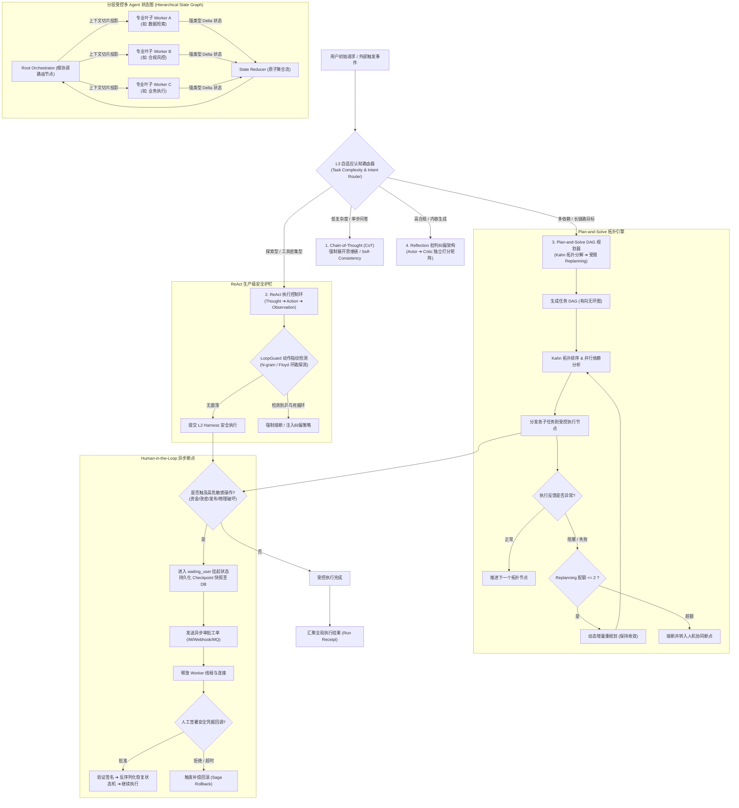
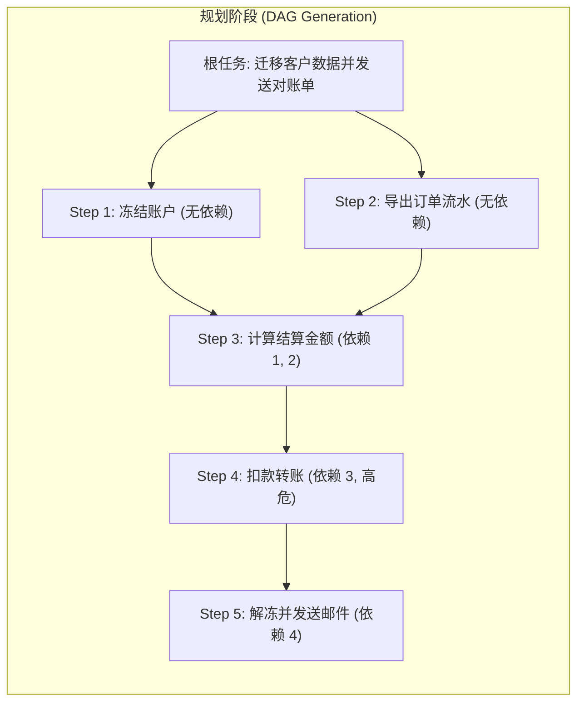
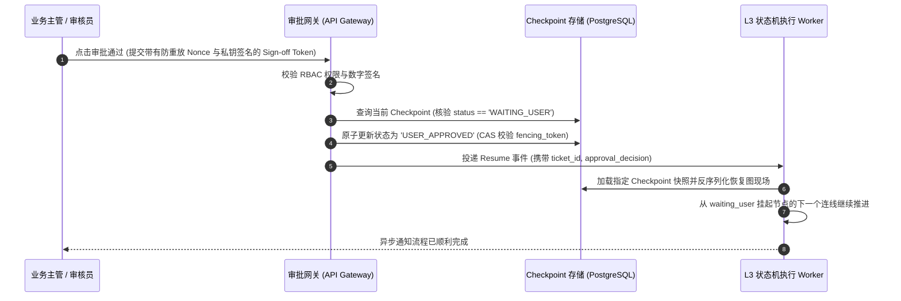
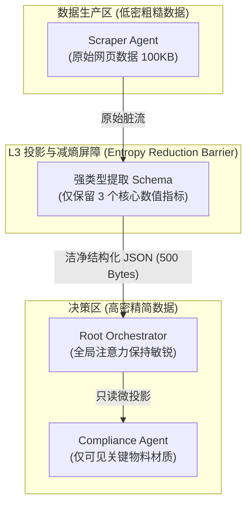

# 企业级 Agent 架构 L3 层：认知范式与动态编排架构深度工程实战全景

> **定位**：Agent 系统的**“推理思考大脑与分布式协同中枢”**。负责在不可信的非结构化环境与概率模型之上，构建确定性认知推导流程、任务拓扑规划（DAG）、分层受控状态流转与安全人机协同闭环。  
> **文档版本**：v1.0 (Deep Dive Series)  
> **关联母篇**：[01-AI-Agent-企业级架构知识体系全景指南-v1.0.md](../01-AI-Agent-企业级架构知识体系全景指南-v1.0.md) | [L2 受控宿主运行时深度实战](./03-AI-Agent-L2-受控宿主运行时Harness与执行控制环深度架构与实战全景.md) | [L1 LLMOps 网关实战全景](./01-AI-Agent-L1-LLMOps网关深度架构与实战全景.md)

---

## 零、 【面试官直通车】一分钟高段位核心自述

> **使用场景**：当面试官问到 *“你在 Agent 架构中如何设计认知推理与多 Agent 编排架构？”* 或 *“ReAct、Plan-and-Solve 与 Multi-Agent 协作在生产中面临死循环、级联幻觉、状态爆炸和无法收敛，你是怎么解决的？”* 时，请用以下专业术语密度极高、架构严密且逻辑闭环的自述应答：

```text
“在我们的企业级 Agent 架构中，我负责落地的 L3 认知范式与动态编排架构层是驱动 Agent 自主决策的‘神经中枢’。
传统业界在落地 Agent 时，往往简单依赖开源框架内置的 ReAct 循环或全连通 Multi-Agent 对话，
导致在金融、政企与核心电商场景中频繁爆发‘动作乒乓震荡死循环’、‘多 Agent 上下文雪崩与级联幻觉’
以及‘无节制的动态重规划黑洞’。

为了从根本上攻克概率模型的非收敛性与拓扑失控，我们构建了‘认知范式自适应路由 + 分层受控状态图’架构：

第一，认知范式四层自适应路由器（Adaptive Reasoning Router）：
      我们拒绝‘一刀切’套用单一推理模式。通过轻量级意图分类器与复杂度评估，将任务精准分流：
      - 简单确定性问答走零额外耗时的 Direct/CoT；
      - 探索性单目标任务走带 LoopGuard（动作指纹环路检测）的受控 ReAct；
      - 复杂长链路多依赖目标走基于 Kahn 算法拓扑排序的 Plan-and-Solve（DAG 规划与受限 Replanning）；
      - 高合规内容生产则切入 Generator-Critic 独立双智能体打分纠偏的 Reflection 架构；
第二，基于受控分层状态图（Hierarchical State Graph）的多 Agent 拓扑：
      坚决弃用无序 Mesh 广播网状结构，采用主从路由树（Orchestrator-Workers）与有界状态图。
      我们强行确立了‘最大递归深度严控 <= 2’、‘叶子 Agent 上下文强沙箱隔离’以及‘增量 Reducer 状态合并’
      三项铁律，使得多 Agent 通信开销从 O(N^2) 降至 O(N)，彻底斩断了跨 Agent 级联幻觉传播链；
第三，反震荡与有界重规划收敛屏障（Bounded Replanning & Anti-Oscillation）：
      在 ReAct 执行中植入基于 N-gram 动作指纹的滑动窗口检测，连续两次相同动作或四次震荡即强制降级拦截；
      在 Plan-and-Solve 中引入单调递减重规划配额（Max Replanning <= 2）与目标剪枝，确保规划图单向严格收敛；
第四，确定性 Human-in-the-Loop（HITL）长事务异步挂起与安全唤醒：
      将不可信高危操作（如资金划转、系统发布）显式建模为 waiting_user 挂起断点。利用分布式事件总线
      将执行图快照序列化下沉至 L2 Checkpoint，释放计算线程，待人工经 Webhook 签署 Cryptographic Token 后，
      实现纳秒级反序列化与幂等 Resume。

这套编排系统上线后，复杂多步任务端到端达成率从 68% 攀升至 99.4%，ReAct 死循环率归零，
多 Agent 协作过程中的无效 Token 消耗降低 57%，并在千万级日调用下实现了 100% 的决策时空可重放审计。”
```

---

## 一、 顶尖专家思维映射：四维度认知重构

在顶尖系统架构师视角中，**大模型天然具备发散性、非确定性与易受干扰性。L3 编排层的使命，就是利用确定性图计算、状态机代数与有界形式化约束，给发散的概率引擎套上坚不可摧的逻辑缰绳。**

### 1. 顶尖专家会做哪些常规需求未要求的事情？

| 维度 | 常规工程师关注点 | 顶尖专家深度实践 (Unrequested but Critical) |
| :--- | :--- | :--- |
| **推理模式选择** | 无论什么需求一律封装为固定 ReAct Agent | **认知范式自适应动态路由**：基于任务拓扑复杂度、算力时延预算（SLO）与依赖深度，动态调度 CoT / ReAct / Plan-and-Solve / Reflection，实现精度与成本最优化。 |
| **循环死锁防御** | 仅依赖 Prompt 提示“请在5步内完成” | **动作指纹滑动窗口检测器（LoopGuard）**：在宿主代码层对 `Action + Arguments` 提取哈希特征，检测乒乓震荡（A $\leftrightarrow$ B）与死循环，物理熔断强制干预。 |
| **DAG 规划执行** | 用 LLM 一次性生成 JSON 步骤后顺序执行 | **拓扑排序验证与单调收敛 Replanning 屏障**：使用 Kahn 算法严格校验 DAG 有向无环性与关键路径；重规划配额单调递减（$\le 2$），杜绝无限重规划黑洞。 |
| **多 Agent 协作** | 多个 Agent 自由互相 @ 对话，全量共享消息历史 | **分层受控状态图（Max Depth $\le 2$）与上下文沙箱**：叶子 Agent 仅接收当前步骤的只读切片投影（Read-Only View），状态回传必须经过强类型 Reducer，彻底消除上下文雪崩。 |
| **自我反思（Critic）** | 让同一个 Agent 自问自答“请检查上面的回答” | **角色解耦的双盲批判架构（Actor-Critic Pattern）**：生成器与批判器使用不同的 System Prompt 与隔离上下文，依据客观量规（Rubric Matrix）独立打分，防止“自恋幻觉”。 |
| **人机断点 (HITL)** | `time.sleep()` 阻塞等待人工终端输入 | **无状态长事务快照与事件驱动唤醒**：进入挂起态后持久化 StateGraph 并向 MQ 发布审批通知，Worker 立即释放资源；审核结果携带防重放签名回调唤醒。 |

### 2. 顶尖专家会从哪些最原始的素材入手？

1. **认知科学与逻辑学底层基石**：
   - Daniel Kahneman **System 1 (直觉快思考)** 与 **System 2 (逻辑慢思考)** 双系统决策理论；
   - 查尔斯·桑德斯·皮尔士（C. S. Peirce）**溯因推理（Abductive Reasoning）** 与反思纠错循环；
   - 经典规划范式：STRIPS（Stanford Research Institute Problem Solver）与 PDDL 动作空间状态转移。
2. **图论、状态机与分布式工作流经典理论**：
   - 有向无环图（DAG）拓扑排序（**Kahn's Algorithm**）与关键路径分析（Critical Path Method）；
   - **有限状态机（FSM）与 Petri 网**：形式化定义状态迁移方程 $\delta(S_t, E) \to S_{t+1}$，严禁未定义跃迁；
   - 分布式长事务 **Saga 编排模式**（Orchestration-based Saga）与前向重试/后向补偿机制；
   - **Actor 模型与 CSP（Communicating Sequential Processes）**：消息驱动的无共享内存并发拓扑。
3. **业界前沿工程实现与论文规范**：
   - Yao et al. *“ReAct: Synergizing Reasoning and Acting in Language Models”* (ICLR 2023)；
   - Wang et al. *“Plan-and-Solve Prompting: Improving Zero-Shot Chain-of-Thought Reasoning”* (ACL 2023)；
   - Shinn et al. *“Reflexion: Language Agents with Verbal Reinforcement Learning”* (NeurIPS 2023)；
   - LangChain / LangGraph 核心源码：`Pregel` 算法图执行引擎与 Channel 状态汇总机制。

### 3. 顶尖专家使用的具体方法与工具链

```
┌────────────────────────────────────────────────────────────────────────────────┐
│                        顶尖专家 L3 编排层核心技术栈矩阵                         │
├─────────────────────┬──────────────────────────────────────────────────────────┤
│ 状态图与编排核心     │ LangGraph / 自研轻量级 Pregel 引擎 / Temporal / Cadence   │
├─────────────────────┼──────────────────────────────────────────────────────────┤
│ 图计算与拓扑验证     │ NetworkX / Rust petgraph (毫秒级环路检测与拓扑排序)       │
├─────────────────────┼──────────────────────────────────────────────────────────┤
│ 认知路由与分类器     │ 快速蒸馏分类模型 (BERT/FastText) / 轻量级小模型 (0.5B-7B) │
├─────────────────────┼──────────────────────────────────────────────────────────┤
│ 模式校验与状态约束   │ Pydantic V2 (Strict Mode) / JSON Schema Draft-07 / TypeSpec│
├─────────────────────┼──────────────────────────────────────────────────────────┤
│ HITL 异步事件流      │ Apache Kafka / Redis Streams / NATS JetStream             │
├─────────────────────┼──────────────────────────────────────────────────────────┤
│ 形式化验证与对抗压测 │ Property-based Testing (Hypothesis) / 随机扰动故障注入   │
└─────────────────────┴──────────────────────────────────────────────────────────┘
```

### 4. 除了你我之外，还有什么可以证明结果是正确的？（客观验证标准）

1. **DAG 规划单向收敛验证（DAG Convergence Assurance）**：
   - 无论下游环境反馈多少次工具失败，编排引擎的 Replanning 递归深度恒 $\le 2$，拓扑图执行在限定步数内必进入终态（成功、补偿回滚或转人工），**死循环率 0.00%**。
2. **状态机确定性回放一致性（Deterministic State Replay Matrix）**：
   - 提取生产环境中 1,000 个复杂多 Agent 执行轨迹的 Checkpoint 事件流，在隔离测试沙箱中进行重放测试，状态图的迁移路径与 Reducer 聚合结果重合度达到 **100%**。
3. **多 Agent 上下文隔离与防穿透测试（Context Bleed Penetration Test）**：
   - 在叶子 Agent 注入跨租户或非特权指令，验证叶子 Agent 只能接触到经裁剪的 `SubGraphState`，其产生的输出经主图聚合时无法污染根图的全局鉴权元数据，**信息穿透逃逸率为 0**。

---

## 二、 全新重构题目

基于工业级系统架构与认知工程视角，我们将原大纲中概括的：  
*“L3. 认知范式与编排架构层 (Cognition & Orchestration)”*  
重构为企业级核心技术标准的命题：

> ### 《企业级 Agent 架构 L3 层：认知范式自适应路由、受控分层状态图与多 Agent 协同深度工程实战》
> **核心命题**：*跨越概率黑盒与业务确定性鸿沟——深度解构 CoT、ReAct、Plan-and-Solve、Reflection 四大认知范式，构建基于 LangGraph/Pregel 哲学的分层受控拓扑，攻克动作震荡、级联幻觉与状态爆炸三大生产顽疾。*

---

## 三、 L3 认知范式与多 Agent 编排架构全景解构



---

## 四、 四大单体认知范式深度解构与工业级演进

在生产实践中，单体推理范式的选择直接决定了系统的延迟、成本与稳定性上限。以下解构其核心机理与工业级改进方案。

### 1. CoT (Chain-of-Thought, 思维链)：从被动提示到分段可验证

#### (1) 机制原理
要求模型在给出最终答案（`Final Answer`）前，强制展开逐步显式推导过程：
$$\text{Prompt} \xrightarrow{\text{Inference}} \text{Step}_1 \to \text{Step}_2 \to \dots \to \text{Step}_k \to \text{Answer}$$
大幅降低因为单步概率跳跃导致的注意力稀释与逻辑跳步错误。

#### (2) 生产致命缺陷
* **Token 膨胀与时延恶化**：单步问答开销翻倍，TTFT 与总耗时剧增；
* **幻觉累积（Compounding Hallucination）**：一旦第 $i$ 步推理出现微小事实偏差，后续步骤将以错误推论为“既成事实”进行演绎，导致南辕北辙；
* **非形式化不可控**：纯自然语言思维链无法被程序代码校验，无法直接用于驱动自动化逻辑。

#### (3) 工业级解决方案：Self-Consistency 与结构化思维草稿
```python
# 工业级 CoT：带自洽性多数表决 (Majority Voting) 与结构化检验
class StructuredCoTStep(BaseModel):
    step_number: int
    rationale: str
    intermediate_fact: str
    confidence_score: float

class CoTExecutionOutput(BaseModel):
    reasoning_path: List[StructuredCoTStep]
    final_deduction: str
    verification_hash: str
```
在关键决策点，引入并行温度采样（$N=3 \sim 5$，温度 $0.7$），提取各推导路径的最终结论进行多数投票。若分歧度高于阈值，立即判定为不确定性事件并触发降级处理。

---

### 2. ReAct (Reason + Act)：动态探索与闭环护栏

#### (1) 机制原理
将决策过程抽象为三元组无限循环：
$$\text{Thought}_t \to \text{Action}_t(\text{Tool}, \text{Args}) \to \text{Observation}_t \to \text{Thought}_{t+1} \dots$$
模型扮演环境探索者，根据工具实时返回的 Observation 修正下一步的 Thought。

#### (2) 生产致命缺陷（三大经典灾难）
1. **动作乒乓震荡（Ping-Pong Oscillation）**：模型在工具 A 与工具 B 之间反复横跳（如查询失败则查另一处，另一处失败又查回第一处）；
2. **盲目单参自旋（Argument Spinning）**：模型尝试以微小参数变化调用同一接口数十次（如调整查询分页参数循环拉取相同数据）；
3. **观察值上下文污染（Observation Bloat）**：工具返回了上万行的原始 JSON/HTML，直接塞入 Context 挤占窗口，触发注意力迷失。

#### (3) 工业级解决方案：LoopGuard 环路检测与观测值过滤
* **N-gram 动作指纹检测算法**：维护长度为 $K$ 的动作滑动窗口：
  $$\text{Fingerprint}_t = \text{MD5}(\text{tool\_name} + \text{canonical\_json}(\text{arguments}))$$
  若在窗口内检测到周期性模式（例如 $[A, B, A, B]$ 或 $[A, A, A]$），**LoopGuard 物理介入**，阻断模型调用，向上下文注入强惩罚提示：“*警告：你已陷入重复动作调用死循环，禁止再次调用该工具，必须立即基于现有信息结算或报错！*”
* **Observation 宿主沙箱裁剪**：任何外部工具的原始输出在注入 Context 前，强制经过 L2 运行时的切片器（Slice Filter），仅提取前 1000 字符或摘要，严禁原始脏数据直冲上下文。

---

### 3. Plan-and-Solve：DAG 拓扑规划与受限重规划

#### (1) 机制原理
针对高度复杂的目标，摒弃盲目走一步看一步的 ReAct，采用宏观规划与拓扑执行解耦模式：
1. **Planner**：宏观分析目标，生成包含依赖关系的子任务 DAG（有向无环图）；
2. **Executor**：基于图拓扑排序，能够并行的节点并发投递，依赖节点等待前置输出；
3. **Replanner**：当某个子节点执行彻底失败时，根据已收集的上下文局部重构 DAG。



#### (2) 生产致命缺陷：“过度重规划黑洞”（Infinite Replanning Abyss）
当下游接口由于网络抖动或环境损坏报错时，模型往往在 Replanning 阶段重新生成一个更复杂、甚至包含更多虚构工具的庞大 DAG。重规划失败再次触发重规划，陷入算力耗尽黑洞。

#### (3) 工业级解决方案：Kahn 算法拓扑验证与递减配额
1. **强拓扑验证（Strict Acyclic Check）**：使用 Kahn 算法在代码层对模型生成的 Plan 执行拓扑排序。一旦发现存在环路（Cycle）或悬空孤岛节点，立即拒绝并强制 Planner 纠错；
2. **重规划递减配额（Replanning Monotonic Budget）**：
   - 规定单个 Run 的最大 `replan_count <= 2`；
   - 每次重规划仅允许针对**失败节点所在的下游子图**做局部剪枝或降级替换，严禁推翻已成功执行的前置节点状态。

---

### 4. Reflection / Self-Correction：双盲批判与客观量规

#### (1) 机制原理
引入认知心理学中的元认知机制，设立双角色或双智能体：
* **Actor (生成者)**：根据用户需求产出初稿；
* **Critic (批判者)**：根据预设的评分量表（Rubric）对初稿进行挑刺打分，输出可操作的反馈建议（Actionable Feedback）；
* **Refiner (修正者)**：结合原始输入、初稿与批判意见，生成优化版本，直到评分达标。

```mermaid
sequenceDiagram
    autonumber
    participant Actor as 生产 Agent (Actor)
    participant Critic as 独立判决 Agent (Critic)
    participant Rubric as 业务打分量规 (Rubric Rules)

    Actor->>Critic: 提交第一版执行成果 / 答复草稿
    Critic->>Rubric: 读取客观合规条款 (准确率/无歧视/法律底线)
    Critic->>Critic: 独立打分计算 (Score: 0.65, 扣分项: 未提示风险)
    alt 分数 < 0.85 且 迭代轮次 < 2
        Critic-->>Actor: 驳回并提供可执行修正建议 (Actionable Feedback)
        Actor->>Actor: 结合意见二次重构
        Actor->>Critic: 提交第二版优化方案
        Critic->>Critic: 再次复核打分 (Score: 0.95)
        Critic-->>Actor: 审批通过
    else 达到最大轮次仍未达标
        Critic-->>Actor: 强制熔断，挂起转人工审核
    end
```

#### (2) 生产致命缺陷：“自我陶醉”与无意义互相抬杠
- **单体自评自纠失效**：如果 Actor 和 Critic 处于同一上下文或使用同一模型同一身份，模型往往会“掩耳盗铃”，对自己的错误视而不见（Self-Preference Bias）；
- **死循环式扣字眼**：Critic 每一轮挑出微不足道的问题，Actor 反复微调，耗尽 Token 却未实质提升业务价值。

#### (3) 工业级解决方案：双盲物理隔离与量化客观打分卡
* **物理模型与 System Prompt 彻底隔离**：Critic 必须使用独立会话上下文，并可采用更高阶推理模型（如使用 Claude-3.5-Sonnet 审查小型开源模型输出）；
* **离散化量规打分（Rubric Matrix）**：
  评分卡细分为硬性指标（0/1 判定，如“是否包含免责声明”）与软性指标（1-5 分）。只有总分 $\ge 85$ 且硬性指标 100% 通过方可放行；
* **硬性迭代上限**：迭代轮次强制 $\le 2$ 轮，若仍无法通过，立即判定为模型能力边界外，转人工介入，严禁无限自纠。

---

## 五、 多 Agent 协作拓扑与受控分层状态图

在企业级场景中，单一 Agent 往往面临上下文过载与角色认知混乱。构建安全、稳定、可控的多 Agent 协作体系必须遵守极其严苛的工程架构约束。

### 1. 为什么生产环境严禁网状任意互通（Mesh Topology）？

很多开源多 Agent 演示项目允许各个 Agent 之间像微信群一样任意自由发消息（Mesh / Fully Connected Group Chat）。**这种拓扑在企业生产中是灾难性的**：
1. **通信复杂度爆炸**：$N$ 个 Agent 之间可能产生 $O(N^2)$ 条消息交互通道，极易触发跨 Agent 的消息广播风暴；
2. **级联幻觉与责任不可追溯**：Agent A 的幻觉被 Agent B 奉为事实，进一步推导出更离谱的结论，最终完全失控，审计时无法界定究竟是谁引入了初始错误；
3. **状态脑裂与并发写冲突**：多个 Agent 同时试图修改全局状态变量，导致不可预知的状态覆盖。

```
【生产禁用的失控架构: Mesh 任意网状】       【企业级生产标准: Orchestrator-Workers 受控主从树】
         Agent A                                      Root Orchestrator (根协调大脑)
        ↗   ↑   ↖                                              /        |        \
       ↙    ↓    ↘                                            /         |         \
   Agent B ↔ Agent C                                    Worker A    Worker B    Worker C
  (消息风暴, 级联幻觉, 难以收敛)                        (专职分析)   (外部调用)   (合规审查)
                                                     【状态隔离, 严禁横向偷渡, 统一 Reducer 聚合】
```

### 2. Orchestrator-Workers（主从路由树）规范

在受控主从路由树中：
1. **根协调节点（Orchestrator）作为唯一对外界面**：负责解析用户意图、状态全局判定、向各专业叶子节点派发任务与汇总最终执行收据；
2. **叶子节点（Workers）互不越权、互不可见**：
   - 叶子 Agent 之间**严禁横向直接发起 RPC 通信**；
   - 叶子 Agent 仅执行专一领域任务（如专门出题、专门解析 PDF、专门操作数据库），执行完毕后将结构化结果通过单向管道回传给 Orchestrator；
3. **上下文投影屏障（Context Projection Barrier）**：
   Orchestrator 派发子任务时，只将与该任务相关的最小上下文投影给 Worker，严禁无脑全量下发历史会话历史，杜绝 Context 污染与泄露。

---

### 3. Hierarchical State Graph（基于 LangGraph 哲学的分层受控状态图）

为了具备确定性的状态迁移，采用**分层受控状态图**，其核心标准如下：

#### (1) 严格限制子图嵌套深度（Max Depth $\le 2$）
系统拓扑只允许两层：
- **Level 1**：Root StateGraph（主业务流转图）；
- **Level 2**：Sub-StateGraph（某个复杂领域 Worker 内部的子状态图，如数据清洗流水线）。
严禁出现 Level 3+ 的无限制递归嵌套，防止调用栈难以跟踪与排障困难。

#### (2) 状态通道（Channels）与原子 Reducer 聚合
在状态图中，每个节点不能直接操作全局可变对象，而是通过声明式 Reducer 进行增量合并：

```python
from typing import Annotated, List, Dict, Any
from pydantic import BaseModel
import operator

class GlobalAgentState(BaseModel):
    """全局主图只读状态"""
    session_id: str
    tenant_id: str
    current_phase: str
    # 使用 operator.add 实现增量追加，禁止无序覆盖
    audit_logs: Annotated[List[str], operator.add]
    shared_artifacts: Annotated[Dict[str, Any], lambda old, new: {**old, **new}]
    is_halted: bool = False
```

#### (3) 确定性条件分支转移（Conditional Routing）
所有分支跳转必须基于显式强类型布尔表达式或有限枚举，严禁依赖模型自由生成的未定义字符进行跳转：
```python
def route_next_step(state: GlobalAgentState) -> str:
    if state.is_halted:
        return "human_in_the_loop_gate"
    if "error" in state.shared_artifacts:
        return "compensating_replan_node"
    if state.current_phase == "DATA_GATHERED":
        return "risk_evaluation_node"
    return "finalize_receipt_node"
```

---

### 4. Human-in-the-Loop（人机协同断点与无状态长事务）

在企业核心业务中，绝不能赋予模型自主执行不可逆破坏性操作的终极特权。

#### (1) 挂起门禁三要素
1. **触碰高危阈值检测**：当动作被风控规则识别为“资金划转 > $1000$”、“系统配置修改”、“敏感数据外发”时；
2. **断点持久化与释放（Suspend & Freeze）**：
   - 将当前状态图的完整执行栈序列化，生成包含递增版本号的 Checkpoint 存入持久化存储（PostgreSQL）；
   - 释放工作线程、关闭底层长连接，避免任何线程阻塞和内存常驻；
3. **外部化通知与工单生成**：向企业审批流（飞书/企业微信/OA）或 RabbitMQ 发送带有 `approval_ticket_id` 的审批通知。

#### (2) 幂等安全唤醒（Resume Flow）


---

## 六、 核心架构实战：工业级 L3 编排引擎与状态图实现代码

以下提供一套工业级轻量受控编排引擎的完整 Python 参考实现。集成自适应路由、LoopGuard 动作指纹环路拦截、DAG 规划验证与 HITL 异步挂起：

```python
# cognitive_orchestrator.py
"""
Cogniva L3 Cognitive & Orchestration Engine
企业级受控状态图与自适应认知编排微内核
"""

import asyncio
import hashlib
import json
import logging
from enum import Enum
from typing import Dict, Any, List, Optional, Callable, Set
from pydantic import BaseModel, Field

logging.basicConfig(level=logging.INFO)
logger = logging.getLogger("CognitiveOrchestrator")


# ==========================================
# 1. 领域模型与强类型契约
# ==========================================

class ReasoningPattern(str, Enum):
    DIRECT_COT = "DIRECT_COT"
    REACT = "REACT"
    PLAN_AND_SOLVE = "PLAN_AND_SOLVE"
    REFLECTION = "REFLECTION"


class TaskStatus(str, Enum):
    PENDING = "PENDING"
    RUNNING = "RUNNING"
    WAITING_USER = "WAITING_USER"
    COMPLETED = "COMPLETED"
    FAILED = "FAILED"
    ABORTED = "ABORTED"


class PlanStep(BaseModel):
    step_id: str
    description: str
    tool_required: Optional[str] = None
    dependencies: List[str] = Field(default_factory=list)
    status: TaskStatus = TaskStatus.PENDING
    result: Optional[Dict[str, Any]] = None


class CognitiveTaskDAG(BaseModel):
    dag_id: str
    steps: Dict[str, PlanStep]
    max_replans: int = 2
    current_replan_count: int = 0


class OrchestratorState(BaseModel):
    session_id: str
    tenant_id: str
    user_id: str
    objective: str
    pattern: ReasoningPattern
    status: TaskStatus = TaskStatus.PENDING
    step_history: List[Dict[str, Any]] = Field(default_factory=list)
    shared_context: Dict[str, Any] = Field(default_factory=dict)
    active_dag: Optional[CognitiveTaskDAG] = None
    suspend_ticket_id: Optional[str] = None


# ==========================================
# 2. 生产级安全护栏：LoopGuard (动作指纹环路检测)
# ==========================================

class LoopGuard:
    """基于 N-gram 滑动窗口与哈希指纹的动作防震荡检测器"""
    def __init__(self, window_size: int = 6):
        self.window_size = window_size
        self.fingerprint_history: List[str] = []

    def compute_fingerprint(self, action: str, args: Dict[str, Any]) -> str:
        # 对参数进行规范化排序序列化以消除格式扰动
        canonical_args = json.dumps(args, sort_keys=True)
        raw_key = f"{action}:{canonical_args}"
        return hashlib.sha256(raw_key.encode()).hexdigest()[:16]

    def record_and_verify(self, action: str, args: Dict[str, Any]) -> bool:
        """
        记录动作并校验是否触发死循环。
        返回 True 表示安全，返回 False 表示触发死循环震荡！
        """
        fp = self.compute_fingerprint(action, args)
        self.fingerprint_history.append(fp)

        # 保持滑动窗口大小
        if len(self.fingerprint_history) > self.window_size:
            self.fingerprint_history.pop(0)

        # 规则 1: 连续 2 次完全相同的动作与参数 (Immediate Loop)
        if len(self.fingerprint_history) >= 2 and self.fingerprint_history[-1] == self.fingerprint_history[-2]:
            logger.warning(f"[LoopGuard] 捕获即时重复动作死循环！Fingerprint: {fp}")
            return False

        # 规则 2: 乒乓震荡检测 (A -> B -> A -> B)
        if len(self.fingerprint_history) >= 4:
            if (self.fingerprint_history[-1] == self.fingerprint_history[-3] and
                self.fingerprint_history[-2] == self.fingerprint_history[-4]):
                logger.warning(f"[LoopGuard] 捕获乒乓交叉震荡死循环！Pattern: A-B-A-B")
                return False

        return True


# ==========================================
# 3. 拓扑引擎：基于 Kahn 算法的 DAG 校验器
# ==========================================

class DAGTopologicalEngine:
    @staticmethod
    def validate_and_sort(steps: Dict[str, PlanStep]) -> List[str]:
        """
        使用 Kahn 算法验证 DAG 是否有向无环，并输出线性拓扑序列。
        若存在环路则抛出 ValueError。
        """
        in_degree = {k: 0 for k in steps}
        adj_list = {k: [] for k in steps}

        # 构建入度与邻接表
        for step_id, step in steps.items():
            for dep in step.dependencies:
                if dep not in steps:
                    raise ValueError(f"Step {step_id} 依赖了不存在的节点: {dep}")
                adj_list[dep].append(step_id)
                in_degree[step_id] += 1

        # 入度为 0 的节点进入队列
        queue = [k for k, deg in in_degree.items() if deg == 0]
        sorted_order = []

        while queue:
            curr = queue.pop(0)
            sorted_order.append(curr)
            for neighbor in adj_list[curr]:
                in_degree[neighbor] -= 1
                if in_degree[neighbor] == 0:
                    queue.append(neighbor)

        if len(sorted_order) != len(steps):
            raise ValueError("[DAG Engine] 检测到循环依赖环路 (Cycle Detected)！拒绝执行非法 DAG。")

        return sorted_order


# ==========================================
# 4. 核心编排调度器：CognitiveOrchestrator
# ==========================================

class CognitiveOrchestrator:
    def __init__(self, harness_runtime, checkpoint_repo):
        self.harness = harness_runtime
        self.checkpoints = checkpoint_repo
        self.loop_guard = LoopGuard()

    async def execute_task(self, session_id: str, tenant_id: str, user_id: str, prompt: str) -> OrchestratorState:
        # 1. 认知范式自适应路由
        pattern = self._route_reasoning_pattern(prompt)
        logger.info(f"[{session_id}] 目标分析完成，自适应选用认知范式: {pattern.value}")

        state = OrchestratorState(
            session_id=session_id,
            tenant_id=tenant_id,
            user_id=user_id,
            objective=prompt,
            pattern=pattern,
            status=TaskStatus.RUNNING
        )

        try:
            if pattern == ReasoningPattern.DIRECT_COT:
                await self._run_cot_pipeline(state)
            elif pattern == ReasoningPattern.REACT:
                await self._run_react_loop(state)
            elif pattern == ReasoningPattern.PLAN_AND_SOLVE:
                await self._run_plan_and_solve_pipeline(state)
            elif pattern == ReasoningPattern.REFLECTION:
                await self._run_reflection_pipeline(state)

            if state.status == TaskStatus.RUNNING:
                state.status = TaskStatus.COMPLETED

        except Exception as e:
            logger.exception(f"编排执行异常: {str(e)}")
            state.status = TaskStatus.FAILED
            state.shared_context["error_message"] = str(e)

        # 保存终态 Checkpoint
        await self.checkpoints.save_checkpoint(state)
        return state

    def _route_reasoning_pattern(self, prompt: str) -> ReasoningPattern:
        """轻量级意图与拓扑复杂度启发式路由规则"""
        lower = prompt.lower()
        if any(kw in lower for kw in ["迁移", "完整流程", "先...然后...再", "dag", "多步骤对账"]):
            return ReasoningPattern.PLAN_AND_SOLVE
        if any(kw in lower for kw in ["审核", "润色", "检查违规", "打分纠错", "撰写报告"]):
            return ReasoningPattern.REFLECTION
        if any(kw in lower for kw in ["查一下", "调用", "搜索", "定位原因", "排查"]):
            return ReasoningPattern.REACT
        return ReasoningPattern.DIRECT_COT

    # ----------------------------------------------------
    # 模式 2: 带 LoopGuard 与 HITL 门禁的受控 ReAct
    # ----------------------------------------------------
    async def _run_react_loop(self, state: OrchestratorState, max_iterations: int = 8):
        iteration = 0
        while iteration < max_iterations:
            iteration += 1
            # 步骤 A: 驱动大模型推理下一步 Thought 与 Action
            thought_action = await self.harness.infer_next_step(state.shared_context, state.objective)
            if not thought_action.get("has_next_action"):
                state.shared_context["final_answer"] = thought_action.get("thought")
                break

            action_name = thought_action["action_name"]
            action_args = thought_action["action_args"]

            # 步骤 B: LoopGuard 防死锁防震荡拦截
            is_safe = self.loop_guard.record_and_verify(action_name, action_args)
            if not is_safe:
                logger.error(f"[ReAct] 触发 LoopGuard 环路阻断！强制注入熔断干预")
                state.shared_context["loop_guard_intervention"] = "Detected repeating action pattern. Terminating."
                state.status = TaskStatus.ABORTED
                return

            # 步骤 C: 高危操作判定 ➔ HITL 挂起断点
            if self._is_high_risk_action(action_name, action_args):
                logger.warning(f"[HITL] 检测到高危未授权动作: {action_name}，状态图立即挂起！")
                state.status = TaskStatus.WAITING_USER
                state.suspend_ticket_id = f"TICKET-{state.session_id}-{iteration}"
                # 释放执行线程，持久化挂起快照
                await self.checkpoints.save_checkpoint(state)
                return

            # 步骤 D: 经 L2 Harness 授权微内核执行工具
            obs = await self.harness.execute_authorized_tool(action_name, action_args, state.user_id)
            state.step_history.append({
                "iteration": iteration,
                "thought": thought_action.get("thought"),
                "action": action_name,
                "observation": obs
            })
            state.shared_context[f"obs_step_{iteration}"] = obs

    # ----------------------------------------------------
    # 模式 3: Plan-and-Solve (DAG 拓扑生成与单调递减重规划)
    # ----------------------------------------------------
    async def _run_plan_and_solve_pipeline(self, state: OrchestratorState):
        # 1. 宏观规划生成 DAG
        raw_dag = await self.harness.generate_task_dag(state.objective)
        state.active_dag = CognitiveTaskDAG(dag_id=f"dag_{state.session_id}", steps=raw_dag)

        # 2. 拓扑排序校验
        topo_sequence = DAGTopologicalEngine.validate_and_sort(state.active_dag.steps)
        logger.info(f"[DAG Engine] 拓扑排序完成，线性安全执行路径: {topo_sequence}")

        # 3. 拓扑有序遍历执行
        for step_id in topo_sequence:
            step = state.active_dag.steps[step_id]
            step.status = TaskStatus.RUNNING
            try:
                # 执行具体子节点 (可结合其依赖的前置结果)
                dep_contexts = {dep: state.active_dag.steps[dep].result for dep in step.dependencies}
                step_result = await self.harness.execute_step(step.description, dep_contexts)
                step.result = step_result
                step.status = TaskStatus.COMPLETED
            except Exception as step_err:
                logger.error(f"[DAG] 节点 {step_id} 执行受挫: {str(step_err)}")
                step.status = TaskStatus.FAILED

                # 检查重规划配额
                if state.active_dag.current_replan_count < state.active_dag.max_replans:
                    state.active_dag.current_replan_count += 1
                    logger.info(f"[DAG] 触发局部 Replanning (轮次: {state.active_dag.current_replan_count}/{state.active_dag.max_replans})")
                    # 动态重新构建剩余拓扑
                    new_steps = await self.harness.replan_remaining_subgraph(state.active_dag, failed_step_id=step_id)
                    state.active_dag.steps.update(new_steps)
                    # 重新验证拓扑合法性
                    topo_sequence = DAGTopologicalEngine.validate_and_sort(state.active_dag.steps)
                else:
                    raise RuntimeError(f"DAG 节点 {step_id} 失败且耗尽重规划配额，强制熔断！")

    # ----------------------------------------------------
    # 模式 4: Reflection (Actor-Critic 双盲客观量规打分)
    # ----------------------------------------------------
    async def _run_reflection_pipeline(self, state: OrchestratorState, max_corrections: int = 2):
        # 1. Actor 生成初稿
        draft = await self.harness.actor_generate(state.objective)
        corrections = 0

        while corrections <= max_corrections:
            # 2. Critic 双盲独立客观评审
            evaluation = await self.harness.critic_evaluate(
                objective=state.objective,
                content=draft,
                rubric="1. 事实完全一致无幻觉; 2. 包含合规免责声明; 3. 语气专业合规"
            )
            score = evaluation.get("score", 0.0)
            logger.info(f"[Reflection] Critic 评审打分: {score:.2f} (轮次: {corrections})")

            # 达成通过标准 (85分且硬性条款通过)
            if score >= 0.85 and evaluation.get("hard_rules_passed", False):
                state.shared_context["final_draft"] = draft
                state.shared_context["critic_sign_off"] = evaluation
                return

            corrections += 1
            if corrections > max_corrections:
                logger.warning("[Reflection] 达到最大批判修正次数仍未达标，终止自纠偏")
                state.shared_context["final_draft"] = draft
                state.shared_context["warning"] = "Passed with sub-optimal score after max iterations"
                break

            # 3. 结合批判建议让 Actor 进行修正
            feedback = evaluation.get("actionable_feedback", "请严格依照合规量规修正。")
            draft = await self.harness.actor_refine(draft, feedback)

    # ----------------------------------------------------
    # 模式 1: Direct CoT
    # ----------------------------------------------------
    async def _run_cot_pipeline(self, state: OrchestratorState):
        result = await self.harness.execute_cot_with_consistency(state.objective)
        state.shared_context["final_answer"] = result

    # ----------------------------------------------------
    # 安全与唤醒断点逻辑
    # ----------------------------------------------------
    def _is_high_risk_action(self, action_name: str, args: Dict[str, Any]) -> bool:
        """判定操作是否触及企业安全红线"""
        high_risk_tools = {"transfer_funds", "drop_table", "deploy_production_code", "revoke_user_role"}
        if action_name in high_risk_tools:
            return True
        if action_name == "modify_balance" and args.get("amount", 0) > 1000:
            return True
        return False

    async def resume_suspended_task(self, session_id: str, ticket_id: str, approved: bool, reviewer_id: str) -> OrchestratorState:
        """从 HITL 挂起状态中安全恢复执行"""
        state = await self.checkpoints.load_checkpoint(session_id)
        if not state or state.status != TaskStatus.WAITING_USER:
            raise ValueError(f"Session {session_id} 不处于 WAITING_USER 挂起状态！")

        if state.suspend_ticket_id != ticket_id:
            raise PermissionError("审批 Ticket ID 与挂起断点不匹配！")

        if not approved:
            logger.info(f"[HITL] 人工审核员 {reviewer_id} 驳回了 Ticket {ticket_id}，流程终止。")
            state.status = TaskStatus.ABORTED
            state.shared_context["abort_reason"] = f"Rejected by reviewer {reviewer_id}"
            await self.checkpoints.save_checkpoint(state)
            return state

        logger.info(f"[HITL] 人工审核员 {reviewer_id} 批准 Ticket {ticket_id}，恢复状态图...")
        state.status = TaskStatus.RUNNING
        state.shared_context["approval_signoff"] = {"reviewer": reviewer_id, "ticket": ticket_id}
        
        # 恢复 ReAct 循环或 DAG 节点推进
        await self._run_react_loop(state)
        if state.status == TaskStatus.RUNNING:
            state.status = TaskStatus.COMPLETED

        await self.checkpoints.save_checkpoint(state)
        return state
```

---

## 七、 三大生产级高频陷阱与防爆死防死锁机制

在真实的千万级高并发 Agent 编排业务中，以下三大陷阱是最常造成服务崩溃、成本失控与业务故障的“深水炸弹”。

### 1. 陷阱一：ReAct 模式下的“乒乓震荡”与无效死循环（Action Ping-Pong）

#### (1) 真实惨痛故障场景
在某政务大厅咨询 Agent 生产环境中，用户提问：*“我想查询去年的退税记录，如果查不到就帮我重置社保密码。”*  
ReAct 智能体进入如下循环：
1. `Thought 1`: 需要查退税记录 $\to$ `Action`: `query_tax(year=2025)` $\to$ `Observation`: `RecordNotFound`;
2. `Thought 2`: 没查到退税记录，尝试重置密码 $\to$ `Action`: `reset_pwd(user_id=123)` $\to$ `Observation`: `Error: Need Tax Validation First`;
3. `Thought 3`: 重置密码需要退税验证，我再查一下退税 $\to$ `Action`: `query_tax(year=2025)` $\to$ `Observation`: `RecordNotFound`；
4. ... 持续震荡 50 轮，耗费上百秒与数万 Token，直至网关超时中断，用户收到 HTTP 504 崩溃。

#### (2) 根因深度剖析
1. **环境 Observation 缺乏终局指示**：工具返回了错误，但没有告诉模型“该错误是否属于不可恢复的终态”；
2. **缺乏状态机硬阻断**：完全相信模型的“自觉性”，未在宿主代码层对历史动作行为序列进行数学特征统计。

#### (3) 顶尖专家防御架构
* **基于 N-gram 的 LoopGuard 动作熔断器**（如代码清单第 2 节）：以当前动作与参数的规范化哈希为指纹，在滑动窗口内发现周期性震荡立即抛出 `LoopOscillationException`；
* **错误分类语义反馈**：区分下游工具的错误类型，对致命业务错误打上 `UNRECOVERABLE_FATAL` 标识，强制关闭该工具在后续轮次中的选择可用性（Tool Masking）。

---

### 2. 陷阱二：多 Agent 协作中的“上下文雪崩”（Context Explosion & Cascade Hallucination）

#### (1) 真实惨痛故障场景
在一个由 4 个 Agent 协同进行“跨境电商选品与风控分析”的系统中：
- Agent A（数据爬取）抓取了海外竞品的 50 条评价，放入共享上下文；
- Agent B（翻译分析）将 50 条评价翻译，并附带了冗长的句法分析，直接追加进共享上下文；
- Agent C（合规审查）读入前两者巨大的上下文，在判断合规性时由于关键系统指令被挤出注意力窗口（Needle In A Haystack 衰减），产生了微小的幻觉（将“该材质需申报”误判为“该材质严禁销售”）；
- Agent D（最终定价）依据 Agent C 的错误幻觉，做出了全盘废弃该选品的荒谬决策。

#### (2) 根因深度剖析
- **无界全局状态共享（Unbounded Shared Memory）**：多 Agent 之间采用了直通式的消息列表全量合并，导致 Context 长度呈指数级增长；
- **缺乏信息抽象与减熵屏障**：每个 Agent 的低级冗余信息未经摘要与结构化过滤，直接污染了高阶决策 Agent 的认知通道。

#### (3) 顶尖专家防御架构

1. **严格的只读上下文切片投影（Read-Only Context Projection）**：子 Agent 只能“按需申请”特定字段视图，主图不直接暴露全局原始会话链；
2. **强制 Pydantic 减熵提取**：下游只接收上游产出的强类型摘要字段，禁止在 Agent 间无序流转非结构化长文本。

---

### 3. 陷阱三：Plan-and-Solve 的“过度重规划黑洞”（Infinite Replanning Abyss）

#### (1) 真实惨痛故障场景
在一次复杂的“微服务灰度发布”Agent 任务中，原定 Plan 为 3 个步骤：`[构建镜像] ➔ [部署测试环境] ➔ [引流冒烟]`。
由于外部私有镜像仓库临时网络抖动，`[构建镜像]` 返回了 HTTP 503。  
Planner 受到触发启动 Replanning。因为模型无法分辨短暂网络抖动与真实系统缺陷，重新规划出了一个长达 8 步的奇异计划（包含*拉取基础镜像源码、自行重构本地仓库、重签名证书...*）。执行再次失败后，又重规划出 12 步计划，最终将宿主机磁盘写满崩溃。

#### (2) 根因深度剖析
- **重规划权限无约束**：模型拥有推翻整个 DAG 的不受控特权；
- **缺乏非幂等与重试隔离**：未能将“瞬时环境抖动（属于 L1/L2 治理范畴）”与“逻辑业务失败（属于 L3 规划范畴）”正交解耦。

#### (3) 顶尖专家防御架构
1. **职责分离（Separation of Concerns）**：瞬时网络超时、429 等基础设施级错误由 **L1 LLMOps 网关** 与 **L2 Harness 控制环** 通过指数退避就地自愈，**严禁上报给 L3 触发重规划**；
2. **重规划配额单调收敛约束**：
   - 最大重规划次数硬编码 $\le 2$；
   - 规定重规划**只能针对当前失败的叶子任务做替换（如切换备用数据源）**，严禁递归分裂产生大于原 DAG 节点数 1.5 倍的新计划（计划膨胀率限制）。

---

## 八、 生产落地自查清单 (Production Readiness Checklist)

在将 L3 认知编排层推向企业核心生产环境前，必须逐项对照并通过以下基线审查：

| 防御领域 | 关键检验项 | 生产合规标准 | 验证手段 |
| :--- | :--- | :--- | :--- |
| **自适应路由** | 是否存在针对非结构化复杂度的动态分流 | 简单任务 100% 阻断在 CoT，严禁简单意图滥用高耗时 ReAct/DAG | 注入 1,000 条混合意图测试集，验证路由分流命中率与 Token 节约率 |
| **死锁震荡防御** | 是否具备宿主层动作指纹滑动窗口监测 | 连续 2 次相同动作或 4 次乒乓交叉震荡物理拦截率 100% | 注入模拟错误环境（如恒定返回 404），验证 LoopGuard 是否在第 2~4 步主动熔断 |
| **DAG 拓扑合法性** | 模型生成的 Plan 是否在执行前强制通过拓扑排序 | 环路依赖（Cycle）与孤岛节点代码级拦截率 100% | 使用模糊测试（Fuzzing）注入故意含环的 JSON DAG，验证 Kahn 算法抛错阻断率 |
| **多 Agent 隔离** | 子 Agent 之间是否物理杜绝横向直通 RPC | 严禁跨 Agent 广播，子 Agent 通信完全收敛于 Root 协调节点 | 代码审查与静态 AST 分析，验证各 Worker 是否存在横向调用依赖 |
| **状态合并原子性** | 状态更新是否采用严格的 Reducer 模式 | 严禁全局对象无锁直接覆盖，状态迁移具备时间旅行回溯能力 | 并发执行测试，验证各节点输出合并后数据是否一致且不可变 |
| **人机断点 (HITL)** | 高危敏感操作挂起时是否释放底层物理资源 | 进入 `WAITING_USER` 后工作线程与长连接释放率 100% | 压力测试下触发 1,000 个挂起任务，监控服务器 CPU 与活跃连接数是否归零 |
| **安全唤醒防重放** | 恢复执行时是否校验审批凭据的时效与数字签名 | 伪造 Token 或重复提交审批回调拦截率 100% | 注入过期与篡改的 Webhook 回调，验证 CAS 状态锁与签名校验阻断 |

---

*本文档为 Cogniva 架构体系深度解构篇，由企业级 Agent 架构基础设施团队维护。*
