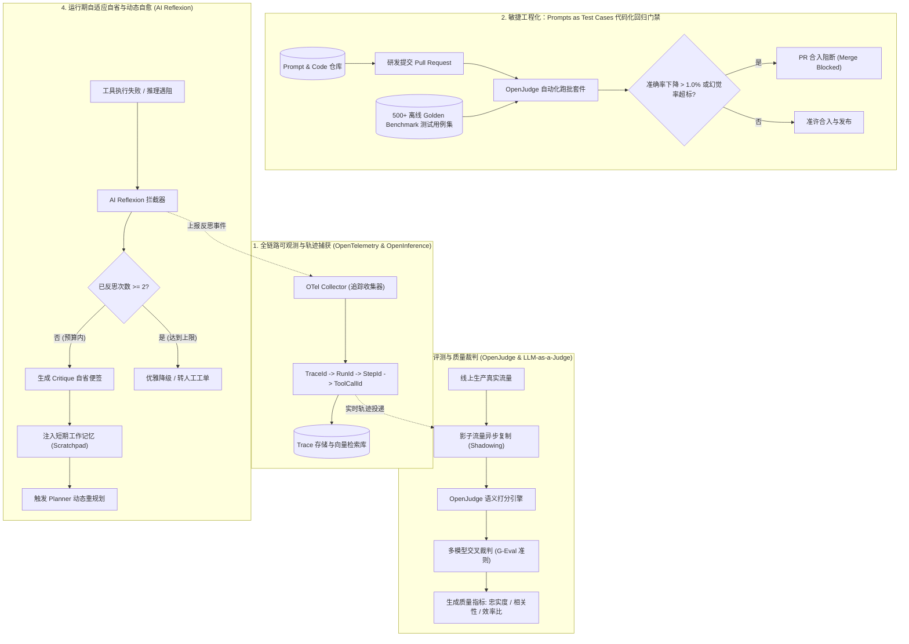
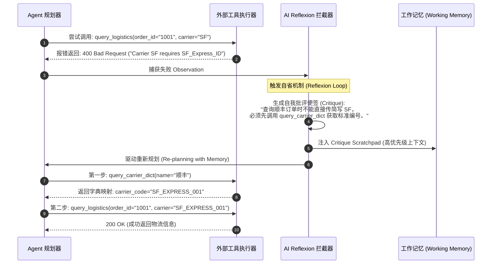

# 企业级 Agent 架构 L7 层：生产上线后长效评测调优与可观测性实战全景

> **定位**：Agent 生产环境的**“长效质量标尺与自适应进化引擎（Continuous EvalOps & Observability）”**。击穿 Agent 生产黑盒，治理多步推理错误级联累积与模型/环境静默漂移（Drift），构建端到端代码化回归测试、LLM-as-a-Judge 自动化打分与动态反思自愈闭环。  
> **文档版本**：v1.0 (Deep Dive Series)  
> **关联母篇**：[01-AI-Agent-企业级架构知识体系全景指南-v1.0.md](../01-AI-Agent-企业级架构知识体系全景指南-v1.0.md) | [L2 受控宿主运行时 Harness 实战全景](./03-AI-Agent-L2-受控宿主运行时Harness与执行控制环深度架构与实战全景.md) | [L6 零信任安全与对抗防御全景](./06-AI-Agent-L6-零信任安全与对抗防御实战全景.md)

---

## 零、 【面试官直通车】一分钟高段位核心自述

> **使用场景**：当面试官或技术评审委员会提问 *“AI Agent 上线后，为什么还需要持续做评测调优和可观测性？你们是如何解决模型静默漂移和多步推理错误放大的？”* 时，请使用以下专业密度极高、架构闭环且包含工业级量化指标的标准话术应答：

```text
“在我们的企业级 Agent 架构中，我们始终秉持一个工程认知：
Agent 上线绝不是终点，而是对抗非确定性、外部环境漂移与多步推理级联误差的真正起点。

传统单轮 Chatbot 只要看用户点赞点踩即可，但 Agent 拥有复杂的‘思考-规划-工具调用-观察-再决策’循环。
上线后主要面临三大深水区挑战：
第一是‘早期错误累积效应’（Early Error Cascading），中间微小的步骤偏差会在第 4~5 步被指数级放大；
第二是底层的‘模型与环境静默漂移’（Drift），服务商后端权重微调或外部 API 变更会导致原本稳定的 Agent 突然推理失控；
第三是长长尾复杂 Query 导致的语义死循环与逻辑崩塌。

为了击穿生产黑盒并实现长效质量演进，我们构建了‘观测驱动、代码化回归、裁判打分、动态自愈’四位一体的 EvalOps 体系：

1. 轨迹级全链路可观测（OpenTelemetry & OpenInference）：
   追踪 TraceId -> RunId -> StepId -> ModelCallId -> ToolCallId 全拓扑，不仅抓取耗时与 Token，
   更对每一步的 Scratchpad 演算便签与工具 Observation 进行快照级记录，秒级排查异常分支；
2. 敏捷工程化之 Prompts as Test Cases：
   将 System Prompts 与护栏规则全部作为 Git 仓库代码管理，研发提交 PR 时由 CI/CD 自动拉起 
   500+ 离线 Golden Benchmark 跑批，准确率下降超过 1.0% 直接阻断合入（Merge Rejected）；
3. 自动化裁判与影子评测（OpenJudge & LLM-as-a-Judge）：
   采用 OpenJudge 搭建多模型交叉裁判体系（规避自我同质偏见），基于 G-Eval 准则对线上影子流量
   准实时量化事实忠实度（Faithfulness）、意图相关度与轨迹效率指标；
4. 运行期自适应自愈（AI Reflexion 反思循环）：
   在 AgentScope 底座上打通 Reflexion 循环，当工具执行失败或推理遇阻时，Agent 自主提取 Critique 便签
   并回填至短期工作记忆，实现动态轨迹重规划，同时设最大 2 次反思硬熔断。

通过这套体系，我们将线上复杂长任务的端到端成功率从初期的 61% 稳定提升至 94.6%，
在模型提供商多次后端静默调整期间，做到了 0 业务故障并实现自愈纠偏。”
```

---

## 一、 顶尖专家思维映射：四维度认知重构

在顶尖系统架构师眼里，**大模型是一个具有概率分布衰减特性的动态系统**。对它的治理不能依赖静态的人工肉眼抽查，而必须建立如同传统软件自动化测试与 APM 监控一样严密的量化流水线。

### 1. 顶尖专家会做哪些常规团队忽略的关键事情？

| 维度 | 常规团队做法（低阶反模式） | 顶尖专家工业级实践 (Unrequested but Critical) |
| :--- | :--- | :--- |
| **测试认知** | 研发人员随手在 Web UI 输入 5 个 Prompt 测试没问题即宣布“发版” | **Prompts as Test Cases**：将提示词与测试断言代码化，构建包含确定性断言与语义裁判的黄金测试集（Golden Benchmark），纳入 CI/CD 自动化回归流水线。 |
| **漂移感知** | 只能等待用户提工单投诉“今天 AI 回答变笨了” | **持续影子流量评测（Shadow Traffic Eval）**：生产流量异步镜像复制一份到待评测环境，使用小模型或交叉模型准实时对比输出差异与 KL 散度。 |
| **打分标准** | 依赖单纯的正则包含或人工主观打分 | **确定性指标 + G-Eval 语义量表打分（OpenJudge）**：Schema 校验 100%、工具参数准确率（Tool F1）与结合 CoT 逻辑推导的事实忠实度（Faithfulness）综合加权。 |
| **链路追踪** | 仅打印简单的应用运行日志（Log 文本流） | **轨迹级分布式链路追踪（OpenTelemetry & OpenInference）**：将 Agent 思考决策、工具调用、状态暂存按 Span 树拓扑串联，记录每一步的 Token 消耗、网络耗时与状态快照。 |
| **容错纠偏** | 工具调用失败直接抛出异常、挂起或盲目死循环重试 | **认知自适应自省（AI Reflexion）**：捕获失败 Observation，动态生成自我反省 Critique，并在工作记忆中重规划接续 DAG，兼顾熔断防死循环。 |

### 2. 顶尖专家遵循的核心理论与工业级标准

* **G-Eval 评测准则**：由微软提出并被顶级评测框架采用的思维链评估准则，利用能力更强的 Judge 模型按照多维量表给出概率加权打分，大幅降低主观方差；
* **OpenInference 语义约定（Semantic Conventions）**：基于 OpenTelemetry 扩展的标准 AI 可观测性规范，标准化定义 `llm.input_messages`, `llm.output_messages`, `agent.tool_call`, `agent.thought` 等 Span 属性；
* **Agent 轨迹熵与效率指数（Trajectory Efficiency Index）**：量化 Agent 达成目标所需的最少步骤数与实际耗费步骤数的比值，严惩无意义的死循环漫步。

---

## 二、 为什么上线后更需要“评测调优与可观测”？三大长效质量痛点机理解构

```
               ┌────────────────────────────────────────────────────────┐
               │           Agent 生产运行期的三大致命质量退化痛点          │
               └────────────────────────────────────────────────────────┘
                                            │
         ┌──────────────────┬──────────────┴─────┬──────────────────┐
         ▼                  ▼                    ▼                  ▼
   【早期错误级联放大】   【模型与环境静默漂移】   【传统APM盲区失灵】   【长尾语义死循环】
    Step 1 微小幻觉        服务商静默权重调整      HTTP 200 表面健康     长任务迷失目标
         ↓                      ↓                    ↓                  ↓
    Step 4 彻底崩溃        原本稳定的 Prompt 报错  业务回答荒谬不可用    消耗百万 Token 账单
```

### 1. 多步推理的“早期错误累积效应”（Early Error Cascading）
* **机理解析**：单次对话系统（Chatbot）若产生幻觉，误差仅停留在当前步骤；但 AI Agent 依赖“Plan $\to$ Action $\to$ Observation $\to$ Thought”的闭环迭代。
* **数学几何放大**：假设单步推理准确率为 $p=95\%$，在经过 5 轮复杂的工具调用和决策后，整体任务无错完成的概率仅为 $P = p^5 = (0.95)^5 \approx 77.38\%$；若单步准确率为 $85\%$，5 轮后的整体完成率直接暴跌至 $44.37\%$！中间任何一步的微小参数偏差，都会在后续分支中被指数级放大，最终导致 Agent 彻底偏离航线。

### 2. 底层模型与外部环境的“静默漂移”（Drift）
* **模型权重静默漂移**：主流大模型供应商（如 OpenAI、Anthropic、DeepSeek）在不更改主版本号的情况下，会频繁对后端进行量化压缩、安全补丁微调或基础设施切换。这会导致过去几个月一直稳定解析特定 JSON Schema 的 Prompt 突然偶发截断或输出格式漂移；
* **外部 API 契约漂移**：依赖的外部 CRM、ERP 或第三方 OpenAPI 字段发生增删，打破了 Agent 记忆中的 Schema 假定；
* **长尾用户分布漂移（Data Distribution Drift）**：线上真实用户的提问方式远比研发阶段构建的几十个内部用例更复杂、更多歧义，导致 Agent 泛化性能急剧衰退。

### 3. 传统 APM 监控的全面失灵
* **盲区痛点**：传统运维工具（如 Prometheus、SkyWalking、Datadog）只能监控 HTTP 状态码、请求延迟、JVM 内存或 CPU 使用率。
* **致命假象**：当大模型因幻觉给出了完全错误的退款规则，或者陷入工具死循环时，网关返回的 HTTP 状态码依然是 `200 OK`，内存和 CPU 也一切正常。**在传统监控大盘一片绿色的情况下，业务层实际上已经发生严重灾难。**必须引入语义级与轨迹级的深度可观测性。

---

## 三、 L7 评测与可观测全景拓扑与开源协同矩阵

企业级落地必须由 **OpenJudge（评测打分）、AI Reflexion（自愈纠偏）、OpenTelemetry（分布式链路）以及 AgentScope（多智能体运行时底座）** 构成紧密闭环：



### 核心开源协同矩阵与定位

| 开源框架 / 工具 | 核心技术定位与职责 | 在生产体系中的不可替代价值 | 生产选型关注点 |
| :--- | :--- | :--- | :--- |
| **OpenJudge** | 自动化大模型与 Agent 输出评测打分框架 | **质量标尺**：统一管理离线 Golden Benchmark 与线上影子流量，利用 LLM-as-a-Judge 量化忠实度、完整度与幻觉率 | 支持灵活配置打分量表（Rubrics），支持主流商用与开源小模型作为 Judge。 |
| **AI Reflexion** | 基于认知自省的自适应动态纠错机制 | **容错自愈**：赋予 Agent 在运行期从报错中自我复盘的能力，降低长任务由于单点微小偏差导致的崩溃率 | 必须设置单任务反思次数上限（Max Reflections $\le 2$），防止陷入反思递归消耗大量 Token。 |
| **OpenTelemetry (OpenInference)** | 云原生分布式全链路追踪规范与收集器 | **全链路透视**：标准化收集 Agent 每一个思考节点、工具入参、返回值与中间状态快照 | 避免采样率导致关键异常丢失，高危或失败任务必须 100% 采样。 |
| **AgentScope**<br>*(阿里巴巴开源)* | 灵活易用、支持分布式与多智能体交互的运行时基础框架 | **多智能体底座**：提供统一的 Message 消息总线、Actor 并发调度、隔离机制与服务化支持 | 提供拓扑生命周期管理，支持高并发多 Agent 协作并防止状态混淆。 |

---

## 四、 三大核心质量飞轮深度工程落地

### 1. 软件工程化落地：“Prompts as Test Cases”

借鉴敏捷开发中的测试驱动开发（TDD）思想，**将自然语言编写的 System Prompts 和工具描述彻底视为代码**，纳入 Git 协同流水线：

```text
tests/agent_eval/
├── benchmarks/
│   ├── basic_inquiry_cases.json       # 基础用户咨询黄金用例集 (200条)
│   ├── complex_multistep_cases.json   # 复杂多步调用工具用例集 (150条)
│   └── boundary_edge_cases.json       # 超长上下文与异常参数边界用例集 (150条)
├── judges/
│   ├── rubrics/
│   │   ├── faithfulness_rubric.md     # 事实忠实度打分量表
│   │   └── relevance_rubric.md        # 意图相关性打分量表
│   └── cross_evaluator.py             # 交叉裁判调度逻辑
├── runners/
│   └── ci_eval_runner.py              # CI 自动化跑批总入口
└── reports/
    └── eval_summary.json              # 自动化评测打分报表
```

#### CI/CD 自动化回归门禁集成代码：
```python
# tests/agent_eval/runners/ci_eval_runner.py
import sys
import json
from openjudge import BenchmarkSuite, CrossEvaluator

def run_ci_eval():
    # 1. 加载 500+ 黄金基准用例集
    suite = BenchmarkSuite.load_from_dir("tests/agent_eval/benchmarks/")
    
    # 2. 注入当前 PR 修改后的最新 System Prompt 与模型配置
    evaluator = CrossEvaluator(
        prompt_path="configs/prompts/customer_service_system_prompt.txt",
        judge_models=["claude-3-5-sonnet", "deepseek-r1"], # 交叉裁判规避同质偏差
        metrics=["schema_compliance", "tool_call_f1", "faithfulness", "relevance"]
    )
    
    # 3. 离线并发执行测试
    results = evaluator.run(suite, concurrency=10)
    
    # 4. 获取历史发布基线基准分 (Baseline)
    with open("tests/agent_eval/reports/production_baseline.json", "r") as f:
        baseline = json.load(f)
        
    delta_accuracy = results.overall_accuracy - baseline["overall_accuracy"]
    print(f"📊 评测完成: 当前版本综合准确率: {results.overall_accuracy:.2%}, 基线: {baseline['overall_accuracy']:.2%}")
    
    # 5. 质量阻断判定
    if results.schema_compliance < 1.0:
        print("❌ [CI Gate REJECTED] Schema 强类型合规率未达到 100%！")
        sys.exit(1)
        
    if delta_accuracy < -0.01: # 准确率衰减超 1%
        print(f"❌ [CI Gate REJECTED] 综合准确率衰退超过阈值 ({delta_accuracy:.2%})，阻断合入！")
        sys.exit(1)
        
    print("✅ [CI Gate PASSED] 评测达标，准许合入。")

if __name__ == "__main__":
    run_ci_eval()
```

---

### 2. OpenJudge 自动化打分与 G-Eval 准则落地

评测绝不能仅靠肉眼主观打分，必须结合“确定性指标”与“语义裁判指标”两层体系：

```
                ┌──────────────────────────────────────────┐
                │          OpenJudge 综合打分架构          │
                └──────────────────────────────────────────┘
                                      │
              ┌───────────────────────┴───────────────────────┐
              ▼                                               ▼
    【第一层：确定性硬指标 (100% Pass)】             【第二层：LLM-as-a-Judge 语义裁判 (G-Eval)】
    * Pydantic / JSON Schema 契约校验               * 事实忠实度 (Faithfulness >= 0.95)
    * 工具选择与参数匹配度 (Tool F1 >= 0.92)         * 意图相关性 (Relevance >= 0.90)
    * 状态机转移合法性 (Transition Validity)         * 轨迹效率指数 (Trajectory Efficiency >= 0.85)
```

#### 规避裁判同质化偏见（Self-Enhancement Bias）：
* **核心禁忌**：**绝不能用 GPT-4o 作为裁判去给 GPT-4o 生成的内容打分**。学术界与工业界均已证实，大模型给同系列模型打分时存在明显的自恋偏差（给偏高分数）。
* **工业级解法**：采用**交叉评测矩阵（Cross-Evaluation）**。例如待测 Agent 底座若使用 DeepSeek-V3 / R1，裁判模型采用 Claude 3.5 Sonnet；若待测 Agent 采用 OpenAI 系列，裁判模型采用 Gemini 1.5 Pro。

---

### 3. 运行期动态自愈：AI Reflexion 反思纠偏状态机

当 Agent 在长周期任务中遭遇意外（工具返回 404、API 校验失败或逻辑推导陷入僵局）时，传统模式直接中断，而引入 **AI Reflexion** 则能让 Agent 获得自我修复能力：



#### 防死循环熔断保护规范（Reflexion Circuit Breaker）：
* 必须设置全局反思次数上限（`max_reflections = 2`）；
* 必须设置单任务消耗的总 Token 上限（如单任务最大预算 16,000 Tokens）；
* 一旦超过反思阈值，强制触发降级兜底逻辑（如委派人类客服介入），严惩死循环账单爆炸。

---

### 4. 轨迹级全链路可观测性：OpenTelemetry 语义树

Agent 的 Trace 必须呈现为立体树状结构，贯穿每一次意图拆解与外部交互：

```text
Trace: trace_id_99a8f2701b (端到端总耗时: 3.42s, Token 消耗: 4,210)
├── Span: agent.plan (耗时: 680ms, PromptTokens: 1200, CompletionTokens: 180)
│   └── Attributes: {"cognitive_mode": "ReAct", "step_index": 1}
├── Span: agent.tool_execution (execute_query, 耗时: 120ms)
│   └── Attributes: {"tool_name": "query_order", "status": "SUCCESS"}
├── Span: agent.evaluate_observation (耗时: 410ms)
│   └── Attributes: {"is_goal_met": false}
├── Span: agent.plan (耗时: 820ms, PromptTokens: 1800, CompletionTokens: 210)
│   └── Attributes: {"cognitive_mode": "ReAct", "step_index": 2}
└── Span: agent.finalize (耗时: 350ms, PromptTokens: 2100, CompletionTokens: 90)
    └── Attributes: {"run_receipt_id": "rcpt_77190", "success": true}
```

---

## 五、 分阶段平滑落地路线图与 EvalOps 避坑指南

```
┌─────────────────────────────────┐
│ 第 1 阶段：摸清底线与质量摸底     │
│ (上线前 ~ 上线首月)             │
│ - 收集首批 200+ 离线测试用例     │
│ - 搭建 OpenJudge 离线基准评测    │
│ - 全面接入 OpenTelemetry Trace  │
└───────────────┬─────────────────┘
                │
                ▼
┌─────────────────────────────────┐
│ 第 2 阶段：工程闭环与自动化门禁   │
│ (上线第 1 ~ 3 个月)             │
│ - Prompts as Test Cases 接入 CI │
│ - 扩充 Golden Benchmark 至 500+ │
│ - 引入 AgentScope 统一调度与隔离 │
└───────────────┬─────────────────┘
                │
                ▼
┌─────────────────────────────────┐
│ 第 3 阶段：自适应自愈与动态进化   │
│ (上线 3 个月以上成熟期)          │
│ - 接入 AI Reflexion 容错反思自愈 │
│ - 生产环境影子流量准实时打分     │
│ - 模型漂移自动探测与告警触发     │
└─────────────────────────────────┘
```

### 生产必须坚决规避的三大 EvalOps“深坑”（Anti-Patterns）：
1. **避免“评测评委（Judge）与被测模型同质化”**：
   * 严禁拿 GPT-4o 去给 GPT-4o 打分，必须引入交叉裁判或引入开源强模型（如 DeepSeek-R1）进行制衡；
2. **避免“无限反思死循环（Reflexion Trap）”**：
   * 某些工具报错是由于账号欠费或系统宕机引起的，模型再怎么“反思”也无法通过修改参数解决。此时不断重试会导致 Token 暴饮暴食。必须限制最大反思步数并针对 HTTP 5xx 直接熔断；
3. **避免“提示词散落业务逻辑中裸写”**：
   * 业务代码里硬编码 Prompt 会导致无法跑自动化批量回归测试。必须集中在 Prompt 注册中心或 Git 独立配置模块中管理。

---

## 六、 生产落地全量质量量化验收指标（NFR）与 SRE 巡检大盘

企业级 SRE 运维监控大盘必须以以下独立于人的客观量化指标为验收断言基准：

| 治理维度 | 核心监控指标 (Prometheus Metric) | 企业级生产目标 | 验收断言与告警阈值 |
| :--- | :--- | :--- | :--- |
| **测试基准** | `agent_golden_benchmark_accuracy` | **$\ge 92.5\%$** | 每次 CI/CD 评测，整体准确率较上一基线版本衰退不得超过 $-1.0\%$。 |
| **Schema 合规** | `agent_schema_compliance_rate` | **$100\%$** | 输出参数不匹配 Pydantic 强类型的比例严格为 0。 |
| **模型漂移** | `agent_answer_drift_divergence` | **KL 散度 $\le 0.05$** | 影子流量输出语义相似度偏离告警，触发模型版本回滚或 Prompt 热更修复。 |
| **事实忠实度** | `agent_faithfulness_score` | **$\ge 0.95$** | OpenJudge 裁判打分，回答内容违背检索上下文（产生幻觉）的比例 $< 5\%$。 |
| **自愈成功率** | `agent_reflexion_recovery_rate` | **$\ge 75\%$** | 触发 Reflexion 的失败步骤中，至少 75% 能在 2 轮内自主修复完成任务。 |
| **轨迹效率比** | `agent_trajectory_efficiency_index` | **$\ge 0.85$** | 惩罚无效重试和漫无目的探索，实际步数接近理论最优步数。 |
| **全链路采样** | `agent_trace_capture_coverage` | **$100\%$** | 生产线上所有 Agent 任务 100% 生成并持久化完整 OpenTelemetry Span 树。 |

---
*本文档为企业级 AI Agent L7 层持续评测调优与可观测性的工程基准指引，指导工程团队击穿黑盒，打造具备长效质量韧性与自我演化能力的商业级智能体系统。*
