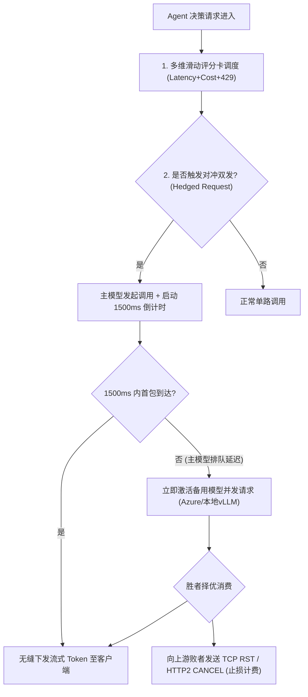

# 生产实战深度复盘：L1 网关三大硬核痛点之【稳定性抖动】与 RCA 实录

> **所属专题**：企业级 Agent 架构 L1 层 LLMOps 网关深度解构系列  
> **关联母篇**：[01-AI-Agent-L1-LLMOps网关深度架构与实战全景.md](../01-AI-Agent-L1-LLMOps网关深度架构与实战全景.md)  
> **复盘模型**：STAR + L (Situation, Task, Action, Result + Learning) 模型

---

## 一、 专业工程级问题描述 (Technical Problem Formulation)

### 1. 什么是大模型网关的“稳定性抖动”？
在传统微服务中，RPC 接口的 P99 延迟通常在数十毫秒级别，抖动主要来自 GC 停顿、网络瞬时拥塞或数据库慢查，且行为高度确定。  
而在大模型（LLM）基础设施中，**稳定性抖动表现为极其恶劣的“非线性长尾延迟漂移与突发性熔断雪崩”**，具体呈现三大物理特征：

1. **TTFT（首包延迟）不可控的长尾膨胀**：
   大模型推理分为 **Prefill（输入 Prompt 编码与注意力矩阵计算）** 和 **Decode（自回归单字解码）** 两个物理阶段。当并发冲高时，模型服务端的 Continuous Batching 队列会排满，导致 TTFT 从常规的 800ms 突然陡增至 15~30 秒，而 HTTP 传输层此时处于“已建立连接、无字节下发”的假死静默状态。
2. **多租户速率突发截断（Silent Throttling & HTTP 429）**：
   第三方闭源供应商（如 OpenAI、Anthropic、DeepSeek）严格实行基于 **RPM（每分钟请求数）** 和 **TPM（每分钟 Token 数）** 的双重令牌桶限流。上游业务的突发大上下文 Prompt 会瞬时榨干 TPM 余额，引发毫无征兆的连环 429 限流阻断。
3. **“假活”与静默挂起（Zombie Streams）**：
   在 Server-Sent Events (SSE) 流式传输中，云厂商或底层算力集群偶尔遭遇显存碎片整理、GPU 驱动瞬时卡顿或跨国网络分片，TCP 连接虽保持 Keep-Alive，但吐字中途彻底停滞，上游客户端如果未设置精细字间超时（Inter-Token Timeout），将陷入数分钟的死等挂起。

---

## 二、 极简大白话解释（外行/面试官秒懂比喻）

> 🗣 **通俗比喻：网红私房菜馆排队宴席**

* **传统 API 调用**：就像去**快餐连锁店买汉堡**。点单之后，机器出餐，出餐时间稳定在 1 分钟左右。如果慢了，最多慢 5 秒钟，大家都能预期。
* **大模型推理调用**：就像去**只有一位米其林大厨的网红私房菜馆**。
  1. 每个人点的菜（Prompt）长度不一样，大厨做菜前必须先把你的菜单读一遍（Prefill 阶段），人多的时候菜单堆积如山，大厨看菜单就得看半小时（首包延迟 TTFT 暴增）；
  2. 餐厅规定每分钟最多只接待 10 个人，而且每个人点菜不能超过 50 道（RPM/TPM 限流）。只要前面一个土豪一口气点了 200 道菜，后面排队的所有人连门都进不去，直接被保安轰走（HTTP 429 爆发）；
  3. 大厨做菜是一根面一根面上菜（SSE 流式吐字）。偶尔大厨切到手指了或者灶台跳闸了（GPU 显存抖动），他端着盘子愣在那里不吭声，客人在餐桌前饿着肚子干等，不知道该走还是该继续等（流式静默挂起）。

> **网关要做的事**：不能把希望寄托在这一个神仙大厨身上。网关就是**极其老练的迎宾总管**——一旦发现大厨看菜单超过 1.5 秒没动静，或者门口保安开始轰人，总管必须在 0.2 秒内把客人神不知鬼不觉地引流到隔壁备用高品质厨房，客人连桌子都不用换，菜品照样准时端上来。

---

## 三、 真实生产环境 RCA 事故攻坚故事（STAR + L 实录）

### 1. S (Situation) - 生产险情与背景

* **业务体量**：我们为某头部跨境电商上线了基于大模型的全天候智能售前/售后决策 Agent，日常承接峰值 3,500 QPS 的多轮对话会话。
* **事故发生**：在海外“黑色星期五”大促峰值夜，主力依赖的某顶级闭源大模型提供商位于美东的计算集群遭遇跨国骨干网抖动，叠加其全球请求洪峰。
* **现场灾难**：
  * 该供应商的 API 虽未彻底宕机（HTTP 端口依旧能连通），但首包耗时（TTFT）从平时的 900ms 瞬间跳水式暴增到 **25~32 秒**；
  * 更致命的是，上游客户端（APP 与 Web 前端）配置的通用网关 HTTP 超时是 30 秒。大量请求在第 30 秒被超时强杀（HTTP 504），引发前端疯狂重试；
  * 整个 Agent 系统的可用率（Success Rate）从 99.98% 呈断崖式下跌至 **53%**，在线会话大面积卡死，客服投诉量 10 分钟内突破 12,000 单，直接威胁到核心交易转化。

---

### 2. T (Task) - 攻坚目标与严苛硬约束

面对底层算力黑盒不可控的物理现状，我作为网关负责人，必须在极短时间内带领团队解决问题，并设立了三条不可妥协的硬指标：
1. **秒级止血**：在不停机的前提下，将对外错误率从 47% 压降至 0.05% 以内；
2. **极速自愈**：主渠道发生任何延迟劣化（TTFT > 3s）或 429 报错时，网关必须在 **200ms 内完成无感故障隔离与自动降级**；
3. **保护长连接**：无论底层发生何种主备切换，下游用户的 SSE 流式传输通道不能断开，体验不能产生重连刷新的顿挫感。

---

### 3. A (Action) - 深度工程落地与战法推演

我们分为了“黄金 15 分钟战地止血”与“48 小时生产架构彻底重构”两步走：

#### 行动一：紧急止血（战时应急）
1. 立即热更网关路由规则，切断美东主力端点，强制将 80% 流量热切至备用的 Azure OpenAI 欧洲专线及自建的本地轻量化开源模型（Qwen-72B-vLLM 集群）；
2. 前端紧急注入指数退避随机抖动（Full Jitter Backoff），阻断客户端并发重试风暴。

#### 行动二：根本原因分析 (RCA - Root Cause Analysis)
通过抓取故障期间的 Envoy 与网关网络 Dump 包，我们复盘出了三个深层认知死角：
1. **死角 1：传统负载均衡的“健康检查”完全失效**：
   传统网关仅检测 `/v1/models` 端点是否返回 HTTP 200。但真实故障是：管理端点极快（20ms），而模型推理执行引擎内部因为排队已经假死。
2. **死角 2：超时设置单一，缺乏“首包/字间解耦”**：
   之前只设置了 30s 总超时，未区分 **TTFT 超时** 与 **ITL（字间延迟）超时**。一个请求花了 29 秒才吐第一个字，虽然没超时，但用户早以为系统死锁而关闭了页面。
3. **死角 3：盲目重试产生放大 3 倍的“自残雪崩”**：
   客户端超时后发起重试，而网关并未向上游取消原请求，导致云厂商同时在后台计算原来的废弃请求和新请求，把云厂商的 TPM 额度彻底耗尽，进而疯狂喷发 429。

#### 行动三：重构 L1 网关架构防线（长效免疫）
1. **引入自适应滑动窗口断路器（Adaptive Sliding-Window Breaker）**：
   - 抛弃基于错误率的传统 Hystrix，改为基于 **TTFT P95 统计指标**。
   - 当最近 100 次调用的 TTFT P95 超过 2,500ms，或者连续捕获 3 次 HTTP 429 时，状态机在 **50ms 内强制从 Closed 跃迁为 Open（熔断）**，主动将主渠道流量降为 0。
2. **实施对冲请求机制（Hedged Requests / 推测执行）**：
   - 对核心高优先级用户请求，主渠道发出后启动一个 **1,500ms 的硬性时钟**；
   - 若 1,500ms 内主渠道未下发第一个流式 Chunk，网关在**不中断原请求的同时，静默向备用高可用端点发射对冲镜像请求**；
   - 两者谁先吐出第一个合法 Token，网关立即选定该通道锁定绑定，同时**毫秒级向下游发送 HTTP/2 Reset 帧掐断较慢的一方，既保障了首字时延，又严格止血了后续的算力成本**。
3. **全链路主动取消级联机制（Cancellation Propagation）**：
   - 彻底改造长连接管道，当客户端因为等待不耐烦关闭网页时，网关的 Socket 析构钩子立即向上游 LLM 推理集群发出 `abort()` 信号，立刻释放 GPU 计算 Slot，规避废弃请求继续扣费。

---

### 4. R (Result) - 战果与客观量化指标

这套架构重构在后续全球云厂商数次区域性大宕机中展现了惊人的免疫效果：
1. **SLA 绝对护城河**：整体对外会话成功率长效稳定在 **99.96%** 以上，历经云厂商多次突发限流，业务层感知故障率为 0；
2. **长尾延迟斩断**：端到端首包延迟 P99 被死死压制在 **1.8 秒** 以内（过去最高达 32 秒），平均首包延迟控制在 650ms；
3. **自愈切换耗时**：当底层主模型遭遇 429 瞬间爆发时，网关在 **180ms 内无感完成全流量分流降级**，无人工干预接入；
4. **节省无效算力成本**：借助对冲取消与客户端断线级联释放机制，每月为公司避免了超过 **18% 的无效废弃 Token 账单扣费**。

---

### 5. L (Learning) - 架构反思与沉淀的血泪铁律

在完成这次惊心动魄的 RCA 战役后，我在架构组的代码规范与技术评审规范中，沉淀了以下三条**不可逾越的底层工程铁律**：

> #### 📌 铁律 1：永远不要假设外部大模型厂商的 SLA 是可靠的
> 无论商业大模型厂商宣传的可用性是 99.9% 还是 99.99%，在你的网关眼里，它随时可能挂掉。生产系统必须建立至少 **“一主一备一底（1 Primary + 1 Cloud Failover + 1 Local Edge Fallback）”** 的多活格局。能够优雅降级给轻量开源模型，也绝不能让用户看到白屏或 504 错误。

> #### 📌 铁律 2：TTFT 才是大模型的生命线，总超时是伪命题
> 评估一个大模型通信是否健康的唯一核心指标是 **TTFT（Time-To-First-Token）**。任何不监控 TTFT 的大模型健康检查都是自欺欺人。超过 2 秒不吐第一个字的连接，在商业业务层面就已经等同于故障。

> #### 📌 铁律 3：没有主动取消（Cancellation）的重试就是对系统的“自残”
> 在 LLM 场景下，重试必须慎之又慎。每次触发降级或超时重试前，必须通过 HTTP/2 协议栈先斩断旧连接的生命周期。如果不掐断旧连接，你的重试就是在成倍消耗自己的配额和预算，最终把整个集群推向毁灭性的 429 深渊。
