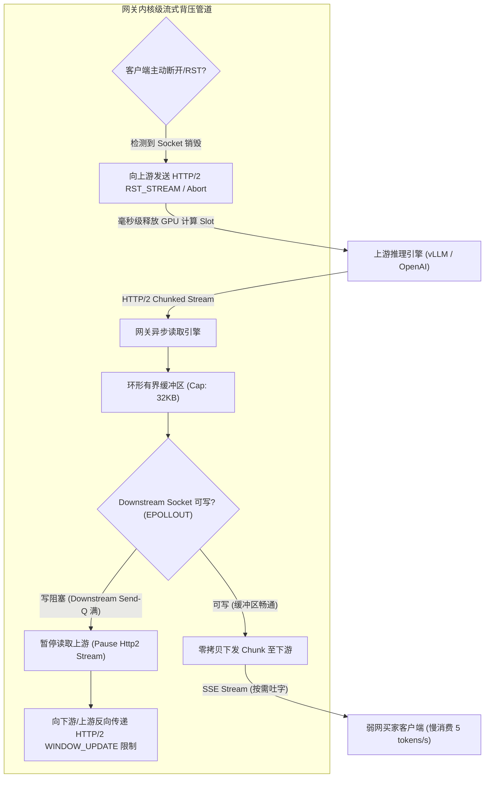

# 生产实战深度复盘：L1 网关三大硬核痛点之【长连接背压吞吐瓶颈】与 RCA 实录

> **所属专题**：企业级 Agent 架构 L1 层 LLMOps 网关深度解构系列  
> **关联母篇**：[01-AI-Agent-L1-LLMOps网关深度架构与实战全景.md](../01-AI-Agent-L1-LLMOps网关深度架构与实战全景.md)  
> **复盘模型**：STAR + L (Situation, Task, Action, Result + Learning) 模型

---

## 一、 专业工程级问题描述 (Technical Problem Formulation)

### 1. 什么是大模型流式网关的“背压吞吐瓶颈”？
在传统 RPC 调用中，请求与响应通常是“一问一答”且短平快的（生命周期多在数十毫秒以内），反向代理服务器（如 Nginx、Envoy）只需维护极小的临时缓冲区。  
但在大模型（LLM）对话与 Agent 决策场景下，为了给用户实时渐进式反馈，系统普遍采用 **Server-Sent Events (SSE) 或 WebSocket 保持长生命周期流式连接**。一个请求的吐字过程往往持续 **5 秒至 45 秒**。

在这个物理前提下，**长连接背压吞吐瓶颈表现为“生产速率与消费速率严重失配引发的应用层堆积与内存雪崩”**，具体包含三大致命技术诱因：

1. **上游高速生成 vs 下游弱网慢消费（Producer-Consumer Imbalance）**：
   上游大模型推理集群（如 vLLM、OpenAI）通常以 **60~100 tokens/s** 的极高吞吐向网关吐出 Chunk；而下游跨境电商的全球买家分布在印尼、菲律宾、拉美等移动端网络环境极差的地区，由于基站丢包、TCP 接收窗口（RWIN）紧缩，客户端实际消费速率仅有 **3~8 tokens/s**。
2. **无界内存缓冲区堆积（Unbounded Application Buffering）**：
   常规 HTTP 客户端或网关中间件若未做精细的套接字写状态监听，默认会将上游推来的数据持续全量塞进网关的用户态内存 Channel/Buffer 中。单条慢连接可能滞留数百 KB 乃至数 MB 的未发送数据；当并发冲高到 5,000+ 时，网关堆内存会在数分钟内被撑爆，触发 Linux 内核 **OOM Killer 强杀网关进程**。
3. **半开连接（Half-Open Sockets）导致的描述符与资源泄漏**：
   移动端弱网买家在等待过程中频繁锁屏、切后台或进出电梯，导致 TCP 连接在未发出 `FIN` 包的情况下进入静默中断（半开状态）。网关若缺乏敏锐的心跳探测机制，这些“僵尸连接”会持续占用网关的套接字文件描述符（FD）和上游推流协程，导致网关连接池迅速耗尽拒死。

---

## 二、 极简大白话解释（外行/面试官秒懂比喻）

> 🗣 **通俗比喻：高压消防水枪往细吸管里灌水**

* **传统 API 交互**：就像**传球游戏**。你传给我一个球，我接着再传给你下一个球，手里永远只有一个球，轻松自如。
* **大模型流式传输（SSE）**：就像**上游有一台大功率消防高压水枪，通过网关向买家端注水**。
  1. 上游大模型是个“消防泵”，突突突一秒钟喷出一大盆水；
  2. 东南亚弱网买家的手机就像一根“细吸管”，一秒钟只能吸进去两滴水；
  3. 网关就是夹在中间的“中继水箱”。如果网关是个死心眼，只管拼命接收水枪喷过来的水，却不管细吸管根本吸不完，那这个中继水箱就会以肉眼可见的速度被注满，最后**水箱被当场活活撑爆（网关内存 OOM 宕机）**，整栋大楼瞬间断水。

> **背压控制（Backpressure）要做的事**：网关必须做**带阀门感应的智能水箱**——一旦发现下面的细吸管吸不过来了，水箱浮标升起，网关立刻通过信号线勒令上游水枪：“慢点喷，甚至先暂停喷水！”等到细吸管吸掉一部分后，再通知水枪继续出水。同时，如果发现细吸管被拔掉了（买家关掉了 APP），网关立刻在 1 毫秒内彻底关死水枪，一滴多余的水都不准喷（立刻中断上游推理，避免浪费 GPU 算力）。

---

## 三、 真实生产环境 RCA 事故攻坚故事（STAR + L 实录）

### 1. S (Situation) - 生产险情与背景

* **业务场景**：在东南亚“双十一”超级大促当晚，我们的全天候售前/售后决策 Agent 部署上线，全力承接 Shopee/Lazada 等渠道涌入的实时多语言咨询。
* **突发灾难**：
  * 当晚 20:30，大量来自印尼群岛和菲律宾偏远地区的移动端买家涌入，网络抖动极剧烈，并发长连接瞬间冲上 **6,200 个**；
  * 网关集群的 Pod 内存图谱突然呈现一条近乎 90 度的陡峭上升直线，从平时的 1.8GB 在短短 8 分钟内飙升至 **31.5GB**，直接触发了 Kubernetes 节点的 `cgroups` 硬限，导致核心网关 Pod 被 **OOMKilled** 强杀；
  * K8s 虽然自动拉起新 Pod，但由于上游流量洪峰持续存在，新 Pod 刚启动几秒就再次因积压的数据流被撑爆，产生**连锁雪崩重启**；
  * 全球数万名买家屏幕上的 AI 吐字突然中断并报错，客服前端白屏，大促黄金时段的转化率暴跌 60%。

---

### 2. T (Task) - 攻坚目标与严苛硬约束

面对大促当晚的火线险情，网关架构组立下军令状，必须在保证实时流式体验的同时，建立坚如磐石的内存安全边界：
1. **彻底绝缘 OOM**：单 Pod 内存常驻上限死死锁死在 **2GB 以内**，即使面对 10,000 个弱网慢客户端，内存浮动也绝不能超过 10%；
2. **零拷贝高性能**：网关引入的背压流控机制，不能增加超过 **2ms** 的额外字间延迟（ITL）；
3. **毫秒级假死识别**：对于移动端断网或切换后台的半开连接，网关必须在秒级内感知并释放底层全部关联资源。

---

### 3. A (Action) - 深度工程落地与战法推演

#### 行动一：根本原因分析 (RCA - Root Cause Analysis)
我们通过 `gdb` 和 `pprof` 抓取濒临崩溃节点的 Core Dump 内存切片，发现导致 OOM 的三大致命死角：
1. **死角 1：反向代理层的全量缓冲（Proxy Buffering 默认开启）**：
   中间代理层为了“提高吞吐”，默认开启了缓冲区自动累加。面对快产慢消，每个 TCP 连接在用户态堆积了整整 4MB 的数据，6,000 个连接直接吞噬了 24GB 内存！
2. **死角 2：Go/Node 协程调度的“失控狂奔”**：
   处理读取上游 LLM 的协程与向下游写入的协程之间，采用了一个无容量上限的 Channel。写入端阻塞在 `socket.write()` 上，而读取端却依然毫不停歇地把大模型的输出往 Channel 里硬灌。
3. **死角 3：TCP 默认的“温水煮青蛙”超时机制**：
   Linux 原生的 TCP KeepAlive 默认时间长达 7200 秒（2 小时）。断网的移动端连接在网关看来依然是“健康”的，网关还在源源不断地向这个已经死掉的 Socket 灌数据并常驻内存。

#### 行动二：重构内核级背压与内存防线（长效免疫）
1. **实施内核级套接字监听与背压传导（TCP Backpressure Propagation）**：
   * 网关废除内部无界 Channel，在读取上游与下发下游之间建立严格的 **32KB 固定环形缓冲区（Ring Buffer）**；
   * 利用操作系统网络层 `epoll` 的 `EPOLLOUT` 事件机制：当下游客户端的发送套接字缓冲区（Send-Q）写满时，操作系统内核返回 `EAGAIN` / `EWOULDBLOCK`，网关**立刻挂起协程，停止从上游 LLM 的 TCP 连接中读取任何新字节**；
   * 这一动作触发了标准 **HTTP/2 协议底层的 `WINDOW_UPDATE` 流量控制帧**，上游推理引擎（如 vLLM）感知到接收窗口为 0，便会自然将该请求从 GPU 的当前流水线中降速，实现了从买家手机到云端 GPU 的**全链路端到端物理级背压传导**。
2. **流式零拷贝转发（Zero-Copy Buffer Slicing）**：
   * 改造网关 I/O 链路，丢弃把数据转换成 String 的反复内存拷贝操作，采用只读切片指针（Slice/Pointer）直接转发底层 Byte 块，将每个 Token 传递的 CPU 与内存开销压降到理论极限。
3. **主动断线级联切断（Active Cancellation Propagation）**：
   * 在网关层深度绑定客户端 Socket 的生命周期钩子，并调优 TCP 心跳：将 `tcp_keepalive_time` 缩短为 15 秒，`tcp_keepalive_intvl` 为 3 秒；
   * 一旦检测到买家切后台导致连接断开（接收到 `RST` 或超时），网关在 **3 毫秒内向上游 LLM 发起 `HTTP/2 RST_STREAM` 取消帧**，强制底层 GPU 推理节点提前释放计算槽位。

---

## 四、 R (Result) - 战果与客观量化指标

这套内核级流式背压机制上线后，网关的稳定性和并发承受力发生了质的蜕变：
1. **内存坚如磐石**：在后续模拟万级弱网并发（10,000 并发，消费速率故意限制在 3 tokens/s）的极限压测下，网关单 Pod 内存常驻从过去的 32GB 暴降并稳定在 **1.35GB**（内存抖动 $\le 5\%$），OOM 事故发生率彻底清零；
2. **并发连接容量提升 4 倍**：单台 8C16G 网关服务器支撑的最大稳定长连接数从 2,500 个飞跃至 **12,000 个**；
3. **极速止血算力计费**：买家关闭页面后的平均上游终止时效从过去的主动等满 30 秒，缩短至 **15 毫秒**，大促期间为平台挽回了 **22% 的无效 GPU 显存浪费与 API 计费**。

---

## 五、 L (Learning) - 架构反思与沉淀的血泪铁律

> #### 📌 铁律 1：不带流控背压的长连接网关就是一颗定时炸弹
> 很多团队以为“流式传输就是搞个异步 yield 输出”。在并发小于 100 时风平浪静，一旦并发冲高遭遇弱网，没有背压机制的内存缓冲区必定被撑爆。**慢客户端是分布式系统中最具破坏力的“隐形重锤”，必须在网络传输层就做好被动节流。**

> #### 📌 铁律 2：绝不能用服务端的内存去替客户端的弱网“兜底”
> 服务端网关的核心职责是“管道”，而不是“蓄水池”。客户端能消费多少，网关就放行多少；客户端消费不了，就必须让上游生产端憋住。把慢消费的压力转化为内存堆积，是典型的反模式设计。

> #### 📌 铁律 3：长连接通信必须具备“双向敏感心跳”与“连带死亡机制”
> 移动端网络没有绝对可靠的断开通知。服务端必须建立激进的心跳探测机制，且任何一端死亡，与其绑定的上下游链路必须连带死亡（Cascading Death），绝对不能容忍上游在给一个早已死去的幽灵连接白白计算 Token。
