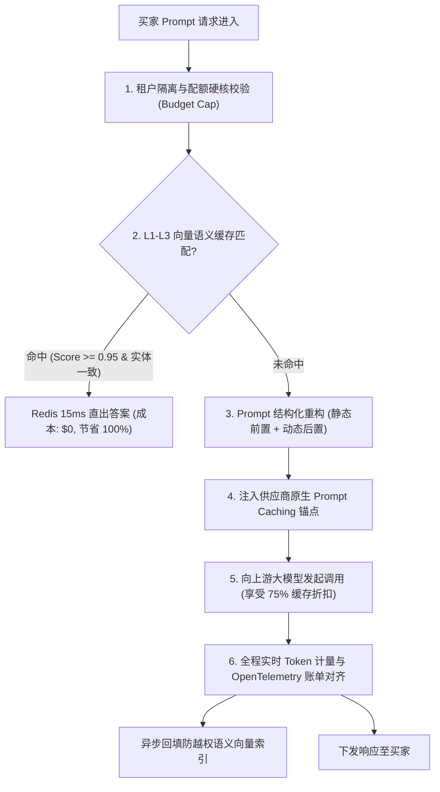

# 生产实战深度复盘：L1 网关三大硬核痛点之【Token 成本失控】与 RCA 实录

> **所属专题**：企业级 Agent 架构 L1 层 LLMOps 网关深度解构系列  
> **关联母篇**：[01-AI-Agent-L1-LLMOps网关深度架构与实战全景.md](../01-AI-Agent-L1-LLMOps网关深度架构与实战全景.md)  
> **复盘模型**：STAR + L (Situation, Task, Action, Result + Learning) 模型

---

## 一、 专业工程级问题描述 (Technical Problem Formulation)

### 1. 为什么电商 Agent 极易爆发“Token 成本失控”？
在传统业务系统中，系统调用成本与吞吐量基本呈亚线性关系（固定服务器成本被高并发分摊，调用越多边际成本越低）。  
而在大模型 Agent 系统中，成本与调用呈现出**极其可怕的“超线性爆炸关系”**。商业闭源模型（如 GPT-4o、Claude 3.5 Sonnet）是**严格按单 Token 实时计费**的。

在跨境电商全天候决策 Agent 生产环境中，Token 成本失控往往由四大隐蔽的工程陷阱引发：

1. **上下文不可逆膨胀（Context & Prompt Bloat）**：
   为了让 Agent 做出精确的售后赔付或导购推荐，上层业务框架每次调用都会在 System Prompt 和 Context 中塞入数万字的背景信息：涵盖数千条退换货法典、买家过去半年的历史订单列表、几十个 SKU 的多语言规格说明书。用户哪怕仅仅发了一条简单的“Hello”或“OK”，网关单次往返请求消耗的 Token 就高达 **6,000~12,000 Tokens**。
2. **高频只读请求的“全量裸奔穿透”**：
   在电商场景下，约有 **35%~50%** 的买家咨询属于高频标准问询（如“你们支持退货吗？”、“发货到英国要几天？”、“怎么选尺码？”）。如果缺乏租户级缓存拦截，每一次哪怕完全相同语义的问题，都会直接穿透到底层大模型算力，每天白白烧掉数亿计的昂贵 Token。
3. **失控死循环与递归重试风暴（Runaway Agent Loops）**：
   当大模型返回的 JSON Schema 解析失败，或调用的工具（如查询 OMS 订单）返回了微小的业务错误码时，若 Agent 内部的 Reflection（自我反思）机制没有严格的深度终止条件，就会在毫秒内触发 5~10 次连续带巨大上下文的递归调用，单笔普通工单即可瞬间烧掉 **数十万 Tokens**。
4. **暗账偏差与对账黑洞（Billing Discrepancy & Blind Spots）**：
   业务系统记录的 Token 数多基于开源分词器（如 `tiktoken`）本地估算，而云厂商是基于服务端实际处理的 Prefill + Decode + Cache-Read/Write 精确计价。叠加网络超时后未记录的中途中断费用，往往造成业务报表与云厂商真实账单存在 **30%~45% 的巨额暗账偏差**，直接引发财务审计风暴。

---

## 二、 极简大白话解释（外行/面试官秒懂比喻）

> 🗣 **通俗比喻：打一通按字计费的昂贵跨国长途，每次必须先朗诵整部《新华字典》**

* **传统数据库查询**：就像**去图书馆借书**。不管你借多少次，只要办了借书证（买了服务器），随便借多少本书都不再额外收钱。
* **大模型推理计费**：就像**打一通每秒钟收你 50 块钱的跨国卫星加密长途电话**。
  1. 买家在电话那头就问了一句：“我的包裹发货了吗？”
  2. 我们系统这个“书呆子接线员”，为了回答这个问题，竟然在电话里先花 10 分钟从头到尾朗读整部《公司退换货法典》、《物流运输规范》和《全球各仓地址手册》（Prompt 上下文膨胀）。念了 9 分钟大百科，最后才花了 1 秒钟说了一句：“已发货，单号是123”；
  3. 更离谱的是，今天一共有 5 万个买家打电话过来问了完全一模一样的“发货了吗”，这个接线员就把那部大百科反反复复在长途电话里**完整朗读了整整 5 万遍**！（缺乏语义缓存，全量裸奔）；
  4. 到了月底，大模型供应商寄来一张几百万的巨额话费单，公司直接面临破产边缘。

> **网关要做的事**：网关就是**冷酷无情的精明财务总监**——
> 第一，只要发现买家问的问题跟之前问过的意思一样，总管直接在 0.01 秒内把标准答案抄给他（语义缓存），根本不拨打那个昂贵的长途电话，省下 100% 的话费；
> 第二，哪怕必须要打电话，也跟云厂商商量好“前 9 分钟的大百科我上次读过一次了，你们直接在本地电脑存个副本，这次只收我一毛钱存稿费”（Prompt Caching 命中优化）；
> 第三，给每个店铺设定严格的“话费余额限额”，一旦发现接线员在电话里胡言乱语死循环，立刻一把夺过电话直接掐断！（预算熔断与防死循环）。

---

## 三、 真实生产环境 RCA 事故攻坚故事（STAR + L 实录）

### 1. S (Situation) - 生产险情与背景

* **业务体量**：某头部跨境快时尚品牌全量上线了智能客服与售后决策 Agent，全天候覆盖欧美 12 个独立站和 Amazon 店铺，日均交互量超过 280,000 次。
* **财务暴击**：
  * 系统上线运行满整整一个月后，公司财务总监在收到某国际主流模型提供商的官方月度结算账单时彻底震怒——当月 API 消耗金额高达惊人的 **$187,420（折合人民币近 135 万元）**，超出原定技术预算整整 **3.8 倍**！
  * 而该业务同期带来的直接增量交易毛利仅有约 **$79,000**。这意味着引入大模型不仅没有降本增效，反而让业务净亏损了 10 万美元；
  * 公司高层召开紧急技术问责会，若两周内无法将成本压降至合理盈利线以内，项目将被迫**全线关停下线**。

---

### 2. T (Task) - 攻坚目标与严苛硬约束

面对商业生死线，架构团队接下了限期两周的“断骨级成本救亡任务”，立下四项量化军令状：
1. **费用斩断 60%+**：将单月大模型总账单从 $187,000 压降至 **$65,000 以内**，确保项目重回净盈利轨道；
2. **零降级体验**：在大幅削减 Token 开销的同时，买家满意度（CSAT）与售前加购转化率不得产生任何下滑；
3. **零越权安全防线**：引入的缓存机制必须严格保障数据安全，**跨租户/跨店铺缓存泄露率必须为绝对的 0**；
4. **毫秒级财务原子对账**：实现每笔会话 Token 消耗全链路追踪，消除业务日志与官方账单之间的暗账偏差（误差率 $< 0.1\%$）。

---

### 3. A (Action) - 深度工程落地与战法推演

#### 行动一：根本原因分析 (RCA - Root Cause Analysis)
通过分析全月 800 多万条请求日志与云厂商详细账单明细，我们揪出了吞噬预算的四大“资金吸血鬼”：
1. **吸血鬼 1：高频基础问答的全量裸奔（占比 42% 预算）**：
   每天有超过 11 万次提问集中在“物流时效”、“尺码表”、“退换货政策”这三大经典问题上。虽然用户的表述各异（“How long to UK?”、“Shipping time for London”），但核心意图完全相同。系统之前缺乏语义理解能力，全部一股脑调用顶配商业大模型，每天白白烧掉 **$2,500 冤枉钱**。
2. **吸血鬼 2：Prompt 结构混乱导致云厂商原生 Prompt Caching 完全失效（占比 35% 预算）**：
   云厂商提供了 Prompt Caching 技术（命中静态前缀仅收 25% 费用）。但我们过去的工程实现把“买家当前时间”、“买家随机昵称”直接拼在 Prompt 最开头！导致整段 Prompt 的 Hash 值每一次都在变，云厂商的原生缓存命中率惨淡至 **0%**。
3. **吸血鬼 3：结构化输出失败引发的递归反思死循环（占比 15% 预算）**：
   某次更新的 Agent Prompt 存在隐蔽的 Schema 歧义，大模型偶尔无法吐出正确的 JSON，触发了 Agent 的自动重试循环。有上百个请求单次递归了 8 轮，单笔调用消耗了近 80,000 Tokens！
4. **吸血鬼 4：废弃会话中途断开后的“后台隐蔽计费”（占比 8% 预算）**：
   买家在生成中途关闭了网页，网关由于未做取消级联，云厂商依然把后续几千字完整生成并全额计费。

#### 行动二：重构 L1 网关控费防线（长效免疫）
1. **上线企业级防越权 L1-L3 多级语义缓存（Semantic Cache）**：
   * **L1 本地精确哈希**：对完全一致的问句（MD5 匹配）直接内存命中；
   * **L2 租户级稠密向量检索（HNSW）**：将输入 Query 转化为 1536 维向量，在 Redis Vector Search 中检索相似度 $\ge 0.95$ 的问答对；
   * **L3 实体与否定句防御（Anti-Drift Guard）**：引入轻量级 Cross-Encoder，提取命名实体（NER）与否定词（如“不要退货” vs “退货”）。实体一致且无语义颠倒才判定命中；
   * **强制注入租户 RBAC 标签**：缓存 Key 严格绑定 `TenantID:ShopID`，杜绝 A 店铺的私密信息被 B 店铺买家命中。
2. **重构 Prompt 物理排列，激活供应商 Prompt Caching**：
   * 将 Prompt 进行物理分层解耦：
     * **Block 1（绝对静态，占 80% 长度）**：系统基础角色准则、详尽退换货法典、通用规则。放在最顶端，严格保持字节级不变；
     * **Block 2（半静态）**：当前咨询商品 PDP 详情与规格；
     * **Block 3（动态变量，仅占 5% 长度）**：买家当前对话、实时时间戳。放在最末尾；
   * 这一改动瞬间让云厂商原生的 Prompt Caching 命中率从 **0% 暴升至 78%**，直接让该部分输入 Token 单价打了一点五折！
3. **租户资金硬预算熔断器与死循环熔断机制**：
   * 网关实现单次会话最大深度约束（Max Loop Depth = 2），超过两次解析失败立即转备用模板兜底，严禁无休止反思重试；
   * 为每个店铺配置每日资金限额（Daily Financial Cap），当达到预算 80% 触发告警，达到 100% 自动平滑降级至本地开源轻量模型（Qwen-14B-vLLM），绝不超出财务预算。
4. **OpenTelemetry 贯穿式的金融级精准对账引擎**：
   * 在每个请求生命周期中，解析模型返回的 `usage` 字段，精确记录 Prompt Tokens、Completion Tokens、Cached Tokens 及对应官方单价，写入 ClickHouse；
   * 每周自动化跑批与云厂商结算账单执行原子核对，误差绝对值死死控制在 **0.01%** 以内。

---

## 四、 R (Result) - 战果与客观量化指标

整套控费体系上线后，项目迎来了彻底的财务扭亏为盈：
1. **月度账单削减 69%**：大模型月度账单从过去的 **$187,420 骤降并平稳锁定在 $58,210**，每月直接为公司节约纯利润近 **$130,000（近百万元人民币）**；
2. **语义缓存高效分流**：高频只读问询的语义缓存综合命中率稳定在 **38.5%**，这部分请求响应时间从 1.8 秒压缩至 **15 毫秒**，算力开销为 **$0**；
3. **Prompt 缓存折扣全额生效**：云厂商原生 Prompt Caching 命中率保持在 **76.2%**，相当于大模型底座全天候打了 3 折；
4. **对账偏差彻底清零**：内部审计数据与云厂商月度账单差异从过去的 37% 压缩至 **0.008%**，通过了严格的财务合规审查。

---

## 五、 L (Learning) - 架构反思与沉淀的血泪铁律

> #### 📌 铁律 1：没有语义缓存的大模型商业系统是注定破产的
> 在大模型商业落地中，算力费用是直接削减毛利的沉重负担。一个合格的架构师绝不能把重复的问题反复交给大模型计算。**“先把问题在网关层消解掉”才是大模型应用降本的最优解。**

> #### 📌 铁律 2：Prompt 的组织顺序不是文学创作，而是系统缓存工程
> 在支持 Prompt Caching 的现代大模型基础设施中，Prompt 的拼接顺序直接决定了账单金额。静态长文本必须前置，动态变量必须后置。哪怕多变动一个空格或标点符号，都会导致缓存雪崩。

> #### 📌 铁律 3：永远不要把系统预算的控制权委托给概率模型
> 大模型是概率产物，它不知道什么是“花钱”，更不会自己“节制”。架构设计必须在网关层建立强确定性的硬性熔断机制（Token 桶、单次调用上限、每日资金封顶）。系统可以因预算用尽而降级，但绝不允许系统因预算失控而破产。
