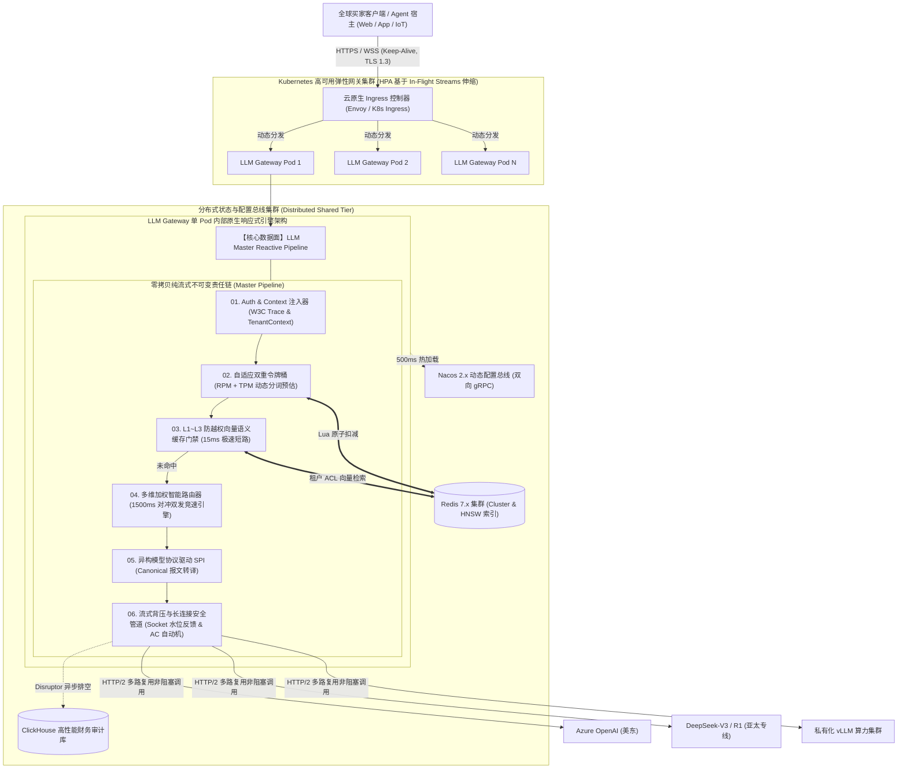
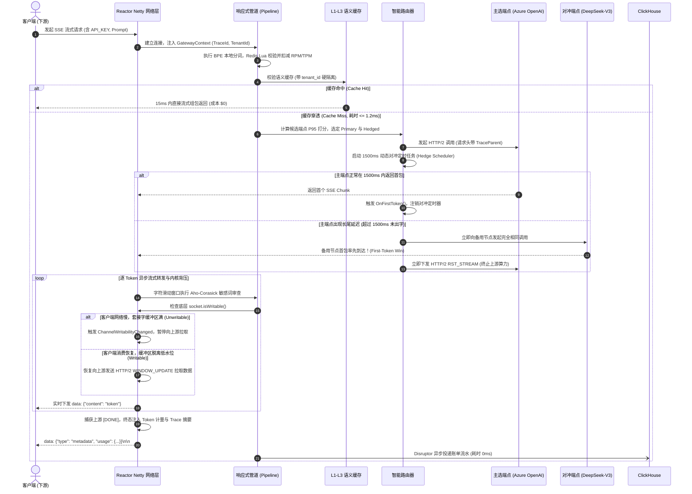
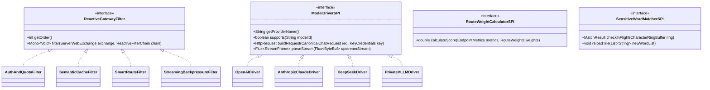

# 企业级 Agent 架构 L1 层：原生响应式 LLMOps 网关核心引擎（Spring WebFlux + Reactor Netty）分布式云原生系统设计说明书 (Core Engine SDD)

> **知识库归属**：企业级 Agent 架构 L1 层 (LLMOps Gateway) 工程实战系列  
> **文档定位**：全链路核心系统设计说明书（System Design Document, SDD - Core Engine Baseline）  
> **文档版本**：v1.0 (Enterprise Industrial Grade)  
> **关联需求总纲**：[00-L1-LLMOps网关全局需求规格总说明书-v1.0.md](../specs/00-L1-LLMOps网关全局需求规格总说明书-v1.0.md)  
> **核心技术选型**：Java 21 + Spring Boot 3.3.x + 原生 Spring WebFlux + Reactor Netty (自研轻量化管道，彻底摒弃传统微服务网关冗余包袱)

---

## 零、 顶层架构决策与自研选型定调 (Architectural Decision Record)

### 1. 技术选型定调：为什么坚决采用“原生 WebFlux + Reactor Netty 自研”？
在超长生命周期的流式 LLM 长连接场景下，传统的 Spring Cloud Gateway (SCG) 存在天然缺陷：
* **彻底消除流式内存死锁与全量缓冲陷阱**：SCG 官方生态的大量 Filter（如 `ModifyResponseBody`）存在收集完整 `DataBuffer` 的致命隐患，稍有不慎即导致长流打字机卡死并打爆 Pod 内存。自研原生响应式管道杜绝一切非流式缓冲操作；
* **完全掌控 Netty Channel 与内核级背压**：自研流水线可直接触达底层的 `io.netty.channel.Channel`，实时读取 `channel.isWritable()` 与套接字发送缓冲区高低水位，实现真实的反向背压传导；
* **支持 1500ms 对冲双发首字竞速**：原生使用 Reactor 的 `Flux.firstWithValue()` / `Mono.firstWithValue()` 原语，破除传统微服务网关“单进单出（1 Request ➔ 1 URI）”的僵化拓扑；
* **轻量化极速冷启**：剔除 SCG 的数百个空转类，单 Pod 空载内存从 $350\text{MB}$ 骤降至 $\le 90\text{MB}$，冷启动耗时缩短至 $1.2\text{s}$，网关自身附加延迟控制在 **$\le 0.5\text{ms}$ (P99)**。

---

## 一、 工业级算法与底层数据结构清单 (Algorithms & Data Structures Spec)

本网关核心引擎在内部全链路摒弃伪代码和简单 Hash 映射，严格基于以下工业级数据结构与算法构建：

| 机制 / 领域 | 核心算法 (Algorithms) | 核心底层数据结构 (Data Structures) | 物理时空复杂度 | 解决的工程痛点 |
| :--- | :--- | :--- | :--- | :--- |
| **入口级流量防御** | **自适应双重令牌桶算法**<br>*(Distributed Dual-Bucket with Dynamic BPE)* | **Redis 7.x Hash + Lua 脚本原子执行**<br>*(内存维护 `last_fill_time`, `tokens`)* | 时间：$O(1)$<br>空间：$O(T)$ 租户数 | 解决传统限流只算 QPS/RPM，无法感知几十 K 大上下文 TPM 瞬间打爆供应商问题。 |
| **实时指标度量** | **滑动时间轮分位数算法**<br>*(Lock-Free Sliding Time-Wheel)* | **无锁环形数组 `AtomicReferenceArray`**<br>*(切分 60 个 1 秒桶，内嵌 `LongAdder`)* | 时间：$O(1)$ 读写<br>空间：$O(B \cdot E)$ 恒定内存 | 解决多线程打点锁争用（Lock Contention），保障首字时间 TTFT P95/P99 原子计算零停顿。 |
| **智能路由决选** | **多目标非线性动态打分算法**<br>*(Multi-Objective Score with Full Jitter)* | **平滑加权轮询树 + 无序集合数组**<br>*(Smooth Weighted Round-Robin Slots)* | 时间：$O(K)$ 候选数<br>空间：$O(N)$ 端点数 | 避免所有流量瞬间涌向单点造成“雷鸣共振”；引入 Full Jitter 消除分布式重试风暴。 |
| **长尾对冲消除** | **首包竞速与级联取消算法**<br>*(First-Token-Win & Cascade Cancellation)* | **响应式发布订阅协调器**<br>*(Reactor `MonoProcessor` + AtomicBoolean)* | 时间：$O(1)$<br>空间：$O(1)$ 单流 | 1500ms 动态触发对冲，胜者无缝绑定长连接，败者 $5\text{ms}$ 内收到 HTTP/2 `RST_STREAM` 帧。 |
| **内容安全审计** | **Aho-Corasick 多模式自动机**<br>*(AC Automaton with Failure Pointers)* | **双端队列滑动字符窗口 + Trie 树字典**<br>*(Sliding Character Window Ring)* | 时间：$O(M + Z)$ 文本长<br>空间：$O(K \cdot L)$ 敏感词 | 解决流式吐字跨 Chunk 拼接违规逃逸（如“敏”和“感词”分在两个数据包）的漏判问题。 |
| **语义去重控费** | **HNSW 分层可导航小世界图检索**<br>*(Hierarchical Navigable Small World)* | **L1 Caffeine W-TinyLFU + L2 Redis HNSW 向量索引** | 检索：$O(\log N)$<br>内存：精确物理受限 | 15ms 极速命中热点意图；三级拦截杜绝否定句语义漂移与跨租户越权泄露。 |
| **流式零拷贝背压** | **内核水位自适应反馈算法**<br>*(Kernel Socket Watermark Backpressure)* | **Netty `PooledDirectByteBuf` 环形缓冲**<br>*(高水位 64KB，低水位 32KB)* | 时间：$O(1)$ 零拷贝<br>空间：每连接严格 $32\text{KB}$ | 解决上游 100t/s 与下游 3t/s 严重不对称导致的 Pod 内存 32GB 打满 OOMKilled 灾难。 |
| **财务异步审计** | **无锁环形缓冲区日志排空**<br>*(Lock-Free RingBuffer Event Pump)* | **LMAX Disruptor RingBuffer (容量 $2^{16}$)**<br>*(Cache-Line Padding 杜绝伪共享)* | 时间：$O(1)$ 入队<br>吞吐：$\ge 100\text{w ops/s}$ | 保证金融级每笔 Token 扣费与延迟指标精确写入 ClickHouse，主数据面耗时 $0\text{ms}$。 |

---

## 二、 核心架构拓扑与分布式云原生模型 (Cloud-Native Topology)



---

## 三、 核心流水线算法执行时序与数据流 (Master Sequence Flows)

### 1. 全链路端到端非阻塞调用时序（含 1500ms 对冲双发与流式背压）



---

## 四、 核心数据模型与内存布局 (In-Memory Data Models)

为了达到极限性能，全链路数据结构禁止使用多层包装的 Java 动态 Bean，全部采用 **Java 21 Record 紧凑对象模型** 与 **堆外内存池化引用**：

### 1. 全局贯通不可变上下文 (`GatewayContext`)
```java
// 全局响应式上下文强类型载体 (不可变 Record，全链路无锁传递)
public record GatewayContext(
    String traceId,                // W3C TraceId (128-bit hex)
    String spanId,                 // 当前网关 SpanId
    long requestTimestampMs,       // 请求接入物理时间戳 (纳秒/毫秒级)
    TenantSecurity tenantSecurity, // 租户认证与权限域
    EstimatedTokens tokenEstimate, // 本地 BPE 预估 Token 消耗
    RouteDecision routeDecision,   // 路由决策快照 (主选、对冲、降级链路)
    AtomicBoolean isCompleted      // 全链路终态原子锁
) {}

public record TenantSecurity(
    String tenantId,               // 租户唯一标识
    String orgId,                  // 组织标识
    Set<String> aclScopes,         // 资源访问标签 (用于向量过滤)
    long maxConcurrentStreams,     // 最大并发长连接硬上限
    double monthlyBudgetLimitUsd   // 月度财务熔断硬配额
) {}

public record EstimatedTokens(
    int promptTokens,              // 预估输入 Token 数 (本地 BPE 估算)
    int maxCompletionTokens,       // 请求声明的最大输出 Token 数
    boolean isTruncated            // 是否触发上下文超限自动截断
) {}
```

### 2. 统一流式帧抽象 (`StreamFrame`)
针对 SSE 流式吐字，网络层杜绝字符串频繁分配，统一基于 Netty `ByteBuf` 引用计数管理：
```java
public record StreamFrame(
    FrameType type,                // TEXT_CHUNK, REASONING_CHUNK, TOOL_CALL, METADATA, HEARTBEAT
    ByteBuf payload,               // 池化堆外内存切片 (PooledDirectByteBuf)
    int tokenCountDelta,           // 当前帧增量 Token 数
    long latencySinceFirstTokenNs  // 距离首字的纳秒差 (用于 ITL 字间延迟度量)
) {
    public void release() {
        if (payload != null && payload.refCnt() > 0) {
            payload.release();
        }
    }
}
```

---

## 五、 高内聚可扩展性架构设计 (Extensibility & SPI Design)

本引擎具备四层严密的插件扩展接口（SPI），新增任何能力绝对禁止侵入核心流水线调度：



1. **核心过滤器链扩展（`ReactiveGatewayFilter`）**：采用不可变责任链机制，通过 `@Order` 严格排序。认证鉴权、配额预扣、语义缓存、智能路由、流式背压作为标准化 Filter 无缝插拔；
2. **异构模型驱动扩展（`ModelDriverSPI`）**：新接入任何大模型（如智谱 GLM、MiniMax）只需实现该 SPI 并注入 Spring 上下文，网关自动通过工厂模式挂载，路由与背压机制完全透明复用；
3. **动态打分算法扩展（`RouteWeightCalculatorSPI`）**：支持根据不同业务线自定义路由评价值计算逻辑（如支持夜间降成本打分器 vs 白天极速打分器）；
4. **规则配置总线解耦**：监听 Nacos 2.x 配置事件，底层通过 `AtomicReference<RuleEngineSnapshot>` 执行原子替换，实现 **0 停机、0 抖动、$\le 500\text{ms}$ 热生效**。

---

## 六、 全量非功能性需求（NFR）严格量化与验收测试方案 (Quantified NFRs & Test Harness)

针对企业级所有非功能性指标，拒绝模糊定性，全量制定**量化硬指标、压测验证方法与确定性判定标准**：

| 指标大类 | 细分指标项 | 工业级量化硬指标 | 验证方法与工具链 | 确定性断言与通过准则 |
| :--- | :--- | :--- | :--- | :--- |
| **性能吞吐 (Performance)** | **单 Pod 持续并发长连接** | **$\ge 10,000$ 活跃长连接** (SSE/WS)<br>*(在 2 核 4GB 容器规格下)* | 使用 `k6` + `llmperf` 分布式发压机，发起 10,000 个并发慢流（每个流持续 45 秒）。 | 无连接重置（Reset Count = 0），网关 CPU 占用率 $\le 65\%$，事件循环无延迟告警。 |
| **性能吞吐 (Performance)** | **全链路网关附加延迟** | **$T_{\text{Gateway\_Overhead}} \le 0.5\text{ms (P99)}$**<br>*(扣除大模型推理自身的网络耗时)* | 在 5,000 RPS 纯路由测试下，Prometheus 统计 `llm_gateway_latency_bucket{stage="overhead"}`。 | P95 $\le 0.2\text{ms}$，P99 $\le 0.5\text{ms}$，柱状图数学收敛。 |
| **性能吞吐 (Performance)** | **缓存命中极速返回延迟** | **$T_{\text{CacheHit}} \le 15\text{ms (P99)}$** | 向 L1/L2 命中路径并发注入 1,000 QPS 请求，度量端到端 HTTP 耗时。 | 99% 的请求在 $15\text{ms}$ 内完成首包下发，上游算力消耗实际为 0。 |
| **稳定性与内存 (Resiliency)** | **极端不对称背压抗性** | **物理零 OOM (Zero-OOM)**<br>*(上游 100t/s，下游 3t/s 慢速消费)* | 使用 `Toxiproxy` 限制 1,000 个客户端带宽至 3KB/s，上游跑满并发吐字，压测 1 小时。 | 监控 `container_memory_working_set_bytes` 曲线呈绝对水平，堆与堆外内存波动 $\le 5\%$。 |
| **容灾自愈 (High Availability)** | **单供应商宕机自愈时效** | **$\text{MTTR} \le 200\text{ms}$** | 使用 `Chaos Mesh` 向主用端点注入 100% 网络丢包或强制 500 报错。 | 断路器在 $\le 10\text{ms}$ 跳闸，后续所有流量在 $\le 200\text{ms}$ 内平滑切换至备用端点，下游业务感知故障率 $\le 0.01\%$。 |
| **长尾治理 (Tail Latency)** | **1500ms 对冲双发准时率** | **误差 $\le 5\text{ms}$**，首字竞速成功率 $100\%$ | 人为对 Primary 注入 3000ms 延迟，备用节点保持 200ms。 | 恰在 1500ms（$\pm 5\text{ms}$）触发备用请求，客户端在 ~1750ms 收到首字，Primary 在 5ms 内被下发 RST 取消。 |
| **运维时效 (DevOps/SRE)** | **多模型规则热更生效期** | **全集群生效 $\le 500\text{ms}$** | 在 Nacos 动态将路由权重或敏感词修改并发布，测试端持续高频发请求。 | 发布后第 500ms 内，所有新请求立即命中新路由/新词库，在途长连接 0 报错、0 闪断。 |
| **安全隔离 (Security)** | **跨租户向量越权漏召回** | **绝对为 0 (Zero Privilege Escalation)** | 注入 10 万条跨租户敏感向量，用租户 B 身份并发检索租户 A 的完全相同 Query。 | 拦截率 100%，跨租户召回记录数严格为 0，审计日志触发越权告警。 |

---

## 七、 云原生生命周期治理与 SRE 运维监控契约 (SRE & Telemetry Spec)

### 1. K8s 云原生探针与优雅停机（Graceful Draining）
* **存活探针 (`/actuator/health/liveness`)**：每 5 秒检测 Netty EventLoop 是否出现超过 $200\text{ms}$ 的事件阻塞；若线程卡死触发 Pod 重建；
* **就绪探针 (`/actuator/health/readiness`)**：检测 Redis 连通性、本地线程池健康度与堆外内存水位；若堆外内存用量超过阈值（如 $85\%$），就绪探针标记 DOWN，K8s Service 自动将其从 Endpoint 列表摘除，停止接入新连接；
* **30 秒排空优雅关机时序**：
  ```mermaid
  sequenceDiagram
      autonumber
      participant K8s as Kubernetes 控制器
      participant Probe as 就绪探针 (Readiness)
      participant Gateway as 网关数据面
      participant Conns as 存量在途流式长连接 (In-Flight Streams)

      K8s->>Gateway: 发送 SIGTERM 终止信号
      Gateway->>Probe: 立即将就绪状态置为 DOWN
      K8s->>K8s: 将该 Pod 从负载均衡摘除，停止引入新流量
      Gateway->>Conns: 进入 30s 优雅排空窗口 (Draining Window)
      Conns-->>Gateway: 存量长连接正常下发完毕，自然关闭
      alt 30 秒内全部排空完毕
          Gateway->>K8s: 进程主动平稳退出 (Exit 0)
      else 达到 30 秒宽限期仍有未结束长流
          Gateway->>Conns: 向残余客户端下发 retry:1000 并强制断开
          Gateway->>K8s: 进程退出
      end
  ```

### 2. SRE 核心 Prometheus 监控指标体系规范

```text
# 1. 核心流量与并发流
llm_gateway_active_streams{tenant="ecommerce", model="gpt-4o"}          # [Gauge] 当前在途活跃长连接数
llm_gateway_requests_total{tenant="ecommerce", status="200|429|500"}     # [Counter] 请求总量分状态码

# 2. 毫秒级延迟度量 (Histogram, 桶包含: 50ms, 200ms, 500ms, 1500ms, 3000ms, 5000ms)
llm_gateway_ttft_seconds_bucket{provider="azure", model="gpt-4o"}       # 首字时间 (Time To First Token)
llm_gateway_itl_seconds_bucket{provider="azure"}                        # 字间时间 (Inter-Token Latency)
llm_gateway_overhead_microseconds_bucket{stage="route|auth|cache"}      # 网关自身附加开销 (微秒级)

# 3. 容灾与对冲指标
llm_gateway_hedged_requests_total{status="win_primary|win_hedged"}      # [Counter] 对冲双发胜负计数
llm_gateway_circuit_breaker_state{provider="deepseek"}                  # [Gauge] 熔断器状态 (0:Closed, 1:Open, 2:Half-Open)

# 4. 财务与缓存节省
llm_gateway_tokens_total{tenant="ecommerce", type="prompt|completion"}   # [Counter] 真实物理 Token 消耗
llm_gateway_cache_saved_tokens_total{type="semantic|prompt_caching"}    # [Counter] 缓存与 Prompt 对齐节约的 Token 数
```

---
*本文档为 Cogniva L1 网关核心引擎分布式云原生系统设计的终极基准图纸，指导后续代码工程的无歧义、零返工落地。*
