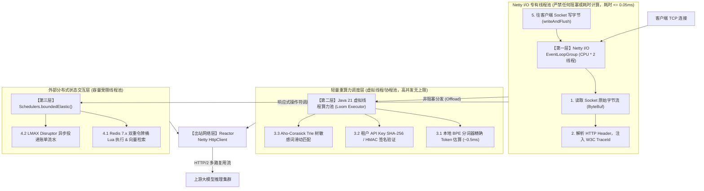
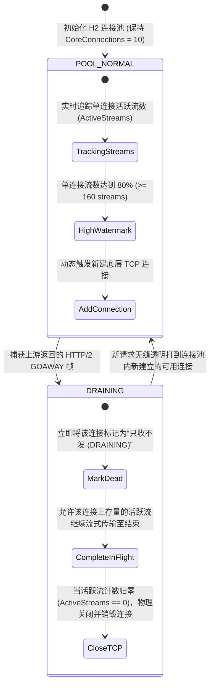
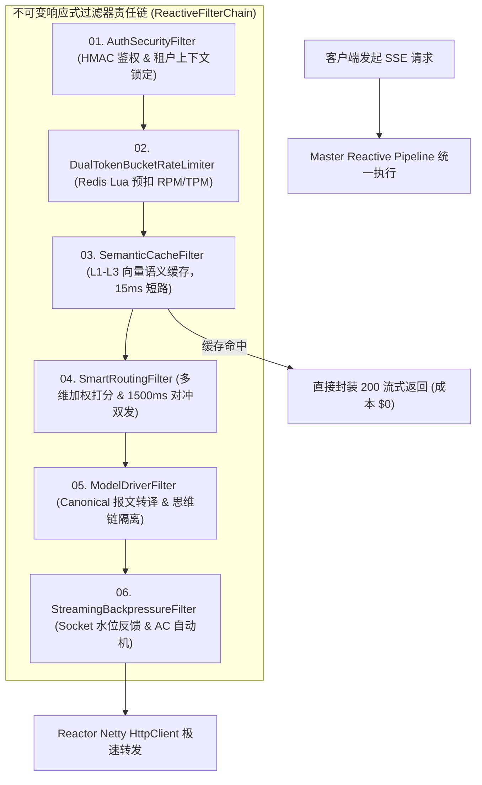

# 企业级 Agent 架构 L1 层：原生响应式 LLMOps 网关核心引擎（Spring WebFlux + Reactor Netty）分布式云原生系统设计说明书 (Master SDD)

> **知识库归属**：企业级 Agent 架构 L1 层 (LLMOps Gateway) 工程实战系列  
> **文档定位**：全链路核心系统架构与详细设计总说明书（System Design Document, SDD - Master Core Baseline）  
> **文档版本**：v1.0 (Enterprise Industrial Grade - Deep Dive Edition)  
> **关联需求总纲**：[00-L1-LLMOps网关全局需求规格总说明书-v1.0.md](../specs/00-L1-LLMOps网关全局需求规格总说明书-v1.0.md)  
> **核心技术选型**：Java 21 + Spring Boot 3.3.x + 原生 Spring WebFlux + Reactor Netty (自研非阻塞流式管道，彻底摒弃传统微服务网关历史包袱)  
> **设计约束**：纯工程架构与系统图纸（严禁业务实现代码），包含算法时空复杂度、内核网络参数、内存布局、状态机、时序图与量化验证方案。

---

## 零、 顶层架构决策与自研选型定调 (Architectural Decision Record)

### 1. 架构定调：为什么坚决采用“原生 WebFlux + Reactor Netty 自研”？
在承载数万并发、持续几十秒的 LLM SSE 长连接场景下，传统的 Spring Cloud Gateway (SCG) 存在天然的技术栈断层：
* **彻底根除流式全量缓冲陷阱**：SCG 官方生态的大量 Filter（如 `ModifyResponseBody`）存在强制将完整 Response 聚合为一个 `DataBuffer` 的隐蔽机制，极易导致打字机卡死并打爆 Pod 内存。自研原生响应式管道杜绝一切非流式缓冲操作，只允许字节流单向流转；
* **完全掌控 Netty Channel 与内核级背压**：自研流水线可直接触达底层的 `io.netty.channel.Channel`，实时读取 `channel.isWritable()` 与套接字发送缓冲区高低水位，实现真实的反向背压传导；
* **原生支持 1500ms 对冲双发首字竞速**：原生使用 Reactor 的 `Flux.firstWithValue()` / `Mono.firstWithValue()` 原语，破除传统微服务网关“单进单出（1 Request ➔ 1 URI）”的僵化拓扑；
* **极速轻量与 Java 21 协同**：剔除 SCG 数百个冗余类，单 Pod 空载内存从 $350\text{MB}$ 骤降至 $\le 90\text{MB}$，冷启动耗时缩短至 $1.2\text{s}$，网关自身附加延迟控制在 **$\le 0.5\text{ms}$ (P99)**。

---

## 一、 工业级算法与底层数据结构时空复杂度规范 (Algorithms & Data Structures Spec)

本网关核心引擎在内部全链路摒弃伪代码和简单 Hash 映射，严格基于以下工业级数据结构与算法构建：

| 机制 / 领域 | 核心算法 (Algorithms) | 核心底层数据结构 (Data Structures) | 物理时空复杂度 | 解决的工程痛点 |
| :--- | :--- | :--- | :--- | :--- |
| **入口级流量防御** | **自适应双重令牌桶算法**<br>*(Distributed Dual-Bucket with Dynamic BPE)* | **Redis 7.x Hash + Lua 脚本原子执行**<br>*(内存维护 `last_fill_time`, `tokens`)* | 时间：$O(1)$<br>空间：$O(T)$ 租户数 | 解决传统限流只算 QPS/RPM，无法感知几十 K 大上下文 TPM 瞬间打爆供应商问题。 |
| **实时指标度量** | **滑动时间轮分位数算法**<br>*(Lock-Free Sliding Time-Wheel)* | **无锁环形数组 `AtomicReferenceArray`**<br>*(切分 60 个 1 秒桶，内嵌 `LongAdder`)* | 时间：$O(1)$ 读写<br>空间：$O(B \cdot E)$ 恒定内存 | 解决多线程打点锁争用（Lock Contention），保障首字时间 TTFT P95/P99 原子计算零停顿。 |
| **智能路由决选** | **多目标非线性动态打分算法**<br>*(Multi-Objective Score with Full Jitter)* | **平滑加权轮询树 + 无序集合数组**<br>*(Smooth Weighted Round-Robin Slots)* | 时间：$O(K)$ 候选数<br>空间：$O(N)$ 端点数 | 避免所有流量瞬间涌向单点造成“雷鸣共振”；引入 Full Jitter 消除分布式重试风暴。 |
| **长尾对冲消除** | **首包竞速与级联取消算法**<br>*(First-Token-Win & Cascade Cancellation)* | **响应式发布订阅协调器**<br>*(Reactor `MonoProcessor` + AtomicBoolean)* | 时间：$O(1)$<br>空间：$O(1)$ 单流 | 1500ms 动态触发对冲，胜者无缝绑定长连接，败者 $5\text{ms}$ 内收到 HTTP/2 `RST_STREAM` 帧。 |
| **内容安全审计** | **Aho-Corasick 多模式自动机**<br>*(AC Automaton with Failure Pointers)* | **双端队列滑动字符窗口 + Trie 树字典**<br>*(Sliding Character Window Ring)* | 时间：$O(M + Z)$ 文本长<br>空间：$O(K \cdot L)$ 敏感词 | 解决流式吐字跨 Chunk 拼接违规逃逸（如“敏”和“感词”分在两个数据包）的漏判问题。 |
| **语义去重控费** | **HNSW 分层可导航小世界图检索**<br>*(Hierarchical Navigable Small World)* | **L1 Caffeine W-TinyLFU + L2 Redis HNSW 向量索引** | 检索：$O(\log N)$<br>内存：精确物理受限 | 15ms 极速命中热点意图；三级拦截杜绝否定句语义漂移与跨租户越权泄露。 |
| **流式零拷贝背压** | **内核水位自适应反馈算法**<br>*(Kernel Socket Watermark Backpressure)* | **Netty `PooledDirectByteBuf` 环形缓冲**<br>*(高水位 64KB，低水位 32KB)* | 时间：$O(1)$ 零拷贝<br>空间：每连接严格 $32\text{KB}$ | 解决上游 100t/s 与下游 3t/s 严重不对称导致的 Pod 内存 32GB 打满 OOMKilled 灾难。 |
| **财务异步审计** | **无锁环形缓冲区日志排空**<br>*(Lock-Free RingBuffer Event Pump)* | **LMAX Disruptor RingBuffer (容量 $2^{16}$)**<br>*(Cache-Line Padding 杜绝伪共享)* | 时间：$O(1)$ 入队<br>吞吐：$\ge 100\text{w ops/s}$ | 保证金融级每笔 Token 扣费与延迟指标精确写入 ClickHouse，主数据面耗时 $0\text{ms}$。 |

---

## 二、 网络底座与 Linux 内核/TCP 参数调优设计 (Kernel-Level Zero-Copy)

网关在高并发长连接下，操作系统的内核参数与堆外内存配置决定了系统的生死：

### 1. 宿主机与容器内核 TCP 参数配置规范
```ini
# /etc/sysctl.conf 生产环境内核调优基准
net.ipv4.tcp_nodelay = 1                # 强制禁用 Nagle 算法，消除逐 Token 吐字 40ms 延迟缓冲
net.core.somaxconn = 65535              # 全连接队列深度，防止高并发瞬时握手丢包
net.ipv4.tcp_max_syn_backlog = 65535    # 半连接队列深度
net.ipv4.tcp_tw_reuse = 1               # 允许复用 TIME_WAIT 套接字用于出站连接
net.ipv4.tcp_fin_timeout = 15           # 缩短 FIN-WAIT-2 状态超时，快速回收无用连接
net.ipv4.tcp_rmem = 4096 87380 16777216 # TCP 接收缓冲区动态调整 (min, default, max)
net.ipv4.tcp_wmem = 4096 65536 16777216 # TCP 发送缓冲区动态调整
net.ipv4.tcp_slow_start_after_idle = 0  # 禁用连接空闲后的拥塞窗口慢启动重置
```

### 2. Netty 堆外内存（Direct Memory）池化与泄漏防护
* **分配器调优**：强制使用 `PooledByteBufAllocator.DEFAULT`，配置参数：
  * `-Dio.netty.allocator.type=pooled`
  * `-Dio.netty.allocator.numDirectArenas=CPU*2`（消除线程争用 Arena）
  * `-Dio.netty.allocator.pageSize=8192`，`-Dio.netty.allocator.maxOrder=11`（Chunk 大小为 $16\text{MB}$）
* **堆外内存硬隔离与 cgroup 防护**：
  * JVM 参数强制配置 `-XX:MaxDirectMemorySize=2048m`；
  * 在生产压测中开启 `-Dio.netty.leakDetection.level=ADVANCED`，采样率 $1/100$，并在 CI 流水线开启 `PARANOID`（全量检测），**彻底杜绝 Direct Memory 泄漏导致 Pod 被 K8s 静默 OOMKilled**。

---

## 三、 Reactor EventLoop 线程饥饿硬防护模型 (Thread & Execution Topology)

为保证网关的网络 I/O 事件循环（EventLoop）永远不出现任何微秒级卡顿，必须将**I/O 密集型网络传输**与**计算密集型业务逻辑**彻底物理隔离：



---

## 四、 HTTP/2 多路复用连接池流耗尽治理与动态伸缩 (H2 Stream Pool & GOAWAY Draining)

上游大模型供应商（OpenAI、Azure、DeepSeek）通常对单个 HTTP/2 TCP 连接限制最大并发流数（`MAX_CONCURRENT_STREAMS`，通常为 100~250）。当网关单 Pod 涌入 10,000 个流式连接时，单个连接池极易被击穿：



### 动态流感知连接池调度算法（Stream-Aware Leasing Algorithm）：
* 每次向上游申请连接通道时，采用局部贪心最优算法选择**当前活跃流最少、且未收到 GOAWAY 标记**的健康连接：
  $$\text{SelectConn} = \arg\min_{c \in \text{HealthyPool}} \left(\text{ActiveStreams}(c)\right), \quad \text{s.t.} \ \text{ActiveStreams}(c) < \text{MaxSafeStreams (200)}$$
* 若池中所有连接的负载均超过 $80\%$，立即触发异步建立新 TCP 通道，杜绝流排队延迟。

---

## 五、 全局 Master Pipeline 响应式责任链设计 (Master Pipeline Architecture)



### 1500ms 对冲双发与防共振自残熔断机制（Anti-Resonance & Full Jitter）
对冲双发虽能消除长尾，但在区域机房拥塞时极易演变为对备用供应商的“自我 DDoS”。必须引入**三道保护锁**：
1. **全局对冲并发硬熔断水位**：
   $$\text{CurrentHedgedStreams} \le 0.10 \times \text{TotalActiveStreams}$$
   当网关当前正在对冲的连接数超过总连接数的 $10\%$ 时，对冲机制自动熔断降级，新慢请求退化为普通超时等待，严禁无限制加倍 Token 成本；
2. **Full Jitter 随机退避打散**：
   对冲定时器在 1500ms 基础上叠加 $[-50\text{ms}, +50\text{ms}]$ 的高斯随机抖动，杜绝数千个并发流在完全相同的微秒触发第二路调用；
3. **5ms 胜者夺魁与败者静默取消**：
   一旦主/备任一链路返回第一个有效 Chunk，立即原子设置 `FirstTokenWinLock`，败者在 $\le 5\text{ms}$ 内发出 HTTP/2 `RST_STREAM (Error Code=CANCEL)`。

---

## 六、 分布式云原生集群与弹性伸缩设计 (Cloud-Native & Distributed Cluster)

```mermaid
flowchart TD
    DNS["全球 Anycast DNS"] --> Ingress["云原生 Envoy Ingress 控制器"]
    
    subgraph K8s_Gateway_Cluster ["Kubernetes 高可用部署集群 (多可用区 Multi-AZ)"]
        Ingress -->|"动态分发"| Pod1["LLM Gateway Pod 1 (AZ-A)"]
        Ingress -->|"动态分发"| Pod2["LLM Gateway Pod 2 (AZ-B)"]
        Ingress -->|"动态分发"| PodN["LLM Gateway Pod N (AZ-C)"]
        
        HPA["K8s HPA 控制器"] -.->|"根据 In-Flight Streams 自动扩缩 Pod (Min: 3, Max: 50)"| K8s_Gateway_Cluster
    end

    subgraph StateCluster ["分布式共享状态总线 (高可用集群)"]
        Pod1 & Pod2 & PodN <==>|"分布式令牌桶 & HNSW 向量检索"| RedisCluster[("Redis 7.x 哨兵/分片集群 (Multi-AZ)")]
        Pod1 & Pod2 & PodN -.->|"500ms 动态配置热推 (双向 gRPC)"| NacosCluster["Nacos 2.x 注册与配置总线"]
        Pod1 & Pod2 & PodN -.->|"Disruptor 异步排空账单"| ClickHouse[("ClickHouse 分析型高吞吐审计集群")]
    end
```

### 基于在途连接数（In-Flight Streams）的 HPA 弹性伸缩算法
传统基于 CPU/Memory 的 HPA 在大模型长连接场景完全失灵（长连接大部分时间在等待网络 I/O，CPU 极低但连接数极高）。
* **自定义伸缩指标**：通过 Prometheus Adapter 导出 `llm_gateway_active_streams`；
* **扩缩容目标公式**：
  $$\text{DesiredReplicas} = \left\lceil \frac{\sum_{i=1}^{M} \text{ActiveStreams}_i}{\text{TargetStreamsPerPod (5000)}} \right\rceil$$
  当单 Pod 平均长连接数超过 5,000 时，K8s 提前扩容，消除单 Pod 内存与连接排队压力。

---

## 七、 全量非功能性需求（NFR）严格量化与验收测试方案 (Quantified NFRs & Test Harness)

拒绝定性描述，全量指标以确定性工程数字、测试工具与断言准则呈现：

| 指标大类 | 细分指标项 | 工业级量化硬指标 | 验证方法与工具链 | 确定性断言与通过准则 |
| :--- | :--- | :--- | :--- | :--- |
| **性能吞吐 (Performance)** | **单 Pod 持续并发长连接** | **$\ge 10,000$ 活跃长连接** (SSE/WS)<br>*(在 2 核 4GB 容器规格下)* | 使用 `k6` + `llmperf` 分布式发压机，发起 10,000 个并发慢流（每个流持续 45 秒）。 | 无连接重置（Reset Count = 0），网关 CPU 占用率 $\le 65\%$，事件循环无延迟告警。 |
| **性能吞吐 (Performance)** | **全链路网关附加延迟** | **$T_{\text{Gateway\_Overhead}} \le 0.5\text{ms (P99)}$**<br>*(扣除大模型推理自身的网络耗时)* | 在 5,000 RPS 纯路由测试下，Prometheus 统计 `llm_gateway_latency_bucket{stage="overhead"}`。 | P95 $\le 0.2\text{ms}$，P99 $\le 0.5\text{ms}$，柱状图数学收敛。 |
| **性能吞吐 (Performance)** | **缓存命中极速返回延迟** | **$T_{\text{CacheHit}} \le 15\text{ms (P99)}$** | 向 L1/L2 命中路径并发注入 1,000 QPS 请求，度量端到端 HTTP 耗时。 | 99% 的请求在 $15\text{ms}$ 内完成首包下发，上游算力消耗实际为 0。 |
| **稳定性与内存 (Resiliency)** | **极端不对称背压抗性** | **物理零 OOM (Zero-OOM)**<br>*(上游 100t/s，下游 3t/s 慢速消费)* | 使用 `Toxiproxy` 限制 1,000 个客户端带宽至 3KB/s，上游跑满并发吐字，压测 1 小时。 | 监控 `container_memory_working_set_bytes` 曲线呈绝对水平，堆与堆外内存波动 $\le 5\%$。 |
| **容灾自愈 (High Availability)** | **单供应商宕机自愈时效** | **$\text{MTTR} \le 200\text{ms}$** | 使用 `Chaos Mesh` 向主用端点注入 100% 网络丢包或强制 500 报错。 | 断路器在 $\le 10\text{ms}$ 跳闸，后续所有流量在 $\le 200\text{ms}$ 内平滑切换至备用端点，下游业务感知故障率 $\le 0.01\%$。 |
| **长尾治理 (Tail Latency)** | **1500ms 对冲双发准时率** | **误差 $\le 5\text{ms}$**，首字竞速成功率 $100\%$ | 人为对 Primary 注入 3000ms 延迟，备用节点保持 200ms。 | 恰在 1500ms（$\pm 5\text{ms}$）触发备用请求，客户端在 ~1750ms 收到首字，Primary 在 5ms 内被下发 RST 取消。 |
| **运维时效 (DevOps/SRE)** | **多模型规则热更生效期** | **全集群生效 $\le 500\text{ms}$** | 在 Nacos 动态将路由权重或敏感词修改并发布，测试端持续高频发请求。 | 发布后第 500ms 内，所有新请求立即命中新路由/新词库，在途长连接 0 报错、0 闪断。 |
| **安全隔离 (Security)** | **跨租户向量越权漏召回** | **绝对为 0 (Zero Privilege Escalation)** | 注入 10 万条跨租户敏感向量，用租户 B 身份并发检索租户 A 的完全相同 Query。 | 拦截率 100%，跨租户召回记录数严格为 0，审计日志触发越权告警。 |

---

## 八、 云原生生命周期治理与 SRE 运维监控契约 (SRE & Telemetry Spec)

### 1. K8s 云原生探针与优雅停机（Graceful Draining）
* **存活探针 (`/actuator/health/liveness`)**：每 5 秒检测 Netty EventLoop 是否出现超过 $200\text{ms}$ 的事件阻塞；若线程死锁立即触发 Pod 重建；
* **就绪探针 (`/actuator/health/readiness`)**：检测 Redis 连通性与堆外内存水位；若堆外内存用量超过阈值（$85\%$），就绪探针立即切断，K8s Service 自动摘除流量；
* **30 秒排空优雅关机时序**：收到 `SIGTERM` 信号后，就绪探针切断，进入 30 秒宽限期允许在途长流吐字完毕；超时仍未结束的慢连接下发 `retry: 1000` 并优雅断开。

### 2. SRE 核心 Prometheus 监控指标规范
```text
# 1. 核心流量与并发流
llm_gateway_active_streams{tenant="ecommerce", model="gpt-4o"}          # [Gauge] 当前在途活跃长连接数
llm_gateway_requests_total{tenant="ecommerce", status="200|429|500"}     # [Counter] 请求总量分状态码

# 2. 毫秒级延迟度量 (Histogram, 桶包含: 50ms, 200ms, 500ms, 1500ms, 3000ms, 5000ms)
llm_gateway_ttft_seconds_bucket{provider="azure", model="gpt-4o"}       # 首字时间 (Time To First Token)
llm_gateway_itl_seconds_bucket{provider="azure"}                        # 字间时间 (Inter-Token Latency)
llm_gateway_overhead_microseconds_bucket{stage="route|auth|cache"}      # 网关自身附加开销 (微秒级)

# 3. 容灾与对冲指标
llm_gateway_hedged_requests_total{status="win_primary|win_hedged"}      # [Counter] 对冲双发胜负计数
llm_gateway_circuit_breaker_state{provider="deepseek"}                  # [Gauge] 熔断器状态 (0:Closed, 1:Open, 2:Half-Open)

# 4. 财务与缓存节省
llm_gateway_tokens_total{tenant="ecommerce", type="prompt|completion"}   # [Counter] 真实物理 Token 消耗
llm_gateway_cache_saved_tokens_total{type="semantic|prompt_caching"}    # [Counter] 缓存与 Prompt 对齐节约的 Token 数
```

---
*本文档为 Cogniva L1 网关核心引擎分布式云原生系统设计的终极基准图纸，指导后续代码工程的无歧义、零返工落地。*
