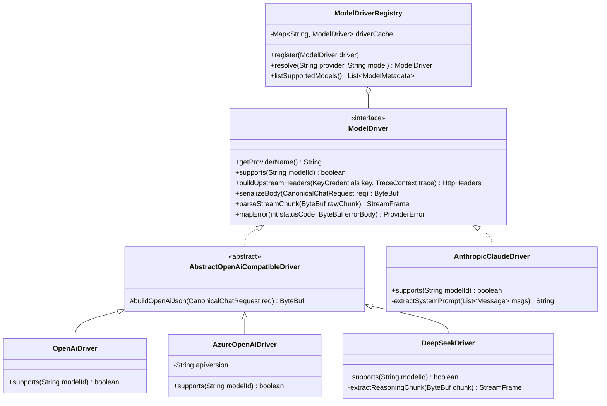
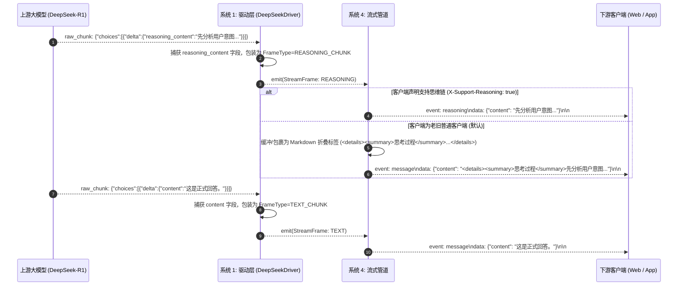
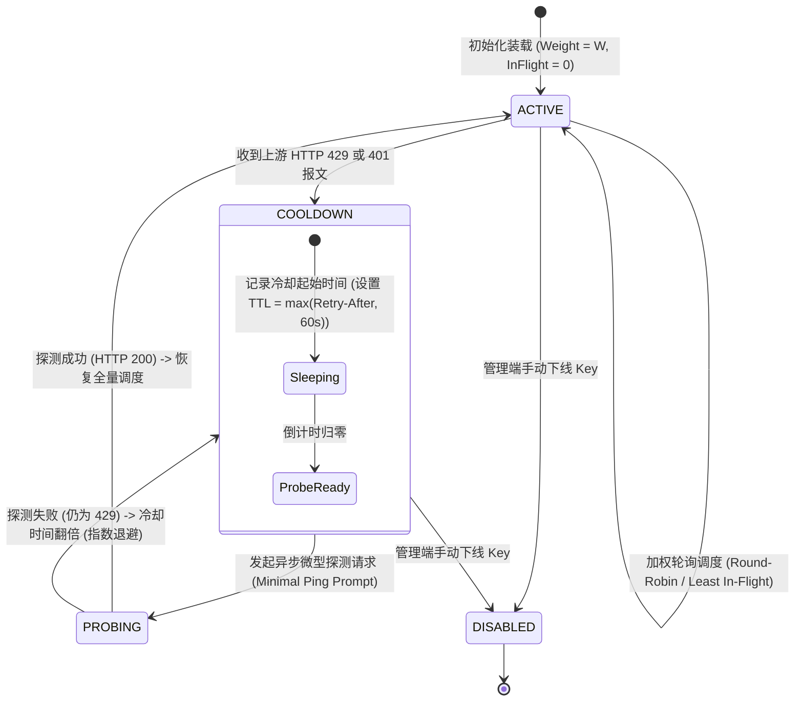
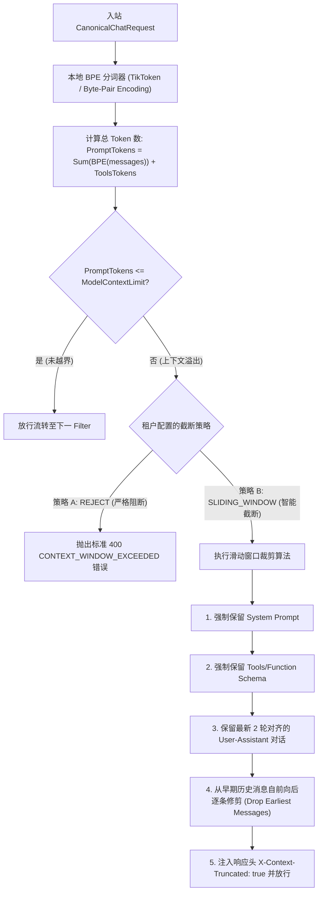

# L1 网关系统 1：异构模型驱动与协议转译引擎 —— 系统功能设计说明书 (FSD)

> **知识库归属**：企业级 Agent 架构 L1 层 (LLMOps Gateway) 工程实战系列  
> **文档定位**：系统 1 (Model Driver & Protocol Adapter Engine) 详细功能设计图纸（Functional System Design, FSD）  
> **文档版本**：v1.0 (Enterprise Industrial Grade)  
> **关联需求总纲**：[01-L1-Sys1-异构模型统一驱动与适配器-需求规格说明书-v1.0.md](../specs/01-L1-Sys1-异构模型统一驱动与适配器-需求规格说明书-v1.0.md)  
> **关联全局架构**：[00-L1-LLMOps网关全局架构与核心引擎系统设计说明书-v1.0.md](./00-L1-LLMOps网关全局架构与核心引擎系统设计说明书-v1.0.md)  
> **设计约束**：纯工程设计（严禁业务实现代码），包含算法时序图、数据模型 Schema、字段映射矩阵、状态转移机与 QA 测试矩阵。

---

## 零、 模块定位与执行拓扑 (Module Positioning & Topology)

系统 1 在全局 Master Pipeline 中承担**“协议归一化（Northbound Inbound）”**与**“异构驱动调度（Southbound Outbound）”**的双向职责：
* **北向输入**：接收客户端符合 `CanonicalChatRequest` 规范的标准报文；
* **南向输出**：根据系统 2 决选的物理端点，调度对应的 `ModelDriver` 插件，将请求转译为特定供应商（OpenAI、Claude、DeepSeek、Gemini）的原生报文；
* **流式反向归一**：将上游流式返回的异构 Chunk 零拷贝解析并包装为标准内部 `StreamFrame`，独立剥离 `reasoning_content` 思维链。

---

## 一、 驱动 SPI 架构设计与生命周期管理 (Driver SPI Model)



### 1. 驱动加载与注册机制
* **动态发现（Spring SPI）**：利用 Spring 容器的 `@ConditionalOnProperty` 与统一接口自动装配，所有实现 `ModelDriver` 的组件在网关启动时自动注册到 `ModelDriverRegistry`；
* **只读查找性能**：注册表底层使用不可变哈希表 `Map<String, ModelDriver>`，运行时查找复杂度为 $O(1)$，全程无读写锁争用。

---

## 二、 异构模型字段双向映射矩阵 (Cross-Provider Mapping Matrix)

下表规范了网关标准字段与四大主流供应商 API 报文字段的映射转换规则：

| 标准规范字段 (Canonical Schema) | OpenAI / Azure API (`/v1/chat/completions`) | Anthropic Claude API (`/v1/messages`) | DeepSeek-V3 / R1 (`/v1/chat/completions`) | Google Gemini REST (`:generateContent`) | 转译处理逻辑 |
| :--- | :--- | :--- | :--- | :--- | :--- |
| `model` | `model` | `model` | `model` | URL Path 中的 modelId | 原样透传或根据别名表转译 |
| `messages[role='system']` | `messages[role='system']` | 顶级字段 `system: "..."` | `messages[role='system']` | `systemInstruction.parts[].text` | **Claude 剥离**：从 messages 数组剔除，提取至顶层 |
| `messages[role='user']` | `messages[role='user']` | `messages[role='user']` | `messages[role='user']` | `contents[role='user'].parts[].text` | 统一结构 |
| `temperature` | `temperature` (0.0~2.0) | `temperature` (0.0~1.0) | `temperature` (0.0~2.0) | `generationConfig.temperature` | **标度归一**：Claude 超出 1.0 时强制截断为 1.0 |
| `tools` (函数定义) | `tools[].function` | `tools[].input_schema` | `tools[].function` | `tools[].function_declarations` | **Schema 转换**：JSON Schema 格式双向对齐 |
| `stream` | `stream: true` | `stream: true` | `stream: true` | URL Path `:streamGenerateContent` | HTTP POST 端点切换 |
| **思维链输出** | 暂无（o1 内部隐藏） | `<thinking>...</thinking>` (3.7) | `choices[0].delta.reasoning_content` | `candidates[0].content.parts[].thought` | **强隔离分流**：写入 `StreamFrame.REASONING_CHUNK` |

---

## 三、 深度思考模型思维链（Reasoning）分流时序与缓冲模型

针对 DeepSeek-R1、Claude 3.7 Thinking 等具备思维链的模型，驱动层必须执行**物理分流**，严禁与正式回答文本混淆：



---

## 四、 动态多 Key 凭据池与 429 冷却自愈状态机 (Key Pool State Machine)

为解决企业单 Key 极易触发供应商频控的问题，每个供应商维护一个线程安全的动态 Key 资源池：



### 调度算法参数模型：
* **调度选择器**：计算每个活跃 Key 的得分：
  $$\text{KeyScore}_i = \frac{\text{CurrentInFlight}_i + 1}{\text{ConfiguredWeight}_i}$$
  每次调用优先挑选 $\text{KeyScore}$ 最小的可用 Key，实现动态负载均衡。

---

## 五、 本地高精度 BPE 分词与上下文滑动窗口预截断算法

为了在不消耗网络 RTT 的前提下完成 Token 预估并防止上下文超限，集成高性能本地分词算法：



---

## 六、 形式化数据模型契约 (Formal Schemas)

### 1. 规范化入站请求模型 (`CanonicalChatRequest` Schema)
```json
{
  "$schema": "http://json-schema.org/draft-07/schema#",
  "title": "CanonicalChatRequest",
  "type": "object",
  "required": ["model", "messages"],
  "properties": {
    "model": { "type": "string", "description": "逻辑模型标识符，如 gpt-4o, claude-3-5-sonnet, deepseek-r1" },
    "messages": {
      "type": "array",
      "items": {
        "type": "object",
        "required": ["role", "content"],
        "properties": {
          "role": { "type": "string", "enum": ["system", "user", "assistant", "tool"] },
          "content": { "type": ["string", "array"] },
          "name": { "type": "string" },
          "tool_call_id": { "type": "string" }
        }
      }
    },
    "temperature": { "type": "number", "minimum": 0.0, "maximum": 2.0, "default": 0.7 },
    "top_p": { "type": "number", "minimum": 0.0, "maximum": 1.0, "default": 1.0 },
    "max_tokens": { "type": "integer", "minimum": 1 },
    "stream": { "type": "boolean", "default": false },
    "tools": { "type": "array" },
    "tool_choice": { "type": ["string", "object"] },
    "custom_extensions": { "type": "object", "description": "特定供应商的底层透传参数" }
  }
}
```

---

## 七、 交付与测试追踪矩阵 (Traceability Matrix)

| 需求编号 | 功能项 | 测试场景与验证手段 | 预期断言指标 |
| :--- | :--- | :--- | :--- |
| **FR-01** | Canonical 请求转译 | 输入标准请求，分别经 OpenAI、Claude、DeepSeek 驱动序列化 | 序列化输出 JSON 100% 符合官方 API 规范，无字段遗失 |
| **FR-03** | 工具调用转译 | 携带标准 Tools 请求 Claude 驱动 | 成功转译为 `tools[].input_schema`，Claude 正常识别并返回 ToolCall |
| **FR-04** | 思维链物理分流 | 模拟 DeepSeek-R1 SSE 数据流（混杂 reasoning 与 content） | `StreamFrame` 分流正确率 100%，无思考内容向前端泄露 |
| **FR-06** | Key 池 429 隔离自愈 | 向上游某单一 API Key 注入 HTTP 429 | Key 自动置入 60s 冷却，池内备用 Key 平滑接管，请求 0 失败 |
| **NFR-01** | 编解码延迟预算 | 5000 QPS 并发打压驱动转译模块 | 单次转译耗时 P99 $\le 0.5\text{ms}$，无大对象 GC 停顿 |

---

## 八、 面向开发、QA、SRE 与 AI 的落地指引

* **对后端研发**：根据 `ModelDriver` 接口规范与映射表编写各供应商 Driver，严格使用 Netty `ByteBuf` 切片解析，禁止动态反射；
* **对 QA 测试**：根据映射矩阵编写单元测试与参数边界测试（重点测试 Claude 的 1.0 截断、System Prompt 剥离）；
* **对 SRE 运维**：通过 Nacos 动态更新 `key_credentials_pool` 配置，监控 Key 状态机指标 `llm_gateway_key_status`；
* **对 AI 编码引擎**：将本设计书作为上下文，逐驱动类（如 `DeepSeekDriver.java`）进行 TDD 单元测试与类结构生成。
