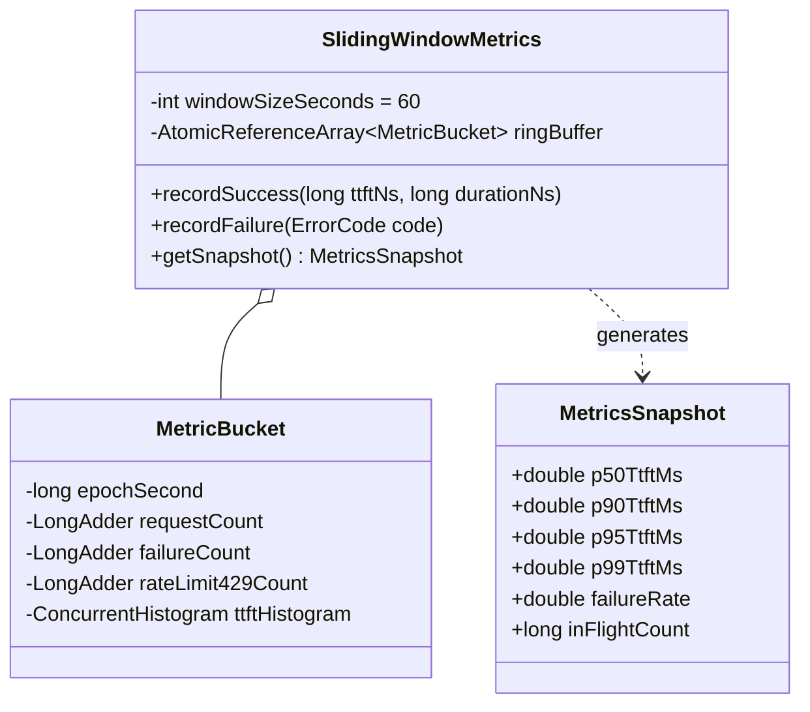
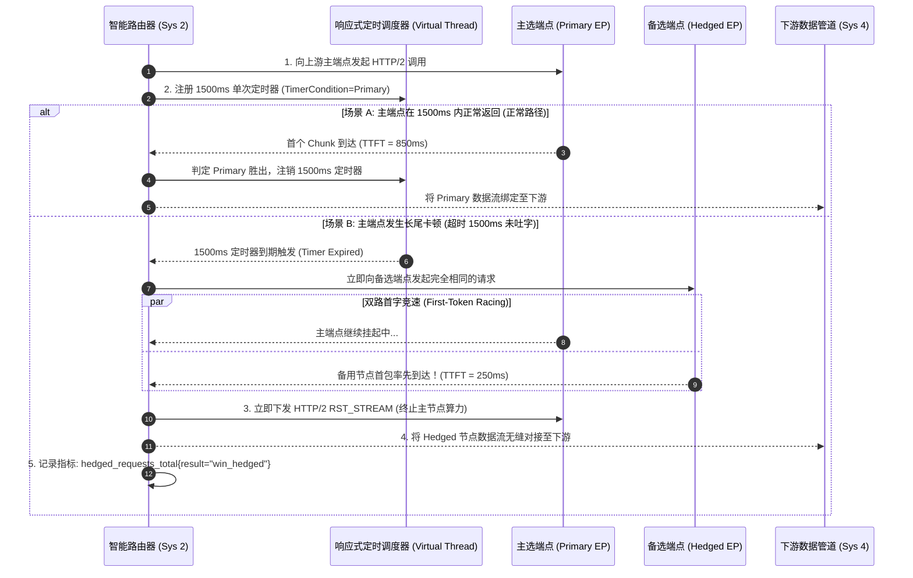
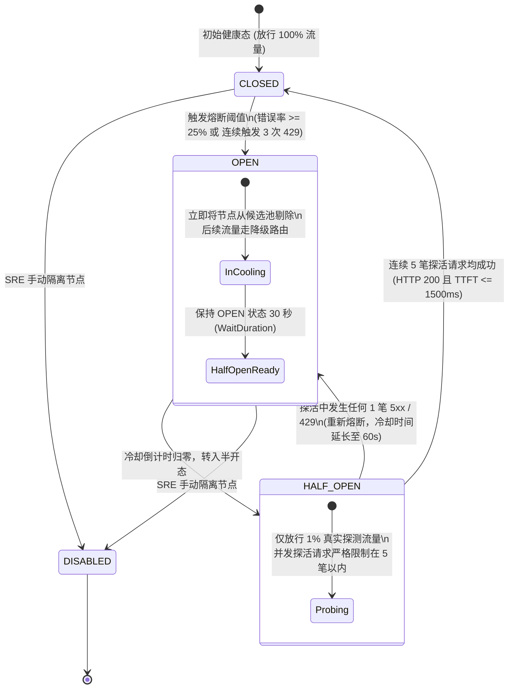
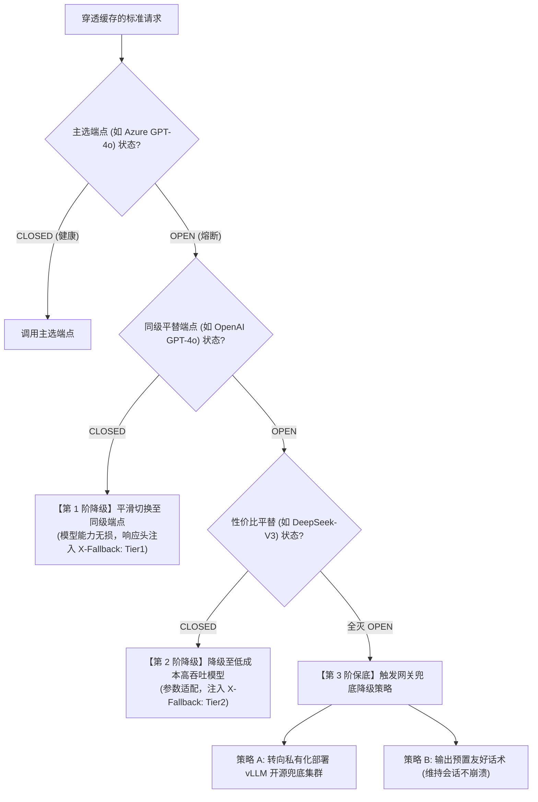

# L1 网关系统 2：多维智能路由与断路降级引擎 —— 系统功能设计说明书 (FSD)

> **知识库归属**：企业级 Agent 架构 L1 层 (LLMOps Gateway) 工程实战系列  
> **文档定位**：系统 2 (Smart Router & Circuit Breaker Engine) 详细功能设计图纸（Functional System Design, FSD）  
> **文档版本**：v1.0 (Enterprise Industrial Grade)  
> **关联需求总纲**：[02-L1-Sys2-多维智能路由与断路降级引擎-需求规格说明书-v1.0.md](../specs/02-L1-Sys2-多维智能路由与断路降级引擎-需求规格说明书-v1.0.md)  
> **关联复盘案例**：[01-L1-Case-01-稳定性抖动与SLA容灾降级-RCA实战.md](../cases/01-L1-Case-01-稳定性抖动与SLA容灾降级-RCA实战.md)  
> **关联全局架构**：[00-L1-LLMOps网关全局架构与核心引擎系统设计说明书-v1.0.md](./00-L1-LLMOps网关全局架构与核心引擎系统设计说明书-v1.0.md)  
> **设计约束**：纯工程设计（严禁业务实现代码），包含算法时序图、数据模型 Schema、数学公式、状态机与 QA 混沌测试矩阵。

---

## 零、 模块定位与决策拓扑 (Module Positioning & Topology)

系统 2 是 L1 LLMOps 网关的**“流量决策大脑与容灾控制中枢”**。它紧承系统 3 缓存穿透检查之后，负责为每一个进入实质推理阶段的 LLM 请求挑选最合理的物理端点（Provider Endpoint）：
* **动态多维打分**：基于“滑动窗口首字时间（P95 TTFT）+ Token 成本权重 + 错误率”实施多目标动态打分；
* **消灭长尾延迟**：主选端点在 1500ms 内未出字时，激活**对冲双发（Hedged Requests）**，首字竞速胜出；
* **秒级故障自愈**：出现连续 429 或 5xx 时，在 **$\le 200\text{ms}$** 内完成断路器跳闸并触发三阶优雅降级。

---

## 一、 无锁滑动时间轮数据结构 (Lock-Free Sliding Time-Wheel)

为了在高并发下以极低开销统计每个端点的 P95 TTFT 与错误率，采用基于连续内存的无锁环形数组（RingBuffer Bucket）：



### 环形时间轮物理更新算法：
1. **当前秒索引定位**：$\text{index} = (\text{CurrentEpochSecond}) \pmod{60}$；
2. **过期桶原子清空（CAS）**：若读取桶的 `epochSecond` 不等于当前物理秒，利用 CAS 操作将 `MetricBucket` 内的 `LongAdder` 与直方图重置为当前秒；
3. **读写性能**：打点与采样全程无全局互斥锁，时空复杂度恒定为 $O(1)$，对主数据面附加延迟 $\le 0.05\text{ms}$。

---

## 二、 多目标动态打分数学模型与 Full Jitter 防共振公式

### 1. 综合评价值打分方程
为候选端点集合中的每个物理节点 $i$ 计算综合代价得分 $S_i$（分值越小越优）：

$$S_i = w_{\text{lat}} \cdot \left(\frac{\text{TTFT}_{\text{P95}}(i)}{\text{BaseLatency}}\right) + w_{\text{cost}} \cdot \left(\frac{\text{TokenCost}(i)}{\text{BaseCost}}\right) + w_{\text{err}} \cdot \left(\frac{\text{ErrorCount}_{60\text{s}}(i)}{\text{TotalCount}_{60\text{s}}(i) + 1}\right) + w_{\text{in}} \cdot \left(\frac{\text{InFlight}(i)}{\text{MaxCapacity}(i)}\right)$$

* **权重归一化约束**：$w_{\text{lat}} + w_{\text{cost}} + w_{\text{err}} + w_{\text{in}} = 1.0$（可通过配置中心热调整）；
* **基准常数**：$\text{BaseLatency} = 1000\text{ms}$，$\text{BaseCost} = \$0.002 / 1\text{K tokens}$。

### 2. Full Jitter 指数退避加随机抖动公式
在触发重试或对冲调度时，为了避免集群几千个长连接在同一微秒发起重试造成“自制流量雪崩（Thundering Herd）”，引入 Full Jitter 随机打散：

$$T_{\text{sleep}} = \text{random}\left(0, \ \min\left(T_{\text{max}}, \ T_{\text{base}} \cdot 2^{\text{attempt}}\right)\right)$$

---

## 三、 1500ms 对冲双发首字竞速全链路时序图 (Hedged Request Racing)



---

## 四、 断路器三态状态机转移矩阵 (Circuit Breaker State Machine)



### 供应商 429 自适应退避机制（Adaptive Backoff）：
若上游明确返回 `Retry-After: N` 响应头，状态机强制将冷却时间设定为：
$$\text{ActualCoolDown} = \max\left(N, \ 30\text{s}\right)$$
严禁在冷却期未满时盲目向该端点注入探活流量。

---

## 五、 三阶优雅降级决策树 (Fallback Cascading Ladder)



---

## 六、 形式化配置数据模型 (Routing Policy Schema)

```json
{
  "$schema": "http://json-schema.org/draft-07/schema#",
  "title": "RoutingAndResiliencePolicy",
  "type": "object",
  "required": ["policy_id", "hedged_request", "circuit_breaker", "fallback_ladder"],
  "properties": {
    "policy_id": { "type": "string", "example": "ecommerce_presale_fast" },
    "weights": {
      "type": "object",
      "properties": {
        "latency_weight": { "type": "number", "default": 0.4 },
        "cost_weight": { "type": "number", "default": 0.3 },
        "error_weight": { "type": "number", "default": 0.2 },
        "inflight_weight": { "type": "number", "default": 0.1 }
      }
    },
    "hedged_request": {
      "type": "object",
      "properties": {
        "enabled": { "type": "boolean", "default": true },
        "timeout_ms": { "type": "integer", "default": 1500 },
        "max_hedged_concurrency_ratio": { "type": "number", "default": 0.10 }
      }
    },
    "circuit_breaker": {
      "type": "object",
      "properties": {
        "failure_rate_threshold": { "type": "number", "default": 0.25 },
        "sliding_window_seconds": { "type": "integer", "default": 60 },
        "wait_duration_in_open_state_seconds": { "type": "integer", "default": 30 },
        "probe_concurrency_limit": { "type": "integer", "default": 5 }
      }
    },
    "fallback_ladder": {
      "type": "array",
      "items": { "type": "string" },
      "example": ["azure_gpt4o_eastus", "openai_gpt4o_direct", "deepseek_v3_asia", "local_vllm_qwen"]
    }
  }
}
```

---

## 七、 交付与测试追踪矩阵 (Traceability Matrix)

| 需求编号 | 功能项 | 验证场景与混沌测试工具 | 预期断言指标 |
| :--- | :--- | :--- | :--- |
| **FR-01** | 无锁滑动窗口 | 5000 QPS 并发打点持续 10 分钟 | 内存无泄漏，打点与计算耗时 P99 $\le 0.05\text{ms}$ |
| **FR-02** | 多维加权打分 | 调整 $w_{\text{cost}}$ 权重从 0.1 上浮至 0.8 | 流量分配自动向便宜端点倾斜，倾斜比例与数学模型误差 $\le 2\%$ |
| **FR-03** | 1500ms 对冲双发 | `Toxiproxy` 注入主端点 3000ms 首字延迟，备用节点 200ms | 1500ms 准时触发对冲，客户端 ~1750ms 出字，主节点 5ms 内收到 RST |
| **FR-04** | 断路器跳闸与自愈 | `Chaos Mesh` 向主节点注入 100% 500 报错 | 10ms 跳闸，后续请求 200ms 内平滑切流，探活成功后平滑自愈 |
| **FR-05** | 阶梯降级梯队 | 依次熔断 Tier 1 与 Tier 2 端点 | 网关自动顺延至 Tier 3，返回包含正确 `X-Fallback` 标头 |

---

## 八、 面向开发、QA、SRE 与 AI 的落地指引

* **对后端研发**：根据时序图使用 Reactor 的 `Mono.firstWithValue` 编写对冲竞速逻辑，指标统计严格使用 `AtomicReferenceArray`；
* **对 QA 测试**：利用 Toxiproxy 编写对冲双发边界测试（模拟主节点在 1490ms 与 1510ms 返回首包的临界断言）；
* **对 SRE 运维**：监控 `llm_gateway_circuit_breaker_state` 与 `llm_gateway_hedged_requests_total`，设置熔断跳闸告警；
* **对 AI 编码引擎**：将本设计书作为上下文，逐类生成 `SmartRouter.java` 与 `HedgedRequestDispatcher.java`。
