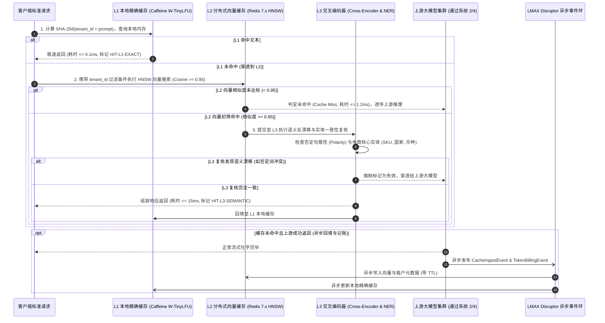
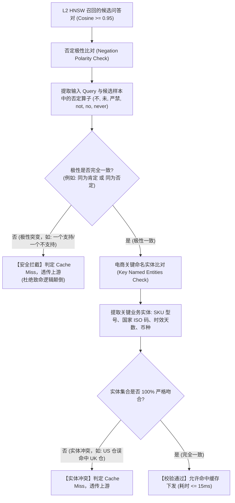
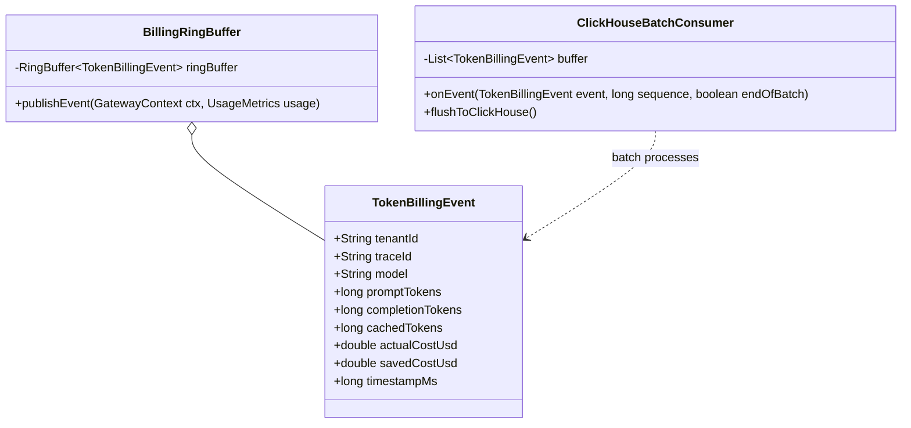

# L1 网关系统 3：防越权向量语义缓存与控费引擎 —— 系统功能设计说明书 (FSD)

> **知识库归属**：企业级 Agent 架构 L1 层 (LLMOps Gateway) 工程实战系列  
> **文档定位**：系统 3 (Anti-Privilege Semantic Cache & Cost Engine) 详细功能设计图纸（Functional System Design, FSD）  
> **文档版本**：v1.0 (Enterprise Industrial Grade)  
> **关联需求总纲**：[03-L1-Sys3-防越权向量语义缓存与控费引擎-需求规格说明书-v1.0.md](../specs/03-L1-Sys3-防越权向量语义缓存与控费引擎-需求规格说明书-v1.0.md)  
> **关联复盘案例**：[01-L1-Case-03-Token成本失控与语义缓存对账-RCA实战.md](../cases/01-L1-Case-03-Token成本失控与语义缓存对账-RCA实战.md)  
> **关联全局架构**：[00-L1-LLMOps网关全局架构与核心引擎系统设计说明书-v1.0.md](./00-L1-LLMOps网关全局架构与核心引擎系统设计说明书-v1.0.md)  
> **设计约束**：纯工程设计（严禁业务实现代码），包含算法时序图、数据模型 Schema、数学公式、Redis/ClickHouse 物理拓扑与越权渗透测试矩阵。

---

## 零、 模块定位与分层缓存拓扑 (Module Positioning & Topology)

系统 3 位于 Master Pipeline 的入站第一道路由分支前（系统 1 协议归一化之后，系统 2 智能路由之前）：
* **成本阻断门禁**：对高频重复意图，通过 L1~L3 递进式缓存实现 **$15\text{ms}$ 极速响应并达成 \$0 算力支出**；
* **租户硬隔离安全**：强制将 `tenant_id` 与权限标签注入向量检索语句，**跨租户越权漏召回率严格为 0%**；
* **防否定句漂移**：引入轻量级 Cross-Encoder 语义二阶复核与命名实体（NER）比对，杜绝“支持”与“不支持”混淆；
* **Prompt 物理对齐**：标准化系统提示词与工具定义前缀，激发云厂商底层 Prompt Caching 复用，压降 60%~80% 成本；
* **双时钟无锁记账**：基于 LMAX Disruptor 异步将 Token 流水刷入 ClickHouse，并在租户超额时毫秒级熔断。

---

## 一、 L1~L3 递进式缓存查询与回填全链路时序图 (Cache Sequence Flow)



---

## 二、 Redis 7.x 向量与元数据存储模型 (RediSearch Schema)

在 Redis 7.x 中创建 RediSearch 索引，强制将租户标识与 ACL 设置为可快速过滤的 `TAG` 类型：

```redis
FT.CREATE idx:semantic_cache ON HASH
PREFIX 1 cache:doc:
SCHEMA
  tenant_id TAG NOINDEX CASESENSITIVE
  acl_scope TAG CASESENSITIVE
  model_family TAG CASESENSITIVE
  query_text TEXT NOSTEM
  response_payload TEXT NOINDEX
  created_at NUMERIC SORTABLE
  ttl_expires NUMERIC SORTABLE
  embedding VECTOR HNSW 6
    TYPE FLOAT32
    DIM 1536
    DISTANCE_METRIC COSINE
    M 16
    EF_CONSTRUCTION 200
```

### 1. 租户安全强制预过滤查询语句 (Mandatory Pre-Filtering)
检索时必须强制拼接租户与权限过滤子句，**严禁无租户约束的裸 KNN 检索**：
$$\text{Query} = \left(@\text{tenant\_id}:\{\text{tenant\_001}\} \ @\text{acl\_scope}:\{\text{public}|\text{vip}\}\right) \Rightarrow [\text{KNN } 1\ \text{@embedding } \$vec\ \text{AS score}]$$

---

## 三、 语义反漂移与命名实体（NER）极性校验算法 (Anti-Drift Guard)



---

## 四、 Prompt 四层物理对齐编排模型 (Prompt Caching Alignment)

为了激发 OpenAI、Claude、DeepSeek 底层的 K-V Cache 复用机制（节约高达 80% 输入 Token 成本），网关强制规范 Prompt 的物理编排顺序：

```text
┌────────────────────────────────────────────────────────────────────────┐
│  第 1 层：静态系统角色指令 (Static System Persona)                     │
│  - 纯静态全局提示词，严禁插入时间戳或用户会话 ID                       │
│  - 长度严格对齐 >= 1024 tokens（满足云厂商 Prompt Cache 起步阈值）       │
├────────────────────────────────────────────────────────────────────────┤
│  第 2 层：静态工具声明定义 (Static Tools / Function Schemas)            │
│  - 所有可调用工具的 JSON Schema 定义                                   │
│  - 强制按工具名称字符字典序（Alphabetical Sort）稳定排列               │
├────────────────────────────────────────────────────────────────────────┤
│  第 3 层：半静态业务背景知识 (Semi-Static Few-Shots & RAG Context)      │
│  - 业务标准政策知识、少样本示例（Few-Shot Examples）                   │
│  - 相同意图下的上下文保持物理前缀稳定                                  │
├────────────────────────────────────────────────────────────────────────┤
│  第 4 层：动态历史与末尾用户提问 (Dynamic History & User Query)         │
│  - 历史多轮对话记录（最近 N 轮）                                      │
│  - 终端买家当前最新输入（Dynamic Suffix 追加在尾部）                   │
└────────────────────────────────────────────────────────────────────────┘
```

---

## 五、 LMAX Disruptor 异步双时钟记账与 ClickHouse 模型

为避免记账 I/O 阻塞主数据面，采用高性能无锁 Disruptor 环形队列异步排空：



### ClickHouse 高性能审计对账表 DDL 规范：
```sql
CREATE TABLE llm_token_billing_log (
    tenant_id LowCardinality(String),
    trace_id String,
    model LowCardinality(String),
    provider LowCardinality(String),
    prompt_tokens UInt32,
    completion_tokens UInt32,
    cached_tokens UInt32,
    actual_cost_usd Float64,
    saved_cost_usd Float64,
    ttft_ms UInt32,
    status_code UInt16,
    event_time DateTime64(3, 'UTC')
) ENGINE = MergeTree()
PARTITION BY toYYYYMM(event_time)
ORDER BY (tenant_id, event_time, trace_id)
TTL event_time + INTERVAL 365 DAY;
```

---

## 六、 交付与测试追踪矩阵 (Traceability Matrix)

| 需求编号 | 功能项 | 验证场景与渗透测试手段 | 预期断言指标 |
| :--- | :--- | :--- | :--- |
| **FR-01** | L1~L3 递进式缓存 | 并发注入 1000 笔相同意图查询 | 首笔穿透，后续 999 笔 100% 缓存命中，端到端耗时 P99 $\le 15\text{ms}$ |
| **FR-02** | 跨租户防越权隔离 | 租户 A 生成缓存；租户 B 发起完全相同向量的 Query | 租户 B 强制未命中并穿透，跨租户越权漏召回率严格为 0% |
| **FR-03** | 语义反漂移 | 测试“支持跨境包邮吗”与“不支持跨境包邮吗”两个 Query | 肯定句命中缓存，否定句触发极性冲突被安全拦截并穿透 |
| **FR-04** | Prompt Caching 激发 | 按照四层结构发起 10 轮长会话对话 | 上游返回的 `cached_tokens` 占比稳定 $\ge 70\%$，Token 成本显著下降 |
| **FR-05** | 实时预算硬熔断 | 为测试租户配置 \$1.00 预算，持续打流使其额度耗尽 | 预算耗尽瞬间，后续请求毫秒级拦截返回 402/429，账单 0 穿透 |

---

## 七、 面向开发、QA、SRE 与 AI 的落地指引

* **对后端研发**：根据时序图集成 Caffeine 与 RediSearch 客户端，严禁拼接裸向量 SQL，必须注入租户预过滤；
* **对 QA 测试**：设计跨租户越权攻击用例集与否定句漂移用例集，执行自动化断言；
* **对 SRE / DBA**：部署 Redis 7.x 集群并开启 AOF 持久化，监控 ClickHouse 写入批量延迟；
* **对 AI 编码引擎**：将本设计书作为上下文，逐类生成 `SemanticCacheManager.java` 与 `TokenBillingConsumer.java`。
