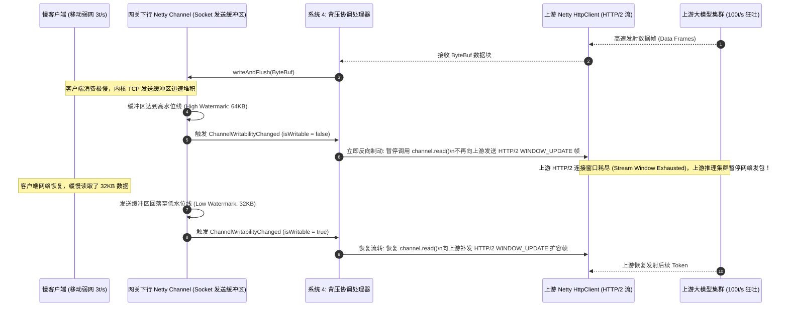
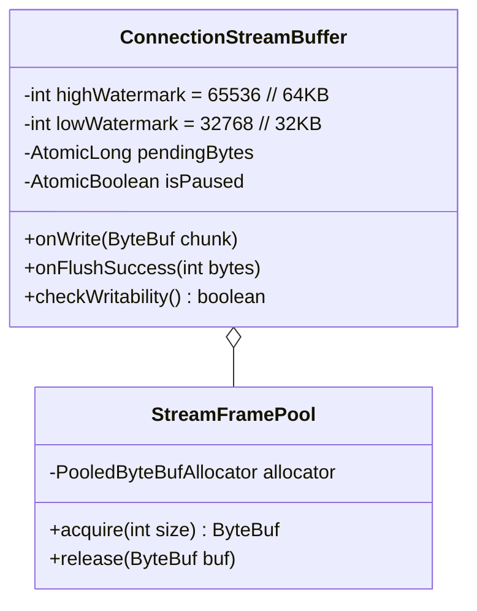
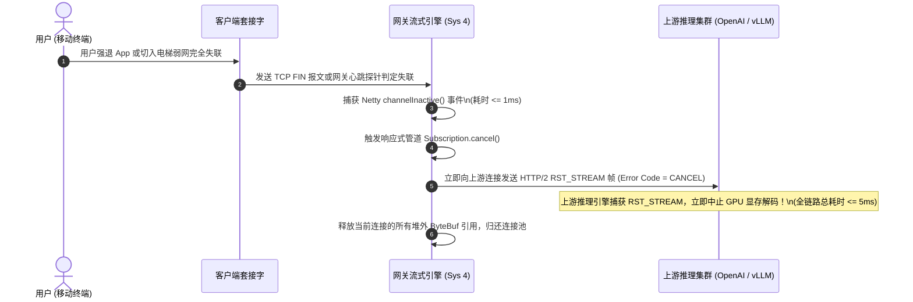
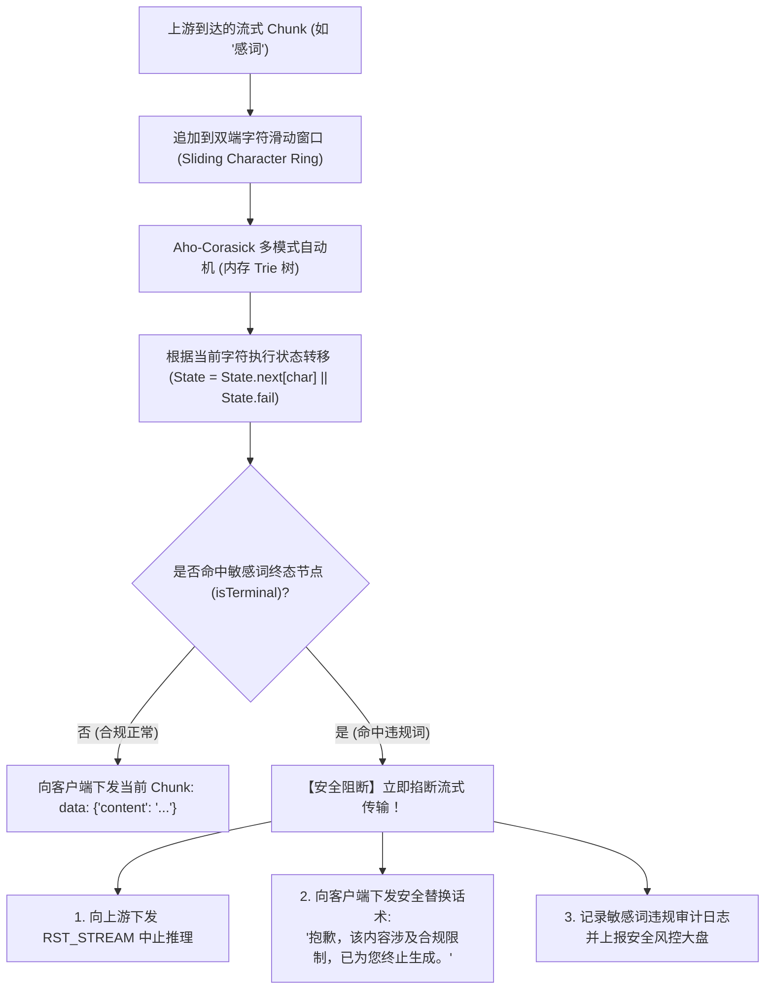

# L1 网关系统 4：全异步流式背压与长连接治理引擎 —— 系统功能设计说明书 (FSD)

> **知识库归属**：企业级 Agent 架构 L1 层 (LLMOps Gateway) 工程实战系列  
> **文档定位**：系统 4 (Streaming Backpressure & Connection Governance Engine) 详细功能设计图纸（Functional System Design, FSD）  
> **文档版本**：v1.0 (Enterprise Industrial Grade)  
> **关联需求总纲**：[04-L1-Sys4-流式背压与长连接治理引擎-需求规格说明书-v1.0.md](../specs/04-L1-Sys4-流式背压与长连接治理引擎-需求规格说明书-v1.0.md)  
> **关联复盘案例**：[01-L1-Case-02-长连接背压吞吐瓶颈与内存OOM-RCA实战.md](../cases/01-L1-Case-02-长连接背压吞吐瓶颈与内存OOM-RCA实战.md)  
> **关联全局架构**：[00-L1-LLMOps网关全局架构与核心引擎系统设计说明书-v1.0.md](./00-L1-LLMOps网关全局架构与核心引擎系统设计说明书-v1.0.md)  
> **设计约束**：纯工程设计（严禁业务实现代码），包含算法时序图、数据模型 Schema、底层 Netty 水位状态机、Wire-Level RST 取消流程与弱网压测矩阵。

---

## 零、 模块定位与数据面拓扑 (Module Positioning & Topology)

系统 4 是 L1 LLMOps 网关的**“数据面非阻塞传输管道与长连接安全内核”**。它处于大模型异构推理集群（上游）与全球分布式买家终端（下游）之间：
* **快产慢消物理制动**：在上游生产速率（100t/s）与下游移动弱网消费速率（3t/s）严重失配时，**以内核级 Socket 发送缓冲区水位反向制动上游 HTTP/2 流量控制，实现绝对 Zero-OOM**；
* **客户端断网毫秒级级联取消**：当用户关闭浏览器或 App 闪退时，在 **$\le 5\text{ms}$** 内向上游发送 HTTP/2 `RST_STREAM`，掐断无效计算，避免 Token 巨额浪费；
* **流式跨分块实时内容安全**：基于 Aho-Corasick 多模式自动机与双端字符滑动窗口，在流式吐字的同时实时拦截敏感违规词。

---

## 一、 内核套接字背压传导与状态流转时序图 (Backpressure Sequence Flow)

---

## 二、 固定 32KB 环形缓冲 Zero-OOM 数据模型 (Memory Bound Model)

为了保障万级并发长连接下 Pod 内存绝对平稳，单连接缓冲区受到严格的物理边界约束：

### 内存有界性数学证明：
设单 Pod 承载 $N$ 个并发活跃长连接，每个连接在最极端的阻塞状态下最多积压一个高水位阈值的数据量：
$$\text{MaxDirectMemory} = N \cdot \text{HighWatermark} = 10,000 \times 64\text{KB} = 640\text{MB}$$
在 4GB 物理内存容器中，缓冲区常驻内存仅占 **$16\%$**，数学上彻底杜绝内存无底洞堆积导致的 `OOMKilled`。

---

## 三、 客户端断网级联取消全链路时序图 (Cascade Cancellation)

---

## 四、 Aho-Corasick 多模式自动机流式跨分块审查算法 (Stream AC Automaton)

针对大模型边生成边吐字时，不良词汇可能跨 Chunk 拼接逃逸的问题，维护固定大小的字符滑动窗口：

---

## 五、 激进心跳探测与长连接保活机制 (Aggressive KeepAlive)

为了防止中间设备（如 AWS ALB、NAT 网关、家庭路由器）在模型长思考期间因 60s 空闲超时而掐断 TCP 连接：
1. **SSE 注释空行心跳（Application Ping）**：
   * 网关启动定时调度器，若某长连接持续 **15 秒** 未产生任何有效 Token；
   * 网关主动向客户端下发一行 W3C 标准的 SSE 注释行：`:keep-alive\n\n`；
   * 客户端标准 SSE 接收器会自动忽略注释行，但整个网络物理链路的 Idle 计时器被成功重置。
2. **TCP 保活探针（Transport KeepAlive）**：
   * 开启套接字底层 `SO_KEEPALIVE`，设置探测参数：`tcp_keepalive_time=30`，`tcp_keepalive_intvl=5`，`tcp_keepalive_probes=3`。

---

## 六、 交付与测试追踪矩阵 (Traceability Matrix)

| 需求编号 | 功能项 | 验证场景与弱网压测手段 | 预期断言指标 |
| :--- | :--- | :--- | :--- |
| **FR-01** | SSE 协议规范化 | 连接长流并抓包检验 HTTP 响应标头 | 包含 `text/event-stream`、`no-cache`、`X-Accel-Buffering: no` |
| **FR-03** | 慢客户端内核背压 | `Toxiproxy` 限制 1,000 个客户端带宽为 3KB/s，压测 1 小时 | Pod 物理内存波动 $\le 5\%$，无 OOMKilled，上游收到背压暂停 |
| **FR-04** | 主动断线级联取消 | 客户端建立长流吐字到第 50 字时强制 kill 进程 | 网关向上游发出的 HTTP/2 `RST_STREAM` 在 $\le 5\text{ms}$ 内发出 |
| **FR-05** | 15s 激进保活心跳 | 模拟大模型挂起思考 120 秒，中间不吐字 | 每隔 15s 客户端收到 `:keep-alive\n\n`，连接在 120s 期间零断连 |
| **FR-06** | 跨分块敏感词审查 | 故意切分恶意词：“敏”放在 Chunk 1，“感词”放在 Chunk 2 | AC 自动机成功拼接识别，流式传输在第 2 个 Chunk 瞬间掐断 |

---

## 七、 面向开发、QA、SRE 与 AI 的落地指引

* **对网络开发**：基于 Netty `ChannelInboundHandlerAdapter` 重写 `channelWritabilityChanged`，直接与响应式 `Subscription.request(n)` 联动；
* **对 QA 测试**：利用 Toxiproxy 模拟跨国丢包与 3G 弱网，利用 Wireshark 抓包检验 RST 帧的时延；
* **对 SRE 运维**：监控 `llm_gateway_active_streams` 与 `container_memory_working_set_bytes`，配置背压连接数告警；
* **对 AI 编码引擎**：将本设计书作为上下文，生成 `BackpressureStreamBridge.java` 与 `StreamGuardrailFilter.java`。
