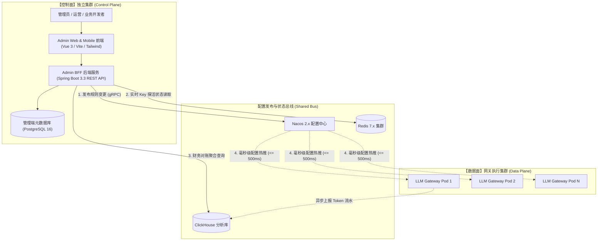
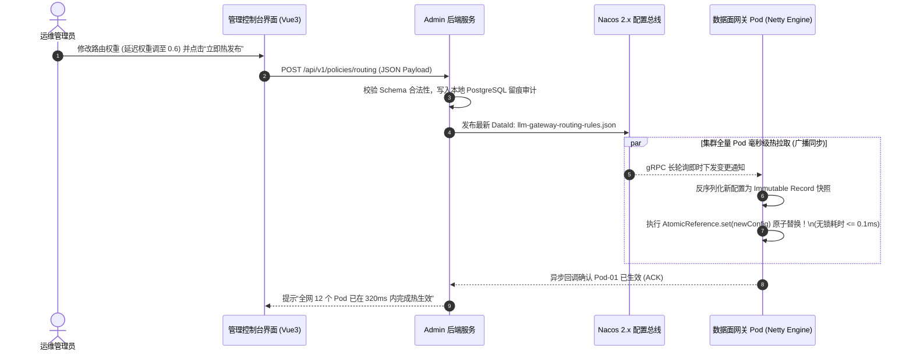

# L1 网关管理端：网关管理控制台与运营平台 —— 系统功能设计说明书 (FSD)

> **知识库归属**：企业级 Agent 架构 L1 层 (LLMOps Gateway) 工程实战系列  
> **文档定位**：管理控制面 (Admin Console & Operations Platform) 详细功能设计图纸（Functional System Design, FSD）  
> **文档版本**：v1.0 (Enterprise Industrial Grade)  
> **关联需求总纲**：[05-L1-Admin-LLMOps网关管理控制台与运营平台-需求规格说明书-v1.0.md](../specs/05-L1-Admin-LLMOps网关管理控制台与运营平台-需求规格说明书-v1.0.md)  
> **关联全局架构**：[00-L1-LLMOps网关全局架构与核心引擎系统设计说明书-v1.0.md](./00-L1-LLMOps网关全局架构与核心引擎系统设计说明书-v1.0.md)  
> **设计约束**：纯工程设计（严禁业务实现代码），包含系统拓扑图、交互时序图、数据模型 Schema、Playground UI 布局图与测试矩阵。

---

## 零、 模块定位与控制面拓扑 (Module Positioning & Topology)

管理控制台是 L1 LLMOps 网关的**“运营指挥中枢与控制面（Control Plane）”**：
* **控制面与数据面物理强隔离**：管理端独立部署，其任何突发高负载或故障，**对数据面网关的流式高并发转发影响严格为 0**；
* **毫秒级全生命周期配置热更**：多模型凭据池、智能路由权重、断路器阈值、敏感词库等，通过 Nacos 2.x 配置总线实现 **$\le 500\text{ms}$** 集群 Pod 热同步；
* **跨端调试工作台 (Playground)**：提供 PC 端与移动端完美自适应的交互式调试平台，支持实时流式吐字、DeepSeek-R1 思维链抽屉分流与一键模拟故障注入。

---

## 一、 控制面与数据面物理隔离架构拓扑 (Blast Radius Isolation)



---

## 二、 动态规则毫秒级热更发布与同步时序图 (Config Hot-Reloading)



---

## 三、 租户与三维配额管理模型 (Tenant Quota Schema)

```json
{
  "$schema": "http://json-schema.org/draft-07/schema#",
  "title": "TenantQuotaConfig",
  "type": "object",
  "required": ["tenant_id", "api_key_hash", "quotas"],
  "properties": {
    "tenant_id": { "type": "string", "example": "tenant_ecommerce_cs" },
    "org_id": { "type": "string", "example": "org_crossborder_retail" },
    "api_key_hash": { "type": "string", "description": "SHA-256 存储的密钥哈希" },
    "status": { "type": "string", "enum": ["ACTIVE", "SUSPENDED", "EXPIRED"] },
    "quotas": {
      "type": "object",
      "required": ["max_concurrent_streams", "rpm_limit", "tpm_limit", "monthly_budget_usd"],
      "properties": {
        "max_concurrent_streams": { "type": "integer", "default": 1000 },
        "rpm_limit": { "type": "integer", "description": "每分钟请求上限", "default": 3000 },
        "tpm_limit": { "type": "integer", "description": "每分钟 Token 上限", "default": 500000 },
        "monthly_budget_usd": { "type": "number", "description": "月度预算硬熔断额度", "default": 2000.00 }
      }
    },
    "allowed_models": {
      "type": "array",
      "items": { "type": "string" },
      "example": ["gpt-4o", "claude-3-5-sonnet", "deepseek-r1"]
    }
  }
}
```

---

## 四、 跨端 Playground 交互界面结构设计 (Playground Layout)

Playground 是开发者验证网关能力的核心工作台，采用响应式双栏（PC 端）与折叠抽屉（移动端）设计：

```text
┌────────────────────────────────────────────────────────────────────────┐
│                        Cogniva LLMOps Playground                       │
├──────────────────────────┬─────────────────────────────────────────────┤
│   【左侧：配置与控制面板】   │            【右侧：流式对话主视窗】              │
│                          │                                             │
│ 租户选择: [电商客服 Agent ▼]│ ┌─────────────────────────────────────────┐ │
│ 目标模型: [deepseek-r1   ▼]│ │ 买家: SKU-8891 什么时候能送到英国？     │ │
│ Temperature: [ 0.7  ──●─]│ └─────────────────────────────────────────┘ │
│                          │ ┌─────────────────────────────────────────┐ │
│ [开关] 激活 1500ms 对冲双发 │ │ ▼ 深度思考过程 (Reasoning Content)      │ │
│ [开关] 开启 L1-L3 语义缓存  │ │   首先匹配物流知识库，UK 专线时效 3-5 天 │ │
│                          │ └─────────────────────────────────────────┘ │
│ ┌──────────────────────┐ │ 智能助手 (已流式完成 128 tokens, TTFT: 680ms)│
│ │ [模拟故障注入]        │ │ 根据您的海外仓配置，该商品将于 3-5 个工作日  │ │
│ │ 🔘 上游 429 频控     │ │ 送达英国伦敦及周边地区。                      │ │
│ │ 🔘 上游 3000ms 慢响应 │ └─────────────────────────────────────────┘ │
│ └──────────────────────┘ │                                             │
│                          │ 输入 Prompt: [                               ] │
│                          │       [发送 / Send]   [清空会话]              │
└──────────────────────────┴─────────────────────────────────────────────┘
```

### 核心交互功能点：
1. **真实打字机与首字打点**：展示 TTFT（首字耗时）、ITL（字间耗时）与 Token 计数器；
2. **思维链抽屉（Reasoning Drawer）**：针对 DeepSeek-R1，将思考过程收敛至折叠抽屉，支持随时展开查看思考逻辑；
3. **模拟故障一键注入**：测试人员可一键勾选“注入 429”或“注入 3000ms 慢首包”，现场直接检验对冲双发与断路降级是否生效。

---

## 五、 交付与测试追踪矩阵 (Traceability Matrix)

| 需求编号 | 功能项 | 验证场景与测试用例 | 预期断言指标 |
| :--- | :--- | :--- | :--- |
| **AFR-01** | 租户三维配额控制 | 在控制台设置月预算 \$5.00，压测触发超额 | 额度耗尽瞬间，网关返回 HTTP 402，前端展示清晰欠费告警 |
| **AFR-02** | 密钥热添加与冷却看板 | 在管理端录入新 Key，向其中一 Key 注入 429 | 新 Key 在 500ms 内生效；触发 429 的 Key 实时显示 60s 倒计时看板 |
| **AFR-03** | 动态加权打分在线调整 | 拖拽滑块将 $w_{\text{cost}}$ 权重从 0.2 调至 0.8 | 数据面流量在 500ms 内自动平滑倾斜至低成本供应商 |
| **AFR-04** | 敏感词在线热推 | 在控制台新增敏感词“恶意退款”，立即发提问 | 500ms 内该词被流式安全组件拦截并替换为安全话术 |
| **AFR-06** | 跨端 Playground 交互 | 在手机端 Safari 与 PC 端 Chrome 打开 Playground 调试 | SSE 流式吐字平滑，思维链抽屉正常展开，故障注入正确触发降级 |

---

## 六、 面向前端、全栈、QA 与 AI 的落地指引

* **对前端研发**：基于 Vue 3 + Tailwind CSS + Vite 开发响应式管理端，重点优化 Playground 的 Markdown 实时流式渲染；
* **对后端研发**：根据 Schema 编写 Admin REST API，重点保证与 Nacos 的配置发布通道具备事务与重试能力；
* **对 QA 测试**：设计管理端权限 RBAC 测试用例，以及 Nacos 网络分区下的配置兜底测试；
* **对 AI 编码引擎**：将本设计书作为上下文，逐个模块生成 `TenantManagementController.java` 与 `PlaygroundConsole.vue`。
