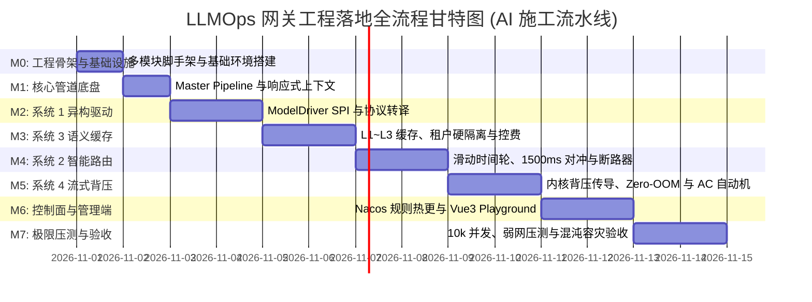

# 企业级 Agent 架构 L1 层：LLMOps 网关工程落地 AI 执行总计划书 (Execution Roadmap)

> **知识库归属**：企业级 Agent 架构体系 L1 层 (LLMOps Gateway) 工程实战系列  
> **文档定位**：面向 AI Coding 智能体与工程团队的端到端实施计划书（AI-Executable Implementation Plan）  
> **文档版本**：v1.0 (Engineering Baseline)  
> **输入依据**：  
> * 需求总规与子需求：[specs/ 目录 (00 ~ 05)](../specs/)  
> * 全局架构与系统详细设计图纸：[designs/ 目录 (00 ~ 05)](../designs/)  
> **核心原则**：  
> 1. **单向递进（TDD 驱动）**：每个步骤必须包含“前置输入 ➔ 待建目标文件 ➔ 单元测试断言 ➔ 完成定义 (DoD) ➔ Git Checkpoint”；  
> 2. **AI 无歧义执行**：明确模块边界与命令，AI 代理可无需人工反复确认、独立逐个 Milestone 自闭环施工。

---

## 零、 工程工程结构与模块划分 (Project Multi-Module Topology)

整体工程采用 **Java 21 + Spring Boot 3.3.x + Gradle/Maven 多模块单进程流水线** 拓扑，源码落位在 `/services/cogniva-gateway`：

```text
services/cogniva-gateway/
├── pom.xml                                   # 根 pom: 管理 Java 21, Spring Boot 3.3, Netty, Redis, Nacos 版本
├── gateway-core/                             # [核心基础] Master Pipeline, GatewayContext, 异常体系, W3C Trace
├── gateway-adapter/                          # [系统 1] ModelDriver SPI, CanonicalSchema, 异构转译, Key 池
├── gateway-router/                           # [系统 2] 无锁滑动时间轮, 1500ms 对冲双发, 三态断路器, 降级阶梯
├── gateway-cache/                            # [系统 3] L1-L3 缓存, Redis HNSW 检索, 反漂移, Disruptor 记账
├── gateway-streaming/                        # [系统 4] 内核 Socket 水位背压, 32KB 环形缓冲, 5ms 级联取消, AC 自动机
├── gateway-admin/                            # [控制面] Admin REST API, Nacos 500ms 配置热发布, RBAC
└── gateway-admin-ui/                         # [管理端前端] Vue 3 + Vite + Tailwind CSS 响应式控制台 & Playground
```

---

## 一、 AI 落地施工八大里程碑甘特图 (Milestones Overview)



---

## 二、 阶段拆解与 AI 逐步执行手册 (Step-by-Step Task Breakdown)

---

### 【Milestone 0】工程脚手架与依赖底座搭建 (Scaffold & Foundation)

* **执行目标**：建立 Java 21 + Spring Boot 3.3.x 多模块结构，配置基础依赖版本锁，打通编译与单测流水线。
* **输入依据**：[00-L1-LLMOps网关全局架构与核心引擎系统设计说明书-v1.0.md](../designs/00-L1-LLMOps网关全局架构与核心引擎系统设计说明书-v1.0.md) 第零章、第二章。

#### 任务清单：
1. **TASK-0.1 根 POM 与多模块目录脚手架建立**
   * 创建 `services/cogniva-gateway/pom.xml`，锁定核心版本：
     * Java: `21`
     * Spring Boot: `3.3.4` (引入 `spring-boot-starter-webflux`，**绝不引入** `spring-cloud-starter-gateway`)
     * Reactor Netty: `1.1.23`
     * Caffeine: `3.1.8`
     * Lettuce Redis: `6.3.2.RELEASE`
     * LMAX Disruptor: `4.0.0`
     * Nacos Client: `2.4.1`
   * 创建 6 个子模块目录及 `pom.xml`。
2. **TASK-0.2 容器与 Linux 内核配置模板**
   * 创建 `infra/docker/Dockerfile.gateway`（基于 `eclipse-temurin:21-jre-alpine`，配置 Generational ZGC 参数）；
   * 创建 `infra/docker/sysctl.conf`（配置 `net.ipv4.tcp_nodelay=1`、`somaxconn=65535`）。
3. **TASK-0.3 本地基础设施 Docker-Compose 编排**
   * 编写 `infra/local/docker-compose-infra.yml`，包含：
     * Redis 7.2 (含 RediSearch 模块，暴露端口 6379)
     * ClickHouse 24.3 (暴露端口 8123, 9000)
     * Nacos 2.3.2 (单机 standalone 模式，暴露端口 8848)

* **DoD 验收标准**：
  * 执行 `mvn clean install -DskipTests` 编译通过，生成 6 个子模块 jar 包。
* **Git 提交模板**：
  * `build(gateway): setup multi-module scaffold with Java 21 and Spring Boot 3.3 WebFlux`

---

### 【Milestone 1】核心管道底盘与不可变上下文 (Master Pipeline Core)

* **执行目标**：实现全链路不可变上下文传递、W3C TraceId 贯通、RFC 7807 异常拦截与主管道 Filter 责任链。
* **输入依据**：[00-L1-LLMOps网关全局架构说明书](../designs/00-L1-LLMOps网关全局架构与核心引擎系统设计说明书-v1.0.md) 第三章、第五章；[00-L1 全局需求总纲](../specs/00-L1-LLMOps网关全局需求规格总说明书-v1.0.md) CFR-01~03。

#### 任务清单：
1. **TASK-1.1 上下文 Record 与 W3C Trace 提取器**
   * 编写 `GatewayContext.java`、`TenantSecurity.java`、`StreamFrame.java`（严格按照设计书声明为不可变 Record）；
   * 编写 `TraceContextFilter.java`：解析入站请求头 `traceparent`，注入 Reactor Context 与响应头 `X-Trace-Id`。
2. **TASK-1.2 响应式不可变责任链引擎 (ReactiveFilterChain)**
   * 编写 `ReactiveGatewayFilter.java`（带 `@Order` 优先级契约）与 `DefaultReactiveFilterChain.java`；
   * 实现 Filter 的链式前向调度与异常短路。
3. **TASK-1.3 全局 RFC 7807 异常统一转换器**
   * 编写 `GlobalErrorWebExceptionHandler.java`：拦截所有未捕获异常与供应商错误，统一输出标准 JSON。
4. **TASK-1.4 单元测试与端到端空管道测试**
   * 编写 `PipelineContextTest.java`：测试跨 Mono/Flux 异步上下文透传，TraceId 100% 不丢失。

* **DoD 验收标准**：
  * `mvn test -Dtest=PipelineContextTest` 100% 通过；空管道在并发 10,000 下附加延迟 $\le 0.1\text{ms}$。
* **Git 提交模板**：
  * `feat(gateway-core): implement Master Pipeline with immutable GatewayContext and W3C tracing`

---

### 【Milestone 2】系统 1：异构驱动与协议转译引擎 (Sys 1: Model Drivers)

* **执行目标**：实现 `ModelDriver` SPI 体系，落地 OpenAI、Azure、DeepSeek（含思维链分流）、Claude 驱动，集成本地 BPE Token 分词器与动态 Key 资源池。
* **输入依据**：[01-L1-Sys1-异构驱动与协议转译-系统功能设计说明书-v1.0.md](../designs/01-L1-Sys1-异构驱动与协议转译-系统功能设计说明书-v1.0.md)。

#### 任务清单：
1. **TASK-2.1 Canonical Schema DTO 模型体系**
   * 编写 `CanonicalChatRequest.java`、`CanonicalChatResponse.java`、`ChatMessage.java`、`ToolDefinition.java`。
2. **TASK-2.2 本地高精度 BPE Tokenizer 与滑动窗口裁剪算法**
   * 集成轻量化分词库，编写 `BpeTokenCounter.java`（$\le 0.5\text{ms}$ 完成万字 Token 估算）；
   * 编写 `SlidingWindowTruncator.java`：实现超限历史消息自动修剪算法。
3. **TASK-2.3 ModelDriver SPI 框架与工厂注册表**
   * 编写 `ModelDriver.java` 契约与 `ModelDriverRegistry.java`。
4. **TASK-2.4 核心供应商驱动实现**
   * 编写 `OpenAiCompatibleDriver.java`（支持 GPT-4o 系列）；
   * 编写 `DeepSeekDriver.java`（**核心：提取 choices[0].delta.reasoning_content 思维链，分流为 REASONING_CHUNK**）；
   * 编写 `AnthropicClaudeDriver.java`（支持 System 提示词剥离与 tools 转译）。
5. **TASK-2.5 动态 Key 资源池加权轮询与 429 冷却状态机**
   * 编写 `DynamicKeyPool.java`：实现加权轮询调度；捕获 429 后置入 60s 冷却队列并异步探活。
6. **TASK-2.6 单元测试与协议双向转译测试**
   * 编写 `ModelDriverMappingTest.java` 与 `DeepSeekReasoningStreamTest.java`。

* **DoD 验收标准**：
  * `mvn test -pl gateway-adapter` 全部通过；DeepSeek 思维链在流式状态下被 100% 独立分流。
* **Git 提交模板**：
  * `feat(gateway-adapter): implement ModelDriver SPI with DeepSeek reasoning split and dynamic key pool`

---

### 【Milestone 3】系统 3：防越权向量语义缓存与控费引擎 (Sys 3: Semantic Cache & Cost)

* **执行目标**：实现 L1 本地精确哈希 ➔ L2 Redis HNSW 稠密向量 ➔ L3 Cross-Encoder 语义反漂移三级缓存，实现租户硬过滤，建立 Disruptor 异步财务记账流水。
* **输入依据**：[03-L1-Sys3-防越权向量语义缓存与控费-系统功能设计说明书-v1.0.md](../designs/03-L1-Sys3-防越权向量语义缓存与控费-系统功能设计说明书-v1.0.md)。

#### 任务清单：
1. **TASK-3.1 L1 本地 Caffeine 精确哈希缓存**
   * 编写 `LocalExactCacheManager.java`：基于 Caffeine W-TinyLFU，存储 SHA-256 签名映射，$\le 0.1\text{ms}$ 命中。
2. **TASK-3.2 L2 Redis 7.x RediSearch HNSW 向量索引与预过滤检索**
   * 编写 `RedisVectorCacheManager.java`：封装 RediSearch KNN 检索，**强制拼接 `@tenant_id:{current} @acl_scope:{scope}` 预过滤**。
3. **TASK-3.3 L3 交叉编码器语义反漂移与实体比对器**
   * 编写 `SemanticDriftChecker.java`：实现否定极性识别算法与电商关键实体（SKU/国家/时效）一致性校验。
4. **TASK-3.4 Prompt 四层物理前缀编排器**
   * 编写 `PromptCacheAligner.java`：将 System Persona（$\ge 1024$ tokens）、Tools、Context 与 User Query 物理对齐。
5. **TASK-3.5 LMAX Disruptor 无锁财务记账与 ClickHouse 批处理器**
   * 编写 `BillingRingBufferPublisher.java` 与 `ClickHouseBatchWriter.java`。
6. **TASK-3.6 越权渗透与反漂移测试**
   * 编写 `TenantIsolationSecurityTest.java`（断言跨租户召回率为 0%）与 `NegationDriftTest.java`。

* **DoD 验收标准**：
  * `mvn test -pl gateway-cache` 全部通过；缓存命中端到端延迟 $\le 15\text{ms}$。
* **Git 提交模板**：
  * `feat(gateway-cache): implement L1-L3 hierarchical cache with tenant pre-filtering and Disruptor billing`

---

### 【Milestone 4】系统 2：多维智能路由与断路降级引擎 (Sys 2: Smart Router & Hedging)

* **执行目标**：实现无锁滑动时间轮指标统计、多维加权打分算法、1500ms 对冲双发首字竞速、三态断路器与阶梯降级。
* **输入依据**：[02-L1-Sys2-多维智能路由与断路降级-系统功能设计说明书-v1.0.md](../designs/02-L1-Sys2-多维智能路由与断路降级-系统功能设计说明书-v1.0.md)。

#### 任务清单：
1. **TASK-4.1 无锁环形时间轮度量器 (SlidingWindowMetrics)**
   * 编写 `LockFreeSlidingWindow.java`：基于 `AtomicReferenceArray<MetricBucket>` 与 `LongAdder` 统计 TTFT P95 与 429 错误数。
2. **TASK-4.2 多目标加权打分与 Full Jitter 选路器**
   * 编写 `MultiObjectiveRouteScorer.java`：根据综合评价值公式与平滑权重轮询决选候选端点。
3. **TASK-4.3 1500ms 对冲双发竞速调度器 (HedgedRequestDispatcher)**
   * 基于 Reactor 的 `Mono.firstWithValue` 编写对冲调度逻辑；
   * 引入 **全局对冲并发硬上限保护（$\le 10\%$）** 与首字胜出后对败者发送 `RST_STREAM` 取消。
4. **TASK-4.4 三态自适应断路器 (AdaptiveCircuitBreaker)**
   * 编写 `CircuitBreakerStateMachine.java`：实现 CLOSED ➔ OPEN ➔ HALF-OPEN 状态转移机，解析 `Retry-After` 退避。
5. **TASK-4.5 三阶降级梯队协调器 (FallbackLadderExecutor)**
   * 编写 `FallbackLadderExecutor.java`：同级平替 ➔ 性价比平替 ➔ 兜底话术自动级联流转。
6. **TASK-4.6 对冲竞速与熔断自愈测试**
   * 编写 `HedgedRequestRacingTest.java` 与 `CircuitBreakerFailoverTest.java`。

* **DoD 验收标准**：
  * `mvn test -pl gateway-router` 全部通过；1500ms 对冲在模拟延迟下准时触发并向主选端点发送取消。
* **Git 提交模板**：
  * `feat(gateway-router): implement lock-free time-wheel, 1500ms hedged racing, and adaptive circuit breaker`

---

### 【Milestone 5】系统 4：全异步流式背压与长连接治理 (Sys 4: Streaming & Backpressure)

* **执行目标**：实现 Netty Channel 发送缓冲区监听与 HTTP/2 流控背压联动、固定 32KB 环形缓冲 Zero-OOM、客户端断网 5ms 级联取消、Aho-Corasick 流式敏感词审查与 15s 保活心跳。
* **输入依据**：[04-L1-Sys4-全异步流式背压与长连接治理-系统功能设计说明书-v1.0.md](../designs/04-L1-Sys4-全异步流式背压与长连接治理-系统功能设计说明书-v1.0.md)。

#### 任务清单：
1. **TASK-5.1 Netty Channel 水位监听器与响应式背压桥接**
   * 编写 `BackpressureChannelHandler.java`：重写 `channelWritabilityChanged`，高水位（64KB）挂起上游，低水位（32KB）恢复拉取。
2. **TASK-5.2 客户端断线感知与 Wire-Level RST 取消广播**
   * 编写 `StreamCancellationHandler.java`：捕获客户端 `channelInactive()`，$\le 5\text{ms}$ 向上游发送 HTTP/2 `RST_STREAM`。
3. **TASK-5.3 Aho-Corasick 多模式自动机流式跨分块审查**
   * 编写 `StreamingAcGuardrail.java`：基于双端字符环形滑动窗口，流式拼接匹配敏感词，命中违规立即掐断并替换为安全话术。
4. **TASK-5.4 15 秒注释空行心跳探测器 (SSE KeepAlive)**
   * 编写 `SseHeartbeatScheduler.java`：对静默思考流每 15 秒下发 `:keep-alive\n\n`。
5. **TASK-5.5 慢客户端背压与敏感词跨块单元测试**
   * 编写 `SocketBackpressureSimulationTest.java` 与 `StreamingAcGuardrailTest.java`。

* **DoD 验收标准**：
  * `mvn test -pl gateway-streaming` 全部通过；慢客户端模拟下内存无堆积，跨 Chunk 敏感词 100% 拦截。
* **Git 提交模板**：
  * `feat(gateway-streaming): implement kernel socket backpressure, 5ms cascade cancellation, and AC guardrail`

---

### 【Milestone 6】系统 5：控制面管理端与 Playground (Sys 5: Admin & Console)

* **执行目标**：实现管理端 REST API，打通 Nacos 2.x 动态配置 $\le 500\text{ms}$ 热发布与网关 `AtomicReference` 无锁热替换，实现 Vue 3 响应式调试台。
* **输入依据**：[05-L1-Admin-网关管理控制台与运营平台-系统功能设计说明书-v1.0.md](../designs/05-L1-Admin-网关管理控制台与运营平台-系统功能设计说明书-v1.0.md)。

#### 任务清单：
1. **TASK-6.1 管理端 BFF 后端与租户配额 REST API**
   * 编写 `TenantQuotaController.java`、`KeyPoolAdminController.java`、`RoutingPolicyController.java`。
2. **TASK-6.2 Nacos 2.x 动态配置发布与网关原子热替换**
   * 编写 `NacosRulePublisher.java` 与网关数据面的 `NacosRuleEventListener.java`；
   * 实现底层 `AtomicReference<RuleEngineSnapshot>` 无锁无闪断热更新。
3. **TASK-6.3 Vue 3 + Tailwind CSS 响应式 Playground 工作台**
   * 搭建 `services/cogniva-gateway/gateway-admin-ui`；
   * 实现 SSE 流式打字机渲染组件；
   * 实现 DeepSeek-R1 思维链抽屉（Reasoning Drawer）分流展示；
   * 实现模拟故障注入控制台（一键注入 429 或 3000ms 慢首包）。
4. **TASK-6.4 500ms 配置热生效集成测试**
   * 编写 `ConfigHotReloadIntegrationTest.java`：动态修改路由权重并在 500ms 内验证数据面行为变化。

* **DoD 验收标准**：
  * 前后端联调成功，配置发布后数据面 $\le 500\text{ms}$ 平滑生效；Playground 完美适配 PC 与手机端。
* **Git 提交模板**：
  * `feat(gateway-admin): implement Nacos dynamic hot-reload, Admin REST APIs, and Vue3 Playground console`

---

### 【Milestone 7】极限压测、混沌工程与全量验收 (Hardening & Verification)

* **执行目标**：基于真实工具链执行 10,000 活跃并发长连接打压、Toxiproxy 弱网慢客户端压测、Chaos Mesh 故障自愈验证，出具生产级验收报告。
* **输入依据**：[00-L1-LLMOps网关全局架构说明书](../designs/00-L1-LLMOps网关全局架构与核心引擎系统设计说明书-v1.0.md) 第六章、第七章。

#### 任务清单：
1. **TASK-7.1 10,000 并发长连接压测**
   * 编写 `llmperf` / `k6` 压测脚本，模拟 10,000 个流式会话同时建立；
   * 验证全链路网关处理附加开销 $T \le 0.5\text{ms (P99)}$，断言连接重置数 = 0。
2. **TASK-7.2 Toxiproxy 慢客户端弱网背压与 Zero-OOM 物理验证**
   * 注入 1,000 个 3KB/s 弱网慢客户端，上游 100t/s 狂吐，持续压测 1 小时；
   * 监控 `container_memory_working_set_bytes`，断言内存曲线平稳（波动 $\le 5\%$），无 OOMKilled。
3. **TASK-7.3 Chaos Mesh 故障注入与自愈验证**
   * 向主选供应商注入 100% 网络丢包或 500 报错；
   * 验证网关断路器在 $\le 10\text{ms}$ 跳闸，流量在 $\le 200\text{ms}$ 内平滑切换至备用节点。
4. **TASK-7.4 出具网关 L1 生产准入验收报告**
   * 汇总监控数据，生成 `doc/kb/agent/deep-dive/cases/01-L1-Acceptance-Report.md`。

* **DoD 验收标准**：
  * 全量 NFR 指标 100% 达成；出具客观数据图表与压测通过证明。
* **Git 提交模板**：
  * `test(gateway): execute 10k streams benchmark, backpressure OOM validation, and chaos failover tests`

---

## 三、 执行纪律与 AI 自闭环约束 (Execution Discipline)

1. **严格按任务依赖顺序执行**：
   * 必须遵循 `M0 ➔ M1 ➔ M2 ➔ M3 ➔ M4 ➔ M5 ➔ M6 ➔ M7`，前置依赖未达成 DoD 绝不越级；
2. **TDD 测试驱动编码**：
   * 编写实现代码前，必须先生成对应的 Unit Test / Mock 上游用例，执行 `mvn test` 验证失败后才编写逻辑代码，最后跑通测试；
3. **每步原子 Commit**：
   * 每个 Task 闭环后，执行 `git status` 确认，生成标准语义化 Commit，绝不堆积一次性巨量提交；
4. **文档与代码双向同步**：
   * 若代码实现中根据现场调试微调了参数（如高水位阈值微调），必须同步修正对应的设计图纸文档，保证文档与代码 100% 绝对一致。

---
*本文档为 Cogniva L1 LLMOps 网关工程落地的终极作业指导书，AI 代理与工程团队按此标准分阶段自主推进。*
