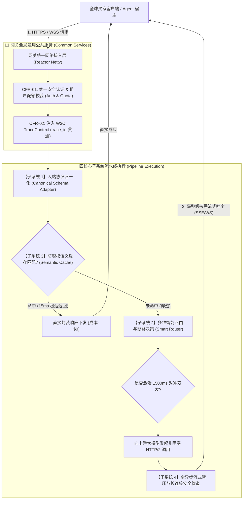

# 企业级 Agent 架构 L1 层：LLMOps 服务网关全局需求规格总说明书 (Master SRS)

> **知识库归属**：企业级 Agent 架构体系 L1 层 (LLMOps Gateway) 工程实战系列  
> **文档定位**：Layer 1 网关总需求纲领文档（Master System Requirements Specification）  
> **文档版本**：v1.0 (Master Engineering Baseline)  
> **关联母篇**：[01-AI-Agent-L1-LLMOps网关深度架构与实战全景.md](../01-AI-Agent-L1-LLMOps网关深度架构与实战全景.md)  
> **技术底座**：Java 21 + Spring Boot 3.3.x + Spring WebFlux (Reactor Netty) 单进程模块化管道

---

## 零、 网关全局定位与业务宿主关系 (Global Positioning & Mission)

### 1. 全局定位
L1 LLMOps 网关是介于**上层有状态 Agent 执行宿主（L2 Harness & Control Ring）**与**底层异构大模型算力基础设施（OpenAI、Azure、DeepSeek、私有化 vLLM）**之间的**确定性流量隔离与治理中枢**。

### 2. 核心架构模式：单进程高性能模块化管道 (Modular Pipeline)
为了将全链路网关层额外延迟（Gateway Overhead）严格压制在 **$3\text{ms}$ (P99)** 以内，**整个 L1 网关采用单进程模块化管道架构（Modular Pipeline）部署**，禁止在子系统之间进行多跳微服务 RPC。四大核心子系统以高内聚的责任链模式（Filter Chain）协同装配在同一非阻塞网络引擎（Reactor Netty）中。

---

## 一、 Layer 1 宏观数据流向与子系统装配时序



---

## 二、 跨子系统的五大公共通用功能性需求 (Common FRs)

这些需求属于网关整体宿主能力，任何单个子系统均无法单独承担，由网关宿主框架统一提供：

### CFR-01: 统一安全认证、租户上下文与配额硬隔离 (Global Auth & Tenant Security)
* **CFR-01.1 多模式身份认证契约**：
  * 支持 `Authorization: Bearer <API_KEY>` 签名校验；
  * 支持通过 HMAC-SHA256 对请求时间戳、随机数（Nonce）及 Body 执行签名防重放校验；
  * 支持企业级双向 TLS（mTLS）内部服务间零信任鉴权。
* **CFR-01.2 租户上下文严格绑定 (Tenant Context Enforcement)**：
  * 鉴权通过后，网关在 Reactor Context 中注入全局不可变的 `SecurityContext`（含 `tenant_id`、`org_id`、`user_id`、`role_scopes`）；
  * 后续所有子系统（缓存查询、路由分发、流式日志）强制透传并校验此上下文，绝对禁止未带租户身份的无主请求流入内部。
* **CFR-01.3 入口级双重令牌桶流控 (Global Pre-Flight Rate Limiter)**：
  * 基于 Redis 7.x + Lua 脚本实现高性能分布式双重令牌桶；
  * 在请求进入子系统前，原子校验并扣减租户当前的 **RPM（每分钟请求数）** 与 **TPM（每分钟 Token 预估数）**；
  * 配额超限时秒级拦截，直接返回规范的 HTTP 429 响应，绝不浪费算力。

### CFR-02: 全链路分布式追踪与 W3C TraceContext 贯通 (Unified Distributed Tracing)
* **CFR-02.1 W3C TraceContext 标准化透传**：
  * 严格遵循 W3C 规范解析入站请求头中的 `traceparent` 与 `tracestate`；若不存在则自动生成符合规范的全局唯一 `trace_id`；
  * 将 `trace_id` 无侵入注入到 Reactor 响应式上下文，跨线程、跨异步协程调用中 100% 不丢失。
* **CFR-02.2 客户端感知与响应头注入**：
  * 所有响应（无论是 HTTP 200、429、500 还是 SSE 流式事件）均在 Header 中注入 `X-Trace-Id: {trace_id}`；
  * 在流式 SSE 结束前的终态元数据块中（`data: {"type": "metadata", "trace_id": "..."}`）下发可观测标识，便于前端一键上报客诉工单。

### CFR-03: 全局统一错误码与异常契约体系 (Global Error & Fault Protocol)
* **CFR-03.1 异常抹平机制**：
  * 任何子系统抛出的内部异常、网络超时、上游 4xx/5xx 错误，必须被网关统一的全局异常处理器（Global Exception Handler）拦截；
  * 抹平 OpenAI、Anthropic、DeepSeek 之间格式各异的错误 JSON，统一封装为标准 RFC 7807 (Problem Details) 规范：
    ```json
    {
      "code": "PROVIDER_CIRCUIT_OPEN",
      "message": "Primary model endpoint degraded. Automatic fallback in progress.",
      "status": 503,
      "trace_id": "4bf92f3577b34da6a3ce929d0e0e4736",
      "timestamp": 1729987654321
    }
    ```
* **CFR-03.2 标准错误枚举分级**：
  * `AUTH_INVALID_KEY` (401)：密钥非法或过期；
  * `RATE_LIMIT_EXCEEDED` (429)：租户配额或并发超限；
  * `STREAM_BACKPRESSURE_TIMEOUT` (504)：客户端网络过慢导致缓冲区超时；
  * `UPSTREAM_PROVIDER_ERROR` (502)：上游推理集群物理宕机。

### CFR-04: 动态配置中心与多模型规则热加载 (Dynamic Configuration & Hot-Reloading)
* **CFR-04.1 核心配置零停机热更**：
  * 支持对接 Nacos 2.x / Apollo / Consul 或 Kubernetes ConfigMap；
  * 支持动态监听并热刷新以下关键参数：
    1. 上游模型供应商列表、动态 API 密钥池与可用端点 URL；
    2. 智能路由权重配比（Latency vs Cost 权重因子）与熔断冷却时间；
    3. 语义缓存相似度阈值（如从 0.95 热调整至 0.96）；
    4. 敏感词违规词库（Aho-Corasick Trie 树内存热重建）。
* **CFR-04.2 热生效时效性指标**：
  * 配置中心发布变更后，网关集群各 Pod 必须在 **$\le 500\text{ms}$** 内完成内存数据结构原子替换，**整个热更过程保证已有长连接零抖动、新连接无感切入**。

### CFR-05: 容器生命周期治理与云原生探针 (Cloud-Native Lifecycle & Probes)
* **CFR-05.1 健康检查与流量摘除探针**：
  * 暴露标准 `/actuator/health/liveness`（存活探针）：检测 Netty 事件循环是否死锁；
  * 暴露标准 `/actuator/health/readiness`（就绪探针）：检测 Redis 连通性、本地缓冲区水位；若缓冲区满自动标为 Unready，K8s 暂停引流。
* **CFR-05.2 平滑优雅停机 (Graceful Shutdown)**：
  * 收到 K8s 的 `SIGTERM` 信号后，就绪探针立即切断，停止接收新连接；
  * 保留 **30 秒** 宽限期（Draining Window），允许当前正在传输中的流式连接平稳下发完毕；
  * 超时仍未结束的慢连接，网关下发 `retry: 1000` 与优雅重连提示后断开。

---

## 三、 四大核心子系统独立规格导入与职责划分 (Subsystem Registry)

网关内部的具体核心能力分别由以下四个独立规格说明书承载并深度解构：

### 1. 【子系统 1】异构模型统一驱动与协议适配器 (Adapter & Drivers)
* 📄 **独立规格书**：👉 [01-L1-Sys1-异构模型统一驱动与适配器-需求规格说明书-v1.0.md](./01-L1-Sys1-异构模型统一驱动与适配器-需求规格说明书-v1.0.md) *(已完成基线)*
* **核心职责**：通过抽象驱动模式（Driver Pattern），抹平 OpenAI、Claude、DeepSeek（含 `reasoning_content` 思维链）及本地 vLLM 的 API 结构差异，统一面向网关标准 `CanonicalSchema` 编程。

### 2. 【子系统 2】多维智能路由与断路降级引擎 (Smart Router & Circuit Breaker)
* 📄 **独立规格书**：👉 [02-L1-Sys2-多维智能路由与断路降级引擎-需求规格说明书-v1.0.md](./02-L1-Sys2-多维智能路由与断路降级引擎-需求规格说明书-v1.0.md) *(已完成基线)*
* **核心职责**：实时维护滑动时间窗口（Sliding Window Metrics），按“P95 延迟 + 成本 + 429 状态”实时动态打分，支持 1500ms 对冲双发（Hedged Requests）与 200ms 自动熔断降级。

### 3. 【子系统 3】企业级防越权向量语义缓存与控费引擎 (Semantic Cache & Cost Engine)
* 📄 **独立规格书**：👉 [03-L1-Sys3-防越权向量语义缓存与控费引擎-需求规格说明书-v1.0.md](./03-L1-Sys3-防越权向量语义缓存与控费引擎-需求规格说明书-v1.0.md) *(已完成基线)*
* **核心职责**：构建 L1 本地精确哈希 ➔ L2 Redis HNSW 稠密向量 ➔ L3 Cross-Encoder 防否定句漂移的三级缓存；强制注入租户标签杜绝缓存越权；物理分层编排 Prompt 激发供应商 Prompt Caching。

### 4. 【子系统 4】全异步流式背压与长连接治理引擎 (Streaming Backpressure & Governance)
* 📄 **独立规格书**：👉 [04-L1-Sys4-流式背压与长连接治理引擎-需求规格说明书-v1.0.md](./04-L1-Sys4-流式背压与长连接治理引擎-需求规格说明书-v1.0.md) *(已完成基线)*
* **核心职责**：监听操作系统底层 Socket 发送缓冲区，慢客户端自动反向制动上游 HTTP/2 流量控制；固定 32KB 环形缓冲区实现万级并发 Zero-OOM；客户端断线 5ms 级联终止上游推理。

### 5. 【控制面】LLMOps 网关管理控制台与运营平台 (Admin Console & Control Plane)
* 📄 **独立规格书**：👉 [05-L1-Admin-LLMOps网关管理控制台与运营平台-需求规格说明书-v1.0.md](./05-L1-Admin-LLMOps网关管理控制台与运营平台-需求规格说明书-v1.0.md) *(已完成基线)*
* **核心职责**：控制面与数据面物理隔离；租户三维配额（并发/RPM/TPM/预算）可视化治理；动态多 Key 池健康监控与 429 冷却自愈；多维路由打分权重滑块调节；跨端 Playground 调试工作台与毫秒级配置热推。

---

## 四、 跨子系统的公共非功能需求规范 (Common NFRs)

### CNFR-01: 全局延迟预算分配 (Global Latency Budget Breakdown)
在万级并发基准下，整个网关层本身引入的处理耗时必须遵守严格的延迟预算分配（Latency Budget）：

$$\text{Total Gateway Overhead} = T_{\text{Auth}} + T_{\text{Trace}} + T_{\text{CacheCheck}} + T_{\text{RouteDecision}} + T_{\text{Forwarding}} \le 3.0\text{ms (P99)}$$

* 鉴权与租户上下文解析：$\le 0.3\text{ms}$
* TraceId 与上下文注入：$\le 0.1\text{ms}$
* 语义缓存粗排与哈希检测：$\le 1.2\text{ms}$
* 智能路由打分与断路检测：$\le 0.4\text{ms}$
* 流式首包零拷贝转发：$\le 1.0\text{ms}$

### CNFR-02: 全局高可用性与故障自愈 (High Availability SLA)
* **平台整体 SLA 承诺**：$\ge 99.95\%$（月度非计划停机时间 $\le 21.6$ 分钟）；
* **故障自愈时效 (MTTR)**：任一外部供应商（如 OpenAI 美东）出现连环 429 或宕机，网关自适应熔断并切换至备用节点的耗时 $\le 200\text{ms}$，终端业务感知故障率 $\le 0.05\%$。

### CNFR-03: 安全合规与金融级审计 (Auditability & Compliance)
* **严禁记录未脱敏敏感数据**：网关在接入和转发过程中，日志中严禁明文打印用户密码、信用卡 CVV 码及高危 PII 数据；
* **审计不可篡改**：每笔调用的 Token 消耗、扣减流水必须异步写入 ClickHouse，支持精确到毫秒级的外部账单对账。

---

## 五、 全局需求追踪与验收测试矩阵 (Master Traceability Matrix)

| 需求编号 | 需求项名称 | 验证方式与测试场景 | 验收硬性指标 |
| :--- | :--- | :--- | :--- |
| **CFR-01 / CNFR-01** | 全局鉴权与租户隔离 | 注入非法 API Key、伪造跨租户请求 | 拦截率 100%，附加延迟 $\le 0.3\text{ms}$，跨租户越权为 0 |
| **CFR-02** | W3C TraceContext 透传 | 跨网关发起全链路长调用并抓包 | 响应头与日志中 `trace_id` 100% 贯通一致 |
| **CFR-03** | 统一错误码响应 | 人为模拟上游各种异构 4xx/5xx 错误 | 格式符合 RFC 7807，错误码统一对齐 |
| **CFR-04** | 动态配置 500ms 热生效 | 压测中动态更新权重参数 | 500ms 内平滑切流，存量连接零中断 |
| **CFR-05** | 优雅停机连接排空 | 持续长连接中向 Pod 发送 `SIGTERM` | 30 秒内已建连接正常结束，零强制强杀报错 |
| **CNFR-01** | 网关附加延迟总预算 | `llmperf` 梯度压测（100~10,000 并发） | 网关全链路附加耗时 P99 $\le 3\text{ms}$ |

---
*本文档为 Cogniva L1 网关顶层工程需求纲领，指导全链路研发实施与验收。*
