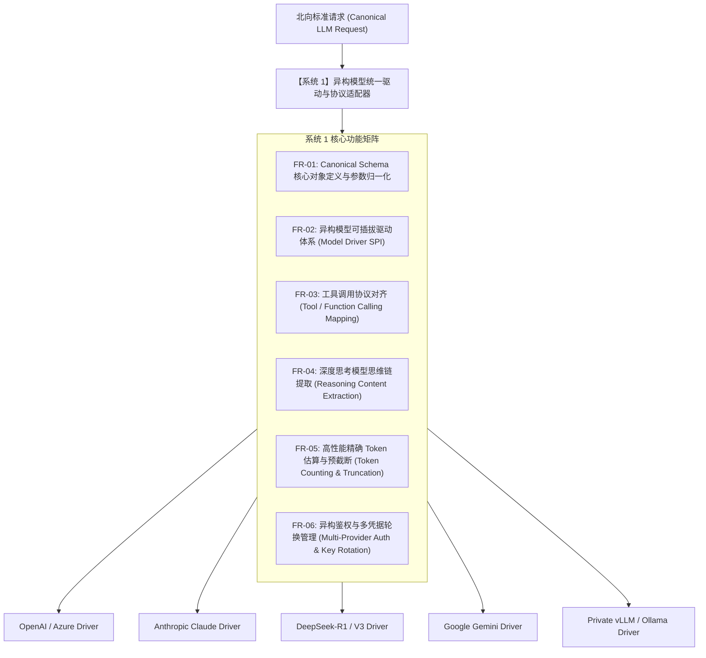

# L1 网关系统 1：异构模型统一驱动与协议适配器 —— 需求规格说明书 (SRS)

> **知识库归属**：企业级 Agent 架构 L1 层 (LLMOps Gateway) 工程实战系列  
> **文档定位**：系统 1 (Model Driver & Protocol Adapter Engine) 研发第一步：功能性与非功能性需求全景定义  
> **文档版本**：v1.0 (Engineering Specification)  
> **关联母篇**：[01-AI-Agent-L1-LLMOps网关深度架构与实战全景.md](../01-AI-Agent-L1-LLMOps网关深度架构与实战全景.md)  
> **全局总说明书**：[00-L1-LLMOps网关全局需求规格总说明书-v1.0.md](./00-L1-LLMOps网关全局需求规格总说明书-v1.0.md)

---

## 零、 系统定位与工程使命 (System Positioning & Mission)

### 1. 系统定位
系统 1 是 L1 LLMOps 网关的**“北向接口与南向驱动适配中枢（Southbound Driver & Northbound Canonical Engine）”**。在 L1 单进程模块化流水线中，它处于网关入站的第一道协议转换环节与出站的异构驱动调度环节。

### 2. 核心工程使命
解决企业多模型接入的**“协议碎片化与供应商锁定（Vendor Lock-in）”**痛点：
* **对上（北向）**：为上层 Agent 业务层（L2 Harness、业务决策 Agent）提供**单一、不可变的规范化大模型交互协议（Canonical Schema）**；
* **对下（南向）**：通过**轻量级驱动插件体系（Driver SPI）**，透明抹平 OpenAI、Azure OpenAI、Anthropic Claude、DeepSeek（含 `reasoning_content` 思维链）、Google Gemini 以及私有化部署的开源模型（vLLM / Ollama）在 API 参数、流式 Chunk 结构、工具调用（Tool Calling）以及鉴权机制上的巨大差异；
* **极速无垃圾开销**：在协议转换和 JSON 解析中做到零反射、极低 GC 压力，将单次报文序列化/反序列化延迟严格压制在 **$0.5\text{ms}$ (P99)** 以内。

---

## 一、 功能性需求规格 (Functional Requirements, FR)



### FR-01: 规范化模型交互协议 (Canonical Schema & Parameter Normalization)
* **FR-01.1 全局统一请求对象 (`CanonicalChatRequest`)**：
  * **基础参数标准化**：归一化 `messages`（含 `system`、`user`、`assistant`、`tool` 角色）、`temperature`、`top_p`、`max_tokens`、`stop`、`stream`、`presence_penalty`、`frequency_penalty`；
  * **扩展参数映射**：提供 `custom_extensions` 字典，透传供应商特定高级参数（如 Anthropic 的 `top_k`、OpenAI o1 的 `reasoning_effort`、DeepSeek 的 `beta` 参数），同时保证核心逻辑不被污染。
* **FR-01.2 多模态请求归一化**：
  * 支持在 `user` 消息中无缝携带图文混合内容（`text` 与 `image_url` / `base64`）；
  * 自动将图片分辨率与格式转换为目标供应商支持的规范（如 Claude 的 `source.type="base64"` vs OpenAI 的 `image_url.url`）。
* **FR-01.3 全局统一响应对象 (`CanonicalChatResponse` & `CanonicalStreamChunk`)**：
  * 无论底层供应商返回格式如何，输出统一的包装对象，标准字段包括：`id`、`model`、`created`、`content`、`reasoning_content`、`tool_calls`、`finish_reason`、`usage`（含 prompt_tokens、completion_tokens、cached_tokens）。

### FR-02: 可插拔模型驱动体系 (Driver SPI Architecture)
* **FR-02.1 驱动接口定义与生命周期**：
  * 定义核心契约 `ModelDriver`：
    ```java
    public interface ModelDriver {
        String getProviderName(); // e.g., "openai", "anthropic", "deepseek", "vllm"
        boolean supports(String modelId);
        HttpRequest buildUpstreamRequest(CanonicalChatRequest request, EndpointConfig config);
        CanonicalChatResponse parseResponse(HttpResponse response);
        CanonicalStreamChunk parseStreamChunk(byte[] rawChunkBytes);
        ProviderError mapError(int statusCode, String errorBody);
    }
    ```
* **FR-02.2 官方及主流模型驱动覆盖清单**：
  * **OpenAI Driver**：支持 GPT-4o、GPT-4o-mini、o1-preview、o3 系列标准 ChatCompletions 接口；
  * **Azure OpenAI Driver**：支持 Azure 特有的 API-Version 路由、部署名映射（deployment-id）、API-Key 标头（`api-key`）及 Managed Identity 认证；
  * **Anthropic Claude Driver**：支持 Messages API (`/v1/messages`)，自动将顶级 System Prompt 从 messages 数组中剥离为独立的 `system` 字段；
  * **DeepSeek Driver**：支持 DeepSeek-V3 及 DeepSeek-R1，支持标准 OpenAI 兼容模式并无损捕获思考链字段；
  * **Google Gemini Driver**：支持 Gemini 1.5 Pro / Flash 原生 REST 协议（`contents` 数组结构与 `generationConfig`）；
  * **Private vLLM Driver**：针对私有化部署的开源模型（Qwen2.5、Llama 3.3 等），支持 OpenAI 兼容 API 并针对本地推理吞吐调优连接保持。

### FR-03: 工具调用协议统一转译 (Unified Tool / Function Calling)
* **FR-03.1 Schema 入站标准化**：
  * 采用基于 JSON Schema 的标准契约接收客户端定义的 Tools：
    ```json
    {
      "type": "function",
      "function": {
        "name": "query_product_inventory",
        "description": "查询海外仓实时库存与可用量",
        "parameters": { ... }
      }
    }
    ```
* **FR-03.2 异构驱动双向转译**：
  * **Anthropic 转换**：自动将 `tools[].function` 转译为 Claude 所需的 `tools[].input_schema`；
  * **Gemini 转换**：自动转译为 Gemini 所需的 `function_declarations`；
  * **流式工具调用拼装**：在 SSE 流式吐字过程中，精确聚合碎片化的 `arguments` 增量数据分片，保证下发给下游的 ToolCall 完整合法。

### FR-04: 深度思考模型思维链捕获与透传 (Reasoning Content Extraction)
* **FR-04.1 思维链字段无损捕获**：
  * 针对 DeepSeek-R1、OpenAI o1 等具备内置思考能力的模型，独立解析 `reasoning_content` 或 `<think>...</think>` 标签；
  * 将思考过程与正式回答内容（`content`）在协议对象中做**强隔离字段分流**，禁止将思考内容直接混入普通内容导致前端排版错乱。
* **FR-04.2 客户端协议向下兼容**：
  * 若下游客户端声明支持思考链（通过 Header `X-Support-Reasoning: true`），网关输出独立思考字段；
  * 若下游为老旧客户端，网关支持按配置将思考内容包装在 `<details><summary>思考过程</summary>...</details>` Markdown 标签中合并下发。

### FR-05: 高性能精确 Token 估算与预截断 (Token Counting & Truncation)
* **FR-05.1 本地离线高性能 Token 计数**：
  * 集成高效的 Java BPE 分词器（支持 cl100k_base、o200k_base、deepseek-tokenizer）；
  * 在不调用上游 API 的前提下，在 **$\le 1.0\text{ms}$** 内完成万字 Prompt 的 Token 数精确估算。
* **FR-05.2 窗口溢出动态预截断 (Context Window Guard)**：
  * 当客户端传入的上下文长度超过目标模型的最大上下文容量（Context Window Limit）时，触发配置的安全截断策略：
    * **策略 A（抛错拦截）**：返回标准 400 `CONTEXT_WINDOW_EXCEEDED` 错误；
    * **策略 B（智能滑动窗口截断）**：保留 System Prompt 与最新 N 轮对话，自动修剪早期历史对话，并在响应头标明 `X-Context-Truncated: true`。

### FR-06: 异构凭据管理与动态多 Key 轮换 (Multi-Provider Auth & Dynamic Key Pool)
* **FR-06.1 凭据池隔离管理**：
  * 每个供应商（Provider）支持配置独立的 API Key 资源池；
  * 支持加权轮询（Weighted Round-Robin）、最少使用（Least In-Flight Requests）调度策略分摊单个 Key 的并发压力。
* **FR-06.2 429 密钥临时隔离与自动复苏**：
  * 当某单一 API Key 收到上游返回的 HTTP 429（Rate Limit）时，驱动层将该 Key 标记为冷却状态（默认冷却 60 秒），自动切换至池内其他可用 Key 重试；
  * 冷却到期后自动执行 Ping 探活并平滑复苏。

---

## 二、 非功能性需求规格 (Non-Functional Requirements, NFR)

### NFR-01: 编解码极速延迟预算 (Marshalling Latency Budget)
* 在单节点 5000 QPS 吞吐下，系统 1 执行规范化入站解析、驱动协议映射及序列化输出的总延迟预算：
  $$T_{\text{Sys1\_Marshal}} \le 0.5\text{ms (P99)}$$
* 禁止使用重量级 Java 动态反射机制解析 JSON；强制采用 Jackson Blackbird / Afterburner 字节码优化或 Java 21 Record 紧凑对象模型。

### NFR-02: 内存分配与 GC 零压力 (Zero-Allocation & Low GC Footprint)
* 针对流式 SSE 报文的解析，采用基于 Netty `ByteBuf` 的零拷贝切片（Slice）机制，严禁在解析流式每字符 Chunk 时产生海量小对象 String 字符串，保障 Java 21 Generational ZGC 停顿维持在 **$\le 1\text{ms}$**。

### NFR-03: 驱动热插拔与扩展隔离性 (Driver Extensibility & Isolation)
* 新增一款模型供应商驱动（如 Mistral 或 Minimax）只需实现 `ModelDriver` 接口并通过 Spring SPI 注册，**禁止修改网关路由、缓存与背压等核心调度逻辑**，代码改动零外溢。

### NFR-04: 错误归一化覆盖率 (Error Code Mapping Coverage)
* 驱动层对所有底层供应商抛出的特有 HTTP 错误码和 JSON Payload，必须实现 **100% 格式抹平**，统一转换为全局总说明书 CFR-03 所定义的 RFC 7807 标准格式，严禁将 OpenAI/Claude 底层原始堆栈直接暴露给下游。

---

## 三、 接口契约定义 (Interface & Data Contracts)

### 1. 规范化请求核心 Schema (Canonical Schema Definition)

```json
{
  "$schema": "http://json-schema.org/draft-07/schema#",
  "title": "CanonicalChatRequest",
  "type": "object",
  "required": ["model", "messages"],
  "properties": {
    "model": { "type": "string", "description": "逻辑模型标识符，如 'gpt-4o', 'claude-3-5-sonnet', 'deepseek-r1'" },
    "messages": {
      "type": "array",
      "items": {
        "type": "object",
        "required": ["role", "content"],
        "properties": {
          "role": { "type": "string", "enum": ["system", "user", "assistant", "tool"] },
          "content": { "type": ["string", "array"] },
          "name": { "type": "string" },
          "tool_call_id": { "type": "string" }
        }
      }
    },
    "temperature": { "type": "number", "minimum": 0, "maximum": 2.0, "default": 0.7 },
    "top_p": { "type": "number", "minimum": 0, "maximum": 1.0, "default": 1.0 },
    "max_tokens": { "type": "integer", "minimum": 1 },
    "stream": { "type": "boolean", "default": false },
    "tools": { "type": "array", "description": "工具列表定义" },
    "tool_choice": { "type": ["string", "object"] },
    "custom_extensions": { "type": "object", "description": "特定供应商的底层透传参数" }
  }
}
```

### 2. 标准规范化响应核心 Schema (CanonicalChatResponse)

```json
{
  "id": "chatcmpl-9u1f82d1c3a7",
  "object": "chat.completion",
  "created": 1729987654,
  "model": "deepseek-r1",
  "choices": [
    {
      "index": 0,
      "message": {
        "role": "assistant",
        "content": "根据您海外仓的最新盘点记录，SKU-8891 目前可用库存为 342 件。",
        "reasoning_content": "用户询问 SKU-8891 库存。首先调用仓库系统数据发现总库存 400，锁定 58，故可用 342。",
        "tool_calls": null
      },
      "finish_reason": "stop"
    }
  ],
  "usage": {
    "prompt_tokens": 128,
    "completion_tokens": 64,
    "total_tokens": 192,
    "prompt_tokens_details": {
      "cached_tokens": 64
    }
  }
}
```

---

## 四、 需求追踪与验收测试矩阵 (Traceability Matrix)

| 需求编号 | 需求项名称 | 验证场景与测试用例 | 验收硬性指标 |
| :--- | :--- | :--- | :--- |
| **FR-01 / FR-02** | 驱动层协议转译一致性 | 发送统一规范请求，分别路由给 OpenAI、Claude、DeepSeek、vLLM | 4 种供应商均正常调用成功，语义参数无缺失漂移 |
| **FR-03** | 工具调用转译 | 携带标准 JSON Schema Tools 调用 Claude-3.5-Sonnet | Claude 成功解析并正确返回 ToolCall 请求结构 |
| **FR-04** | 思维链捕获 | 发送复杂逻辑题给 DeepSeek-R1，流式获取输出 | `reasoning_content` 与 `content` 物理分流清晰，无标签泄露 |
| **FR-05** | 本地 Token 估算 | 输入 5,000 Token 文本，对比上游实际返回的 `prompt_tokens` | 计数偏差率 $\le 1.5\%$，本地估算耗时 $\le 1\text{ms}$ |
| **FR-06** | Key 故障自动隔离 | 人为向上游某个 API Key 注入 429 响应 | 该 Key 自动置入 60s 冷却，平滑使用池内备用 Key，业务调用 100% 成功 |
| **NFR-01** | 编解码延迟预算 | 在 5000 QPS 持续压力下打点统计序列化/反序列化时间 | 协议转换 P99 耗时 $\le 0.5\text{ms}$ |

---
*本文档为 Cogniva L1 网关系统 1（异构模型统一驱动与协议适配器）工程建设硬性基准。*
