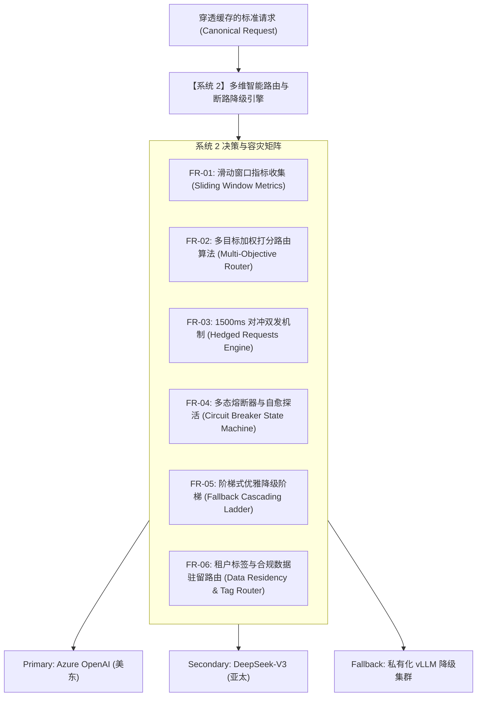

# L1 网关系统 2：多维智能路由与断路降级引擎 —— 需求规格说明书 (SRS)

> **知识库归属**：企业级 Agent 架构 L1 层 (LLMOps Gateway) 工程实战系列  
> **文档定位**：系统 2 (Multi-Dimensional Smart Router & Circuit Breaker Engine) 研发第一步：功能性与非功能性需求全景定义  
> **文档版本**：v1.0 (Engineering Specification)  
> **关联母篇**：[01-AI-Agent-L1-LLMOps网关深度架构与实战全景.md](../01-AI-Agent-L1-LLMOps网关深度架构与实战全景.md)  
> **关联复盘案例**：[01-L1-Case-01-稳定性抖动与SLA容灾降级-RCA实战.md](../cases/01-L1-Case-01-稳定性抖动与SLA容灾降级-RCA实战.md)  
> **全局总说明书**：[00-L1-LLMOps网关全局需求规格总说明书-v1.0.md](./00-L1-LLMOps网关全局需求规格总说明书-v1.0.md)

---

## 零、 系统定位与工程使命 (System Positioning & Mission)

### 1. 系统定位
系统 2 是 L1 LLMOps 网关的**“流量决策大脑与容灾控制中枢（Routing Decision & Resiliency Core）”**。它紧承系统 1 协议归一化与系统 3 缓存穿透检查之后，负责为每一个进入实质推理阶段的 LLM 请求挑选最合理的物理端点。

### 2. 核心工程使命
解决大模型生产环境中最严峻的**“可用性黑天鹅（Availability Jitter）与长尾延迟（Tail Latency）”**痛点：
* **破除静态负载均衡**：拒绝简单的 Round-Robin 或硬编码 URL，实时基于“滑动时间窗口延迟（P95 TTFT）+ 成本权重 + 错误率”实施多维动态打分路由；
* **消灭慢请求长尾**：支持配置驱动的 **1500ms 对冲双发（Hedged Requests）** 机制，对冲长尾毛刺，将上游 P99 抖动压制在 SLA 范围之内；
* **秒级故障自愈**：上游推理集群发生区域性宕机或连环 429 时，在 **$\le 200\text{ms}$** 内完成自动断路熔断并触发平滑阶梯降级（Fallback Ladder），保障企业业务 99.95% 的综合高可用。

---

## 一、 功能性需求规格 (Functional Requirements, FR)



### FR-01: 高性能滑动时间窗口指标度量 (Sliding Window Metrics Engine)
* **FR-01.1 环形时间轮细粒度打点**：
  * 对每个物理端点（Provider Endpoint）维护一个固定内存大小的滑动时间轮（默认窗口大小 60 秒，切分为 60 个 1 秒桶 Bucket）；
  * 无锁化统计每个端点的核心原子指标：
    1. 首字时间（TTFT, Time To First Token）的 P50、P90、P95、P99 分位值；
    2. 错误计数（分类统计 HTTP 429 频控、HTTP 5xx 服务端故障、连接超时 Connect Timeout、读取超时 Read Timeout）；
    3. 当前在途请求数（In-Flight Requests）。
* **FR-01.2 零停顿原子更新**：
  * 采用 `LongAdder` 与原子引用数组，打点与采样读取全程无全局互斥锁（Zero-Lock），杜绝高并发下的线程争死。

### FR-02: 多目标加权动态路由决策 (Multi-Objective Weighted Routing)
* **FR-02.1 动态综合代价打分方程**：
  * 路由引擎为候选端点计算综合评价值 $S$，分值越低优先级越高：
    $$S = w_{\text{latency}} \cdot \left(\frac{\text{TTFT}_{\text{P95}}}{\text{TTFT}_{\text{base}}}\right) + w_{\text{cost}} \cdot \left(\frac{\text{Cost}_{\text{token}}}{\text{Cost}_{\text{base}}}\right) + w_{\text{error}} \cdot E_{\text{rate}} + w_{\text{flight}} \cdot \left(\frac{\text{InFlight}}{\text{Capacity}}\right)$$
  * 权重参数 $w_{\text{latency}}, w_{\text{cost}}, w_{\text{error}}, w_{\text{flight}}$ 支持通过 CFR-04 配置中心毫秒级热调。
* **FR-02.2 确定性优选与平滑分流**：
  * 在综合打分排名前 $K$ 的高优节点中，采用平滑加权轮询（Smooth Weighted Round Robin）分发流量，避免全部流量瞬间压垮单个最低延迟节点产生“雷鸣震荡（Thundering Herd）”。

### FR-03: 对冲双发长尾消除引擎 (Hedged Requests Engine)
* **FR-03.1 动态对冲触发阈值**：
  * 当主选端点发起调用后，在指定超时窗口 $T_{\text{hedge}}$（默认 $1500\text{ms}$，或基于近期 P95 TTFT 动态上浮 20%）内**未收到首包 Chunk**；
  * 网关立即在独立线程中向备选端点发起完全相同的对冲调用（Hedged Request）。
* **FR-03.2 首包竞争胜出与静默取消**：
  * 监听两个连接的响应首包，**谁先返回有效 Token 首包即判定谁胜出（First-Token Win）**；
  * 胜出链路立即绑定下游客户端长连接并开始流式传输；
  * 败者链路在 **$\le 5\text{ms}$** 内收到网关主动下发的取消信号（HTTP/2 `RST_STREAM`），掐断多余推理，避免成本翻倍。

### FR-04: 多态熔断器与自愈探活 (Circuit Breaker & Self-Healing Engine)
* **FR-04.1 三态状态机转移规则**：
  * **CLOSED（闭合正常态）**：流量全量通行；
  * **OPEN（打开熔断态）**：当滑动窗口内“错误率 $\ge 25\%$”或“连续触发 3 次 429”，熔断器在 $\le 10\text{ms}$ 内跳闸，将该端点摘除，后续请求直接走降级路由；
  * **HALF-OPEN（半开探测态）**：熔断器保持打开状态 $T_{\text{cool}}$（默认 30 秒）后自动转入半开态；允许放行 $1\%$ 的探活流量。若连续 5 次探测成功，自动闭合自愈；若出现任何一次 5xx 或 429，立即重置为 OPEN 并延长冷却时间。
* **FR-04.2 供应商主动限流退避感知 (Adaptive 429 Backoff)**：
  * 捕获上游返回的 `Retry-After` 标头；
  * 若上游明确要求退避 $N$ 秒，熔断器自动将该端点的熔断计时设定为 $\max(N, T_{\text{cool}})$，严禁盲目向该供应商强发请求。

### FR-05: 阶梯式优雅降级矩阵 (Fallback Cascading Ladder)
* **FR-05.1 多层级降级阶梯**：
  * **第 1 阶（同级平替）**：如主用 `Azure OpenAI GPT-4o` 熔断，平滑降级至备用 `OpenAI Official GPT-4o` 或 `Anthropic Claude 3.5 Sonnet`；
  * **第 2 阶（性价比平替）**：同级模型均受限时，降级至低成本高性能模型（如 `DeepSeek-V3` 或 `Qwen2.5-72B`）；
  * **第 3 阶（兜底兜圈 / 规则降级）**：外部 API 全面瘫痪时，触发网关内置兜底模板或转向轻量化本地模型输出预设礼貌应答，保障客服业务不崩溃。
* **FR-05.2 降级感知上下文注入**：
  * 触发降级后，响应头自动附加 `X-Fallback-Triggered: true` 及 `X-Original-Model: gpt-4o`、`X-Actual-Model: deepseek-v3`，以便上层 Agent 适配温度和输出格式。

### FR-06: 租户标签与合规数据驻留路由 (Data Residency & Compliance Routing)
* **FR-06.1 地理区域与合规硬隔离**：
  * 支持针对欧盟买家（GDPR 合规）强制路由至部署在欧洲本土的合规端点（如 Azure West Europe），严禁跨境路由；
* **FR-06.2 租户 SLA 等级分流**：
  * VIP 租户路由至专属低负载专线端点；免费租户路由至共享低优先级集群。

---

## 二、 非功能性需求规格 (Non-Functional Requirements, NFR)

### NFR-01: 决策极速延迟预算 (Decision Latency Budget)
* 在单节点 5000 QPS 持续压力下，系统 2 完成指标计算、多维打分、端点决选的总耗时：
  $$T_{\text{Sys2\_Route}} \le 0.4\text{ms (P99)}$$
* 所有内存指标计算均在 L1/L2 缓存友好型连续内存空间完成，杜绝阻塞 IO 操作。

### NFR-02: 容灾自愈反应时效 (Failover Reaction MTTR)
* 针对上游单点宕机、网络黑洞或连环 429 故障，系统从发生首个故障到全量切离故障节点的反应时间：
  $$\text{MTTR}_{\text{Failover}} \le 200\text{ms}$$
* 终端买家受长尾延迟或故障波及的比例控制在 **$\le 0.05\%$**。

### NFR-03: 对冲流量算力开销防护 (Hedged Request Cost Guard)
* 对冲双发机制必须受到全局对冲配额保护：
  * 单租户或全局并发对冲请求比例不得超过当前活跃连接数的 **$10\%$**；
  * 避免在大面积网络拥塞时由于盲目对冲而造成 Token 成本翻倍。

---

## 三、 接口与核心配置契约 (Interface & Configuration Contracts)

### 1. 路由与熔断规则配置模型 (Routing & Circuit Breaker Policy Schema)

```json
{
  "route_policy_id": "policy_ecommerce_presale",
  "logical_model": "gpt-4o",
  "hedged_request": {
    "enabled": true,
    "delay_ms": 1500,
    "max_hedged_ratio": 0.10
  },
  "circuit_breaker": {
    "failure_rate_threshold": 0.25,
    "slow_call_duration_threshold_ms": 5000,
    "wait_duration_in_open_state_ms": 30000,
    "permitted_number_of_calls_in_half_open_state": 10
  },
  "endpoints": [
    {
      "id": "ep_azure_us_east",
      "provider": "azure",
      "priority": 1,
      "cost_weight": 1.0,
      "base_url": "https://cogniva-eastus.openai.azure.com"
    },
    {
      "id": "ep_deepseek_v3_direct",
      "provider": "deepseek",
      "priority": 2,
      "cost_weight": 0.2,
      "base_url": "https://api.deepseek.com"
    }
  ],
  "fallback_chain": ["ep_azure_us_east", "ep_deepseek_v3_direct", "ep_local_vllm_backup"]
}
```

---

## 四、 需求追踪与验收测试矩阵 (Traceability Matrix)

| 需求编号 | 需求项名称 | 验证场景与测试用例 | 验收硬性指标 |
| :--- | :--- | :--- | :--- |
| **FR-01 / NFR-01** | 滑动窗口无锁度量 | 压测工具并发注入 5,000 QPS 持续打点 10 分钟 | 内存无泄漏，无锁竞争耗时 P99 $\le 0.1\text{ms}$ |
| **FR-02** | 多目标加权打分 | 模拟两节点：节点 A 延迟低但昂贵，节点 B 便宜但延迟略高，动态调整 $w_{\text{cost}}$ | 流量权重分配与配置预期数学模型完全吻合（误差 $\le 2\%$） |
| **FR-03** | 1500ms 对冲双发 | 人为对主节点注入 3000ms 延迟，备用节点保持 200ms | 1500ms 准时触发对冲，客户端于 ~1750ms 收到首包，主节点被发 RST 取消 |
| **FR-04 / NFR-02** | 熔断自愈与切换 | 向上游节点注入 100% 的 HTTP 500 错误 | 网关在 $\le 200\text{ms}$ 内切断该节点，后续请求 100% 平滑走向备选节点 |
| **FR-05** | 阶梯降级梯队 | 依次切断 Primary 和 Secondary 节点 | 网关自动顺延降级至第 3 阶兜底集群，响应头正确标记 Fallback 标头 |

---
*本文档为 Cogniva L1 网关系统 2（多维智能路由与断路降级引擎）工程建设硬性基准。*
