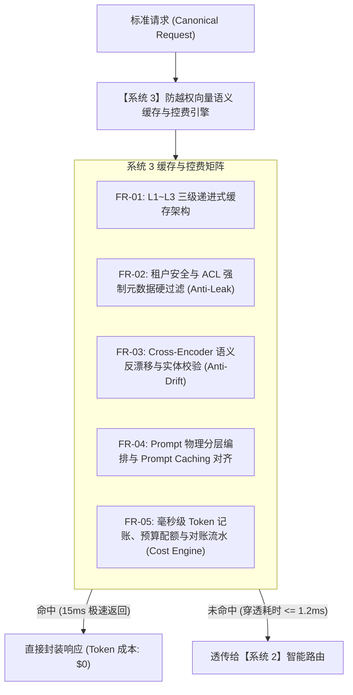

# L1 网关系统 3：防越权向量语义缓存与控费引擎 —— 需求规格说明书 (SRS)

> **知识库归属**：企业级 Agent 架构 L1 层 (LLMOps Gateway) 工程实战系列  
> **文档定位**：系统 3 (Anti-Privilege Semantic Cache & Cost Engine) 研发第一步：功能性与非功能性需求全景定义  
> **文档版本**：v1.0 (Engineering Specification)  
> **关联母篇**：[01-AI-Agent-L1-LLMOps网关深度架构与实战全景.md](../01-AI-Agent-L1-LLMOps网关深度架构与实战全景.md)  
> **关联复盘案例**：[01-L1-Case-03-Token成本失控与语义缓存对账-RCA实战.md](../cases/01-L1-Case-03-Token成本失控与语义缓存对账-RCA实战.md)  
> **全局总说明书**：[00-L1-LLMOps网关全局需求规格总说明书-v1.0.md](./00-L1-LLMOps网关全局需求规格总说明书-v1.0.md)

---

## 零、 系统定位与工程使命 (System Positioning & Mission)

### 1. 系统定位
系统 3 是 L1 LLMOps 网关的**“成本阻断与极速响应中枢（Cost Gate & Semantic Acceleration Engine）”**。在 L1 单进程模块化流水线中，它部署在系统 1 协议归一化之后、系统 2 智能路由之前。

### 2. 核心工程使命
解决大模型生产运营中最痛苦的**“Token 账单爆表与缓存安全越权”**双重挑战：
* **Token 成本断崖式节约**：对于高频重复意图（如退换货政策、尺码对照表、跨境物流规则），通过三级缓存实现 **15ms 极速响应并达成 $0 算力支出**；通过精准 Prompt Caching 结构编排，削减高达 **60%~80%** 的输入 Token 开销；
* **严防越权数据泄露**：杜绝盲目的全局向量匹配，通过**“租户 ID + 权限标签（ACL）强制元数据硬过滤”**，彻底消除跨租户、越权召回敏感数据的金融级安全隐患；
* **杜绝语义漂移（Anti-Drift）**：引入轻量级 Cross-Encoder 语义二阶复核与命名实体（NER）比对，**100% 杜绝“否定句与肯定句混淆”（如“支持退货”误命中“不支持退货”）的灾难性语义事故**。

---

## 一、 功能性需求规格 (Functional Requirements, FR)



### FR-01: L1~L3 三级递进式缓存架构 (Multi-Tier Hierarchical Cache)
* **FR-01.1 L1 本地精确哈希缓存 (Local Exact Cache)**：
  * 基于高性能内存缓存库（Caffeine），存储静态文本与近期 Prompt 的 SHA-256 签名映射；
  * **访问耗时**：$\le 0.1\text{ms}$，直接拦截 100% 字符级完全相同的并发重复请求。
* **FR-01.2 L2 分布式向量近似语义缓存 (Distributed HNSW Vector Cache)**：
  * 对接 Redis 7.x (RediSearch) / Qdrant；
  * 采用轻量级高效嵌入模型（如 `text-embedding-3-small` / `bge-small-zh-v1.5`，维度 512 或 1536）计算向量；
  * 采用 HNSW 索引执行余弦相似度召回（初筛阈值 Cosine Similarity $\ge 0.95$），召回耗时 $\le 8\text{ms}$。
* **FR-01.3 L3 交叉编码器深度反漂移校验 (Cross-Encoder Anti-Drift Reranker)**：
  * 对 L2 召回的候选答案执行二阶 Cross-Encoder 重排与语义复核（见 FR-03）；
  * 校验通过后，将缓存的回答以规范的 `CanonicalChatResponse` 结构返回，并注入标头 `X-Cache-Status: HIT-SEMANTIC-L3`。

### FR-02: 租户安全隔离与 ACL 元数据硬过滤 (Tenant Isolation & Anti-Privilege Escalation)
* **FR-02.1 强制多租户向量硬过滤 (Mandatory Pre-Filtering)**：
  * 在向向量数据库执行 HNSW 近似搜索时，**必须将请求上下文中的 `tenant_id`、`org_id` 作为硬性前置过滤条件（Pre-Filter）**：
    $$\text{SearchQuery} = \left(@\text{tenant\_id}:\{\text{current\_tenant}\} \ \& \ @\text{acl\_scope}:\{\text{public}|\text{user\_role}\}\right) \Rightarrow [\text{KNN } 1\ \text{vector}]$$
  * 严禁无租户过滤的全局向量检索，绝对禁止租户 A 的会话召回租户 B 的私有知识或历史问答。
* **FR-02.2 敏感数据脱敏与缓存穿透准入 (Cache Ingestion Policy)**：
  * 包含高危 PII 数据（信用卡号、手机号、密码口令）的会话，网关安全组件打上 `NO-CACHE` 标记，严禁写入向量缓存池。

### FR-03: 语义反漂移与命名实体一致性校验 (Anti-Semantic Drift & NER Guard)
* **FR-03.1 否定词与极性突变阻断**：
  * 提取 Query 中的否定算子（如“不”、“未”、“严禁”、“no”、“not”、“except”）；
  * 若当前 Query 与召回命中样本在否定极性上不一致（一个含否定、一个为肯定），即使向量余弦值高达 0.98，**强制判定为未命中（Cache Miss）**，严防“支持退货”误答为“不支持退货”。
* **FR-03.2 关键命名实体（NER）强一致性校验**：
  * 针对电商业务关键实体（商品型号 SKU、国家代码 Country、物流时效天数 Days、货币代码 Currency）；
  * 校验用户输入中的核心实体与命中缓存中的实体是否 100% 严格一致；若实体冲突立即判定失效并穿透。

### FR-04: Prompt 物理结构对齐与 Prompt Caching 激发 (Prompt Caching Alignment)
* **FR-04.1 四层静态前缀对齐编排**：
  * 网关强制将入站上下文重构为标准前缀结构，激发各大云厂商（OpenAI、Anthropic Claude、DeepSeek）底层的 K-V Cache 复用机制：
    1. **第 1 层（静态系统指令 System Persona）**：100% 静态不变，长度对齐 $\ge 1024$ tokens；
    2. **第 2 层（工具定义 Tools/Functions Schema）**：静态注册工具规范，按字符字典序稳定排序；
    3. **第 3 层（长期背景知识 Few-Shots/RAG Context）**：半静态高频背景知识；
    4. **第 4 层（短期动态对话 History & User Input）**：高频变化末尾追加。
* **FR-04.2 缓存命中监控与收益分析**：
  * 解析上游返回的 `usage.prompt_tokens_details.cached_tokens`；
  * 精确度量 Prompt Caching 命中率，并在可观测看板上直观展示由此带来的成本节约金额（通常节约 50%~80% 的输入成本）。

### FR-05: 细粒度 Token 记账与实时财务配额控制 (Financial Token Metering & Budget Gate)
* **FR-05.1 双时钟毫秒级扣费流水**：
  * 每次推理结束后（无论普通响应还是流式首/尾包），原子记录：`tenant_id`、`model`、`prompt_tokens`、`completion_tokens`、`cached_tokens`、`actual_cost_usd`；
  * 采用异步非阻塞方式（Disruptor RingBuffer）无损写入审计对账日志与 ClickHouse 分析库。
* **FR-05.2 预算熔断硬配额 (Hard Budget Quotas)**：
  * 支持配置租户每日/每月预算上限（如每月 \$500.00）；
  * 当租户可用预算耗尽时，网关在毫秒级自动对该租户下发 HTTP 402 `PAYMENT_REQUIRED` 或标准 429 拦截，防止云厂商账单无限度透支。

---

## 二、 非功能性需求规格 (Non-Functional Requirements, NFR)

### NFR-01: 缓存全链路延迟预算 (Cache Latency Budget)
* **缓存命中（Cache Hit）极速返回**：
  $$T_{\text{CacheHit}} \le 15\text{ms (P99)}$$
  （对比上游大模型 1200ms~3000ms 的等待时间，响应体验提升近 100 倍）。
* **缓存未命中（Cache Miss）穿透开销**：
  $$T_{\text{CacheMiss\_Overhead}} \le 1.2\text{ms (P99)}$$
  （严控 L1 哈希与快速初筛耗时，禁止因缓存检索而拖慢未命中请求的端到端耗时）。

### NFR-02: 语义反漂移准确率 (Anti-Drift Accuracy)
* 在生产回放基准测试中，由于否定句、实体不匹配而导致的错误缓存召回率必须满足：
  $$\text{Semantic Error Rate} \le 0.01\%$$
* 保证企业高可信决策场景下的绝对回答正确性。

### NFR-03: 高吞吐与并发对账无锁化 (Throughput & Zero-Lock Auditing)
* 控费计量模块在高并发下单节点吞吐需支持 **$\ge 10,000\text{ QPS}$**；
* 记账流水采用无锁环形队列异步排空，禁止因为对账持久化影响网关主数据面转发。

---

## 三、 接口与存储结构契约 (Data Contracts & Storage Schemas)

### 1. Redis 向量语义缓存 Schema 定义 (RediSearch HNSW Index)

```redis
FT.CREATE idx:semantic_cache ON HASH
PREFIX 1 cache:
SCHEMA
  tenant_id TAG SORTABLE
  acl_scope TAG
  query_text TEXT NOSTEM
  response_json TEXT NOINDEX
  embedding VECTOR HNSW 6
    TYPE FLOAT32
    DIM 1536
    DISTANCE_METRIC COSINE
  created_at NUMERIC SORTABLE
  ttl_expires NUMERIC SORTABLE
```

### 2. 缓存命中响应头注入契约 (Cache Response Headers)

```http
HTTP/1.1 200 OK
Content-Type: application/json; charset=utf-8
X-Cache-Status: HIT-SEMANTIC-L3
X-Cache-Similarity: 0.9782
X-Cache-Tenant-Verified: true
X-Saved-Cost-USD: 0.0042
X-Trace-Id: 4bf92f3577b34da6a3ce929d0e0e4736
```

---

## 四、 需求追踪与验收测试矩阵 (Traceability Matrix)

| 需求编号 | 需求项名称 | 验证场景与测试用例 | 验收硬性指标 |
| :--- | :--- | :--- | :--- |
| **FR-01 / NFR-01** | L1~L3 递进式缓存命中 | 针对高频退换货政策并发注入 1,000 次请求 | 首请求穿透，后续 999 次全部 L1/L2 命中，P99 耗时 $\le 15\text{ms}$ |
| **FR-02** | 跨租户越权隔离 | 租户 A 查询私有合同数据生成缓存；租户 B 传入完全相同的 Query | 租户 B 强制未命中并穿透，跨租户越权召回率为 0% |
| **FR-03 / NFR-02** | 语义反漂移校验 | 知识库有“支持跨境免运费”；用户提问“支持跨境免运费吗？”与“不支持跨境免运费怎么办？” | 肯定句命中缓存，否定句判定未命中并穿透上游处理 |
| **FR-04** | Prompt Caching 激发 | 发送对齐四层结构的复杂 Agent 任务，持续对话 10 轮 | 上游返回的 `cached_tokens` 占比稳定 $\ge 70\%$，Token 成本显著下降 |
| **FR-05** | 实时预算硬熔断 | 为测试租户配置 \$1.00 预算额度，持续压测使其 Token 耗尽 | 预算耗尽瞬间毫秒级返回 429/402，后续请求 100% 拦截 |

---
*本文档为 Cogniva L1 网关系统 3（防越权向量语义缓存与控费引擎）工程建设硬性基准。*
