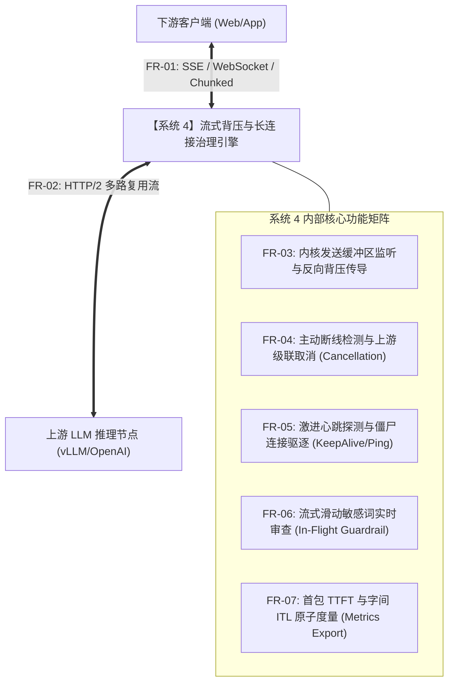

# L1 网关系统 4：全异步流式背压与长连接治理引擎 —— 需求规格说明书 (SRS)

> **知识库归属**：企业级 Agent 架构 L1 层 (LLMOps Gateway) 工程实战系列  
> **文档定位**：系统 4 (Streaming Backpressure & Connection Governance Engine) 研发第一步：功能性与非功能性需求全景定义  
> **文档版本**：v1.0 (Engineering Specification)  
> **关联母篇**：[01-AI-Agent-L1-LLMOps网关深度架构与实战全景.md](../01-AI-Agent-L1-LLMOps网关深度架构与实战全景.md)  
> **关联复盘案例**：[01-L1-Case-02-长连接背压吞吐瓶颈与内存OOM-RCA实战.md](../cases/01-L1-Case-02-长连接背压吞吐瓶颈与内存OOM-RCA实战.md)

---

## 零、 系统定位与工程使命 (System Positioning & Mission)

### 1. 系统定位
系统 4 是 L1 LLMOps 网关的**“数据面（Data Plane）流式数据管道内核”**。它介于上游大模型异构推理集群（OpenAI、Azure、DeepSeek、私有化 vLLM）与下游全球分布式买家客户端（Web 端 SSE、移动 App WebSocket）之间。

### 2. 核心工程使命
解决大模型生产环境中最具破坏力的**“快产慢消”物理失配**问题：
* 在上游生产速率（60~100 tokens/s）与下游弱网消费速率（3~8 tokens/s）严重不对称时，**以内核级 Socket 监听反向制动上游，实现单 Pod 内存绝对有界（Zero-OOM）**；
* 在客户端断网或用户关闭会话时，**毫秒级向上游发送取消帧，掐断无效推理，杜绝算力浪费**。

---

## 一、 功能性需求规格 (Functional Requirements, FR)

### FR-01: 多协议下游流式传输与长连接支持 (Multi-Protocol Downstream Streaming)
* **FR-01.1 Server-Sent Events (SSE) 协议封装**：
  * 遵循 W3C SSE 规范，支持标准事件流封装：包含 `event: message\n`、`data: {JSON}\n\n`、`id: {UUID}\n`；
  * 自动注入响应头：`Content-Type: text/event-stream; charset=utf-8`、`Cache-Control: no-cache`、`Connection: keep-alive`；
  * 自动下发 `X-Accel-Buffering: no` 标头，强制阻断 Nginx/Ingress 默认的反向代理缓冲行为。
* **FR-01.2 WebSocket (WS) 双向全双工支持**：
  * 支持 RFC 6455 规范的 WebSocket 握手与长连接帧传输；
  * 支持客户端在同一连接上持续流式发送多轮 Prompt，网关单连接复用流式返回 Token；
  * 支持二进制帧（Binary Frames）与文本帧（Text Frames）传输。
* **FR-01.3 HTTP Chunked Transfer Encoding 透传**：
  * 支持针对不支持 SSE 的老旧客户端降级为标准 HTTP/1.1 分块传输编码（Chunked Stream）。

### FR-02: 上游推理协议解析与流式事件适配 (Upstream Stream Consumption)
* **FR-02.1 多格式流式 Chunk 解析**：
  * 支持解析标准 OpenAI 格式的 `data: {"choices": [{"delta": {"content": "..."}}]}`；
  * 支持解析深度思考模型（如 DeepSeek-R1）特有的 `reasoning_content` 思维链数据流；
  * 支持解析流式结束标志 `data: [DONE]` 及附带的 `usage` 统计对象。
* **FR-02.2 异构协议转译归一化**：
  * 无论上游是 Anthropic SSE、OpenAI SSE 还是私有化 vLLM gRPC/HTTP2，系统 4 内部统一转换为标准的内部轻量化结构 `StreamFrame` 处理。

### FR-03: 内核级发送缓冲区感知与动态背压调节 (Kernel-Level Buffer Awareness & Backpressure)
* **FR-03.1 非阻塞套接字可写状态监听**：
  * 下游 Socket 必须设置为非阻塞 I/O 模式；
  * 网关必须监控操作系统内核级别的套接字发送缓冲区状态（Send-Q）；
  * 当客户端因弱网导致发送缓冲区被填满，操作系统返回 `EAGAIN` 或 `EWOULDBLOCK` 时，引擎必须捕获该事件。
* **FR-03.2 动态背压制动与恢复循环**：
  * **制动动作**：当下游写阻塞时，引擎**立刻挂起当前连接的读取协程，暂停从上游读取新字节**；
  * **背压向上传导**：停止读取上游的行为必须触发传输层协议底层的 **HTTP/2 `WINDOW_UPDATE` 流量控制机制**，使得上游推理集群的 TCP 接收窗口降为 0，迫使上游推理暂停吐字；
  * **唤醒恢复**：当下游 Socket 重新可写（操作系统触发 `EPOLLOUT` 事件）且有界环形缓冲区被排空后，引擎重新恢复从上游拉取数据。

### FR-04: 主动断线检测与上游级联取消 (Active Disconnect & Upstream Cancellation)
* **FR-04.1 客户端断开感知**：
  * 实时监听下游 Socket 的 `TCP FIN` 正常断开和 `TCP RST` 异常断线报文；
  * 捕获 WebSocket 的 Close 帧握手协议。
* **FR-04.2 上游毫秒级级联终止 (Cascade Abortion)**：
  * 一旦确认客户端断开，引擎必须在 **$\le 5\text{ms}$** 内向上游 HTTP/2 连接发送 `RST_STREAM` 帧（错误码为 `CANCEL` 或 `INTERNAL_ERROR`）；
  * 若上游为本地 vLLM 集群，调用其内置的 `abort(request_id)` RPC 接口，立即释放 GPU 计算 Slot，规避废弃 Token 继续计费；
  * 强制回收并清理该连接分配的环形缓冲区与内存对象。

### FR-05: 激进心跳探测与僵尸连接驱逐 (Zombie & Half-Open Eviction)
* **FR-05.1 L4 传输层 TCP Keep-Alive 动态调优**：
  * 为所有流式长连接开启操作系统的 TCP Keep-Alive 机制；
  * 将系统级默认的 7200 秒调整为：`tcp_keepalive_time = 15s`（空闲 15s 开始探测）、`tcp_keepalive_intvl = 3s`（间隔 3s 探测一次）、`tcp_keepalive_probes = 3`（连续 3 次失败判定死连接）。
* **FR-05.2 L7 应用层保活心跳帧**：
  * SSE 模式：连接建立后每隔 10 秒无业务数据时，自动向客户端下发 `: ping\n\n` 注释帧，既保活连接又防止前置防火墙（NAT / ELB）超时切断；
  * WebSocket 模式：每 10 秒自动下发标准 `Ping` 帧，若 5 秒内未收到 `Pong` 响应，直接判定为假活连接并强杀。

### FR-06: 流式滑动窗口实时内容安全审查 (In-Flight Guardrail & Redaction)
* **FR-06.1 逐 Token 滑动窗口扫描**：
  * 引入轻量级 **Aho-Corasick 多模式匹配状态机**；
  * 在流式 Token 经过网关的传输管道中，以 $O(1)$ 复杂度实时进行跨 Token 拼接扫描（解决敏感词被拆在两个 Token 中的边缘问题）；
* **FR-06.2 实时阻断与掩码替换**：
  * 规则一（即时阻断）：检测到越狱攻击或严重违法词，立即掐断上游，并向客户端下发终态提示，随后关闭连接；
  * 规则二（流式脱敏）：对买家卡号、手机号等 PII 敏感信息进行实时掩码替换（如 `4111-****-****-1111`）后再下发。

### FR-07: 细粒度流式指标原子度量 (Token Usage & Latency Metering)
* **FR-07.1 时间戳精准打点**：
  * 记录连接握手完成时间戳 $T_0$；
  * 记录上游发出首个有效 Token 时间戳 $T_{first}$，计算 **TTFT = $T_{first} - T_0$**；
  * 记录每两个相邻 Token 之间的字间时间差 $\Delta t$，计算平均与 P95 **ITL (Inter-Token Latency)**；
  * 记录连接完成终态时间戳 $T_{end}$。
* **FR-07.2 数据吞吐原子统计**：
  * 统计单个会话累计下发的 Token 数量、传输的 Byte 总数、触发背压暂停的总时长（Backpressure Pause Duration）；
  * 将所有度量指标关联全局唯一的 `trace_id`，准备向可观测体系输出。

---

## 二、 非功能性需求规格 (Non-Functional Requirements, NFR)

### NFR-01: 内存确定性与绝对有界性 (Memory Boundedness & Zero-OOM)
* **NFR-01.1 单连接缓冲区硬上限**：
  * 单个长连接在网关堆内存中分配的 Ring Buffer 容量**严格限制在 $\le 32\text{KB}$**，达到上限时触发强制背压挂起，**严禁使用容量动态扩容的无界通道**。
* **NFR-01.2 万级弱网并发下 Pod 内存常驻指标**：
  * 压测场景：单网关 Pod 承载 **10,000 个弱网慢客户端**（客户端人为限速至 3 tokens/s，上游按 80 tokens/s 吐字）；
  * **验收标准**：Pod 内存常驻物理集（RSS）必须**稳定在 $\le 1.5\text{GB}$**，内存波动范围 $\le 5\%$，运行 24 小时零内存泄漏，彻底杜绝触发 K8s OOMKilled 重启。

### NFR-02: 极低附加延迟与零拷贝转发 (Ultra-Low Latency Overhead)
* **NFR-02.1 网关转发额外开销 (Gateway Overhead)**：
  * **TTFT 首包附加延迟**：网关本身对首个 Chunk 的解析、安全扫描及转发耗时 **P99 $\le 2\text{ms}$**；
  * **ITL 字间附加延迟**：正常网络下，网关中继后续 Token 的附加延迟 **P99 $\le 0.5\text{ms}$**。
* **NFR-02.2 零拷贝（Zero-Copy）数据管道**：
  * 数据的中继转发必须基于只读字节切片（Byte Slices / Buffers），禁止在高频流式管道中反复执行 `bytes -> string -> bytes` 的重复内存分配与垃圾回收（GC）。

### NFR-03: 高并发吞吐与连接容量 (Scale & Throughput Capacity)
* **NFR-03.1 单节点最大稳定长连接数**：
  * 在标准 8 核 CPU、16GB 内存的容器资源规格下，单实例必须能够稳定承载 **$\ge 20,000$ 个并发长连接**。
* **NFR-03.2 连接新建速率 (Connections Per Second, CPS)**：
  * 支持每秒新建连接速率 **$\ge 2,500\text{ CPS}$**，在客户端瞬时重连风暴下，系统 CPU 调度平稳，握手失败率 $\le 0.01\%$。

### NFR-04: 可靠性、韧性与平滑停机 (Reliability & Graceful Draining)
* **NFR-04.1 异常隔离（Panic Fault-Tolerance）**：
  * 单个连接的解析异常、序列化失败或下游 Socket 崩溃，必须被协程级 Recover 隔离，**单连接故障率绝对不能影响任何其他活跃连接**。
* **NFR-04.2 容器生命周期平滑排空 (Graceful Draining)**：
  * 接收到 K8s 发出的 `SIGTERM` 信号时，网关立即标记就绪探针为 Unready，拒绝新连接；
  * 启动最多 **30 秒** 的平滑排空窗口，允许存量流式连接正常吐字完毕；
  * 窗口到期未结束的连接，下发带优雅重连提示的终态事件后切断。

### NFR-05: 全链路可观测性 (End-to-End Observability)
* 严格遵循 **OpenTelemetry + OpenInference** 协议规范暴露实时指标：
  1. `gateway_stream_active_connections{protocol="sse|ws"}`：当前活动连接数实时 Gauges；
  2. `gateway_stream_ttft_seconds{quantile="0.5|0.9|0.99"}`：首包延迟直方图；
  3. `gateway_stream_itl_seconds{quantile="0.5|0.9|0.99"}`：字间延迟直方图；
  4. `gateway_stream_backpressure_events_total`：背压触发计数器；
  5. `gateway_stream_aborted_tokens_saved_total`：因主动取消上游而挽回的废弃 Token 总数计数器。

---

## 三、 需求追踪与验收测试矩阵 (Requirements Traceability Matrix)

| 需求编号 | 需求项名称 | 关键验证手段 (Verification Method) | 验收硬性指标 (Acceptance Threshold) |
| :--- | :--- | :--- | :--- |
| **FR-03 / NFR-01** | 慢客户端背压与零 OOM | 使用 `k6` 注入 10,000 个 3 tokens/s 慢连接进行 1 小时压力注入 | Pod 内存 $\le 1.5\text{GB}$，零 OOMKilled，无内存泄漏 |
| **FR-04 / NFR-05** | 主动断开与算力止损 | 模拟客户端在第 5 个 Token 时直接发送 `TCP RST` 切断连接 | 网关在 5ms 内发出 HTTP/2 RST，上游 GPU 立即释放 Slot |
| **FR-06 / NFR-02** | 流式 Aho-Corasick 审查 | 注入包含违规测试词库的生成流 | 敏感词命中率 100%，附加字间延迟 $\le 0.5\text{ms}$ |
| **NFR-02** | 首包与字间极低延迟开销 | 使用 `llmperf` 进行基准无网关 vs 经网关对比测试 | 网关引入的额外 TTFT P99 $\le 2\text{ms}$ |
| **NFR-03** | 万级并发长连接容量 | 8C16G 节点下跑满 20,000 活跃长连接 | 维持连接 30 分钟无抖动，CPU 使用率 $\le 65\%$ |

---
*本文档为 Cogniva L1 网关系统 4 研发第一阶段基线，后续技术选型与脚手架工程均以此需求规范为准。*
