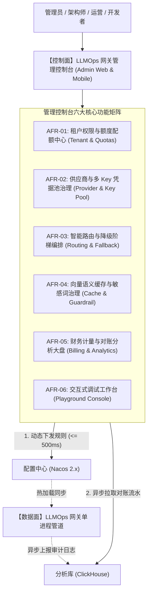

# L1 网关管理端：LLMOps 网关管理控制台与运营平台 —— 需求规格说明书 (SRS)

> **知识库归属**：企业级 Agent 架构 L1 层 (LLMOps Gateway) 工程实战系列  
> **文档定位**：管理控制面 (Admin Console & Control Plane) 研发基线：功能性与非功能性需求全景定义  
> **文档版本**：v1.0 (Engineering Specification)  
> **关联母篇**：[01-AI-Agent-L1-LLMOps网关深度架构与实战全景.md](../01-AI-Agent-L1-LLMOps网关深度架构与实战全景.md)  
> **全局总说明书**：[00-L1-LLMOps网关全局需求规格总说明书-v1.0.md](./00-L1-LLMOps网关全局需求规格总说明书-v1.0.md)

---

## 零、 系统定位与工程使命 (System Positioning & Mission)

### 1. 系统定位
管理控制台（Admin Console）是 L1 LLMOps 网关的**“运营治理与控制面中心（Control Plane）”**。它与数据面（Data Plane 网关核心）物理分离，通过配置总线（Nacos 2.x / Redis）与分析库（ClickHouse）实现配置毫秒级热下发与实时财务对账。

### 2. 核心工程使命
解决大模型网关在企业生产环境下的**“黑盒运行、配置依赖发版、财务对账滞后与多团队协同困难”**痛点：
* **控制面与数据面彻底解耦**：管理端的任何操作、发布或故障，绝对不影响数据面网关的流式长连接与毫秒级高并发转发；
* **策略与密钥全生命周期热治理**：多模型凭据（API Key 池）、多维路由打分权重、断路器阈值、敏感词库实现**无需重启、无需发版、$\le 500\text{ms}$ 动态热生效**；
* **可视化成本核算与调试验证**：提供租户级 Token 消耗流水分摊大盘，并内置面向 Web 与移动端的全功能交互式 Playground 调试工作台。

---

## 一、 功能性需求规格 (Functional Requirements, FR)

### AFR-01: 租户安全、鉴权与配额硬隔离 (Tenant & Quota Management)
* **AFR-01.1 租户与网关 API Key 生命周期管理**：
  * 支持为各业务 Agent（如跨境电商客服 Agent、BI 分析 Agent）创建独立租户与 `Bearer` 凭证；
  * 支持密钥的一键启停、过期时间设定、重置轮换（Rolling Re-keying）与权限范围绑定（Scopes）。
* **AFR-01.2 租户级三维配额控制**：
  * **并发连接数配额**：限制租户最大活跃长连接数（如限制电商活动租户并发 $\le 2000$）；
  * **RPM / TPM 令牌桶配额**：独立配置每分钟请求上限（RPM）与每分钟 Token 估算上限（TPM）；
  * **财务预算熔断硬上限**：设定每日/每月硬预算金额（USD / RMB），达到预算自动关停或降级为兜底模板。

### AFR-02: 供应商与动态多 Key 凭据池治理 (Provider & Dynamic Key Pool)
* **AFR-02.1 多供应商端点统一纳管**：
  * 支持可视化增删查改供应商（OpenAI、Azure OpenAI、Anthropic、DeepSeek、私有化 vLLM）；
  * 配置供应商的端点基础 URL、网络超时（Connect/Read Timeout）、权重比与默认逻辑模型映射。
* **AFR-02.2 动态多 Key 资源池监控与冷却自愈**：
  * 每个供应商支持录入多条 API Key，并配置加权轮询权重；
  * **实时可视化监控**：实时展示每个 Key 的活跃并发数、历史调用成功率、累计消耗金额；
  * **429 冷却看板**：若某个 Key 触发上游限流被数据面临时拉黑，控制台实时显示剩余冷却倒计时，并支持管理员一键“手动强制复苏”。

### AFR-03: 智能路由与对冲降级可视化编排 (Routing & Fallback Orchestration)
* **AFR-03.1 动态加权打分权重在线调整**：
  * 提供滑块式可视化调节路由打分因子的权重比例（$w_{\text{latency}}$ 延迟权重、$w_{\text{cost}}$ 成本权重、$w_{\text{error}}$ 稳定性权重）；
  * 支持“定时策略切换”（如：日间高峰期偏向极速延迟优先，夜间低谷期偏向低成本优先）。
* **AFR-03.2 1500ms 对冲双发与降级阶梯编排**：
  * 一键开启/关闭对冲双发（Hedged Requests），动态修改对冲超时阈值（如从 1500ms 调整至 1200ms）；
  * 可视化拖拽配置“多级降级梯队（Fallback Ladder）”（如：Azure GPT-4o ➔ DeepSeek-V3 ➔ 私有化 vLLM ➔ 静态兜底模板）。

### AFR-04: 向量语义缓存与敏感词内容安全治理 (Cache & Guardrail Admin)
* **AFR-04.1 语义缓存状态与一键失效**：
  * 实时展示 L1 本地、L2 Redis HNSW 向量、L3 Cross-Encoder 的命中率及节约金额；
  * **按业务标签精确失效**：当电商业务政策调整（如黑五退换货时效变更），支持按 `tenant_id` 或 `tag` 一键批量驱逐指定的向量缓存，杜绝回答滞后。
* **AFR-04.2 敏感词库在线热更新**：
  * 提供合规敏感词、高危违规词字典的在线维护与批量导入；
  * 保存发布后，自动通过配置总线推送到网关内存，触发 Aho-Corasick Trie 树在 $\le 500\text{ms}$ 内原子热替换。

### AFR-05: 财务计量与对账分析大盘 (Financial Metering & Analytics)
* **AFR-05.1 多维成本分摊看板**：
  * 基于 ClickHouse 聚合计算，按“租户、部门、逻辑模型、日期”实时出具 Token 消耗与费用账单；
  * 清晰展示 **Prompt Caching 命中节省金额** 与 **语义缓存直接拦截节省金额** 的双重投资回报率（ROI）报表。
* **AFR-05.2 SLA 与调用链路追踪排障**：
  * 统计展示首字延迟（TTFT P50/P90/P95/P99）、字间延迟（ITL）、错误率分布；
  * 提供集成 `trace_id` 的调用日志搜索器，支持一键调出特定异常请求的全链路执行轨迹。

### AFR-06: 交互式多端调试工作台 (Playground Console)
* **AFR-06.1 Web / Mobile 双端友好交互**：
  * 提供响应式布局调试工作台，移动端与 PC 端无缝适配，支持开发者随时随地验证接口；
  * 支持选择不同租户身份、逻辑模型、调节 Temperature/Top_P 等核心参数。
* **AFR-06.2 流式打字机与思维链分流调试**：
  * 实时渲染 SSE 流式打字机效果，直观展示网络传输速率与首包 TTFT 耗时；
  * 针对 DeepSeek-R1 / OpenAI o1，独立开辟“深度思考过程（Reasoning）”抽屉面板，与正式回答分离展示；
  * 提供“模拟故障注入”按钮，可在调试时强制模拟上游 429 或慢响应，现场验证对冲双发与阶梯降级是否生效。

---

## 二、 非功能性需求规格 (Non-Functional Requirements, NFR)

### ANFR-01: 控制面与数据面物理隔离 (Blast Radius Isolation)
* 管理控制台必须作为独立微服务独立部署，其高负载或突发异常（如大盘聚合查询打满 CPU）严禁对数据面网关的流式长连接与毫秒级延迟产生任何反噬。

### ANFR-02: 规则热更生效时效性 (Propagation Latency)
* 管理端点击“发布规则”后，通过 Nacos / Redis 发布订阅扩散至数据面所有 Pod 的时效性：
  $$T_{\text{Propagation}} \le 500\text{ms (P99)}$$

### ANFR-03: 安全审计与操作不可篡改 (RBAC & Audit Trail)
* 管理端所有针对 API Key、路由规则、配额预算、敏感词的操作，必须保留完整的操作审计日志（操作人、操作 IP、变更前快照、变更后快照），日志永久存盘且不可篡改。

---

## 三、 需求追踪与验收测试矩阵 (Traceability Matrix)

| 需求编号 | 需求项名称 | 验证场景与测试用例 | 验收硬性指标 |
| :--- | :--- | :--- | :--- |
| **AFR-01** | 租户额度硬控制 | 管理端为某租户设置月预算 \$10，压测触发超额 | 额度耗尽瞬间，数据面立即拦截该租户并返回 402/429 |
| **AFR-02 / ANFR-02** | 密钥热添加与冷却复苏 | 在控制台新增一个 API Key，并在数据面注入 429 | Key 在 500ms 内生效；触发 429 后控制台实时显示冷却倒计时 |
| **AFR-03** | 降级阶梯在线编排 | 在管理端拖拽调整备用节点顺序并保存 | 无需重启网关，故障发生时数据面 100% 严格按新顺序降级 |
| **AFR-04** | 敏感词在线热推 | 在控制台新增敏感词“测试高危词”，立即向网关发包含该词的请求 | 500ms 内该词被流式安全组件拦截并替换为安全话术 |
| **AFR-06** | 移动端/Web 调试台 | 在手机浏览器和 PC 浏览器打开 Playground 发起流式推理 | 界面完美自适应，SSE 流式吐字平稳，思维链抽屉正常展示 |

---
*本文档为 Cogniva L1 网关管理控制台与运营平台工程建设硬性基准。*
