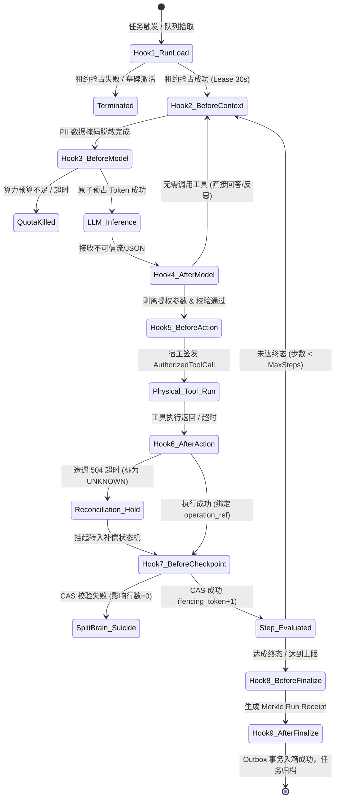

# L2 核心技术专题：9 阶段生命周期控制环原理与电梯演说

> **知识库归属**：企业级 Agent 架构 L2 层 (受控宿主运行时 Harness) 核心专题系列  
> **所属专题**：[9 阶段生命周期控制环专题总揽](./00-专题总揽与实战索引.md)  
> **关联主架构**：[受控宿主运行时 Harness 与执行控制环深度架构与实战全景](../../03-AI-Agent-L2-受控宿主运行时Harness与执行控制环深度架构与实战全景.md#51--9-阶段生命周期钩子内核级流水线与状态流转拓扑)  
> **专题定位**：彻底吃透“意图推导”、“Tools 执行”与“9 个原子系统调用门禁”的微内核底层哲学，掌握 30 秒电梯演说。

---

## 一、 Topic 核心本质透视：到底在讨论什么？

在企业级 Agent 架构中，很多人把控制环误解为简单的“拦截器”或“Python 装饰器”。实际上，该 Topic 的本质是：  
**“基于现代操作系统的 POSIX 系统调用拦截机制，为不可信概率论大模型构建一套特权环隔离沙箱（AI Syscall & Sandbox Pipeline）。”**

### 1. 三大核心术语底层拆解

```
┌──────────────────────────────────────────────────────────────────────────────┐
│                    Ring 3 (不可信用户态 / AI 认知空间)                          │
│                                                                              │
│    大模型内部思维链 (CoT) ────► 产生不可信初步想法:                             │
│                                “意图推导 (Intent Reasoning)”                 │
│                                (例如: 想调用退款接口退 $50)                  │
└──────────────────────────────────────┬───────────────────────────────────────┘
                                       │ 尝试发起跨环调用 (Trap)
═══════════════════════════════════════╪════════════════════════════════════════
                        9 阶段原子系统调用门禁 (Syscall Gates)
═══════════════════════════════════════╪════════════════════════════════════════
                                       │ 宿主鉴权审查 & 注入短期凭据
┌──────────────────────────────────────▼───────────────────────────────────────┐
│                    Ring 0 (受控内核态 / Harness 运行时)                        │
│                                                                              │
│    宿主签发 AuthorizedToolCall ──► “Tools 执行 (Side-Effect Invocation)”       │
│                                    (真正向银行/ERP划扣资金或修改订单)         │
└──────────────────────────────────────────────────────────────────────────────┘
```

1. **“意图推导（Intent Reasoning）”**：  
   * **位置**：处于 **Ring 3（不可信认知空间）**；
   * **本质**：大模型根据提示词和上下文，在内部展开思维链（Chain of Thought），生成的**未经证实、充满幻觉风险、可能被越狱污染的初步调用意图**（如模型输出的未校验 JSON）。这一步属于纯粹的“脑内计算”，尚未对外界产生物理改写。
2. **“Tools 执行（Tool Invocation / External Side-Effect）”**：  
   * **位置**：处于 **Ring 0（宿主物理世界）**；
   * **本质**：真正向外部生产系统（银行转账、ERP 修改订单、WMS 叫停发货）施加**不可逆的物理副作用**。一旦调用发生，真实资产即被划走，真实数据即被持久化改写。
3. **“9 个原子系统调用门禁（Atomic Syscall Gates）”**：  
   * **位置**：横亘在 Ring 3 与 Ring 0 之间的**硬件级隔离栅栏**；
   * **本质**：如同 Linux 内核对 `sys_write` / `sys_fork` 的强制特权检查，Harness 在意图推导之前、模型调用前后、工具调用前后、状态持久化与终态交付等 9 个关键节点，切入不可绕过的特权检查。任何一个门禁校验失败，当前执行立即被物理熔断。

---

## 二、 30 秒电梯演说（Elevator Pitch）

> **场景 A：面向业务高管 / CEO 汇报（一分钟讲透商业安全价值）**
> “很多团队直接拿大模型调公司系统，就像让一个口才极好但容易打瞌睡的实习生直接握着公司的网银 U 盾和公章去付款。而我们在中间自研了一套‘9 阶段受控生命周期环’。实习生负责提建议，而每一次查看数据、调用模型、转账发货，都必须经过宿主的 9 道安全门禁——钱该不该付、付给谁、有没有权限、超时了怎么核对，全部由确定的系统代码兜底。有了这套机制，大模型产生再离谱的幻觉，公司的核心资产与交易账目也绝对安全。”

> **场景 B：面向顶级技术面试官 / 首席架构师（展现极高专业术语密度与闭环）**
> “所谓 9 阶段生命周期控制环，是我们在 L2 Harness 落地微内核架构的核心抓手。传统 Agent 将状态机与外部调用交给概率模型，必然导致非幂等重试重复扣款、Prompt 提权与脑裂覆盖。我们借鉴 POSIX 特权分离模型，在意图推导与工具执行的前中后切入 9 个原子系统调用门禁：
> 在 `before_model` 原子预占算力预算防死循环，在 `after_model` 严格 Schema 反序列化剥离非法提权标识，在 `before_action` 由宿主基于用户真实身份签发带 STS 凭据的 `AuthorizedToolCall`，在 `after_action` 绑定 SHA256 唯一幂等键并在超时时标为 UNKNOWN 挂起对账，最后在 `before_checkpoint` 借由单调递增 Fencing Token 与 CAS 锁彻底杜绝分布式脑裂。整套控制环将生产失控率彻底归零，赋予复杂长周期任务毫秒级断点续跑与确定性回放能力。”

---

## 三、 9 阶段系统调用门禁（Syscall Gates）逐层判定全景表

每一个 Hook 都是一个原子屏障，承载着明确的准入条件、拦截逻辑与熔断后果：

| Hook 标识 | 门禁类型 | 核心职能与准入条件 | 拦截的致命风险 | 门禁未通过时的处置策略 |
| :--- | :--- | :--- | :--- | :--- |
| **1. `on_run_load`** | 准入屏障 | 验证租户身份；原子抢占 Redis 30s 分布式租约（`Lease`）；核查是否具备软删除墓碑（`Tombstone`）。 | 僵尸 Run 被唤醒、多节点并发争抢调度造成双主冲突。 | 立即释放资源，直接终止流程，拒绝进入调度。 |
| **2. `before_context`** | 隐私脱敏 | 依据授权目的声明（`purpose_code`）过滤无关上下文；使用 Aho-Corasick 算法对 PII 敏感数据进行动态掩码。 | 违反 GDPR/个保法、个人明文隐私泄漏给外部模型提供商。 | 阻断上下文流出，抛出 `ComplianceViolationException`。 |
| **3. `before_model`** | 算力限额 | 依据 Prompt 长度与 MaxTokens 在 Redis 执行 Lua 脚本**原子预扣减 Token 算力预算**；检查出网域名白名单。 | 任务陷入死循环无限自调用，一夜刷爆企业数十万 API 额度。 | 抛出 `QuotaExceededException`，物理熔断模型外呼。 |
| **4. `after_model`** | 结构过滤 | Strict Mode Pydantic 强类型校验；**物理剥离**模型输出中自主伪造的 `permit=true`、`is_admin=true` 等提权字段。 | 间接提示词注入（Prompt Injection）导致的越权提权。 | 丢弃非法字段；若结构无法解析，触发反思重试或抛错。 |
| **5. `before_action`** | **特权隔离 (核心门禁)** | **彻底剥夺模型自主授权权**；由宿主基于用户真实身份与 RBAC 权限，向安全中枢换取 60s 短期 STS 凭据，组装为 `AuthorizedToolCall`。 | 权限漂移、未授权用户调用高危写接口（如删库、发券）。 | 拒绝发券/转账，拦截越权调用，记录安全渗透告警。 |
| **6. `after_action`** | 幂等隔离 | 绑定不可变幂等键 `operation_ref`；若下游返回 TCP RST 或 504 Gateway Timeout，**严禁盲目重试**。 | 网络超时后盲目重试导致用户被重复划款、重复下单。 | 标为 `ACTION_STATUS_UNKNOWN`，挂起主流程转入对账。 |
| **7. `before_checkpoint`** | 并发一致 | 版本计数器递增 `fencing_token = fencing_token + 1`，通过 PostgreSQL CAS 乐观锁比较并更新状态。 | 多 Worker 假死苏醒后的脏写踩踏与分布式状态撕裂。 | CAS 影响行数为 0，判定发生脑裂，当前 Worker 自杀退出。 |
| **8. `before_finalize`** | 审计存证 | 串联全链路每一个 Step 的输入输出 Hash，计算 Merkle Root Hash，生成全局不可篡改的 **Run Receipt（运行收据）**。 | 事后扯皮对账困难、审计日志被篡改、缺少合规凭据。 | 收据签名校验失败则告警，阻止任务非法归档。 |
| **9. `after_finalize`** | 可靠出箱 | 基于 **Transactional Outbox 模式** 将终态事件原子写入数据库出箱表，通过 CDC 引擎可靠投递至 Kafka。 | 任务终态提交但外部计费、通知系统因宕机漏收事件。 | 本地事务保证事件持久化，待队列恢复后自动可靠重放。 |

---

## 四、 控制环与微内核状态机底层跃迁图



---
*本文档为 Cogniva 架构体系深度解构专题篇，由企业级 Agent 架构基础设施团队维护。*
