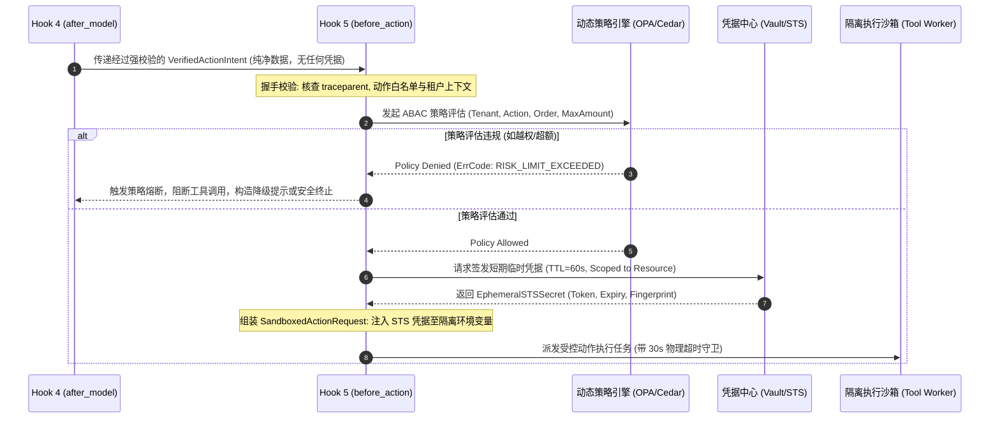

# Hook 5: before_action —— 工具特权隔离与 STS 临时凭据签发落地实战

> **定位**: 本文是 [01-生命周期钩子（Lifecycle Hooks）专题](file:///Users/allen/Desktop/NewArchitect/workspace/cogniva/doc/kb/agent/deep-dive/topics/01-lifecycle-hooks/00-专题总揽与实战索引.md) 的第 13 篇核心实战文档。深入剖析在受控宿主运行时（Harness）进入物理工具或外部 API 调用前，如何通过内核级安全门禁实现**零信任特权隔离**与 **动态 STS 临时凭据派发（TTL=60s）**。
>
> **前置依赖**: 建议先阅读 [01-内核级控制环原理与电梯演说](file:///Users/allen/Desktop/NewArchitect/workspace/cogniva/doc/kb/agent/deep-dive/topics/01-lifecycle-hooks/01-内核级控制环原理与电梯演说.md)、[12-Hook4-after_model 结构强校验与物理剥离提权落地实战](file:///Users/allen/Desktop/NewArchitect/workspace/cogniva/doc/kb/agent/deep-dive/topics/01-lifecycle-hooks/12-Hook4-after_model-结构强校验与物理剥离提权落地实战.md) 以及 [01-跨境电商多AI-Agent生态体系业务架构与集成落地指南](file:///Users/allen/Desktop/NewArchitect/workspace/cogniva/doc/kb/agent/deep-dive/topics/01-lifecycle-hooks/01-跨境电商多AI-Agent生态体系业务架构与集成落地指南.md)。

---

## 一、 30秒电梯演说：面试与技术汇报标准口径

> **“在企业级 Agent 架构中，绝不能让大模型直接感知或持有任何生产环境的持久性 API 密钥、数据库凭据或云凭据。模型输出的永远只是‘无特权的纯文本调用意图’。  
> `before_action` 是执行控制环中的物理工具准入屏障：它在调用发起前的微秒级窗口内，通过 OPA/Cedar 策略引擎对动作参数进行租户隔离与风控金额阈值核查；随后向安全凭据中心（Vault/STS）动态签发一个绑定当前租户、当前订单、TTL 仅 60 秒的极简受限凭据，并注入隔离沙箱的环境变量中。一旦发生 Prompt 越权诱导或参数篡改，安全门禁立即熔断并阻断出网，从物理上杜绝宽泛权限泄露与高危误调用！”**

---

## 二、 业务痛点下钻：以“跨境电商售后争议退赔 Agent”为例

在跨境电商售后场景中，Agent 拥有发起 Stripe 退款、ERP 补发配件、生成 UPS/FedEx 退货面单等高危动作能力。若缺少 `before_action` 的特权隔离，将引发致命的资金与数据灾难：

```
                    【黑客注入/模型幻觉调用】
                               │
                               ▼
  LLM 决策意图: stripe_refund(order_id="ORD-9921", amount=2000.00, currency="USD")
                 (注: 该订单实际成交金额仅 $200.00, 被篡改为 $2000.00)
                               │
    ┌──────────────────────────┴──────────────────────────┐
    ▼                                                     ▼
【无 before_action 裸奔模式】                     【有 before_action 内核受控模式】
 1. 工具执行器直接持有 Stripe Admin 全局主密钥          1. OPA 策略核验: $2000 > 订单成交限额 $200 -> 拦截拒绝!
 2. 盲目执行退款 $2000.00 到用户海外信用卡               2. 凭据隔离: 工具沙箱中无持久密钥，模型无法窃取
 3. 结果: 严重资金资损，且无法追回！                     3. 动态 STS 机制: 即使通过校验，仅签发限额 $200、有效期 60s 凭据
                                                        4. 结果: 强阻断非法动作，保护资金安全与合规底线!
```

### 生产核心隐患剖析
1. **全局主密钥泄露（God-Key Exposure）**: 传统低阶 Agent 将 Stripe/AWS/ERP 主 API Key 硬编码或直接暴露在宿主环境变量中，模型或第三方不可信插件一旦利用 SSRF 或沙箱逃逸读到内存，全局系统沦陷。
2. **越权参数篡改（IDOR / Parameter Tampering）**: 模型幻觉或间接注入导致 Agent 使用租户 A 的会话操作租户 B 的订单号，发起无抵押退款。
3. **长期凭据重放攻击（Replay Attack）**: 工具执行网络报文被中间人截获后，长期有效的 API Token 可被任意重放。

---

## 三、 四维核心管道架构与机制设计

```
[Hook 4: after_model 结构校验与提权清洗通过]
                     │  (携带 VerifiedActionIntent: 无特权纯净动作意图)
                     ▼
┌────────────────────────────────────────────────────────┐
│  【Hook 5: before_action 工具特权隔离与动态准入管道】   │
│                                                        │
│  维度 1：动态策略门禁核验 (OPA/Cedar + ABAC 细粒度审计)│
│  维度 2：短期受限 STS 凭据签发 (Vault/OIDC, TTL=60s)  │
│  维度 3：流水线契约与拓扑握手 (Context 与 Action 解耦)  │
│  维度 4：沙箱环境注入与熔断超时挂载 (Wasm/Container)    │
└────────────────────┬───────────────────────────────────┘
                     │  (下发注入了短凭据与安全上下文的 SandboxedActionRequest)
                     ▼
[工具执行沙箱 Tool Execution Sandbox]
```

---

### 维度 1: 动态策略门禁核验（OPA / Cedar 细粒度控制）

`before_action` 的第一道防线绝不是信任大模型传入的参数，而是通过确定性策略引擎（如 Open Policy Agent / AWS Cedar）进行属性访问控制（ABAC）：

1. **租户边界强绑定**: 强制比对当前 `RunContext.tenant_id` 与动作入参中的 `target_tenant_id` / `order_id`，杜绝横向越权。
2. **业务风控限额核查**:
   - 规则：单笔无退货退款（Keep-Item-Refund）绝对上限不得超过 $50.00；
   - 规则：退款金额必须小于等于订单实付金额减去已退款金额：`amount <= (order.paid_amount - order.refunded_amount)`；
   - 规则：涉及高危动作（如 `direct_db_write`、`delete_order`）直接无条件阻断，触发合规告警。

---

### 维度 2: 短期受限 STS 凭据签发（Vault / OIDC 动态生成）

**核心铁律：主凭据留在安全边界内，外发执行只用临时动态凭据。**

Harness 控制环与 HashiCorp Vault 或云厂商 STS（Security Token Service）集成：
- **极短生命周期（TTL=60s）**: 工具调用预期在 5~10 秒内完成，凭据有效期严格设定为 60 秒，超时自动销毁失效。
- **权限最小化声明（Role-Scoped Policy）**:
  - 例如调用海外仓补发工具时，签发的临时 S3 凭据**仅**允许读取特定订单号的 PDF 运单目录，禁止读取任何其他路径；
  - 临时 Stripe Restricted Key 仅允许针对指定 Charge ID 发起一次 Refund，禁止发起 Transfer 或读取客户卡号。

---

### 维度 3: 流水线契约与拓扑握手（Pipeline Contract & Topology Handshake）

本维度严格规范 `before_action` 在执行控制环中的输入、输出与上下文边界。

#### 1. 契约拓扑与架构握手图



#### 2. 深度辨析：大模型上下文（Context）与动作执行载荷（Action Payload）的本质解耦

| 比较维度 | 大模型上下文（LLM Context） | 动作执行载荷（Action Execution Payload） |
| :--- | :--- | :--- |
| **存储位置** | 对话消息数组（Messages）、KV 缓存、向量召回片段 | 结构化动作调用请求体（`SandboxedActionRequest`） |
| **内容性质** | 概率论语义文本、推理链、历史退赔讨论记录 | 确定性 RPC / HTTP 调度参数与签名信息 |
| **凭据暴露度** | **绝对禁止包含任何敏感凭据或真实 Token** | **仅在沙箱运行时环境变量中注入 TTL=60s 短期凭据** |
| **生命周期** | 伴随整个 Run 会话生命周期，易被模型在后续轮次复述 | 仅在单次网络 I/O 窗口内有效（TTL=60s），调用后即弃 |
| **防篡改保障** | 易受越狱 Prompt 诱导与语义幻觉影响 | 受 OPA 策略硬编码强制约束，签名完整性校验 |

#### 3. 严格数据契约定义（Python Pydantic 规范）

```python
from pydantic import BaseModel, Field, SecretStr
from typing import Dict, Any, Optional
from datetime import datetime

class VerifiedActionIntent(BaseModel):
    """从 Hook 4 流转入 Hook 5 的无特权动作意图"""
    action_id: str = Field(..., description="全局唯一动作 ID")
    tool_name: str = Field(..., description="目标工具名称，如 refund_charge")
    parameters: Dict[str, Any] = Field(..., description="强类型校验后的业务参数")
    tenant_id: str = Field(..., description="租户标识")
    run_id: str = Field(..., description="宿主执行 Run ID")
    trace_id: str = Field(..., description="分布式追踪 Traceparent")

class EphemeralSTSToken(BaseModel):
    """Hook 5 向 Vault/STS 申请的极短生命周期凭据"""
    access_token: SecretStr = Field(..., description="短期访问凭据，不输出至日志")
    token_fingerprint: str = Field(..., description="Token 哈希指纹，用于审计追溯")
    expires_at: datetime = Field(..., description="硬到期时间戳")
    scoped_resource: str = Field(..., description="受限资源 ARN / 范围")

class SandboxedActionRequest(BaseModel):
    """Hook 5 派发给沙箱工具执行器的最终请求载荷"""
    action_id: str
    tool_name: str
    parameters: Dict[str, Any]
    ephemeral_credentials: Dict[str, str] = Field(..., description="注入沙箱安全环境变量的键值")
    timeout_ms: int = Field(default=30000, description="物理超时时间，默认 30s")
    audit_trace_meta: Dict[str, str] = Field(..., description="包含 traceparent 与安全凭据指纹的元数据")
```

#### 4. 前置条件与后置保证（Pre-condition & Post-condition）
- **前置必须成立（Pre-condition）**:
  1. 动作入参必须已由 Hook 4 完成 Schema 校验与金丝雀过滤；
  2. 租户 ID 必须与当前分布式租约持有者严格一致，无墓碑标记。
- **后置保证达成（Post-condition）**:
  1. 派发至执行器的凭据有效期严格 $\le 60\text{s}$；
  2. 大模型上下文历史中绝对不沉淀任何凭据明文；
  3. 执行审计日志已记录 `(action_id, tool_name, token_fingerprint, opa_verdict)`。

---

### 维度 4: 审计追踪、熔断监控与下游路由

1. **分布式追踪注入（W3C Traceparent）**:
   - 将主控制环的 TraceContext 注入 HTTP Request Header 或 gRPC Metadata 中，确保全链路 Trace 从 Prompt -> Model -> Hook 5 -> 外部第三方 API（Stripe/FedEx）完全串联。
2. **物理沙箱熔断器挂载**:
   - 针对下游网络 I/O 挂载严格的 Wall-Clock 定时器（通常 30s）；若工具调用超时或发生三次连续 5xx 故障，触发断路器（Circuit Breaker），禁止后续流量冲击。

---

## 四、 生产踩坑问答与高频面试考点

### Q1: 凭据签发（Vault/STS）本身会有网络延迟（50-100ms），每个工具调用都签发一次，会否拖垮高并发 Agent 性能？
> **深度拆解**:  
> 1. **本地短效凭据租约池（Local Ephemeral Lease Pool）**: 绝大部分 STS 服务支持分批派发或基于内存的轻量公私钥非对称签名（如基于 Ed25519 的自签发短期 JWT）。Harness 内部持有短期私钥签发器，签发本地短期凭据仅耗时 **< 1ms**。  
> 2. **按需降级与范围缓存**: 对于同一 Run 内连续发起的只读动作（如查询订单历史、查询物流轨迹），可在内存中复用 TTL 剩余时间充足（> 30s）的同一只读凭据，兼顾极速吞吐与特权隔离。对于写入动作（退款、发货），必须坚持单次独立签发。

### Q2: 如果 OPA 策略引擎拒绝了 Agent 的工具调用（如金额超限），Harness 应该直接崩溃抛错，还是反馈给大模型让其自主纠错？
> **深度拆解**:  
> 这是一个经典的 **“安全阻断 vs 认知自愈”** 抉择：
> 1. **硬违规（恶意越权 / IDOR / 黑名单工具）**: 直接抛出 `SecurityPolicyViolationException`，终止整个 Run，封禁可疑会话并告警人工介入，绝不向模型透露安全规则的内部阈值细节，防止对抗试探。
> 2. **软违规（参数超额 / 缺少前置凭据）**: 构造合规的 ReAct 观察反馈：`"Tool Execution Error: Refund amount $2000 exceeds maximum allowable limit of $200 for this order. Please adjust refund amount."`，将确定性规则反馈给模型，允许模型在当前控制环内自我修正为 $200.00，完成安全自治闭环。但必须设置最大重试次数限制（如 2 次），防止陷入死循环。

---

## 五、 关联导航与知识拓扑

- 上一步：[12-Hook4-after_model 结构强校验与物理剥离提权落地实战](file:///Users/allen/Desktop/NewArchitect/workspace/cogniva/doc/kb/agent/deep-dive/topics/01-lifecycle-hooks/12-Hook4-after_model-结构强校验与物理剥离提权落地实战.md)
- 下一步：[14-Hook6-after_action 不可变幂等键与超时未知态对账落地实战](file:///Users/allen/Desktop/NewArchitect/workspace/cogniva/doc/kb/agent/deep-dive/topics/01-lifecycle-hooks/14-Hook6-after_action-不可变幂等键与超时未知态对账落地实战.md)
- 跨Hook代币化闭环：[09-附录-Harness全生命周期数据代币化与跨Hook隐私沙箱闭环全景](file:///Users/allen/Desktop/NewArchitect/workspace/cogniva/doc/kb/agent/deep-dive/topics/01-lifecycle-hooks/appendix/09-附录-Harness全生命周期数据代币化与跨Hook隐私沙箱闭环全景.md)（掌握 Hook 5 如何执行去代币化反向赎回真卡号与地址）
- 专题索引：[00-生命周期钩子（Lifecycle Hooks）专题总揽与实战索引](file:///Users/allen/Desktop/NewArchitect/workspace/cogniva/doc/kb/agent/deep-dive/topics/01-lifecycle-hooks/00-专题总揽与实战索引.md)
