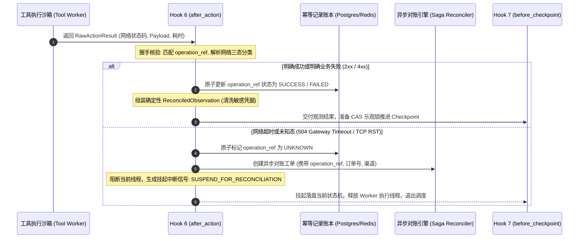

# Hook 6: after_action —— 不可变幂等键与超时未知态对账落地实战

> **定位**: 本文是 [01-生命周期钩子（Lifecycle Hooks）专题](file:///Users/allen/Desktop/NewArchitect/workspace/cogniva/doc/kb/agent/deep-dive/topics/01-lifecycle-hooks/00-专题总揽与实战索引.md) 的第 14 篇核心实战文档。深入剖析在工具或外部 API 物理调用完成后，宿主运行时（Harness）如何通过**不可变幂等键（Idempotency Key）** 与 **504 超时未知态（UNKNOWN State）对账机制**，彻底根除生产环境重复扣款、超额退款与库存撕裂。
>
> **前置依赖**: 建议先阅读 [01-内核级控制环原理与电梯演说](file:///Users/allen/Desktop/NewArchitect/workspace/cogniva/doc/kb/agent/deep-dive/topics/01-lifecycle-hooks/01-内核级控制环原理与电梯演说.md)、[13-Hook5-before_action 特权隔离与STS凭据签发落地实战](file:///Users/allen/Desktop/NewArchitect/workspace/cogniva/doc/kb/agent/deep-dive/topics/01-lifecycle-hooks/13-Hook5-before_action-特权隔离与STS凭据签发落地实战.md) 以及 [01-跨境电商多AI-Agent生态体系业务架构与集成落地指南](file:///Users/allen/Desktop/NewArchitect/workspace/cogniva/doc/kb/agent/deep-dive/topics/01-lifecycle-hooks/01-跨境电商多AI-Agent生态体系业务架构与集成落地指南.md)。

---

## 一、 30秒电梯演说：面试与技术汇报标准口径

> **“在分布式工具调用中，网络超时（HTTP 504 / TCP RST）从来不代表失败，而是致命的‘未知态（UNKNOWN）’。低阶 Agent 在超时后盲目重试，必然导致客户被重复退款、仓库重复发货。  
> `after_action` 是执行控制环中的强一致性幂等与对账门禁：它首先强制校验动作绑定的不可变幂等键 `operation_ref = SHA256(run_id + step_id + action_name + canonical_params)`；当下游接口发生超时或假死时，控制环**严禁盲目重试**，而是立即将动作状态标记为 `ACTION_STATUS_UNKNOWN`，触发状态机将当前 Run 安全挂起（`SUSPENDED_FOR_RECONCILIATION`）并持久化检查点，交由后台异步 Saga 对账协程或 Webhook 回查真实账本。只有在确认下游事实终态后，才允许唤醒断点续跑，确保全链路资金与物理库存绝对零撕裂！”**

---

## 二、 业务痛点下钻：以“跨境电商售后争议退赔 Agent”为例

在跨境电商售后处理中，Agent 最核心的高危动作包括向 Stripe 发起争议退款、向海外仓 ERP 发送换货补发指令。网络闪断与网关超时是分布式系统的常态，若缺乏 `after_action` 的未知态防护，将直接导致资金翻倍亏损：

```
                    【Agent 发起工具动作】
                               │
            调用 Stripe 退款接口 refund_charge(amount=$180)
                               │
            ┌──────────────────┴──────────────────┐
            ▼                                     ▼
     [请求成功到达 Stripe]                 [网络抖动 / 网关超时]
     Stripe 已成功扣款 $180               返回 HTTP 504 Gateway Timeout
            │                                     │
            └──────────────────┬──────────────────┘
                               ▼
    ┌──────────────────────────┴──────────────────────────┐
    ▼                                                     ▼
【无 after_action 盲目重试模式】                  【有 after_action 幂等对账模式】
 1. 模型感知到 504 错误，判定“退款失败”          1. 捕获 504，严格禁止在循环中重发请求
 2. ReAct 循环立即重试：再次发起退款 $180          2. 标记动作状态为 ACTION_STATUS_UNKNOWN
 3. Stripe 执行第二次扣款，客户收到 $360!          3. 写入不可变 operation_ref 防重账本
 4. 结果: 严重资损，财务坏账无法追回！           4. 挂起 Run，异步 Saga 探针轮询 Stripe 对账
                                                 5. 对账发现第一笔已成功 -> 直接平账并返回成功！
```

### 生产真实痛点剖析
1. **三态困境（The Three-State Dilemma）**: 分布式 RPC 调用的返回状态本质上是三态——**成功（Success）、失败（Failure）、未知（Unknown）**。当返回 504 或连接重置时，请求可能已经在下游执行完毕，也可能根本未到达。任何未经对账的自主重试，等同于在盲盒里赌博。
2. **幂等键漂移（Idempotency Key Drift）**: 许多开发者依赖 UUID 作为重试的幂等键，重试时重新生成了新的 UUID，导致下游支付网关将重试识别为一笔“全新交易”，彻底击穿下游防重逻辑。
3. **Worker 资源耗尽与重试风暴**: 如果 Agent 在超时后原地 `sleep(5)` 阻塞线程轮询，当大量请求超时时，线程池瞬间被占满，引发全站级联雪崩。

---

## 三、 四维核心管道架构与机制设计

```
[工具执行沙箱 Tool Execution Sandbox]
                     │  (返回原始网络响应 RawNetworkResponse: 200/504/RST)
                     ▼
┌────────────────────────────────────────────────────────┐
│  【Hook 6: after_action 幂等隔离与未知态对账管道】     │
│                                                        │
│  维度 1：不可变幂等键计算与防重约束 (SHA256 确定性生成)│
│  维度 2：三态分类与 504 未知态拦截 (禁止盲目重试)     │
│  维度 3：流水线契约与拓扑握手 (Observation 标准化)    │
│  维度 4：异步 Saga 挂起对账与断点续跑 (Webhook/Worker) │
└────────────────────┬───────────────────────────────────┘
                     │  (输出确定性 ReconciledObservation)
                     ▼
[Hook 7: before_checkpoint 并发一致性状态落盘]
```

---

### 维度 1: 不可变幂等键计算与防重约束（SHA256 确定性生成）

为了确保整个生命周期内任何重试、重放都具有全局唯一且确定性的指纹，Harness 在内核层计算不可变幂等键：

$$\text{operation\_ref} = \text{SHA256}(\text{tenant\_id} + \text{run\_id} + \text{step\_id} + \text{tool\_name} + \text{CanonicalJSON}(\text{parameters}))$$

- **规范化排序（Canonical JSON）**: 对参数 JSON 键进行字典序排序，剔除多余空格，确保 `{a: 1, b: 2}` 与 `{b: 2, a: 1}` 生成完全一致的 Hash。
- **数据库防重表硬核约束**:
  ```sql
  CREATE TABLE idempotency_records (
      tenant_id VARCHAR(64) NOT NULL,
      operation_ref VARCHAR(64) NOT NULL,
      run_id VARCHAR(64) NOT NULL,
      step_id INT NOT NULL,
      action_status VARCHAR(32) NOT NULL, -- PENDING / SUCCESS / FAILED / UNKNOWN
      response_payload JSONB,
      created_at TIMESTAMP WITH TIME ZONE DEFAULT NOW(),
      PRIMARY KEY (tenant_id, operation_ref)
  );
  ```
  在发送网络请求前插入 `PENDING`，请求返回后更新为最终状态。下游任何重复到达的相同请求直接读取已有记录，杜绝双发。

---

### 维度 2: 三态分类与 504 未知态拦截（严格禁绝盲目重试）

`after_action` 建立确定性状态判定树：

```
                    【动作网络返回结果】
                             │
            ┌────────────────┼────────────────┐
            ▼                ▼                ▼
     [HTTP 2xx 成功]   [明确业务拒绝 4xx]   [超时/网络假死/5xx]
            │                │                │
            ▼                ▼                ▼
     ACTION_SUCCESS   ACTION_FAILED    ACTION_UNKNOWN
     (平账并正常流转)  (业务不可行反馈) (504/TCP RST/ConnectTimeout)
                                              │
                                              ▼
                                    【严格禁绝在当前回路重试】
                                    触发挂起对账 Saga 机制！
```

---

### 维度 3: 流水线契约与拓扑握手（Pipeline Contract & Topology Handshake）

本维度严格规范 `after_action` 在执行控制环中的输入、输出与观察值边界。

#### 1. 契约拓扑与架构握手图



#### 2. 深度辨析：原始网络响应（Raw Network Response）与安全观测值（Reconciled Observation）

| 比较维度 | 原始网络响应（Raw Network Response） | 安全观测值（Reconciled Observation） |
| :--- | :--- | :--- |
| **数据源头** | 外部 HTTP/gRPC 网关未经清洗的底层报文 | 经过 `after_action` 确权与合规化后的规范结构 |
| **敏感信息** | 可能包含第三方 API 返回的内部 IP、调试 Header、客户卡号前 6 位 | **严格脱敏**，剔除传输层元数据，仅保留业务事实字段 |
| **状态确定性** | 存在 504 / RST 等不确定状态 | **必须具备强确定性**（`SUCCESS` / `FAILED`），消除歧义 |
| **模型可理解性**| 堆栈信息过长，容易耗尽大模型上下文并引发幻觉 | 压缩为结构化紧凑 JSON，精准指导 ReAct 下一步思考 |

#### 3. 严格数据契约定义（Python Pydantic 规范）

```python
from pydantic import BaseModel, Field
from typing import Dict, Any, Optional
from enum import Enum
from datetime import datetime

class ActionTriState(str, Enum):
    SUCCESS = "ACTION_SUCCESS"
    FAILED = "ACTION_FAILED"
    UNKNOWN = "ACTION_UNKNOWN"

class RawActionResult(BaseModel):
    """工具沙箱直接返回的原始数据"""
    action_id: str
    operation_ref: str
    http_status_code: Optional[int]
    raw_body: Optional[str]
    error_message: Optional[str]
    latency_ms: int

class ReconciledObservation(BaseModel):
    """从 Hook 6 流转至 Hook 7 的最终可信观测结果"""
    action_id: str
    operation_ref: str
    state: ActionTriState
    sanitized_output: Dict[str, Any] = Field(..., description="经过安全脱敏的业务结果")
    requires_reconciliation: bool = Field(default=False, description="是否已被挂起转入对账")
    reconciliation_ticket_id: Optional[str] = Field(None, description="挂起对账工单号")
    verified_at: datetime
```

#### 4. 前置条件与后置保证（Pre-condition & Post-condition）
- **前置必须成立（Pre-condition）**:
  1. 动作必须已注入由 Hook 5 计算的不可变 `operation_ref`；
  2. 调用的 STS 临时凭据已在沙箱内部完成销毁。
- **后置保证达成（Post-condition）**:
  1. 绝不允许任何带有 `UNKNOWN` 状态的动作继续直接调用大模型（进入下一步思考）；
  2. 幂等账本 `idempotency_records` 中的状态必须已落盘；
  3. 若进入对账挂起，当前 Worker 必须立即释放 CPU 与内存，拒绝原地同步阻塞。

---

### 维度 4: 异步 Saga 对账补偿与安全挂起/恢复

1. **状态机安全挂起（Run Suspension）**:
   - 当捕获 `ACTION_STATUS_UNKNOWN` 时，Harness 不抛出异常崩溃，而是触发状态跃迁：`RUNNING -> SUSPENDED_FOR_RECONCILIATION`。
   - 立即将当前上下文通过 Hook 7 写入持久化存储，将 Worker 归还线程池。
2. **外部 Webhook 或 Saga 对账探针**:
   - 对账 Worker 启动退避轮询（如 10s, 30s, 60s），携带 `operation_ref` 调用第三方查询接口（如 `stripe.charges.retrieve(idempotency_key)`）；
   - 或者监听 Stripe/ERP 的异步 Webhook 回调事件。
3. **断点续跑唤醒（Resume Execution）**:
   - 一旦对账结果确认成功，将对账结果补全至 Step 结果账本，将状态机跃迁为 `READY_TO_RESUME`，由调度器重新派发 Worker 继续从断点执行。

---

## 四、 生产踩坑问答与高频面试考点

### Q1: 为什么即使在 HTTP Header 中加了 Stripe 的 `Idempotency-Key`，在遇到 504 时依然严禁在控制环内部直接 `while retry`？
> **深度拆解**:  
> 1. **下游防重锁未释放（Lock Contention）**: 当下游微服务或第三方网关正在处理第一个超时请求时，其内部往往对该幂等键施加了分布式锁。如果客户端立刻重发，下游极可能直接返回 `409 Conflict` 或 `429 Rate Limit`，使错误复杂化。  
> 2. **加剧下游级联雪崩（Retry Storm）**: 导致 504 的根本原因通常是下游服务过载。若成千上万个并发 Agent 遇到 504 都在本地死循环重试，将瞬间对下游造成 3~5 倍的流量洪峰，彻底击垮下游数据库。  
> 3. **线程资源独占**: Agent 的执行往往是长生命周期的，原地重试阻塞 Worker，会迅速耗尽宿主计算集群的并发承载能力。

### Q2: 异步对账通常需要几秒甚至几分钟，客户如果在线等待 Agent 回复，前端该如何呈现？
> **深度拆解**:  
> 这属于 Agent 的**异步流式交互体验设计**：
> 1. **状态透传与意图安抚**: 当进入 `SUSPENDED_FOR_RECONCILIATION` 时，Harness 会向前端推送一个标准事件：`{"status": "processing_payment", "message": "正在与银行对账安全确认中，请勿重复操作..."}`。
> 2. **WebSocket / SSE 异步保活**: 前端客户端接收到挂起事件后，展示平滑进度条，不关闭会话；一旦对账完成，通过 SSE 发送真正的业务结果包，实现“异步化、无感知、不丢单”。

---

## 五、 关联导航与知识拓扑

- 上一步：[13-Hook5-before_action 特权隔离与STS凭据签发落地实战](file:///Users/allen/Desktop/NewArchitect/workspace/cogniva/doc/kb/agent/deep-dive/topics/01-lifecycle-hooks/13-Hook5-before_action-特权隔离与STS凭据签发落地实战.md)
- 下一步：[10-Hook7-before_checkpoint 并发一致性与CAS乐观锁防脑裂落地实战](file:///Users/allen/Desktop/NewArchitect/workspace/cogniva/doc/kb/agent/deep-dive/topics/01-lifecycle-hooks/10-Hook7-before_checkpoint-并发一致性与CAS乐观锁防脑裂落地实战.md)
- 专题索引：[00-生命周期钩子（Lifecycle Hooks）专题总揽与实战索引](file:///Users/allen/Desktop/NewArchitect/workspace/cogniva/doc/kb/agent/deep-dive/topics/01-lifecycle-hooks/00-专题总揽与实战索引.md)
