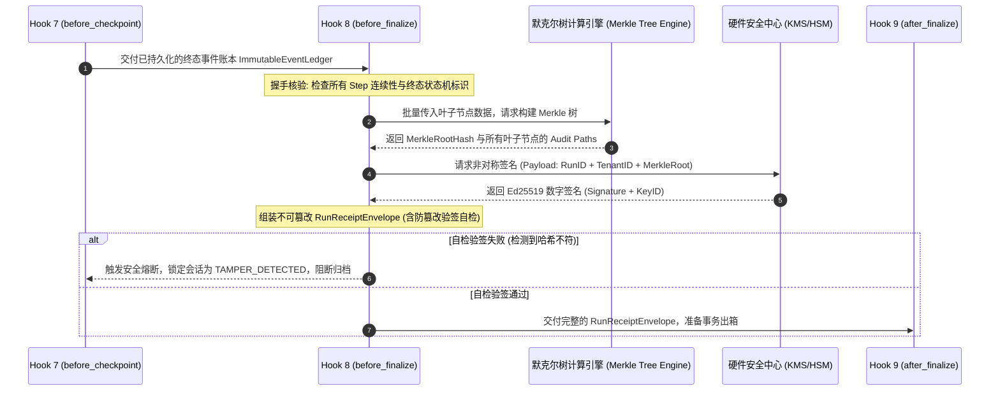

# Hook 8: before_finalize —— 全链路 Merkle 运行收据与密码学审计存证落地实战

> **定位**: 本文是 [01-生命周期钩子（Lifecycle Hooks）专题](file:///Users/allen/Desktop/NewArchitect/workspace/cogniva/doc/kb/agent/deep-dive/topics/01-lifecycle-hooks/00-专题总揽与实战索引.md) 的第 15 篇核心实战文档。深入剖析在 Agent 任务完成准备落盘归档的最后前置门禁中，宿主运行时（Harness）如何基于 **Merkle 树（默克尔树）哈希链** 与 **KMS/HSM 非对称签名**，铸造具备法律仲裁效力的**全局不可篡改运行收据（Run Receipt）**。
>
> **前置依赖**: 建议先阅读 [01-内核级控制环原理与电梯演说](file:///Users/allen/Desktop/NewArchitect/workspace/cogniva/doc/kb/agent/deep-dive/topics/01-lifecycle-hooks/01-内核级控制环原理与电梯演说.md)、[10-Hook7-before_checkpoint 并发一致性与CAS乐观锁防脑裂落地实战](file:///Users/allen/Desktop/NewArchitect/workspace/cogniva/doc/kb/agent/deep-dive/topics/01-lifecycle-hooks/10-Hook7-before_checkpoint-并发一致性与CAS乐观锁防脑裂落地实战.md) 以及 [01-跨境电商多AI-Agent生态体系业务架构与集成落地指南](file:///Users/allen/Desktop/NewArchitect/workspace/cogniva/doc/kb/agent/deep-dive/topics/01-lifecycle-hooks/01-跨境电商多AI-Agent生态体系业务架构与集成落地指南.md)。

---

## 一、 30秒电梯演说：面试与技术汇报标准口径

> **“在涉及真实资金交易、合同签署与合规核验的生产级自主 Agent 中，传统的文本日志‘不可靠、易篡改、无法律效力’。一旦面临国际卡组织反洗钱风控或跨国信用卡拒付（Chargeback）仲裁，企业根本无法自证 Agent 的决策链条未经篡改。  
> `before_finalize` 是任务归档前的密码学审计存证门禁：它从不可变状态账本中依次抽取每一个 Step 的输入、模型推理意图、工具调用与沙箱观测结果，通过 SHA256 递归构造一棵标准 Merkle 树并提取 Merkle Root；随后交由企业安全硬件中枢（KMS/HSM）使用 Ed25519 私钥进行数字签名，生成全链路不可篡改的 **Run Receipt（运行收据）**。如果历史上任何一个步骤被恶意篡改或跳步，收据验签立即失败并熔断归档，为企业构筑无懈可击的数字抗辩与司法存证底座！”**

---

## 二、 业务痛点下钻：以“跨境电商售后争议退赔 Agent”为例

在跨境电商售后处理中，海外买家经常发起 Visa/Mastercard 恶意拒付调单（Dispute / Chargeback），声称“商家未经同意乱退款”、“收到了破损商品但商家没有按约定补发”；或者企业内部存在恶意运维篡改数据库日志进行贪腐。若缺少 `before_finalize` 的密码学存证，企业将面临输掉仲裁与天价合规罚款的双重风险：

```
                    【跨境售后纠纷仲裁场景】
                               │
       买家向 Visa 提出拒付争议: "商家无理拒绝全额退款，且私自篡改沟通记录"
                               │
            ┌──────────────────┴──────────────────┐
            ▼                                     ▼
【无 before_finalize 传统文本日志】              【有 before_finalize 密码学收据】
 1. 调取 ELK / CloudWatch 文本日志               1. 调取不可篡改 Run Receipt (数字签名信封)
 2. 日志无签名，可被 DBA 或攻击者随意增删改     2. 出示单步 Merkle Audit Path (仅包含验货与退赔决策)
 3. Visa 卡组织与法庭不采信: "私有日志无自证力"  3. 数学证明：所有步骤哈希递归等于公钥签名 Root!
 4. 结果: 败诉，罚没全额退款并处 $50 争议罚金!   4. 结果: 胜诉，卡组织驳回拒付，秒级完成对账免责!
```

### 生产真实痛点剖析
1. **事后对账扯皮无凭据（Non-repudiation Failure）**: 传统纯文本日志存储在 Elasticsearch 中，缺乏密码学防篡改校验。DBA 或运维拥有直接修改日志的能力，导致审计日志无法作为法庭级或卡组织认可的合规凭证。
2. **敏感信息全量泄露风险**: 在应对外部审计或买家仲裁时，如果直接提交整个长周期 Run 的全部日志，将把其他敏感信息（如内部 API 域名、其他买家的数据缓存）一并暴露。
3. **隐蔽跳步与状态漂移（Silent State Tampering）**: 攻击者通过恶意劫持数据库直接将 Run 状态改为 `COMPLETED`，跳过了风控合规步骤，传统系统无法察觉执行过程缺失。

---

## 三、 四维核心管道架构与机制设计

```
[Hook 7: before_checkpoint 终态检查点写入完成]
                     │  (携带完整不可变事件账本 EventLedger)
                     ▼
┌────────────────────────────────────────────────────────┐
│  【Hook 8: before_finalize 密码学审计收据铸造管道】   │
│                                                        │
│  维度 1：全链路执行证据链聚合 (有序抽取所有 Step 哈希) │
│  维度 2：Merkle 树构建与 KMS 非对称私钥签名 (Ed25519)  │
│  维度 3：流水线契约与拓扑握手 (Merkle 证明信封规范)    │
│  维度 4：仲裁合规出证与终态防篡改准入 (阻断非法归档)   │
└────────────────────┬───────────────────────────────────┘
                     │  (输出已签名的 RunReceiptEnvelope)
                     ▼
[Hook 9: after_finalize Transactional Outbox 可靠事件出箱]
```

---

### 维度 1: 全链路执行证据链聚合（有序抽取 Step 哈希）

Harness 执行控制环的底层事件账本是一个**仅追加（Append-Only）**的事件流。在 `before_finalize` 触发时，内核遍历当前 Run 的全部有序 Step，并为每个 Step 计算规范化叶子节点哈希：

$$\text{Leaf}_i = \text{SHA256}(\text{step\_id} \parallel \text{action\_type} \parallel \text{input\_hash} \parallel \text{output\_hash} \parallel \text{policy\_verdict} \parallel \text{timestamp})$$

- 严格保序性：确保 Step 0 到 Step $N$ 严格按照物理执行发生的单调递增逻辑序号排列；
- 完整性约束：若中间缺失任何一个序号（例如存在 Step 1、Step 3 却缺失 Step 2），立即识别为“执行链路断裂”，拒绝生成收据并报警。

---

### 维度 2: Merkle 树构建与 KMS 非对称签名（Ed25519 硬件级存证）

1. **二叉 Merkle 树递归聚合**:
   将所有叶子节点哈希按二叉树自底向上两两合并哈希，最终计算出唯一的 32 字节根哈希：$$\text{Merkle Root} = \text{TreeHash}(\text{Leaf}_0, \text{Leaf}_1, \dots, \text{Leaf}_{n-1})$$
2. **KMS / HSM 硬件隔离私钥签名**:
   - Harness 将 `(run_id, tenant_id, merkle_root, completed_at)` 打包为权威声明，调用企业安全中心（AWS KMS / HashiCorp Vault Transit / 硬件安全模块 HSM）签发非对称数字签名：
   $$\text{Digital Signature} = \text{Sign}_{\text{PrivKey}}(\text{SHA256}(\text{ReceiptManifest}))$$
   - 采用 **Ed25519** 算法：签名长度仅 64 字节，验签耗时低于 50 微秒，性能远超传统 RSA。

---

### 维度 3: 流水线契约与拓扑握手（Pipeline Contract & Topology Handshake）

本维度严格规范 `before_finalize` 在执行控制环中的输入、输出与密码学证明边界。

#### 1. 契约拓扑与架构握手图



#### 2. 深度辨析：普通操作日志（Operational Logs）与密码学运行收据（Run Receipt）

| 比较维度 | 普通操作日志（Operational Logs） | 密码学运行收据（Cryptographic Run Receipt） |
| :--- | :--- | :--- |
| **存储介质** | Elasticsearch、CloudWatch、ClickHouse | 不可变关系数据库（WORM 存储）、区块链存证表 |
| **可篡改性** | 弱（系统管理员或特权程序可直接修改文本） | **物理不可篡改**（任何字节变更导致验签失败） |
| **法律与仲裁效力** | 仅供内部排查使用，法庭及卡组织易质疑真实性 | **具备抗抵赖性（Non-repudiation）**，合规认可度极高 |
| **局部证明能力** | 必须出示整段日志，极易泄露无关商业机密 | **支持 Merkle Audit Path**：可单独证明某一动作而隐藏其他内容 |
| **生命周期** | 通常按 30~90 天滚动删除冷备 | 长期持久化封存（至少 3~7 年以满足金融审计要求） |

#### 3. 严格数据契约定义（Python Pydantic 规范）

```python
from pydantic import BaseModel, Field
from typing import List, Dict, Any, Optional
from datetime import datetime

class StepEvidenceBlock(BaseModel):
    """单个步骤的密码学证据块"""
    step_id: int
    action_type: str = Field(..., description="LLM_INFERENCE / TOOL_CALL / HUMAN_REVIEW")
    input_sha256: str
    output_sha256: str
    policy_verdict: str = Field(default="ALLOWED")
    leaf_hash: str = Field(..., description="当前步骤计算所得的 Merkle 叶子节点哈希")

class MerkleAuditPath(BaseModel):
    """用于对单个步骤进行局部无损验证的审计路径"""
    step_id: int
    leaf_hash: str
    audit_siblings: List[str] = Field(..., description="自底向上重构 Root 所需的同级哈希序列")

class RunReceiptEnvelope(BaseModel):
    """Hook 8 铸造的最终不可篡改运行收据信封"""
    receipt_version: str = "v1.0"
    tenant_id: str
    run_id: str
    order_id: str
    total_steps: int
    merkle_root: str = Field(..., description="全链路证据的 32 字节 Merkle 根哈希")
    kms_key_id: str = Field(..., description="签名所用的 KMS 密钥版本 ID")
    digital_signature: str = Field(..., description="Ed25519 签名 Base64 编码")
    completed_at: datetime
    evidence_blocks: List[StepEvidenceBlock]
```

#### 4. 前置条件与后置保证（Pre-condition & Post-condition）
- **前置必须成立（Pre-condition）**:
  1. 当前 Run 的业务终态必须已由 Hook 7 成功落盘（影响行数 = 1）；
  2. 事件账本必须严格连续有序，不存在未闭合的异步对账悬挂态。
- **后置保证达成（Post-condition）**:
  1. 产出的 `RunReceiptEnvelope` 必须在内存中通过本地公钥二次验签，确保签名绝对有效；
  2. 只有合法的收据才能进入 Hook 9 进行事务出箱。

---

### 维度 4: 仲裁合规出证与终态防篡改准入

1. **局部零知识审计出证（Selective Disclosure via Merkle Path）**:
   - 当海外买家对“退赔金额核准”提出异议时，企业无需交出完整的内部推理链（CoT）和敏感商业策略。
   - 企业只需导出 Step 4 的 `Leaf_4` 及其对应的 `MerkleAuditPath`，任何第三方仅凭这串兄弟哈希和公钥，即可在数学上严格证明：**“Step 4 的退赔裁决百分之百属于签名确权的这笔订单，且内容未被篡改”**。
2. **终态篡改熔断自毁**:
   - 若在 Hook 8 签名时发现数据库中某一步的哈希校验和与内存账本冲突，立即将任务标记为 `STATE_CORRUPTED_SUSPEND`，发出最高级别 P0 安全警报，并直接阻断流程走向终态。

---

## 四、 生产踩坑问答与高频面试考点

### Q1: 每次任务结束都调用一次 KMS 硬件签名，在高并发场景下（如黑五每秒上千单退赔），会否产生高昂的 KMS 调用账单和延迟瓶颈？
> **深度拆解**:  
> 1. **本地 HSM 缓存签名者（Local Ed25519 In-Memory Signer）**: 生产环境通常采用**分层密钥架构**。KMS 主密钥仅用于保护本地运行时实例的“短期会话私钥证书”（TTL=1小时）。在控制环内部，Harness 直接使用本地受保护内存中的 Ed25519 私钥进行签名，单次耗时 **< 50 微秒**，吞吐量可达 **20,000+ OPS**，完全不消耗 KMS 在线配额。  
> 2. **异步批处理归卷（Batch Merkle Aggregation）**: 对吞吐要求极高的场景，可在 Hook 8 先计算各 Run 的局部 Merkle Root，再由后台定时（如每 10 秒）将多笔 Run 的 Root 聚合为更大的 Block Root，单次向 KMS 统一盖章存证。

### Q2: 如果大模型的输出中包含幻觉生成的敏感词或非法字符，计算进入 Merkle 树后，会不会违反 GDPR “被遗忘权”导致无法删除？
> **深度拆解**:  
> 这是一个极为精妙的架构考点：
> 1. **证据与载荷物理分离（Hash-Only Ledger）**: Merkle 树中存储的**绝非明文原始数据**，而仅仅是数据的 `SHA256(RawContent + Pepper)` 单向哈希值。单向哈希不可逆，不属于个人可识别信息（PII）。  
> 2. **加密盐爆破丢弃（Cryptographic Shredding）**: 当用户行使 GDPR “被遗忘权”要求删除聊天记录时，企业只需在明文存储库中销毁加密密钥或删除对应原始文本，而无需破坏不可变账本中的 Merkle 哈希链，既满足了数据删除合规，又保留了历史金融账本的审计抗辩能力。

---

## 五、 关联导航与知识拓扑

- 上一步：[10-Hook7-before_checkpoint 并发一致性与CAS乐观锁防脑裂落地实战](file:///Users/allen/Desktop/NewArchitect/workspace/cogniva/doc/kb/agent/deep-dive/topics/01-lifecycle-hooks/10-Hook7-before_checkpoint-并发一致性与CAS乐观锁防脑裂落地实战.md)
- 下一步：[16-Hook9-after_finalize Transactional Outbox模式与可靠事件出箱落地实战](file:///Users/allen/Desktop/NewArchitect/workspace/cogniva/doc/kb/agent/deep-dive/topics/01-lifecycle-hooks/16-Hook9-after_finalize-Transactional-Outbox模式与可靠事件出箱落地实战.md)
- 专题索引：[00-生命周期钩子（Lifecycle Hooks）专题总揽与实战索引](file:///Users/allen/Desktop/NewArchitect/workspace/cogniva/doc/kb/agent/deep-dive/topics/01-lifecycle-hooks/00-专题总揽与实战索引.md)
