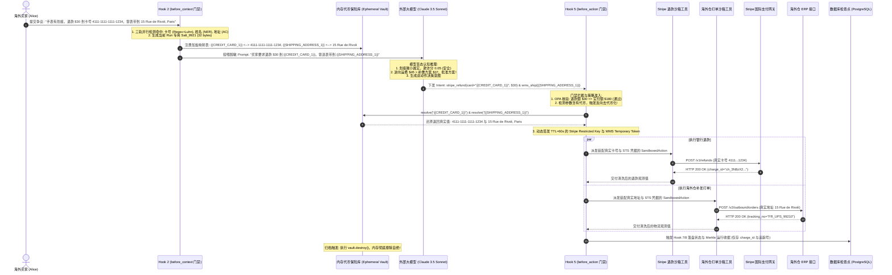

# 09-附录：售后争议退赔 Agent 全生命周期数据代币化与跨 Hook 隐私沙箱闭环全景（含 ASD-STE100 规范）

> **文档定位**：以 [01-跨境电商多AI-Agent生态体系业务架构与集成落地指南](file:///Users/allen/Desktop/NewArchitect/workspace/cogniva/doc/kb/ecommerce/architect/01-跨境电商多AI-Agent生态体系业务架构与集成落地指南.md) 中定义的 **第 2 专业核心 Agent——“售后争议调解与退赔决策 Agent (Post-Sales & Dispute Resolution Agent)”** 为完整业务蓝本，系统性阐明“数据代币化（Data Tokenization）”如何在受控宿主运行时（Harness）中构建贯穿 **Hook 2（识别铸币与加盐金库登记）$\to$ 大模型（盲态逆向经济学推理）$\to$ Hook 5（工具准入反向去代币化与出网划款）$\to$ 归档销毁（零持久化物理自绝）** 的跨 Hook 强一致性隐私沙箱闭环。
>
> **编写标准**：第一章节严格遵循国际航空航天与国防工业标准 **ASD-STE100（Simplified Technical English）** 编写，通过受控词汇与无歧义单意短句确立跨国工程技术基线。  
> **所属专题**：[01-生命周期钩子（Lifecycle Hooks）专题总揽与实战索引](file:///Users/allen/Desktop/NewArchitect/workspace/cogniva/doc/kb/agent/deep-dive/topics/01-lifecycle-hooks/00-专题总揽与实战索引.md)  
> **关联核心主文档**：  
> • [09-Hook2-before_context 隐私脱敏与上下文剪枝落地实战](file:///Users/allen/Desktop/NewArchitect/workspace/cogniva/doc/kb/agent/deep-dive/topics/01-lifecycle-hooks/09-Hook2-before_context-隐私脱敏与上下文剪枝落地实战.md)  
> • [13-Hook5-before_action 特权隔离与STS凭据签发落地实战](file:///Users/allen/Desktop/NewArchitect/workspace/cogniva/doc/kb/agent/deep-dive/topics/01-lifecycle-hooks/13-Hook5-before_action-特权隔离与STS凭据签发落地实战.md)  
> • [09-附录-加盐隔离临时可逆代币保险库与PII动态脱敏协同全景](file:///Users/allen/Desktop/NewArchitect/workspace/cogniva/doc/kb/agent/deep-dive/topics/01-lifecycle-hooks/appendix/09-附录-加盐隔离临时可逆代币保险库与PII动态脱敏协同全景.md)  
> • [09-附录-三轨PII动态脱敏与掩码引擎-电商售后退赔实战与STE100规范全景](file:///Users/allen/Desktop/NewArchitect/workspace/cogniva/doc/kb/agent/deep-dive/topics/01-lifecycle-hooks/appendix/09-附录-三轨PII动态脱敏与掩码引擎-电商售后退赔实战与STE100规范全景.md)  
> • [01-跨境电商多AI-Agent生态体系业务架构与集成落地指南](file:///Users/allen/Desktop/NewArchitect/workspace/cogniva/doc/kb/ecommerce/architect/01-跨境电商多AI-Agent生态体系业务架构与集成落地指南.md)

---

## 第一章：基于 ASD-STE100 规范的售后退赔 Agent 数据代币化工程技术标准

本章节遵循国际航空与工业标准 **ASD-STE100（Simplified Technical English）** 编写。旨在通过严格受控词汇、短句结构（$\le 20$ 词）与主动语态，消除跨国开发、安全审计与合规团队的技术理解歧义。

### SECTION 1: PURPOSE AND DEFINITIONS / 目的与术语定义

#### STE English:
1. This section gives mandatory rules for data tokenization in the Post-Sales and Dispute Resolution Agent.
2. **Post-Sales Agent**: An autonomous software component that resolves customer disputes and executes refund actions.
3. **Data Tokenization**: The process that replaces sensitive customer data with temporary non-sensitive surrogate tokens.
4. **Surrogate Token**: A structured placeholder string like `{{CREDIT_CARD_1}}` that contains no private customer information.
5. **De-tokenization**: The reverse process that swaps a surrogate token back to its real customer data value.
6. **Ephemeral Vault**: An in-memory key-value store that keeps the token-to-real mapping for only one dispute run.
7. **Per-Run Salt**: A 32-byte cryptographic random value generated for only one dispute resolution execution.
8. **Reverse Logistics**: The supply chain process that returns physical products from customers to warehouses.

#### 标准中文对照：
1. 本章节给出“售后争议调解与退赔决策 Agent”中数据代币化的强制性工程技术规则。
2. **售后决策 Agent（Post-Sales Agent）**：负责调解客户争议并执行退赔动作的自主软件组件。
3. **数据代币化（Data Tokenization）**：使用临时的非敏感代理代币替换客户真实敏感数据的处理过程。
4. **代理代币（Surrogate Token）**：如 `{{CREDIT_CARD_1}}` 的结构化占位字符串，其自身不含任何客户隐私信息。
5. **去代币化 / 逆向赎回（De-tokenization）**：将代理代币反向置换为其真实客户数据值的逆向处理过程。
6. **临时代币金库（Ephemeral Vault）**：仅在单次争议处理运行期间保持代币到真实值映射的内存键值存储。
7. **单次运行随机盐（Per-Run Salt）**：仅为单次争议处理运行执行生成的 32 字节密码学安全随机值。
8. **逆向物流（Reverse Logistics）**：将实物商品从客户退运回海外仓的供应链流程。

---

### SECTION 2: OPERATIONAL INVARIANTS ACROSS HOOKS / 跨 Hook 操作不变量与架构约束

#### STE English:
1. The harness must apply data tokenization across Hook 2 and Hook 5 for every dispute run.
2. In Hook 2, the engine must scan buyer messages for credit card numbers and home addresses.
3. In Hook 2, Track 1 must run the Luhn algorithm to verify Visa and Mastercard numbers.
4. In Hook 2, the engine must replace verified credit card numbers with `{{CREDIT_CARD_1}}`.
5. In Hook 2, the engine must replace customer physical addresses with `{{SHIPPING_ADDRESS_1}}`.
6. In Hook 2, the engine must store mappings in the ephemeral vault with a unique random salt.
7. The language model must analyze dispute photos and calculate reverse logistics costs with tokens only.
8. The language model must not receive real credit card numbers or real customer home addresses.
9. In Hook 5, the harness must intercept the refund tool call before it connects to Stripe.
10. In Hook 5, the harness must resolve `{{CREDIT_CARD_1}}` to the real credit card number.
11. In Hook 5, the harness must resolve `{{SHIPPING_ADDRESS_1}}` to the real warehouse shipping destination.
12. The harness must destroy the ephemeral vault from heap memory when the dispute run completes.
13. Do not serialize the ephemeral vault to database checkpoints, disks, or log files.

#### 标准中文对照：
1. 宿主系统（Harness）必须在每次争议运行中横跨 Hook 2 与 Hook 5 强制实施数据代币化。
2. 在 Hook 2 中，引擎必须扫描买家留言中的信用卡号与家庭住址。
3. 在 Hook 2 中，第一轨必须运行 Luhn 算法以校验 Visa 和 Mastercard 真实卡号。
4. 在 Hook 2 中，引擎必须将验证通过的信用卡号替换为 `{{CREDIT_CARD_1}}`。
5. 在 Hook 2 中，引擎必须将客户的物理收件住址替换为 `{{SHIPPING_ADDRESS_1}}`。
6. 在 Hook 2 中，引擎必须使用唯一的随机盐将映射关系存入临时代币金库。
7. 大语言模型必须仅使用代理代币分析争议图片并计算逆向物流成本。
8. 大语言模型严禁接收真实的信用卡号或真实的客户家庭住址。
9. 在 Hook 5 中，宿主系统必须在退款工具调用连接 Stripe 之前进行拦截。
10. 在 Hook 5 中，宿主系统必须将 `{{CREDIT_CARD_1}}` 还原为真实信用卡号。
11. 在 Hook 5 中，宿主系统必须将 `{{SHIPPING_ADDRESS_1}}` 还原为海外仓打单的真实收件地址。
12. 当本次争议运行结束时，宿主系统必须从堆内存中彻底销毁临时代币金库。
13. 严禁将临时代币金库序列化写入数据库检查点、磁盘或日志文件中。

---

### SECTION 3: STEP-BY-STEP PROCEDURE / 逐步操作规程

```
[Buyer Dispute Message] ──> [Hook 2: Tokenize & Vault] ──> [LLM: Blind Economics] ──> [Hook 5: De-token & Stripe] ──> [Destroy Vault]
```

#### STE English:
1. **Step 1 (Ingestion)**: Receive the buyer claim with the damaged watch photo and card number.
2. **Step 2 (Hook 2)**: Detect sensitive card and address fields with the three-track engine.
3. **Step 3 (Hook 2)**: Create surrogate tokens and record them into the memory vault with a salt.
4. **Step 4 (Hook 2)**: Deliver prompt text that contains surrogate tokens to the language model.
5. **Step 5 (Model)**: Verify the watch scratch photo and decide the partial refund amount.
6. **Step 6 (Model)**: Output tool actions with `{{CREDIT_CARD_1}}` and `{{SHIPPING_ADDRESS_1}}`.
7. **Step 7 (Hook 5)**: Check that the refund amount does not exceed the paid order amount.
8. **Step 8 (Hook 5)**: Resolve surrogate tokens to the real credit card and real address.
9. **Step 9 (Hook 5)**: Attach a 60-second STS credential and execute the Stripe refund request.
10. **Step 10 (Finalize)**: Save the dispute receipt and erase the memory vault immediately.

#### 标准中文对照：
1. **步骤 1（输入接收）**：接收包含破损手表照片与支付卡号的买家客诉。
2. **步骤 2（Hook 2 准入）**：使用三轨引擎检测敏感的银行卡与地址字段。
3. **步骤 3（Hook 2 铸币）**：创建代理代币并配合随机盐记录进内存金库中。
4. **步骤 4（Hook 2 交付）**：向大语言模型交付仅包含代理代币的 Prompt 文本。
5. **步骤 5（模型推理）**：核验手表划痕照片并裁决部分退赔金额。
6. **步骤 6（模型输出）**：输出包含 `{{CREDIT_CARD_1}}` 和 `{{SHIPPING_ADDRESS_1}}` 的工具动作。
7. **步骤 7（Hook 5 门禁）**：核查退赔金额未超过订单实付金额。
8. **步骤 8（Hook 5 赎回）**：将代理代币反向置换为真实信用卡号与真实地址。
9. **步骤 9（Hook 5 出网）**：附加有效期 60 秒的 STS 凭据并向 Stripe 发起真实退款。
10. **步骤 10（终态完成）**：保存争议收据并立即抹除内存金库。

---

### SECTION 4: WARNINGS AND PROHIBITED ACTIONS / 警告与绝对禁止动作

#### STE English:
* **WARNING 1**: DO NOT SEND RAW CREDIT CARD NUMBERS TO EXTERNAL AI APIS. THIS BREAKS PCI-DSS RULES.
* **WARNING 2**: DO NOT USE STATIC DETERMINISTIC TOKENS. THIS ENABLES CORRELATION OF BUYER PROFILES.
* **WARNING 3**: DO NOT SAVE EPHEMERAL VAULT DATA INTO CHECKPOINT TABLES OR REDIS STORES.
* **WARNING 4**: DO NOT ALLOW TOOL WORKERS TO CALL THE EPHEMERAL VAULT DIRECTLY.

#### 标准中文对照：
* **警告 1**：严禁向外部 AI 模型 API 发送原始信用卡号。这严重违反 PCI-DSS 支付安全规范。
* **警告 2**：严禁使用静态确定性代币。这会导致不同工单之间的买家画像被关联推断。
* **警告 3**：严禁将临时代币金库数据保存到检查点数据库表或 Redis 缓存中。
* **警告 4**：严禁允许工具沙箱 Worker 直接调用临时代币金库。

---

## 第二章：业务蓝本：售后争议退赔 Agent 的现实困局与破局之道

在跨境电商多 Agent 生态中（[01-跨境电商多AI-Agent生态体系业务架构与集成落地指南](file:///Users/allen/Desktop/NewArchitect/workspace/cogniva/doc/kb/ecommerce/architect/01-跨境电商多AI-Agent生态体系业务架构与集成落地指南.md)），“售后争议调解与退赔决策 Agent”每天要处理数以万计的复杂跨国客诉。

### 1. 真实业务客诉母案画像
* **订单档案**：`ORD-20261104-8839`，商品为货值 **$180.00** 的智能手表；
* **买家画像**：欧洲买家 Alice Dupont，巴黎收件人（`15 Rue de Rivoli, Paris, 75001`），历史信誉评分高，无恶意退款欺诈记录；
* **买家争议诉求**：
  > *“手表表盘有细微划痕（附质检照片）。我买表时刷的 Visa 卡号是 `4111-1111-1111-1234`。跨国退货太麻烦，我要求**仅退款补偿 $30.00** 到我的卡上，并免费邮寄一条**替换尼龙表带**到我的巴黎住址。”*

### 2. 逆向经济学最优决策链（Reverse Logistics Economics）
Agent 的核心商业价值在于平衡客户体验与逆向物流亏损：
* **传统全额退货模式（Return & Refund）**：
  - 从法国巴黎退回中国香港或欧盟中转仓运费：**$35.00**；
  - 仓库二次验货、重新打包装箱费用：**$10.00**；
  - 手表沦为二手开箱损耗（折价 40%）：**$72.00**；
  - **商家综合实际亏损：$35 + $10 + $72 = $117.00**！
* **Agent 协商最优模式（Keep-Item & Partial Refund + Replacement）**：
  - 仅退款补偿：**$30.00**；
  - 海外仓本地直发尼龙表带成本（商品 $3 + 本地平邮 $4）：**$7.00**；
  - **商家综合实际支出：$37.00**，直接挽回损失 **$80.00**，且买家体验极佳！

### 3. 技术落地的生死矛盾：数据裸奔 vs 不可逆打码
```
                               买家客诉真实输入 (包含 Visa 卡号与巴黎住址)
                                                    │
            ┌───────────────────────────────────────┴───────────────────────────────────────┐
            ▼                                                                               ▼
     【死局 A：数据裸奔上云】                                                         【死局 B：不可逆星号打码】
   直接发给外部 OpenAI / Claude API                                                 全部用正则打码成 4111-****-1234
            │                                                                               │
   • 违反 GDPR 第 5/6 条与 PCI-DSS 支付安全规范                                      • 大模型确实看不到隐私了，
   • 触发监管部门最高 2000 万欧元合规巨额罚单                                       • 但模型决策后调用工具: stripe_refund(card="4111-****-1234")
   • 商业客户卡号被模型提供商用于训练日志                                           • 下游 Stripe 支付网关直接抛错: 400 Invalid Card Number!
                                                                                   • 无法向银行打款、无法向海外仓打单，业务彻底瘫痪！
```

---

## 第三章：全生命周期代币化体系：前台铸币、盲态推理与后台赎回

正因如此，“代币化”绝不能被简单理解为一次性的文本替换，而是一个由 **Hook 2（输入端） $\to$ 大模型（认知端） $\to$ Hook 5（输出端） $\to$ 终态销毁（生命周期归档）** 构成的完整体系：

```
                    ┌────────────────────────────────────────────────────────┐
                    │     售后退赔 Agent 全生命周期数据代币化闭环拓扑        │
                    └───────────────────┬────────────────────────────────────┘
                                        │
┌───────────────────────────────────────▼────────────────────────────────────────┐
│ 【阶段一：Hook 2 before_context 准入】—— 代币化上半场 (识别敏感词、铸币并入库) │
│  1. 三轨并行引擎：精准检测卡号 4111...1234 与巴黎地址 15 Rue de Rivoli          │
│  2. 加盐金库登记：在 Worker 私有内存中建立映射：                                │
│     {{CREDIT_CARD_1}} <--> 4111-1111-1111-1234                                │
│     {{SHIPPING_ADDRESS_1}} <--> 15 Rue de Rivoli, Paris                        │
│  3. 交付 Prompt：清洗掉所有真值，仅向大模型暴露无害代理代币                    │
└───────────────────────────────────────┬────────────────────────────────────────┘
                                        │ (交付无害化 Prompt)
                                        ▼
┌────────────────────────────────────────────────────────────────────────────────┐
│ 【阶段二：大模型中场】—— 无感知盲态推理 (专注于多模态质检与逆向经济学决策)      │
│  1. 视觉比对表盘划痕属实，判定无需退货 (符合 Keep-Item-Refund 规则)            │
│  2. 计算最优经济学解：批准补偿 $30.00 并补发配件表带                           │
│  3. 结构化工具调用输出：                                                       │
│     - stripe_refund(card="{{CREDIT_CARD_1}}", amount=30.00)                    │
│     - wms_dispatch(address="{{SHIPPING_ADDRESS_1}}", sku="STRAP-NYLON-01")     │
└───────────────────────────────────────┬────────────────────────────────────────┘
                                        │ (拦截无特权 Action Intent)
                                        ▼
┌────────────────────────────────────────────────────────────────────────────────┐
│ 【阶段三：Hook 5 before_action 门禁】—— 代币化下半场 (策略核查、去代币化与出网)│
│  1. OPA 策略风控：核查 $30.00 <= $180.00 订单实付额 (严防超额退款)             │
│  2. 逆向去代币化 (De-tokenization)：从内存 Ephemeral Vault 提取真卡号与真地址   │
│  3. 签发 STS 60s 临时受限凭据，注入工具隔离沙箱环境变量                        │
│  4. 物理调用出网：沙箱向 Stripe 发起扣款，向海外仓 WMS 发起配件打包打单         │
└───────────────────────────────────────┬────────────────────────────────────────┘
                                        │ (执行成功，回传清洗后的 Observation)
                                        ▼
┌────────────────────────────────────────────────────────────────────────────────┐
│ 【阶段四：Hook 7/8/9 终态归档】—— 终态自绝与零持久化 (Zero-Persistence)         │
│  1. Hook 7/8：写入 Checkpoint 状态机，计算 Merkle Root 运行收据                │
│  2. 内存金库自绝：清除 Ephemeral Vault，内存擦除！                             │
│  3. 盘面状态：数据库中只有审计收据与代币占位符，绝不存留任何明文银行卡！       │
└────────────────────────────────────────────────────────────────────────────────┘
```

---

## 第四章：端到端协同全时序与工程数据契约

### 1. 售后退赔端到端全时序图（Mermaid 交互全景）



---

### 2. 生产级 Python Pydantic 数据契约规范

```python
from pydantic import BaseModel, Field, SecretStr
from typing import Dict, Any, Optional
from datetime import datetime

class InboundDisputeClaim(BaseModel):
    """买家原始客诉报文 (包含未脱敏的原始隐私信息)"""
    ticket_id: str = "TICK-8839"
    order_id: str = "ORD-20261104-8839"
    raw_message: str = Field(..., description="买家原始陈述")
    raw_card_number: Optional[str] = Field(None, description="原始提取的信用卡号")
    raw_shipping_address: Optional[str] = Field(None, description="原始收件住址")

class SanitizedDisputeContext(BaseModel):
    """Hook 2 交付给外部大模型的无害化上下文"""
    ticket_id: str
    order_id: str
    sanitized_prompt: str = Field(..., description="所有卡号与地址均被替换为 {{TOKEN}} 的 Prompt")
    active_tokens: list[str] = Field(..., description="本次会话中生效的代币标识列表")

class DisputedToolCallIntent(BaseModel):
    """大模型输出的动作决策 (纯净代币，无物理特权)"""
    tool_name: str = "stripe_refund"
    parameters: Dict[str, Any] = Field(
        ..., 
        example={"card": "{{CREDIT_CARD_1}}", "amount": 30.00, "currency": "USD"}
    )

class DeTokenizedOutboundPayload(BaseModel):
    """Hook 5 完成去代币化与 STS 凭据装配后的底层物理出网载荷"""
    tool_name: str
    real_parameters: Dict[str, Any] = Field(
        ..., 
        example={"card": "4111-1111-1111-1234", "amount": 30.00, "currency": "USD"}
    )
    sts_session_token: SecretStr = Field(..., description="TTL=60s 临时受限执行凭据")
    timeout_ms: int = Field(default=30000, description="30秒物理超时断路器")
```

---

## 第五章：生产级 Java 21 范式：售后退赔代币协调器核心实现

以下代码演示了在 Harness 控制环中，如何通过 `PostSalesDisputeTokenCoordinator` 优雅打通 Hook 2 与 Hook 5：

```java
package com.cogniva.agent.harness.postsales;

import java.security.SecureRandom;
import java.util.Map;
import java.util.Objects;
import java.util.Optional;
import java.util.concurrent.ConcurrentHashMap;
import java.util.HexFormat;

/**
 * 售后争议调解 Agent 专属：全生命周期加盐代币协调器
 * 核心保证：单次 Run 独占、堆内存驻留、出网微秒级还原、归档物理自洁
 */
public final class PostSalesDisputeTokenCoordinator {

    private final String runId;
    private final String orderId;
    private final byte[] runSalt;
    
    // 双向内存字典，确保微秒级 O(1) 检索
    private final Map<String, String> tokenToRealMap = new ConcurrentHashMap<>();
    private final Map<String, String> realToTokenMap = new ConcurrentHashMap<>();

    private static final SecureRandom SECURE_RANDOM = new SecureRandom();

    public PostSalesDisputeTokenCoordinator(String runId, String orderId) {
        this.runId = Objects.requireNonNull(runId, "runId cannot be null");
        this.orderId = Objects.requireNonNull(orderId, "orderId cannot be null");
        this.runSalt = new byte[32]; // 256 位高熵随机盐，粉碎跨工单彩虹表碰撞
        SECURE_RANDOM.nextBytes(this.runSalt);
    }

    /**
     * 【Hook 2 before_context 门禁调用】：识别到敏感信息后，铸造代币并入金库
     * @param realSensitiveValue 真实敏感数据 (如 "4111-1111-1111-1234" 或 "15 Rue de Rivoli, Paris")
     * @param piiType 敏感类型 ("CREDIT_CARD", "SHIPPING_ADDRESS", "BUYER_NAME")
     * @return 语义化安全代理代币 (如 "{{CREDIT_CARD_7F8A}}")
     */
    public String mintAndRegister(String realSensitiveValue, String piiType) {
        Objects.requireNonNull(realSensitiveValue, "Sensitive value cannot be null");
        
        return realToTokenMap.computeIfAbsent(realSensitiveValue, raw -> {
            String fingerprint = computeSaltedHmac(raw);
            String surrogateToken = String.format("{{%s_%s}}", piiType.toUpperCase(), fingerprint);
            
            tokenToRealMap.put(surrogateToken, raw);
            return surrogateToken;
        });
    }

    /**
     * 【Hook 5 before_action 门禁调用】：工具物理出网前，去代币化还原真实值
     * @param surrogateToken 大模型下发的代币占位符
     * @return 真实敏感数据 (若存在)
     */
    public Optional<String> deTokenize(String surrogateToken) {
        if (surrogateToken == null || !surrogateToken.startsWith("{{") || !surrogateToken.endsWith("}}")) {
            return Optional.empty();
        }
        return Optional.ofNullable(tokenToRealMap.get(surrogateToken));
    }

    /**
     * 【Hook 5 递归参数转换器】：将模型传入的代币参数自动还原为真实参数字典
     */
    public Map<String, Object> resolveActionParameters(Map<String, Object> rawParams) {
        Map<String, Object> resolved = new ConcurrentHashMap<>();
        rawParams.forEach((key, value) -> {
            if (value instanceof String strVal && tokenToRealMap.containsKey(strVal)) {
                resolved.put(key, tokenToRealMap.get(strVal));
            } else {
                resolved.put(key, value);
            }
        });
        return resolved;
    }

    /**
     * 【Hook 7/8 终态落盘归档调用】：物理销毁与内存擦除
     */
    public void destroy() {
        this.tokenToRealMap.clear();
        this.realToTokenMap.clear();
        java.util.Arrays.fill(this.runSalt, (byte) 0); // 彻底清空内存盐
    }

    private String computeSaltedHmac(String raw) {
        try {
            javax.crypto.Mac mac = javax.crypto.Mac.getInstance("HmacSHA256");
            mac.init(new javax.crypto.spec.SecretKeySpec(this.runSalt, "HmacSHA256"));
            mac.update(this.runId.getBytes(java.nio.charset.StandardCharsets.UTF_8));
            mac.update(this.orderId.getBytes(java.nio.charset.StandardCharsets.UTF_8));
            byte[] hashBytes = mac.doFinal(raw.getBytes(java.nio.charset.StandardCharsets.UTF_8));
            // 截取 4 字节生成 8 位十六进制指纹
            return HexFormat.of().formatHex(hashBytes, 0, 4).toUpperCase();
        } catch (Exception e) {
            throw new IllegalStateException("Failed to compute HMAC token fingerprint", e);
        }
    }
}
```

---

## 第六章：深度辨析：为什么必须在 Hook 5 反向赎回？两大技术禁区

在很多初级架构设计中，常有开发者提出两种错误方案：
1. **错误方案一：在 Hook 2 就直接把真数据藏在上下文元数据里传给沙箱**；
2. **错误方案二：把金库引用直接注入给 Python/JS 工具插件，让插件内部自己去调 `vault.resolve()`**。

这两大方案在生产中均属**严重安全事故级漏洞**：

| 架构禁区 | 致命隐患剖析 | Harness 标准设计对策 |
| :--- | :--- | :--- |
| **禁区 1：在 Hook 2 提前解密** | 大模型尚未开始推理，模型可能决定拒绝退赔（无需退款）。若提前解密，敏感数据在内存中暴露窗口长达数十秒，且极易在模型反思重试时意外流出。 | **最小特权按需解密**：只有当大模型明确输出合法动作意图且通过 OPA 风控门禁时，才在 Hook 5 出网前最后 1 毫秒瞬间完成解密。 |
| **禁区 2：把金库暴露给工具代码** | 工具沙箱通常包含不可信第三方依赖（如开源 PDF 运单生成库、物流爬虫脚本）。一旦插件代码被污染，黑客可注入脚本直接遍历内存金库中的所有客户卡号（沙箱逃逸拖库）。 | **特权绝不下放**：工具沙箱永远无法感知金库的存在！去代币化完全由 Harness 内核在沙箱外部代为执行，沙箱只负责单次网络通信。 |

---

## 第七章：高频面试与架构评审硬核考点

### Q1: 结合“售后争议退赔 Agent”，如果大模型在推理过程中“自己捏造了一个代币”（如把 `{{CREDIT_CARD_1}}` 幻觉成了 `{{CREDIT_CARD_99}}`），控制环如何避免生产事故？
> **深度拆解**:  
> 1. **严禁静默出网**: 当大模型下发退款意图 `stripe_refund(card="{{CREDIT_CARD_99}}")` 时，Hook 5 在参数校验阶段检测到该参数符合 `{{...}}` 代币语法，但在当前 `EphemeralPiiVault` 中无法找到对应真值。  
> 2. **阻断并触发反思自愈（Self-Correction）**: Hook 5 立即阻断出网，坚决不向 Stripe 发起非法请求，并向控制环返回结构化错误：`"Tool Execution Error: Token {{CREDIT_CARD_99}} is not registered in this session. Available tokens: [{{CREDIT_CARD_1}}]."`，触发模型在 ReAct 循环中自我修正为正确的代币，实现安全自治。

### Q2: 售后退赔任务经常需要等待买家补充破损图片（工单挂起数小时），Worker 内存被释放后，代币映射表丢失怎么办？
> **深度拆解**:  
> 1. **零持久化铁律（Zero-Persistence Rule）**: 严禁将代币映射表随状态写入 PostgreSQL 检查点（防止数据库被攻破后明文泄露）。  
> 2. **无状态凭据重水化（Stateless Re-hydration）**: 当买家上传图片唤醒挂起的工单时，调度器重新分配 Worker。新的 Worker 根据已完成鉴权的订单号 `ORD-20261104-8839`，重新调用底层只读微服务只读拉取一次买家卡号和地址，就地生成新的 Salt 重新完成一次轻量级代币化。**“恢复的是业务状态机，绝不持久化明文凭据”**。

---

## 第八章：关联导航与双向拓扑回溯

- **主业务生态架构指南**：[01-跨境电商多AI-Agent生态体系业务架构与集成落地指南](file:///Users/allen/Desktop/NewArchitect/workspace/cogniva/doc/kb/ecommerce/architect/01-跨境电商多AI-Agent生态体系业务架构与集成落地指南.md)（详见第二章节“售后争议调解与退赔决策 Agent”）
- **主生命周期控制环**：[01-内核级控制环原理与电梯演说](file:///Users/allen/Desktop/NewArchitect/workspace/cogniva/doc/kb/agent/deep-dive/topics/01-lifecycle-hooks/01-内核级控制环原理与电梯演说.md)
- **输入端准入门禁**：[09-Hook2-before_context 隐私脱敏与上下文剪枝落地实战](file:///Users/allen/Desktop/NewArchitect/workspace/cogniva/doc/kb/agent/deep-dive/topics/01-lifecycle-hooks/09-Hook2-before_context-隐私脱敏与上下文剪枝落地实战.md)
- **输出端特权门禁**：[13-Hook5-before_action 特权隔离与STS凭据签发落地实战](file:///Users/allen/Desktop/NewArchitect/workspace/cogniva/doc/kb/agent/deep-dive/topics/01-lifecycle-hooks/13-Hook5-before_action-特权隔离与STS凭据签发落地实战.md)
- **前置算法支撑附录**：[09-附录-三轨PII动态脱敏与掩码引擎-电商售后退赔实战与STE100规范全景](file:///Users/allen/Desktop/NewArchitect/workspace/cogniva/doc/kb/agent/deep-dive/topics/01-lifecycle-hooks/appendix/09-附录-三轨PII动态脱敏与掩码引擎-电商售后退赔实战与STE100规范全景.md)
- **加盐金库专篇附录**：[09-附录-加盐隔离临时可逆代币保险库与PII动态脱敏协同全景](file:///Users/allen/Desktop/NewArchitect/workspace/cogniva/doc/kb/agent/deep-dive/topics/01-lifecycle-hooks/appendix/09-附录-加盐隔离临时可逆代币保险库与PII动态脱敏协同全景.md)
- **专题总揽与实战索引**：[00-生命周期钩子（Lifecycle Hooks）专题总揽与实战索引](file:///Users/allen/Desktop/NewArchitect/workspace/cogniva/doc/kb/agent/deep-dive/topics/01-lifecycle-hooks/00-专题总揽与实战索引.md)
