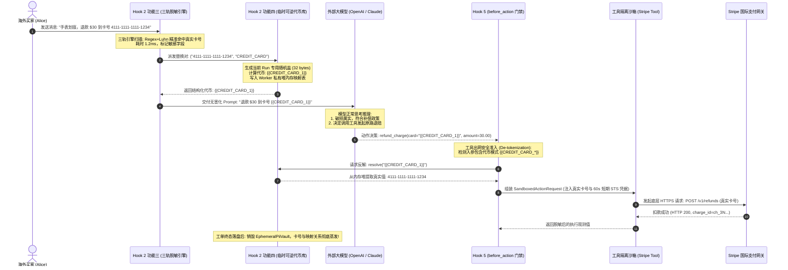

# 09-附录：加盐隔离临时可逆代币保险库与 PII 动态脱敏协同全景

> **文档定位**：[Hook 2 before_context 隐私脱敏与上下文剪枝落地实战](file:///Users/allen/Desktop/NewArchitect/workspace/cogniva/doc/kb/agent/deep-dive/topics/01-lifecycle-hooks/09-Hook2-before_context-隐私脱敏与上下文剪枝落地实战.md) 的专属技术深潜附录。针对生产级 AI Agent 架构中极为关键的“数据隐私保护与工具可用性平衡”难题，系统拆解**三轨 PII 动态脱敏引擎（功能三）**与**加盐隔离临时可逆代币保险库（功能四）**的架构切分、加盐防碰撞防彩虹表推导机理、以及在**跨境电商售后争议退赔**业务中的端到端落地全景。
>
> **所属专题**：[01-生命周期钩子（Lifecycle Hooks）专题总揽与实战索引](file:///Users/allen/Desktop/NewArchitect/workspace/cogniva/doc/kb/agent/deep-dive/topics/01-lifecycle-hooks/00-专题总揽与实战索引.md)  
> **关联主架构**：[09-Hook2-before_context 隐私脱敏与上下文剪枝落地实战](file:///Users/allen/Desktop/NewArchitect/workspace/cogniva/doc/kb/agent/deep-dive/topics/01-lifecycle-hooks/09-Hook2-before_context-隐私脱敏与上下文剪枝落地实战.md) | [13-Hook5-before_action 特权隔离与STS凭据签发落地实战](file:///Users/allen/Desktop/NewArchitect/workspace/cogniva/doc/kb/agent/deep-dive/topics/01-lifecycle-hooks/13-Hook5-before_action-特权隔离与STS凭据签发落地实战.md) | [01-跨境电商多AI-Agent生态体系业务架构与集成落地指南](file:///Users/allen/Desktop/NewArchitect/workspace/cogniva/doc/kb/ecommerce/architect/01-跨境电商多AI-Agent生态体系业务架构与集成落地指南.md)

---

## 一、 30 秒核心精髓（电梯演说与高频面试口径）

> **“在涉及真实资金退付与实物补发的 Agent 架构中，最大的技术矛盾是：如果将买家真实卡号与地址发给大模型，会立即触发 GDPR 与 PCI-DSS 的千万欧元合规罚单；但如果采用传统的一刀切不可逆打码（全部变成星号 `****`），大模型输出工具动作时，下游银行网关和物流打单系统又会因参数失效而全线瘫痪。  
> 破局之道在于我们在 Hook 2 中构建的‘功能三与功能四黄金搭档’：  
> • **功能三（脱敏引擎）充当‘安检员与剪刀’**：利用‘正则+Luhn校验、AC自动机与本地NER’三轨在 5ms 内精准识别文本中的敏感数据，并将其替换为语义化代号 `{{CREDIT_CARD_1}}`；  
> • **功能四（代币保险库）充当‘私密寄存柜与钥匙保管员’**：基于每个 Run 独立的密码学随机盐（Per-Run Salt），在 Worker 私有堆内存中建立单次工单独占的可逆映射。外部模型只能看到随机代号，彻底杜绝跨会话画像推断与彩虹表攻击；而当下游工具（Hook 5）真正出网调用 Stripe 时，保险库在微秒级内将代号反向还原为真实卡号。一旦工单归档，保险库随内存瞬时灰飞烟灭，实现‘物理零持久化与合规自绝’！”**

---

## 二、 业务困局：为什么“不可逆打码”与“数据裸奔”都是死路？

在跨境电商售后处理中（以智能手表表盘划痕争议理赔为例），欧洲买家 Alice 在客诉中提交了如下信息：
> *“我的手表表盘有轻微划痕，买表时刷的卡号是 `4111-1111-1111-1234`，请退回约定的补偿款 $30.00，并将备用表带寄到巴黎 `15 Rue de Rivoli, Paris`。”*

此时系统面临极其残酷的**双向死局**：

```
                              买家输入真实隐私 (卡号/地址)
                                          │
            ┌─────────────────────────────┴─────────────────────────────┐
            ▼                                                           ▼
     【死局 1：裸奔发给大模型】                                   【死局 2：传统不可逆掩码】
   直接发给外部 OpenAI / Claude API                           把卡号变成 4111-****-1234，地址变成 ***
            │                                                           │
   • 违反 GDPR / PCI-DSS 支付安全规范                          • 大模型确实看不到隐私了，
   • 触发监管部门最高 2000 万欧元合规罚单                       • 但模型输出工具调用: refund(card="4111-****-1234")
   • 商业机密与客户隐私被模型服务商用于再训练                   • 下游 Stripe 支付网关直接报错：卡号非法！
                                                               • 业务直接瘫痪，无法完成理赔！
```

**破局方案**：
必须在大模型与底层工具执行器之间建立**“影子代币机制”**——大模型只负责基于影子代币进行逻辑推理，而底层的物理工具执行器在真正出网前通过安全的内存通道换回真实数据。

---

## 三、 深度辨析：功能三（脱敏引擎）与功能四（代币保险库）的六维本质差异

许多工程师容易将“脱敏”与“代币存储”混为一谈。在 Harness 微内核设计中，二者属于不同职责层级的解耦组件：

```
┌────────────────────────────────────────────────────────┐
│  【功能三：三轨 PII 脱敏掩码引擎】                      │
│   负责："识别与替换" (Detection & Token Generation)     │
│   技术：Regex + Luhn Checksum / AC 自动机 / 本地 NER    │
└─────────────────────────────┬──────────────────────────┘
                              │ 产出替换对: ({{CREDIT_CARD_1}}, "4111...1234")
                              ▼
┌────────────────────────────────────────────────────────┐
│  【功能四：加盐隔离临时可逆代币保险库】                 │
│   负责："存储与还原" (Secure State & De-tokenization)   │
│   技术：Per-Run Salting / In-Memory Vault / 物理自绝   │
└────────────────────────────────────────────────────────┘
```

### 六维核心差异对比表

| 比较维度 | **功能三：三轨 PII 动态脱敏与掩码引擎** | **功能四：加盐隔离的临时可逆代币保险库** |
| :--- | :--- | :--- |
| **1. 角色定位** | **“动态计算流水线（Pure Function / Algorithm）”** | **“安全状态容器（Secure In-Memory State Container）”** |
| **2. 回答的问题** | “文本中哪里藏着卡号/地址/邮箱？如何无遗漏、低耗时地识别并将其替换为结构化占位符？” | “刚才被替换出来的真实卡号存在哪才安全？如何保证黑客无法撞库？后续调用退款时如何精准还原？” |
| **3. 底层核心技术** | • 正则表达式 + Luhn 卡号校验算法<br>• Aho-Corasick 高性能多模式 Trie 树词典<br>• 本地紧凑型 NER（命名实体识别）模型 | • JVM 堆私有单例（`ConcurrentHashMap`）<br>• Per-Run 密码学高熵随机盐（`HMAC-SHA256`）<br>• 垃圾回收（GC）物理自洁，零持久化 |
| **4. 数据流向与输入输出** | **输入**：买家原始非结构化口语文本<br>**输出**：被打了占位符的脱敏上下文（喂给大模型） | **输入**：`register(代币, 真实值)`<br>**输出**：`resolve(代币) -> 真实值`（喂给工具沙箱） |
| **5. 在电商退赔中的具体动作** | 扫描买家留言，将 `4111-1111-1111-1234` 识别为高危信用卡，切分为类型与序号并生成 `{{CREDIT_CARD_1}}`。 | 接收映射对，混入当前工单随机盐计算防碰撞指纹，在本地内存登记，并在 Hook 5 工具调用时提供反解服务。 |
| **6. 安全攻防关注点** | **召回率与时延性能**：严防漏检导致合规罚单；避免超时拖慢整条控制环（要求 $\le 5\text{ms}$）。 | **抗关联推断与零泄露**：防彩虹表撞库；防止跨工单用户行为画像聚合；严禁写盘与外溢。 |

---

## 四、 加盐隔离机制深潜：为什么必须“Per-Run 随机加盐”？

如果系统仅仅把真实的卡号映射为代币，却使用确定性的静态规则（例如 `Token = MD5(RawCard)`），系统依然存在致命的**关联推理与彩虹表攻击**风险。

### 1. 静态代币（Static Tokenization）的致命缺陷

假设买家 Alice 本周提交了两次独立工单：
* **工单 A（周一，手表划痕客诉）**：Alice 发送卡号 `4111...1234`，若采用静态映射，生成代币 `{{CARD_abc123}}`；
* **工单 B（周四，购买香水破损客诉）**：Alice 再次发送卡号 `4111...1234`，若规则相同，依然生成代币 `{{CARD_abc123}}`。

**攻击后果**：
1. **跨会话行为画像聚合（Profile Correlation Attack）**：任何能够接触到大模型调用日志的人（包括第三方大模型供应商），只要发现两次会话中出现了相同的代号 `{{CARD_abc123}}`，就可以断定这是同一个人，从而把买家在不同商家的购买记录、退赔历史、私人地址强行拼装串联，导致买家画像全裸！
2. **彩虹表碰撞（Rainbow Table Attack）**：常见信用卡前 6 位是固定的发卡行识别码（BIN），后 1 位是校验码，黑客只需预先计算有限组合的 Hash 字典，就能通过代号反推出真实的信用卡卡号！

### 2. Per-Run Salting（每个 Run 独立加盐）的数学保障

为了彻底粉碎关联推理，Harness 规定：**每一次控制环启动（每个 Run），必须动态生成一个独立的高熵密码学随机盐（Salt）**：

$$\text{TokenID} = \text{HMAC-SHA256}(\text{RawPii}, \text{RunID} \parallel \text{SecureRandomSalt})$$

* **工单 A（Run 101, Salt A）**：卡号 `4111...1234` $\longrightarrow$ 生成代币 `{{CREDIT_CARD_7f8a}}`
* **工单 B（Run 102, Salt B）**：同一个卡号 `4111...1234` $\longrightarrow$ 生成代币 `{{CREDIT_CARD_9b2c}}`

**业务效果**：
在大模型与外部网络观察者眼中，两次工单呈现出两个毫无关联的伪随机代号，彩虹表在数学上完全失效，跨会话画像分析被从物理底层彻底阻断。

---

## 五、 端到端协同全时序与 Java 21 范式生产级实现

### 1. 端到端协同交互时序图



---

### 2. Java 21 范式生产级核心实现

```java
package com.cogniva.agent.harness.security;

import java.security.SecureRandom;
import java.util.Map;
import java.util.Objects;
import java.util.Optional;
import java.util.concurrent.ConcurrentHashMap;
import java.util.HexFormat;

/**
 * 加盐隔离的临时可逆代币保险库 (Salted Ephemeral De-Token Vault)
 * 核心铁律：仅存活于单次 Run 的 Worker 私有堆内存中，严禁序列化入库或写入日志！
 */
public final class SaltedEphemeralPiiVault {

    private final String runId;
    private final byte[] runSalt;
    
    // 正向反向双向映射表，保障微秒级双向检索
    private final Map<String, String> forwardTokenToRawMap = new ConcurrentHashMap<>();
    private final Map<String, String> reverseRawToTokenMap = new ConcurrentHashMap<>();

    private static final SecureRandom SECURE_RANDOM = new SecureRandom();

    public SaltedEphemeralPiiVault(String runId) {
        this.runId = Objects.requireNonNull(runId, "runId cannot be null");
        this.runSalt = new byte[32]; // 256 位高熵随机盐
        SECURE_RANDOM.nextBytes(this.runSalt);
    }

    /**
     * 【Hook 2 功能三/四协同入口】：登记敏感数据，生成并返回单次工单独占的加盐代币
     * @param rawPii 真实敏感数据 (如信用卡号 "4111-1111-1111-1234")
     * @param piiType 敏感类型 (如 "CREDIT_CARD", "BUYER_NAME")
     * @return 语义化安全代币 (如 "{{CREDIT_CARD_7F8A}}")
     */
    public String register(String rawPii, String piiType) {
        Objects.requireNonNull(rawPii, "rawPii cannot be null");
        Objects.requireNonNull(piiType, "piiType cannot be null");

        return reverseRawToTokenMap.computeIfAbsent(rawPii, raw -> {
            // 结合当前 runId 与独占 runSalt 计算不可逆指纹，杜绝彩虹表推断
            String fingerprint = computeSaltedFingerprint(raw);
            String token = String.format("{{%s_%s}}", piiType.toUpperCase(), fingerprint);
            
            forwardTokenToRawMap.put(token, raw);
            return token;
        });
    }

    /**
     * 【Hook 5 before_action 门禁入口】：反向代币还原 (De-tokenization)
     * 仅在物理工具即将真正发起网络出网调用前唤醒调用
     * @param token 语义化代币 (如 "{{CREDIT_CARD_7F8A}}")
     * @return 真实敏感数据 (若存在)
     */
    public Optional<String> resolve(String token) {
        if (token == null || !token.startsWith("{{") || !token.endsWith("}}")) {
            return Optional.empty();
        }
        return Optional.ofNullable(forwardTokenToRawMap.get(token));
    }

    /**
     * 核心计算：HMAC-SHA256 混淆计算 4 字节紧凑指纹
     */
    private String computeSaltedFingerprint(String raw) {
        try {
            javax.crypto.Mac mac = javax.crypto.Mac.getInstance("HmacSHA256");
            mac.init(new javax.crypto.spec.SecretKeySpec(this.runSalt, "HmacSHA256"));
            mac.update(this.runId.getBytes(java.nio.charset.StandardCharsets.UTF_8));
            byte[] hashBytes = mac.doFinal(raw.getBytes(java.nio.charset.StandardCharsets.UTF_8));
            // 仅截取前 4 字节 (8 位 Hex 字符)，既确保单会话内唯一，又保持 Prompt 紧凑
            return HexFormat.of().formatHex(hashBytes, 0, 4).toUpperCase();
        } catch (Exception e) {
            throw new IllegalStateException("Failed to calculate HMAC fingerprint", e);
        }
    }

    /**
     * 显式清理方法：在 Run 归档销毁阶段被调度器调用
     */
    public void destroy() {
        this.forwardTokenToRawMap.clear();
        this.reverseRawToTokenMap.clear();
        java.util.Arrays.fill(this.runSalt, (byte) 0); // 擦除内存盐值
    }
}
```

---

## 六、 架构红线与生产避坑四大铁律

### 1. 铁律一：物理零持久化原则（Zero-Persistence Rule）
- **致命反模式**：部分初学者为了所谓“调试方便”，把 `EphemeralPiiVault` 的键值对直接作为 JSON 字段存入 PostgreSQL 的 `run_checkpoints` 状态表中，或者缓存到 Redis 中。
- **后果**：数据库一旦被攻破或发生日志泄露，由于数据库中存有真实卡号和映射，所有脱敏防护当场瓦解，PCI-DSS 审计直接定级为“重大不合规”。
- **架构底线**：该对象必须与 Worker 的单次执行线程生命周期强绑定，**严禁进入任何 Checkpoint 序列化流**！

### 2. 铁律二：断点续跑（Resume Run）下的凭据重水化对策
- **技术挑战**：如果一个长周期理赔任务因等待买家上传照片而挂起，或者因节点宕机发生故障转移，Worker 内存被清空，重试时丢失了 `EphemeralPiiVault` 怎么办？
- **优雅解法**：  
  断点续跑时，**严禁在检查点中恢复明文映射**！Harness 控制环在重新拉起会话时，必须基于买家的真实租户会话重新通过 [Hook 1: on_run_load](file:///Users/allen/Desktop/NewArchitect/workspace/cogniva/doc/kb/agent/deep-dive/topics/01-lifecycle-hooks/08-Hook1-on_run_load-准入屏障与分布式租约落地实战.md) 与 [Hook 2: before_context](file:///Users/allen/Desktop/NewArchitect/workspace/cogniva/doc/kb/agent/deep-dive/topics/01-lifecycle-hooks/09-Hook2-before_context-隐私脱敏与上下文剪枝落地实战.md) 重新执行一次安全的轻量级代币水化，生成全新的 Salt 和代币表，做到“无状态恢复、不存明文”。

### 3. 铁律三：GDPR “被遗忘权” 的天然合规红利
- 依据欧盟 GDPR 第 17 条（Right to Erasure），用户有权要求删除其个人数据。
- 得益于 `EphemeralPiiVault` 的零持久化与单次会话自毁设计，企业在响应 GDPR 数据清除请求时，**无需在海量历史 Agent 对话和推理日志中大动干戈去搜索删除每一句包含了信用卡号的文本**，因为所有外部沉淀的会话历史中**本来就只有毫无意义的临时代号**，从架构根源上直接免疫了删除复杂性。

---

## 七、 关联导航与双向拓扑回溯

- **所属主钩子文档**：[09-Hook2-before_context 隐私脱敏与上下文剪枝落地实战](file:///Users/allen/Desktop/NewArchitect/workspace/cogniva/doc/kb/agent/deep-dive/topics/01-lifecycle-hooks/09-Hook2-before_context-隐私脱敏与上下文剪枝落地实战.md)
- **姊妹篇附录（算法细节）**：[09-附录-三轨PII动态脱敏与掩码引擎-电商售后退赔实战与STE100规范全景.md](file:///Users/allen/Desktop/NewArchitect/workspace/cogniva/doc/kb/agent/deep-dive/topics/01-lifecycle-hooks/appendix/09-附录-三轨PII动态脱敏与掩码引擎-电商售后退赔实战与STE100规范全景.md)
- **下游工具还原钩子**：[13-Hook5-before_action 特权隔离与STS凭据签发落地实战](file:///Users/allen/Desktop/NewArchitect/workspace/cogniva/doc/kb/agent/deep-dive/topics/01-lifecycle-hooks/13-Hook5-before_action-特权隔离与STS凭据签发落地实战.md)
- **业务生态指南**：[01-跨境电商多AI-Agent生态体系业务架构与集成落地指南](file:///Users/allen/Desktop/NewArchitect/workspace/cogniva/doc/kb/ecommerce/architect/01-跨境电商多AI-Agent生态体系业务架构与集成落地指南.md)
- **专题总揽索引**：[00-生命周期钩子（Lifecycle Hooks）专题总揽与实战索引](file:///Users/allen/Desktop/NewArchitect/workspace/cogniva/doc/kb/agent/deep-dive/topics/01-lifecycle-hooks/00-专题总揽与实战索引.md)
