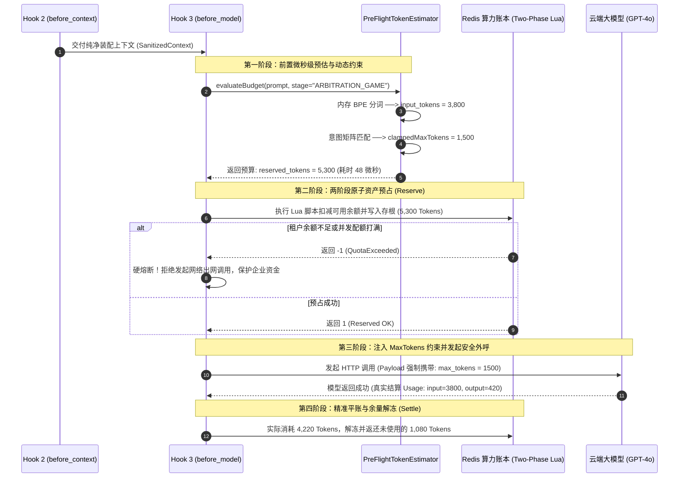

# 深度解构：Token 动态预估与 MaxTokens 约束体系全景

> **文档定位**：L2 受控宿主运行时（Harness）核心安全与资源管理专题附录——系统剖析在 Hook 3（`before_model`）执行模型外呼前，如何通过内存级 BPE 分词与意图状态机策略，实现微秒级输入开销测量与动态输出敞口夹持，杜绝算力假性枯竭与钱包拒绝服务攻击（DoW）。  
> **所属专题**：[01-lifecycle-hooks 专题目录](../00-专题总揽与实战索引.md)  
> **直接关联主文档**：  
> * [11-Hook3-before_model-算力原子预算预占与死循环硬熔断落地实战.md](../11-Hook3-before_model-算力原子预算预占与死循环硬熔断落地实战.md)（功能 3：纳秒级 Token 动态预估与 MaxTokens 约束；功能 4：Redis Lua 两阶段原子预占）  
> * [09-Hook2-before_context-隐私脱敏与上下文剪枝落地实战.md](../09-Hook2-before_context-隐私脱敏与上下文剪枝落地实战.md)（上游上下文装配、证据降维与提示词模具注入）  
> * [11-附录-大模型商业计费体系与算力成本精算-STE100规范全景.md](./11-附录-大模型商业计费体系与算力成本精算-STE100规范全景.md)（Input vs Output 非对称计费与单单成本精算账本）  
> * [11-附录-大模型并发限流TPM-RPM与配额防雪崩-STE100规范全景.md](./11-附录-大模型并发限流TPM-RPM与配额防雪崩-STE100规范全景.md)（TPM 令牌桶预占防雪崩与并发配额保护）  
> * [01-跨境电商多AI-Agent生态体系业务架构与集成落地指南.md](../../../../ecommerce/architect/01-跨境电商多AI-Agent生态体系业务架构与集成落地指南.md)（售后争议调解与退赔决策业务母案）

---

## 第一章：ASD-STE100 国际技术标准规范（Technical Specification）

> 本章遵循 **ASD-STE100（简明英语标准，Simplified Technical English）** 国际规范编写。  
> 规范要求：句子长度严格控制在 20 词以内，每句仅表达单一技术指令或判定，动词采用主动语态，严禁使用模棱两可与情绪化词汇。

### 1. PURPOSE AND DEFINITION (目的与定义)
* The microkernel Harness measures compute resource consumption before model dispatch.
* Pre-flight Token Estimation calculates the input token count in memory.
* Dynamic MaxTokens Clamping sets the maximum output token limit.
* The system calculates the maximum exposure budget using both parameters.
* The formula is: reserved tokens equal input tokens plus maximum output tokens.
* The system reserves this budget atomically in the shared cache.
* This mechanism prevents account overdraft and token quota exhaustion.

### 2. SYSTEM INVARIANTS (系统不变量)
* **Rule 1**: The system must measure the input token count before each model request.
* **Rule 2**: The system must set an explicit maximum output token parameter on every request.
* **Rule 3**: Static global output limits are not permitted in production.
* **Rule 4**: The maximum output token parameter must match the current state machine phase.
* **Rule 5**: The runtime must cancel the execution if the reserved tokens exceed tenant balance.

### 3. PROCEDURE (标准执行程序)
* **Step 1**: Receive the sanitized context string from Hook 2.
* **Step 2**: Count the exact tokens using the in-memory BPE tokenizer (Java or Rust).
* **Step 3**: Identify the active business phase in the dispute state machine.
* **Step 4**: Read the clamped output token limit for the active phase from the policy table.
* **Step 5**: Add input tokens and clamped output tokens to calculate reserved tokens.
* **Step 6**: Execute the Redis Lua script to hold the reserved tokens atomically.
* **Step 7**: Inject the clamped output limit into the model API payload.
* **Step 8**: Settle the difference after model response and return unconsumed tokens.

### 4. WARNINGS AND PROHIBITIONS (警告与操作禁忌)
* **WARNING**: Inaccurate token estimation causes request rejection or budget under-reservation.
* **PROHIBITION**: Do not use character-length division as the primary tokenizer in production.
* **PROHIBITION**: Do not permit default vendor output ceilings (such as 4096) for simple extraction.
* **PROHIBITION**: Do not execute external model calls before successful budget reservation.

---

## 第二章：核心概念深度解构：为什么需要“动态预估”与“阶段约束”？

在许多未经生产验证的 AI 原型或开源框架中，开发者通常采用极其粗糙的硬编码方式：
```python
# 致命生产反例：无预估、死阈值
response = client.chat.completions.create(
    model="gpt-4o",
    messages=prompt,
    max_tokens=4096  # 全局写死固定上限！
)
```

这种静态写法在企业高并发生产环境中将直接引爆两大毁灭性灾难：

```
┌────────────────────────────────────────────────────────────────────────────────────────┐
│                        静态写死 max_tokens=4096 的两大毁灭性死穴                       │
├────────────────────────────────────────────────────────────────────────────────────────┤
│ 【灾难 A：两阶段配额预占假性枯竭 (False Quota Starvation)】                           │
│   业务实况：简单抽取诉求只需 100 Tokens 输出，但系统为该请求锁定了 4096 Tokens 配额。 │
│   致命后果：企业每分钟 TPM 限额 100,000，仅 20 笔并发工单就把企业配额假性占满！         │
│             后续数百笔正常买家退款请求全部被拒绝，并发处理能力暴跌 90%！               │
├────────────────────────────────────────────────────────────────────────────────────────┤
│ 【灾难 B：缺乏前置预估导致敞口放飞与拒绝服务 (Denial of Wallet)】                     │
│   业务实况：买家上传恶意 40,000 字垃圾报关文本，系统事前毫无感知，盲目提交调用。      │
│   致命后果：单次调用打满显存上下文，耗时长达 45 秒，扣费数美元，甚至直接超时崩溃。    │
└────────────────────────────────────────────────────────────────────────────────────────┘
```

为了彻底消除上述隐患，微内核 Harness 在 Hook 3（`before_model`）构建了**“Token 动态预估”**与**“MaxTokens 动态约束”**双重确定性防线。

### 2.1 什么是 Token 动态预估（Pre-flight Token Estimator）？
* **功能**：在请求发出前的微秒级时间内，利用宿主机本地内存中的分词器，精准丈量出装配后的完整提示词上下文（`SanitizedContext.rendered_prompt`）实际包含的 Token 数量（$\text{input\_tokens}$）。
* **职责**：
  1. **物理超限熔断**：若输入已突破单步物理上限（如超过 8,000 Tokens），在出网前立即拒绝，避免浪费公网带宽与云端算力；
  2. **锁定确定性输入成本**：作为两阶段资产预占公式中的必付基数。

### 2.2 什么是 MaxTokens 动态约束（Dynamic MaxTokens Clamping）？
* **功能**：由 Harness 状态机根据当前的**决策意图与执行阶段（Business Phase）**，动态向模型请求体中注入严格受限的 `max_tokens` 参数。
* **职责**：
  1. **防止模型幻觉废话**：例如仅需提取是否同意退款（布尔值）时，给 100 Tokens 绝不给 1,000，防止模型输出长篇大论；
  2. **收紧最大资金风险敞口**：将本次推理可能产生的最大账单死死锁在可预期的极小安全包络内。

### 2.3 最大风险敞口预算公式（Reserved Exposure Formula）

$$\text{reserved\_tokens} = \underbrace{\text{input\_tokens}}_{\text{Token 动态预估 (实测确定值)}} + \underbrace{\text{max\_tokens}}_{\text{MaxTokens 约束 (阶段硬阈值)}}$$

* 系统凭借计算出的 $\text{reserved\_tokens}$ 执行 Redis Lua 原子预占；
* 预占成功才允许向大模型发起出网呼叫；
* 模型响应后，根据大模型实际返回的 Usage 账单执行平账（多退少补）。

---

## 第三章：底层工作原理与工程实现机理 (Java vs. Rust)

### 3.1 BPE (Byte Pair Encoding) 分词原理
大模型的 Token 既不是字，也不是词，而是经过子词切分算法（如 BPE）编码的整数 ID：
1. **输入归一化**：处理 UTF-8 字节序与特殊控制符；
2. **正则分块**：利用高度优化的正则表达式拆分标点、缩写与词根；
3. **词表树映射查找**：在预加载到内存中的数万/数十万项 BPE 词表字典（如 OpenAI `cl100k_base` 或 `o200k_base`）中执行贪心最长匹配合并；
4. **输出数组**：最终生成紧凑的 `int[]` 数组，其元素数量即为精确的 Token 数。

### 3.2 架构抉择：为什么纯 Java 21 实现是企业生产首选？

```
┌────────────────────────────────────────────────────────────────────────────────────────┐
│                        分词执行栈对比：纯 Java vs JNI 调用 Rust                         │
├────────────────────────────────────────────────────────────────────────────────────────┤
│ 【方案 A：Java 通过 JNI 调用 Rust 动态库 (tiktoken-rs)】                               │
│   Java 线程 ──(JNI 边界切换开销: 5~10 微秒)──► native C 栈 ──► Rust BPE 算法 (15 微秒) │
│   缺点：跨语言边界产生性能抵消；跨平台编译（Linux/macOS x86/ARM）运维成本高；易引爆崩溃 │
├────────────────────────────────────────────────────────────────────────────────────────┤
│ 【方案 B：纯 Java 21 高性能实现 (jtokkit / JIT C2 Compiler)】                          │
│   Java 线程 ──(零跨语言边界、JIT 激进内联、内存紧凑 int[])──► 纯 Java 算法 (40~60 微秒) │
│   优势：标准单个 Jar 包依赖，零外部 .so/.dylib 负担；单次调用耗时仅占模型调用的十万分之五│
└────────────────────────────────────────────────────────────────────────────────────────┘
```

#### 关键生产结论：
大模型云端 API 的网络与推理耗时通常在 **800ms ~ 3,000ms（毫秒级）**。
纯 Java 方案的 50 微秒耗时在整个端到端调用链条中仅占 **0.005%**，完全可以忽略不计。因此在企业级微服务与 K8s 容器编排体系中，**纯 Java 方案在稳定性、跨架构部署与可维护性上具备压倒性优势**。

---

## 第四章：售后争议退赔 Agent 业务实战全景推演

以欧洲买家 Alice Dupont 购买的 $180 智能手表表盘划痕争议理赔（工单号 `ORD-20261104-8839`）为业务切片，拆解 Agent 在不同认知阶段下的动态预算分配策略：

```
┌────────────────────────────────────────────────────────────────────────────────────────┐
│                售后争议调解全周期：阶段感知型动态预算演进矩阵 (ORD-20261104-8839)       │
├──────────────────────┬─────────────┬──────────────┬──────────────┬─────────────────────┤
│ 业务执行阶段 (Stage) │ 核心任务    │ 预估输入负荷 │ 动态约束上限 │ 最大资金敞口与理由  │
├──────────────────────┼─────────────┼──────────────┼──────────────┼─────────────────────┤
│ **阶段 1：诉求抽取**  │ 提取纠纷类型│ 1,250 Tokens │ max_tokens:  │ 1,550 Tokens        │
│ (EXTRACT_INTENT)     │ 与买家期望值│ (包含买家留言│ **300**      │ 仅需结构化输出小    │
│                      │             │ 与手表照片OCR│              │ JSON，严禁废话      │
├──────────────────────┼─────────────┼──────────────┼──────────────┼─────────────────────┤
│ **阶段 2：博弈研判**  │ 货值 vs 运费│ 3,800 Tokens │ max_tokens:  │ 5,300 Tokens        │
│ (ARBITRATION_GAME)   │ 逆向经济推导│ (加注条款v3.2│ **1,500**    │ 需要多步思维链(CoT) │
│                      │             │ 与物流报价单)│              │ 推演补偿$40代金券   │
├──────────────────────┼─────────────┼──────────────┼──────────────┼─────────────────────┤
│ **阶段 3：动作下发**  │ 生成结算与  │ 900 Tokens   │ max_tokens:  │ 1,050 Tokens        │
│ (EMIT_PAYMENT)       │ 支付补偿调用│ (仅精简结论) │ **150**      │ 仅需输出工具调用    │
│                      │             │              │              │ `execute_refund`结构│
└──────────────────────┴─────────────┴──────────────┴──────────────┴─────────────────────┘
```

---

## 第五章：生产级 Java 21 代码落地与两阶段控制环

### 5.1 动态预估与约束器核心源码：`PreFlightTokenEstimator.java`

```java
package com.cogniva.agent.harness.estimator;

import com.knuddels.jtokkit.Encodings;
import com.knuddels.jtokkit.api.Encoding;
import com.knuddels.jtokkit.api.EncodingRegistry;
import com.knuddels.jtokkit.api.EncodingType;
import org.slf4j.Logger;
import org.slf4j.LoggerFactory;

import java.util.Map;

/**
 * Hook 3 模型调用前：Token 动态预估与 MaxTokens 约束器 (纯 Java 21 实现).
 * <p>
 * 遵循 ASD-STE100 规范设计，负责输入上下文开销精准度量与业务意图动态上限夹持。
 */
public final class PreFlightTokenEstimator {

    private static final Logger log = LoggerFactory.getLogger(PreFlightTokenEstimator.class);

    // 内存单例预热加载 BPE 词表 (支持 GPT-4o / Claude 等通用 cl100k_base 编码)
    private static final EncodingRegistry REGISTRY = Encodings.newDefaultEncodingRegistry();
    private static final Encoding BPE_ENCODING = REGISTRY.getEncoding(EncodingType.CL100K_BASE);

    // 业务阶段感知型输出上限约束矩阵 (Stage-Aware Policy Matrix)
    private static final Map<String, Integer> STAGE_OUTPUT_LIMIT_MAP = Map.of(
            "EXTRACT_INTENT", 300,      // 诉求抽取阶段：严禁冗余输出
            "VERIFY_EVIDENCE", 800,     // 证据核实阶段：允许适度解析
            "ARBITRATION_GAME", 1500,   // 经济学博弈阶段：允许思维链 (CoT) 推演
            "EMIT_PAYMENT", 150         // 最终动作下发：仅允许输出工具参数
    );

    // 单步物理防御硬上限 (防超长上下文投毒)
    private static final int HARD_STEP_INPUT_CEILING = 8000;

    /**
     * 预算预占载荷 (不可变 Record)
     */
    public record BudgetReservationResult(
            int inputTokens,
            int clampedMaxTokens,
            int reservedTokens,
            long durationMicros
    ) {}

    /**
     * 执行内存级分词预估与阶段感知型 MaxTokens 动态约束
     *
     * @param renderedPrompt 经 Hook 2 隐私脱敏与模具渲染后的完整上下文
     * @param businessStage 当前售后状态机所处的执行阶段
     * @param runId 当前执行流水号 (如 RUN-20261104-001)
     * @return 预占结果
     * @throws TokenBudgetExceededException 当输入已击穿物理硬上限时抛出
     */
    public static BudgetReservationResult evaluateBudget(String renderedPrompt, String businessStage, String runId) {
        long startNanos = System.nanoTime();

        if (renderedPrompt == null || renderedPrompt.isEmpty()) {
            return new BudgetReservationResult(0, 0, 0, 0);
        }

        // 1. 本地内存分词：毫秒级/微秒级精准计算输入 Token
        int inputTokens = BPE_ENCODING.countTokens(renderedPrompt);

        // 2. 物理硬上限防御：若输入突破绝对上限，在出网前立即阻断熔断
        if (inputTokens > HARD_STEP_INPUT_CEILING) {
            log.error("[TOKEN-ESTIMATOR] 输入上下文击穿物理硬上限! runId={}, inputTokens={}, ceiling={}",
                    runId, inputTokens, HARD_STEP_INPUT_CEILING);
            throw new TokenBudgetExceededException("Input tokens [" + inputTokens + "] exceeds step ceiling [" +
                    HARD_STEP_INPUT_CEILING + "]");
        }

        // 3. 动态提取对应阶段的输出上限 (未匹配时兜底 500)
        int clampedMaxTokens = STAGE_OUTPUT_LIMIT_MAP.getOrDefault(businessStage, 500);

        // 4. 计算最大风险敞口预算
        int reservedTokens = inputTokens + clampedMaxTokens;

        long durationMicros = (System.nanoTime() - startNanos) / 1000;

        log.info("[TOKEN-ESTIMATOR] 预估完成: runId={}, stage={}, 输入={}, 约束上限={}, 敞口预占={}, 耗时={}µs",
                runId, businessStage, inputTokens, clampedMaxTokens, reservedTokens, durationMicros);

        return new BudgetReservationResult(inputTokens, clampedMaxTokens, reservedTokens, durationMicros);
    }

    /**
     * 预算超限异常
     */
    public static class TokenBudgetExceededException extends RuntimeException {
        public TokenBudgetExceededException(String message) {
            super(message);
        }
    }
}
```

### 5.2 全流程控制环 Mermaid 拓扑时序



---

## 第六章：双向穿透链接与架构演进地图

| 关联模块 | 对应技术文档 | 核心关联要点与契约交互 |
| :--- | :--- | :--- |
| **所属核心文档** | [11-Hook3-before_model-算力原子预算预占与死循环硬熔断落地实战.md](../11-Hook3-before_model-算力原子预算预占与死循环硬熔断落地实战.md) | 在“功能 3”与“功能 4”中定义了预估算子与 Redis Lua 两阶段预占原语。 |
| **上游生命周期** | [09-Hook2-before_context-隐私脱敏与上下文剪枝落地实战.md](../09-Hook2-before_context-隐私脱敏与上下文剪枝落地实战.md) | 交付已执行 PII 脱敏、证据降维并经过 Token 长度初筛的上下文。 |
| **计费精算附录** | [11-附录-大模型商业计费体系与算力成本精算-STE100规范全景.md](./11-附录-大模型商业计费体系与算力成本精算-STE100规范全景.md) | 结合输入与输出非对称单价，将 Token 预估精准折算为美金敞口。 |
| **并发限流附录** | [11-附录-大模型并发限流TPM-RPM与配额防雪崩-STE100规范全景.md](./11-附录-大模型并发限流TPM-RPM与配额防雪崩-STE100规范全景.md) | 动态约束 MaxTokens 避免突发高并发工单打满 TPM 令牌桶配额。 |
| **防攻击附录** | [11-附录-恶意算力耗尽攻击DoW与微内核防御体系-STE100规范全景.md](./11-附录-恶意算力耗尽攻击DoW与微内核防御体系-STE100规范全景.md) | 针对输入端恶意投毒与输出端无限死循环，提供跨 Hook 纵深防御。 |
| **业务母案实战** | [01-跨境电商多AI-Agent生态体系业务架构与集成落地指南.md](../../../../ecommerce/architect/01-跨境电商多AI-Agent生态体系业务架构与集成落地指南.md) | 规范售后争议调解与退赔决策中买家凭据与质检报告的安全接入标准。 |
