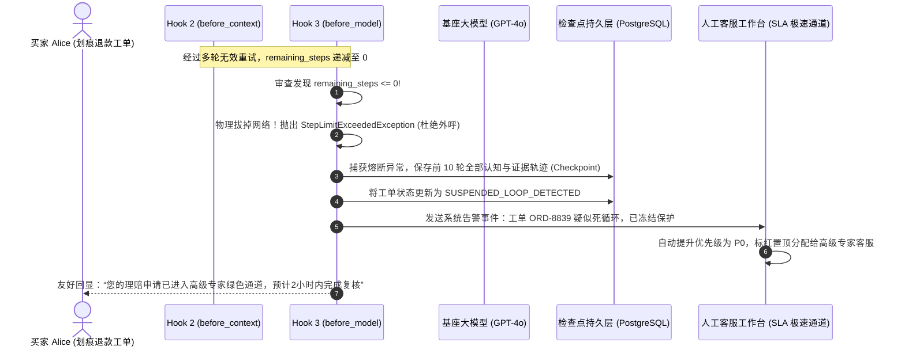

# 深度解构：单调递减步数计数器与死循环硬熔断机制全景

> **文档定位**：L2 受控宿主运行时（Harness）核心安全与执行控制专题附录——系统剖析在 Hook 3（`before_model`）执行模型外呼前，如何通过“单调递减步数计数器（Monotonic Decrementing Step Counter）”与“死循环硬熔断（Hard Loop Circuit Breaker）”，与算力资产配额构建“双十字交叉锁定矩阵”，彻底消灭高净值商户无限死循环与平台并发配额（RPM/TPM）假死穿透。  
> **所属专题**：[01-lifecycle-hooks 专题目录](../00-专题总揽与实战索引.md)  
> **直接关联主文档**：  
> * [11-Hook3-before_model-算力原子预算预占与死循环硬熔断落地实战.md](../11-Hook3-before_model-算力原子预算预占与死循环硬熔断落地实战.md)（功能 5：单调递减步数计数器与死循环硬熔断）  
> * [05-Ring0-3特权隔离与Harness控制环深度解析.md](../05-Ring0-3特权隔离与Harness控制环深度解析.md)（Ring 0 宿主微内核控制权与 Ring 3 沙箱隔离）  
> * [10-Hook7-before_checkpoint-并发一致性与CAS乐观锁防脑裂落地实战.md](../10-Hook7-before_checkpoint-并发一致性与CAS乐观锁防脑裂落地实战.md)（步数状态持久化落盘与防重置接管）  
> * [11-附录-开源框架死循环死穴与微内核硬熔断机制-STE100规范全景.md](./11-附录-开源框架死循环死穴与微内核硬熔断机制-STE100规范全景.md)（开源 LangChain 自治死穴与 500 轮鬼打墙深潜）  
> * [01-跨境电商多AI-Agent生态体系业务架构与集成落地指南.md](../../../../ecommerce/architect/01-跨境电商多AI-Agent生态体系业务架构与集成落地指南.md)（售后争议调解与退赔决策业务母案）

---

## 第一章：ASD-STE100 国际技术标准规范（Technical Specification）

> 本章遵循 **ASD-STE100（简明英语标准，Simplified Technical English）** 国际规范编写。  
> 规范要求：句子长度严格控制在 20 词以内，每句仅表达单一技术指令或判定，动词采用主动语态，严禁使用模棱两可与情绪化词汇。

### 1. PURPOSE AND DEFINITION (目的与定义)
* The microkernel Harness stops infinite loops during model reasoning.
* The Step Counter records the remaining allowed model invocations.
* The counter decrements by one before every model request.
* Decrement is monotonic and irreversible.
* The language model cannot modify or reset the step counter.
* The runtime terminates the execution when the counter reaches zero.
* The runtime saves intermediate progress and escalates to human agents.

### 2. SYSTEM INVARIANTS (系统不变量)
* **Rule 1**: The step counter must decrease monotonically on each model dispatch.
* **Rule 2**: The runtime must not allow increments to remaining steps during execution.
* **Rule 3**: The step limit must be coupled with the financial token quota.
* **Rule 4**: The remaining step value must persist in the distributed checkpoint.
* **Rule 5**: A recovered task must not re-initialize its step counter to original caps.

### 3. PROCEDURE (标准执行程序)
* **Step 1**: Read the allocated step ceiling during Hook 1 run loading.
* **Step 2**: Decrement the remaining step counter in Hook 3 before HTTP dispatch.
* **Step 3**: Verify that the remaining steps value is strictly greater than zero.
* **Step 4**: Inject urgency countdown notices into the context prompt if steps are low.
* **Step 5**: Drop the network connection and throw `StepLimitExceededException` if steps reach zero.
* **Step 6**: Persist the final state machine snapshot into the checkpoint database.
* **Step 7**: Update the dispute status to `SUSPENDED_HUMAN_TAKEOVER` and alert human operators.

### 4. WARNINGS AND PROHIBITIONS (警告与操作禁忌)
* **WARNING**: In-memory counters without database checkpointing permit infinite loops across worker reboots.
* **PROHIBITION**: Do not allow the language model to dictate loop termination conditions.
* **PROHIBITION**: Do not use natural language prompt constraints as the sole termination barrier.
* **PROHIBITION**: Do not discard intermediate evidence when step limit circuit breaking occurs.

---

## 第二章：理论根基与破防本质：图灵停机问题在 AI 时代的投影

在传统确定性软件架构中，循环逻辑的退出条件是数学可证明的（例如 `for (int i=0; i<10; i++)` 或遍历有限长度集合）。
然而，在大模型与自治智能体（AI Agent）中，**“循环停机”面临着前所未有的非确定性危机**。

```
┌────────────────────────────────────────────────────────────────────────────────────────┐
│                        自治智能体停机困境 vs 宿主微内核物理拔线                        │
├────────────────────────────────────────────────────────────────────────────────────────┤
│ 【传统开源框架死穴 (如裸跑 LangChain / AutoGPT)】                                     │
│   while (model_not_finished):  ──► 停机控制权交由被调用的概率论模型！                  │
│   * 模型遭遇下游接口非标报错 (如 TMS 400)，产生“自我归因幻觉”；                       │
│   * 模型误以为自己输入的 JSON 格式不对，不断自主微调 Prompt 重试；                    │
│   * 结论：图灵停机问题 (Halting Problem) 爆发，框架在未知黑盒中陷入无限死循环！       │
├────────────────────────────────────────────────────────────────────────────────────────┤
│ 【企业级 Harness 微内核解法：确定性外部强行停机 (Deterministic External Halt)】       │
│   * 剥夺大模型的生死主权，确立 Ring 0 宿主绝对控制权；                                │
│   * 物理网络定律：1 个 HTTP 请求 = 且仅等于 1 个认知步数；                             │
│   * 无论模型输出什么文本，Ring 0 的计数簿强制递减：10 ➡️ 9 ➡️ 8 ... ➡️ 0；            │
│   * 计数归零瞬间，宿主物理拔掉网线，彻底掐断外呼循环！                                │
└────────────────────────────────────────────────────────────────────────────────────────┘
```

### 2.1 物理步数（Step）的严格定义
在 Harness 微内核控制环中，步数有着毫厘不爽的物理边界：
$$\text{One Step} \equiv \text{Hook 3 (前置模型门禁)} \longrightarrow \text{LLM 单次 HTTP 推理} \longrightarrow \text{Hook 4 (结构校验)} \longrightarrow \text{Hook 5/6 (工具执行)}$$

只要宿主决定**再次向大模型发起 HTTP POST 网络外呼**，步数计数器就必须执行不可逆自减：
$$\text{remaining\_steps}_{t+1} = \text{remaining\_steps}_t - 1$$

---

## 第三章：双十字交叉锁定矩阵（Dual Cross-Locking Matrix）深度解构

许多初级开发者最大的疑问是：*“既然已经做了 Token 算力流量计费系统，钱扣完不就停了吗，为什么还要多此一举限制步数？”*

在真实的商业世界中，**单靠资金配额根本防不住死循环，特别是高净值签约大客户！**

```
                    【算力维度 (横轴 X)：钱包厚度】
                Token / 资金物理配额 (Hard Financial Quota)
                                     │
                                     ▼
        ┌─────────────────────────────────────────────────────────┐
        │  单次任务硬上限：Max_Cost <= $0.50 USD (15,000 Tokens)  │
        └────────────────────────────┬────────────────────────────┘
                                     │
   【步数维度 (纵轴 Y)：认知轮次】   │  【双十字交叉锁定安全包络】
   单调递减步数计数器                ┼──────────────────────────────► 只要任一维度先触顶，
   (Monotonic Step Counter)          │                                 立即就地硬熔断！
                                     │
        ┌────────────────────────────┴────────────────────────────┐
        │  单次任务硬上限：Remaining_Steps <= 10 步               │
        └─────────────────────────────────────────────────────────┘
```

### 3.1 致命漏洞还原：高净值商户的“慢死与平台并发挤占”
跨国品牌商（如 SwissWatch-Direct）在平台预存了 **$10,000 美元（50,000,000 Tokens）** 配额：
1. **单次消耗微弱**：Agent 陷入物流 TMS 接口 400 报错死循环，模型每次仅输出一行微调 JSON（`{"retry": true}`），单次仅消耗 200 Tokens（不足 $0.0007 美元）；
2. **算力计费系统被彻底骗过**：系统查账发现账户还有 49,999,800 Tokens，判定“余额无限充足，继续放行！”；
3. **恶性后果爆发**：
   * 单笔工单以 2 QPS 的频率在后台空转整夜（空转超 80,000 次）；
   * **全平台瘫痪**：单笔工单占满了企业在云厂商（OpenAI / Azure）绑定的全局并发 RPM/TPM 连接池，**直接引爆 429 报错，导致平台所有其他正常买家的退赔全部阻塞超时！**

### 3.2 双十字正交互补防御矩阵

| 故障 / 攻击形态 | 算力维度 (X 轴) | 步数维度 (Y 轴) | 交叉矩阵拦截判定 |
| :--- | :--- | :--- | :--- |
| **形态 A：单步投毒炸弹 (DoW)**<br>买家上传 50,000 字超长报关文书，企图单次推理耗尽算力 | ❌ **第 1 步消耗 $5.00**，直接击穿任务预算阈值 | 仅消耗 1 步 (剩余 9 步) | **算力门禁即刻熔断！**<br>封死单步钱包拒绝服务攻击 |
| **形态 B：高净值逻辑鬼打墙 (死循环)**<br>商户账上有上万美元，模型每次消耗 200 Tokens 高频空转 | 余额无限充裕，算力门禁失效 | ❌ **第 10 步耗尽，计数器归零** | **步数门禁即刻熔断！**<br>彻底消灭空转刷单与配额占用 |
| **形态 C：正常售后退赔决策**<br>经过 3 步（意图抽取 ➡️ 运费博弈 ➡️ 执行下发）正常结单 | 消耗 $0.038 USD (合规) | 仅消耗 3 步 (剩余 7 步，合规) | **双重合规，顺利交付！** |

---

## 第四章：售后争议退赔 Agent 业务实战全景推演

我们跟踪法国买家 Alice Dupont 购买的 $180 智能手表表盘划痕争议理赔（工单号 `ORD-20261104-8839`），在商户 SwissWatch-Direct 预存充足资金下的死循环攻防实况：

```
【工单初始状态】
  * 商户配额：50,000,000 Tokens (高净值账户)
  * 步数预算：allocated_steps = 10, remaining_steps = 10
  ----------------------------------------------------------------------
【第 1 步：意图抽取】 (remaining_steps: 10 ➡️ 9)
  * Agent 提取买家划痕诉求与照片 OCR，输出结构化事实。 (合规)
【第 2 步：运费核实】 (remaining_steps: 9 ➡️ 8)
  * Agent 调用国际物流 TMS 接口查询退运成本，接口返回非标 400 报错。
【第 3 步 ~ 第 7 步：陷入死循环】 (remaining_steps: 8 ➡️ 3)
  * 模型产生自我归因幻觉，连续 5 次微调提示词重试 TMS 接口，接口持续 400。
  * 每次仅消耗 180 Tokens，算力账本无法察觉，但步数计数器忠实单调递减！
  ----------------------------------------------------------------------
【第 8 步：触发认知层紧迫感预警】 (remaining_steps: 3 ➡️ 2)
  * Hook 2 扫描发现 remaining_steps == 2，向 Prompt 强行注入紧急收敛指令：
    "[CRITICAL: Only 2 steps left! DO NOT call TMS tool again. Produce final decision now!]"
【第 9 步：模型自愈受控着陆】 (remaining_steps: 2 ➡️ 1)
  * 模型被倒计时震慑，主动放弃调用物流工具，转而基于表盘划痕事实输出：
    "建议补偿买家 $40 代金券结单" ──► 成功在硬熔断前自愈交付！
  ----------------------------------------------------------------------
【极端分支：若模型未自愈，进入第 10 步】 (remaining_steps: 1 ➡️ 0)
  * 模型依然任性，企图发起第 8 次物流调用；
  * Hook 3 门禁检查：remaining_steps (0) <= 0！
  * 物理拔线！拒绝向 OpenAI 发送 HTTP 报文，抛出 StepLimitExceededException；
  * 保存当前已沉淀的事实快照，将工单标红置顶转交高级人工客服，2 秒内结单！
```

### 4.1 全链路拦截与优雅降级时序拓扑



---

## 第五章：四层立体工程落地机制与生产级 Java 21 实现

限制步数绝不能仅靠单机变量，必须实现四层闭环：

### 5.1 生产级步数治理核心源码：`MonotonicStepGovernanceBarrier.java`

```java
package com.cogniva.agent.harness.governance;

import org.slf4j.Logger;
import org.slf4j.LoggerFactory;

/**
 * 单调递减步数计数器与死循环硬熔断屏障 (Java 21 实现).
 * <p>
 * 遵循 ASD-STE100 规范设计，在 Ring 0 层面掌握模型外呼绝对控制权，杜绝无限空转与并发打满。
 */
public final class MonotonicStepGovernanceBarrier {

    private static final Logger log = LoggerFactory.getLogger(MonotonicStepGovernanceBarrier.class);

    // 紧急收尾阶段阈值 (当剩余步数 <= 2 时触发认知层紧迫感注入)
    private static final int URGENCY_THRESHOLD_STEPS = 2;

    /**
     * Hook 2 (before_context): 动态生成递进式紧迫感上下文指令
     */
    public static String generateProgressiveUrgencyPrompt(int remainingSteps) {
        if (remainingSteps <= URGENCY_THRESHOLD_STEPS) {
            return """
                    \n[SYSTEM GOVERNANCE ALERT: CRITICAL DEADLINE]
                    You have only %d cognitive step(s) remaining before FORCED TERMINATION.
                    You are PROHIBITED from calling any new retry tools.
                    Synthesize all current evidence immediately and emit your final resolution.
                    """.formatted(remainingSteps);
        }
        return ""; // 步数充裕时不增加额外压力
    }

    /**
     * Hook 3 (before_model): 物理模型外呼前的步数单调递减审查
     *
     * @param disputeId 工单流水号 (如 ORD-20261104-8839)
     * @param context 受控执行上下文
     * @throws StepLimitExceededException 当步数耗尽时抛出物理硬熔断异常
     */
    public static void checkAndDecrement(String disputeId, GovernanceContext context) {
        int remaining = context.getRemainingSteps();

        // 核心硬防线：步数耗尽，物理拔线！坚决不向大模型发包！
        if (remaining <= 0) {
            log.error("[STEP-CIRCUIT-BREAKER] 侦测到 Agent 逻辑死循环! disputeId={}, 已用步数={}",
                    disputeId, context.getAllocatedSteps());
            throw new StepLimitExceededException("Execution halted: Run reached maximum allowed cognitive steps [" +
                    context.getAllocatedSteps() + "] for dispute: " + disputeId);
        }

        // 步数严格单调自减 (大模型在 Ring 3 沙箱内绝无可能篡改)
        context.decrementRemainingSteps();

        log.info("[STEP-GOVERNOR] 步数放行: disputeId={}, 剩余可用步数={}", disputeId, context.getRemainingSteps());
    }

    /**
     * 步数超限熔断异常
     */
    public static class StepLimitExceededException extends RuntimeException {
        public StepLimitExceededException(String message) {
            super(message);
        }
    }

    /**
     * 宿主治理上下文接口
     */
    public interface GovernanceContext {
        int getAllocatedSteps();
        int getRemainingSteps();
        void decrementRemainingSteps();
    }
}
```

---

## 第六章：双向穿透链接与架构演进地图

| 关联模块 | 对应技术文档 | 核心关联要点与契约交互 |
| :--- | :--- | :--- |
| **所属核心文档** | [11-Hook3-before_model-算力原子预算预占与死循环硬熔断落地实战.md](../11-Hook3-before_model-算力原子预算预占与死循环硬熔断落地实战.md) | 在“功能 5”中统领单调递减步数计数器与死循环硬熔断的架构定位。 |
| **特权隔离哲学** | [05-Ring0-3特权隔离与Harness控制环深度解析.md](../05-Ring0-3特权隔离与Harness控制环深度解析.md) | 确立 Ring 0 掌握步数记账与网络发包权，Ring 3 大模型完全被动受控。 |
| **状态持久落盘** | [10-Hook7-before_checkpoint-并发一致性与CAS乐观锁防脑裂落地实战.md](../10-Hook7-before_checkpoint-并发一致性与CAS乐观锁防脑裂落地实战.md) | 将 `remaining_steps` 持久化至检查点，杜绝 K8s 节点重启“刷步数”死循环。 |
| **开源缺陷对比** | [11-附录-开源框架死循环死穴与微内核硬熔断机制-STE100规范全景.md](./11-附录-开源框架死循环死穴与微内核硬熔断机制-STE100规范全景.md) | 深度复盘 LangChain `AgentExecutor` 与 AutoGPT 因缺失外部步数约束导致的惨剧。 |
| **流量计费联动** | [11-附录-分布式高并发Token流量计费系统与账本架构设计全景.md](./11-附录-分布式高并发Token流量计费系统与账本架构设计全景.md) | 步数维度与资金维度正交交织，共同构成双十字交叉锁定安全包络。 |
| **业务母案实战** | [01-跨境电商多AI-Agent生态体系业务架构与集成落地指南.md](../../../../ecommerce/architect/01-跨境电商多AI-Agent生态体系业务架构与集成落地指南.md) | 规范售后争议调解与退赔决策中买家凭据与质检报告的安全接入标准。 |
