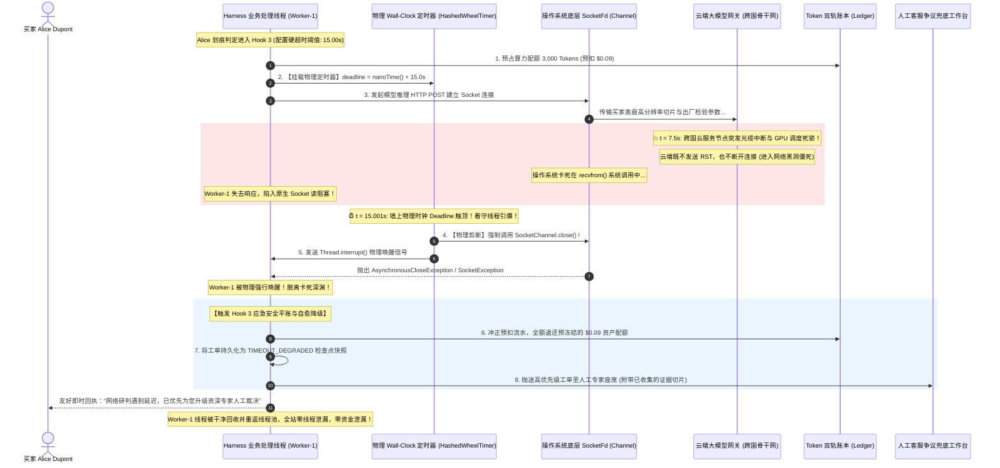

# 深度解构：物理 Wall-Clock 定时器挂载与抗死锁边界全景

> **文档定位**：L2 受控宿主运行时（Harness）核心安全与执行控制专题附录——系统解构在 Hook 3（`before_model`）发起模型网络外呼前，如何通过挂载系统级物理墙上时钟定时器（Physical Wall-Clock Deadline），构建抗死锁与抗网络黑洞的绝对时间防御边界，彻底杜绝跨国网络半开假死、SSE 流式僵死与集群 Worker 线程池耗尽雪崩。  
> **所属专题**：[01-lifecycle-hooks 专题目录](../00-专题总揽与实战索引.md)  
> **直接关联主文档**：  
> * [11-Hook3-before_model-算力原子预算预占与死循环硬熔断落地实战.md](../11-Hook3-before_model-算力原子预算预占与死循环硬熔断落地实战.md)（功能 6：物理 Wall-Clock 定时器挂载）  
> * [05-Ring0-3特权隔离与Harness控制环深度解析.md](../05-Ring0-3特权隔离与Harness控制环深度解析.md)（Ring 0 宿主微内核控制权与 Ring 3 沙箱隔离）  
> * [10-Hook7-before_checkpoint-并发一致性与CAS乐观锁防脑裂落地实战.md](../10-Hook7-before_checkpoint-并发一致性与CAS乐观锁防脑裂落地实战.md)（超时降级状态持久化与故障自愈）  
> * [11-附录-单调递减步数计数器与死循环硬熔断机制-STE100规范全景.md](./11-附录-单调递减步数计数器与死循环硬熔断机制-STE100规范全景.md)（步数维度与物理时间维度的正交防御）  
> * [11-附录-分布式高并发Token流量计费系统与账本架构设计全景.md](./11-附录-分布式高并发Token流量计费系统与账本架构设计全景.md)（超时两阶段预占资金原路解冻与平账）  
> * [01-跨境电商多AI-Agent生态体系业务架构与集成落地指南.md](../../../../ecommerce/architect/01-跨境电商多AI-Agent生态体系业务架构与集成落地指南.md)（售后争议调解与退赔决策业务母案）

---

## 第一章：ASD-STE100 国际技术标准规范（Technical Specification）

> 本章遵循 **ASD-STE100（简明英语标准，Simplified Technical English）** 国际规范编写。  
> 规范要求：句子长度严格控制在 20 词以内，每句仅表达单一技术指令或判定，动词采用主动语态，严禁使用模棱两可与情绪化词汇。

### 1. PURPOSE AND DEFINITION (目的与定义)
* The microkernel Harness mounts a physical wall-clock timer before socket dispatch.
* The timer measures absolute monotonic physical time in nanoseconds.
* The timer runs on an independent watchdog thread outside the worker pool.
* Silent network hangs, socket read blocks, and model stalls cannot stop the timer.
* The timer establishes an absolute temporal boundary for model inference.
* The watchdog thread forcibly closes the socket channel when the deadline expires.
* The worker thread terminates cleanly and returns to the thread pool immediately.

### 2. SYSTEM INVARIANTS (系统不变量)
* **Rule 1**: The deadline calculation must use a monotonic time source (`System.nanoTime()` / `time.monotonic()`).
* **Rule 2**: The runtime must not use non-monotonic wall-clock clocks susceptible to NTP time jumps.
* **Rule 3**: The timer guardian thread must not share thread pool resources with worker tasks.
* **Rule 4**: When the deadline triggers, the watchdog must physically break the underlying socket descriptor.
* **Rule 5**: The runtime must unfreeze all reserved token quotas upon a deadline timeout event.
* **Rule 6**: The dispute case state must be saved as `TIMEOUT_DEGRADED` and routed to a human operator.

### 3. PROCEDURE (标准执行程序)
* **Step 1**: Calculate the deadline: $\text{Deadline} = \text{MonotonicNow} + \text{TimeoutMillis}$.
* **Step 2**: Mount a cancellation task onto the `HashedWheelTimer` with the calculated deadline.
* **Step 3**: Dispatch the model HTTP POST request on the designated worker thread.
* **Step 4**: If the model finishes before the deadline, cancel the timer task and continue.
* **Step 5**: If the timer triggers, close the underlying `SocketChannel` and interrupt the worker.
* **Step 6**: Catch `PhysicalWallClockTimeoutException` inside the worker thread stack.
* **Step 7**: Roll back the reserved token budget through the dual-ledger billing manager.
* **Step 8**: Persist the degraded dispute snapshot to the database and alert the human desk.

### 4. WARNINGS AND PROHIBITIONS (警告与操作禁忌)
* **WARNING**: In-band soft timeouts permit silent TCP half-open stalls to exhaust worker thread pools.
* **PROHIBITION**: Do not rely on streaming read timeouts when tokens trickle with long stalls.
* **PROHIBITION**: Do not ignore `InterruptedException` without closing socket descriptors.
* **PROHIBITION**: Do not leave reserved token balances frozen when requests abort.

---

## 第二章：核心概念深度解构：为何软超时必死，唯物理时钟永生

在分布式高并发与 AI Agent 架构中，许多初学者或缺乏生产实战经验的开发者最容易写出如下“致命代码”：

```python
# 致命反例：表面设置了超时，实则随时导致集群死锁瘫痪
response = requests.post("https://api.openai.com/v1/chat/completions", json=payload, timeout=15.0)
```

在公网环境与大模型推理场景下，**这行代码随时可能把后端整个 Worker 线程池彻底“冻死”**！

### 2.1 三大时钟维度的本质差异

```
┌────────────────────────────────────────────────────────────────────────────────────────┐
│                        计算机体系结构中的三大时钟概念比对                              │
├────────────────────────────────────────────────────────────────────────────────────────┤
│ 1. CPU 时间 (Virtual / Thread CPU Time):                                               │
│    * 只有操作系统把 CPU 时间片分配给当前线程计算代码时，该时钟才推进；                 │
│    * 当线程陷入底层 Socket 阻塞 (Native I/O wait) 时，CPU 时间完全静止！              │
│    * 缺陷：如果代码卡在网络 I/O 阻塞中，依赖 CPU 时间的超时监控永远无法触发！          │
├────────────────────────────────────────────────────────────────────────────────────────┤
│ 2. 逻辑时钟与软检查点 (Soft Checkpoint / In-band Cancel):                             │
│    * 依赖代码内部的协作式轮询 (如 if (isCancelled) break;)；                          │
│    * 缺陷：当线程阻塞在 C 语言编写的原生网络库 (Native Socket Read) 时，应用层代码根本  │
│      没有执行指令的机会，协作式软检查点形同虚设！                                      │
├────────────────────────────────────────────────────────────────────────────────────────┤
│ 3. 墙上物理时钟 (Physical Wall-Clock Monotonic Time):                                  │
│    * 取自物理硬件晶振的单调递增时钟 (如 Linux clock_gettime(CLOCK_MONOTONIC))；        │
│    * 不受 NTP 网络授时跳变、闰秒、CPU 调度饥饿或网络阻塞的任何干扰；                  │
│    * 地球自转推进 1 秒，该时钟就绝对递增 1 秒。它是宿主微内核最刚性的物理防线！         │
└────────────────────────────────────────────────────────────────────────────────────────┘
```

### 2.2 什么是“物理 Wall-Clock 定时器挂载”？
* **工程定义**：在工作线程正式向操作系统发起底层 Socket 握手与网络发包前的**前置纳秒级瞬间**，微内核 Harness 在**一个完全隔离的独立守护线程（Watchdog Thread）**上，挂载一颗独立倒计时的“物理定时炸弹”：
  $$\text{Deadline} = \text{System.nanoTime()} + (\text{TimeoutSeconds} \times 10^9)$$
* **挂载哲学**：工作线程只管发起调用，外部定时器只管独立倒计时。两者在内存中唯一共享的，是对底层操作系统套接字通道句柄（`SocketChannel`）和工作线程的引用。

---

## 第三章：大模型外呼的三大网络黑洞与“抗死锁绝对时间防御边界”

为什么调用云端大模型必须依赖“抗死锁的绝对时间防御边界”？因为调用跨国公网大模型存在传统 Web 服务极少遇见的**三大致死性假死陷阱**：

```
┌────────────────────────────────────────────────────────────────────────────────────────┐
│                 大模型推理外呼过程中的三大“静默死锁与假死”陷阱                          │
├────────────────────────────────────────────────────────────────────────────────────────┤
│ 【陷阱 1：TCP 半开连接与跨国网络黑洞 (TCP Half-Open / Drop-without-RST)】             │
│   跨大西洋骨干网路由器突发光纤抖动或防火墙静默丢包，既不转发数据，也不发送 FIN/RST 包。│
│   本地 Linux 内核以为连接依旧存活，Socket 读等待可能持续 15 分钟以上，线程彻底被冻结！  │
├────────────────────────────────────────────────────────────────────────────────────────┤
│ 【陷阱 2：SSE 流式输出中途“吐字吐一半僵死” (Streaming Stall / Trickle Attack)】         │
│   大模型在生成判决书时，前 50 字飞快输出，第 51 字突然因远端 GPU 显存 OOM 或调度锁死挂起。│
│   HTTP 客户端由于每隔 14 秒能收到一个保活探测字节，根本不触发 read_timeout，永久死等！ │
├────────────────────────────────────────────────────────────────────────────────────────┤
│ 【陷阱 3：Worker 线程池耗尽引发全平台级联瘫痪 (Thread Pool Starvation)】               │
│   当突发网络抖动导致 200 个并发争议调解工单全部遭遇上述假死，所有 Worker 线程瞬间耗尽；│
│   后来的买家退款进不来，商户审核无法处理，Kubernetes 存活探针无响应，全站死锁雪崩！     │
└────────────────────────────────────────────────────────────────────────────────────────┘
```

### 3.1 什么是“绝对时间防御边界（Absolute Temporal Boundary）”？
所谓“绝对”，其本质就是**“物理级单向强制打断，绝不妥协、绝不协商、六亲不认”**：
1. **边界确定性**：无论大模型是否声称自己“思考了 99%”，无论底层网络是否在传输握手报文，当物理世界流逝的时间达到 $15.000\text{s}$ 的那一微秒，防御边界生效；
2. **物理断开优先于代码中断**：看守线程不仅仅发送 Java `Thread.interrupt()`（因为很多原生 JNI 网络库会屏蔽中断信号），而是**直接调用底层操作系统的 `SocketChannel.close()` 暴力销毁套接字文件描述符（fd）**；
3. **强制解脱并平账自愈**：底层 Socket 管道被剪断瞬间，阻塞的工作线程必定触发 `AsynchronousCloseException` 或 `SocketException`，强行跳出卡死状态，释放线程池，完成财务回滚并退出。

---

## 第四章：业务母案实战：法国买家 Alice 划痕争议惊魂 15 秒救险

我们以跨境电商真实售后争议理赔案件为推演背景：
* **工单编号**：`ORD-20261104-8839`
* **买家信息**：法国巴黎买家 Alice Dupont
* **涉案商品**：$180 智能运动手表（瑞士直邮）
* **争议核心**：买家提供开箱视频声称表盘外圈有微划痕，要求 50% 折让赔付（$90）；商家坚称出厂全检合格，仅同意退货退款。
* **Agent 任务**：在 Hook 3 门禁放行后，调用云端多模态大模型进行“划痕光影反光与出厂公差对比研判”。

### 4.1 惊魂 15 秒推演时序（Mermaid Sequence）



---

## 第五章：生产级 Java 21 / Netty 高性能时间轮实战代码

在微内核生产工程中，绝对严禁为每个请求新建独立的 Java 线程来做超时控制（高并发下会引发线程爆炸）。  
微内核必须采用 **Netty 时间轮（`HashedWheelTimer`）**，以 **O(1)** 的极低开销在单个守护线程中统一挂载数万个并发任务的绝对物理 Deadline：

```java
package com.cogniva.agent.harness.barrier;

import io.netty.util.HashedWheelTimer;
import io.netty.util.Timeout;
import io.netty.util.concurrent.DefaultThreadFactory;
import org.slf4j.Logger;
import org.slf4j.LoggerFactory;

import java.io.Closeable;
import java.io.IOException;
import java.nio.channels.Channel;
import java.util.concurrent.TimeUnit;
import java.util.function.Supplier;

/**
 * 物理 Wall-Clock 定时器挂载与抗死锁防御门禁 (Hook 3 核心组件)
 * 业务场景：跨境电商售后争议调解与退赔决策 (Alice Dupont ORD-20261104-8839)
 */
public final class PhysicalWallClockDeadlineBarrier {

    private static final Logger log = LoggerFactory.getLogger(PhysicalWallClockDeadlineBarrier.class);

    // 单例高性能时间轮守护线程：10ms 滴答刻度，512 轮格，完全独立于业务工作线程池
    private static final HashedWheelTimer WATCHDOG_TIMER = new HashedWheelTimer(
            new DefaultThreadFactory("harness-wallclock-watchdog", true),
            10, TimeUnit.MILLISECONDS, 512
    );

    /**
     * 挂载绝对物理墙上时钟防御边界执行模型外呼
     *
     * @param disputeId       售后争议工单号 (如 ORD-20261104-8839)
     * @param timeoutMillis   物理超时硬阈值 (如 15,000ms)
     * @param socketResource  底层网络套接字句柄 (用于物理强拆断开)
     * @param invocation      模型调用执行闭包
     * @param ledgerRollback  超时平账与资金解冻补偿钩子
     * @param <T>             返回结果泛型
     * @return 模型响应
     */
    public static <T> T executeWithWallClockDeadline(
            String disputeId,
            long timeoutMillis,
            Closeable socketResource,
            Supplier<T> invocation,
            Runnable ledgerRollback
    ) {
        // 1. 获取物理单调时间的绝对起点
        long startNanos = System.nanoTime();
        Thread workerThread = Thread.currentThread();

        // 2. 在独立的守护时间轮上挂载“绝对倒计时炸弹”
        Timeout timeoutBomb = WATCHDOG_TIMER.newTimeout(timeout -> {
            long elapsedMs = (System.nanoTime() - startNanos) / 1_000_000;
            log.error("[WALL-CLOCK-BREAKER] 触达绝对时间防御边界！物理超时强制中断！" +
                            "disputeId={}, 实际流逝耗时={}ms, 配置阈值={}ms, 目标工作线程={}",
                    disputeId, elapsedMs, timeoutMillis, workerThread.getName());

            // 物理破坏动作 1：优先强制关闭底层 Socket 句柄，打断底层 Native Socket 读阻塞
            if (socketResource != null) {
                try {
                    log.warn("[WALL-CLOCK-BREAKER] 物理暴力断开 SocketChannel 文件描述符: disputeId={}", disputeId);
                    socketResource.close();
                } catch (IOException e) {
                    log.error("[WALL-CLOCK-BREAKER] 关闭底层网络套接字句柄失败", e);
                }
            }

            // 物理破坏动作 2：向工作线程发送中断信号，唤醒 Java 层线程状态
            workerThread.interrupt();

        }, timeoutMillis, TimeUnit.MILLISECONDS);

        try {
            // 3. 执行真正的模型网络外呼 (此过程可能遭遇跨国网络假死)
            T result = invocation.get();

            // 若在 Deadline 前正常返回，必须立即拆除定时炸弹
            timeoutBomb.cancel();
            return result;

        } catch (Exception ex) {
            // 确保在任何异常情况下定时器被撤销
            timeoutBomb.cancel();

            // 4. 判定是否为物理墙上时钟超时所触发的强制唤醒
            if (Thread.interrupted() || isCausedByTimeoutBreak(ex)) {
                log.warn("[WALL-CLOCK-RECOVERY] 工单从跨国网络假死中自愈脱困: disputeId={}", disputeId);

                // 核心保障：执行资金账本原路解冻回滚，杜绝幽灵资产预占泄漏
                try {
                    if (ledgerRollback != null) {
                        ledgerRollback.run();
                        log.info("[WALL-CLOCK-RECOVERY] 预占算力配额已全额原路退还至商户账本: disputeId={}", disputeId);
                    }
                } catch (Exception rollbackEx) {
                    log.error("[WALL-CLOCK-FATAL] 账本平账回滚失败，需人工审计介入: disputeId={}", disputeId, rollbackEx);
                }

                throw new PhysicalWallClockTimeoutException(
                        "Execution aborted by physical wall-clock deadline (" + timeoutMillis + "ms) for dispute: " + disputeId, ex);
            }

            // 非超时异常正常向上抛出
            throw ex;
        }
    }

    /**
     * 判断异常是否源于套接字被强拆或中断
     */
    private static boolean isCausedByTimeoutBreak(Throwable ex) {
        Throwable current = ex;
        while (current != null) {
            if (current instanceof InterruptedException ||
                current instanceof java.nio.channels.AsynchronousCloseException ||
                current instanceof java.nio.channels.ClosedByInterruptException ||
                (current instanceof java.net.SocketException && current.getMessage() != null &&
                 current.getMessage().contains("Socket closed"))) {
                return true;
            }
            current = current.getCause();
        }
        return false;
    }

    /**
     * 物理超时专属异常类
     */
    public static class PhysicalWallClockTimeoutException extends RuntimeException {
        public PhysicalWallClockTimeoutException(String message, Throwable cause) {
            super(message, cause);
        }
    }
}
```

---

## 第六章：双向穿透链接与架构演进地图

| 关联模块 | 对应技术文档 | 核心关联要点与契约交互 |
| :--- | :--- | :--- |
| **所属核心文档** | [11-Hook3-before_model-算力原子预算预占与死循环硬熔断落地实战.md](../11-Hook3-before_model-算力原子预算预占与死循环硬熔断落地实战.md) | 在“功能 6”中统领物理 Wall-Clock 定时器挂载与抗死锁边界的工程定义。 |
| **下流级联切断** | [11-Hook3-before_model-算力原子预算预占与死循环硬熔断落地实战.md#7-功能七http2-rst_stream-级联切断协议cascading-cancellation-protocol](../11-Hook3-before_model-算力原子预算预占与死循环硬熔断落地实战.md) | 超时引爆后，通过 HTTP/2 `RST_STREAM` 级联释放远端 GPU 推理显存 KV Cache。 |
| **特权隔离哲学** | [05-Ring0-3特权隔离与Harness控制环深度解析.md](../05-Ring0-3特权隔离与Harness控制环深度解析.md) | Ring 0 看守线程掌握套接字生命线，Ring 3 大模型网络假死完全被动受制。 |
| **步数计数联动** | [11-附录-单调递减步数计数器与死循环硬熔断机制-STE100规范全景.md](./11-附录-单调递减步数计数器与死循环硬熔断机制-STE100规范全景.md) | 步数维度约束大模型认知轮次，Wall-Clock 维度约束物理执行时间，构成时间与步数双重边界。 |
| **流量平账联动** | [11-附录-分布式高并发Token流量计费系统与账本架构设计全景.md](./11-附录-分布式高并发Token流量计费系统与账本架构设计全景.md) | 物理超时打断后，必须立即触发两阶段预占资金退款，防止商户配额产生“幽灵冻结”。 |
| **状态持久落盘** | [10-Hook7-before_checkpoint-并发一致性与CAS乐观锁防脑裂落地实战.md](../10-Hook7-before_checkpoint-并发一致性与CAS乐观锁防脑裂落地实战.md) | 超时脱困后，将工单状态持久化为 `TIMEOUT_DEGRADED` 检查点并无缝转接人工座席。 |
| **业务母案实战** | [01-跨境电商多AI-Agent生态体系业务架构与集成落地指南.md](../../../../ecommerce/architect/01-跨境电商多AI-Agent生态体系业务架构与集成落地指南.md) | 规范售后争议调解与退赔决策中买家凭据与质检报告的安全接入标准与 SLA 保障。 |
