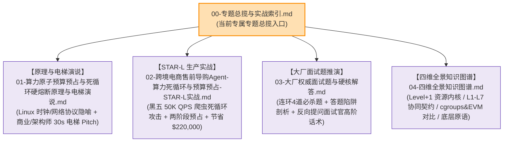

# L2 核心机制深度专题总揽：算力原子预算预占与死循环硬熔断

> **知识库归属**：企业级 Agent 架构 L2 层 (受控宿主运行时 Harness) 专题矩阵  
> **机制编号**：L2-Core-Mechanism-02（5 大核心机制之二）  
> **归属主架构全景**：[受控宿主运行时 Harness 与执行控制环深度架构与实战全景](../../03-AI-Agent-L2-受控宿主运行时Harness与执行控制环深度架构与实战全景.md#52--算力原子预算预占beforesend-quota-reservation)  
> **核心命题**：依据上下文动态预占最大算力资产、物理 Wall-Clock 与 HTTP/2 RST_STREAM 传输级级联硬切断、单调递减步数计数器与死循环熔断，彻底杜绝企业 Token 预算被击穿。

---

## 一、 专题知识矩阵导读

本专题围绕企业生产级 AI Agent 架构中极为关键的**“资金防线与算力资源治理”**展开，形成覆盖“操作系统底层原理、30 秒电梯演说、跨境电商千亿级实战复盘、大厂高阶面试必杀题、四维立体拓扑”的工业级完整闭环。



---

## 二、 专题独立目录文件结构

```
doc/kb/agent/deep-dive/topics/02-quota-reservation/
├── 00-专题总揽与实战索引.md (★ 当前专题总揽入口)
├── 01-算力原子预算预占与死循环硬熔断原理与电梯演说.md
│   └── 包含：可变算力资产空间跃迁、三层系统隐喻（事务预占/RST_STREAM/Gas Meter）、两套30秒电梯Pitch
├── 02-跨境电商售前导购Agent-算力死循环与预算预占-STAR-L实战.md
│   └── 包含：黑五50K QPS爬虫攻击、事后计费穿透等三大车祸、两阶段预占与Wall-Clock硬切断、降本$220,000+
├── 03-大厂权威面试题与硬核解答.md
│   └── 包含：4道连环必杀题（QPS限流失效/伪超时后台扣费/分布式预占锁粒度/死循环检测）+ 终面反问话术
└── 04-四维全景知识图谱.md
    └── 包含：资源微内核哲学、L1-L7架构协同契约时序图、cgroups/EVM横向对比、六大底层技术原语
```

---

## 三、 专题模块核心速览与直通导航

### 1. [原理透析与电梯演说（Elevator Pitch）](./01-算力原子预算预占与死循环硬熔断原理与电梯演说.md)
* **核心内容**：
  * 深度拆解大模型计费从“微服务频次限流”向“可变资产配额空间”的范式跃迁；
  * 解析三层计算机系统隐喻：**两阶段事务预占（Two-Phase Reservation）**、**物理 Wall-Clock 看门狗与 HTTP/2 RST_STREAM 协议硬切断**、**单调递减步数阶梯（Monotonic Gas Meter）**；
  * 提供面向 CEO/业务方的“网银 U 盾/加油卡预授权”30 秒商业说服力演说，以及面向首席架构师的硬核技术演说。
* **直通链接**：[👉 查阅原理透析与电梯演说全文](./01-算力原子预算预占与死循环硬熔断原理与电梯演说.md)

### 2. [STAR-L 生产实战：跨境电商售前导购 Agent 算力死循环与防刷爆](./02-跨境电商售前导购Agent-算力死循环与预算预占-STAR-L实战.md)
* **核心内容**：
  * **Situation**：黑五大促 50,000 QPS 流量脉冲下，恶意爬虫通过超长 Prompt 与比价工具陷阱诱导导购 Agent 陷入无限逻辑死循环，50 万美元预付费 Token 池在 18 分钟内消耗 68%；
  * **Task**：剖析开源原生框架裸跑时的“事后计费穿透”、“应用层伪超时导致 GPU 空转扣费”、“无单调步数硬限额”三大致命车祸；
  * **Action**：落地 Redis Lua 两阶段配额原子冻结、网络层 HTTP/2 RST_STREAM 级联释放 GPU 显存、单调递减步数计数器三大防线；
  * **Result**：实现大促期间 Token 预算零穿透、死循环时延下降 95.2%、LLM 算力浪费降低 99.3%，直接节约云端 API 成本逾 $220,000；
  * **Learning**：沉淀“大模型调用必须遵循金融预授权”、“无网络协议级联的超时是自我安慰”、“有穷状态机铁笼约束图灵自主性”三大认知。
* **直通链接**：[👉 查阅 STAR-L 生产实战复盘全文](./02-跨境电商售前导购Agent-算力死循环与预算预占-STAR-L实战.md)

### 3. [互联网大厂面试硬核对抗：权威面试题与深度解答](./03-大厂权威面试题与硬核解答.md)
* **核心内容**：
  * **Q1**：高并发 Agent 场景下，为什么传统的令牌桶/漏桶算法无法直接防护 Token 预算刷爆？
  * **Q2**：客户端设置了 10s 请求超时并断开连接，为什么 LLM 账单依然会被扣费？底层如何彻底熔断？
  * **Q3**：如何设计一套高并发下零超卖、强一致性的两阶段算力预占与对账机制？
  * **Q4**：当大模型在 ReAct 自循环中陷入逻辑犹豫或死循环时，宿主控制环如何精准识别并执行最小代价熔断？
  * **反客为主**：终面反向提问面试官高段位话术，聚焦混合异构大模型（闭源云 API vs 开源自建 vLLM）在协议切断与显卡算力抢占上的工程权衡。
* **直通链接**：[👉 查阅大厂权威面试题全集全文](./03-大厂权威面试题与硬核解答.md)

### 4. [四维全景知识图谱：立体拓扑与协同契约](./04-四维全景知识图谱.md)
* **核心内容**：
  * **Level +1 上一级**：操作系统资源隔离微内核与确定性受控运行时哲学；
  * **Sibling Layers 上一级同级**：与 L1 动态网关、L3 编排引擎、L4 记忆上下文修剪、L5 工具副作用层的协同契约（Schema 契约与时序图）；
  * **Sibling Concepts 同一级平行方案**：横向对比 Linux cgroups v2、以太坊 EVM Gas 机制、云原生 FinOps 成本门禁与传统微服务 Sentinel；
  * **Sub-Concepts 下一级底层原语**：两阶段预占合约、Redis Lua 原子扣减、HTTP/2 RST_STREAM 0x08 帧、vLLM `abort_request` 显卡抢占、单调步数计数器、文本坍缩检测。
* **直通链接**：[👉 查阅四维全景知识图谱全文](./04-四维全景知识图谱.md)

---

## 四、 主架构双向穿透回溯

* 回溯主架构对应章节：[5.2 【★ 算力原子预算预占与防刷爆机制】](../../03-AI-Agent-L2-受控宿主运行时Harness与执行控制环深度架构与实战全景.md#52--算力原子预算预占beforesend-quota-reservation)
* 前序机制：[L2-Core-Mechanism-01: 9 阶段生命周期钩子专题总揽](../01-lifecycle-hooks/00-专题总揽与实战索引.md)
* 下一机制：[L2-Core-Mechanism-03: Fencing Token CAS 状态机版本控制](../../03-AI-Agent-L2-受控宿主运行时Harness与执行控制环深度架构与实战全景.md#53--fencing-token-cas-防脑裂与并发状态机)
