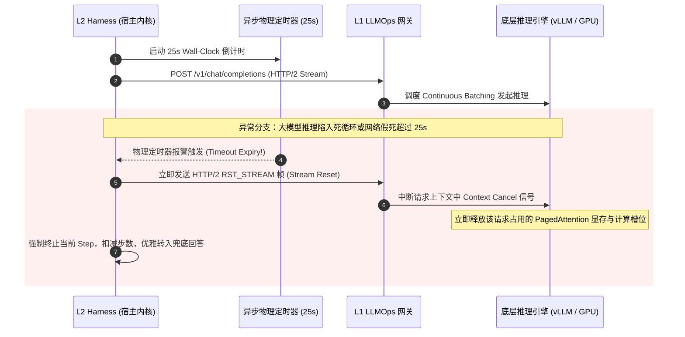

# L2 核心技术专题：算力原子预算预占与死循环硬熔断原理与电梯演说

> **知识库归属**：企业级 Agent 架构 L2 层 (受控宿主运行时 Harness) 核心专题系列  
> **所属专题**：[算力原子预算预占与防刷爆专题总揽](./00-专题总揽与实战索引.md)  
> **关联主架构**：[受控宿主运行时 Harness 与执行控制环深度架构与实战全景](../../03-AI-Agent-L2-受控宿主运行时Harness与执行控制环深度架构与实战全景.md#52--算力原子预算预占beforesend-quota-reservation)  
> **专题定位**：深入解构“两阶段算力预算原子预占”、“物理 Wall-Clock 超时”与“单调递减步数阶梯”的微内核控费哲学，掌握 30 秒电梯演说。

---

## 一、 Topic 核心本质透视：到底在讨论什么？

该核心文本直击现代大模型架构最昂贵且危险的阿喀琉斯之踵：  
**“大模型调用具有‘事前不确定性（输出 Token 数未知）’与‘非确定性停机（容易陷入死循环）’两大失控特征。”**

### 1. 三大关键技术术语底层拆解

```
┌──────────────────────────────────────────────────────────────────────────────┐
│                    事前预授权冻结 (Pre-flight Quota Reservation)              │
│                                                                              │
│    预估: ReservedTokens = Len(Prompt) + ConfiguredMaxTokens                  │
│    Redis Lua 脚本原子执行: DECRBY tenant:balance ReservedTokens               │
│    ├── 余额不足 ──► 抛出 QuotaExceededException 物理阻断 (算力不外流)          │
│    └── 余额充足 ──► 放行进入模型推理                                         │
└──────────────────────────────────────┬───────────────────────────────────────┘
                                       │ 携带 25s Wall-Clock 超时监听
                                       ▼
┌──────────────────────────────────────────────────────────────────────────────┐
│                    推理与物理级级联熔断 (Physical Execution & Timeout)        │
│                                                                              │
│    L1 LLMOps 网关流式吐字 (SSE) ──► 监听 Socket 与 异步硬定时器              │
│    ├── 超时 (30s) ──► 发出 HTTP/2 RST_STREAM 帧，物理终止 GPU 显卡连续推理    │
│    └── 步数耗尽 (Step=0) ──► 强制熔断死循环，优雅转入兜底工作流               │
└──────────────────────────────────────┬───────────────────────────────────────┘
                                       │ 返回真实消耗 ActualTokens
                                       ▼
┌──────────────────────────────────────────────────────────────────────────────┐
│                    事后精确平账多退少补 (Post-flight Reconciliation)         │
│                                                                              │
│    差额结算: RefundTokens = ReservedTokens - ActualTokens                    │
│    Redis Lua: INCRBY tenant:balance RefundTokens (平账退款，计费 100% 吻合)  │
└──────────────────────────────────────────────────────────────────────────────┘
```

1. **“算力原子预算预占（Atomic Quota Reservation）”**：  
   * **底层原型**：源自银行信用卡交易的**“预授权冻结（Pre-Authorization Hold）”**与分布式事务两阶段提交。
   * **本质**：由于 LLM 是概率自回归生成，发起请求时无法获知将生成多少 Token。如果直接调用再事后扣费，一旦账户余额只有 $1 却跑出了 $50 的长文本，就会导致平台欠费穿透。Harness 在 `before_model` 阶段依据最坏情况原子冻结配额，事后再多退少补，从根本上杜绝欠费超支。
2. **“物理 Wall-Clock 异步硬超时（Physical Wall-Clock Timeout & RST_STREAM）”**：  
   * **底层原型**：操作系统内核的 `alarm(2)` / `setitimer` 硬件时钟中断与 HTTP/2 流重置机制。
   * **本质**：绝不依赖大模型的“自觉停止”。宿主在发起调用时启动独立硬定时器；若单步超过阈值（如 25s），宿主不仅在本地中断，而且向 L1 网关发出 **HTTP/2 `RST_STREAM` 帧**，强行斩断 TCP 传输，通知底层推理引擎（vLLM/SGLang）立即释放该 Request 的 GPU 显存和 Continuous Batching 槽位。
3. **“阶梯递减步数限额（Monotonic Step Counter）”**：  
   * **底层原型**：图灵机停机问题（Halting Problem）在工程维度的有限状态裁剪。
   * **本质**：为每个 Agent Run 赋予不可逆递减的步数计数器。无论模型在思考链中如何借口“我还需要再试一次”，计数器归零即强行关闸，彻底终结无限死循环。

---

## 二、 30 秒电梯演说（Elevator Pitch）

> **场景 A：面向 CEO / 业务财务主管（讲透防刷爆与资金穿透）**
> “很多企业上线 AI 客服或导购，就像给用户发了一张‘无限透支且没有密码的加油卡’。恶意爬虫或者模型的逻辑死循环，能在周五晚上一夜之间刷掉公司十几万的 API 额度，导致整个平台周一直接欠费瘫痪。我们在核心入口自研了‘原子预算预占与机械断路器’：每一次调用大模型前，先像出租车打表一样预冻结上限金额，钱不够立刻切断；同时加装物理秒表和最多 8 步的硬限额，时间一到或步数一满直接拉闸，确保企业算力成本 100% 确定可控。”

> **场景 B：面向首席架构师 / 技术考官（展现分布式一致性与内核级设计）**
> “所谓算力原子预算预占，是我们在 L2 Harness 落地资源受控的核心屏障。针对大模型推理‘事前消耗未知’与‘非确定性停机死循环’两大顽疾，我们在 `before_model` 阶段引入了基于 Redis Lua 的两阶段预算预占（Two-Phase Reservation）机制：事前依据 Prompt 长度加配置的 MaxTokens 进行最坏预期原子扣减，余额不足直接物理阻断；事后基于 L1 网关回传的精确 Usage 账单毫秒级平账返还。同时，我们配合异步 Wall-Clock 硬超时向下游级联广播 HTTP/2 `RST_STREAM` 帧切断 GPU 推理，结合单调递减步数计数器，彻底掐死了无限死循环与算力穿透风险。”

---

## 三、 两阶段配额预占数学模型与控制算法

### 1. 预算冻结与对账数学公式

设租户可用 Token 余额为 $B_{\text{tenant}}$，当前步骤上下文 Prompt 长度为 $L_{\text{prompt}}$，模型配置允许的最大生成 Token 为 $T_{\text{max}}$：

$$\text{ReservedTokens} = L_{\text{prompt}} + T_{\text{max}}$$

* **准入前置判定条件**：
  $$\text{If } B_{\text{tenant}} < \text{ReservedTokens} \implies \text{REJECT (Trigger QuotaExceededException)}$$
  $$\text{If } B_{\text{tenant}} \ge \text{ReservedTokens} \implies B_{\text{tenant}} \leftarrow B_{\text{tenant}} - \text{ReservedTokens}$$

* **推理完成后平账返还**：  
  设 L1 LLMOps 网关回传的实际消耗账单为 $U_{\text{actual}}$（含语义缓存命中减免）：
  $$\text{RefundTokens} = \text{ReservedTokens} - U_{\text{actual}}$$
  $$B_{\text{tenant}} \leftarrow B_{\text{tenant}} + \text{RefundTokens}$$

> 💡 **语义缓存命中的极致优化**：  
> 若 L1 网关命中 L1-L3 向量语义缓存，实际模型消耗 $U_{\text{actual}} = 0$。此时 $\text{RefundTokens} = \text{ReservedTokens}$，Harness 在 $15\text{ms}$ 内将预占配额**全额退回**，本次步骤成本标记为 $0。

---

## 四、 物理硬超时与级联取消（Cascading Cancellation）控制流



---
*本文档为 Cogniva 架构体系深度解构专题篇，由企业级 Agent 架构基础设施团队维护。*
