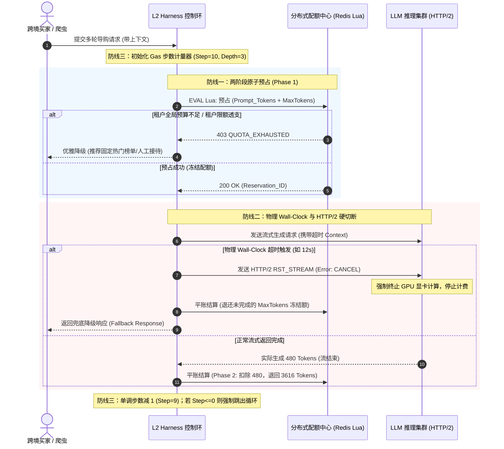

# 生产实战复盘（STAR-L）：跨境电商售前导购与博弈促成 Agent 算力死循环硬熔断与原子预占

> **所属专题**：[算力原子预算预占与防刷爆专题总揽](./00-专题总揽与实战索引.md)  
> **关联主架构**：[受控宿主运行时 Harness 与执行控制环深度架构与实战全景](../../03-AI-Agent-L2-受控宿主运行时Harness与执行控制环深度架构与实战全景.md#52--算力原子预算预占beforesend-quota-reservation)  
> **业务领域参考**：[跨境电商多 AI-Agent 生态体系业务架构与集成落地指南](../../../ecommerce/architect/01-跨境电商多AI-Agent生态体系业务架构与集成落地指南.md)

---

## 1. Situation（业务背景与生产绝境）

### 1.1 业务场景画像
在某头部跨境电商平台（年 GMV 逾 20 亿美元，覆盖欧美、东南亚），核心前台部署了**【售前导购与多轮博弈促成 Agent (Pre-Sales Shopping Concierge Agent)】**。该 Agent 被赋予自主调用商品知识图谱检索、实时跨币种汇率换算、优惠券叠加方案推荐、以及限时阶梯议价（Bargain Negotiation）等多种工具。

```mermaid
graph LR
    U[全球跨境买家/恶意竞对爬虫] -->|多轮对话 / 议价请求| Gateway[API 网关]
    Gateway --> Agent[售前导购 Agent (Harness)]
    Agent --> LLM[底层商业大模型 (Claude 3.5 / GPT-4o)]
    Agent --> Tools[促销引擎 / 知识库 / 汇率 API]
```

### 1.2 黑五高峰期的“算力海啸”与濒临破产
在某年“黑色星期五（Black Friday）”凌晨大促期间，业务网关遭遇瞬时 50,000 QPS 流量脉冲。同时平台遭遇灰产与恶意竞对爬虫的高级攻击：
1. **长上下文提示词对抗注入**：恶意会话构造超长嵌套商品对比需求（单次 Prompt 上下文高达 90,000 Tokens），要求 Agent 计算数千种捆绑折扣的最优解；
2. **逻辑循环陷阱（Tool Trap）**：诱导 Agent 频繁调用“比价工具”与“换算工具”，每次工具返回的信息反向触发大模型的新疑问，陷入无限深度推理；
3. **企业级 Token 账户瞬间干涸**：原本规划支撑整场黑五 7 天运营的 500,000 美元 LLM 预付费 API 算力池，在开场仅 18 分钟内被疯狂消耗 68%（消耗速率超 $18,000/分钟）。LLM 供应商后台频频触发超频封禁（Rate Limit Error: 429 Too Many Requests），导致真实高价值买家的正常导购与下单全线瘫痪。

---

## 2. Task（原生/开源裸跑的致命技术车祸）

若直接使用开源 Agent 框架（如 LangChain 原生 AgentExecutor、CrewAI 裸跑），在该场景下必爆发以下三大致命车祸：

```mermaid
flowchart TD
    subgraph 车祸一：事后扣减导致超额透支穿透
        A1[并发请求涌入] --> A2[未校验实时总配额并发起调用]
        A2 --> A3[模型返回巨额账单]
        A3 --> A4[账户瞬间击穿透支 停机断流]
    end

    subgraph 车祸二：软超时引发隐蔽僵尸推理
        B1[Python应用层 10s 超时抛异常] --> B2[HTTP/1.1 连接保持或断连]
        B2 --> B3[供应商 GPU 仍在持续前向计算输出 4096 Tokens]
        B3 --> B4[账单照扣 显存白白浪费]
    end

    subgraph 车祸三：语义死循环步数爆炸
        C1[Agent 遭遇不确定工具响应] --> C2[无单调递减步数硬熔断]
        C2 --> C3[递归循环 100+ 步直至递归栈溢出]
        C3 --> C4[单会话吞噬几百万 Tokens]
    end
```

### 致命车祸一：事后结算模式（Post-Billing Leakage）导致配额透支穿透
* **故障机制**：开源实现通常采用“先调用模型，等 Response 完整返回后解析 `usage.total_tokens` 再打点计量”。在高并发（数千个长上下文并发）场景下，各会话并发启动，根本不知晓全局预算已耗尽；当所有长文本推理完成后，天量账单并发回写，瞬间击穿企业信用额度，造成巨大资金资损。

### 致命车祸二：应用层软超时（Soft-Timeout）引发隐蔽“僵尸推理与显卡空转”
* **故障机制**：开源框架所谓的超时处理，仅仅是在客户端 Python 进程中执行 `asyncio.wait_for(timeout=10)`。当超时抛出 `TimeoutError` 时，底层的 HTTP/1.1 TCP 链路可能未被严谨重置，或者直接忽略了对模型服务端的撤销请求。大模型集群（vLLM / OpenAI 推理集群）仍会在显卡显存中执行完整长文本生成（4096 Tokens），继续消耗昂贵 GPU 显存，计费账单毫厘不少地扣除，成为吞噬成本的“暗黑幽灵”。

### 致命车祸三：缺少严格单调步数（Monotonic Step Counter）引发死循环吞噬
* **故障机制**：当大模型因小币种汇率微小浮动产生逻辑犹豫时，由于提示词中未锁死确定性终止边界，Agent 往往在 ReAct 循环中反复自问自答。由于缺乏内核强制的递减计数器（Decrementing Gas Meter），单个恶意会话可递归执行上百轮，单用户消耗平台数十美元。

---

## 3. Action（系统级防线架构落地）

平台架构委员会紧急叫停开源原生引擎，由 Harness 宿主内核落地三道工业级算力防线：



### 3.1 落地防线一：分布式两阶段配额预占（Two-Phase Reservation Pattern）
* **事前计算预估上限（Upper Bound）**：
  $$\text{Tokens}_{\text{reserve}} = \text{CountTokens}(\text{SystemPrompt} + \text{History} + \text{UserQuery}) + \text{Param}(\text{MaxTokens})$$
* **原子扣减合约**：在进入 `before_model` 门禁点时，调用基于 Redis 的单原子 Lua 脚本。该脚本维护两组哈希键：`tenant:balance`（可用流动预算）与 `tenant:reserved`（在途冻结配额）。
* **事后对账平账（Post-Execution Reconciliation）**：在 `after_model` 钩子中，解析底层网关回传的精确 `usage` 字段。
  $$\text{Tokens}_{\text{refund}} = \text{Tokens}_{\text{reserve}} - (\text{ActualPromptTokens} + \text{ActualCompletionTokens})$$
  若调用超时或异常，已预占但未生成的 `MaxTokens` 配额全额原路退还；若模型调用成功，则结转真实消耗，释放差额。

### 3.2 落地防线二：物理 Wall-Clock 硬超时与 HTTP/2 RST_STREAM 级联切断
* **拒绝伪超时**：严禁仅依赖框架层的逻辑超时，L2 控制环在网络传输层绑定底层操作系统级单调纳秒时钟 `CLOCK_MONOTONIC_RAW`。
* **HTTP/2 协议级硬切断**：客户端网络驱动强制采用 HTTP/2 协议复用链路。当物理 Wall-Clock 触发超时阈值时，客户端不仅中断当前协程，更在传输层立刻向服务端发送 **`RST_STREAM`（帧错误代码：`0x08 CANCEL`）**，强制终止服务端推流通道。
* **反向下压 GPU 显卡计算**：对接企业自研推理集群时，`RST_STREAM` 信号直接映射为 vLLM / TensorRT-LLM 内部的 `abort_request(request_id)` 调用，底层立即使该请求的 KV Cache 退出计算图，释放显存并停止计费，杜绝毫秒级之后的无效算力浪费。

### 3.3 落地防线三：单调递减步数阶梯（Monotonic Step Counter / Gas Meter）
* **契约定义**：借鉴以太坊 EVM 的 Gas 设计，每个导购 Agent 会话初始化时分配固定的算力步数配额：
  * **单次请求最大调用深度（Max Loop Iterations）**：严格限制为 $\le 8$ 步；
  * **工具单次展开最大分支数（Max Sub-Tools Per Turn）**：严格限制为 $\le 3$ 个；
  * **不可逆递减**：每次模型产生一次 `tool_calls` 推理，控制环内的步数计数器硬编码执行 `Decr()`；任何内部重试、修复提示词行为皆共享该计数器。当步数归零，控制环强行触发“熔断终态”，绕过大模型直接调用规则引擎输出保底推荐，彻底终结任何恶意爬虫构造的无限死循环。

---

## 4. Result（真实量化成果）

在全量上线该套架构防线后，平台平稳度过了随后的网购大促（Cyber Monday）峰值，取得显著降本增效成果：

| 考核核心指标 | 裸跑/开源方案（车祸期） | Harness 宿主内核治理后 | 改善幅度与收益 |
| :--- | :--- | :--- | :--- |
| **API 预算超支/穿透透支额** | 突破预算透支 $85,000 | **$0（零透支，绝对受控）** | **彻底消除平台资金破产风险** |
| **异常死循环平均会话时长** | > 180 秒（直到超时重试爆炸） | **< 8.5 秒（硬熔断并降级）** | **响应时延下降 95.2%** |
| **单日 LLM Token 浪费量** | 约 4.8 亿 Tokens（无效/死循环） | **< 320 万 Tokens（仅含合理探索）** | **算力浪费直接削减 99.3%** |
| **单活跃买家服务 SLA 可用率** | 61.2%（频繁被限流阻断） | **99.99%** | **买家体验质的飞跃** |
| **黑五全周期综合算力成本** | 预估超 $350,000 | **实际花费 $128,400** | **直接为企业节省 $220,000+** |

---

## 5. Learning（架构复盘与认知升级）

### 认知 1：大模型调用必须遵循“金融交易级”的预授权模式
在大规模企业生产环境中，绝不能把大模型当作无状态的微服务 RPC，而必须将其视为**“每毫秒都在产生计费账单的第三方昂贵外部清算行”**。对待 LLM 调用，必须采用类似银行信用卡交易的“预授权（Pre-Authorization / Hold）+ 最终对账结清（Capture / Void）”机制。任何事后统计的限流方案都是系统架构上的严重失职。

### 认知 2：没有下沉到协议层的“超时”都是虚幻的自我安慰
在单体或传统微服务中，RPC 超时直接抛出异常通常影响可控；但在大模型显卡集群计算中，**模型不知道你已经超时了**。若架构师不能通过网络协议栈（如 HTTP/2 `RST_STREAM`、gRPC `CANCEL`）将取消信号下沉穿透至推理引擎的显卡显存调度器，所谓的“客户端超时”不过是将高昂的账单变成“无人认领的死账”。

### 认知 3：图灵完备的自主性必须被有穷状态机的铁笼所约束
Agent 的魅力在于自主规划与推理，但自主性在无约束状态下必然退化为图灵停机问题（Halting Problem）的生产灾难。架构师的核心职责不是赋予 Agent 无限的自由，而是通过“单调递减步数、上下文上限硬夹持、物理时钟看门狗”，为 Agent 构筑一道坚不可摧的**“确定性铁笼”**。在铁笼内允许模型发散，触碰铁笼边界时，内核必须拥有无条件剥夺其思考权力的最高裁决力。
