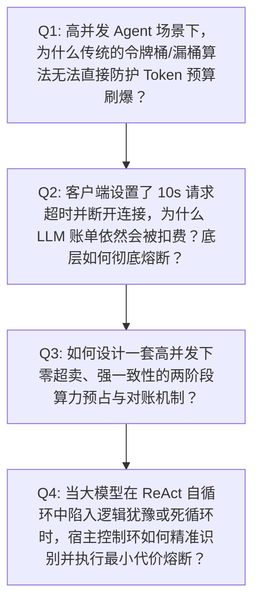
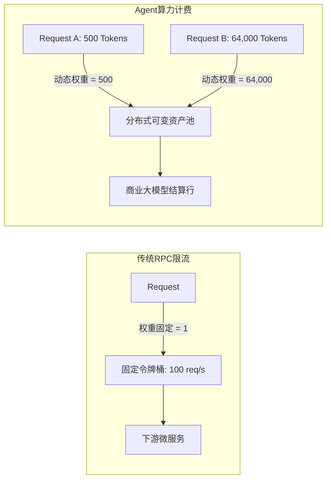
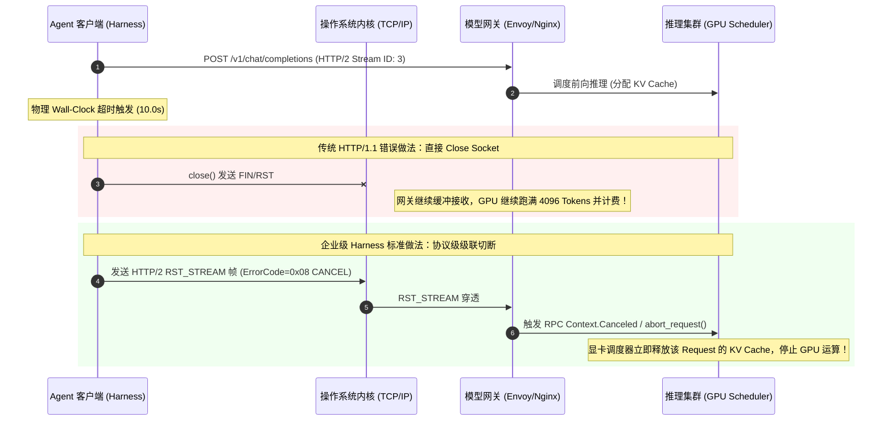
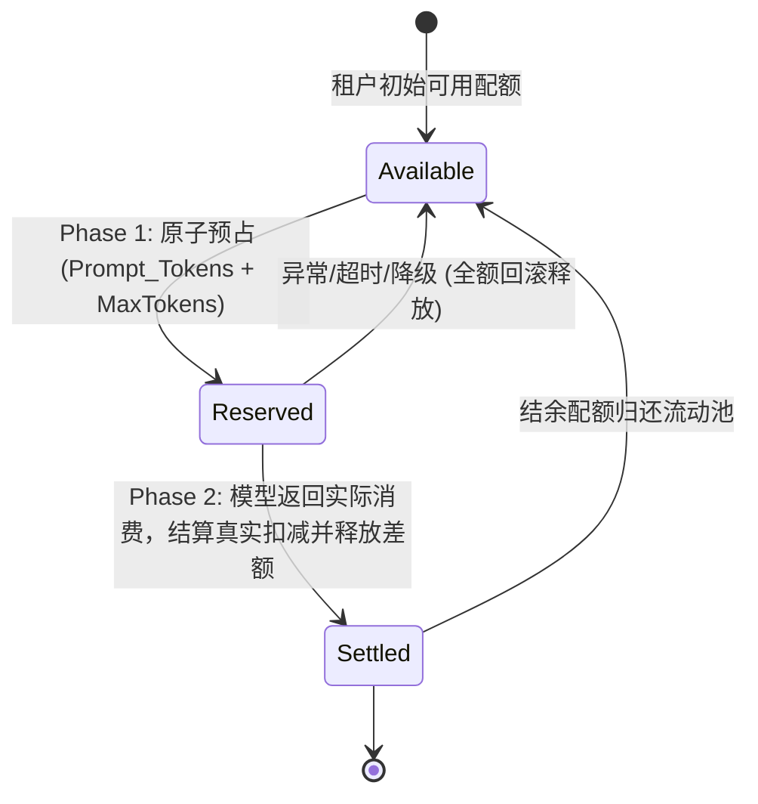
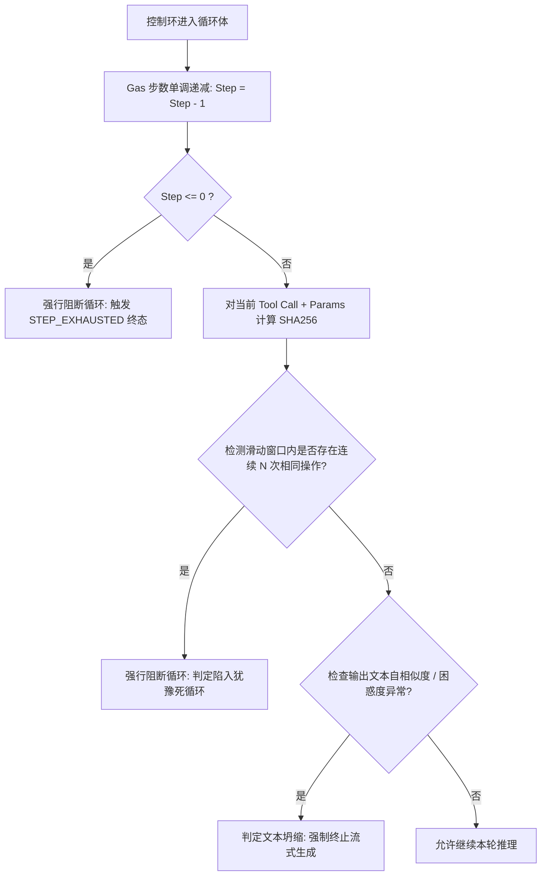

# 互联网大厂权威面试题与硬核推演：算力原子预占、死循环熔断与防刷爆

> **所属专题**：[算力原子预算预占与防刷爆专题总揽](./00-专题总揽与实战索引.md)  
> **关联主架构**：[受控宿主运行时 Harness 与执行控制环深度架构与实战全景](../../03-AI-Agent-L2-受控宿主运行时Harness与执行控制环深度架构与实战全景.md#52--算力原子预算预占beforesend-quota-reservation)  
> **考察层级**：阿里 P8+ / 字节 3-1+ / 腾讯 11 级+ / OpenAI 架构体系

---

## 考官出题心智模型（Mental Model）

在评估高阶 AI Agent 架构师时，大模型调用与成本管控是一道极其残酷的分水岭：
* **初中级工程师（P6/P7）思维**：把调用大模型简单视为调用一个普通的 RPC/HTTP 接口，聊限流就提 Guava RateLimiter 或 Nginx 限速，聊超时就说设置 Python/Go client 超时时间，聊异常就说指数退避重试（Exponential Backoff）。
* **高阶系统架构师（P8+/Staff Engineer）思维**：能够洞察到**“非确定性、高昂单次调用开销、流式长文本传输、第三方清算计费、分布式状态漂移”**的复合系统本质。能够设计出覆盖“事前最坏情况预占、传输层协议级硬切断、物理时钟看门狗、以及有穷步数硬约束”的全套金融级防御微内核。

---

## 连环第一问：为什么传统的令牌桶/漏桶算法无法直接防护 Agent 算力预算刷爆？

### 1.1 面试官真实考察意图
* 考察候选人是否真正理解传统微服务“基于请求频次（QPS）限流”与大模型“基于可变算力体量（Token Cost）计费”的本质范式差异；
* 考察是否清楚 Agent 动态推理过程中 Prompt 长度与 Completion 长度的极端不确定性（从几百 Tokens 突增到 128K Tokens）。

### 1.2 致命答题陷阱（回答即淘汰）
> **典型错误回答**：“我们在网关层用 Redis 令牌桶或 Sentinel 做限流，设置每个用户每分钟最多请求 60 次，一旦超过就返回 429 降级，这样就绝对不会刷爆企业 API Key 的配额了。”
> 
> **考官内心判定**：**直接不及格**。完全没有 Agent 生产意识。恶意用户单次发一条精心构造的“超长长文本对比+多轮复杂 Prompt”，单次请求就能吞掉 10 万 Tokens。即便 QPS=1，10 个并发也能瞬间消耗 100 万 Tokens。传统基于 QPS 的限流在大模型面前如同纸糊防线。

### 1.3 满分回答与硬核解析

* **核心差异 1：单次调用权重的离散性（Variance）高达数千倍**：传统 RPC 调用的资源开销基本在同一数量级（权重几乎为 1）。但 Agent 调用中，Prompt 长度受对话历史累积可达 100K+ Tokens，而 MaxTokens 输出上限也可设为 4K 或 8K。单次调用的成本跨度从 \$0.0001 美元暴增至 \$0.60 美元，QPS 限流在巨大方差面前彻底失效。
* **核心差异 2：非确定性延迟破坏了令牌桶的平滑填充（Refill）假设**：传统令牌桶假设请求处理耗时均在毫秒级，令牌以固定速率持续注入。而大模型单次请求耗时可能长达 15~60 秒，若采用后扣减模式，在长达数十秒的窗口期内，无法获知在途并发所绑定的潜在算力总额，必发严重的超卖穿透。
* **结论**：必须将限流维度从**“请求频次空间（Frequency Space）”**跃迁到**“可变资产配额空间（Quota Asset Space）”**，基于最坏情况评估实施**“算力预占（Reservation）”**。

---

## 连环第二问：客户端设置了超时断开，为什么后台还在扣费？底层如何彻底硬切断？

### 2.1 面试官真实考察意图
* 考察候选人对底层网络协议栈（TCP、HTTP/1.1 vs HTTP/2 vs gRPC）以及 LLM 推理服务端（vLLM、TensorRT-LLM、商业云 API）计算流转生命周期的掌握深度；
* 辨别候选人是只懂调 API 的普通程序员，还是具备跨网络协议与异构算力集群视野的资深系统专家。

### 2.2 致命答题陷阱
> **典型错误回答**：“我们在客户端配置了 `timeout=10`，超时抛出异常后把上下文清空、写一条失败日志并返回给前端报错就行了。”
> 
> **考官内心判定**：典型纸上谈兵。客户端自己把 Socket 关闭了，服务端根本没停，显卡依然在按预设输出 4096 个 Tokens，月底账单原原本本扣除，不仅耗费巨额算力，更让自建 GPU 推理集群显存持续被占用导致全服雪崩。

### 2.3 满分回答与硬核解析

* **本质机制剖析**：
  1. **HTTP/1.1 半关闭缺陷**：若采用 HTTP/1.1，客户端在应用层单方面 `close()`，TCP 协议栈发送 `FIN` 包。若反向代理（Nginx/HAProxy）开启了请求缓冲，代理层可能继续维持与模型后端的连接并静默接收响应，模型侧完全无感知；
  2. **显卡批处理队列的自驱性**：大模型推理引擎（如 vLLM、TGI）采用 Continuous Batching 调度。一旦 Prompts 通过 Prefill 阶段进入 Decode 阶段，只要引擎未显式收到中断信号，GPU 会持续按迭代生成下一个 Token，直到触发 `EOS` 或达到 `max_tokens`；
* **工业级终极解法（三级硬切断）**：
  * **第一级（传输协议）**：全面采用 **HTTP/2 或 gRPC**，超时发生时，强制底层网络驱动发出 **`RST_STREAM` 帧（错误码 `0x08 CANCEL`）**，在不拆除复用 TCP 连接的前提下硬切断该逻辑流；
  * **第二级（网关路由）**：在 Envoy/API 网关层启用 `cancel_cache_on_disconnect: true`，一旦上游断开，立即向前级下游级联广播断连事件；
  * **第三级（算力释放）**：自建推理集群捕获断连事件后，直接调用底层推理引擎的 `abort_request(request_id)`，强制剥离 GPU 显存中的 KV Cache 块，彻底制止算力账单的后续累积。

---

## 连环第三问：如何设计一套高并发下“零超卖、强一致性”的两阶段算力预占与对账机制？

### 3.1 面试官真实考察意图
* 考察分布式高并发系统下的事务设计模式（如 TCC、Two-Phase Reservation、Saga）；
* 考察对 Redis 性能边界、Lua 单原子脚本、锁粒度、并发性能平衡的架构功底。

### 3.2 致命答题陷阱
> **典型错误回答**：“用分布式锁（如 Redisson）锁住用户账户，先查余额，余额够就调模型，模型调完扣钱，最后释放分布式锁。”
> 
> **考官内心判定**：**当场秒杀淘汰**。在大模型单次调用耗时 10~30 秒的场景下加分布式锁，并发吞吐量直接退化为 1 QPS。一个用户发两条消息，第二条就得死等 30 秒，整套系统瞬间被长事务活活拖垮。

### 3.3 满分回答与硬核解析

* **无锁化两阶段预占（Two-Phase Non-blocking Reservation）架构**：
  1. **Phase 1: 原子冻结（Try/Reserve）**：
     * **不加分布式悲观锁**，在 `before_model` 钩子中，运行基于 Redis 的单原子 Lua 脚本；
     * 依据当前上下文估算预占最大消耗：$U = \text{PromptTokens} + \text{MaxTokens}$；
     * 校验 `Balance >= U`，若满足则单步执行原子划转：`Balance = Balance - U`，`Reserved = Reserved + U`，并返回唯一的 `reservation_id`。整个过程在 Redis 内存中耗时 $< 1\text{ms}$，支撑万级 QPS 并发；
  2. **Phase 2: 对账平账（Confirm/Reconcile）**：
     * 当模型正常流式返回结束后，在 `after_model` 钩子中捕获实际消耗 $A = \text{ActualPrompt} + \text{ActualCompletion}$；
     * 执行结对释放 Lua 脚本：将实际消耗 $A$ 沉淀为消费账单（`Consumed = Consumed + A`），将多冻结的差额 $\Delta = (U - A)$ 立即归还可用流动池（`Balance = Balance + \Delta`），同时清零该 `reservation_id` 的在途记录；
  3. **兜底补偿对账（Tombstone / Reconciliation Worker）**：
     * 针对网络抖动、Worker 宕机断电未执行 Phase 2 的极端情况，每个预占记录均设置分布式 TTL（如 Wall-Clock 超时时间 + 30 秒缓冲）；
     * 独立的对账守护协程基于时间轮定期扫描过期的幽灵预占（Ghost Reservation），执行原子回滚并触发审计报警。

---

## 连环第四问：Agent 在 ReAct 自循环中陷入逻辑犹豫或死循环时，控制环如何识别并最小代价熔断？

### 4.1 面试官真实考察意图
* 考察候选人对 Agent 认知失控（Cognitive Stalling / Infinite Reflection）本质的认识；
* 考察如何平衡“给 Agent 足够的探索空间”与“防止算力无端被榨干”的系统韧性策略。

### 4.2 致命答题陷阱
> **典型错误回答**：“我们在 Prompt 里明确告诉模型：‘你最多只能思考 3 轮，如果思考不出结果就直接回答不知道’，大模型很聪明，它会听话停下来的。”
> 
> **考官内心判定**：完全缺乏工程实践经验。依赖模型自觉遵守规则等同于将银行金库钥匙交给门童。当模型遭遇未预见的状态、工具报错或恶意对抗 Prompt 时，指令跟随能力会急剧退化，出现“反复重试调用失败工具”的强迫症现象。

### 4.3 满分回答与硬核解析

* **四维多层防御与熔断机制**：
  1. **内核级单调步数仪表（Monotonic Gas Meter）**：
     * 在控制环上下文中注入不可逆递减计数器（如默认单次任务上限 8 步）；
     * 模型每次输出 `tool_calls` 即强扣 1 步。模型无权修改该计数器，一旦计数器归零，控制环强行介入剥夺推理控制权，直接进入规则降级分支；
  2. **状态去重与工具调用指纹判定（Tool Fingerprint Deduplication）**：
     * 对模型产生的 `(ToolName, CanonicalJsonParams)` 提取 SHA-256 签名；
     * 维护环形滑动窗口（Window Size = 3）。若检测到连续 2 次产生完全相同的签名且前次工具返回为错误码，判定模型已失去自愈能力，立即熔断循环；
  3. **输出熵值与坍缩检测（Entropy & Repetition Degeneration）**：
     * 当模型陷入死循环时，流式输出常表现为特定字符或短语的高频自我复读（如“换句话说...换句话说...”）；
     * 控制环在流式接收时运行轻量级 Aho-Corasick 或 N-gram 重复率检测算法。一旦单位滑窗内重复率超过 80%，无需等待其生成满 MaxTokens，立即在本地发送中断帧截停生成；
  4. **最小代价平滑降级（Graceful Degradation）**：
     * 熔断后绝不可给终端用户简单抛出“系统错误”，而是从缓存或规则引擎提取预设兜底（如跨境电商导购场景下，直接展示当前分类的爆款榜单与人工客服通道），将用户体验损失降至最低。

---

## 终面反向提问面试官的高段位话术

> **求职者**：“在咱们当前业务的 Agent 落地中，当面对第三方商业大模型（如闭源 OpenAI/Anthropic）和内部自研部署的开源大模型（如基于 vLLM 的集群）时，针对超时切断与算力预算预占，咱们在 L2 宿主内核层是抽象了统一的配额与网络协议切断网关，还是说闭源模型依赖 HTTP/2 连接终止，自研集群下沉到了调度器的显卡算力抢占？在应对这种混合异构算力环境时，团队目前遇到最具有挑战性的技术权衡点是什么？”
> 
> **话术杀伤力点评**：
> 1. **瞬间反客为主**：此问题直接将讨论维度拔高到“企业级混合异构大模型基础设施架构”，展现了对闭源/开源差异、网络切断、底层显卡抢占的深刻理解；
> 2. **表明深厚实战背景**：只有真正设计过双轨大模型基础设施的高阶架构师，才能精准道出异构算力在调度与切断上的不同实现难题，直接让面试官对候选人的工程段位产生强烈认同。
