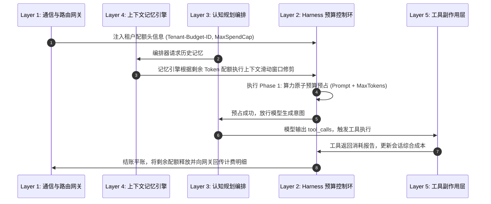
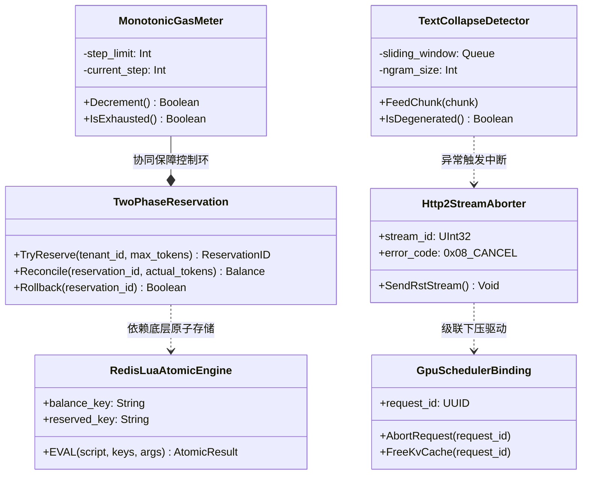

# 架构全景透视：算力原子预算预占与死循环硬熔断四维全景知识图谱

> **所属专题**：[算力原子预算预占与防刷爆专题总揽](./00-专题总揽与实战索引.md)  
> **关联主架构**：[受控宿主运行时 Harness 与执行控制环深度架构与实战全景](../../03-AI-Agent-L2-受控宿主运行时Harness与执行控制环深度架构与实战全景.md#52--算力原子预算预占beforesend-quota-reservation)  
> **定位目标**：以“算力原子预占与死循环硬熔断”为核心圆心，构建结构化立体四维全景拓扑。

---

## 一、 四维立体全景拓扑总览

```mermaid
graph TD
    classDef center fill:#f96,stroke:#333,stroke-width:3px;
    classDef l1 fill:#d4f0f0,stroke:#007799,stroke-width:2px;
    classDef siblingLayer fill:#e1f5fe,stroke:#0288d1,stroke-width:2px;
    classDef siblingConcept fill:#fff3e0,stroke:#f57c00,stroke-width:2px;
    classDef subConcept fill:#f3e5f5,stroke:#7b1fa2,stroke-width:2px;

    Center["核心圆心 Topic<br>【算力原子预算预占与死循环硬熔断】<br>(Quota Reservation & Monotonic Circuit Breaker)"]:::center

    %% Level +1
    L1_Top["Level +1 上一级概念<br>【操作系统资源隔离微内核与确定性受控运行时】<br>(OS Resource Management & Deterministic Runtime)"]:::l1
    Center -->|寄宿并实现其资源治理意志| L1_Top

    %% Sibling Layers
    subgraph Sibling_Layers [上一级的同级层级协同 (Sibling Layers)]
        L1_Gateway["L1 通信与动态路由网关<br>(Tenant API-Key & Route Sharding)"]:::siblingLayer
        L3_Orchestrator["L3 认知规划与图编排引擎<br>(DAG Step Budgets & Branch Pruning)"]:::siblingLayer
        L4_Memory["L4 统一记忆与上下文引擎<br>(Context Token Clipping & Compression)"]:::siblingLayer
        L5_Tools["L5 业务工具执行与副作用治理<br>(Tool Cost Weighting & Idempotency)"]:::siblingLayer
    end
    Center -.->|契约对账与状态回传| Sibling_Layers

    %% Sibling Concepts
    subgraph Sibling_Concepts [同一级平行设计方案 (Sibling Concepts)]
        Linux_cgroups["Linux cgroups v2<br>(CPU/Memory Hard Limit)"]:::siblingConcept
        EVM_Gas["以太坊 EVM Gas 机制<br>(Deterministic Gas Metering)"]:::siblingConcept
        FinOps_Gateway["云原生 FinOps 智能成本治理<br>(Dynamic Budget Control)"]:::siblingConcept
        Sentinel_RateLimit["传统微服务令牌桶/漏桶<br>(QPS Sentinel / Envoy)"]:::siblingConcept
    end
    Center ---|平行理念对照与设计借鉴| Sibling_Concepts

    %% Sub-Concepts
    subgraph Sub_Concepts [下一级细分技术概念与原语 (Sub-Concepts)]
        TwoPhase_Res["两阶段预占与对账机制<br>(Try-Reserve / Post-Reconcile)"]:::subConcept
        Redis_Lua["Redis 单原子配额扣减脚本<br>(Atomic Balance Mutation)"]:::subConcept
        H2_RST["HTTP/2 RST_STREAM (0x08 CANCEL)<br>(Transport Layer Abort Frame)"]:::subConcept
        GPU_Abort["推理引擎显存抢占与算力释放<br>(vLLM abort_request & KV Cache Free)"]:::subConcept
        Monotonic_Gas["单调递减步数计数器<br>(Decrementing Step Counter)"]:::subConcept
        Text_Collapse["Aho-Corasick / N-gram 文本坍缩检测<br>(Entropy Degeneration Detector)"]:::subConcept
    end
    Center ==>|由底层技术原语具体支撑落地| Sub_Concepts
```

---

## 二、 维度详解与技术契约

### 1. Level +1 上一级概念：操作系统资源管理哲学与确定性宿主内核

* **宏观概念定位**：
  * **算力配额微内核（Compute Quota Microkernel）**：正如操作系统不允许任意用户态进程无休止地申请物理内存或独占 CPU 时间片，AI Agent 宿主运行时（Harness）必须扮演**“算力资源调度监控器（Hypervisor）”**。
  * **确定性契约（Determinism Contract）**：大模型的输出具有概率性与不可预测性，但外围宿主系统对资源消耗的控制必须具备 100% 的数学确定性。算力预算预占机制正是实现从“概率性黑盒”向“确定性工业级系统”跃迁的核心基石。

---

### 2. Sibling Layers 上一级的同级架构层级协同与契约交互

算力预算预占与熔断机制不是孤立存在的，它贯穿整个 7 层 Agent 架构，与其它核心层级保持毫秒级契约交互：



| 架构层级 | 协同接口 / 契约协议 | 协同机制与职责分工 |
| :--- | :--- | :--- |
| **Layer 1: 通信与动态路由网关** | `X-Tenant-Quota-Token`, `Tenant-ID` | 网关在握手阶段解析租户身份，向 L2 控制环注入租户预算池指针，并接收 L2 广播的全局配额耗尽事件以执行前置拦截。 |
| **Layer 3: 认知规划与图编排** | `TaskStepBudgetContract`, `BranchCap` | L3 编排引擎在展开复杂 DAG（有向无环图）或分层树时，必须将 L2 赋予的总步数拆解为子任务步数配额，严禁无限展开子分支。 |
| **Layer 4: 统一记忆与上下文引擎** | `ContextClipPolicy`, `TokenWindowBudget` | L4 记忆引擎在向模型注水前，必须依据 L2 当前剩余的预算空间执行长文本智能压缩、向量提取或修剪，杜绝无脑填满上下文。 |
| **Layer 5: 工具副作用与执行层** | `ToolCostMetric`, `IdempotentToken` | 某些高开销工具（如付费搜索 API、大批量代码沙箱执行）本身也附带计算成本，工具执行结果需向 L2 汇报额外开销以合并入账。 |

---

### 3. Sibling Concepts 同一级平行设计方案横向对比

| 机制维度 | Linux cgroups v2 | 以太坊 EVM Gas 机制 | 云原生 FinOps 成本门禁 | Agent L2 算力原子预占与硬熔断 |
| :--- | :--- | :--- | :--- | :--- |
| **核心管理对象** | 物理 CPU 周期、内存物理页 | 区块链交易计算指令字节码 | 云厂商虚拟机/容器按小时开销 | LLM 上下文 Prompt/Completion Tokens、推理耗时 |
| **控制机制** | CFS 调度器时钟中断硬掐断 | 单步字节码扣减 Gas，为 0 时 `REVERT` | 静态账单阈值报警与离线伸缩 | **两阶段原子预占 + 单调步数递减 + HTTP/2 RST_STREAM** |
| **执行时机** | 内核中断周期（实时） | 交易执行的每一条虚拟机指令 | 异步事后对账或秒级弹性伸缩 | **模型调用前预冻结 + 流式生成中实时监控 + 事后结账** |
| **应对死循环** | OOM Killer 强制发 SIGKILL | Gas 耗尽交易回滚并没收 Gas | 触发预算超额直接停服下线 | **单调步数归零强制截断 + 输出坍缩检测 + 降级为规则回复** |

---

### 4. Sub-Concepts 下一级细分技术概念与底层原语

为了在生产高并发下落地算力预占与硬熔断，架构依赖以下底层技术原语：



1. **两阶段预占合约（Two-Phase Reservation Schema）**：
   * 在存储层通过 CAS 保证一致性，定义 `reservation_id` 状态生命周期：`RESERVED` $\to$ `SETTLED` / `TIMED_OUT` / `ROLLED_BACK`。
2. **Redis 单原子 Lua 预占脚本（Atomic Token Engine）**：
   * 将 `GET balance`、`CHECK capacity`、`DECR balance`、`INCR reserved` 封装在单次单线程原子执行中，杜绝高并发竞争条件（Race Condition）。
3. **HTTP/2 `RST_STREAM` 协议帧（Frame Code: 0x08 CANCEL）**：
   * 客户端在超时或主动取消时，向服务端发送单个流取消帧，不破坏 TCP 底层链路复用，且通知网关切断上游推流。
4. **推理引擎显存抢占原语（vLLM `abort_request`）**：
   * 推理集群接收取消信号后，调用调度器内部接口，直接标记该请求的 `SequenceStatus::FINISHED_ABORTED`，立即释放 Block Table 中占用的 GPU 显存。
5. **单调递减步数计数器（Monotonic Decrementing Counter）**：
   * 采用硬件级的单调递减计数原语，防止大模型通过反复生成伪指令欺骗步数统计。
6. **Aho-Corasick / N-gram 文本坍缩检测器**：
   * 在流式客户端（Streaming Client）设立前向滑窗检测，基于字符串匹配与困惑度变化实时捕捉大模型的死循环复读行为，毫秒级自发截流。
