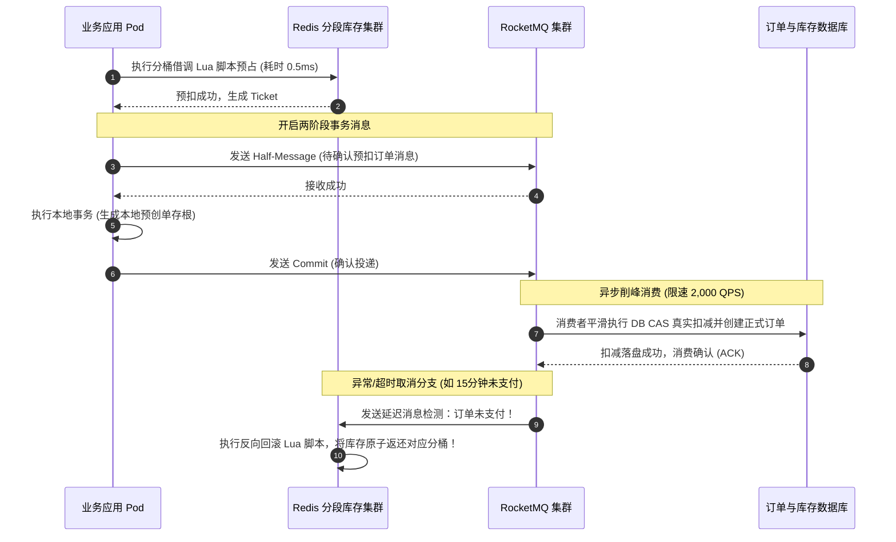
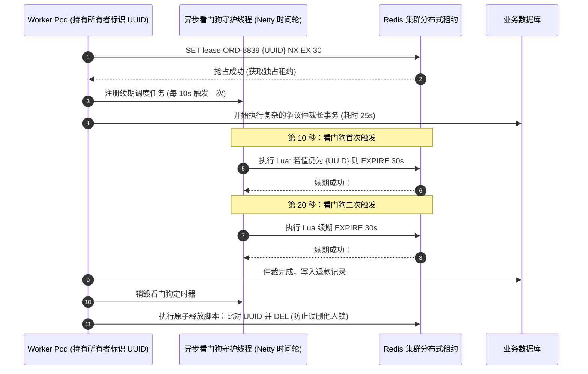

# 分布式并发控制微观原语与业务实战全景

> **文档定位**：分布式系统架构体系（Level 3 微观原语）核心工程实战手册——深度解构企业级高并发、多节点协同环境下 6 大核心并发控制原语。坚决摒弃“空谈算法”，每一项原语严格遵循 **“① 业务场景描述 ➡️ ② 致命痛点还原 ➡️ ③ 微观原语底层求解与工程落地”** 的标准企业级方法论。  
> **所属专题**：[分布式系统架构体系全景知识图谱-v1.0.md](./01-分布式系统架构体系全景知识图谱-v1.0.md)  
> **跨领域联动主案**：  
> * [08-Hook1-on_run_load-准入屏障与分布式租约落地实战.md](../agent/deep-dive/topics/01-lifecycle-hooks/08-Hook1-on_run_load-准入屏障与分布式租约落地实战.md)（分布式租约、看门狗与防护令牌落地）  
> * [11-Hook3-before_model-算力原子预算预占与死循环硬熔断落地实战.md](../agent/deep-dive/topics/01-lifecycle-hooks/11-Hook3-before_model-算力原子预算预占与死循环硬熔断落地实战.md)（内存原子预占、防超卖与 Token 流量计费系统）  
> * [10-Hook7-before_checkpoint-并发一致性与CAS乐观锁防脑裂落地实战.md](../agent/deep-dive/topics/01-lifecycle-hooks/10-Hook7-before_checkpoint-并发一致性与CAS乐观锁防脑裂落地实战.md)（CAS 乐观锁防脑裂与状态落盘闭环）

---

## 知识索引与原语矩阵

| 序号 | 并发控制微观原语 | 核心代名词 | 典型业务对齐场景 | 核心防御目标 | 理论一致性级别 |
| :---: | :--- | :--- | :--- | :--- | :--- |
| **01** | **内存原子预占与防超卖原语** | Lua Barrier / Quota Sharding | 电商热销库存秒杀 / AI 算力 Token 流量计费 | 杜绝负库存、透支坏账与 DB 行锁假死 | 强一致性 (线性一致性) |
| **02** | **时效租约与看门狗自愈原语** | Distributed Lease & Watchdog | 退款仲裁 Agent 执行权 / 调度任务单节点互斥 | 杜绝双 Worker 争抢执行、节点宕机死锁 | 最终一致性 (带时钟租约) |
| **03** | **单调递增防护令牌原语** | Fencing Tokens | 逆向物流履约更新 / 分布式存储落盘 | 杜绝 GC 假死与网络抖动苏醒后的“脑裂覆盖” | 严格时序全序 (Total Order) |
| **04** | **CAS 乐观锁与版本控制原语** | Compare-And-Swap / Versioning | 买家与客服多端并发编辑 / 检查点并发覆盖 | 杜绝并发丢失更新 (Lost Update) | 读已提交 / 无锁冲突判定 |
| **05** | **分布式读写分流与分段锁原语** | RedLock RW-Lock & Striping | 百万级商户热点账户并发扣款 / 商品详情读写分离 | 杜绝读写互斥吞吐暴跌、单 Key 热点瓶颈 | 顺序一致性 |
| **06** | **可串行化快照隔离原语** | SSI (Serializable Snapshot) | 多账户联动转账 / 跨境多币种清结算对账 | 杜绝写偏斜 (Write Skew) 与跨行联合不变量破坏 | 可串行化 (最高隔离级别) |

---

## 第一章：原语一 · 内存原子预占与防超卖原语 (In-Memory Atomic Reservation)

### 1.1 业务场景描述
在跨国跨境电商“黑色星期五”大促期间：
1. **场景 A（物理商品秒杀）**：瑞士某品牌旗舰店推出限量 100 只的定制智能手表，售价 $180 美元，活动上线瞬间引爆数万名全球买家并发抢购；
2. **场景 B（AI 智能体算力计费）**：商户后台开通了“AI 售后争议自动调解与退赔 Agent”，商户预存了 500,000 Tokens 算力配额。因物流延误引发售后潮，平台并发涌入 2,000 笔划痕退赔工单，每笔工单都在并发调用云端大模型进行多方博弈研判。

### 1.2 致命业务痛点
* **痛点 1：数据库行级排他锁引爆连接池瘫痪（Connection Pool Exhaustion）**  
  若直接打数据库执行 `SELECT stock FROM goods WHERE id=1 FOR UPDATE`：当 1,000 个请求同时争抢同一行数据时，行级排他锁产生极其漫长的锁等待队列。瞬间耗尽 MySQL 的 200 个连接池资源，导致整个电商平台全站微服务级联雪崩超时。
* **痛点 2：高并发读写竞态导致“负库存”与“透支坏账”（Overdraft & Lost Updates）**  
  若采用天真的事后扣减（先查后扣）：多个并发线程在第 1 毫秒同时查到“余额还有 $1.00”，于是同时发起下单或大模型调用。大模型 2 秒后返回，实际消耗了 $50.00，商户账户扣成 -$49.00。对于物理商品则造成超卖 900 件，平台面临天价法律索赔。

### 1.3 微观原语底层求解与工程落地（互联网百万级 QPS 六层立体防御架构）

在阿里、京东、美团或 AWS 这类互联网与云厂商生产级项目中，防超卖与资金预占绝非一个简单的单机 Redis Lua 脚本，而是涵盖 **“边缘层 ➡️ 进程层 ➡️ 分布式内存分桶 ➡️ 消息管道 ➡️ 数据库内核 ➡️ 审计平账”** 的六层立体漏斗体系。

```
                     [全球数十万/百万级并发抢购与算力洪峰]
                                   │
 ┌─────────────────────────────────▼──────────────────────────────────┐
 │ 【第一层：边缘网关动静分离与售罄快速熔断】(CDN / OpenResty Nginx) │
 │   * 本地共享内存字典 (lua_shared_dict) 缓存售罄标记 (Sold-Out Flag)│
 │   * 库存一旦归零，广播至边缘，99.9% 的无效流量在网关直接打回！     │
 └─────────────────────────────────┬──────────────────────────────────┘
                                   │ 仅有效流量穿透至内网网关
 ┌─────────────────────────────────▼──────────────────────────────────┐
 │ 【第二层：应用进程本地缓存与布隆防穿透】(Caffeine / Guava Cache)  │
 │   * JVM 本地标记阻断，避免重复查询分布式缓存                       │
 └─────────────────────────────────┬──────────────────────────────────┘
                                   │
 ┌─────────────────────────────────▼──────────────────────────────────┐
 │ 【第三层：分布式库存分段分桶与自适应借调】(Redis Bucket Sharding) │
 │   * 10,000 件库存切分为 100 个分桶 (每桶 100 件)，粉碎单 Key 热点  │
 │   * 跨桶级联轮询与自适应借调 Lua 脚本，彻底消灭“防少卖”假性售罄   │
 └─────────────────────────────────┬──────────────────────────────────┘
                                   │ 预扣成功，生成预占存根凭证 (Ticket)
 ┌─────────────────────────────────▼──────────────────────────────────┐
 │ 【第四层：高可靠异步削峰与最终一致性】(RocketMQ 分布式事务消息)   │
 │   * 半消息 (Half-Message) 机制，解耦订单落库与削减数据库并发峰值   │
 └─────────────────────────────────┬──────────────────────────────────┘
                                   │ 削峰平滑消费 (限流 2,000 QPS 入库)
 ┌─────────────────────────────────▼──────────────────────────────────┐
 │ 【第五层：数据库内核级优化与终局物理屏障】(DB CAS Guard & AliSQL)  │
 │   * 终局安全防线：UPDATE ... WHERE stock >= :num (防主从切换脑裂)  │
 │   * 数据库内核补丁 (commit_on_success / 线程池内联排队消灭行锁)    │
 └─────────────────────────────────┬──────────────────────────────────┘
                                   │
 ┌─────────────────────────────────▼──────────────────────────────────┐
 │ 【第六层：两阶段延迟回滚与对账自愈】(Delayed Queue & Reconciliation)│
 │   * 15 分钟超时未支付 / 仲裁驳回：RocketMQ 延迟消息自动回滚库存   │
 │   * 准实时台账审计：总库存 = 剩余库存 + 在途冻结 + 已支付出库量    │
 └────────────────────────────────────────────────────────────────────┘
```

---

#### 核心底座一：热点分段分桶（Bucket Sharding）与跨桶自适应借调算法

* **单 Key 热点崩溃问题**：Redis 单核物理极限通常在 5万~8万 QPS。面对 50 万 QPS 洪峰，单一 Key 必死无疑。
* **分桶设计**：将商品或商户配额切分成 $N$ 个分桶（例如 $N=10$ 或 $100$），分散到 Redis Cluster 的不同 Slot 槽位与不同机器上：
  * `stock:SwissWatch:bucket_0 = 100`
  * `stock:SwissWatch:bucket_1 = 100`
  * ...
  * `stock:SwissWatch:bucket_9 = 100`
* **跨桶自适应借调算法（彻底解决“防少卖”假性售罄）**：
  * 如果买家被哈希分配到 `bucket_0`，但该桶刚好被买空（剩余 0），如果直接返回“已售罄”，买家就会被误杀，造成商家少卖；
  * **解决方案**：Lua 脚本执行自适应环形探测（Circular Probing）。若目标桶不足，脚本自动在 Redis 内存内部无缝向相邻分桶（Bucket 1 ~ 9）探测借调；只有当**所有分桶之和彻底归零时，才判定最终售罄**。

##### 生产级分桶自适应借调 Lua 脚本（多桶环形原子扣减）：
```lua
-- KEYS: 包含 N 个分桶的 Key 列表 (例如 bucket_0 到 bucket_9)
-- ARGV[1]: 期望扣减数量 (num，例如 1 件或 4220 Tokens)
-- ARGV[2]: 起始首选分桶索引 (hash_index，基于 userId / disputeId 计算)

local num = tonumber(ARGV[1])
local hash_index = tonumber(ARGV[2])
local total_buckets = #KEYS

-- 第一轮探测：优先尝试从指定的首选分桶快速扣除 (最快路径，单桶命中)
local preferred_key = KEYS[hash_index + 1]
local current_stock = tonumber(redis.call('GET', preferred_key) or 0)

if current_stock >= num then
    redis.call('DECRBY', preferred_key, num)
    return 1 -- 首选桶扣减成功
end

-- 第二轮环形跨桶借调：首选桶不足，遍历所有分桶计算总可用量
local total_available = 0
local stocks = {}

for i = 1, total_buckets do
    local s = tonumber(redis.call('GET', KEYS[i]) or 0)
    stocks[i] = s
    total_available = total_available + s
end

-- 判定：全局总库存是否彻底不足？
if total_available < num then
    return -1 -- 全网真无货了！触发售罄熔断
end

-- 跨桶级联扣减：扣尽各桶余量，直至填平需求
local remaining_to_deduct = num
for i = 1, total_buckets do
    if stocks[i] > 0 then
        if stocks[i] >= remaining_to_deduct then
            redis.call('DECRBY', KEYS[i], remaining_to_deduct)
            break
        else
            redis.call('DECRBY', KEYS[i], stocks[i])
            remaining_to_deduct = remaining_to_deduct - stocks[i]
        end
    end
end

return 2 -- 跨桶借调扣减成功
```

---

#### 核心底座二：Redis 异步主从脑裂与主备切换丢数据的防穿透方案 (Master Failover Anti-Drift)

* **致命故障场景（主从复制丢失引发二次超卖）**：
  1. Redis Master 扣减了最后 10 件库存，并返回了扣减成功；
  2. 但这 10 条数据的 AOF / RDB 异步复制**尚未同步到 Slave**；
  3. Master 宿主机突发宕机或网线被挖断，Sentinel / Cluster 发生自动 Failover，将 Slave 提拔为新 Master；
  4. 新 Master 上的库存赫然还是旧的 10 件！后续 10 名买家再次下单，**造成物理上的严重二次超卖！**
* **企业级双重护栏防护方案**：
  1. **方案 A（内存级 Redlock / WAIT 强同步指令）**：在极高价值资产扣除时，执行 `WAIT 1 100` 指令，强制等待至少 1 个 Slave 确认同步成功才返回客户端；
  2. **方案 B（数据库 CAS 终局物理防护兜底 —— 工业界最通用的最终防线）**：
     无论前置缓存如何漂移，订单入库时在持久层必须执行带条件的原子变更：
     ```sql
     -- 终局物理护栏：绝对依赖数据库 ACID 的行级锁排他性兜底
     UPDATE item_stock
     SET available_stock = available_stock - :buy_num,
         frozen_stock = frozen_stock + :buy_num,
         version = version + 1
     WHERE item_id = :item_id
       AND available_stock >= :buy_num; -- 核心防线：必须满足物理余额充足！
     ```
     如果更新影响行数 `affected_rows == 0`，说明前置缓存发生了脑裂漂移，此时立即进入**“下单失败补偿反向回滚通道”**，将买家状态标记为抢购失败并退款，彻底封死资损！

---

#### 核心底座三：RocketMQ 事务消息削峰与两阶段超时自动回滚

在高并发秒杀中，直接由 Web 线程同步写数据库无异于自杀。系统采用 **RocketMQ 分布式事务消息（Transactional Message）**：



---

#### 核心底座四：大厂 MySQL 内核级优化补丁（AliSQL Inventory Patch）

在数据库层，面对最终落库的写冲突，阿里巴巴在开源 MySQL 内核上研发了 **AliSQL Inventory Patch**（以及各大分布式数据库如 OceanBase / TiDB 的内联排队优化）：
* **原生 MySQL 痛点**：大量事务并发更新同一行商品库存时，死锁检测算法（Deadlock Detection）会把 CPU 打到 100%，锁等待导致 TPS 暴跌至个位数；
* **内核优化秘诀**：
  * **行锁排队（Wait-Free Queueing）**：在 InnoDB 存储引擎内核开辟专用排队队列，同一行的更新请求在内存队列中单线程有序执行，消除高并发 CPU 上下文切换；
  * **成功即提交（Commit on Success）**：只要更新库存 SQL 执行成功，在存储引擎内部直接释放行锁并提交，无需等待外部整个事务网络往返，锁持有时间从 **毫秒级压缩至微秒级**，让单行热点写入吞吐量直接飙升至 **30,000+ TPS**！

---

#### 核心底座五：准实时台账对账自愈系统（Auditing & Reconciliation Engine）

任何大型电商或金融系统，绝不能相信内存永不丢失。系统在后台运行实时对账引擎（Reconciliation Reaper）：

$$\text{初始总库存} = \sum_{i=0}^{N-1} \text{Redis 分桶库存}_i + \text{在途待支付冻结库存} + \text{已支付出库订单量}$$

* 每隔 30 秒，定时任务比对全链路守恒公式；
* 一旦发现差额大于 0（例如因网络异常导致未消费成功的孤儿预占），对账引擎主动生成**自动调账冲正事件（Auto-Correction Event）**，将孤儿库存回补至总水池，实现全自动无人值守闭环自愈。

---

## 第二章：原语二 · 分布式时效租约与看门狗自愈原语 (Distributed Lease & Watchdog)

### 2.1 业务场景描述
在跨境电商智能退赔中台，当买家 Alice 对 $180 手表划痕申请退款时，工单进入 `RUNNING_ARBITRATION` 状态。后台部署了 50 个分布式 Worker Pod 共同消费工单事件流。每个工单只允许被一个 Worker 独占加载执行，严禁两个 Worker 同时介入。

### 2.2 致命业务痛点
* **痛点 1：双 Worker 脑裂执行与重复划款（Double Processing）**  
  若没有互斥锁，Worker A 和 Worker B 同时从消息队列消费到工单 `ORD-8839`，两者同时调用支付网关执行退款，导致买家收到双倍退款 $360，商户直接资损。
* **痛点 2：静态死锁 vs 锁过早失效的两难困境（The Lease Duration Dilemma）**  
  * **设长了（如设 30 分钟）**：若 Worker A 刚拿到锁执行到第 5 秒突发硬件断电或 OOM 崩溃，这把锁将硬生生锁死 30 分钟，在此期间该买家工单彻底卡死，引发严重客诉；
  * **设短了（如设 5 秒）**：若大模型推理或复杂网络博弈耗时 7 秒，第 5 秒锁自动超时释放。Worker B 趁虚而入抢到锁，两个 Worker 再次形成双主脑裂！

### 2.3 微观原语底层求解与工程落地

#### 核心解法：带唯一所有者标识的原子租约（SET NX EX）+ 看门狗异步自动续期（Watchdog Timer）
1. **原子申请**：Worker 必须使用自己的唯一节点标识（如 `UUID + ThreadID`）加锁；
2. **看门狗自愈（Watchdog）**：在本地内存启动基于 Netty 时间轮（`HashedWheelTimer`）的后台守护线程。在锁租期的 $1/3$ 时间点（例如锁 30 秒，则每 10 秒）向 Redis 发送续期指令。只要业务进程活着，锁就永远不超时；一旦进程暴毙，看门狗当即陪葬，20 秒后锁自然平滑释放，允许其他节点接管。



#### 生产级带所有者校验的原子释放 Lua 脚本：
```lua
-- 绝不能直接 DEL，必须确认锁是自己持有的，防止释放掉其他 Worker 刚刚接管的新锁
if redis.call('GET', KEYS[1]) == ARGV[1] then
    return redis.call('DEL', KEYS[1])
else
    return 0 -- 锁已被他人接管或已过期，放弃释放
end
```

---

## 第三章：原语三 · 单调递增防护令牌原语 (Monotonic Fencing Tokens)

### 3.1 业务场景描述
在逆向仓储系统中，退货手表的收货上架与质检结果需要落盘至底层只读存储系统或分布式状态库。Worker 节点需要持有分布式租约才能向持久层提交状态变更。

### 3.2 致命业务痛点
* **著名的 Martin Kleppmann 假死脑裂覆盖难题（The GC Pause / Network Partition Disaster）**  
  假设 Worker A 持有有效租约：
  1. Worker A 准备向存储层写入数据时，JVM 突然遭遇了长达 45 秒的 **Stop-The-World (STW) 全局垃圾回收**，或者遭受了底层宿主机的 CPU 抢占挂起；
  2. 在 Worker A 假死期间，租约在 Redis 侧早已彻底超时；
  3. Worker B 正常抢到了新租约，并将工单状态安全更新为 `STAGE_2_PROCESSED`；
  4. 此时，Worker A 从 STW 假死中苏醒。在 Worker A 的内存认知里，**它完全不知道自己已经挂起过，以为自己依然持有合法租约**！
  5. Worker A 径直向数据库执行写入，把 Worker B 最新写入的数据硬生生覆写破坏！

```
[Worker A] ──拿到租约──► [突发 STW 假死 45秒!!] ──(租约过期，B 接管写入最新数据)──► 苏醒──► [强行写入! 覆盖破坏 B 的数据!]
```

### 3.3 微观原语底层求解与工程落地

#### 核心解法：单调递增防护令牌（Monotonic Fencing Tokens）
* **原理**：客户端不能仅凭“我自认为有锁”就直接写数据。每次颁发租约时，协调中心（ZooKeeper、etcd 或 Redis `INCR`）必须附带一个**严格单调递增的整数数字（Fencing Token，防重令牌）**。
* **存储端拦截原则**：持久层（MySQL、PostgreSQL 或对象存储）维护一个 `max_fencing_token` 字段。存储层在执行写入时，强制校验：
  $$\text{Incoming Token} > \text{Max Committed Token}$$
  如果进来的令牌小于或等于当前已提交的最高令牌，说明这是来自远古“僵尸节点”的过期请求，存储层**物理坚决拒绝并当场抛弃**！

```
┌────────────────────────────────────────────────────────────────────────┐
│                        防护令牌拦截僵尸写入物理全景                    │
├────────────────────────────────────────────────────────────────────────┤
│ 1. Worker A 获得租约与令牌 Token = 33                                  │
│ 2. Worker A 突发 STW 假死，租约失效                                    │
│ 3. Worker B 获得新租约与递增令牌 Token = 34                           │
│ 4. Worker B 成功写入数据库 (数据库当前记录 max_fencing_token = 34)     │
│ 5. Worker A 假死苏醒，携带旧令牌 Token = 33 尝试写入                   │
│ 6. 数据库判定：33 <= 34 (拒绝！拦截该僵尸写入，抛出 StaleTokenException)│
└────────────────────────────────────────────────────────────────────────┘
```

#### 生产级 SQL 存储门禁设计：
```sql
-- 存储层通过版本比对拒绝旧令牌写入
UPDATE dispute_order_status
SET status = :new_status,
    fencing_token = :incoming_token,
    updated_at = NOW()
WHERE dispute_id = :dispute_id
  AND fencing_token < :incoming_token; -- 核心防线：必须严格大于当前已记录的令牌！

-- 若 Affected Rows == 0，说明请求来自假死复活的僵尸节点，直接熔断报错！
```

---

## 第四章：原语四 · CAS 乐观锁与并发版本控制原语 (Compare-And-Swap & Versioning)

### 4.1 业务场景描述
在客服工作台与买家维权中心，工单经常面临**多端并发修改**：
* 买家 Alice 在前端 App 点击“补充上传划痕细节照片”，修改工单证据列表；
* 与此同时，在线客服在后台系统看到该工单，点击“驳回买家申请，要求寄回检测”；
* 此时后台 AI Agent 恰好也在执行“自动审核物流单号”。

### 4.2 致命业务痛点
* **并发丢失更新（Lost Update）**  
  三方同时读取工单版本 V1。买家提交后保存了照片；客服 0.1 秒后提交驳回理由。若无版本控制，客服提交的更新会把买家刚上传的照片直接覆盖冲掉。买家刷新页面发现照片丢了，产生严重系统不信任与纠纷。

### 4.3 微观原语底层求解与工程落地

#### 核心解法：基于版本号的原子 CAS（Compare-And-Swap）乐观锁
在实体记录中引入不可逆递增字段 `version: BigInt`。写入时，仅当数据库中的当前版本与内存最初读取的版本完全一致时才允许生效，生效后版本自增 1。

#### 生产级 CAS 乐观锁工程实现（Java 21 + 影响行数断言）：
```java
public void updateDisputeStatusWithCas(String disputeId, String newStatus, long expectedVersion) {
    int maxRetries = 3;
    long currentExpected = expectedVersion;

    for (int attempt = 1; attempt <= maxRetries; attempt++) {
        // 执行原子比较与交换 (CAS)
        int affectedRows = jdbcTemplate.update("""
                UPDATE dispute_order
                SET status = ?, version = version + 1, updated_at = NOW()
                WHERE dispute_id = ? AND version = ?
                """, newStatus, disputeId, currentExpected);

        if (affectedRows == 1) {
            log.info("[CAS-SUCCESS] 工单更新成功: disputeId={}, newVersion={}", disputeId, currentExpected + 1);
            return;
        }

        log.warn("[CAS-CONFLICT] 侦测到并发版本冲突，准备第 {} 次重试: disputeId={}, expectedVersion={}",
                attempt, disputeId, currentExpected);

        // 重新加载最新快照，获取最新的 version
        DisputeOrder freshOrder = repository.findById(disputeId)
                .orElseThrow(() -> new EntityNotFoundException("Dispute not found: " + disputeId));
        
        currentExpected = freshOrder.getVersion();
        // 加入微秒级抖动，避免自旋惊群效应
        Thread.sleep(ThreadLocalRandom.current().nextInt(10, 50));
    }

    throw new OptimisticLockingFailureException("工单并发写入激烈，重试 3 次后彻底放弃: " + disputeId);
}
```

---

## 第五章：原语五 · 分布式读写分流与分段锁原语 (Distributed RW-Lock & Striping)

### 5.1 业务场景描述
平台大品牌商（如 SwissWatch-Direct）拥有高达数万件商品的统一库存中台与账本聚合池。该数据每天要承受 **99.9% 的海量高频查询（如买家浏览商品、商品详情页）**，而仅有 **0.1% 的核心写操作（如真正成交流水扣款、后台退运费）**。

### 5.2 致命业务痛点
* **互斥锁读性能崩溃**：如果为了保证强一致性，对查询也加排他锁，并发读请求将直接排长龙，商品页 RT 从 10ms 恶化至 2,000ms；
* **单 Key 热点瓶颈**：所有写操作集中在单个账户 Key，Redis 单核或数据库单分片直接被打死。

### 5.3 微观原语底层求解与工程落地

#### 核心解法：分布式共享读锁与排他写锁（RReadWriteLock）+ 账本虚拟分段分水池（Lock Striping）
1. **读写分离锁（RW-Lock）**：允许多个节点同时持有“读锁”，读读不互斥；只要有节点申请“写锁”，所有后续读写操作全部阻塞，写写互斥，写完成后立即释放；
2. **锁分段（Striping / Sharding）**：将商户超大资金水池分拆为 $K$ 个分段。并发写入时，请求通过 `DisputeID.hashCode() % K` 分流至独立分段，将锁冲突概率降低 $K$ 倍。

```
┌────────────────────────────────────────────────────────────────────────┐
│                        分布式分段锁与读写分流拓扑                      │
├────────────────────────────────────────────────────────────────────────┤
│ 【读操作 (占比 99.9%)】                                                │
│   并发读 1 ──┐                                                         │
│   并发读 2 ──┼──► 获取分布式共享读锁 (Shared Read Lock) ──► 内存直接读取 │
│   并发读 N ──┘    (完全并行，无任何性能衰减，毫秒级返回)               │
├────────────────────────────────────────────────────────────────────────┤
│ 【写操作 (占比 0.1%)】                                                 │
│   工单 A ──► Hash 到 Bucket 0 ──► 独占排他写 Bucket 0 锁 (扣减额度)    │
│   工单 B ──► Hash 到 Bucket 3 ──► 独占排他写 Bucket 3 锁 (互不干扰！)  │
└────────────────────────────────────────────────────────────────────────┘
```

---

## 第六章：原语六 · 可串行化快照隔离原语 (Serializable Snapshot Isolation / SSI)

### 6.1 业务场景描述
在跨国多币种财务结算与退款补偿中，涉及**跨表、跨实体的复合约束**：
* 业务规则：SwissWatch-Direct 拥有美元账户（`balance_usd`）和欧元账户（`balance_eur`）。平台风控硬规则要求：两个账户折合总资产**必须永远大于等于 $1,000 美元准备金**。

### 6.2 致命业务痛点
* **经典的写偏斜现象（Write Skew Disaster，非串行化陷阱）**  
  假设当前：`USD 账户 = $600`，`EUR 账户 = $600`（总和 $1,200 > $1,000，合规）。
  此时发生并发操作：
  * **事务 1（扣减 USD）**：检查总和：`600 + 600 = 1200 >= 1000`（通过！），于是将 USD 账户扣减 $400，余额变为 $200；
  * **事务 2（扣减 EUR，同时发生）**：检查总和：`600 + 600 = 1200 >= 1000`（通过！），于是将 EUR 账户扣减 $400，余额变为 $200；
  * **最终灾难**：两个事务单独看自己的约束都是完全合规的，但两者同时提交后，总资产变成了 `200 + 200 = $400 < $1,000`！
  * **根本原因**：传统的快照隔离（Snapshot Isolation）只防脏读与不可重复读，但在**跨行跨表联合不变量（Cross-row Invariant）**面前发生写偏斜，无法杜绝逻辑穿透。

### 6.3 微观原语底层求解与工程落地

#### 核心解法：可串行化快照隔离（SSI）与动态读写反向依赖检测（Anti-dependency Tracking）
* **原理**：在 MVCC 快照读的基础上，跟踪事务之间的 **rw-antidependencies（读写反依赖关系，简称 siw 边）**；
* 当检测到两个连续的读写反依赖在依赖图（Serialization Graph）中构成环路时，判定发生了 Write Skew，**主动中止（Abort）并回滚其中较年轻的事务**，强制保证事务执行顺序与某一种串行调度完全等价。

```
[事务 1] ──读取 EUR 余额──► [事务 2 并发修改了 EUR] ──(触发 rw-antidependency 警报)──┐
                                                                                     │
[事务 2] ──读取 USD 余额──► [事务 1 并发修改了 USD] ──(形成环路闭合!) ───────────────┴──► 【SSI 引擎主动 KILL 事务 2 并回滚!】
```

#### 生产级落地方案：
1. **数据库引擎层**：直接使用 PostgreSQL 的 `ISOLATION LEVEL SERIALIZABLE`（内核自带 SSI 检测实现，比传统 2PL 两阶段加锁性能高出一个数量级）；
2. **应用层兜底模式**：若使用 MySQL InnoDB（其 Serializable 为重量级锁表锁行），则在业务层引入**统一范围显式排他锁（Materialized Conflict Lock）**，对租户的母账户强行执行行级排他锁，人工串行化联合判定。

---

## 第七章：架构演进总结与全景图谱穿透回溯

| 原语名称 | 适用并发量级 | 核心解决的死穴问题 | 架构落地组件 |
| :--- | :--- | :--- | :--- |
| **01. 内存原子预占** | **10,000+ TPS** | 解决秒杀与大模型调用中的“负库存/透支超卖” | Redis Lua + 仅追加流水表 |
| **02. 时效分布式租约** | **1,000 ~ 5,000 TPS** | 解决异步任务长事务中的“多主冲突与死锁” | Redis `SET NX EX` + Netty 看门狗 |
| **03. 防护令牌 Fencing** | **全场景兜底** | 解决 STW 假死复活后的“僵尸覆写脑裂” | 递增序列号 + 存储端比较器 |
| **04. CAS 乐观锁** | **高读低写场景** | 解决多端并发更新下的“更新丢失 Lost Update” | 实体版本字段 `version` + SQL 影响行数 |
| **05. 读写分流与分段锁** | **10,000+ TPS** | 解决读多写少下的互斥锁阻塞与单 Key 热点 | Redisson RReadWriteLock + 分段分片 |
| **06. SSI 快照隔离** | **强金融严苛场景** | 解决跨账户复合多表条件下的“写偏斜 Write Skew” | PostgreSQL SSI 内核 / 物化冲突锁 |

### 双向穿透回溯指引：
* 🗺️ 返回知识图谱主目录：[01-分布式系统架构体系全景知识图谱-v1.0.md](./01-分布式系统架构体系全景知识图谱-v1.0.md)
* 🔒 探究 AI Agent 第一道租约准入门禁：[08-Hook1-on_run_load-准入屏障与分布式租约落地实战.md](../agent/deep-dive/topics/01-lifecycle-hooks/08-Hook1-on_run_load-准入屏障与分布式租约落地实战.md)
* ⚡ 探究 AI Agent 算力原子预算预占与 Token 流量计费：[11-Hook3-before_model-算力原子预算预占与死循环硬熔断落地实战.md](../agent/deep-dive/topics/01-lifecycle-hooks/11-Hook3-before_model-算力原子预算预占与死循环硬熔断落地实战.md)
* 🛡️ 探究 AI Agent 状态检查点与 CAS 乐观锁防脑裂：[10-Hook7-before_checkpoint-并发一致性与CAS乐观锁防脑裂落地实战.md](../agent/deep-dive/topics/01-lifecycle-hooks/10-Hook7-before_checkpoint-并发一致性与CAS乐观锁防脑裂落地实战.md)
