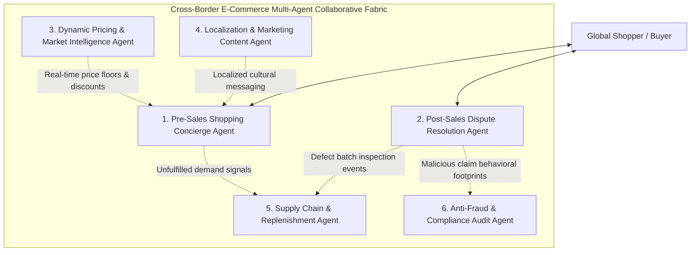

# Cross-Border E-Commerce Multi-AI Agent Ecosystem Architecture & Integration Guide

> **Knowledge Base Domain**: E-Commerce Domain Multi-Agent Architecture Baseline & Evolution Guide  
> **Document Version**: v1.0 (Enterprise Architecture)  
> **Underlying Technical Base**: [01-AI-Agent-Enterprise-Architecture-Knowledge-System-Guide-v1.0.md](../../agent/01-AI-Agent-Enterprise-Architecture-Knowledge-System-Guide-v1.0.md) | [01-L1-Case-01-Stability-Jitter-RCA.md](../../agent/deep-dive/cases/01-L1-Case-01-稳定性抖动与SLA容灾降级-RCA实战.md)  
> **Companion Edition**: [🇨🇳 Chinese Edition](./01-跨境电商多AI-Agent生态体系业务架构与集成落地指南.md)

---

## 0. Business Domain Deconstruction: What Exactly is a "24/7 Intelligent Pre/Post-Sales Decision Agent"?

### 1. Industry Pain Points & Physical Reality
Cross-border e-commerce differs fundamentally from domestic commerce because operations run across highly fragmented, geographically separated global logistics and human realities:
* **Time Zone Gaps & Minor Languages**: Global buyers are dispersed across 24 time zones spanning North America, Europe, the Middle East, and Southeast Asia, speaking over 30 languages. When European or American shoppers browse and inquire during daylight hours, operations teams in origin hubs are asleep, resulting in a **35%~45%** loss of potential high-intent orders due to response latency.
* **The High-Cost Quagmire of Cross-Border Reverse Logistics**: A fashion apparel item with a retail value of $20 shipped internationally can incur return freight and warehouse re-inspection costs between **$25~$35**. Forcing international buyers through rigid return procedures creates net-negative financial margins for merchants while alienating consumers.
* **Credit Card Chargeback Hazards & Payment Gateway Penalties**: International consumers frequently leverage credit card dispute mechanisms (Chargeback / Dispute). Slow responses or mishandled disputes result in penalty fees ($15~$25 per incident), degraded merchant account standing, or suspension of payment processing gateways.

### 2. Traditional FAQ Chatbots vs. Autonomous Decision-Making Agents
In production enterprise architectures, the distinction between a toy conversational bot and a decision-making agent lies in **closed-loop decision authority and controlled action execution**:

| Dimension | Legacy FAQ Rule-Based Chatbot | Intelligent Autonomous Decision Agent |
| :--- | :--- | :--- |
| **Interaction Nature** | Keyword matching and static URL redirection | Multi-turn negotiation, contextual planning, and strategic reasoning |
| **Vision & Perception** | None or simple file format validation | **Multimodal Computer Vision**: Inspects defect photos, package labels, and seam tears against warehouse pre-shipment benchmarks |
| **System Visibility** | Blind to real-time enterprise system state | Full real-time integration with CRM, customer LTV, WMS inventory, and TMS transit timelines |
| **Authority & Action** | **Zero Execution Power** ("Please wait 24h for an agent") | **Sandboxed Action Authority** (executes refunds, replacements, shipment holds, and coupon grants) |
| **Business Objective** | Offload human support ticket volume | **Maximize customer LTV, optimize checkout conversion, and minimize net reverse logistics loss** |

---

## I. Multi-AI Agent Ecosystem: 6 Specialized Domain Agents

In complex e-commerce, a single general-purpose agent cannot shoulder cross-cutting responsibilities spanning marketing, transactional settlement, inventory, and dispute regulation. The domain is deconstructed into **six specialized agents**:



### 1. Pre-Sales Shopping Concierge Agent
* **Operational Scope**: Standalone DTC storefronts, marketplace chat widgets (Amazon, TikTok Shop), floating Product Detail Page (PDP) assistants.
* **Core Responsibilities**:
  * **Personalized Sizing & Parameter Matching**: Solicits body metrics, style preferences, and regional sizing standards to recommend exact SKUs;
  * **Instant DDP Landed Cost Calculation**: Computes real-time landed costs including duties (DDP), localized shipping tariffs, and delivery timelines based on the buyer's geolocation;
  * **Dynamic Negotiation & Conversion Closure**: Detects browsing hesitations and grants authorized, customized promotional vouchers (5%~10% discount cap) to lock in orders.

### 2. Post-Sales Dispute Resolution Agent
* **Operational Scope**: Dispute handling, return/refund requests, in-transit parcel delay resolutions.
* **Core Responsibilities**:
  * **Multimodal Visual Quality Inspection**: Uses computer vision to assess customer-uploaded defect evidence against pre-shipment warehouse photos to derive fraud probabilities;
  * **Reverse Economic Optimization (Refund vs. Return Policy Engine)**:
    * When `Item Retail Value < Cross-Border Return Freight` and buyer trust score is high, it automatically triggers **"Keep the Item and Full Refund"** or an 30% discount concession;
    * When an item has high resale value locally, it issues prepaid overseas return labels;
  * **Immediate Dispatch Interception**: Coordinates with OMS/WMS to halt order packing and courier handover during the pre-dispatch window.

### 3. Dynamic Pricing & Market Intelligence Agent
* **Operational Scope**: 24/7 competitive crawling across international marketplaces (Amazon, Temu, Shopee) and pricing orchestration.
* **Core Responsibilities**:
  * **Competitor SKU Mapping & Volatility Tracking**: Monitors competitor pricing drops, stockout statuses, and negative customer sentiment;
  * **Elastic Algorithmic Repricing**: Calculates optimal price points balancing warehouse holding costs, FX exchange rate fluctuations, and gross margin thresholds.

### 4. Localization & Marketing Content Agent
* **Operational Scope**: Cross-border catalog publishing, multi-channel social content generation (TikTok, Instagram, Google SEO).
* **Core Responsibilities**:
  * **Idiomatic Multi-Language Cultural Adaptation**: Eliminates robotic machine translation by tailoring titles, bullet points, and user manuals to regional customs, slang, and legal naming rules;
  * **Customer Feedback Loop Integration**: Ingests recurrent customer review patterns (e.g., "runs half a size small") to iteratively rewrite product detail page copy.

### 5. Supply Chain & Replenishment Agent
* **Operational Scope**: Domestic factory manufacturing schedules, first-leg freight planning, overseas fulfillment center (FBA/3PL) inventory balancing.
* **Core Responsibilities**:
  * **Dynamic Demand Forecasting**: Synthesizes pre-sales inquiry volume, promotional calendars, and historical velocity to forecast 30-day replenishment demand;
  * **Optimal Allocation DAG Planning**: Generates blended logistics plans (air freight for urgent stockouts + ocean freight for sustained volume) in response to shipping rate spikes.

### 6. Anti-Fraud & Compliance Audit Agent
* **Operational Scope**: Payment checkout evaluation, high-risk refund screening, sensitive item customs export clearance.
* **Core Responsibilities**:
  * **Syndicate & Arbitrage Detection**: Identifies fake delivery addresses and coordinated multi-account voucher abuse;
  * **Preemptive Chargeback Defense**: Cross-checks payment gateway AVS (Address Verification System) and CVV indicators to flag suspicious orders for human review.

---

## II. Multi-Agent Ecosystem Architecture: Coexistence with Legacy Systems

```mermaid
flowchart TD
    subgraph LegacySystems ["Legacy Enterprise Core E-Commerce Systems"]
        OMS["Order Management System (OMS)"]
        WMS["Warehouse Management System (WMS)"]
        TMS["Transportation Management System (TMS)"]
        CRM["Customer Relationship Management (CRM)"]
        ERP["Enterprise Resource Planning (ERP)"]
        Pay["Cross-Border Payment Gateway"]
    end

    subgraph IntegrationFabric ["Event-Driven Integration & Safety Gateway Fabric"]
        CDC["Debezium / Kafka CDC (Read-Only State Replication)"]
        EventBus["Enterprise Event Mesh (Pub/Sub Event Bus)"]
        HarnessGate["Controlled Harness Action Gateway"]
    end

    subgraph AgentSwarm ["Multi-AI Agent Collaborative Swarm"]
        PreSaleAgent["Pre-Sales Agent"]
        PostSaleAgent["Post-Sales Agent"]
        SupplyAgent["Supply Chain Agent"]
        RiskAgent["Risk & Compliance Agent"]
    end

    OMS & WMS & TMS & CRM -->|Binlog Change Streams| CDC
    CDC -->|Asynchronous Vectorization & Read Cache| AgentSwarm
    
    EventBus <-->|Async Event Collaboration| AgentSwarm
    
    AgentSwarm -->|Proposed Mutation Actions (Refund/Hold)| HarnessGate
    HarnessGate -->|Strict Quota Checks + Idempotent Key| OMS & WMS & Pay
```

### 1. Inter-Agent Closed-Loop Collaboration Fabric
The specialized agents do not function as isolated silos; they communicate through an **Enterprise Event Mesh** to drive adaptive operational loops:

```
[Buyer submits recurrent "Dress runs too small" refund claims to Post-Sales Agent]
                                   │
                                   ▼
[Post-Sales Agent: Approves refund & broadcasts structured defect incident]
                                   │
                                   ├─► (Event 1) ──► [Pre-Sales Agent]:
                                   │     Appends real-time sizing advisory during live consultations,
                                   │     lifting conversion by 12%
                                   │
                                   ├─► (Event 2) ──► [Localization Content Agent]:
                                   │     Updates product PDP size charts and adds model try-on fit notes
                                   │
                                   └─► (Event 3) ──► [Supply Chain Agent]:
                                         Flags manufacturing blueprint defects to factory vendors
```

### 2. Three Architectural Invariants for Legacy System Coexistence (OMS/WMS/ERP)

To prevent LLM probabilistic hallucinations from corrupting production financial and operational data, the integration adheres to three structural pillars:

#### Invariant 1: Asynchronous CDC for Reads; Zero Direct OLTP Querying
* Production databases (MySQL/PostgreSQL) are physically isolated from direct Agent connectivity;
* Change data capture (**Debezium CDC + Kafka**) streams transactional, warehouse, and logistics events into an asynchronous vector database and read-only cache. Agents reason over materialized read replicas with zero database locking impact.

#### Invariant 2: Sandboxed Action Harness with Dual-Signatures & Financial Caps
* Actions impacting real funds (refunds), inventory locks, or parcel dispatches must pass through the **Harness Control Kernel**:
  1. **RBAC Token Validation**: Verifies cryptographic permissions for the target microservice;
  2. **Financial Circuit Breakers**: Strictly enforces single-transaction caps (e.g., max $50 auto-refund) and global tenant daily budgets ($5,000/day limit);
  3. **Idempotent Fencing**: Every state change enforces `operation_ref = Hash(order_id + action_phase)` to eliminate duplicate financial transactions;
  4. **Unknown Timeout Reconciliation**: If an external payment gateway call times out, the action transitions to `UNKNOWN_PENDING` and defers to asynchronous ledger reconciliation.

#### Invariant 3: Progressive Three-Stage Rollout (Shadow ➔ Copilot ➔ Autopilot)
* **Stage 1: Shadow Mode (Zero-Risk Groundwork)**:
  * Agents passively monitor human customer support tickets and generate invisible candidate actions;
  * Automated evaluators measure decision concordance against senior human experts (requiring $\ge 92\%$ alignment).
* **Stage 2: Copilot Mode (Human-in-the-Loop)**:
  * Agents formulate optimal resolution proposals and draft responses alongside human support consoles;
  * Human representatives approve actions with one click, cutting employee onboarding time and boosting efficiency by 300%.
* **Stage 3: Autopilot Mode (Autonomous Operational Closure)**:
  * Standard disputes under $25 and off-peak pre-sales dialogues are handled end-to-end autonomously;
  * High-sentiment escalation or legal/regulatory keywords trigger immediate handoff to human specialists.

---

## III. Quantifiable Production Business Impact

Following full enterprise deployment across a tier-1 cross-border retail platform, the multi-agent ecosystem generated transformative business returns:

| Core Business Metric | Pre-Transformation (Human + Basic Bot) | Post-Transformation (Multi-Agent Swarm) | Measurable Business Gain |
| :--- | :--- | :--- | :--- |
| **24/7 Global First Response** | Average 8~14 hours during off-peak night | **Sub-1.5s TTFT 24/7 worldwide** | **99.9%** latency reduction |
| **Nighttime Conversion Rate** | 18% of daytime baseline | **Equal to daytime baseline (92%)** | **35%+** recovered international orders |
| **Reverse Logistics Net Loss** | Mechanically returns all items | **Dynamic refund-without-return optimization** | **41.5%** reduction in reverse freight costs |
| **Chargeback Dispute Rate** | 0.85% (Approaching Visa card risk thresholds)| **0.12% safe operational baseline** | Eradicated merchant account freeze risks |
| **Agent Support Throughput** | 80 tickets/day per representative | **360 tickets/day per representative (Copilot)**| **4.5x** human productivity multiplier |

---
*Maintained by the Cogniva E-Commerce Architecture Knowledge Base Team.*
