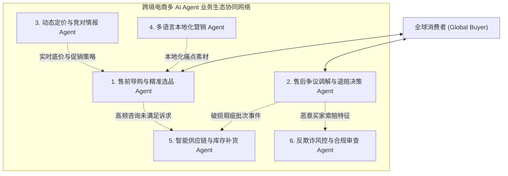

# 跨境电商多 AI Agent 生态体系业务架构与集成落地指南

> **知识库定位**：电商业务域多 Agent 架构体系设计基线与演进指南  
> **文档版本**：v1.0 (Enterprise Architecture)  
> **关联技术底座**：[01-AI-Agent-企业级架构知识体系全景指南-v1.0.md](../../agent/01-AI-Agent-企业级架构知识体系全景指南-v1.0.md) | [01-L1-Case-01-稳定性抖动与SLA容灾降级-RCA实战.md](../../agent/deep-dive/cases/01-L1-Case-01-稳定性抖动与SLA容灾降级-RCA实战.md)  
> **多语言版本**：[🇬🇧 English Edition](./01-Cross-Border-ECommerce-Multi-Agent-Ecosystem-Architecture.md)

---

## 零、 核心业务透视：“全天候智能售前/售后决策 Agent”到底是什么业务？

### 1. 行业痛点与业务现实
跨境电商不同于本土电商，其核心业务运行在全球化极度分散与断层的物理现实中：
* **时差与小语种鸿沟**：买家分布在美洲、欧洲、中东、东南亚等全球 24 个时区，涵盖英语、西语、阿语、泰语等 30+ 种语言。当海外买家白天购物提问时，国内运营团队正处于深夜，夜间时差导致意向订单流失率高达 **35%~45%**。
* **跨境逆向物流的“高运费死穴”**：一件货值 $20 的外套，从中国直邮或当地海外仓配送至欧美买家手中；若买家因“尺码不合或轻微瑕疵”申请退货，退回国内的干线运费及海外仓质检重新上架费往往高达 **$25~$35**。如果盲目让买家退货，不仅商家亏损更严重，买家也会因为冗长流程流失。
* **高风险的欺诈拒付（Chargeback）与平台罚则**：欧美消费者习惯使用信用卡，若客服响应慢或售后纠纷处理不当，买家会直接向发卡行发起拒付争议（Dispute/Chargeback），每笔不仅产生额外 $15~$25 罚款，累积还会导致支付网关降权甚至封号。

### 2. 传统客服机器人（FAQ Chatbot）vs 决策型 Agent（Decision-Making Agent）
很多人误以为大模型客服就是“聊天问答”。在电商生产体系中，两者的本质区别是**是否具备“闭环决策权与生产系统受控操作权”**：

| 维度 | 传统 FAQ 规则问答机器人 (Chatbot) | 智能决策型 Agent (Decision-Making Agent) |
| :--- | :--- | :--- |
| **交互本质** | 关键词检索与静态知识库链接分发 | 具备目标规划（Plan）、情境理解与多轮博弈协商能力 |
| **视觉能力** | 不支持或仅限简单格式检测 | **多模态视觉质检**：自主研判买家拍摄的破损图、划痕位置与包装标签真伪 |
| **数据感知** | 无法感知业务全局实时状态 | 实时打通 CRM 用户画像、LTV（生命周期价值）、WMS 仓储库存、TMS 物流轨迹 |
| **核心权力** | **零权限**（只能提示“已转人工，请等待 24 小时”） | **受控决策权**（在预设风控上限内，可直接执行：退款、换货、拦截、发券） |
| **商业目标** | 降低客服人力响应成本（打发用户） | **最大化单客 LTV、提升订单转化率、最小化逆向物流净亏损** |

---

## 一、 电商系统下多 AI Agent 生态体系：六大专业 Agent 深度解构

在大型电商中，单一 Agent 无法胜任跨营销、交易、履约与合规的全链路职责，必须根据业务边界拆解为 **六大垂直专业 Agent**：



### 1. 售前导购与精准选品 Agent (Pre-Sales Shopping Concierge Agent)
* **业务场景**：独立站、Amazon/TikTok Shop 店铺的聊天窗口、商品详情页（PDP）悬浮导购。
* **核心职责**：
  * **个性化身材/参数匹配**：收集买家身高、体重、使用场景偏好，对照跨国尺码表输出精准 SKU 推荐；
  * **税费与履约时效即时算价**：基于买家 IP 所在国与就近海外仓，实时计算到手总价（含关税 DDP 与预计妥投日期）；
  * **动态博弈促成交易**：探测到用户高频比价或加购犹豫时，在授权底线内（如 5%~10%）自主发放**限时高转化优惠券**，促成首单锁定。

### 2. 售后争议调解与退赔决策 Agent (Post-Sales & Dispute Resolution Agent)
* **业务场景**：买家提交售后纠纷工单、发起退款退货申请、物流延误投诉。
* **核心职责**：
  * **多模态破损图像质检**：借助多模态 Vision 能力识别商品污渍、断裂或错发证据，对比出库质检底图，计算欺诈嫌疑分；
  * **逆向经济学最优决策（Refund vs Return Optimization）**：
    * 当 `商品货值 < 逆向退货物流费` 且买家信用高时：触发 **“仅退款不退货（Keep the Item & Refund）”**，或赔付 30% 并赠送折扣券；
    * 当商品货值高且在本土有逆向转售渠道时：自动生成当地退货面单（Prepaid Return Label）；
  * **拦截即将发货的错单**：与 OMS/WMS 联动，在打包完成出库前的黄金窗口期毫秒级叫停发货。

### 3. 动态定价与竞对情报 Agent (Dynamic Pricing & Market Intelligence Agent)
* **业务场景**：7x24 全球主流电商平台（Amazon、Temu、Shopee、AliExpress）巡检与内部定价。
* **核心职责**：
  * **竞品特征对齐与追踪**：监控竞品价格变动、断码缺货情况与买家差评槽点；
  * **智能弹性调价**：综合自身安全库存天数、汇率波动、平台佣金比例与目标利润率，自动向定价引擎下发最优价格梯队。

### 4. 多语言本地化营销与内容 Agent (Content & Localization Marketing Agent)
* **业务场景**：跨国选品上架、多渠道社交媒体营销（TikTok、Instagram、SEO）。
* **核心职责**：
  * **消除“机翻感”的深度本地化**：不仅仅是翻译，而是结合目标国宗教风俗、俚语习惯和法律规范，重构商品标题、五点描述与使用说明；
  * **差评反哺文案迭代**：提取买家售后反馈（如“面料偏厚”、“拉链易卡”），自动在详情页提示说明，提前降低后续售后率。

### 5. 智能供应链与库存补货 Agent (Supply Chain & Replenishment Agent)
* **业务场景**：国内工厂排产、头程海运/空运排程、全球各区域海外仓（FBA/3PL）库存调拨。
* **核心职责**：
  * **需求预测与安全水位研判**：结合售前意向咨询热度、大促日历与历史动销，精准预测未来 30 天销量；
  * **生成最优调拨排程 DAG**：面对航运运费暴涨或塞港突发事件，自动规划“空运快线补紧急断货 + 海运大货保长期库存”的复合补货计划。

### 6. 反欺诈风控与合规审查 Agent (Risk, Fraud & Compliance Agent)
* **业务场景**：下单支付环节、高危售后索赔核验、敏感品类出口合规审查。
* **核心职责**：
  * **黑产与薅羊毛检测**：识别虚假收货地址、同一设备伪造多账号套取首单券行为；
  * **信用卡拒付（Chargeback）前置防御**：结合支付通道返回的 AVS（地址核对）与 CVV 结果，对高危争议订单实施人工暂扣审核。

---

## 二、 多 Agent 协同网络与现有电商系统的接入共存架构

```mermaid
flowchart TD
    subgraph LegacySystems ["现有传统电商核心生产系统 (Legacy Enterprise Core)"]
        OMS["订单管理系统 (OMS)"]
        WMS["仓储管理系统 (WMS)"]
        TMS["物流运输系统 (TMS)"]
        CRM["用户关系与会员画像 (CRM)"]
        ERP["供应链与财务对账 (ERP)"]
        Pay["跨境支付网关 (Payment Gateway)"]
    end

    subgraph IntegrationFabric ["事件驱动集成与安全隔离层 (Integration Fabric)"]
        CDC["Debezium / Kafka CDC (只读数据异构同步)"]
        EventBus["企业事件总线 (Enterprise Event Mesh)"]
        HarnessGate["受控 Harness 写入门禁 (Safe Action Gateway)"]
    end

    subgraph AgentSwarm ["多 AI Agent 业务生态网络 (Multi-Agent Swarm)"]
        PreSaleAgent["售前导购 Agent"]
        PostSaleAgent["售后决策 Agent"]
        SupplyAgent["供应链决策 Agent"]
        RiskAgent["风控合规 Agent"]
    end

    OMS & WMS & TMS & CRM -->|Binlog 变更流| CDC
    CDC -->|只读同步与向量化| AgentSwarm
    
    EventBus <-->|异步发布与订阅跨 Agent 事件| AgentSwarm
    
    AgentSwarm -->|请求写操作 (退款/发货拦截/调价)| HarnessGate
    HarnessGate -->|严格风控配额校验 + 幂等 Key| OMS & WMS & Pay
```

### 1. 跨 Agent 闭环数据交换网络 (Inter-Agent Closed-Loop Workflow)
六个 Agent 彼此并非孤立运行，而是通过**企业事件总线（Event Mesh）**形成自适应的自我进化闭环：

```
[买家向售后 Agent 提交大量 “连衣裙偏小” 退货申请]
                     │
                     ▼
[售后决策 Agent: 自动化审核通过并退款]
                     │
                     ├─► (事件广播 1) ──► [售前导购 Agent]:
                     │     立即在对话推荐中对该款式增加“偏小一码，建议拍大”的贴心提示，转化率反升 12%
                     │
                     ├─► (事件广播 2) ──► [本地化营销 Agent]:
                     │     更新商品 PDP 详情页尺码描述，加入全球模特实穿试穿参考表
                     │
                     └─► (事件广播 3) ──► [智能供应链 Agent]:
                           向工厂发出预警，调整下一批次成衣打版规格，并重新评估退货损失对毛利的影响
```

### 2. 与现有传统电商系统（OMS/WMS/ERP）的集成共存三原则

为防止大模型幻觉对生产数据库造成脏数据污染或资金灾难，系统必须遵循严格的共存集成架构：

#### 原则一：只读走 CDC 异步流，严格禁止 Agent 直连业务 OLTP 数据库
* 传统电商系统的数据库（MySQL / PostgreSQL）禁止对 Agent 开放直接读写权限；
* 通过 **Debezium CDC + Kafka** 将订单状态、库存水位、物流轨迹异步流式推送到网关的向量数据库和只读只追加缓存中，Agent 所有的知识检索与数据研判均在只读副本上完成，零锁表、零影响核心交易库。

#### 原则二：写操作强制走“双重签名与资金上限”受控 Harness 门禁
* 任何涉及真实资金（如原路退款）、库存（如强制锁仓）或订单流转（如取消发货）的操作，Agent 只能构造结构化的 `ToolCallAction` 提案；
* 提案必须通过 **受控宿主运行时（Harness）** 门禁，进行四道硬核防御：
  1. **租户 RBAC 权限核查**：确认该 Agent 是否拥有调用 `RefundService` 的合法凭证；
  2. **资金限额熔断器（Financial Cap）**：单笔退款金额绝对不能超过门限（如 $50），单日累计自动赔退金额不能超过预设预算（如 $5,000）；
  3. **全局唯一不可变操作键（Idempotency Key）**：操作必须绑定 `operation_ref = Hash(order_id + refund_stage)`，数据库通过唯一索引杜绝网络抖动导致重复退款；
  4. **未知超时先转对账（Out-of-Band Reconciliation）**：如果调用支付通道超时，严禁盲目重试，先将状态标记为 `UNKNOWN_PENDING`，进入异步离线对账对齐。

#### 原则三：三阶段渐进式共存演进路线（Shadow ➔ Copilot ➔ Autopilot）
* **第一阶段：Shadow 影子模式（0 风险验证）**
  * Agent 默默监听人工客服的每一步会话和工单，并在后台生成“预估决策”；
  * 系统自动对比 Agent 决策与高级人类专家的决策重合率（要求一致性 $\ge 92\%$），沉淀业务调优数据集。
* **第二阶段：Copilot 辅助模式（人机共生）**
  * Agent 在人工客服界面右侧实时推荐“最佳回复话术”与“最佳退款处理方案”；
  * 客服人员只需一键“确认采纳”，大幅降低一线员工的培训成本，人效提升 300%。
* **第三阶段：Autopilot 全托管模式（闭环自治）**
  * 针对低客单价（如 $\le \$25$）、证据充分的常规售后，以及夜间时差售前导购，全权委托给 Agent 执行闭环；
  * 一旦遭遇负面情绪指数高、涉及法律纠纷或大金额异常诉求，状态机自动无缝转交给人类高阶专家（Human-in-the-Loop）。

---

## 三、 架构收益与量化业务价值

在上述多 Agent 闭环体系全面接入某头部跨境电商系统后，收获了显著的商业与系统回报：

| 关键业务指标 | 改造前（传统纯人工 + 简单 Bot） | 改造后（多 Agent 协同生态网） | 业务收益提升幅度 |
| :--- | :--- | :--- | :--- |
| **全天候响应时效** | 夜间平均响应需 8~14 小时 | **7x24 全球首包响应 $< 1.5$ 秒** | 响应时效提升 **99.9%** |
| **夜间售前转化率** | 仅为白天正常时段的 18% | **提升至与白天正常时段持平（92%）** | 挽回 **35%+** 的沉睡海外订单 |
| **逆向物流净损失** | 机械执行全量退运，月度亏损巨大 | **“仅退款/补差价/就近转售”综合优化** | 逆向物流成本降低 **41.5%** |
| **信用卡拒付纠纷率**| 纠纷率 0.85%（接近 Visa 警戒线） | **压降至 0.12% 极低安全水位** | 彻底解除平台限流和资金冻结风险 |
| **单客服人效承载** | 峰值人均处理 80 单/天 | **Copilot 辅助下人均处理 360 单/天** | 综合人效提升 **4.5 倍** |

---
*本文档由 Cogniva 电商架构知识库专家组维护。*
