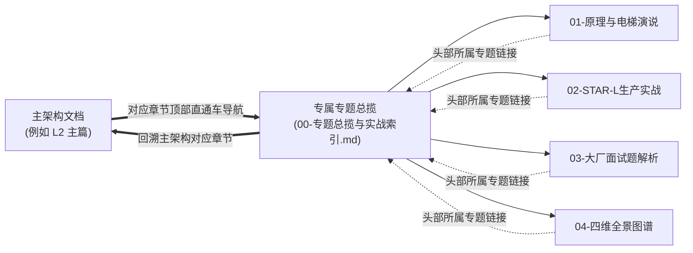

# Cogniva 架构知识库提示词工程与 Meta-Prompt 指南

> **定位**：Cogniva 企业级 AI Agent 架构知识库的元提示词（Meta-Prompt）资产库与标准化沉淀工场。  
> **核心哲学**：深入而非变大（Deeper, Not Wider）。坚决拒绝玩具级 Demo 与浅尝辄止的概念堆砌，驱动大模型以顶尖分布式系统架构师（P8+/Staff Engineer）水准，输出具备操作系统本质透视、真实工业血泪实战、大厂面试硬核对抗与四维全景图谱的工业级资产。

---

## 一、 Meta-Prompt 资产矩阵全景

当前 Prompt 知识库包含两大互补的核心元提示模板，分别覆盖“**宏观分层架构全景（Macro Layer-Level）**”与“**微观核心机制专题（Micro Topic-Level）**”：

| Prompt 编号与文件 | 适用层级与颗粒度 | 核心产出目标 | 存储与落地规范 |
| :--- | :--- | :--- | :--- |
| [01-AI-Agent-分层架构深度解构Prompt模板.md](./01-AI-Agent-%E5%88%86%E5%B1%82%E6%9E%B6%E6%9E%84%E6%B7%B1%E5%BA%A6%E8%A7%A3%E6%9E%84Prompt%E6%A8%A1%E6%9D%BF.md) | **宏观分层篇章级 (Layer-Level)**<br>(针对 L1~L7 任一整层架构) | 产出万字级该分层的全景深度解构：包含 1 分钟高阶自述、顶尖专家思维映射四维度、四大核心子系统架构解构（Mermaid/Schema/状态机）、生产落地自查清单。 | 落地在 `doc/kb/agent/deep-dive/` 根目录下，如 `03-AI-Agent-L2-受控宿主运行时Harness与执行控制环深度架构与实战全景.md` |
| [02-AI-Agent-核心文本深度消化与工业级五维沉淀Meta-Prompt.md](./02-AI-Agent-%E6%A0%B8%E5%BF%83%E6%96%87%E6%9C%AC%E6%B7%B1%E5%BA%A6%E6%B6%88%E5%8C%96%E4%B8%8E%E5%B7%A5%E4%B8%9A%E7%BA%A7%E4%BA%94%E7%BB%B4%E6%B2%89%E6%B7%80Meta-Prompt.md) | **微观核心机制级 (Topic-Level)**<br>(针对某层下的 1~3 句硬核概念片段) | 产出工业级五维闭环矩阵：<br>1. 核心概念透析与 30s 商业/技术电梯演说<br>2. 结合真实业务的 STAR-L 生产实战案例<br>3. 大厂权威连环必杀面试题与反客为主话术<br>4. 四维立体全景知识图谱<br>5. 独立专题总揽与双向穿透索引 | 严禁在根目录平铺！必须为该 Topic 创建**独立专属专题文件夹**：`doc/kb/agent/deep-dive/topics/[xx-topic-slug]/` |

---

## 二、 Topic-Level 专题独立文件夹规划标准

在使用 `02-AI-Agent-核心文本深度消化与工业级五维沉淀Meta-Prompt.md` 时，必须严格遵循以下目录规划标准，杜绝任何将所有文件散落在 `topics/` 或根目录的混乱行为：

```
doc/kb/agent/deep-dive/
│
├── 03-AI-Agent-L2-受控宿主运行时Harness与执行控制环深度架构与实战全景.md (主架构篇)
│
└── topics/
    ├── 01-lifecycle-hooks/                            # 【Topic 1 专属独立目录】
    │   ├── 00-专题总揽与实战索引.md                     # 专题入口与双向导航中枢
    │   ├── 01-内核级控制环原理与电梯演说.md               # 原理深析 + 30s 电梯 Pitch
    │   ├── 02-跨境电商售后争议退赔Agent-控制环与防重对账-STAR-L实战.md # STAR-L 实战复盘
    │   ├── 03-大厂权威面试题与硬核解答全集.md              # 面试题全集与反问话术
    │   └── 04-受控宿主运行时-四维全景知识图谱.md          # 四维全景图谱
    │
    └── 02-quota-reservation/                          # 【Topic 2 专属独立目录】
        ├── 00-专题总揽与实战索引.md                     # 专题入口与双向导航中枢
        ├── 01-算力原子预算预占与死循环硬熔断原理与电梯演说.md
        ├── 02-跨境电商售前导购Agent-算力死循环与预算预占-STAR-L实战.md
        ├── 03-大厂权威面试题与硬核解答.md
        └── 04-四维全景知识图谱.md
```

---

## 三、 双向穿透超链接规范 (Bi-directional Navigation Contract)

为了确保架构文档“可索引、可溯源、网状打通”，所有落盘文件必须满足以下链接契约：



1. **主架构篇 $\to$ 专题文件夹**：
   在主篇对应章节（如 `5.1`、`5.2`）标题正下方，必须设立 `> 💡 专项深度解构与面试实战直通车` 引用块，分别链接到该专题目录下的 `00` 总揽和 `01~04` 具体文档。
2. **各子文档 $\to$ 专题总揽 & 主架构篇**：
   子文档头部元数据中，必须同时标明所属的专题总揽路径（`./00-专题总揽与实战索引.md`）以及回溯主架构对应锚点的相对路径（`../../03-AI-Agent-L2-...#5.x`）。
3. **跨专题环形互链**：
   专题总揽文件尾部，必须显式提供“前序机制”与“后序机制”的导航链接，串联起完整的认知链条。

---

## 四、 核心约束与代码纯粹性铁律

1. **架构纯粹性（No Long Business Code）**：
   架构文档的使命是阐明设计哲学、边界契约与系统级防线。**严禁在文档中粘贴数十行或数百行具体的 Python/Java 业务应用实现代码**。
2. **标准表达语法**：
   * 复杂流程与状态流转：一律使用 **Mermaid 状态机图（stateDiagram-v2）、时序图（sequenceDiagram）、拓扑图（graph TD）**；
   * 接口与参数契约：一律使用 **JSON Schema / YAML 契约规范**；
   * 资源消耗与并发算法：一律使用 **标准 LaTeX 数学公式与 CAS 原语说明**；
   * 方案权衡与指标检验：一律使用 **Markdown 对比表格与客观自查清单**。
